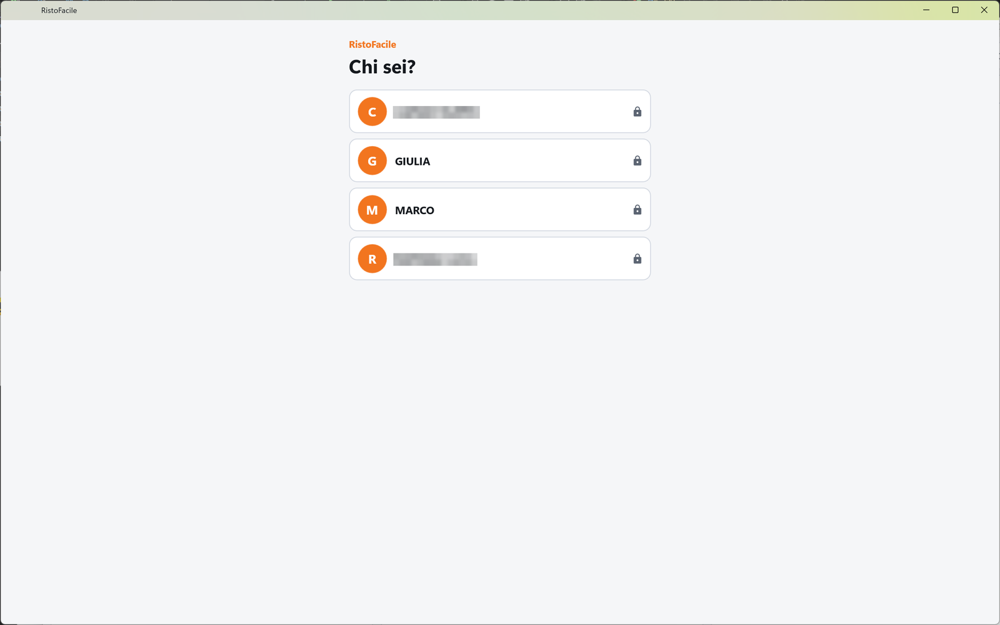
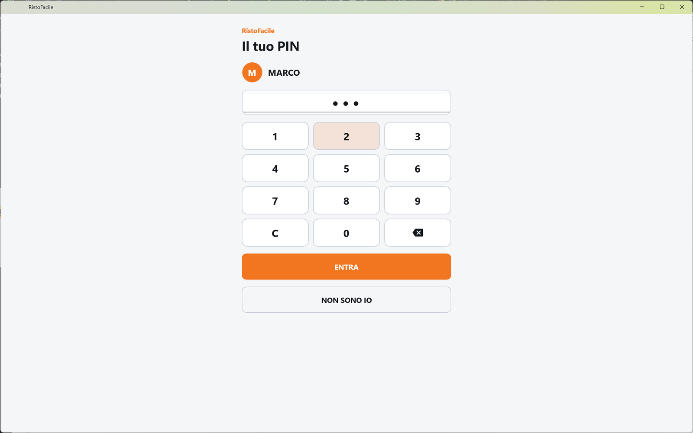

# Accesso operatore

È la porta d'ingresso della cassa: chi lavora sceglie il proprio nome e, se ha un PIN, lo digita.
Da quel momento la cassa sa chi sta battendo le comande. La usano tutti: cassieri, camerieri,
titolare.

!!! info "In sintesi"

    - **Dove si trova:** si apre da sola all'avvio della cassa, se nessuno è entrato; ricompare dopo l'uscita dal turno
    - **Chi la usa:** cassiere / cameriere / titolare
    - **Disponibile anche su:** Palmare ([Accesso](../palmare/accesso.md))

---

## A cosa serve

Ogni comanda porta il nome di chi l'ha battuta, e le operazioni delicate (stornare, offrire, chiudere
un conto senza scontrino, liberare un tavolo) dipendono dai permessi del singolo operatore. Per
questo, prima di entrare nella cassa, si dice chi si è.

Esempio: a fine turno Marco tocca il proprio nome in Comanda ed esce; Giulia, che prende il suo
posto, tocca **GIULIA**, digita il suo PIN e tocca **ENTRA**. Da qui in avanti le comande sono
firmate da lei.

La cassa ricorda chi è entrato: se l'app viene chiusa e riaperta, si riparte direttamente con lo
stesso operatore, senza ripassare da questa schermata, finché qualcuno non esce dal turno.

## Prima di cominciare

- Il servizio RistoFacile deve essere configurato (indirizzo, utente e password): se non lo è, la
  cassa salta questa schermata e apre direttamente le [Impostazioni](impostazioni.md).
- Deve esistere almeno un operatore attivo, creato in [Operatori](operatori.md). Il PIN è quello
  impostato nella sua scheda.
  <!-- DA VERIFICARE: su un'installazione nuova, senza nessun operatore attivo, da questa schermata non si entra e non c'e' un pulsante per andare avanti. Come si crea il primo operatore (dal gestionale Facile? da un'altra cassa?) -->

## La schermata

La schermata è una colonna stretta al centro, e lavora in due tempi.

- **Primo tempo - il nome.** In alto la scritta arancione **RistoFacile** e il titolo **Chi sei?**.
  Sotto, una tessera per ogni operatore attivo, in ordine alfabetico: l'iniziale in un cerchio
  arancione e il nome. Il lucchetto a destra indica che quell'operatore ha un PIN.
- **Secondo tempo - il PIN.** Dopo aver toccato un nome con il lucchetto, il titolo diventa
  **Il tuo PIN**: compaiono l'iniziale e il nome scelto, la casella del PIN, il tastierino e i
  pulsanti **ENTRA** e **NON SONO IO**.

Gli errori compaiono in un riquadro rosso sotto il titolo e restano a schermo finché non tocchi
qualcos'altro. Durante la lettura dell'elenco o la verifica del PIN gira un indicatore di attesa
in fondo.

## Campi e indicatori

| Elemento | Descrizione |
|---|---|
| **Tessera dell'operatore** | Iniziale e nome con cui l'operatore compare in cassa. Toccala per scegliere il nome. |
| **Lucchetto** | Compare solo sugli operatori che hanno un PIN: il tocco apre il tastierino. Senza lucchetto il tocco fa entrare subito. |
| **Casella del PIN** | Mostra un pallino per ogni cifra, mai le cifre. Al massimo 8 cifre; accetta solo numeri. Sulla cassa Windows il PIN si può scrivere anche con la tastiera del PC: la casella prende il cursore da sola appena scegli il nome, e il tasto Invio vale come **ENTRA**. |
| **Tastierino** | Tasti da **0** a **9**; **C** svuota la casella; il tasto con la freccia cancella l'ultima cifra. |

## Pulsanti e comandi

| Comando | Effetto |
|---|---|
| **ENTRA** | Verifica il PIN e, se è giusto, apre la cassa sulla [Mappa della sala](mappa-sala.md). Resta spento finché non hai digitato almeno una cifra. |
| **NON SONO IO** | Torna all'elenco dei nomi, cancellando il PIN digitato. Sui dispositivi Android fa lo stesso il tasto Indietro; nell'elenco dei nomi il tasto Indietro non fa nulla. |
| **RIPROVA** | Compare solo se l'elenco degli operatori non si è potuto leggere: rilegge l'elenco. |
| **IMPOSTAZIONI BACKEND** | Compare solo se l'elenco degli operatori non si è potuto leggere: apre le [Impostazioni](impostazioni.md) per controllare il collegamento al servizio. |

## Come si fa

### Entrare con il PIN

1. Tocca la tessera con il tuo nome.
2. Digita il PIN con il tastierino (o con la tastiera del PC).
3. Tocca **ENTRA**. Si apre la Mappa della sala, e il tuo nome compare in alto a destra nella Comanda.

### Entrare senza PIN

1. Tocca la tessera con il tuo nome (senza lucchetto). Si apre subito la Mappa della sala.

### Cedere la cassa a un collega

1. In [Comanda](comanda.md) tocca il riquadro **OPERATORE** in alto a destra (dice **ESCI**),
   oppure vai in Impostazioni ▸ Turno e tocca **Esci dal turno**.
2. Conferma con **Esci**. Ricompare questa schermata, pronta per il collega.

## Controlli e messaggi

| Messaggio | Causa | Cosa fare |
|---|---|---|
| *PIN errato.* | Il PIN digitato non corrisponde a quello dell'operatore. | Ridigita il PIN. Se l'hai dimenticato, fattelo reimpostare da chi gestisce gli [Operatori](operatori.md). |
| *Operatore non piu' attivo. Chiedi a chi gestisce l'anagrafica.* | L'operatore è stato disattivato mentre la schermata era aperta. | Fai riattivare l'operatore in [Operatori](operatori.md). |
| *Digita il PIN.* | È stato premuto Invio con la casella vuota. | Digita il PIN. |
| *Accesso non riuscito.* (seguito dal dettaglio) | Il servizio non ha risposto alla verifica. | Riprova; se persiste, controlla il collegamento al servizio. |
| *Nessun operatore attivo in anagrafica. Creane uno dalla cassa (Impostazioni - Operatori) prima di poter entrare.* | Non c'è nessun operatore attivo. | Crea o riattiva un operatore. <!-- DA VERIFICARE: vedi "Prima di cominciare", da qui non si raggiunge la schermata Operatori. --> |
| *Impossibile leggere gli operatori dal server. Controlla la connessione e le impostazioni del backend.* (seguito dal dettaglio) | Il servizio non risponde o i dati di collegamento sono sbagliati. | Tocca **RIPROVA**; se non basta, **IMPOSTAZIONI BACKEND**. |
| *Il backend risponde ma non conosce l'accesso operatori: va aggiornato a una versione che espone api/v1/risto/accesso. Fino ad allora da qui non si entra.* | Il servizio installato è più vecchio della cassa. | Fai aggiornare il servizio RistoFacile. |

## Note

- L'elenco mostra solo gli operatori attivi. Chi viene disattivato sparisce dall'elenco al
  prossimo caricamento.
- Il PIN non lascia mai la cassa in chiaro a schermo: si vedono solo pallini.
- Il nome scelto qui firma le righe battute da questo dispositivo e compare sui foglietti della
  cucina e sul preconto.

## Vedi anche

- [Operatori](operatori.md)
- [Impostazioni](impostazioni.md)
- [Mappa della sala](mappa-sala.md)
- [Accesso sul palmare](../palmare/accesso.md)
