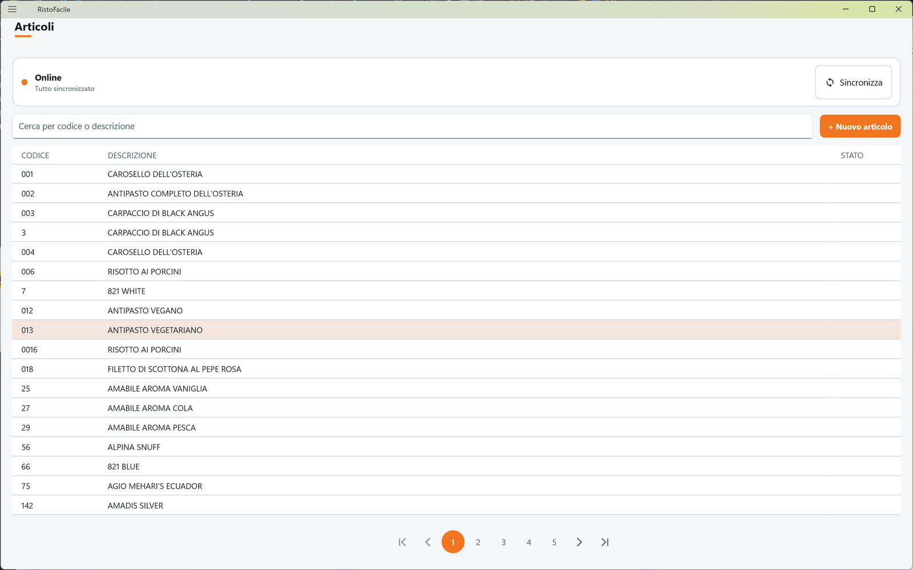
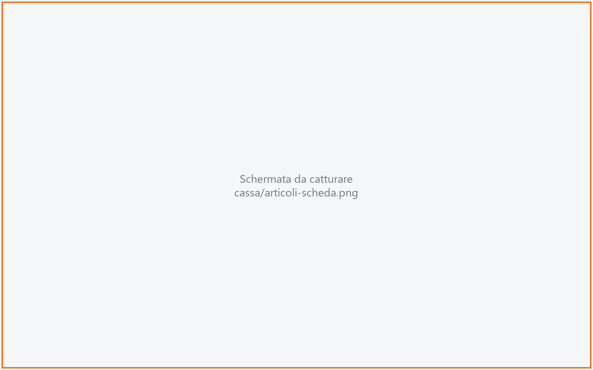
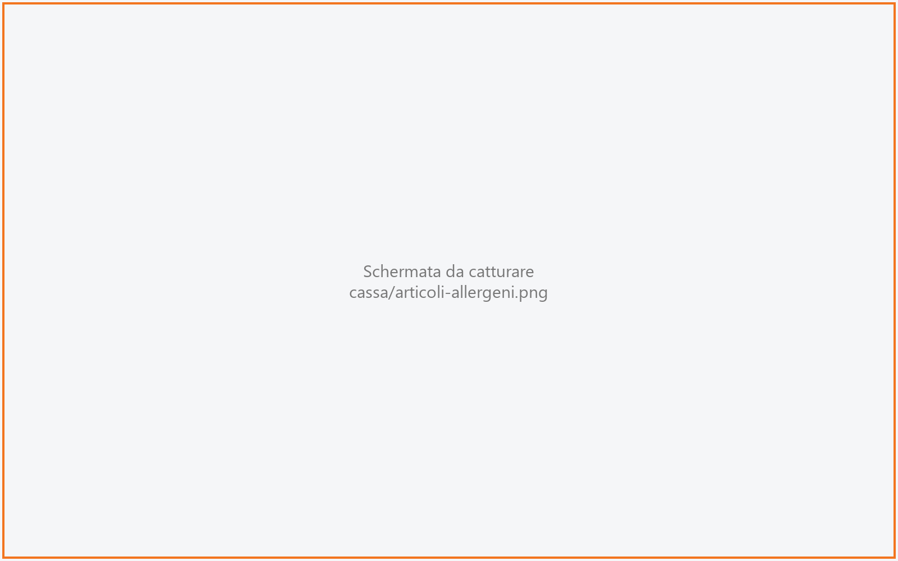
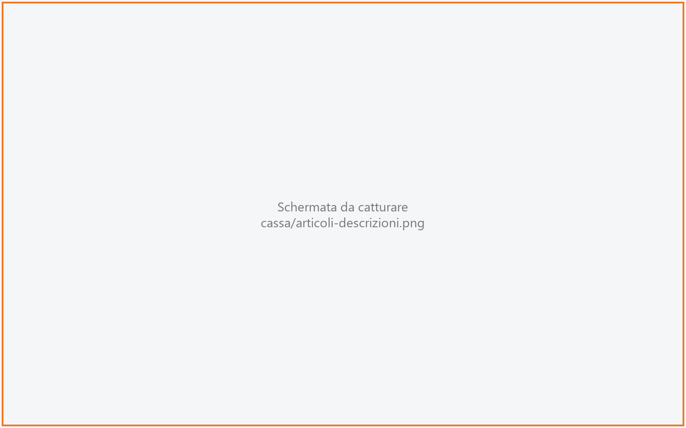

# Articoli

Qui si crea e si modifica l'anagrafica degli articoli: tutto ciò che si vende, dal caffè alla
bistecca a peso. Ogni articolo ha descrizione, prezzo, aliquota IVA, reparto e categoria, e può
avere un'immagine, gli allergeni e le descrizioni in altre lingue. La schermata funziona anche
quando la cassa non è collegata: le modifiche restano sul dispositivo e partono appena il
collegamento torna. La usa il titolare o il responsabile.

!!! info "In sintesi"

    - **Dove si trova:** Menu ▸ Articoli
    - **Chi la usa:** titolare / responsabile
    - **Disponibile anche su:** solo cassa

---

## A cosa serve

L'anagrafica articoli è la base di tutto il resto: per vendere un piatto al tavolo lo si mette in
una sezione del [Menu](menu.md); per venderlo al banco basta che sia in una categoria vendibile al
banco. Il prezzo che si scrive qui è quello di un **listino**: la sala del tavolo decide quale
listino si usa (vedi [Sale e tavoli](sale-e-tavoli.md)).

Esempio: il titolare aggiunge la «Tagliata di manzo» venduta a peso, prezzo 45 € al chilo, IVA 10%,
reparto CUCINA, categoria SECONDI, e le segna gli allergeni. In Comanda, toccandola, il cameriere
scrive il peso e la riga si calcola da sola.

## Prima di cominciare

- Le aliquote IVA, i reparti e le categorie in [Tabelle di base](tabelle-di-base.md) (si possono
  anche creare al volo dalla scheda dell'articolo).
- Per gli allergeni: l'elenco degli allergeni caricato sull'impianto.
- Per le traduzioni: l'elenco delle nazioni caricato dal gestionale Facile.

## La schermata

### L'elenco degli articoli

- **In alto, la fascia di stato**: un pallino (verde **Online**, giallo **Offline**), sotto il numero
  di modifiche non ancora inviate («Tutto sincronizzato», «1 modifica in attesa», «3 modifiche in
  attesa») e l'esito dell'ultima sincronizzazione. A destra il pulsante **Sincronizza**, la cui
  icona gira mentre la sincronizzazione è in corso.
- **Sotto**, la casella **Cerca per codice o descrizione** e il pulsante **+ Nuovo articolo**.
- **Al centro, la griglia** con le colonne **CODICE**, **DESCRIZIONE** e **STATO**; nella colonna
  **STATO** compare **In attesa** per gli articoli modificati e non ancora inviati. Gli articoli sono
  in ordine di codice (i codici numerici in ordine di valore: 9 prima di 100); con una ricerca, in
  ordine di pertinenza (prima il codice uguale, poi i codici che cominciano così, poi le
  descrizioni).
- **In fondo**, i numeri di pagina. La griglia non scorre: ogni pagina contiene le righe che entrano
  nello schermo.

Se non c'è nulla compare *Nessun articolo in cache* (o *Nessun articolo per «…»* durante una
ricerca) con «Modifica la ricerca oppure aggiungi un nuovo articolo.».

Toccando una riga si apre la scheda dell'articolo.

### La scheda dell'articolo

Ha per titolo il codice dell'articolo (**Nuovo articolo** per uno nuovo, **Copia di …** per una
copia) ed è su tre colonne:

- a sinistra **Dati articolo** e **Prezzo**;
- al centro **Classificazione** (IVA, reparto, categoria) e **Vendita al banco**;
- a destra **Informazioni al cliente**: immagine, allergeni, descrizioni in altre lingue.

In fondo: **Elimina articolo** e **Duplica** a sinistra, **Annulla** e **Salva** a destra.

## Campi e indicatori

**Dati articolo**

| Elemento | Descrizione |
|---|---|
| **Codice articolo \*** | Obbligatorio. Si scrive solo alla creazione; poi non si cambia più. Mentre scrivi la cassa controlla che non sia già usato: se lo è compare in rosso *Codice non disponibile: «…» esiste gia' in anagrafica.* e **Salva** resta spento. |
| **Descrizione \*** | Obbligatoria. Il nome dell'articolo, in maiuscolo. |
| **Descrizione 2** | Facoltativa, in maiuscolo. |

**Prezzo**

| Elemento | Descrizione |
|---|---|
| **Listino** | Il listino del prezzo mostrato sotto. Si propone il listino 1; toccandolo si apre la finestra **Scegli listino** e il prezzo si ricarica per il listino scelto. |
| **Venduto a peso** | «Bistecche, pesce: in comanda si digita il peso.» |
| **Prezzo** / **Prezzo al chilo** | Il prezzo nel listino scelto, a porzione oppure al chilo se l'articolo è venduto a peso. Sotto, la nota «Prezzo della porzione nel listino scelto.» oppure «In comanda si digita il peso in grammi e il totale della riga si calcola da qui.». Su un articolo nuovo compare «Il prezzo si scrive dopo il primo salvataggio.» <!-- DA VERIFICARE: la scritta dice di scrivere il prezzo dopo il primo salvataggio, ma il campo è già modificabile e il codice salva il prezzo anche al primo salvataggio. Quale delle due è voluta? --> |

**Classificazione**

| Elemento | Descrizione |
|---|---|
| **IVA** | L'aliquota IVA. Decide anche su quale reparto della stampante fiscale esce la riga dello scontrino. |
| **Reparto** | Il reparto dell'articolo. |
| **Cat. Merceologica** | La categoria merceologica (es. PRIMI, VINI): decide le statistiche e se l'articolo si vende al banco. |

Per un articolo nuovo IVA, reparto e categoria si propongono uguali a quelli dell'ultimo articolo
salvato su questa cassa. Accanto a ciascuno c'è il pulsante **+** per creare una voce nuova senza
lasciare la scheda (finestre **Nuova aliquota IVA**, **Nuovo reparto**, **Nuova merceologica**).

**Vendita al banco**

| Elemento | Descrizione |
|---|---|
| **Posizione in PREFERITI** | Il posto dell'articolo nella tessera PREFERITI della [Vendita al banco](vendita-al-banco.md). Vuoto: l'articolo non c'è. |
| **Posizione in IN EVIDENZA** | Il posto nella tessera IN EVIDENZA. Vuoto: l'articolo non c'è. |

**Informazioni al cliente** — su un articolo nuovo è spenta, con la scritta «Bisogna salvare
prima: allergeni e traduzioni si agganciano al codice dell'articolo.»

| Elemento | Descrizione |
|---|---|
| **Immagine** | L'anteprima della foto, oppure *Nessuna immagine per questo articolo.* Massimo 5 MB. |
| **Allergeni** | Apre la pagina degli allergeni. |
| **Descrizioni in altre lingue** | Apre la pagina delle traduzioni. |

**Finestra «Nuova aliquota IVA» / «Nuovo reparto» / «Nuova merceologica»**

| Elemento | Descrizione |
|---|---|
| **Descrizione \*** | Obbligatoria. |
| **Aliquota %** | Solo per l'IVA, da 0 a 100. |
| **Reparto cassa (1-9) \*** | Solo per l'IVA. «E' il reparto del registratore telematico su cui esce la riga di scontrino.» |

Il codice della nuova voce è il primo libero; la voce creata risulta subito scelta nella scheda.

**Pagina degli allergeni** — titolo: la descrizione dell'articolo

| Elemento | Descrizione |
|---|---|
| **Allergeni (Reg. UE 1169/2011)** | Una tessera per allergene. «Tocca un allergene per cambiarne lo stato: non contiene -> contiene -> tracce.» Sotto il nome la tessera dice sempre lo stato: **non contiene**, **contiene** (arancione) o **tracce** (ambra). |
| Conteggio e riepilogo | Quanti allergeni ci sono in elenco (es. «14 allergeni in elenco») e il riassunto: «Contiene: …  ·  Tracce di: …» oppure «Nessun allergene segnalato per questo articolo.» |

**Pagina delle descrizioni in altre lingue** — titolo: la descrizione dell'articolo

| Elemento | Descrizione |
|---|---|
| Lingua | Una scheda per lingua, intestata con codice e nome della nazione (es. «EN — INGHILTERRA»), con il pulsante **Rimuovi**. «L'italiano non si mette qui: resta la descrizione dell'anagrafica articolo.» |
| **Descrizione** | La descrizione nella lingua scelta. |
| **Descrizione 2** | Facoltativa. |

## Pulsanti e comandi

| Comando | Effetto |
|---|---|
| **Sincronizza** | Invia al servizio le modifiche in attesa e rilegge l'elenco. |
| **+ Nuovo articolo** | Apre una scheda vuota. |
| **Salva** | Salva l'articolo (e il prezzo, se è cambiato). È spento finché manca la descrizione o, su un articolo nuovo, il codice o se il codice è già usato. Su un articolo nuovo la scheda resta aperta e si sbloccano immagine, allergeni e traduzioni; su uno esistente si torna all'elenco. |
| **Annulla** | Torna all'elenco senza salvare. |
| **Duplica** | Apre una scheda nuova (**Copia di …**) con i dati dell'articolo; scrivi il nuovo codice e salva. Al salvataggio vengono copiati anche prezzo, immagine, allergeni e traduzioni. |
| **Elimina articolo** | Elimina l'articolo, dopo conferma. |
| **+** accanto a IVA, Reparto, Cat. Merceologica | Apre la finestra per creare la voce al volo; **Crea** la salva, **Annulla** chiude. |
| **Scegli immagine** / **Rimuovi** | Carica una foto dal dispositivo / toglie la foto (dopo conferma). L'immagine si salva subito, senza **Salva**. |
| Tocco su un allergene | Ne cambia lo stato. **Salva** registra e torna alla scheda; **Annulla** torna senza registrare. |
| **+ Aggiungi lingua** | Apre la scelta della lingua (finestra **Scegli la lingua**). Le lingue già presenti e l'italiano non si possono scegliere. |
| **Rimuovi** (lingua) | Toglie la lingua; la cancellazione avviene con **Salva**. |

### Le finestre di scelta

Toccando le caselle **IVA**, **Reparto** e **Cat. Merceologica** si apre una pagina di scelta (**Scegli
IVA**, **Scegli reparto**, **Scegli merceologica**) con la casella **Cerca per codice o
descrizione** e l'elenco delle voci. Tocca una voce per sceglierla. La **matita** accanto a una voce
apre la sua scheda in [Tabelle di base](tabelle-di-base.md) senza sceglierla: corretta la voce e
tornati indietro, l'elenco è già aggiornato. L'elenco mostra al massimo 200 voci (*Mostrate le
prime 200: scrivi per restringere.*).

Altre schermate usano due finestre di ricerca a griglia, che funzionano allo stesso modo:

- **Cerca articolo** (da [Disponibilità](disponibilita.md), [Varianti](varianti-anagrafica.md) e
  [Impostazioni](impostazioni.md)): casella **Descrizione o codice articolo**, colonne **CODICE**,
  **DESCRIZIONE**, **PREZZO** (prezzo del listino di default della ditta; vuoto se l'articolo non ha
  prezzo in quel listino). Tocca la riga per scegliere l'articolo; **Annulla** chiude.
- **Scegli merceologica** (da [Regole di composizione](regole-di-composizione.md)): casella
  **Descrizione o codice merceologica**, colonne **DESCRIZIONE** e **CODICE**.

La finestra **Scegli listino** è descritta in [Sale e tavoli](sale-e-tavoli.md).

## Come si fa

### Aggiungere un articolo

1. Tocca **+ Nuovo articolo**.
2. Scrivi **Codice articolo \*** e **Descrizione \***.
3. Controlla **IVA**, **Reparto** e **Cat. Merceologica** (sono proposti quelli dell'ultimo articolo).
4. Scrivi il **Prezzo**.
5. Tocca **Salva**. La scheda resta aperta e si accende la colonna **Informazioni al cliente**.
6. Se serve, aggiungi immagine, allergeni e traduzioni.
7. Torna indietro. L'articolo è nell'elenco; per venderlo al tavolo aggiungilo a una sezione del
   [Menu](menu.md).

### Cambiare il prezzo in un listino diverso

1. Tocca l'articolo nell'elenco.
2. Tocca la casella **Listino** e scegli il listino.
3. Il prezzo si ricarica: scrivi il nuovo prezzo.
4. Tocca **Salva**.

### Segnare gli allergeni

1. Apri l'articolo e tocca **Allergeni**.
2. Tocca ogni allergene finché non mostra lo stato giusto (**contiene** o **tracce**).
3. Controlla il riepilogo in alto.
4. Tocca **Salva**. Si torna alla scheda.

### Lavorare senza collegamento

1. Modifica o aggiungi gli articoli come al solito e tocca **Salva**.
2. Compare *Salvato in locale. Verra' sincronizzato quando torna la connessione.*; nell'elenco la
   riga mostra **In attesa** e la fascia in alto conta le modifiche in attesa.
3. Quando la rete torna la sincronizzazione parte da sola; puoi anche toccare **Sincronizza**.
4. A sincronizzazione riuscita la fascia dice «Tutto sincronizzato».

## Controlli e messaggi

| Messaggio | Causa | Cosa fare |
|---|---|---|
| *Il codice articolo e' obbligatorio.* | Articolo nuovo senza codice. | Scrivi il codice. |
| *La descrizione e' obbligatoria.* | Descrizione vuota. | Scrivi la descrizione. |
| *Codice non disponibile: «…» e' gia' usato da un altro articolo. Scegline un altro.* | Il codice è stato preso nel frattempo (anche da un'altra postazione). | Scegli un altro codice. |
| *Offline: la disponibilita' del codice e' verificata solo sulla cache locale.* | Senza rete la cassa controlla il codice solo fra gli articoli che ha sul dispositivo. | Verifica il codice appena torna la rete. |
| *Salvato in locale. Verra' sincronizzato quando torna la connessione.* | Salvataggio senza rete. | Nessuna azione: partirà da solo. |
| *Salvato in locale, ma la sincronizzazione e' fallita: …* / *Prezzo salvato in locale, ma la sincronizzazione e' fallita: …* | Il servizio ha rifiutato l'articolo o il prezzo, o non risponde. | Leggi il motivo, correggi e tocca **Sincronizza**. |
| **Elimina articolo** — *Eliminare l'articolo "…"?* (senza rete: *… Verra' applicato appena torna la connessione.*) | Hai toccato **Elimina articolo**. | **Elimina** o **Annulla**. |
| *Eliminazione salvata in locale. Verra' applicata quando torna la connessione.* | Eliminazione senza rete. | Nessuna azione. |
| *Eliminazione non riuscita: …* | Il servizio ha rifiutato l'eliminazione. | Leggi il motivo. |
| *Niente da sincronizzare.* / *Sincronizzati N articoli.* / *Sincronizzati N, falliti M.* | Esito di **Sincronizza** (nella fascia in alto). | Se ci sono falliti, compare anche l'errore con l'elenco. |
| *Alcuni articoli non sono stati sincronizzati: …* | Una parte delle modifiche è stata rifiutata. | Correggi gli articoli indicati e risincronizza. |
| *Salva prima l'articolo: …* (gli allergeni / le traduzioni / l'immagine si agganciano al suo codice; si duplica una scheda che esiste) | Azione su un articolo non ancora salvato. | Tocca **Salva**. |
| *Articolo duplicato, ma non e' stato possibile copiare: … Il resto c'e'.* | Immagine, allergeni o traduzioni non copiati. | Aggiungili a mano sulla copia. |
| *L'articolo da duplicare non esiste piu'.* / *Articolo non trovato.* | L'articolo è stato eliminato nel frattempo. | Torna all'elenco. |
| *Immagine troppo grande (… MB): il limite e' 5 MB.* | Foto oltre 5 MB. | Riduci la foto. |
| **Rimuovi immagine** — *Togliere l'immagine dall'articolo "…"?* | Hai toccato **Rimuovi**. | **Rimuovi** o **Annulla**. |
| *L'aliquota dev'essere una percentuale fra 0 e 100.* | Finestra **Nuova aliquota IVA**. | Correggi l'aliquota. |
| *Il reparto cassa dev'essere un numero da 1 a 9: e' il reparto del registratore su cui esce la riga di scontrino.* | Finestra **Nuova aliquota IVA**. | Scrivi un reparto da 1 a 9. |
| *L'elenco allergeni non e' stato ancora caricato su questo impianto.* | Mancano gli allergeni sull'impianto. | <!-- DA VERIFICARE: chi carica l'elenco degli allergeni e come? --> |
| *Alcuni allergeni non sono stati salvati: …* | Il servizio ha rifiutato una parte delle modifiche. | Riprova. |
| *L'elenco nazioni non e' caricato su questo impianto: caricalo da Facile, altrimenti non c'e' nessuna lingua da scegliere.* / *L'elenco nazioni e' vuoto su questo impianto: va caricato da Facile.* | Mancano le nazioni. | Caricale dal gestionale Facile. |
| *Non c'e' nessun'altra lingua da aggiungere per questo articolo.* | Tutte le lingue sono già presenti. | — |
| *Alcune descrizioni non sono state salvate: …* | Il servizio ha rifiutato una parte delle traduzioni. | Riprova. |
| *Impossibile caricare gli articoli.* / *Impossibile creare la voce.* / *Impossibile salvare l'immagine dell'articolo.* / *Impossibile rimuovere l'immagine dell'articolo.* / *Impossibile caricare gli allergeni.* / *Impossibile caricare le descrizioni tradotte.* / *Impossibile caricare le categorie merceologiche. (…)* | Il servizio non risponde o rifiuta l'operazione. | Controlla il collegamento e riprova. |
| *Elenco non aggiornato: il server non risponde.* | Finestra di scelta: la rilettura dopo la matita non è riuscita. | Riprova più tardi. |
| *Nessun articolo trovato.* / *Nessuna categoria merceologica disponibile.* / *Nessuna voce disponibile.* / *Nessun risultato per «…».* | La ricerca non trova nulla. | Cambia la ricerca. |

## Note

- **Online** vuol dire che il dispositivo ha una rete, anche solo quella del locale: non garantisce
  che il servizio risponda. Se il servizio non risponde l'articolo resta **In attesa**.
- Senza ricerca l'elenco mostra gli articoli che la cassa ha già sul dispositivo (all'apertura, con
  la rete, ne rilegge i primi 500 dal servizio). Per trovare un articolo che non compare, cercalo:
  con la rete la ricerca interroga anche il servizio.
- Se lo stesso articolo viene modificato su due casse senza collegamento, vale l'ultima modifica
  inviata.
  <!-- DA VERIFICARE: confermare che un articolo modificato da due casse offline non dia avviso di conflitto (vince l'ultima sincronizzazione). -->
- Immagine, allergeni e traduzioni **non** funzionano senza collegamento: si salvano direttamente
  sul servizio.
- L'eliminazione non cancella davvero l'articolo: lo segna come eliminato, e sparisce dagli elenchi.
- Gli articoli creati dalla cassa per vendere i menu interi non compaiono in questo elenco.
- Gli allergeni si consultano in [Comanda](comanda.md) e possono comparire nel
  [menu online](menu-online.md).

## Vedi anche

- [Tabelle di base](tabelle-di-base.md)
- [Menu](menu.md)
- [Sale e tavoli](sale-e-tavoli.md)
- [Vendita al banco](vendita-al-banco.md)
- [Disponibilità](disponibilita.md)
- [Menu online](menu-online.md)
