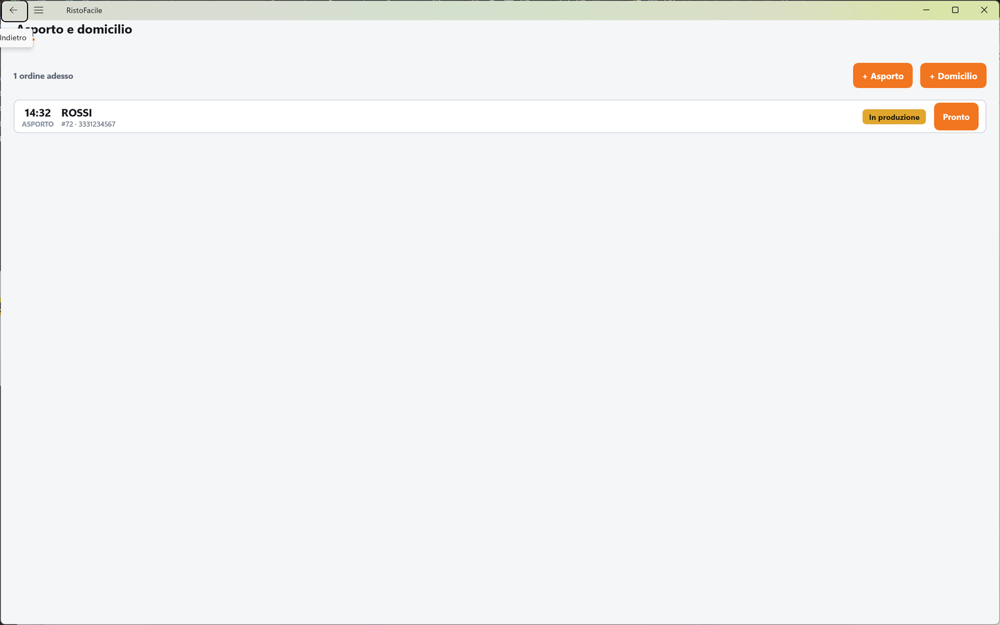
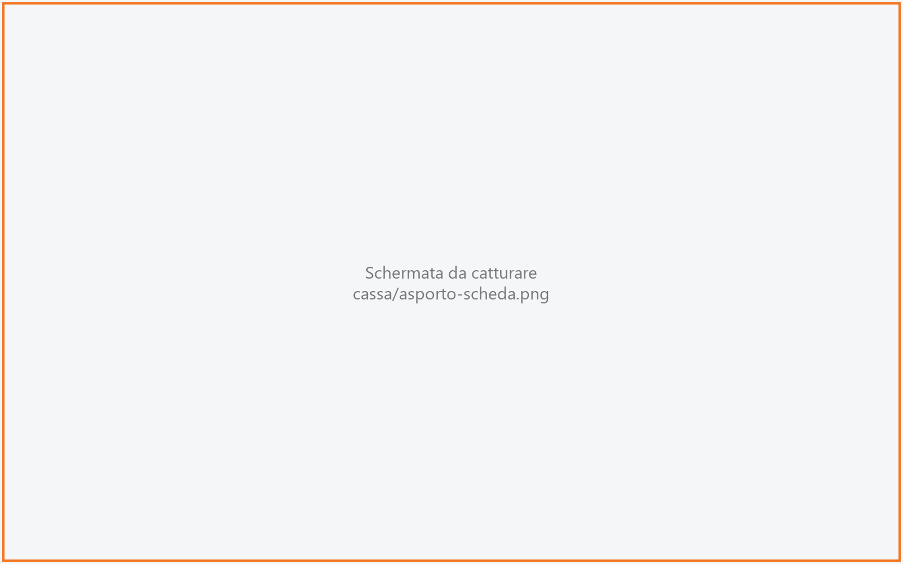
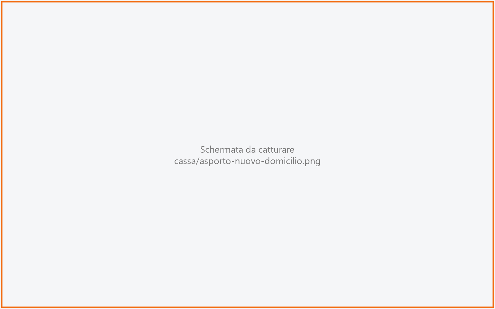

# Asporto e domicilio

Qui il cassiere raccoglie gli ordini da portar via e quelli da consegnare a domicilio, li
segue in coda dall'arrivo fino al ritiro (o alla consegna) e ne apre la comanda per
aggiungere i piatti e incassare.

!!! info "In sintesi"

    - **Dove si trova:** Menu ▸ Vendita ▸ Mappa della sala ▸ **Asporto e domicilio** (barra in basso)
    - **Chi la usa:** cassiere
    - **Disponibile anche su:** [Palmare](../palmare/ordini.md) (linguetta **Ordini**)

---

## A cosa serve

Un cliente telefona alle 19:10 e ordina due pizze da ritirare alle 20:00. Tocchi
**+ Asporto**, scrivi il nome e l'ora, e la cassa apre subito la comanda dell'ordine dove
inserisci le pizze. L'ordine entra in coda, ordinato per ora di ritiro: quando lo mandi in
cucina passa da solo a **In produzione**, quando è pronto lo segni **Pronto**, e quando il
cliente paga e lo ritira esce dalla coda.

Per il domicilio vale lo stesso, con in più indirizzo, telefono per il fattorino e il
passaggio **In consegna**.

## Prima di cominciare

- Deve essere impostato il **tavolo dell'asporto**: Impostazioni ▸ Sala ▸ **Tavolo asporto**
  (vedi [Impostazioni](impostazioni.md)). È il tavolo "virtuale" su cui la cassa appoggia tutti
  gli ordini da asporto e domicilio; sala e tavolo devono già esistere in
  [Sale e tavoli](sale-e-tavoli.md). Senza, la creazione di un ordine si ferma con un avviso.
- Per **Rifiuta**, **Non ritirato** e **Non consegnato** serve un operatore collegato con il
  permesso di annullare (vedi [Operatori](operatori.md)).

## La schermata

- **Testata**: a sinistra il riepilogo della coda (per esempio *3 ordini adesso · 2 piu' tardi*);
  al centro la pastiglia **Tutti** / **Adesso**, che compare solo quando ci sono ordini fuori
  dalla finestra dei prossimi 90 minuti; a destra i pulsanti **+ Asporto** e **+ Domicilio**.
- **Elenco degli ordini**, ordinati per ora di ritiro o consegna. Ogni riga mostra l'ora, il tipo
  (**ASPORTO** in grigio, **DOMICILIO** in verde acqua), il nome del cliente, il numero d'ordine
  con il telefono (o, per il domicilio, l'indirizzo), lo stato e il pulsante dell'azione
  successiva.
- **Scheda dell'ordine**: si apre toccando una riga (vedi sotto).

Normalmente l'elenco mostra solo gli ordini **di adesso**: quelli con l'ora entro i prossimi
90 minuti, quelli già in ritardo e quelli senza ora. Gli altri sono contati nel riepilogo
(*piu' tardi*) e si vedono toccando **Tutti**.

Se non ci sono ordini compare *Nessun ordine da preparare adesso* con l'invito
*Tocca "+ Asporto" o "+ Domicilio" per aggiungerne uno*.

La schermata si aggiorna da sola con gli ordini creati o modificati dalle altre postazioni e
dai palmari, tranne mentre è aperta la scheda di un ordine o il modulo del nuovo ordine.

### La scheda dell'ordine

Riporta nome del cliente, tipo e numero (*Ordine #27 · 333 1234567* o *Domicilio #28 · …*),
l'ora di **Ritiro** o di **Consegna**, lo **Stato** e, per il domicilio, **Indirizzo** e le
indicazioni per il **Fattorino**; le **Note** se presenti. Sotto ci sono i comandi dell'ordine.
Si chiude con la **X** in alto a destra o toccando fuori dalla scheda.

### Il modulo del nuovo ordine

**+ Asporto** apre *Nuovo ordine asporto* (cliente, ora di ritiro, note); **+ Domicilio** apre
*Nuovo ordine a domicilio*, su due colonne: a sinistra cliente e ora di consegna, a destra
l'indirizzo.

## Campi e indicatori

| Elemento | Descrizione |
|---|---|
| **Riepilogo** | Quanti ordini sono in elenco *adesso* e quanti *piu' tardi*; con **Tutti** attivo, quanti ordini ci sono *in coda* in tutto. |
| **Ora** (riga) | Ora di ritiro o di consegna. Un trattino se l'ordine non ha ora. |
| **ASPORTO** / **DOMICILIO** | Tipo d'ordine. |
| **#numero** | Numero dell'ordine da dire al cliente. È un progressivo che cresce per tutto l'anno. |
| **n. 27** | Accanto al #numero, il numero del giorno dell'ordine: è quello che si chiama in [Chiamate](chiamate.md) e sul monitor in sala, e che il monitor di cucina mette in testa al titolo. Riparte ogni giorno. |
| **Stato** | *Ricevuto* e *In produzione* in giallo; *Confermato*, *Programmato*, *Pronto*, *In consegna* in verde. |
| **Nome** (modulo) | Nome del cliente. Obbligatorio. |
| **Telefono** (modulo) | Facoltativo per l'asporto; **obbligatorio per il domicilio** (*Per il fattorino*). |
| **Ora ritiro** / **Ora consegna** | Proposta mezz'ora dopo l'ora attuale. L'ordine è sempre per la giornata in corso. |
| **Note** / **Note sull'ordine** | Facoltative. |
| **Via**, **Civico**, **Citta'**, **CAP** | Solo domicilio. La via è obbligatoria; il CAP accetta al massimo 5 cifre. |
| **Per il fattorino** | Solo domicilio: citofono, scala, piano. Facoltativo. |

## Pulsanti e comandi

| Comando | Effetto |
|---|---|
| **+ Asporto** | Apre il modulo *Nuovo ordine asporto*. |
| **+ Domicilio** | Apre il modulo *Nuovo ordine a domicilio*. |
| **Tutti (n)** / **Adesso** | Mostra anche gli ordini oltre i prossimi 90 minuti / torna ai soli ordini di adesso. |
| Tocco su una riga | Apre la scheda dell'ordine. |
| Pulsante sulla riga | Porta l'ordine allo stato successivo (vedi tabella degli stati). |
| **Crea ordine** | Crea l'ordine e apre subito la sua [comanda](comanda.md). |
| **Annulla** (modulo) | Chiude il modulo senza creare nulla. |
| Azione dello stato (scheda) | Come il pulsante sulla riga, con l'etichetta per esteso. |
| **Apri comanda** | Apre la comanda dell'ordine (per aggiungere piatti, mandarli in cucina, andare al [conto](conto.md)). |
| **Rifiuta** | Solo per un ordine *Ricevuto*. Chiede conferma ed elimina l'ordine e le sue righe. |
| **Non ritirato** / **Non consegnato** | Per un ordine *Pronto* (o *In consegna*, se a domicilio). Chiede conferma ed elimina l'ordine e le sue righe. |

### Gli stati dell'ordine

| Stato | Pulsante sulla riga | Nella scheda | Stato successivo |
|---|---|---|---|
| Ricevuto | **Conferma** | **Conferma**, **Rifiuta** | Confermato |
| Confermato | **In prod.** | **Inizia produzione** | In produzione |
| In produzione | **Pronto** | **Segna pronto** | Pronto |
| Pronto (asporto) | **Ritirato** | **Segna ritirato**, **Non ritirato** | Ritirato (esce dalla coda) |
| Pronto (domicilio) | **Parte** | **Parte la consegna**, **Non consegnato** | In consegna |
| In consegna | **Consegnato** | **Segna consegnato**, **Non consegnato** | Consegnato (esce dalla coda) |
| Programmato | — | — | — |

Un ordine creato dalla cassa nasce **Ricevuto**.

<!-- DA VERIFICARE: chi porta un ordine nello stato "Programmato"? Dalla cassa non c'e' nessun comando che lo imposti ne' che lo faccia avanzare. -->

## Come si fa

### Prendere un ordine da asporto

1. Nella Mappa della sala tocca **Asporto e domicilio**.
2. Tocca **+ Asporto**.
3. Scrivi il **Nome** del cliente e, se vuoi, il **Telefono**.
4. Imposta l'**Ora ritiro** e le eventuali **Note**.
5. Tocca **Crea ordine**.
6. Si apre la comanda dell'ordine: inserisci i piatti e mandali in cucina. L'ordine compare in
   coda come **In produzione**.

### Prendere un ordine a domicilio

1. Tocca **+ Domicilio**.
2. Scrivi **Nome** e **Telefono** (obbligatorio: il fattorino deve poter chiamare) e imposta
   l'**Ora consegna**.
3. Compila **Via**, **Civico**, **Citta'**, **CAP** e, se servono, le indicazioni
   **Per il fattorino** e le **Note sull'ordine**.
4. Tocca **Crea ordine**.
5. Si apre la comanda: inserisci i piatti e mandali in cucina.

### Seguire un ordine fino alla consegna

1. Quando la cucina ha finito, tocca **Pronto** sulla riga dell'ordine.
2. Asporto: quando il cliente arriva, tocca la riga, poi **Apri comanda** e incassa dal
   [conto](conto.md). Alla chiusura del conto l'ordine diventa **Ritirato** ed esce dalla coda.
   Fa eccezione l'asporto seguito dalle [Chiamate](chiamate.md) e pagato prima che sia pronto:
   vedi le Note.
3. Domicilio: incassa dal conto prima che parta, poi tocca **Parte** quando esce il fattorino e
   **Consegnato** al suo rientro. L'ordine esce dalla coda.

### Rifiutare un ordine o segnarlo come non ritirato

1. Tocca la riga dell'ordine.
2. Tocca **Rifiuta** (ordine *Ricevuto*) oppure **Non ritirato** / **Non consegnato**
   (ordine *Pronto* o *In consegna*).
3. Conferma. L'ordine sparisce dalla coda e la sua comanda viene eliminata.

## Controlli e messaggi

| Messaggio | Causa | Cosa fare |
|---|---|---|
| *Il nome del cliente e' obbligatorio.* | **Crea ordine** con il nome vuoto. | Scrivi il nome. |
| *Per la consegna a domicilio serve l'indirizzo.* | Domicilio senza via. | Compila **Via**. |
| *Per la consegna a domicilio serve il telefono: il fattorino deve poter chiamare.* | Domicilio senza telefono. | Compila **Telefono**. |
| *Nessun tavolo configurato per l'asporto: impostalo in Impostazioni.* | Manca il tavolo dell'asporto. | Impostalo in Impostazioni ▸ Sala ▸ **Tavolo asporto**. |
| *Impossibile creare l'ordine. (…)* | Il servizio ha rifiutato o non ha risposto. Tra parentesi il motivo. | Controlla la connessione; prima di riprovare chiudi il modulo e guarda se l'ordine è già in coda, per non crearlo due volte. |
| *Il backend non ha restituito l'ordine appena aperto.* | Il servizio non ha restituito l'ordine creato. | Ricarica la schermata e controlla se l'ordine è in coda prima di rifarlo. |
| *Ordine aperto, ma l'indirizzo di consegna non si e' salvato.* | L'ordine a domicilio è stato creato ma senza indirizzo. | Segna l'indirizzo nelle note della comanda o avvisa il fattorino. <!-- DA VERIFICARE: dalla cassa si puo' correggere l'indirizzo di un ordine gia' creato? Non risulta un comando di modifica. --> |
| *Impossibile caricare gli ordini asporto.* | Il servizio non risponde. | Controlla la connessione e riapri la schermata. |
| *Impossibile aggiornare lo stato dell'ordine.* | Il cambio di stato non è stato salvato. | Riprova. |
| *Rifiutare questo ordine? L'ordine e le sue righe vengono eliminati.* | Conferma di **Rifiuta**. | **Rifiuta** per procedere, **Annulla** per lasciare l'ordine. |
| *Segnare l'ordine come non ritirato? L'ordine e le sue righe vengono eliminati.* (o *non consegnato*) | Conferma di **Non ritirato** / **Non consegnato**. | **Conferma** per procedere, **Annulla** per lasciare l'ordine. |
| *Ordine tolto dalla coda, ma la comanda e' rimasta aperta sul tavolo.* | L'ordine è stato rifiutato, ma la sua comanda non si è eliminata. | <!-- DA VERIFICARE: come si recupera la comanda rimasta aperta sul tavolo dell'asporto? --> |
| *Nessun operatore collegato: per annullare un ordine serve un operatore abilitato.* | **Rifiuta** / **Non ritirato** senza operatore collegato. | Collegati con un operatore abilitato. |
| *… non e' abilitato a annullare un ordine. Il permesso si da' in Impostazioni -> Operatori.* | L'operatore collegato non ha il permesso di annullare. | Fai dare il permesso in [Operatori](operatori.md) o usa un operatore abilitato. |
| *L'ordine 27 non e' ancora incassato: incassalo prima di segnarlo consegnato.* | **Ritirato** su un asporto seguito dalle [Chiamate](chiamate.md) che non è ancora incassato. L'ordine resta in coda. | Tocca **Apri comanda**, incassa dal conto, poi segna il ritiro. |
| *Operazione riuscita, ma lo stato dell'ordine d'asporto non si e' aggiornato.* | Compare nella comanda o nel conto: l'invio in cucina o l'incasso sono andati a buon fine, ma lo stato in coda no. | Aggiorna lo stato a mano dalla coda. |

## Note

!!! warning "Rifiuta, Non ritirato e Non consegnato eliminano la comanda"
    L'ordine esce dalla coda e la sua comanda, con tutte le righe, viene eliminata. Non si
    può tornare indietro.

- **Mandare in cucina fa avanzare l'ordine da solo**: un ordine *Ricevuto* o *Confermato* passa
  a *In produzione* al primo invio in cucina. Un ordine già *Pronto* che riceve un'aggiunta
  resta *Pronto*.
- **La chiusura del conto chiude l'asporto, non il domicilio**: un ordine da asporto diventa
  *Ritirato* quando ne chiudi il conto; un ordine a domicilio di solito si incassa prima che
  parta, quindi la consegna va segnata a mano con **Consegnato**.
- **Gli asporti seguiti dalle chiamate**: quando sono accese le chiamate anche per gli asporti
  della cassa, i numeri degli asporti mandati in cucina compaiono anche in
  [Chiamate](chiamate.md) e sul monitor in sala. Un asporto pagato **prima** che sia pronto non
  diventa *Ritirato* alla chiusura del conto: resta in coda *In produzione*, poi diventa *Pronto*, e
  il ritiro si segna da Chiamate con **Consegnato** o da qui con **Ritirato**. Se la cucina segna
  consegnati i suoi piatti sul monitor di cucina, l'ordine diventa consegnato da solo. Con le
  chiamate accese **un asporto si incassa prima di segnarlo ritirato**: su un ordine non ancora
  incassato **Ritirato** risponde *L'ordine 27 non e' ancora incassato: incassalo prima di segnarlo
  consegnato.* e l'ordine resta in coda. L'interruttore delle chiamate per gli asporti della cassa
  sta in Menu ▸ [Kiosk](kiosk.md#linguetta-monitor) ▸ **Monitor**.
- **Gli ordini del kiosk** non sono in questa coda: stanno in [Ordini dal kiosk](ordini-kiosk.md).
- L'ora del nuovo ordine vale sempre per **oggi**: non si prende dalla cassa un ordine per un
  altro giorno.
- Le vendite al banco usano lo stesso tavolo dell'asporto ma qui non compaiono: stanno in
  [Vendita al banco](vendita-al-banco.md).
- I palmari vedono la stessa coda nella linguetta **Ordini**, senza la pastiglia **Tutti**:
  lì l'elenco è sempre intero.

## Vedi anche

- [Mappa della sala](mappa-sala.md)
- [Comanda](comanda.md)
- [Conto](conto.md)
- [Vendita al banco](vendita-al-banco.md)
- [Chiamate](chiamate.md)
- [Ordini dal kiosk](ordini-kiosk.md)
- [Impostazioni](impostazioni.md)
- [Operatori](operatori.md)
- [Ordini sul palmare](../palmare/ordini.md)
