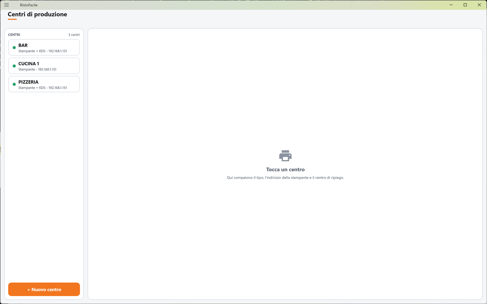
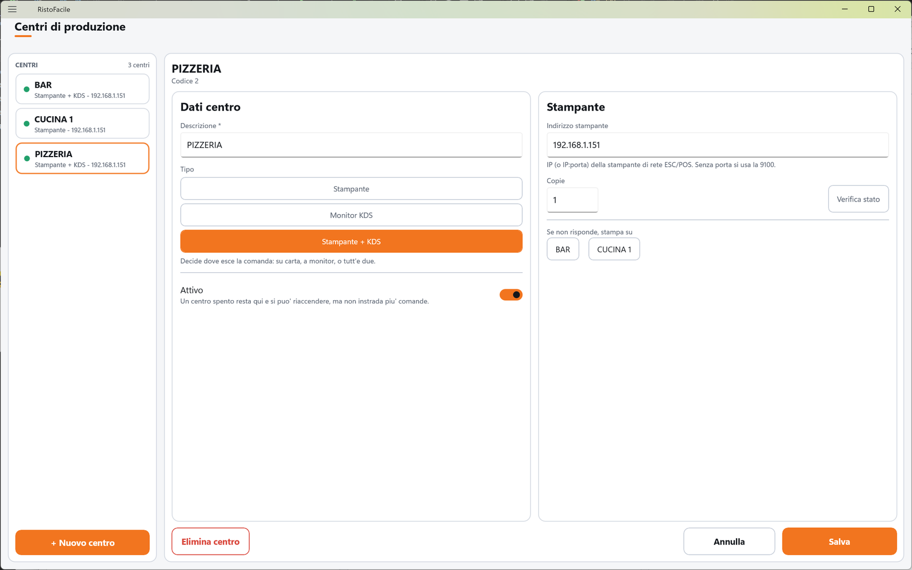

# Centri di produzione

Un centro di produzione è un reparto che prepara qualcosa: la cucina, il bar, la pizzeria, la
pasticceria. Qui decidi, per ciascuno, **dove esce la comanda**: sulla sua stampante, sul monitor di
cucina o su tutti e due. La usa il titolare o l'installatore quando allestisce il locale.

!!! info "In sintesi"

    - **Dove si trova:** Menu ▸ Centri di produzione
    - **Chi la usa:** titolare / installatore
    - **Disponibile anche su:** solo cassa

---

## A cosa serve

Quando il cameriere invia una comanda, ogni riga va al centro di produzione del suo articolo: le
pizze escono sulla stampante della pizzeria, le bevande al bar, i primi in cucina. Un articolo senza
centro di produzione non va in cucina e non si stampa.

Il centro si assegna all'articolo nella composizione del [Menu](menu.md). Il ticket che esce
sulla stampante porta in testa il nome del centro, in maiuscolo (es. PIZZERIA).

Esempio: la cucina ha una stampante all'indirizzo 192.168.1.50; se si blocca, il ticket deve uscire
al bar. Imposti il bar come centro di ripiego della cucina.

## Prima di cominciare

- Per i centri che stampano: la stampante termica di rete (ESC/POS) accesa e il suo indirizzo IP.
- Per i centri con monitor: l'app Monitor di cucina installata sullo schermo del reparto (vedi
  [Scelta del centro](../kds/centro.md)).

## La schermata

La schermata è divisa in due colonne.

- **A sinistra, l'elenco** dei centri in ordine alfabetico, con in alto **CENTRI** e il numero di
  centri. Ogni tessera mostra il nome, il tipo e l'indirizzo della stampante (es.
  «Stampante - 192.168.1.50»). Accanto ai centri che stampano compare un **pallino di stato**:
  verde se la stampante è pronta, giallo se manca la carta o il coperchio è aperto, rosso se non è
  raggiungibile o è in errore; sotto il nome, per i pallini gialli e rossi, il motivo. I centri
  spenti portano la pastiglia rossa **Disattivo**. In fondo il pulsante **+ Nuovo centro**.
- **A destra, la scheda** del centro toccato. Finché non ne scegli uno compare **Tocca un centro**
  con «Qui compaiono il tipo, l'indirizzo della stampante e il centro di ripiego.».

Lo stato delle stampanti si controlla da solo ogni volta che apri la schermata.

La scheda ha in testa il nome del centro (per uno nuovo **Nuovo centro**) e il codice («Codice 2»
oppure «Nuovo centro - codice 3 proposto»). Sotto, due colonne: a sinistra **Dati centro**, a
destra **Stampante** (dove esce la carta) oppure, per un centro solo monitor, il riquadro
**Monitor KDS**. In fondo **Elimina centro**, **Annulla** e **Salva**.

## Campi e indicatori

| Elemento | Descrizione |
|---|---|
| **Descrizione \*** | Obbligatoria. Il nome del reparto (es. CUCINA, BAR, PASTICCERIA). È anche l'intestazione del ticket stampato. |
| **Tipo** | Tre pulsanti: **Stampante**, **Monitor KDS**, **Stampante + KDS**. «Decide dove esce la comanda: su carta, a monitor, o tutt'e due.» |
| **Attivo** | «Un centro spento resta qui e si puo' riaccendere, ma non instrada piu' comande.» Un centro spento non compare più fra quelli sceglibili sul monitor di cucina né come ripiego. <!-- DA VERIFICARE: dal codice, gli articoli che puntano a un centro spento escono comunque sulla stampante comande della postazione con intestazione CUCINA. È il comportamento voluto? --> |
| **Indirizzo stampante** | Solo per **Stampante** e **Stampante + KDS**. «IP (o IP:porta) della stampante di rete ESC/POS. Senza porta si usa la 9100.» Es. 192.168.1.50 oppure 192.168.1.50:9100. |
| **Copie** | Quante copie del ticket escono a ogni invio. Si stampano al massimo 5 copie anche se ne scrivi di più. |
| **Se non risponde, stampa su** | Il centro di ripiego: se la stampante di questo centro rifiuta la stampa, il ticket esce su quella del centro scelto qui. Si possono scegliere solo centri attivi che stampano su carta. Ritoccare il centro già scelto lo toglie. |

Per un centro **Monitor KDS** la colonna di destra spiega: «Questo centro non stampa: le comande
compaiono sul monitor di cucina agganciato a questa stazione (app RistoKds, schermata Stazione).» e
«Non servono percio' indirizzo, copie ne' centro di ripiego - il ripiego riguarda la carta. Se serve
anche il ticket stampato, scegli Stampante + KDS.»

## Pulsanti e comandi

| Comando | Effetto |
|---|---|
| **+ Nuovo centro** | Apre una scheda vuota, di tipo **Stampante**, con il primo codice libero proposto. |
| **Verifica stato** | Interroga la stampante all'indirizzo **scritto nella casella** (anche se non ancora salvato) e mostra l'esito sotto: *Stampante pronta.* oppure il motivo dell'errore. Non salva nulla. |
| **Salva** | Salva il centro. È spento finché la **Descrizione** è vuota. |
| **Annulla** | Rimette la scheda com'era; su un centro nuovo, chiude la scheda. |
| **Elimina centro** | Elimina il centro, dopo conferma. Compare solo su un centro già salvato. |

## Come si fa

### Aggiungere la stampante della pizzeria

1. Tocca **+ Nuovo centro**.
2. In **Descrizione \*** scrivi PIZZERIA.
3. Lascia il tipo **Stampante**.
4. In **Indirizzo stampante** scrivi l'IP della stampante (es. 192.168.1.51).
5. Tocca **Verifica stato** e controlla che compaia *Stampante pronta.*.
6. Tocca **Salva**. Il centro compare nell'elenco con il pallino verde.
7. Assegna la pizzeria agli articoli dal [Menu](menu.md).

### Passare la cucina dalla carta al monitor

1. Tocca il centro CUCINA.
2. Tocca **Monitor KDS** (oppure **Stampante + KDS** se vuoi anche il ticket).
3. Tocca **Salva**.
4. Sul monitor di cucina scegli il centro CUCINA (vedi [Scelta del centro](../kds/centro.md)).

### Impostare un ripiego

1. Tocca il centro da proteggere (es. CUCINA).
2. In **Se non risponde, stampa su** tocca il centro di riserva (es. BAR).
3. Tocca **Salva**.

## Controlli e messaggi

| Messaggio | Causa | Cosa fare |
|---|---|---|
| *La descrizione e' obbligatoria.* | Salvataggio senza descrizione. | Compila la descrizione. |
| *Il codice deve essere un numero maggiore di zero.* | Codice non valido. | Riapri la scheda con **+ Nuovo centro**. |
| *Nessun indirizzo stampante impostato: questo centro non stampera' finche' non lo aggiungi.* | Centro su carta salvato senza indirizzo (il salvataggio avviene lo stesso). | Aggiungi l'indirizzo appena lo conosci. |
| *Imposta prima l'indirizzo della stampante.* | **Verifica stato** con la casella vuota. | Scrivi l'indirizzo. |
| *Verifica stato in corso...* | La verifica è partita. | Attendi l'esito (pochi secondi). |
| **Modifiche non salvate** — *La scheda di "…" ha modifiche non salvate. Vuoi abbandonarle?* | Hai cambiato centro senza salvare. | **Abbandona** o **Resta qui**. |
| **Elimina centro** — *Eliminare definitivamente il centro "…"? L'operazione non e' reversibile.* | Hai toccato **Elimina centro**. | **Elimina** o **Annulla**. |
| *Impossibile eliminare il centro (verificare che non sia assegnato a dei piatti).* | Il centro è ancora usato da qualche articolo del menu, oppure il servizio non risponde. | Togli il centro dagli articoli del [Menu](menu.md) e riprova. |
| *Un'altra postazione ha modificato questi dati prima di te: adesso vedi la versione aggiornata, rifai la modifica e salva.* | Modifica concorrente da un'altra cassa. | Rifai la modifica e salva. |
| *Un'altra postazione ha eliminato questi dati mentre li stavi modificando: non ci sono piu' e non c'e' niente da salvare.* | Il centro è stato eliminato altrove. | Nessuna azione. |
| *Impossibile caricare i centri di produzione.* / *Impossibile salvare il centro.* / *Impossibile determinare il prossimo codice del centro.* | Il servizio non risponde o rifiuta l'operazione. | Controlla il collegamento e riprova. |

## Note

- Il ripiego scatta solo se la stampante **rifiuta** la stampa prima di stamparne anche una sola
  copia. Se la stampante **non risponde** (potrebbe aver ricevuto il ticket) o se una copia è già
  uscita, il ripiego non scatta: meglio una copia in meno che l'ordine due volte in cucina.
- Il ripiego segue la catena: se anche il centro di ripiego non stampa, si passa al suo ripiego e,
  per ultima, alla stampante comande impostata nella postazione (Menu ▸ Impostazioni).
- Le copie restano quelle del centro di origine anche quando si stampa sul ripiego.
- Il monitor di cucina mostra solo i centri attivi di tipo **Monitor KDS** o **Stampante + KDS**.

## Vedi anche

- [Menu](menu.md)
- [Comanda](comanda.md)
- [Messaggi](messaggi.md)
- [Impostazioni](impostazioni.md)
- [Monitor di cucina: scelta del centro](../kds/centro.md)
- [Monitor](../kds/monitor.md)
