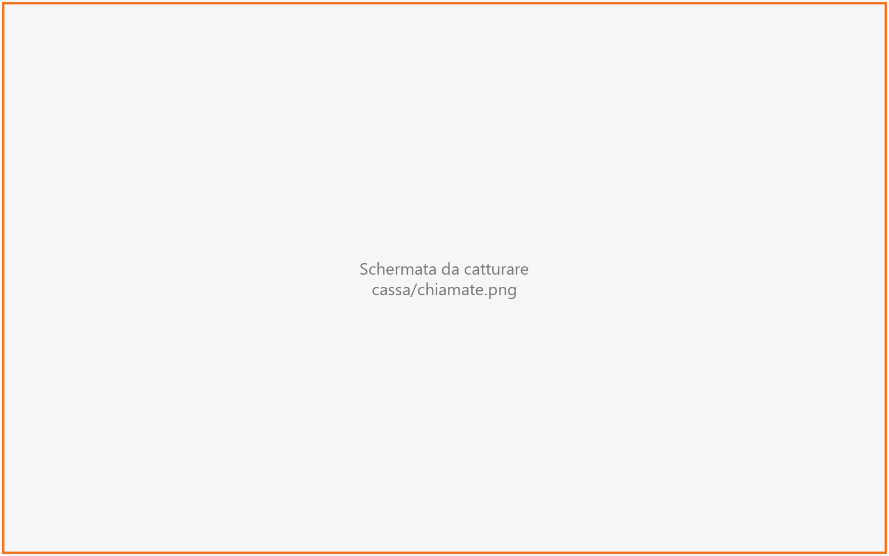
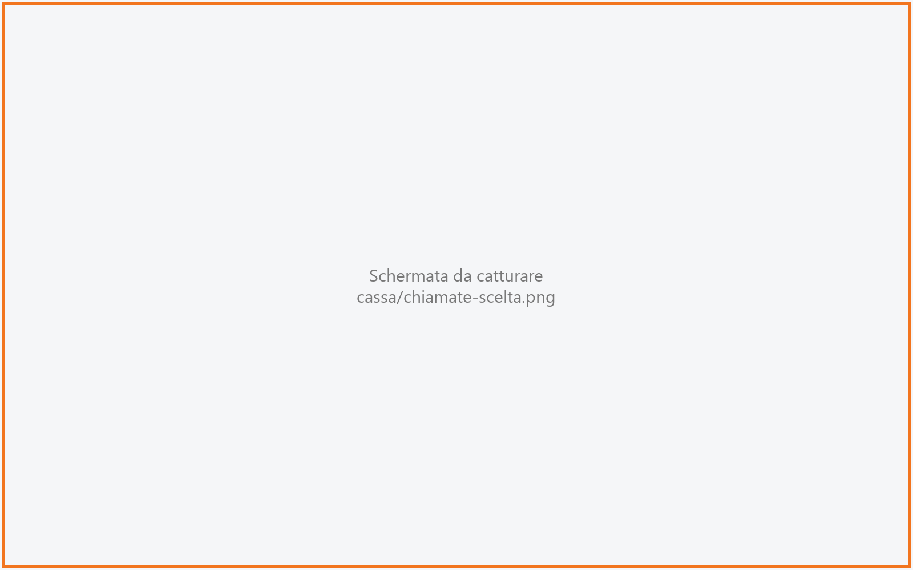
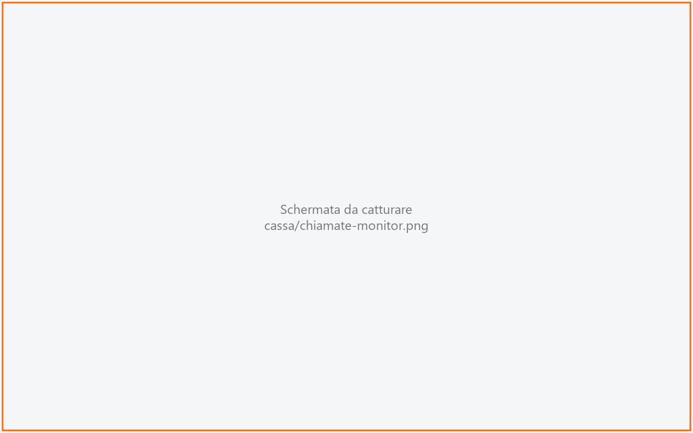
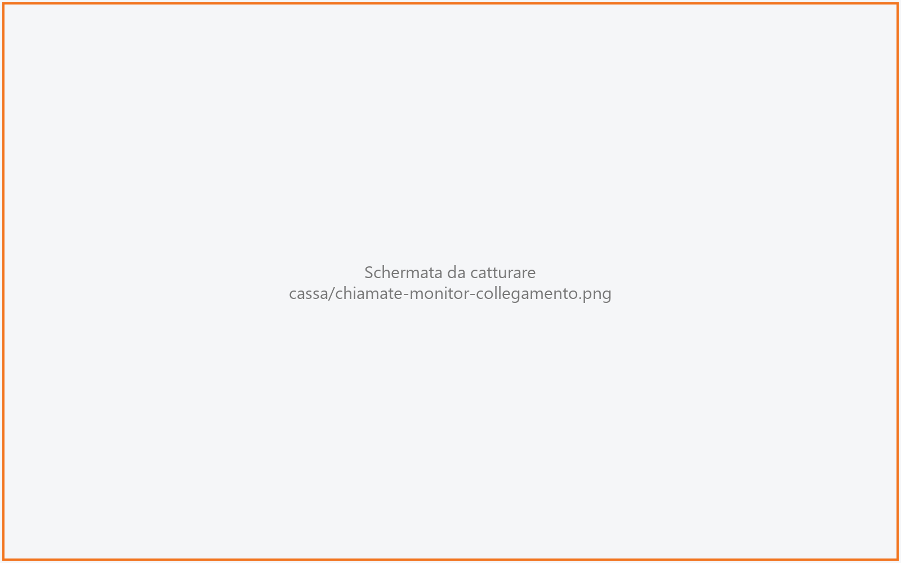

# Chiamate

L'elenco dei numeri degli ordini da ritirare al banco: quelli che la cucina sta ancora preparando e
quelli pronti da consegnare. Chi prepara i vassoi tocca un numero per segnarlo pronto e, quando il
cliente lo ritira, per segnarlo consegnato. Gli stessi numeri compaiono sul **monitor in sala**, una
TV su cui il cliente vede quando il suo ordine è pronto. La usano il cassiere e chi lavora al banco.

!!! info "In sintesi"

    - **Dove si trova:** Menu ▸ Vendita ▸ Mappa della sala ▸ **Chiamate** (barra in basso, accanto ad **Asporto e domicilio**)
    - **Chi la usa:** cassiere, chi prepara e consegna i vassoi al banco; il monitor in sala è per i clienti
    - **Disponibile anche su:** [Palmare](../palmare/ordini.md) (linguetta **Ordini** ▸ **Chiamate**)

---

## A cosa serve

Un cliente ordina al kiosk e paga: il suo è l'ordine 27. Sulla TV della sala il 27 compare fra
**In preparazione**. Quando la pizzeria segna pronta la sua pizza sul monitor di cucina, il 27 passa
da solo fra **Pronti, ritira al banco**, lampeggia e suona. Il cliente viene al banco, tu gli dai il
sacchetto, tocchi il 27 in Chiamate e poi **Consegnato**: il numero sparisce dalla TV.

!!! note "Quando un ordine diventa pronto"
    Un ordine diventa pronto da solo quando i monitor di cucina hanno finito tutto; se una parte si
    prepara senza schermo (un centro con la sola stampante, le bibite), lo segna pronto chi lo tocca
    in Chiamate.

Compaiono qui:

- **sempre** gli ordini del kiosk, sia quelli da portare via sia quelli di chi mangia nel locale con
  il segnaposto («mangio qui»);
- gli **asporti presi dalla cassa** o dal palmare, solo se è accesa l'opzione delle chiamate anche
  per gli asporti della cassa (vedi «Prima di cominciare»);
- **mai** le vendite al banco e gli ordini a domicilio.

Sul monitor in sala vanno solo gli ordini da portare via: chi ha il segnaposto aspetta al tavolo e
il suo numero si vede solo qui, non sulla TV.

## Prima di cominciare

- Il bottone **Chiamate** e il monitor in sala ci sono solo quando i kiosk sono accesi e almeno un
  kiosk ha la licenza, anche in prova. Altrimenti il bottone non compare e il monitor scrive
  *Monitor non attivo*. <!-- DA VERIFICARE: quando ci sara' la scheda del kiosk, rimandare li' per l'accensione dei kiosk e la loro licenza. -->
- Il pronto da solo c'è solo per i centri di produzione con lo schermo, cioè di tipo
  **Monitor KDS** o **Stampante + KDS** (vedi [Centri di produzione](centri-di-produzione.md)).
- Per il monitor in sala serve una TV, o uno schermo con un PC, con un browser e collegata alla
  rete del locale.
- **I minuti sul monitor e le chiamate per gli asporti della cassa** non si impostano ancora da una
  schermata della cassa: stanno nella configurazione dei kiosk sul servizio e li imposta
  l'assistenza. Di partenza un numero pronto resta sul monitor **10 minuti** (si può scegliere da 1
  a 120) e gli asporti della cassa **non** compaiono.
  <!-- DA VERIFICARE: quando la cassa avra' la schermata della configurazione dei kiosk, scrivere qui il percorso e le etichette esatte dei due campi (minuti dei numeri pronti sul monitor, chiamate anche per gli asporti della cassa). -->

## La schermata

- **In alto**, la fascia con l'indirizzo del monitor da aprire sulla TV, per esempio
  *Monitor in sala: apri http://192.168.1.20:4059/monitor sul browser della TV*.
- **A sinistra, In preparazione**: gli ordini che la cucina sta preparando, dal più vecchio. Sotto il
  titolo: «Tocca il numero quando il vassoio e' pronto».
- **A destra, Pronti**: gli ordini pronti da consegnare, a partire da quello che aspetta da più
  tempo. Sotto il titolo: «Tocca il numero quando lo consegni, o per rimetterlo in preparazione».

Il titolo di ogni colonna porta fra parentesi quanti ordini contiene (es. **In preparazione (3)**).
Una colonna vuota dice *Nessun ordine in preparazione* oppure *Nessun ordine da consegnare*.

Ogni ordine è una **tessera**: con il bordo ambra quando è in preparazione, verde piena quando è
pronto. Sulla tessera:

- il **numero** dell'ordine, grande;
- sotto, a chi va: **Porta via** (ordine del kiosk da portare via), **Segnaposto 12** (cliente del
  kiosk che mangia nel locale e aspetta al tavolo con il segnaposto 12) oppure **Asporto · Rossi**
  (asporto preso dalla cassa, con il nome del cliente);
- da quanto aspetta: «in coda da 4 minuti» in preparazione, «pronto da 2 minuti» fra i pronti
  («meno di un minuto» nei primi sessanta secondi).

L'elenco si aggiorna da solo ogni cinque secondi finché la schermata è aperta: i tocchi fatti da
un'altra cassa, da un palmare o dal monitor di cucina compaiono al giro successivo.

Sul **palmare** la schermata è la stessa, con le due colonne una sotto l'altra: prima
**In preparazione**, poi **Pronti**. Le tessere vanno a capo, due per riga su un telefono.

### La scelta sui pronti

Toccando una tessera fra i **Pronti** si apre una finestra con il titolo dell'ordine (es.
**Ordine 27**), a chi va e da quanto è pronto (es. «Porta via · pronto da 2 minuti») e tre pulsanti:
**Consegnato**, **Torna in preparazione** e **Annulla**.

### Il monitor in sala

Il monitor è una pagina che si apre nel browser della TV, all'indirizzo scritto in cima alla
schermata Chiamate. Ha due colonne a numeri grandi: **In preparazione** e
**Pronti, ritira al banco**.

- In preparazione i numeri sono in ordine di arrivo; fra i pronti il più recente viene per primo.
- Un numero appena diventato pronto **lampeggia per 10 secondi**, con un breve suono di campanello.
- Il monitor mostra **solo numeri**: niente nomi, importi o segnaposti.
- Un numero pronto resta sul monitor per i minuti impostati (di partenza 10) da quando è diventato
  pronto, poi sparisce dalla TV. In Chiamate invece resta fra i pronti finché non lo consegni.
- Un ordine segnato **consegnato** sparisce dalla TV **subito**, chiunque lo segni: tu da Chiamate,
  la cassa alla chiusura del conto o la cucina dal monitor di cucina (vedi le Note).
- Il monitor legge i numeri dal servizio ogni tre secondi: un tocco in Chiamate o sul monitor di
  cucina si vede sulla TV in pochi secondi.

**Il suono.** Il browser non lascia suonare una pagina finché qualcuno non la tocca. Per questo,
appena aperta, la pagina mostra in alto la fascia **Tocca per attivare il suono**, che copre i
titoli delle colonne. Tocca lo schermo una volta, oppure premi un tasto del telecomando o della
tastiera: la fascia sparisce e da quel momento i numeri pronti suonano. Va rifatto ogni volta che la
pagina si riapre o si ricarica.

**Se si perde il collegamento** (la rete della TV cade, il servizio è fermo), sulla TV restano gli
ultimi numeri e in basso compare la fascia **Collegamento perso, riprovo…**. Quando il servizio torna
raggiungibile la fascia sparisce e i numeri riprendono da soli: non serve toccare niente.

Il monitor **funziona solo sulla rete del locale**: l'indirizzo non si raggiunge da internet, nemmeno
dall'indirizzo pubblico del [self order](self-order.md). Non chiede nessuna password, perché la TV
non ha un operatore: è per questo che mostra solo i numeri.

## Campi e indicatori

| Elemento | Descrizione |
|---|---|
| **Monitor in sala: apri … sul browser della TV** | L'indirizzo della pagina del monitor da aprire sulla TV della sala. |
| **In preparazione (n)** | Gli ordini che la cucina sta preparando, e quanti sono. |
| **Pronti (n)** | Gli ordini pronti da consegnare, e quanti sono. Restano qui finché non li consegni, anche dopo che sono spariti dalla TV. |
| **Numero** (tessera) | Il numero dell'ordine da chiamare. È il numero del giorno dell'ordine, lo stesso che nella coda dell'[asporto](asporto.md) compare come «n. 27» e sul monitor di cucina in testa al titolo. <!-- DA VERIFICARE: il kiosk mostra o stampa al cliente questo stesso numero? Il codice del kiosk non e' in questi repository. --> |
| **Porta via** | Ordine del kiosk da portare via. Compare anche sul monitor in sala. |
| **Segnaposto 12** | Ordine del kiosk di un cliente che mangia nel locale e aspetta al tavolo con quel segnaposto. Non compare sul monitor in sala: il vassoio va portato al tavolo. |
| **Asporto · Rossi** | Asporto preso dalla cassa o dal palmare, con il nome del cliente. |
| **in coda da … / pronto da …** | Da quanto l'ordine è arrivato in cucina (in preparazione) o da quanto è pronto (fra i pronti). |
| **In preparazione** / **Pronti, ritira al banco** (monitor) | Le due colonne della TV, con i soli numeri degli ordini da portare via. |
| **Tocca per attivare il suono** (monitor) | Compare all'apertura della pagina finché nessuno tocca lo schermo. |
| **Collegamento perso, riprovo…** (monitor) | La TV non riceve più i numeri dal servizio; restano a video gli ultimi. |
| **Monitor non attivo** (monitor) | I kiosk sono spenti o nessun kiosk ha la licenza: la TV non mostra numeri. |

## Pulsanti e comandi

| Comando | Effetto |
|---|---|
| **Chiamate** (Mappa della sala) | Apre questa schermata. Sul palmare il bottone sta nella linguetta **Ordini**, accanto a **+ Asporto**. |
| Tocco su una tessera **In preparazione** | Segna pronto l'ordine, senza conferma, come sul monitor di cucina. La tessera passa fra i **Pronti** e, se è da portare via, sulla TV il numero passa fra i pronti, lampeggia e suona. |
| Tocco su una tessera **Pronti** | Apre la scelta fra **Consegnato**, **Torna in preparazione** e **Annulla**. |
| **Consegnato** | Segna l'ordine consegnato: esce da Chiamate e, subito, dalla TV. Si può solo se l'ordine è già incassato. |
| **Torna in preparazione** | Rimedio a un pronto toccato per sbaglio: la tessera torna fra **In preparazione** e sulla TV il numero torna nella colonna di sinistra. |
| **Annulla** | Chiude la scelta senza cambiare niente. |

## Come si fa

### Accendere il monitor in sala

1. Nella Mappa della sala tocca **Chiamate**.
2. Leggi l'indirizzo nella fascia in alto (es. http://192.168.1.20:4059/monitor).
3. Sulla TV apri il browser e scrivi quell'indirizzo.
4. Metti il browser a tutto schermo (su un PC, di solito con il tasto F11).
5. Tocca lo schermo una volta, o premi un tasto del telecomando: la fascia **Tocca per attivare il
   suono** sparisce.
6. Sulla TV si vedono le due colonne **In preparazione** e **Pronti, ritira al banco**.

### Segnare pronto un ordine che non passa dal monitor di cucina

1. Quando il vassoio è pronto, tocca il suo numero nella colonna **In preparazione**.
2. La tessera passa fra i **Pronti**; sulla TV il numero passa fra **Pronti, ritira al banco**,
   lampeggia e suona.

### Consegnare un ordine

1. Il cliente arriva al banco con il suo numero.
2. Tocca il numero fra i **Pronti**.
3. Tocca **Consegnato**.
4. La tessera sparisce da Chiamate e il numero sparisce subito anche dalla TV.

### Correggere un pronto toccato per sbaglio

1. Tocca il numero fra i **Pronti**.
2. Tocca **Torna in preparazione**.
3. La tessera torna fra **In preparazione** e sulla TV il numero torna nella colonna di sinistra.

Se la cucina aveva già finito tutto sul monitor di cucina, dopo pochi secondi l'ordine torna pronto
da solo, e i minuti per cui resta sulla TV ripartono da capo.

### Un asporto della cassa pagato prima che sia pronto

Vale quando sono accese le chiamate anche per gli asporti della cassa.

1. Da [Asporto e domicilio](asporto.md) prendi l'ordine e mandalo in cucina: il numero compare fra
   **In preparazione**, in Chiamate e sulla TV.
2. Il cliente paga subito: chiudi il conto come al solito. L'ordine **non** diventa consegnato:
   resta in preparazione, in Chiamate e sulla TV.
3. Quando la cucina ha finito sul monitor di cucina, l'ordine diventa pronto da solo. Se una parte si
   prepara senza schermo, toccalo tu in **In preparazione**.
4. Quando il cliente ritira, toccalo fra i **Pronti** e tocca **Consegnato**. Se è la cucina a segnare
   consegnati i suoi piatti sul monitor di cucina (e passano tutti da lì), l'ordine diventa
   consegnato da solo.
5. Il numero sparisce da Chiamate e dalla TV.

Se invece il cliente paga al ritiro, a ordine già pronto, la chiusura del conto lo segna ritirato:
sparisce da Chiamate e dalla TV senza bisogno di toccare **Consegnato**.

## Controlli e messaggi

| Messaggio | Causa | Cosa fare |
|---|---|---|
| *L'ordine 27 non e' ancora incassato: incassalo prima di segnarlo consegnato.* | Hai toccato **Consegnato** su un ordine il cui conto non è ancora chiuso. L'ordine resta fra i pronti. | Incassa il conto dalla comanda dell'ordine (vedi [Asporto e domicilio](asporto.md) e [Conto](conto.md)). Un asporto già pronto, alla chiusura del conto, diventa ritirato da solo. |
| *Non riesco a leggere le chiamate dal servizio: riprovo da solo ogni pochi secondi.* | Il servizio non risponde. Il messaggio compare una volta sola, non a ogni giro. | Controlla la rete e il servizio: l'elenco torna da solo. |
| *Non sono riuscito a segnare l'ordine 27: riprova* (seguito dal dettaglio) | Il tocco non è arrivato al servizio. La tessera resta dov'era. | Controlla la rete e tocca di nuovo. |
| *Collegamento perso, riprovo…* (monitor) | La TV non raggiunge più il servizio. Restano a video gli ultimi numeri. | Controlla che il servizio sia acceso e la TV collegata alla rete del locale: i numeri riprendono da soli. |
| *Monitor non attivo* (monitor) | I kiosk sono spenti o nessun kiosk ha la licenza. | Accendi i kiosk o controlla la licenza con l'assistenza. |
| *Tocca per attivare il suono* (monitor) | La pagina è appena stata aperta e il browser non la lascia ancora suonare. | Tocca lo schermo una volta, o premi un tasto del telecomando. |

## Note

!!! warning "Consegnato sul monitor di cucina toglie il numero dalla TV"
    Quando la cucina segna consegnati sul monitor di cucina tutti i piatti di un ordine già
    incassato, l'ordine diventa consegnato e il numero sparisce subito dalla TV. Se il cuoco tocca
    «consegnato» subito dopo «pronto», il numero resta sulla TV solo per pochi secondi e il cliente
    rischia di non vederlo. Per gli ordini da portare via, sul monitor di cucina segna consegnato
    solo quando il cliente ha ritirato, oppure lascia che lo segni chi consegna, da Chiamate.

- Un ordine del kiosk **non ancora pagato** non compare né qui né sulla TV, e non arriva sul monitor
  di cucina: compare quando è pagato.
- Un ordine non ancora incassato che la cucina segna consegnato sul monitor di cucina resta fra i
  **Pronti**: diventa consegnato quando ne chiudi il conto.
- Dopo **Consegnato** in Chiamate i piatti dell'ordine restano nella colonna PRONTO del
  [monitor di cucina](../kds/monitor.md): il cuoco li toglie toccandoli.
- Se un'altra cassa o un palmare ha già consegnato l'ordine, il tuo tocco fa sparire la tessera
  senza messaggi.
- L'elenco mostra gli ordini arrivati nelle **ultime 12 ore**, così un locale aperto dopo mezzanotte
  non perde quelli a cavallo. Il numero invece è quello del giorno: riparte ogni giorno e dopo 999
  ricomincia da 1.
- Un ordine senza numero del giorno (preso prima dell'aggiornamento che ha introdotto i numeri)
  mostra sulla tessera il nome del cliente, o «Asporto», e non compare sulla TV.
- Alla chiusura del conto di un asporto la cassa controlla se l'ordine è ancora in preparazione. Se
  in quel momento non riesce a chiederlo al servizio entro un paio di secondi, l'ordine diventa
  ritirato come succedeva prima delle chiamate, ed esce da Chiamate e dalla TV.
- Segnare un asporto **Ritirato** dalla coda di [Asporto e domicilio](asporto.md) ha lo stesso
  effetto di **Consegnato**: esce da Chiamate e dalla TV.

## Vedi anche

- [Mappa della sala](mappa-sala.md)
- [Asporto e domicilio](asporto.md)
- [Conto](conto.md)
- [Centri di produzione](centri-di-produzione.md)
- [Monitor di cucina](../kds/monitor.md)
- [Ordini sul palmare](../palmare/ordini.md)
