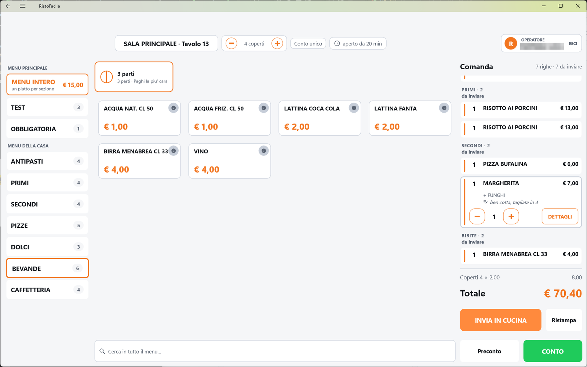
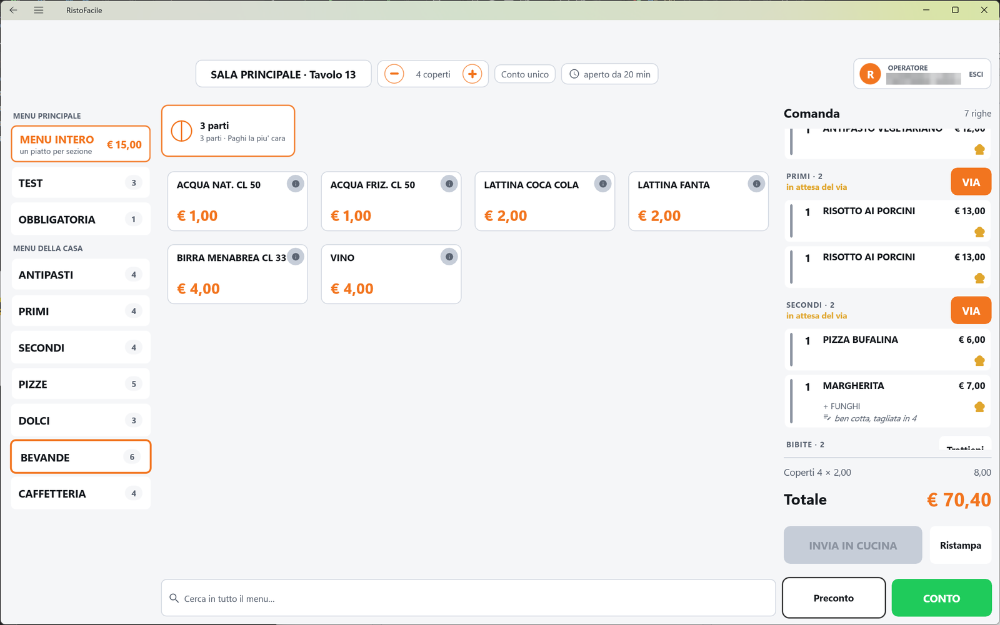
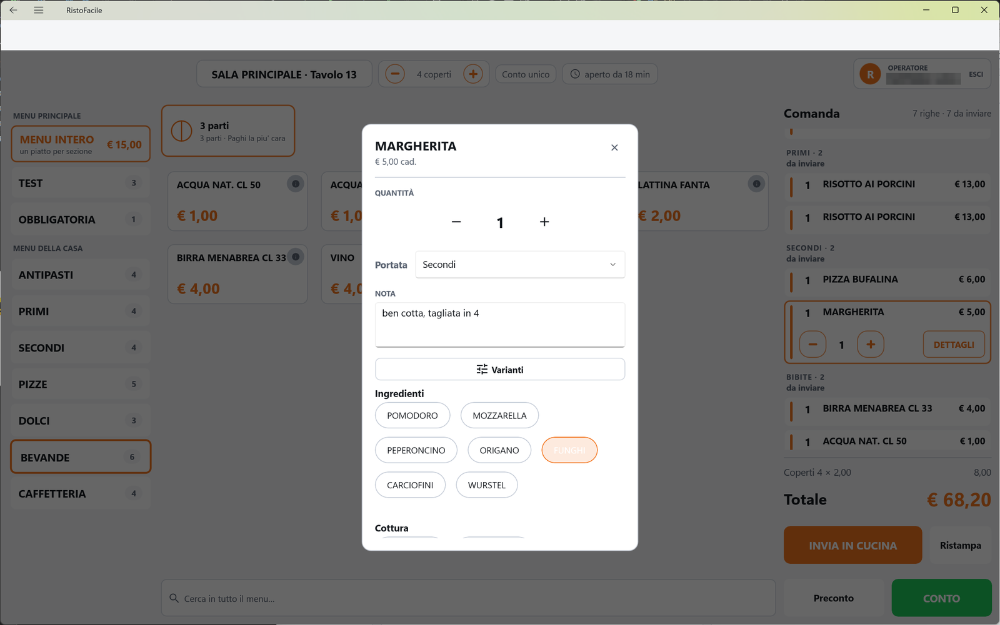
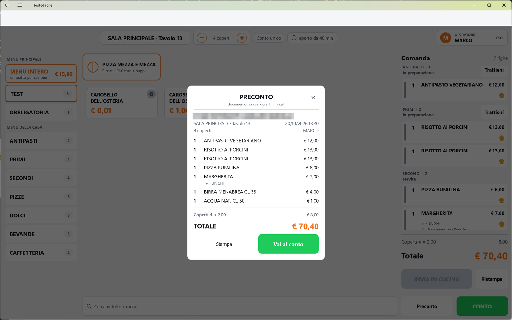

# Comanda

È la schermata in cui si lavora un tavolo: a sinistra le sezioni del menu, al centro i piatti, a
destra la comanda con il totale. Da qui si battono i piatti, si cambiano quantità, note e varianti,
si mandano gli ordini in cucina, si fa il preconto e si passa al conto. La usano il cassiere e i
camerieri che lavorano dalla cassa.

!!! info "In sintesi"

    - **Dove si trova:** dalla [Mappa della sala](mappa-sala.md), tocco su un tavolo; anche aprendo un ordine da [Asporto e domicilio](asporto.md) o un tavolo dalle [Prenotazioni](prenotazioni.md)
    - **Chi la usa:** cassiere / cameriere
    - **Disponibile anche su:** Palmare ([Comanda](../palmare/comanda.md))

---

## A cosa serve

Ogni tavolo aperto ha la sua comanda. Il cameriere prende l'ordinazione, la batte toccando i piatti,
aggiunge le note («senza cipolla») e le varianti, e tocca **INVIA IN CUCINA**: ai centri di
produzione arriva il foglietto (o la riga sul monitor di cucina). Nel corso della serata si
aggiungono altri piatti, si danno i «via» alle portate successive, si offre il caffè e, alla fine,
si fa il preconto e si passa al conto.

Esempio: tavolo 12, quattro persone. Batti due antipasti e quattro primi, tocchi **INVIA IN
CUCINA**: partono gli antipasti, i primi restano in attesa del via. Quando gli antipasti sono
serviti tocchi **VIA** sul gruppo dei primi.

## Prima di cominciare

- Menu, sezioni e piatti: [Menu](menu.md) e [Articoli](articoli.md). I prezzi vengono dal listino
  della sala.
- Le cucine a cui arrivano i piatti: [Centri di produzione](centri-di-produzione.md). Un piatto
  senza centro di produzione resta in comanda ma non va in cucina.
- Le portate (antipasti, primi, secondi…): [Portate](portate.md).
- Varianti e intensità: [Varianti](varianti-anagrafica.md) e [Modificatori](modificatori.md).
- Il prezzo del coperto si imposta sulla sala, in [Sale e tavoli](sale-e-tavoli.md).
- La stampante del preconto: [Impostazioni](impostazioni.md) ▸ Stampante preconto.

## La schermata

La schermata ha una testata e tre colonne.

- **Testata.** Al centro la pastiglia con sala e tavolo (es. «Sala Interna · Tavolo 12») e accanto
  le pastiglie dei **coperti** (con **−** e **+**), del **conto** su cui si sta battendo
  (**Conto unico** se non si divide) e dell'**apertura** (es. «aperto da 25 min»). Compaiono solo
  in caso di problemi la pastiglia **Non in linea** (collegamento al servizio perso) e un
  triangolo giallo (anagrafica articoli non raggiungibile). A destra il riquadro **OPERATORE** con
  il nome di chi è entrato e la scritta **ESCI**.
- **Colonna sinistra - le sezioni.** Raggruppate sotto il nome del menu a cui appartengono (le
  sezioni senza menu stanno sotto **Altro**). Ogni sezione mostra il nome e il numero di piatti;
  quella aperta ha il bordo arancione. Un menu venduto a prezzo fisso ha in testa la tessera
  **MENU INTERO** - «un piatto per sezione» con il prezzo.
- **Colonna centrale - i piatti.** In cima, solo nelle sezioni che le prevedono, le tessere delle
  **combinazioni** (es. la pizza metà e metà). Sotto, una tessera per piatto con nome e prezzo. In
  fondo la casella **Cerca in tutto il menu…**.
- **Colonna destra - la comanda.** Il titolo **Comanda** con il numero di righe (es. «6 righe · 2
  da inviare»), l'elenco delle righe raggruppate per portata, la riga dei coperti, il **Totale** e i
  pulsanti **INVIA IN CUCINA** (o **LIBERA TAVOLO**), **Ristampa**, **Preconto** e **CONTO**.

### Le righe della comanda

Ogni riga mostra a sinistra una **striscia colorata** (arancione = da inviare, grigia = già in
cucina, rossa = stornata), poi la quantità, il nome del piatto e il prezzo. Sotto, più piccoli: le
varianti separate da «·», le parti di una pizza composta (una per riga, es. «½ Margherita»), la nota
con l'icona della matita e, se il conto è diviso, la ripartizione («Conto 1 × 1 · Conto 2 × 1»).
Una riga già in cucina ha il cappello da chef giallo sotto il prezzo; una riga offerta mostra 0,00
con sotto il prezzo pieno barrato e il pacchetto regalo.

Le righe sono raggruppate per portata, con l'ultima battuta in cima al suo gruppo. In testa a ogni
gruppo c'è il nome della portata e il numero di piatti (es. «PRIMI · 4»); quando la comanda ha più
uscite, sotto compare lo stato in cucina e il pulsante **VIA** o **Trattieni**.

Toccando una riga, la riga si apre sul posto: compaiono **−** quantità **+** e **DETTAGLI**. Sulle
righe che non si possono più cambiare al posto di − e + c'è una scritta: «Gia' in cucina»,
«Stornata» o «Il peso si cambia da DETTAGLI».

## Campi e indicatori

| Elemento | Descrizione |
|---|---|
| **Sala · Tavolo** | Il tavolo che stai lavorando. |
| **Coperti** (es. **4 coperti**) | Numero di persone al tavolo. All'apertura vale i posti del tavolo. Si cambia con **−** e **+** nella pastiglia. Non scende sotto 1, né sotto i coperti già pagati, e non sale oltre i posti massimi del tavolo (più quelli dei tavoli uniti). |
| **Conto unico** / **Conto 2** | Su quale conto finiscono i prossimi piatti. Vedi «Battere per conti separati». Accesa (un conto scelto) ha il bordo arancione. |
| **aperto da …** | Da quanto è aperto il tavolo («aperto ora», «aperto da 25 min», «aperto da 1h 05m»). Si aggiorna da sola. |
| **Non in linea** | Il servizio non ha risposto all'ultima operazione. Tocca la pastiglia per riprovare il collegamento; quando torna in linea sparisce. |
| **Triangolo giallo** | L'anagrafica degli articoli del gestionale non risponde: sulle tessere compare il codice al posto del nome. Toccalo per la spiegazione. |
| **OPERATORE** | Chi è entrato con l'accesso. Il tocco serve a uscire dal turno. |
| **Tessera del piatto** | Nome e prezzo («€ 8,00»; per i piatti a peso «€ 25,00/kg»). In ricerca mostra anche la sezione di provenienza. Il cerchietto **i** in alto a destra apre gli allergeni. |
| **ULTIME 3** | Il piatto sta finendo: si può ancora vendere. |
| **ESAURITO** | Il piatto è finito: la tessera è sbiadita e il tocco non fa nulla. |
| **Tessera della combinazione** | Nome della regola, numero di parti e regola di prezzo (es. «2 parti · Paghi la piu' cara»). Apre [Componi la pizza](mezza.md). Non compare durante una ricerca. |
| **MENU INTERO** | Menu a prezzo fisso: apre la scelta di un piatto per sezione ([Menu fisso](menu-fisso.md)). |
| **Coperti 4 × 2,00** | Riga informativa in fondo alla comanda: coperti per prezzo del coperto, con l'importo a destra. |
| **Totale** | Totale del tavolo: righe non stornate (le offerte valgono zero) più i coperti, più l'eventuale percentuale di servizio della sala. Anche con un filtro sul conto attivo resta il totale di tutto il tavolo. |

## Pulsanti e comandi

| Comando | Effetto |
|---|---|
| **Tocco su una sezione** | Mostra i piatti di quella sezione e svuota la ricerca. |
| **Tocco su un piatto** | Aggiunge una riga con quantità 1 in cima alla comanda, già aperta con − e +. Un piatto a peso apre prima il tastierino del peso. Se il piatto ha varianti obbligatorie, si apre subito la finestra della riga con le varianti da scegliere. |
| **i** (sulla tessera) | Mostra gli allergeni del piatto, senza aggiungerlo. |
| **Cerca in tutto il menu…** | Filtra i piatti di tutte le sezioni mentre scrivi; prima quelli che cominciano con il testo cercato. |
| **−** / **+** (riga aperta) | Cambiano la quantità di una riga non ancora inviata. Con la quantità a 1, il **−** toglie la riga dalla comanda. |
| **DETTAGLI** | Apre la finestra della riga (vedi sotto). |
| **VIA** | Sul gruppo di una portata trattenuta: la manda in cucina adesso. Sulle cucine con stampante esce anche il tagliando del via (si spegne in [Impostazioni](impostazioni.md) ▸ Sala ▸ Mappa e servizio ▸ **Tagliando di via in cucina**). |
| **Trattieni** | Sul gruppo di una portata già mandata ma non ancora presa in mano dalla cucina: la rimette in attesa del via. |
| **INVIA IN CUCINA** | Manda in cucina tutte le righe non ancora inviate, e annuncia gli storni delle righe già inviate. Spento quando non c'è niente da mandare. |
| **LIBERA TAVOLO** | Al posto di INVIA IN CUCINA, solo se in comanda non è mai stato battuto niente: chiude il conto vuoto e libera il tavolo, con conferma. Serve il permesso **Puo' liberare i tavoli**. |
| **Ristampa** | Ristampa in cucina l'ultimo invio (o, se la schermata è stata riaperta, tutto ciò che è già in cucina). Spento se non c'è niente da ristampare. |
| **Preconto** | Mostra l'anteprima del preconto e segna il tavolo come **Preconto** (verde) in mappa. Spento se non ci sono righe. |
| **CONTO** | Apre il [Conto](conto.md) per incassare. Con il totale a zero propone di chiudere il tavolo senza documento. |
| **ESCI** (riquadro OPERATORE) | Chiede conferma ed esce dal turno: si torna all'[Accesso operatore](accesso.md). |

### La finestra della riga (DETTAGLI)

In testa il nome del piatto e il prezzo unitario (es. «€ 8,00 cad.», con «· IN OMAGGIO» se è
offerto). La parte centrale è grigia e non si tocca quando la riga è già in cucina o stornata.

| Comando | Effetto |
|---|---|
| **Modifica composizione** | Solo su una pizza composta non ancora inviata: riapre [Componi la pizza](mezza.md) con le parti già scelte. |
| **QUANTITÀ** − / + | Come sulla riga aperta. Con la quantità a 1, il − toglie la riga. |
| **CAMBIA PESO** | Al posto di − e + sulle righe a peso: riapre il tastierino del peso. |
| **Portata** | Elenco delle portate: sposta la riga in un'altra uscita. All'inserimento la riga prende la portata della sua sezione. |
| **NOTA** | Testo libero per la cucina («Nota per la cucina…»). Si salva chiudendo la finestra. |
| **Varianti** | Apre l'elenco delle varianti dell'articolo: si toccano per accenderle o spegnerle; per quelle che lo chiedono si sceglie l'intensità (es. «poco», «tanto · ×2»). I gruppi obbligatori sono segnati «obbligatoria». **Salva varianti** si accende solo se hai cambiato qualcosa. |
| **Allergeni** | Mostra gli allergeni del piatto. Sempre disponibile. |
| **Omaggio** / **Togli omaggio** | Offre la riga (prezzo a zero, con conferma) o annulla l'omaggio. Serve il permesso **Puo' applicare sconti**. Sempre disponibile, anche su righe già in cucina. |
| **Storna** | Storna la riga: resta in comanda barrata in rosso e non conta più nel totale. Serve il permesso **Puo' stornare righe**. Sempre disponibile. |
| **X** (o tocco fuori) | Chiude la finestra, salvando la nota. |

## Come si fa

### Battere i piatti e mandarli in cucina

1. Tocca la sezione a sinistra (es. «Primi»).
2. Tocca i piatti. Ogni tocco aggiunge una riga; per due porzioni tocca **+** sulla riga aperta.
3. Per una nota o una variante tocca **DETTAGLI** sulla riga, scrivi la nota o scegli le varianti,
   poi chiudi la finestra con la **X**.
4. Tocca **INVIA IN CUCINA**. Le righe prendono la striscia grigia e il cappello da chef; in mappa
   il tavolo diventa rosso (**In cucina**).

### Dare il via alla portata successiva

Al primo invio parte subito solo la prima portata (nell'ordine di servizio); le altre restano «in
attesa del via». Le righe senza portata, e quelle delle portate segnate «parte subito» in
[Portate](portate.md), partono sempre.

1. Nel gruppo della portata in attesa (es. «SECONDI · 4», con sotto «in attesa del via») tocca **VIA**.
2. La portata arriva in cucina e lo stato del gruppo diventa «in preparazione», poi «pronta» o
   «2 pronti» man mano che la cucina la segna, e infine «servita».

### Togliere un piatto battuto per sbaglio

1. Se la riga non è ancora in cucina, toccala e tocca **−** fino a farla sparire (oppure apri
   **DETTAGLI** e porta la quantità a zero).
2. Se è già in cucina, apri **DETTAGLI** e tocca **Storna**. La riga resta barrata in rosso.
3. Tocca **INVIA IN CUCINA**: l'annullamento del piatto esce sul foglietto della cucina.

### Offrire un piatto

1. Tocca la riga e poi **DETTAGLI**.
2. Tocca **Omaggio**, poi **Offri** nella conferma («Offrire "Tiramisù" per € 5,00?»).
3. La riga mostra 0,00 con il prezzo pieno barrato e il pacchetto regalo; il totale scende.

### Vendere un piatto a peso

1. Tocca il piatto (il prezzo dice «/kg»). Si apre il tastierino del peso.
2. Digita il peso **in grammi** (es. 350). Sotto vedi il peso in kg e l'importo.
3. Tocca **CONFERMA**. La riga entra in comanda con il peso.

### Battere per conti separati

1. Tocca la pastiglia **Conto unico** in testata. Si apre «Su quale conto vanno i prossimi piatti?».
2. Tocca **+ Nuovo conto (1)** (o un conto già aperto, che mostra quante voci contiene e quanto vale).
3. Batti i piatti: finiscono sul conto scelto, e la riga mostra la pastiglia arancione «Conto 1».
4. Per passare all'amico, tocca di nuovo la pastiglia e scegli **+ Nuovo conto (2)**.
5. Per tornare a battere senza dividere, scegli **Conto unico** - «non dividere questo tavolo».

Quando un conto è acceso compare accanto al titolo **Comanda** la pastiglia «solo Conto 2 · € 8,00»:
toccala per vedere solo le righe di quel conto (più quelle ancora da assegnare); toccala di nuovo per
tornare a vederle tutte. La scelta vale per i piatti che batti da adesso: quello che è già in comanda
non si sposta. La divisione completa si fa da [Dividi conto](dividi-conto.md).

### Fare il preconto e passare al conto

1. Tocca **Preconto**. Si apre l'anteprima **PRECONTO** - «documento non valido ai fini fiscali»
   con il nome del locale, il tavolo, data e ora, coperti, operatore, le righe e il **TOTALE**.
2. Tocca **Stampa** per stamparlo sulla stampante del preconto (sotto compare «Stampa in corso…»,
   poi «Preconto stampato.»).
3. Tocca **Vai al conto**. Si apre il [Conto](conto.md).

### Ristampare in cucina

1. Tocca **Ristampa**.
2. Se l'ultimo invio non era uscito su qualche stampante, la copia va lì. Altrimenti, con più
   cucine, scegli dove serve: una cucina o **Tutti i centri dell'invio**.
3. Compare il riepilogo **Ristampa** (es. «Ristampa n.1 inviata a Cucina.»). Sul foglietto c'è la
   scritta della ristampa con l'ora.

## Controlli e messaggi

| Messaggio | Causa | Cosa fare |
|---|---|---|
| *"Spaghetti" non ha un prezzo in listino: entra in comanda ma NON comparira' sul conto. Sistema il listino prima di incassare.* | Il piatto non ha prezzo nel listino della sala. | Inserisci il prezzo in [Articoli](articoli.md) prima di incassare. |
| *"Bistecca": manca la scelta obbligatoria (Cottura). Sceglila prima di inviare.* | All'invio una riga non ha la variante obbligatoria. Si apre la finestra della riga sulle varianti. | Scegli la variante e tocca **Salva varianti**, poi di nuovo **INVIA IN CUCINA**. |
| *Puoi scegliere al massimo 2 opzioni per "Aggiunte".* | Troppe varianti accese nello stesso gruppo. | Spegnine una prima di accenderne un'altra. |
| *"Cottura" e' obbligatoria: scegli almeno 1 opzione.* | **Salva varianti** con un gruppo obbligatorio vuoto. | Scegli la variante. |
| *Per un altro menu tocca di nuovo il tasto del menu: ognuno ha le sue scelte.* | **+** su un menu a prezzo fisso. | Tocca di nuovo **MENU INTERO**. |
| *Questo piatto fa parte di un menu: per aggiungerne un altro battilo dalla sua sezione.* | **+** su un piatto che fa parte di un menu. | Batti il piatto dalla sua sezione. |
| *4 coperti sono gia' stati pagati: non si puo' scendere sotto.* | **−** sui coperti oltre quelli già incassati. | Nessuna azione. |
| *Sala Interna · Tavolo 12 ha al massimo 4 posti. Per sedere piu' persone unisci un altro tavolo, o alza i posti massimi in Impostazioni -> Sale.* | **+** sui coperti oltre i posti massimi. | Unisci un tavolo dalla [Mappa della sala](mappa-sala.md) o alza i posti massimi in [Sale e tavoli](sale-e-tavoli.md). |
| *MARCO non e' abilitato ad applicare sconti: l'omaggio va concesso da chi lo e'.* | Omaggio senza il permesso. | Fallo fare a un operatore abilitato. |
| *MARCO non e' abilitato a stornare le righe. Il permesso si da' in Impostazioni -> Operatori.* (e *… a liberare i tavoli.*) | Storno o LIBERA TAVOLO senza il permesso. | Fallo fare a un operatore abilitato, o concedi il permesso in [Operatori](operatori.md). |
| *Questa riga non ha un prezzo suo: l'omaggio va messo sulla riga principale.* | Omaggio su una parte di una pizza composta. | Offri la riga principale. |
| *Su questo tavolo e' gia' stato battuto qualcosa: si chiude dal conto, non si libera.* | LIBERA TAVOLO su un tavolo con righe. | Chiudi il tavolo dal [Conto](conto.md). |
| *Comanda inviata in cucina, ma la STAMPA su "Cucina" e' fallita:* (seguito dal dettaglio) | Le righe sono in cucina ma il foglietto non è uscito. | Controlla la stampante e tocca **Ristampa**. |
| *L'uscita Secondi era gia' stata avviata.* | Un collega ha già dato il via da un altro dispositivo. | Nessuna azione. |
| *L'uscita Secondi e' gia' in lavorazione: non si puo' piu' trattenere.* | **Trattieni** su una portata che la cucina ha già preso in mano. | Nessuna azione. |
| *Non c'e' niente da ristampare in cucina: nessuna riga inviata ha un centro di produzione.* | **Ristampa** senza righe destinate a una cucina. | Nessuna azione. |
| *Stampante comande non configurata (Impostazioni).* | **Stampa** del preconto senza stampante. | Configura la stampante in [Impostazioni](impostazioni.md). |
| *Conto a zero* - *Non c'e' niente da incassare su questo tavolo. Vuoi chiuderlo e liberarlo senza emettere nessun documento?* | **CONTO** con il totale a zero. | **Chiudi tavolo** per liberarlo. Serve il permesso **Puo' chiudere il conto**. |
| *Libera il tavolo* - *Su Sala Interna · Tavolo 12 non e' stato battuto niente. Vuoi liberarlo e tornare in sala?* | Conferma di LIBERA TAVOLO. | **Libera** per confermare. |
| *Fine turno* - *Vuoi uscire? MARCO non firmera' piu' le comande su questo dispositivo, e per rientrare servira' il PIN.* | Tocco su **ESCI**. | **Esci** per confermare. |
| *Questo tavolo e' stato chiuso o spostato da un altro dispositivo.* | Mentre eri sulla comanda, il tavolo è stato incassato, liberato o spostato altrove. | Torna alla mappa. |
| *Nessun allergene dichiarato per questo articolo.* / *Allergeni non leggibili: il server non risponde. Chiedi in cucina prima di rispondere al cliente.* | Nella finestra degli allergeni: il primo vuol dire che non ne ha, il secondo che non si sono potuti leggere. | Nel secondo caso chiedi in cucina. |
| *Impossibile aprire il tavolo.* / *Impossibile aggiungere l'articolo alla comanda.* (seguiti dal dettaglio) | Il servizio non risponde. | Controlla il collegamento e riprova; la pastiglia **Non in linea** aiuta a capire quando torna. |

## Note

- **Aprire un tavolo libero apre il conto** sul servizio: il tavolo risulta occupato su tutti i
  dispositivi. Se l'hai aperto per sbaglio, usa **LIBERA TAVOLO**.
- Le modifiche (piatti, quantità, coperti) vengono salvate subito sul servizio: non c'è un tasto
  «Salva». Toccando **CONTO** la cassa aspetta che le ultime modifiche siano arrivate.
- La comanda si aggiorna da sola quando un palmare o un'altra cassa lavora sullo stesso tavolo, ma
  non mentre hai una finestra aperta o stai cambiando una quantità.
- Lo storno di un piatto già in cucina esce sul foglietto al successivo **INVIA IN CUCINA**. Al
  momento sul [Monitor di cucina](../kds/monitor.md) lo storno non compare: va avvisata la cucina.
- Il preconto non è un documento fiscale e non chiude niente: il tavolo resta aperto.
- Se l'anagrafica articoli non risponde (triangolo giallo), le combinazioni come la pizza metà e
  metà non vengono proposte.
- Nel riquadro dei piatti il pulsante **IMPORTO LIBERO** (riga a prezzo libero con aliquota IVA) è
  previsto solo per la vendita al banco. <!-- DA VERIFICARE: in questa schermata il pulsante IMPORTO LIBERO non compare mai (la modalita' banco viene attivata solo da una pagina che la cassa non usa piu'). Va documentato qui o solo in Vendita al banco? -->

## Vedi anche

- [Mappa della sala](mappa-sala.md)
- [Conto](conto.md)
- [Dividi conto](dividi-conto.md)
- [Componi la pizza (mezza e mezza)](mezza.md)
- [Menu fisso](menu-fisso.md)
- [Varianti](varianti.md)
- [Portate](portate.md)
- [Operatori](operatori.md)
- [Comanda sul palmare](../palmare/comanda.md)
- [Monitor di cucina](../kds/monitor.md)
- [Self order](self-order.md)
