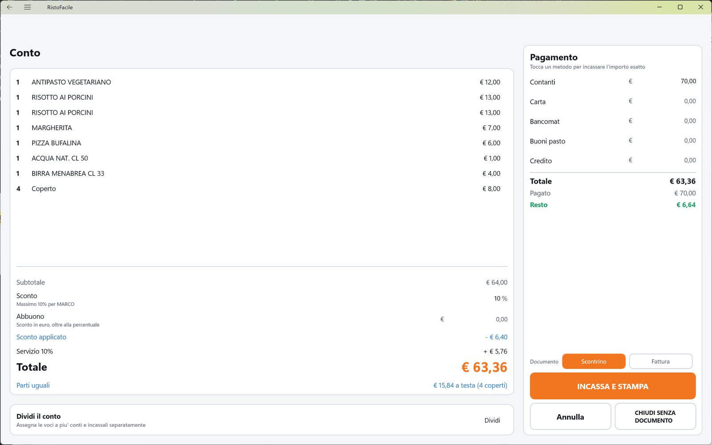
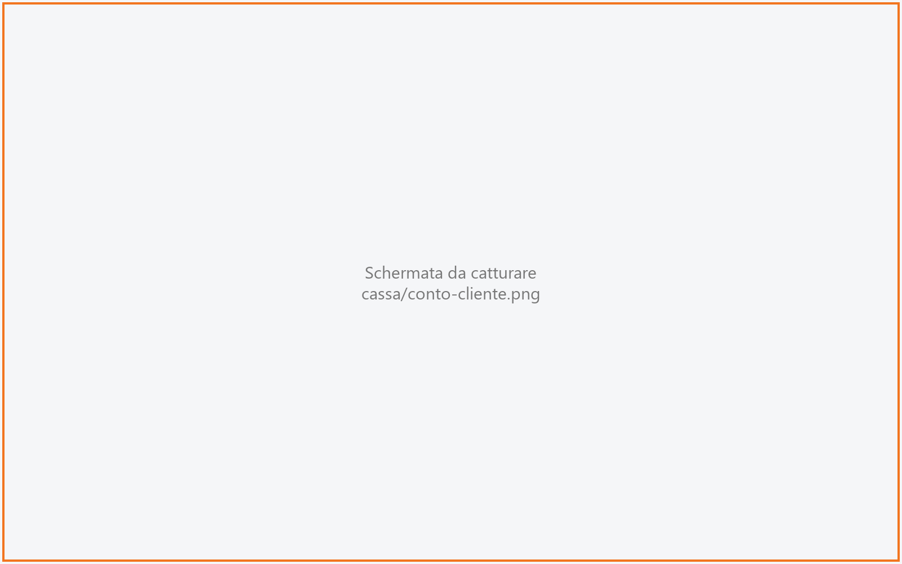
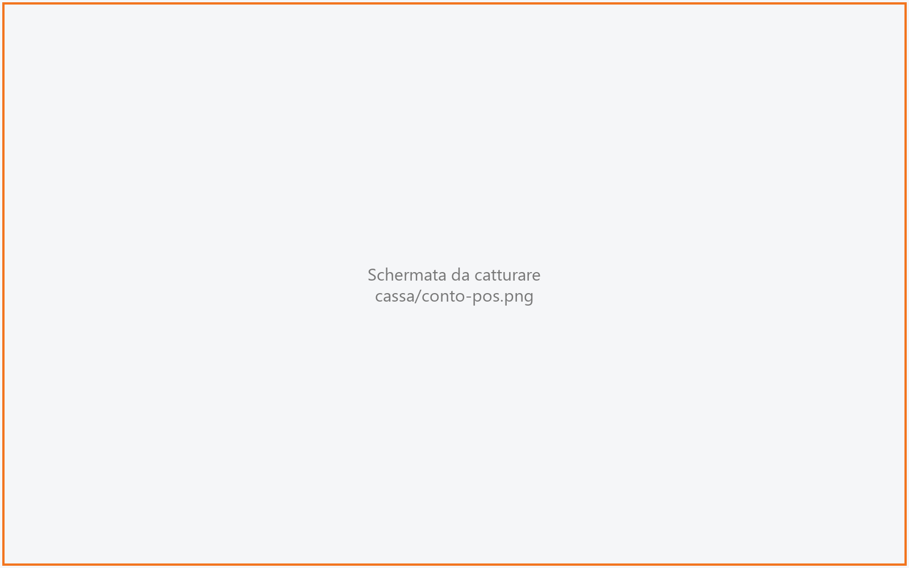
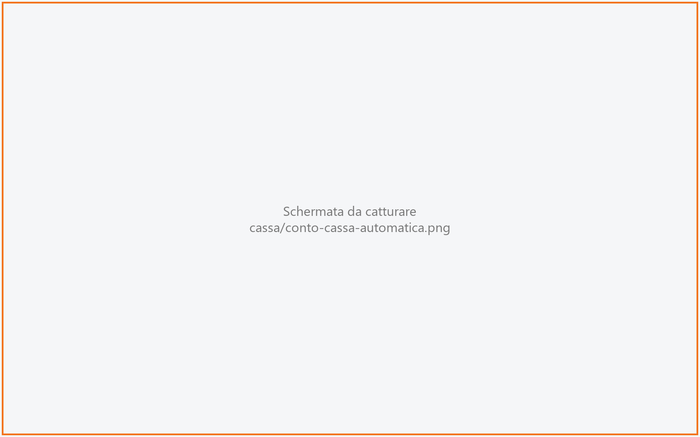
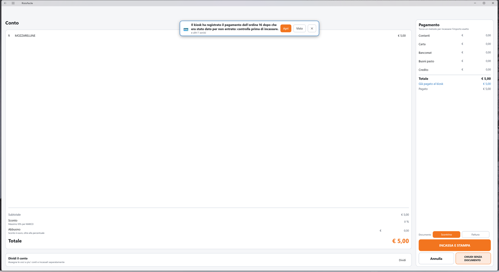
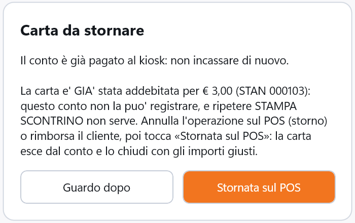
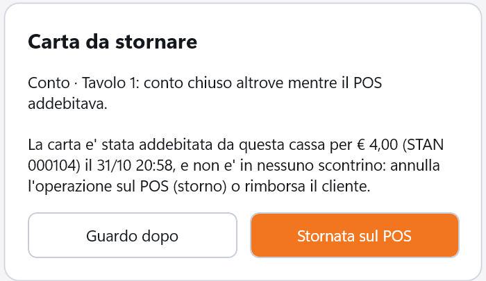

# Conto

Il Conto è la schermata in cui si incassa: mostra le voci da pagare e il totale, raccoglie
gli importi per metodo di pagamento e, con **INCASSA E STAMPA**, chiude il conto ed emette il
documento. La usa il cassiere, o chiunque in sala sia abilitato a incassare.

!!! info "In sintesi"

    - **Dove si trova:** dalla [Comanda](comanda.md), pulsante **CONTO** (oppure **Vai al conto** dal preconto); dalla [divisione del conto](dividi-conto.md); dallo [Storico conti](storico-conti.md) per documentare un conto già chiuso
    - **Chi la usa:** cassiere
    - **Disponibile anche su:** [Palmare](../palmare/conto.md)

---

## A cosa serve

A fine pasto il cliente chiede il conto: dalla comanda del tavolo tocchi **CONTO** e arrivi qui.
Scrivi quanto paga in contanti, con carta o con altri metodi (oppure tocchi il nome del metodo e
la cassa ci mette l'importo esatto), scegli se emettere lo scontrino o la fattura e tocchi
**INCASSA E STAMPA**. Lo scontrino lo emette il servizio sulla stampante fiscale di questa postazione (la predefinita
dell'impianto, se non ne hai scelta una);
a chiusura riuscita il tavolo si libera e torni alla mappa della sala.

Se il tavolo paga separatamente, da qui si apre la [divisione del conto](dividi-conto.md), che
ripartisce le voci su più conti e li fa incassare uno per uno, ciascuno con il suo documento.

## Prima di cominciare

- Una **stampante fiscale** configurata sull'impianto ([Impostazioni](impostazioni.md) ▸ **Stampanti fiscali**): senza, lo scontrino non si emette e il conto resta aperto (vedi [Controlli e messaggi](#controlli-e-messaggi)).
- Per usare **Sconto** e **Abbuono**, l'operatore deve avere **Puo' applicare sconti** e uno **Sconto massimo** in [Operatori](operatori.md).
- Per **CHIUDI SENZA DOCUMENTO** e per l'addebito in camera, l'operatore deve avere **Puo' chiudere il conto** in [Operatori](operatori.md).
- Se la sala del tavolo prevede una percentuale di servizio ([Sale e tavoli](sale-e-tavoli.md)), in [Articoli](articoli.md) deve esistere l'articolo **SERVIZIO** con un'aliquota IVA che abbia un reparto della cassa.
- Facoltativi, in [Impostazioni](impostazioni.md): **Pagamento con carta** (il terminale POS di questa postazione), **Cassa automatica**, **Stampante preconto** (ricevuta del POS, copia di cortesia della fattura, tagliando dell'addebito in camera), **Hotel** (addebito in camera).

## La schermata

La schermata ha due colonne.

**A sinistra, il conto.** In alto il titolo dice quale conto stai incassando: **Conto** per il
tavolo intero, **Conto 2** (o un altro numero) per una parte del conto, **Resto del conto** per
quello che nessuno ha preso nella divisione. Sotto, l'elenco delle voci: quantità, descrizione e
importo. Il coperto compare come una voce («Coperto», con il numero dei coperti come quantità).
Una voce offerta ha importo € 0,00 e sotto la scritta **OMAGGIO -** seguita dal valore offerto.
Seguono sconto e abbuono, l'eventuale servizio, il **Totale** e, da due coperti in su, la riga
**Parti uguali** con la quota a testa. In fondo, il riquadro **Dividi il conto**.

**A destra, il pagamento.** I cinque metodi di pagamento con il loro importo, il riepilogo
(**Totale**, **Pagato**, **Residuo** o **Resto**), la scelta del documento e i pulsanti finali.

Mentre la cassa lavora (caricamento, emissione, chiusura) la schermata si scurisce e compare una
rotella al centro: aspetta che sparisca prima di toccare altro.

## Campi e indicatori

### Colonna del conto

| Elemento | Descrizione |
|---|---|
| **Conto** / **Conto N** / **Resto del conto** | Quale conto si sta incassando: il tavolo intero, uno dei conti della divisione, oppure il resto non assegnato. |
| Elenco delle voci | Quantità, descrizione, importo. Sono le voci **ancora da pagare**: dopo un pagamento parziale compaiono solo le quantità residue. Gli articoli a peso mostrano la quantità in kg. |
| *Parte di questo tavolo e' gia' stata incassata: qui c'e' solo quello che resta.* | Compare quando una parte del tavolo è già stata pagata (per esempio uno dei conti della divisione). |
| **Subtotale** | Somma delle voci, prima di sconto e servizio. |
| **Sconto** | Percentuale di sconto sul conto. Sotto, la riga **Massimo N% per** *operatore* dice il tetto concesso a chi è in turno, oppure che l'operatore non è abilitato agli sconti. |
| **Abbuono** | *Sconto in euro, oltre alla percentuale*: l'arrotondamento a mano («facciamo 50»). |
| **Sconto applicato** | Lo sconto complessivo (percentuale più abbuono), in euro. Compare solo se c'è uno sconto. |
| Avviso in rosso sotto lo sconto | Dice perché l'incasso è bloccato: operatore non abilitato, sconto massimo non impostato, sconto oltre il massimo (vedi [Controlli e messaggi](#controlli-e-messaggi)). |
| **Servizio N%** | Il servizio della sala, calcolato sul conto già scontato. Compare solo se la sala ha una percentuale di servizio. |
| **Totale** | Quanto si incassa su questo conto. |
| **Parti uguali** | *€ X a testa (N coperti)*: solo un numero da leggere, la quota per persona arrotondata per eccesso. Non divide il conto. Compare sul conto intero, da due coperti in su. |
| **Dividi il conto** | *Assegna le voci a piu' conti e incassali separatamente*. Con **Dividi** apri la [divisione del conto](dividi-conto.md). Non compare quando stai già incassando una parte del conto. |

Sconto e abbuono valgono solo sul conto intero: incassando una parte del conto non compaiono.
Lo sconto si controlla sulla percentuale effettiva (percentuale più abbuono): non si aggira il
tetto con l'abbuono.

### Colonna del pagamento

| Elemento | Descrizione |
|---|---|
| **Pagamento** | *Tocca un metodo per incassare l'importo esatto*: toccando il **nome** di un metodo, la cassa aggiunge a quel metodo quanto manca per coprire il totale. |
| **Contanti** | Importo in contanti. Puoi scrivere la cifra ricevuta (es. 50,00 su un conto di 42,00): il resto viene calcolato. |
| **Carta** | Importo pagato con carta di credito. |
| **Bancomat** | Importo pagato con bancomat. |
| **Buoni pasto** | Importo pagato con buoni pasto. |
| **Credito** | Importo non riscosso: conta come pagamento ai fini della copertura del totale. <!-- DA VERIFICARE: come viene stampato sullo scontrino l'importo in "Credito" (voce "non riscosso" della stampante fiscale?) e a chi va intestato il credito. --> |
| **Totale** | Il totale del conto, ripetuto accanto ai pagamenti. |
| **Pagato** | Somma degli importi scritti nei cinque metodi. |
| **Residuo** | In rosso: quanto manca per coprire il totale. Finché c'è un residuo il conto non si incassa. |
| **Resto** | In verde: quanto rendere al cliente. |
| **Già pagato al kiosk** / **Già pagato dal telefono** / **Già pagato dal telefono e al kiosk** | In azzurro, sotto il **Totale**: quanto il cliente ha già pagato al kiosk o dal telefono ([self order](self-order.md)). Conta nel **Pagato** e lo scontrino lo riporta. |
| **Da verificare al kiosk: decidi da «Ordini dal kiosk»** | In ambra: un pagamento del kiosk di cui non si sa se è entrato. Finché non lo decidi da [Ordini dal kiosk](ordini-kiosk.md) il conto non si incassa. |
| **Da rimborsare al cliente (pagato al kiosk)** | Al posto di **Resto**, quando il conto è sceso sotto quello che il cliente ha pagato al kiosk (per esempio dopo uno storno): la differenza va resa al cliente. |
| **Cassa automatica** | Spunta presente solo se su questa postazione è stata scelta una cassa automatica. È accesa all'apertura del conto; spegnila quando il cliente paga al banco a mano o la macchina è in rifornimento. Sotto, la nota dice cosa farà la macchina: **Contanti e carta**, **Solo contanti** oppure **Spenta**. |
| **Documento** | La scelta del documento: **Scontrino** (proposto all'apertura) o **Fattura**. Con l'hotel collegato compare anche **Camera** (e la scritta **Documento** sparisce per fare posto). |
| **Scegli il cliente** | Compare solo con **Fattura**: tocca per scegliere o aggiungere il cliente a cui intestarla. Una volta scelto mostra nome, partita IVA o codice fiscale, recapito e, se prevista, *copia a* indirizzo email. |
| Avviso in rosso sotto il cliente | Con **Fattura**, il primo dato che manca al cliente per la fattura elettronica (es. *Manca: CAP di 5 cifre.*). |
| **Scegli la camera** | Compare solo con **Camera**: tocca per scegliere l'ospite in casa a cui addebitare il conto. |

Una volta che la carta è passata, la cassa automatica ha incassato o lo scontrino è stato emesso,
gli importi non si possono più modificare: il conto registrerà esattamente quello che è avvenuto.

## Pulsanti e comandi

| Comando | Effetto |
|---|---|
| **Dividi** | Apre la [divisione del conto](dividi-conto.md). |
| Nome di un metodo (**Contanti**, **Carta**, **Bancomat**, **Buoni pasto**, **Credito**) | Aggiunge a quel metodo l'importo che manca per coprire il totale. |
| **Scontrino** | Il conto si chiude con lo scontrino, emesso sulla stampante fiscale di questa postazione. |
| **Fattura** | Il conto si chiude con una fattura; se il cliente non è ancora scelto si apre subito il pannello **Cliente della fattura**. |
| **Camera** | Il conto si addebita alla camera di un ospite dell'hotel: niente scontrino, il documento lo emette l'hotel al check-out. Azzera gli importi dei metodi di pagamento e apre la scelta della camera. |
| **INCASSA E STAMPA** | Con **Scontrino**: incassa (carta e cassa automatica, se usate) ed emette lo scontrino. Il testo del pulsante cambia con la situazione: **INCASSA ED EMETTI FATTURA** con la fattura, **ADDEBITA IN CAMERA** con la camera, **STAMPA SCONTRINO** o **EMETTI FATTURA** quando la carta è già stata addebitata. |
| **Annulla** | Torna alla schermata precedente senza incassare. Gli importi scritti non vengono salvati, e nemmeno lo sconto. |
| Freccia indietro (in alto; su Android anche il tasto Indietro) | Torna alla schermata precedente senza incassare, ma **salva lo sconto e l'abbuono** scritti, così il preconto della comanda li porta. Non li salva, e lo dice, quando il conto ha denaro preso o un documento in sospeso: per esempio *Lo sconto non è stato salvato: il conto è in incasso (c'è un documento in sospeso).* o *Lo sconto non è stato salvato: c'è un pagamento del kiosk da verificare.* |
| **CHIUDI SENZA DOCUMENTO** | Chiude il conto e libera il tavolo **senza emettere nessun documento fiscale**, dopo una conferma. Riservato agli operatori con **Puo' chiudere il conto**. Non compare con **Fattura** o **Camera**, né quando stai documentando un conto dallo Storico. |

### Pannello «Cliente della fattura»

Si apre toccando **Fattura** (se il cliente non è ancora scelto) o il campo del cliente. Ha due
passi.

**Ricerca.** Scrivi nel campo *Partita IVA, codice fiscale o ragione sociale* (almeno due
caratteri) e tocca la lente. Tocca un cliente nell'elenco: se ha tutti i dati per la fattura
elettronica viene usato subito, altrimenti si apre la sua scheda per completarla. Se non c'è,
tocca **Cliente nuovo**: la scheda si apre già compilata con quello che avevi cercato (partita
IVA, codice fiscale o ragione sociale).

**Scheda.** *Questi sono i dati che la fattura elettronica pretende.*

| Elemento | Descrizione |
|---|---|
| **Persona** / **Azienda** | Persona fisica o persona giuridica. |
| **Sesso** **M** / **F** | Solo per la persona. |
| **Ditta individuale** | Solo per la persona: se accesa basta la ragione sociale, senza nome. |
| **Cognome** (persona) o **Ragione sociale** | Obbligatorio. |
| **Nome** | Obbligatorio per la persona che non è ditta individuale. |
| **Partita IVA** | Obbligatoria per l'azienda. |
| **Codice fiscale** | Obbligatorio per la persona italiana; 11 o 16 caratteri. |
| **Indirizzo**, **CAP**, **Citta'**, **Prov.**, **Naz.** | Indirizzo obbligatorio; CAP di 5 cifre; provincia di 2 lettere per l'Italia; nazione di 2 lettere. |
| **Invia copia per email** | Se accesa, la fattura in PDF viene spedita all'indirizzo **Email**. Per accenderla serve un indirizzo. |
| **Invia all'Agenzia** | Trasmette la fattura elettronica all'Agenzia delle Entrate. È **spenta a ogni fattura**: va accesa di proposito, ogni volta. |
| **Cod. destinatario** / **oppure PEC** | Uno dei due è obbligatorio; il codice destinatario è di 7 caratteri. |
| **Email**, **Telefono** | Recapiti. |
| **Cerca un altro** | Torna alla ricerca per cambiare cliente. |
| **Usa questo cliente** | Conferma il cliente per la fattura. Se manca qualcosa, la cassa dice cosa. |

Il cliente nuovo, o i dati corretti, vengono salvati nell'archivio insieme alla fattura: se
chiudi il pannello senza emettere, non resta nessun cliente a metà. La X in alto o un tocco
fuori dal pannello lo chiudono.

### Pannello «Addebito in camera»

*Gli ospiti in casa oggi: tocca quello a cui va il conto.* Scrivi nel campo *Numero di camera o
nome dell'ospite* per filtrare l'elenco e tocca l'ospite. Se chiudi il pannello senza scegliere
nessuno, il documento torna su **Scontrino**.

## Come si fa

### Incassare un tavolo con lo scontrino

1. Dalla [Comanda](comanda.md) del tavolo tocca **CONTO**.
2. Controlla voci e **Totale**.
3. Scrivi gli importi nei metodi di pagamento, oppure tocca il nome del metodo (es. **Contanti**) per mettere l'importo esatto.
4. Se il cliente paga in contanti con una banconota più grande, scrivi la cifra ricevuta: la riga **Resto** in verde dice quanto rendere.
5. Controlla che **Residuo** non compaia e che sia acceso **Scontrino**.
6. Tocca **INCASSA E STAMPA**. La schermata si scurisce mentre il servizio emette lo scontrino (con alcune stampanti può volerci qualche decina di secondi).
7. Lo scontrino esce dalla stampante fiscale e torni alla mappa della sala: il tavolo è libero.

### Pagare con la carta sul terminale POS

Se in [Impostazioni](impostazioni.md) ▸ **Pagamento con carta** è stato scelto un terminale per
questa postazione:

1. Scrivi l'importo in **Carta** o **Bancomat** (anche insieme ai contanti).
2. Tocca **INCASSA E STAMPA**.
3. Compare il riquadro *€ X sul terminale: fai passare la carta…* con una barra che si svuota e il tempo che resta (*Ancora N s*): la cassa aspetta il terminale fino a 75 secondi. Confronta l'importo con quello sul display del POS.
4. Il cliente paga sul terminale. Se la stampante preconto è configurata, esce la ricevuta del POS.
5. Subito dopo il servizio emette lo scontrino e il conto si chiude.

Se su questa postazione non è stato scelto nessun terminale, la carta si batte a mano sul POS e
la cassa prosegue senza aspettare niente.

Se il pagamento con carta riesce ma lo scontrino non esce (stampante spenta, carta finita), il
conto resta aperto e la cassa ricorda che la carta è già stata addebitata, anche se esci dalla
schermata e ci torni: il pulsante diventa **STAMPA SCONTRINO** e non riaddebita la carta. Lo
ricorda solo **questa** postazione.

!!! warning "Carta già addebitata"
    Quando un messaggio dice che la carta è GIÀ stata addebitata, non farla ripassare: risolvi il
    problema della stampante e tocca di nuovo il pulsante (**STAMPA SCONTRINO**). Quando invece il
    conto non potrà mai registrare quella carta (per esempio è già pagato al kiosk), la cassa lo
    dice con la domanda [Carta da stornare](#carta-da-stornare).

### Incassare con la cassa automatica

Se su questa postazione è stata scelta una cassa automatica (rendiresto), la spunta **Cassa
automatica** è accesa e:

1. Metti l'importo in **Contanti** (ed eventualmente in **Carta**/**Bancomat**, se la nota dice **Contanti e carta**).
2. Tocca **INCASSA E STAMPA**.
3. Compare il riquadro *€ X nella cassa automatica* con il contatore *Inserito € … — manca € …*. Il cliente inserisce le banconote e le monete nella macchina; la macchina eroga il resto.
4. A incasso completato il servizio emette lo scontrino e il conto si chiude.

Mentre la macchina incassa, nel riquadro ci sono due pulsanti con effetti opposti:

| Comando | Effetto |
|---|---|
| **Annulla e restituisci** | La macchina restituisce tutto quello che il cliente ha inserito: **niente è incassato** e il conto resta aperto. |
| **Chiudi trattenendo** | Solo PagAmico e VNE. La macchina tiene quello che è stato inserito: è un **incasso parziale**, non un annullo. L'importo trattenuto viene scritto in **Contanti** e il conto resta aperto per coprire il resto. |

Con la Cashlogy nel riquadro non c'è nessun pulsante: si legge *Per annullare: dalla finestra del Cashlogy Connector.*

Gli esiti possibili:

- **completato**: i soldi sono entrati, si prosegue con lo scontrino. Se la macchina non ha potuto dare tutto il resto, la cassa avvisa di consegnare a mano la differenza;
- **trattenuto** (incasso parziale): la macchina ha tenuto una parte dei soldi. Succede con **Chiudi trattenendo**, ma anche quando un annullo non restituisce tutto quello che il cliente ha inserito, con qualunque marca. Vedi [Dopo un incasso parziale](#dopo-un-incasso-parziale);
- **completato dopo un annullo**: hai chiesto l'annullo, ma la macchina aveva già concluso il pagamento. Il conto si chiude con l'incasso registrato; se il cliente voleva indietro il denaro, va restituito a conto chiuso;
- **annullato**: la macchina ha restituito **tutti** i soldi, anche quando l'incasso è stato interrotto dal pannello della macchina stessa (o dalla finestra del Cashlogy Connector); il conto resta aperto;
- **rifiutato**: non è entrato niente; la cassa propone di incassare a mano (**Incasso a mano**, o **Carta a mano** per la carta) e proseguire con la chiusura;
- **incerto**: nessuno sa dove siano i soldi. L'incasso del conto resta **da verificare**: vedi [Incasso da verificare](#incasso-da-verificare).

Se la macchina ha già incassato e poi lo scontrino non esce, rientrando nel conto la cassa non
richiede di nuovo i soldi. Anche questo vale solo per **questa** postazione.

### Incasso da verificare

Quando la cassa perde il contatto con la macchina durante un incasso (nessuna risposta, esito
incerto, app chiusa a metà), sul conto compare la riga *Incasso di € X sulla cassa automatica da
verificare* con il tasto **Verifica**. Finché non è chiarito, da questo conto non si incassa
niente: né a mano, né con la macchina, né con la carta; il conto non si divide.

1. Tocca **Verifica** (oppure di nuovo il tasto dell'incasso): la cassa chiede al servizio com'è finito l'incasso.
2. Se l'incasso si era concluso, la cassa ne applica l'esito: per esempio *Cassa automatica: incassati € 20,00, resto € 7,50. Premi INCASSA E STAMPA per chiudere il conto.*
3. Se l'incasso è ancora aperto, la cassa riprende a seguirlo: il cliente può finire di pagare.
4. Se l'incasso era stato rifiutato o era andato in errore, nella macchina non è entrato niente: il segno si toglie e compare *L'incasso precedente di questo conto sulla cassa automatica non e' riuscito (…): nella macchina non e' entrato niente.* Puoi incassare.
5. Se la cassa non raggiunge il servizio, compare *Non riesco a raggiungere il servizio per controllare l'incasso precedente di questo conto sulla cassa automatica (€ X): riprova.* Non scegliere niente a caso: controlla che il servizio sia acceso e in rete, poi tocca di nuovo **Verifica**.
6. Se il servizio non sa più com'è andata (per esempio dopo un suo riavvio), compare la conferma **Incasso da verificare**. L'incasso potrebbe essere andato a buon fine: chiedi al cliente e guarda il giornale del servizio, poi controlla la macchina:
    - se l'operazione è ancora aperta, chiudila con **Sblocca incasso** in [Impostazioni](impostazioni.md) ▸ **Cassa automatica**, che restituisce al cliente quello che ha inserito (con la Cashlogy: dalla finestra del Cashlogy Connector);
    - se nella macchina è rimasto denaro di questo conto, tocca **È entrato denaro** e scrivi quanto (quello che il cliente ha inserito, meno il resto che la macchina gli ha già dato), poi **Registra**. La cassa lo tiene come [trattenuto](#dopo-un-incasso-parziale): al prossimo incasso la macchina chiede solo la differenza, e se l'importo copre il conto la macchina non viene richiamata;
    - quando sei sicuro che per questo conto nella macchina non è rimasto denaro, tocca **Nessun denaro entrato**. Compare *Incasso da verificare chiuso: hai confermato che per questo conto nella cassa automatica non e' entrato niente. Prima di incassare di nuovo, assicurati che il cliente non abbia gia' pagato.*

Come il trattenuto, anche l'incasso da verificare lo conosce solo **questa** cassa: va chiarito da qui.
Uscendo dal conto, buttando la vendita o liberando il tavolo, la cassa lo ricorda con un avviso.

### Dopo un incasso parziale

Quando la macchina ha trattenuto una parte dei soldi, sotto i pagamenti compare la riga
*€ Y gia' trattenuti dalla cassa automatica*. La cassa se ne ricorda anche uscendo dal conto,
sospendendo la vendita al banco o riavviando l'app.

1. Sistema la ripartizione: lascia in **Contanti** l'importo da incassare in contanti (non può essere meno del già trattenuto), oppure sposta il resto su **Carta**/**Bancomat**.
2. Tocca **INCASSA E STAMPA**: la macchina chiede **solo la differenza** (*€ X nella cassa automatica*). Se il trattenuto copre già i contanti, la macchina non viene richiamata.
3. Se la macchina non può incassare (occupata, spenta, o la spunta **Cassa automatica** è spenta), la cassa chiede di incassare a mano **solo la differenza**: *La macchina ha gia' trattenuto € Y: incassa a mano solo € X.*, con il pulsante **Incasso a mano € X**.

Se il trattenuto supera il dovuto (per esempio il conto è stato ridotto), la macchina non viene
richiamata e la cassa dice di consegnare a mano il resto al cliente.

Se hai restituito a mano al cliente i soldi trattenuti, tocca **Restituito** sulla riga del
trattenuto e conferma: da quel momento la cassa non li conta più come incassati.

!!! warning "Il trattenuto lo conosce solo questa cassa"

    Il denaro trattenuto dalla macchina è ricordato solo dalla postazione che ha fatto l'incasso.
    Il conto va finito **da questa cassa**: chiudendolo dal palmare o da un'altra cassa, il
    cliente pagherebbe di nuovo. Per lo stesso motivo, con un trattenuto il conto non si divide
    e non si addebita in camera. Uscendo dal conto la cassa lo ricorda con un avviso.

### Incassare un ordine del kiosk

Gli ordini del kiosk si aprono da [Ordini dal kiosk](ordini-kiosk.md) con **Apri**, poi **CONTO**
dalla comanda.

- **Niente coperto né servizio**, qualunque sia la sala. Se il conto se ne accorge dopo averli
  mostrati, lo dice: *Il conto e' cambiato (e' un ordine del kiosk: niente servizio ne' coperto):
  ricontrolla il totale, ora € …, e premi di nuovo.*
- **Righe da pesare**: con un articolo **DA PESARE** il conto non si apre e si torna alla comanda
  (vedi [Comanda](comanda.md#un-ordine-del-kiosk-con-gli-articoli-a-peso)).
- **«Paga alla cassa»**: si incassa come un conto qualunque. Con l'invio in cucina **dopo**, le
  righe partono per la cucina al primo **INCASSA E STAMPA**, anche se poi la stampante fiscale non
  risponde e il conto resta aperto.
- **Pagato in parte al kiosk**: la riga **Già pagato al kiosk** è già scalata e il **Residuo** dice
  quanto manca. Incassa solo il residuo: con carta, bancomat, buoni pasto o credito oltre il
  residuo la cassa si ferma prima del POS (*Con € 5,00 già pagati dal telefono o dal kiosk i
  pagamenti superano il conto di € 5,00: correggi gli importi (restano da incassare € 3,00). La
  carta non è passata.*).
- **Già pagato per intero al kiosk**: lo scontrino **non** si emette dal conto, ma da
  [Ordini dal kiosk](ordini-kiosk.md#emettere-lo-scontrino-di-un-ordine-pagato-al-kiosk) con
  **Emetti lo scontrino**. Il conto non incassa, né con gli importi vuoti né con un importo scritto
  a mano (contanti compresi), e né il POS né la cassa automatica partono: *Il conto è già pagato al
  kiosk: non incassare di nuovo. Lo scontrino si emette da «Ordini dal kiosk» in cassa («Emetti lo
  scontrino»), non dal conto.* (con gli importi vuoti: *L'ordine è già pagato al kiosk. Lo scontrino
  si emette da «Ordini dal kiosk» in cassa («Emetti lo scontrino»), non dal conto.*).
- **Un ordine che la cassa non deve incassare adesso.** Prima del POS, della cassa automatica e del
  documento il conto rilegge l'ordine, e si ferma se l'ordine nel frattempo è al kiosk: *Al kiosk il
  cliente sta pagando questo ordine: il conto non si incassa adesso. …*, oppure *L'ordine è fermo al
  kiosk: prima prendilo in cassa da «Ordini dal kiosk» («Prendi in cassa»), poi incassalo*. Succede
  con una comanda aperta prima che il cliente cominciasse a pagare al kiosk. Se la carta era già
  passata, va fra le [carte da stornare](#carta-da-stornare).
- **Da verificare**: finché c'è la riga **Da verificare al kiosk**, **INCASSA E STAMPA** risponde
  *C'è un pagamento del kiosk da verificare: decidi da «Ordini dal kiosk» se è entrato.*
- **Solo scontrino o fattura**: con denaro del kiosk nel conto, **CHIUDI SENZA DOCUMENTO**, la
  camera e la divisione del conto sono rifiutati, come per il [self order](self-order.md).
- **Uno storno sotto il pagato al kiosk.** Se togli un piatto dopo che il cliente ha pagato al
  kiosk e il totale scende sotto il pagato, al posto di **Resto** compare **Da rimborsare al
  cliente (pagato al kiosk)**: l'ordine è pagato per intero, e lo scontrino si emette da
  [Ordini dal kiosk](ordini-kiosk.md) con **Emetti lo scontrino**. Lo scontrino porta il totale
  nuovo, e la parte in più del pagamento va a rimborso con l'avviso 💶 *Rimborso di € …, ordine …
  (kiosk …): pagati al kiosk (…) e rimasti fuori dallo scontrino. Rimborsa il cliente.* Il rimborso
  si scrive solo quando la chiusura ha passato tutti i controlli, subito prima dello scontrino: una
  chiusura rifiutata non lascia nessun avviso. Se invece è la stampante fiscale a non emettere,
  l'avviso c'è già, e ripetendo l'emissione non ne nasce un secondo: il rimborso si fa una volta
  sola.

### Carta da stornare

La carta è passata sul POS di **questa** cassa, ma il conto non la può più registrare:

- il conto risulta già pagato al kiosk (il pagamento del kiosk è arrivato mentre il POS
  addebitava), oppure il servizio rifiuta gli importi in un modo che ripetere non cambia: pagamenti
  oltre il conto, acconti che non coprono, un pagamento da verificare, niente da incassare;
- oppure il conto l'ha chiuso un altro mentre il POS addebitava: un'altra cassa, il palmare,
  **Annulla e rimborsa**, il pagamento del kiosk;
- oppure, dopo la carta, il servizio ha rifiutato la chiusura perché l'ordine del kiosk è passato
  in mano al kiosk (*Al kiosk il cliente sta pagando…*, fermo al kiosk) o per un'altra regola degli
  ordini del kiosk. In questi casi non c'è la domanda: l'errore dice che la carta è già stata
  addebitata e che *la mappa della sala te la ricorda fra le carte da stornare*, e la carta entra
  nell'elenco.

La cassa non dice di ripetere **STAMPA SCONTRINO**: chiede **Carta da stornare**, con il motivo,
l'importo e lo STAN dell'operazione, e due risposte.

1. Annulla l'operazione **sul terminale POS** (storno), oppure rimborsa il cliente: la cassa non
   storna da sola, registra solo che l'hai fatto.
2. Tocca **Stornata sul POS**. Con il conto ancora aperto la carta esce dal conto e i suoi importi
   si svuotano: *Carta stornata (€ …): tolta dal conto. Controlla gli importi e premi …*. Puoi
   incassare la differenza in un altro modo.
3. Se adesso non puoi, tocca **Guardo dopo**: la carta entra nell'elenco delle **carte da stornare**
   di questa cassa. Rientrando nel conto, **INCASSA** rifà la stessa domanda.

Finché non tocchi **Stornata sul POS**, la [mappa della sala](mappa-sala.md) e la
[vendita al banco](vendita-al-banco.md), ogni volta che compaiono, ricordano le carte dell'elenco,
una alla volta (*La carta e' stata addebitata da questa cassa per € … (STAN …) il …, e non e' in
nessuno scontrino: annulla l'operazione sul POS (storno) o rimborsa il cliente.*). Con **Guardo
dopo** la stessa carta torna dopo 10 minuti. Al banco il promemoria compare solo se il banco si
apre con il servizio raggiungibile; una postazione che resta su Ordini dal kiosk lo vede tornando
sulla mappa. Se il conto poi si chiude da qui con uno scontrino o
una fattura che contengono la carta, la carta esce dall'elenco da sola; con **CHIUDI SENZA
DOCUMENTO** o con l'addebito in camera no.

!!! warning "La carta da stornare la conosce solo questa cassa"
    L'elenco delle carte da stornare, come la carta addebitata su un conto aperto, sta solo sulla
    postazione che ha addebitato: il palmare e le altre casse non lo vedono, e **reinstallare l'app
    lo cancella**. L'elenco non scade; la carta addebitata su un conto aperto si ricorda per sette
    giorni. Uscendo da un conto con la carta addebitata e non chiusa la cassa avvisa: *La carta e'
    gia' stata addebitata per € … su questo conto, che resta aperto: rientra nel conto da questa
    cassa per chiuderlo (o per dire che l'hai stornata). Il palmare e le altre casse non lo sanno.*

### Emettere la fattura

1. Tocca **Fattura**. Si apre il pannello **Cliente della fattura**.
2. Cerca il cliente per partita IVA, codice fiscale o ragione sociale, oppure tocca **Cliente nuovo**.
3. Completa la scheda se serve e tocca **Usa questo cliente**.
4. Se vuoi trasmettere subito la fattura all'Agenzia delle Entrate, accendi **Invia all'Agenzia** nella scheda del cliente.
5. Scrivi gli importi dei pagamenti e tocca **INCASSA ED EMETTI FATTURA**.
6. Il servizio emette la fattura: la stampante fiscale non viene usata. Il conto si chiude e torni alla mappa della sala.
7. Compare la domanda *Fattura n. … emessa* con le scelte **Stampa la copia di cortesia** (sulla stampante preconto), **Apri la fattura** (il PDF a schermo) e **Niente**.

Se la stampante preconto non è configurata e il PDF si apre dentro l'app, la fattura si apre
subito senza domanda.

### Addebitare il conto in camera

Solo con l'hotel collegato ([Impostazioni](impostazioni.md) ▸ **Hotel**) e per gli operatori con
**Puo' chiudere il conto**.

1. Tocca **Camera**. Si apre l'elenco degli ospiti in casa.
2. Tocca l'ospite.
3. Tocca **ADDEBITA IN CAMERA** e conferma con **Addebita**.
4. L'importo va sul conto della camera; sulla stampante preconto esce il tagliando da far firmare all'ospite. Torni alla mappa della sala.

### Chiudere un conto senza documento

È l'unico modo di liberare il tavolo quando la stampante fiscale non c'è o è guasta.

1. Lascia acceso **Scontrino** (con **Fattura** il pulsante non compare).
2. Tocca **CHIUDI SENZA DOCUMENTO**.
3. Conferma con **Chiudi** il messaggio *Il tavolo verra' chiuso e liberato per € X SENZA emettere nessuno scontrino. Procedere?*
4. Il conto si chiude, il tavolo si libera e torni alla mappa della sala. Nessun documento esce.

In questo caso non serve che i pagamenti coprano il totale, e non vengono interpellati né il
terminale POS né la cassa automatica. La chiusura resta registrata come «senza documento» e lo
scontrino si può emettere più tardi dallo [Storico conti](storico-conti.md).

### Stampare il preconto prima di incassare

Il preconto non si stampa da questa schermata ma dalla [Comanda](comanda.md): **Preconto** mostra
l'anteprima (*documento non valido ai fini fiscali*), **Stampa** la manda alla stampante preconto
e **Vai al conto** porta qui. Il preconto non chiude e non incassa niente: segna soltanto il
tavolo come «preconto» sulla mappa della sala.

## Controlli e messaggi

| Messaggio | Causa | Cosa fare |
|---|---|---|
| *Nessuna voce da incassare su questo conto.* | Il conto non ha voci da pagare. | Torna alla comanda. Un tavolo a zero si chiude dalla comanda stessa, toccando **CONTO**: la cassa propone di chiuderlo senza documento. |
| *Mancano € X da ripartire fra i metodi di pagamento: il conto non si puo' chiudere finche' l'importo non e' coperto per intero.* | Gli importi scritti non coprono il totale. | Completa i pagamenti, o tocca il nome di un metodo per mettere l'importo esatto. |
| *… non e' abilitato ad applicare sconti.* | L'operatore in turno non ha **Puo' applicare sconti**. Il valore scritto viene tolto. | Fai applicare lo sconto a un operatore abilitato. |
| *… non ha uno sconto massimo impostato: va messo in Impostazioni -> Operatori.* | L'operatore è abilitato agli sconti ma con **Sconto massimo** a zero. | Imposta lo sconto massimo in [Operatori](operatori.md). |
| *Sconto N% oltre il massimo consentito a … (M%).* | Lo sconto complessivo (percentuale più abbuono) supera il tetto dell'operatore. | Riduci sconto o abbuono. |
| *Manca: …* | Con **Fattura**: al cliente manca un dato obbligatorio per la fattura elettronica. | Tocca il cliente e completa la scheda. |
| *Per la fattura serve ancora: …* | Hai toccato **Usa questo cliente** con dati mancanti. | Completa i campi elencati. |
| *Scrivi almeno due caratteri: partita IVA, codice fiscale o ragione sociale.* | Ricerca del cliente troppo corta. | Scrivi almeno due caratteri. |
| *Scrivi prima l'indirizzo email del cliente.* | Hai acceso **Invia copia per email** senza indirizzo. | Compila **Email**. |
| *Sul conto c'e' il servizio N%, ma in anagrafica manca l'articolo SERVIZIO con la sua aliquota IVA, o la sua aliquota non ha un reparto della cassa: va creato o sistemato prima di emettere il documento.* | La sala ha il servizio ma l'articolo SERVIZIO manca o è incompleto. | Crea o sistema l'articolo in [Articoli](articoli.md). |
| *Su questo impianto non c'e' una stampante fiscale configurata: per liberare il tavolo usa CHIUDI SENZA DOCUMENTO, e lo scontrino lo emetti piu' tardi da Storico conti.* | Il servizio non ha una stampante fiscale. Il conto resta aperto. | Configura la stampante fiscale, oppure chiudi senza documento e documenta più tardi dallo Storico. |
| *La stampante fiscale n. X non è nell'elenco del servizio.* | La stampante scelta per questa postazione è stata tolta dall'elenco. | Scegli un'altra stampante in Impostazioni ▸ **Stampanti fiscali** ▸ **Stampante di questa postazione**; nel frattempo puoi usare CHIUDI SENZA DOCUMENTO. |
| *La stampante fiscale n. X non è configurata (manca l'indirizzo).* | La stampante scelta non ha l'indirizzo. | Scrivilo nella scheda della stampante, in Impostazioni ▸ **Stampanti fiscali**. |
| *La stampante fiscale non ha risposto: … Premi di nuovo INCASSA E STAMPA: il servizio controlla se lo scontrino e' uscito e non lo ristampa.* | Comunicazione con la stampante interrotta: lo scontrino potrebbe essere uscito. Gli importi si bloccano. | Tocca di nuovo il pulsante: il servizio verifica sulla stampante e non emette due volte. |
| **Scontrino: esito incerto** — *… Guarda la stampante fiscale: lo scontrino di € X e' uscito?* | Il servizio non è riuscito a rileggere la stampante. | Guarda la carta: tocca **E' uscito** o **Non e' uscito**. |
| *… Il conto resta aperto.* | La stampante fiscale ha rifiutato l'emissione (il motivo è nella prima parte del messaggio, quello della stampante). Non è uscito niente. | Risolvi il problema (carta, coperchio, stampante spenta) e tocca di nuovo il pulsante. |
| *Questo conto e' in incasso da un'altra postazione, con uno scontrino in sospeso: l'incasso va finito da li'. Il conto resta aperto.* | Un'altra cassa sta incassando lo stesso tavolo. | Finisci l'incasso dall'altra postazione. |
| *Pagamento con carta non riuscito: … Il conto resta aperto: nessun documento e' stato emesso.* | Il terminale ha rifiutato la carta. | Riprova o cambia metodo. |
| *Nessuna risposta dal terminale: … IL PAGAMENTO POTREBBE ESSERE PASSATO LO STESSO. …* | Il terminale non ha risposto in tempo. | Controlla sul POS (o stampa l'ultima ricevuta) **prima** di riprovare. |
| *La carta e' stata addebitata ma la ricevuta del POS non e' stata stampata.* | Problema sulla stampante preconto. La carta è addebitata. | Non ripassare la carta; il conto prosegue. |
| **Cassa automatica** — *… Vuoi incassare i contanti a mano e proseguire con la chiusura?* | La macchina è occupata, non ha accettato l'incasso o non ha incassato niente. | **Incasso a mano** per proseguire incassando tu, **Annulla** per lasciare il conto aperto. |
| *La cassa automatica ha trattenuto € X: e' un incasso PARZIALE, non un annullo. …* | Hai toccato **Chiudi trattenendo**, o la macchina ha chiuso l'incasso a metà. | Tocca di nuovo **INCASSA E STAMPA** (la macchina chiede solo la differenza) o copri il resto con un altro metodo. |
| *La macchina ha gia' trattenuto € Y: incassa a mano solo € X. Proseguire con la chiusura?* | La macchina non può incassare e su questo conto c'è già un trattenuto. | Incassa a mano solo l'importo indicato. |
| *La cassa automatica ha gia' trattenuto € Y in contanti su questo conto: i contanti non possono essere meno di € Y.* | Hai messo in **Contanti** meno del già trattenuto. | Correggi i contanti, oppure tocca **Restituito** se hai reso i soldi al cliente. |
| *La macchina ha trattenuto € Y su questo conto: finisci l'incasso da questa cassa.* … | Stai uscendo da un conto con un trattenuto. | Rientra nel conto da questa cassa per finire l'incasso. |
| *Questo conto e' stato chiuso da un altro dispositivo: da qui non si incassa piu' niente, ne' carta ne' cassa automatica.* … | Il conto è stato chiuso altrove mentre c'era un trattenuto. | Restituisci al cliente l'importo indicato, poi conferma con **Restituiti**. |
| *Incasso annullato: la cassa ha restituito € X al cliente. …* | Hai toccato **Annulla e restituisci**. | Il conto resta aperto. |
| *La cassa automatica non ha potuto erogare € X di resto: consegnali a mano al cliente.* | Monete o banconote insufficienti nella macchina. | Dai il resto a mano. |
| *Nessuna risposta dalla cassa automatica: … L'INCASSO POTREBBE ESSERE PARTITO LO STESSO. …* / *Non riesco piu' a seguire l'incasso sulla cassa automatica: … IL DENARO POTREBBE ESSERE DENTRO LA MACCHINA. …* | Comunicazione persa con la macchina. L'incasso resta da verificare. | Tocca **Verifica**: vedi [Incasso da verificare](#incasso-da-verificare). |
| **Incasso da verificare** — *L'incasso precedente di questo conto e' da verificare: controlla la macchina …* | Il servizio non sa com'è finito l'incasso precedente di questo conto. | Controlla la macchina; se l'operazione è aperta chiudila con **Sblocca incasso**. Poi tocca **È entrato denaro** e scrivi l'importo, oppure **Nessun denaro entrato**. |
| *Non riesco a raggiungere il servizio per controllare l'incasso precedente di questo conto sulla cassa automatica (€ X): riprova.* | La cassa non raggiunge il servizio: non sa com'è finito l'incasso. | Controlla che il servizio sia acceso e in rete, poi tocca di nuovo **Verifica**. Finché non risponde non si incassa da questo conto. |
| **Denaro entrato** — *Scrivi un importo maggiore di zero, per esempio 12,50.* | Nella domanda dell'importo hai scritto zero o un valore non valido. | Scrivi l'importo rimasto nella macchina, oppure tocca **Annulla**. |
| *Incasso da verificare chiuso dall'operatore. Registrati € X entrati nella cassa automatica. …* | Hai registrato con **È entrato denaro** l'importo rimasto nella macchina. | Premi il tasto dell'incasso: la macchina chiede solo quello che manca. |
| *Annullo con restituzione incompleta: entrati € X, restituiti € Y. …* | L'annullo non ha restituito tutto. | La differenza resta come trattenuto: vedi [Dopo un incasso parziale](#dopo-un-incasso-parziale). |
| *Hai chiesto l'annullo, ma la macchina aveva gia' concluso il pagamento: l'annullo non l'ha disfatto.* … | L'annullo è arrivato a pagamento concluso. | Il conto si chiude; se il cliente voleva indietro il denaro, restituiscilo a conto chiuso. |
| *Se sulla macchina e' rimasto aperto un incasso di QUESTO conto, non incassare a mano: …* | La macchina è occupata, forse proprio dall'incasso di questo conto. | Controlla la macchina prima di incassare a mano. |
| *La cassa automatica impostata su questa postazione non risulta piu' configurata sul servizio: …* | La macchina scelta in Impostazioni non esiste più sul servizio. | Sistema [Impostazioni](impostazioni.md) ▸ **Cassa automatica**. |
| *Lo scontrino di questo conto e' gia' stato emesso: la fattura va fatta dal gestionale.* | Hai scelto **Fattura** dopo che lo scontrino era già uscito. | Emetti la fattura dal gestionale. |
| *Questo conto si documenta con lo scontrino: la fattura va fatta dal gestionale.* | Stai documentando dallo Storico la parte di un conto diviso. | Usa **Scontrino**. |
| *… non e' abilitato a chiudere un conto senza documento fiscale.* | **CHIUDI SENZA DOCUMENTO** toccato da un operatore senza **Puo' chiudere il conto**. | Fai chiudere a un operatore abilitato. |
| *Stai emettendo una fattura: e' quello il documento del conto. Per chiudere senza documento torna su Scontrino.* | **CHIUDI SENZA DOCUMENTO** con **Fattura** scelta. | Torna su **Scontrino**. |
| *Lo scontrino di questo conto potrebbe essere uscito: premi INCASSA E STAMPA, il servizio controlla la stampante.* | **CHIUDI SENZA DOCUMENTO** dopo un esito incerto della stampante. | Tocca di nuovo il pulsante di incasso. |
| *Su questo conto e' gia' stato incassato qualcosa (carta, contanti o scontrino): non si puo' piu' addebitare in camera.* | **Camera** scelta dopo un incasso già avvenuto. | Completa l'incasso con lo scontrino. |
| *… non e' abilitato a chiudere un conto senza scontrino: l'addebito in camera lo fa chi ha "Puo' chiudere".* | Addebito in camera da un operatore non abilitato. | Fai addebitare a un operatore abilitato. |
| *Addebito registrato, ma la stampante del preconto non e' configurata: il tagliando da firmare non e' uscito.* | Manca la stampante preconto. | L'addebito è fatto; fai firmare a mano. |
| *Il conto era gia' stato chiuso da un'altra postazione: non e' stato addebitato niente in camera.* | Il conto era già chiuso altrove. | Nessuna azione. |
| *Impossibile leggere gli ospiti in casa dall'hotel.* | Il collegamento con l'hotel non risponde. | Riprova; verifica [Impostazioni](impostazioni.md) ▸ **Hotel**. |
| *Conto N incassato. Restano € X da incassare su questo tavolo.* | Hai incassato una parte del conto e il tavolo ha ancora voci da pagare. | Si torna alla divisione: incassa gli altri conti. |
| *Questo conto e' stato chiuso da un altro dispositivo.* | Mentre eri qui il conto è stato incassato da un'altra cassa o da un palmare. | Esci con **Annulla**. |
| *Sconto non registrato sulla comanda: l'incasso prosegue con l'importo mostrato.* | Il servizio non ha salvato lo sconto. | L'incasso prosegue; verifica poi lo sconto nello Storico. |
| *Lo sconto non è stato salvato: …* (uscendo con la freccia indietro) | Il conto ha un documento in sospeso, un pagamento del kiosk da verificare, un pagamento dal telefono in corso, oppure lo sconto lo porterebbe sotto quanto già pagato al kiosk o dal telefono. Il motivo è scritto dopo i due punti. | Lo sconto si registra incassando: rientra nel conto quando il caso è risolto. |
| *Stampa della copia di cortesia fallita.* / *La fattura e' stata emessa ma non si e' potuta aprire a schermo.* | Problema di stampa o di visualizzazione dopo l'emissione. | La fattura è emessa: ristampala o aprila dalla schermata [Fatture](fatture.md). |
| *Impossibile caricare il conto.* / *Impossibile chiudere il conto.* | Il servizio non risponde o ha dato errore. | Controlla la connessione e riprova. |
| *Il conto è già pagato al kiosk: non incassare di nuovo. Lo scontrino si emette da «Ordini dal kiosk» in cassa («Emetti lo scontrino»), non dal conto.* | Hai scritto un importo su un conto che il cliente ha già pagato per intero al kiosk. Né il POS né la cassa automatica sono partiti (*La carta non è passata.*). | Esci dal conto ed emetti lo scontrino da [Ordini dal kiosk](ordini-kiosk.md#emettere-lo-scontrino-di-un-ordine-pagato-al-kiosk). |
| *L'ordine è già pagato al kiosk. Lo scontrino si emette da «Ordini dal kiosk» in cassa («Emetti lo scontrino»), non dal conto.* | Lo stesso, con gli importi vuoti. | Come sopra. |
| *Al kiosk il cliente sta pagando questo ordine: il conto non si incassa adesso. Aspetta che finisca e guarda «Ordini dal kiosk» in cassa.* | Mentre il conto era aperto il cliente ha cominciato a pagare l'ordine al kiosk. | Aspetta l'esito, poi guarda [Ordini dal kiosk](ordini-kiosk.md). |
| *L'ordine è fermo al kiosk: prima prendilo in cassa da «Ordini dal kiosk» («Prendi in cassa»), poi incassalo.* | L'ordine è ancora in mano al kiosk. | Tocca **Prendi in cassa** in [Ordini dal kiosk](ordini-kiosk.md#prendere-in-cassa-un-ordine-fermo-al-kiosk). |
| *L'ordine del kiosk è già chiuso.* / *…: il conto non si incassa da qui. Guarda «Ordini dal kiosk» in cassa.* | L'ordine è stato chiuso intanto, o è in uno stato che dal conto non si incassa. | Guarda [Ordini dal kiosk](ordini-kiosk.md). |
| *Lo stato dell'ordine del kiosk non si è potuto rileggere: riprova.* | Prima di incassare il conto non è riuscito a rileggere l'ordine dal servizio. | Riprova fra un attimo. |
| *Con € … già pagati dal telefono o dal kiosk i pagamenti superano il conto di € …: correggi gli importi (restano da incassare € …).* | Carta, bancomat, buoni pasto o credito oltre quello che resta da pagare. | Scrivi solo quello che resta. |
| *C'è un pagamento del kiosk da verificare: decidi da «Ordini dal kiosk» se è entrato.* | Sul conto c'è denaro del kiosk da verificare. | Decidi da [Ordini dal kiosk](ordini-kiosk.md#decidere-un-pagamento-da-verificare). |
| *Su questo tavolo c'e' un pagamento dal telefono o dal kiosk: il conto si chiude con lo scontrino o la fattura, non senza documento, in camera o diviso.* | **CHIUDI SENZA DOCUMENTO**, **Camera** o **Dividi** su un conto con pagamenti del telefono o del kiosk. | Chiudi con **Scontrino** o **Fattura**. Un ordine pagato al kiosk si annulla solo con **Annulla e rimborsa**. |
| *Non riesco a sapere dal servizio se il tavolo ha pagato dal telefono o dal kiosk: riprova fra un attimo.* / *Non riesco a sapere dal servizio se questo e' un ordine del kiosk: riprova fra un attimo.* | Il servizio non ha risposto. | Riprova fra un attimo. |
| *Il conto e' cambiato (e' un ordine del kiosk: niente servizio ne' coperto): ricontrolla il totale, ora € …, e premi di nuovo.* | Il conto ha scoperto solo adesso che è un ordine del kiosk. | Ricontrolla il totale e tocca di nuovo il pulsante. |
| *Ci sono articoli a peso da pesare: conferma i pesi prima di incassare.* | Ordine del kiosk con righe **DA PESARE**: la cassa torna alla comanda. | Pesa le righe (vedi [Comanda](comanda.md#un-ordine-del-kiosk-con-gli-articoli-a-peso)). |
| **Carta da stornare** — *… La carta e' GIA' stata addebitata per € … (STAN …): questo conto non la puo' registrare, e ripetere STAMPA SCONTRINO non serve. …* | La carta è passata, ma il conto non la può registrare (per esempio è già pagato al kiosk). | Storna sul POS o rimborsa, poi **Stornata sul POS**; altrimenti **Guardo dopo**. Vedi [Carta da stornare](#carta-da-stornare). |
| **Carta da stornare** — *… La carta e' GIA' stata addebitata qui per € … (STAN …), ma il conto l'ha chiuso un altro senza di lei: …* | Il conto è stato chiuso altrove mentre il POS addebitava. | Storna sul POS o rimborsa, poi **Stornata sul POS**: finché non lo fai, la mappa te lo ricorda. |
| *Carta da stornare: € … addebitati su questo conto (STAN …). Il conto non si chiude con lei: stornala sul POS, poi premi …* | Hai risposto **Guardo dopo**. | Storna la carta, poi tocca il pulsante dell'incasso e rispondi **Stornata sul POS**. |
| *La carta e' gia' stata addebitata per € … su questo conto, che resta aperto: rientra nel conto da questa cassa per chiuderlo (o per dire che l'hai stornata). Il palmare e le altre casse non lo sanno.* | Esci dal conto con una carta addebitata e non chiusa. | Rientra nel conto da questa cassa. |

## Note

- **Prima i soldi, poi il documento.** Con **INCASSA E STAMPA** la cassa fa nell'ordine: carta sul terminale, contanti nella cassa automatica, documento. Se un passo non riesce non esce nessun documento e il conto resta aperto.
- **Dopo la chiusura.** Con lo scontrino, la chiusura senza documento o l'addebito in camera: la comanda viene chiusa, il tavolo si libera (se non ha altre comande aperte), gli eventuali tavoli uniti tornano separati e torni alla mappa della sala (o all'elenco dell'asporto, se avevi aperto la comanda da lì). Un ordine d'asporto passa a «consegnato»; un ordine a domicilio no: la consegna la segna chi la fa.
- **Incasso di una parte del conto.** Se dopo l'incasso il tavolo ha ancora voci da pagare, si torna alla [divisione](dividi-conto.md); quando l'ultimo conto è incassato la comanda si chiude e si torna alla mappa della sala.
- **Due postazioni sullo stesso tavolo.** Finché stai incassando, la cassa non aggiorna il conto con le modifiche fatte altrove (un totale che cambia sotto un contante già contato è peggio di uno vecchio). Se non hai ancora cominciato, il conto si aggiorna da solo.
- **Ricordo dell'incasso in corso.** Carta già addebitata, incasso della cassa automatica e denaro trattenuto restano ricordati per sette giorni, **solo sulla postazione** che li ha fatti, finché il conto non si chiude. Le [carte da stornare](#carta-da-stornare) restano finché non tocchi **Stornata sul POS**. Reinstallando l'app si perdono tutti.
- **Buttare un conto con un trattenuto.** Prima di **Butta via** al banco, di rifiutare o segnare non ritirato un asporto e di liberare un tavolo, se la macchina ha trattenuto soldi su quel conto la cassa chiede: *La macchina ha trattenuto € Y su questo conto: restituiscili al cliente prima di proseguire.* Con **Annulla** non si cancella niente.
- **Licenza dimostrativa.** Durante un incasso la finestra della versione dimostrativa non compare: viene rimandata a dopo.
- **Conti documentati dallo Storico.** Aprendo il conto dallo [Storico conti](storico-conti.md) per emettere lo scontrino di un conto chiuso senza documento, si sceglie solo fra **Scontrino** e **Fattura**: terminale POS, cassa automatica, **Camera** e **CHIUDI SENZA DOCUMENTO** non entrano in gioco, perché i soldi sono già stati incassati. <!-- DA VERIFICARE: in questa modalità, sul conto intero, il riquadro "Dividi il conto" e i campi Sconto/Abbuono restano visibili e utilizzabili su una comanda già chiusa: è voluto? -->

## Vedi anche

- [Comanda](comanda.md)
- [Dividi conto](dividi-conto.md)
- [Mappa della sala](mappa-sala.md)
- [Storico conti](storico-conti.md)
- [Fatture](fatture.md)
- [Operatori](operatori.md)
- [Impostazioni](impostazioni.md)
- [Conto sul palmare](../palmare/conto.md)
- [Self order](self-order.md)
- [Ordini dal kiosk](ordini-kiosk.md)
