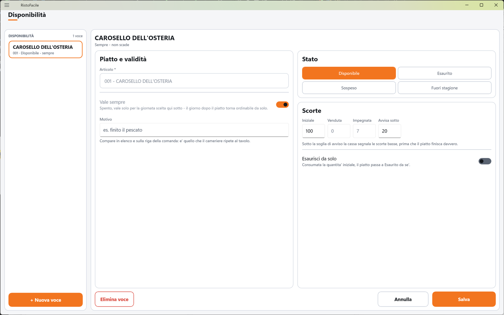

# Disponibilità

Qui si dichiara che un piatto è finito, sospeso o fuori stagione, e si possono contare le porzioni
disponibili per la serata. In Comanda quel piatto smette di essere ordinabile e il cameriere vede
perché. La usa il titolare, il responsabile di sala o la cucina che comunica cosa è finito.

!!! info "In sintesi"

    - **Dove si trova:** Menu ▸ Disponibilità
    - **Chi la usa:** titolare / responsabile di sala
    - **Disponibile anche su:** solo cassa (l'effetto si vede anche sul palmare)

---

## A cosa serve

Alle nove il pescato è finito: invece di avvisare a voce ogni cameriere, lo si segna **Esaurito**
con il motivo «finito il pescato». Da quel momento in Comanda, sulla cassa e sul palmare, il piatto
compare spento con la scritta **ESAURITO** e non si può più aggiungere.

Si possono anche contare le porzioni: la cucina prepara 12 porzioni di lasagna; scrivi 12 come
quantità **Iniziale**, accendi **Esaurisci da solo** e una soglia di avviso di 3. Ogni porzione
inviata in cucina viene contata; sotto le 3 rimaste in Comanda compare «ULTIME N», a zero il piatto
diventa esaurito da solo.

## Prima di cominciare

- L'articolo deve esistere in [Articoli](articoli.md).

## La schermata

- **A sinistra, l'elenco** (**DISPONIBILITÀ** e il numero di voci): una tessera per voce con il
  nome del piatto, il codice, lo stato e la validità (es. «123 · Esaurito - sempre» oppure
  «123 · Sospeso - 20/10/2026»), e il motivo se c'è. Le voci che bloccano il piatto stanno in cima e
  portano la pastiglia dello stato. In fondo **+ Nuova voce**.
- **A destra, la scheda** della voce toccata, su due colonne: **Piatto e validità** e lo stato con
  le scorte. Finché non scegli nulla compare **Tocca una voce** con «Qui si dichiara che un piatto
  e' finito, sospeso o fuori stagione. In comanda quel piatto smette di essere ordinabile - e si
  vede perche'.»

In testa alla scheda il nome del piatto e la validità («Sempre - non scade» oppure «Solo per il
gg/mm/aaaa»). In fondo **Elimina voce**, **Annulla** e **Salva**.

## Campi e indicatori

**Piatto e validità**

| Elemento | Descrizione |
|---|---|
| **Articolo \*** | Il piatto, scelto con la finestra **Cerca articolo**. Si sceglie solo su una voce nuova. |
| **Vale sempre** | «Spento, vale solo per la giornata scelta qui sotto - il giorno dopo il piatto torna ordinabile da solo.» Si sceglie solo su una voce nuova. |
| **Giorno** | Compare se **Vale sempre** è spento: il giorno di validità. |
| **Motivo** | Es. «finito il pescato». «Compare in elenco e sulla riga della comanda: e' quello che il cameriere ripete al tavolo.» <!-- DA VERIFICARE: nel codice della Comanda (cassa e palmare) il motivo non risulta mostrato; compare solo in questo elenco. --> |

**Stato**

| Elemento | Descrizione |
|---|---|
| **Disponibile** / **Esaurito** / **Sospeso** / **Fuori stagione** | Lo stato del piatto. Con **Esaurito**, **Sospeso** o **Fuori stagione** il piatto non si può ordinare. Una voce nuova parte da **Esaurito**. |

**Scorte**

| Elemento | Descrizione |
|---|---|
| **Iniziale** | Le porzioni disponibili. Zero: il piatto non è gestito a porzioni. |
| **Venduta** | Non modificabile. <!-- DA VERIFICARE: chi aggiorna la quantità «Venduta»? Nel codice di cassa e servizio non risulta aggiornata in automatico. --> |
| **Impegnata** | Non modificabile. Le porzioni inviate in cucina: cresce quando una riga parte per la cucina e cala se la riga viene stornata. |
| **Avvisa sotto** | «Sotto la soglia di avviso la cassa segnala le scorte basse, prima che il piatto finisca davvero.» In Comanda il piatto mostra «ULTIME N». Zero: nessun avviso. |
| **Esaurisci da solo** | «Consumata la quantita' iniziale, il piatto passa a Esaurito da se'.» |

Le porzioni rimaste sono: **Iniziale** meno **Venduta** meno **Impegnata**.

## Pulsanti e comandi

| Comando | Effetto |
|---|---|
| **+ Nuova voce** | Apre una scheda vuota (stato **Esaurito**, **Vale sempre** acceso). |
| Casella **Articolo \*** | Apre la finestra **Cerca articolo** (vedi [Articoli](articoli.md)). |
| **Salva** | Salva la voce. Spento finché non è scelto l'articolo. |
| **Annulla** | Rimette la scheda com'era; su una voce nuova, chiude la scheda. |
| **Elimina voce** | Elimina la voce, dopo conferma: il piatto torna disponibile. |

## Come si fa

### Segnare un piatto esaurito per stasera

1. Tocca **+ Nuova voce**.
2. Tocca la casella **Articolo \*** e scegli il piatto.
3. Spegni **Vale sempre** e controlla che il **Giorno** sia oggi.
4. Lascia lo stato **Esaurito** e scrivi il **Motivo**.
5. Tocca **Salva**. La voce compare in cima all'elenco; in Comanda il piatto è spento con la
   scritta **ESAURITO**.

### Rimettere in vendita un piatto

1. Tocca la voce nell'elenco.
2. Tocca **Disponibile** (oppure **Elimina voce**).
3. Tocca **Salva**. Il piatto torna ordinabile.

### Contare le porzioni

1. Crea la voce del piatto con stato **Disponibile**.
2. In **Iniziale** scrivi le porzioni (es. 12) e in **Avvisa sotto** la soglia (es. 3).
3. Accendi **Esaurisci da solo**.
4. Tocca **Salva**. Man mano che le porzioni vanno in cucina, **Impegnata** cresce; sotto la soglia
   in Comanda compare «ULTIME N», a zero il piatto diventa esaurito.

## Controlli e messaggi

| Messaggio | Causa | Cosa fare |
|---|---|---|
| *L'articolo e' obbligatorio.* | Voce senza articolo. | Scegli l'articolo. |
| *Le quantita' devono essere numeri validi.* | Una quantità non è un numero. | Correggi le quantità (usa il punto per i decimali). |
| *Il punto vendita dev'essere un numero maggiore o uguale a zero.* / *Il canale dev'essere un numero maggiore o uguale a zero.* | Dati interni non validi. | Ricrea la voce. |
| *Articolo non trovato in anagrafica.* | Il codice scelto non esiste più in anagrafica. | Scegli un altro articolo. |
| **Modifiche non salvate** — *La scheda di "…" ha modifiche non salvate. Vuoi abbandonarle?* | Hai cambiato voce senza salvare. | **Abbandona** o **Resta qui**. |
| **Elimina disponibilita** — *Eliminare definitivamente questa disponibilita per l'articolo "…"? L'articolo torna disponibile come tutti gli altri.* | Hai toccato **Elimina voce**. | **Elimina** o **Annulla**. |
| *Un'altra postazione ha modificato questi dati prima di te: adesso vedi la versione aggiornata, rifai la modifica e salva.* | Modifica concorrente (anche dal conteggio automatico delle porzioni). | Rifai la modifica. |
| *Un'altra postazione ha eliminato questi dati mentre li stavi modificando: non ci sono piu' e non c'e' niente da salvare.* | Voce eliminata altrove. | Nessuna azione. |
| *Impossibile caricare le disponibilita.* / *Impossibile salvare la disponibilita.* / *Impossibile eliminare la disponibilita.* | Il servizio non risponde o rifiuta l'operazione. | Controlla il collegamento e riprova. |

## Note

- Articolo, validità (sempre o giorno) non si cambiano su una voce già salvata: per cambiarli
  elimina la voce e creane una nuova.
- Un piatto esaurito resta visibile in Comanda, spento: non viene mai nascosto.
- Lo stato vale anche per il [menu online](menu-online.md).
  <!-- DA VERIFICARE: in Comanda la voce applicata è la prima trovata per l'articolo, senza guardare il giorno: una voce «solo per il giorno X» sembra restare valida anche nei giorni dopo, e con una voce «sempre» e una del giorno vince quella «sempre». Va verificato a schermo. -->

## Vedi anche

- [Comanda](comanda.md)
- [Menu](menu.md)
- [Articoli](articoli.md)
- [Menu online](menu-online.md)
