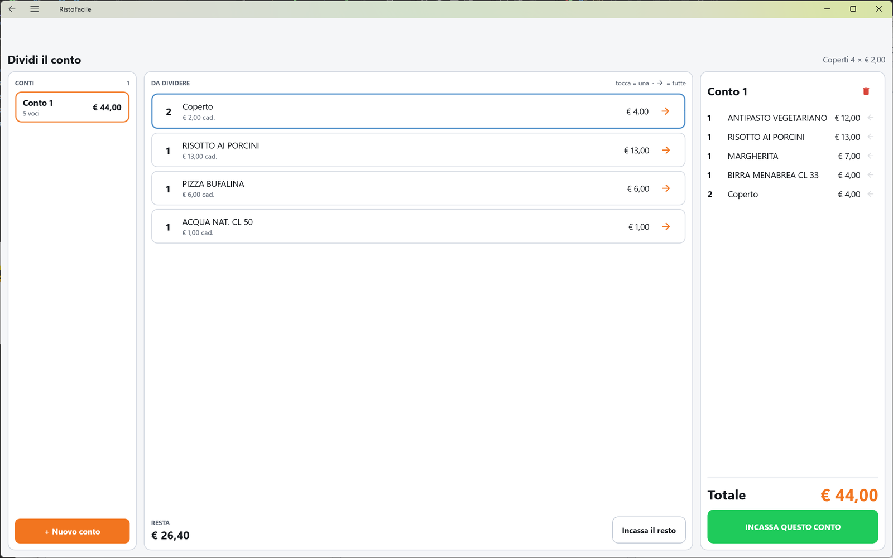

# Dividi il conto

Qui si divide il conto di un tavolo quando i clienti pagano separatamente: si assegnano le voci
(piatti, bevande, coperti) a **Conto 1**, **Conto 2** e così via, e si incassa un conto alla
volta, ciascuno con il suo scontrino o la sua fattura. La usa il cassiere.

!!! info "In sintesi"

    - **Dove si trova:** dal [Conto](conto.md) del tavolo, riquadro **Dividi il conto** ▸ **Dividi**
    - **Chi la usa:** cassiere
    - **Disponibile anche su:** [Palmare](../palmare/conto.md)

---

## A cosa serve

Un tavolo di quattro: due coppie vogliono pagare ognuna il suo. Dal conto del tavolo tocchi
**Dividi**, metti sul **Conto 1** quello che ha preso la prima coppia (con i suoi due coperti),
incassi il Conto 1, e il resto lo incassi con **Incassa il resto**. Ogni conto ha il suo
documento e i suoi metodi di pagamento.

La divisione viene salvata subito, a ogni tocco: se esci e rientri, o se apri lo stesso tavolo
da un'altra cassa o dal palmare, ritrovi i conti come li hai lasciati.

## Prima di cominciare

- Il tavolo deve avere una comanda con delle voci, aperta dal [Conto](conto.md).

## La schermata

In alto il titolo **Dividi il conto** e, a destra, i coperti ancora da pagare con il loro prezzo
(*Coperti N × € P*). Sotto, tre colonne:

- **CONTI**, a sinistra: una tessera per conto, con nome (**Conto 1**, **Conto 2**…), numero di voci (**vuoto**, **1 voce**, **N voci**) e totale. Il conto su cui stai lavorando (il conto attivo) ha il bordo arancione. In fondo, **+ Nuovo conto**.
- **DA DIVIDERE**, al centro: le voci che nessun conto ha ancora preso, con la quantità libera, la descrizione, il prezzo unitario (*€ X cad.*) e l'importo. La legenda in alto ricorda il gesto: *tocca = una · (freccia) = tutte*. In fondo, **RESTA** con il totale di quello che non è su nessun conto, e il pulsante **Incassa il resto**.
- **Il conto attivo**, a destra: titolo (**Conto N**), le voci che contiene, il **Totale** e il pulsante **INCASSA QUESTO CONTO**.

## Campi e indicatori

| Elemento | Descrizione |
|---|---|
| *Coperti N × € P* | I coperti ancora da pagare sul tavolo e il prezzo del coperto. |
| **CONTI** e numero | Quanti conti ci sono nella colonna. |
| Tessera del conto | Nome, voci contenute e totale (servizio della sala compreso). |
| **DA DIVIDERE** | Le voci non ancora assegnate. Il numero grande a sinistra è la quantità ancora libera (in kg per gli articoli a peso). |
| Voce **Coperto** | I coperti compaiono come una voce con il bordo azzurro: si assegnano ai conti come i piatti. |
| **OMAGGIO** | La voce è offerta: resta nel conto, con importo € 0,00. |
| *N su altri conti* | Una parte della voce è già stata assegnata ad altri conti: spiega perché, per esempio, una riga da 4 ne mostra solo 1. |
| *Non resta niente da dividere: e' tutto su un conto.* | Tutte le voci sono assegnate. |
| **RESTA** | Il totale delle voci non assegnate. |
| Titolo del conto attivo | **Conto N**. |
| *Tocca una voce al centro per metterla su questo conto.* | Il conto attivo è vuoto. |
| Voce nel conto attivo | Quantità, descrizione, importo; la freccia indietro ricorda che toccandola torna fra le voci da dividere. Una voce offerta mostra **OMAGGIO -** seguito dal valore. |
| **Totale** | Il totale del conto attivo, servizio della sala compreso: è quello che si incasserà. |

## Pulsanti e comandi

| Comando | Effetto |
|---|---|
| Tocco su una tessera in **CONTI** | Quel conto diventa il conto attivo. |
| **+ Nuovo conto** | Apre un conto nuovo, vuoto, e lo rende attivo. Appare sbiadito quando non serve (non resta niente da dividere, o c'è già un conto vuoto): toccandolo la cassa dice perché. |
| Tocco su una voce in **DA DIVIDERE** | Mette **una** unità della voce sul conto attivo. Per gli articoli a peso sposta tutto il peso. |
| Freccia a destra della voce in **DA DIVIDERE** | Mette **tutta** la quantità libera della voce sul conto attivo. |
| Tocco su una voce del conto attivo | Rimette **una** unità fra le voci da dividere (per gli articoli a peso, tutto il peso). |
| Cestino accanto al titolo del conto attivo | Svuota il conto: tutte le sue voci tornano fra quelle da dividere, dopo conferma. Compare solo su un conto che contiene qualcosa. |
| **INCASSA QUESTO CONTO** | Apre il [Conto](conto.md) con le sole voci del conto attivo (titolo **Conto N**). Spento se il conto attivo è a zero. |
| **Incassa il resto** | Apre il [Conto](conto.md) con le voci non assegnate (titolo **Resto del conto**). Spento se non resta niente. |
| Freccia indietro, in alto | Torna al conto del tavolo. La divisione resta salvata. |

## Come si fa

### Dividere il conto fra due coppie

1. Dal [Conto](conto.md) del tavolo tocca **Dividi**. Si apre la schermata con **Conto 1** già attivo.
2. In **DA DIVIDERE** tocca le voci della prima coppia: ogni tocco ne sposta una unità sul Conto 1. Per spostare tutta una riga tocca la freccia a destra.
3. Tocca due volte la voce **Coperto** per mettere due coperti sul Conto 1.
4. Se hai messo una voce di troppo, toccala nella colonna di destra: torna al centro.
5. Tocca **INCASSA QUESTO CONTO**. Si apre il conto con titolo **Conto 1** e le sole voci assegnate.
6. Incassa come al solito (vedi [Conto](conto.md)). Compare *Conto 1 incassato. Restano € X da incassare su questo tavolo.* e torni qui: il Conto 1 non c'è più.
7. Tocca **Incassa il resto** e incassa la seconda coppia. Il tavolo si chiude e torni alla mappa della sala.

### Dividere fra più di due persone

1. Riempi il Conto 1 come sopra.
2. Tocca **+ Nuovo conto**: compare **Conto 2**, attivo.
3. Assegna le voci della seconda persona; ripeti per gli altri.
4. Per lavorare su un conto già creato, tocca la sua tessera in **CONTI**.
5. Incassa i conti uno alla volta con **INCASSA QUESTO CONTO**, e quello che resta con **Incassa il resto**.

### Rifare la divisione di un conto

1. Tocca la tessera del conto in **CONTI**.
2. Tocca il cestino accanto al titolo.
3. Conferma con **Svuota** la domanda *Rimettere tutto quello che c'e' su Conto N fra le voci da dividere?*
4. Le voci tornano in **DA DIVIDERE**.

## Controlli e messaggi

| Messaggio | Causa | Cosa fare |
|---|---|---|
| *Conto N e' ancora vuoto: riempi quello prima di aprirne un altro. Un conto esiste solo quando ha qualcosa dentro.* | **+ Nuovo conto** con un conto vuoto già presente. La cassa rende attivo il conto vuoto. | Assegna qualcosa a quel conto. |
| *Non resta niente da dividere: un conto nuovo nascerebbe vuoto e ci resterebbe. Rimetti prima qualcosa fra le voci da dividere, oppure incassa uno dei conti.* | **+ Nuovo conto** quando tutte le voci sono già assegnate. | Togli qualcosa da un conto o incassa. |
| *Impossibile aggiornare la divisione del conto.* | Il servizio non ha registrato l'assegnazione. La cassa rilegge la divisione dal servizio. | Controlla la connessione e ripeti il tocco. |
| *Impossibile caricare la divisione del conto.* | Il servizio non risponde. | Controlla la connessione ed esci e rientra. |
| *Impossibile svuotare il conto.* | Il servizio non ha svuotato il conto. | Riprova. |

## Note

- **Un documento per conto.** Ogni conto si incassa a parte e ha il suo documento: scontrino, fattura (anche per un solo conto) oppure, per chi è abilitato, chiusura senza documento. Sconto e abbuono invece si applicano solo al conto intero: incassando un singolo conto non compaiono.
- **Il servizio della sala** si calcola su ogni conto, sulle sue voci.
- **Divisione condivisa.** I conti si salvano sul servizio a ogni tocco: un'altra cassa o un palmare che apre lo stesso tavolo vede la stessa divisione, e la schermata si aggiorna da sola con le modifiche fatte altrove (non mentre un tuo tocco è ancora in corso).
- **Conto vuoto.** Un conto appena aperto esiste solo su questa schermata finché non gli assegni qualcosa: se esci, un conto rimasto vuoto sparisce.
- **Parti uguali.** Al momento non è possibile dividere un conto in parti uguali in automatico: la riga **Parti uguali** del [Conto](conto.md) dice solo la quota a testa. Per incassare a persone diverse si assegnano le voci ai conti.
- **Voci a prezzo zero.** Le voci senza prezzo proprio (per esempio le parti di un piatto composto, il cui prezzo sta sul piatto) non compaiono fra quelle da dividere: si spostano con il piatto a cui appartengono. <!-- DA VERIFICARE: confermare che le componenti di un piatto composto (mezza e mezza, menu fisso) seguano davvero il piatto principale quando questo viene assegnato a un conto. -->
- Le voci si possono anche mandare su un conto già mentre si prende la comanda, scegliendo il conto attivo nella [Comanda](comanda.md): qui le ritrovi già assegnate.

## Vedi anche

- [Conto](conto.md)
- [Comanda](comanda.md)
- [Mappa della sala](mappa-sala.md)
- [Conto sul palmare](../palmare/conto.md)
