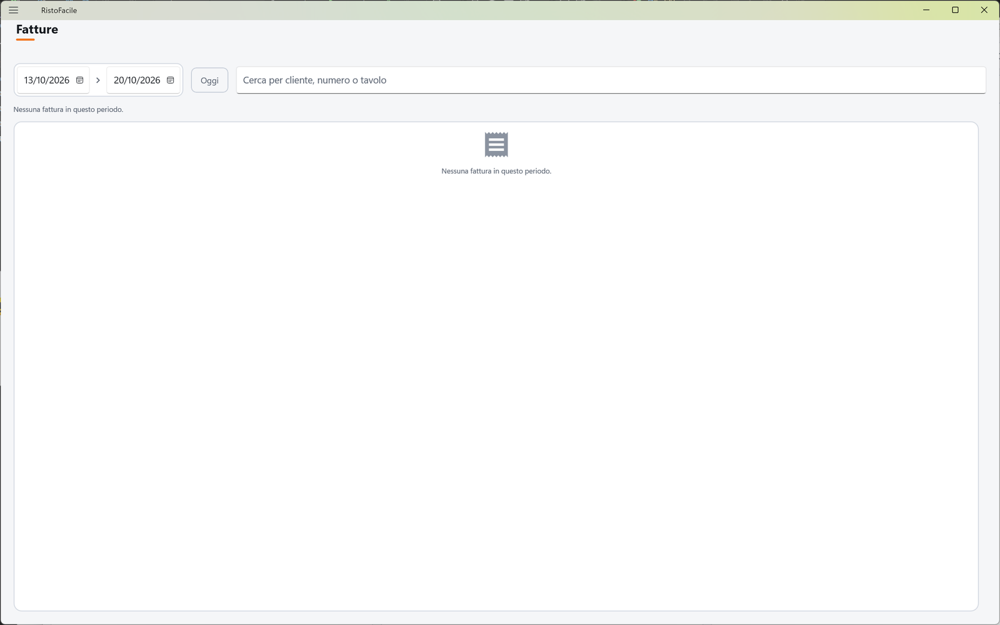
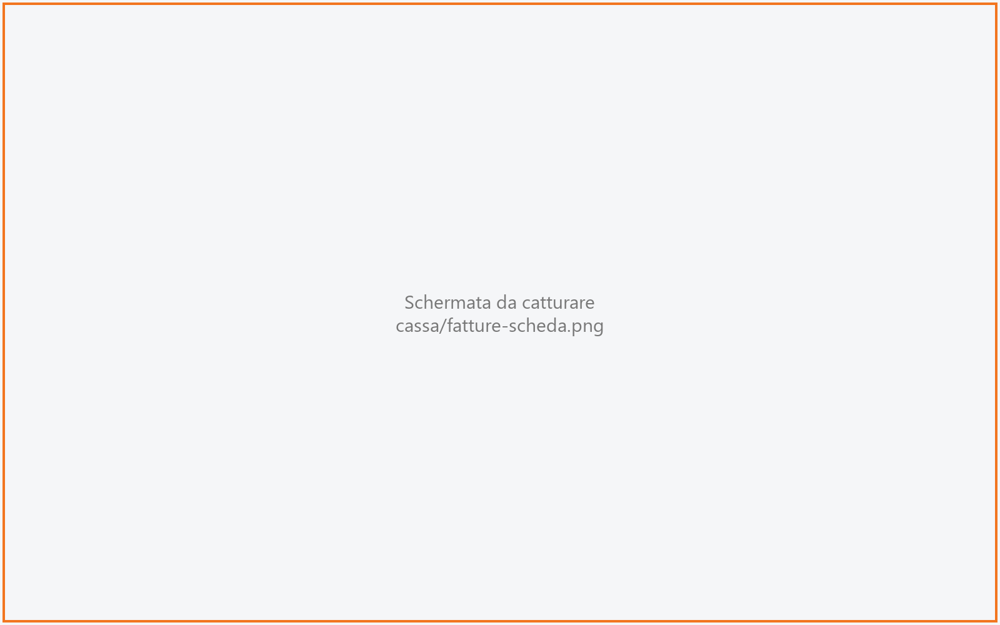
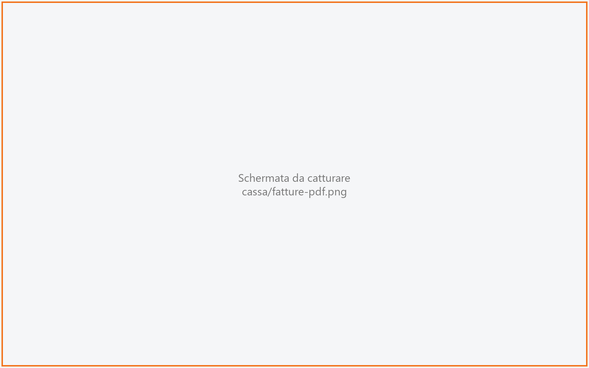

# Fatture

Qui ritrovi le fatture già emesse dalla cassa: le cerchi per periodo, cliente, numero o tavolo,
ne riapri il PDF, le rimandi per email al cliente o ne ristampi una copia di cortesia. Serve al
cassiere e al titolare quando un cliente chiede di nuovo la sua fattura.

!!! info "In sintesi"

    - **Dove si trova:** Menu ▸ Fatture
    - **Chi la usa:** cassiere, titolare
    - **Disponibile anche su:** solo cassa

---

## A cosa serve

La fattura si emette dalla schermata del [Conto](conto.md), al momento dell'incasso. Questa
schermata serve *dopo*: il cliente ha perso la mail, ne vuole una copia stampata, o il
commercialista chiede di rivedere un documento. Per esempio: un cliente telefona perché la
fattura della cena aziendale di martedì non gli è arrivata; scrivi il nome della ditta, apri la
fattura e la rimandi all'indirizzo che ti detta.

Una fattura emessa è a registro: da qui **non si modifica e non si annulla**. L'annullo (nota di
credito) non nasce dalla cassa.
<!-- DA VERIFICARE: confermare che l'annullo/nota di credito si fa dal gestionale Facile e con quale maschera, per poterlo citare. -->

## Prima di cominciare

- Le fatture compaiono qui solo se sono state emesse dalla cassa, dal [Conto](conto.md). Le
  fatture fatte dal gestionale non sono in questo elenco.
- Per **Copia di cortesia** serve la stampante preconto, che si imposta in
  [Impostazioni](impostazioni.md).
- Per **Manda** il servizio deve essere in grado di spedire email.
  <!-- DA VERIFICARE: dove si configura l'invio delle email del servizio (server SMTP, mittente) e se è a carico dell'installatore. -->

## La schermata

La schermata ha tre parti:

- **in alto, i filtri**: il periodo (dalla data, alla data), il pulsante **Oggi** e il campo di
  ricerca;
- **a sinistra, l'elenco** delle fatture del periodo, dalla più recente; ogni riga riporta numero e
  data, cliente, provenienza (tavolo, comanda, conto) e totale;
- **a destra, la scheda** della fattura scelta. Compare solo quando tocchi una riga; finché nessuna
  riga è scelta l'elenco occupa tutta la larghezza.

Sotto i filtri una riga di stato dice quante fatture sono state trovate (es. *12 fatture.*).

## Campi e indicatori

| Elemento | Descrizione |
|---|---|
| **Periodo** (due date) | Dalla data… alla data. All'apertura vale gli ultimi sette giorni fino a oggi. Cambiando una data l'elenco si ricarica da solo. Se inverti le date, vengono scambiate. |
| **Cerca per cliente, numero o tavolo** | Testo libero: cerca nella ragione sociale del cliente, nel numero della fattura e nell'annotazione che indica tavolo e comanda. La ricerca parte quando premi **Invio** sulla tastiera. |
| Numero e data (riga) | Numero della fattura (con il registro, es. `12/A`) e data di emissione. |
| Cliente (riga) | Ragione sociale del cliente intestatario. |
| Provenienza (riga) | Da dove nasce la fattura, es. *Tavolo 1/5 · Comanda 87 · Conto 2*, oppure *Resto del conto* quando è stata fatturata la parte restante di un tavolo diviso. |
| **ANNULLATA** (pastiglia rossa) | La fattura è stata annullata dal gestionale: resta in elenco, ma non vale più. |
| **SDI** (pastiglia verde) | La fattura elettronica è stata trasmessa. È solo un'indicazione: da qui non si ritrasmette nulla. |
| Totale (riga) | Totale del documento in euro. |
| **FATTURA N. …** (scheda) | Titolo della scheda, con la pastiglia **INVIATA SDI** se la fattura è stata trasmessa. |
| **DATA** | Data della fattura. |
| **TOTALE** | Totale della fattura. |
| **CLIENTE** | Intestatario, con sotto la provenienza (tavolo, comanda, conto). |
| **RIMANDA PER EMAIL** | Indirizzo a cui rimandare la fattura. Si propone quello del cliente in anagrafica, ma puoi cambiarlo (es. se il cliente ne detta un altro al telefono). Non c'è sulle fatture annullate. |

## Pulsanti e comandi

| Comando | Effetto |
|---|---|
| **Oggi** | Porta il periodo a oggi–oggi e ricarica l'elenco. |
| Tocco su una riga | Apre la scheda della fattura a destra. Toccando di nuovo la stessa riga la scheda si chiude. |
| **Manda** | Rimanda la fattura in PDF all'indirizzo scritto in **RIMANDA PER EMAIL**, dopo una conferma. |
| **Copia di cortesia** | Stampa sulla stampante preconto una copia **non fiscale** della fattura, con le righe, il totale e la dicitura *Documento di cortesia. L'originale e' la fattura elettronica intestata al cliente.* Compare solo se la stampante preconto è configurata e la fattura non è annullata. |
| **Apri il PDF** | Apre il PDF della fattura dentro la cassa (vedi sotto). È disponibile anche sulle fatture annullate. |

Il PDF si apre in una schermata a tutto schermo con, in alto, il titolo (es. *Fattura 12/A*) e
questi comandi:

| Comando | Effetto |
|---|---|
| Frecce sinistra/destra | Pagina precedente/successiva, con l'indicazione *pagina/totale*. Compaiono solo se la fattura ha più di una pagina. |
| Lente − / lente + | Riduce o ingrandisce il documento; in mezzo la percentuale di ingrandimento. |
| **Stampa** | Su Windows apre il PDF con l'app dei PDF del PC (per esempio Edge o Acrobat): da lì si stampa con la sua finestra di stampa, scegliendo la stampante. Sugli altri dispositivi stampa il PDF da questa finestra. <!-- DA VERIFICARE: comportamento della stampa sul tablet Android e su iPad (provata solo su Windows). --> |
| **Chiudi** | Torna all'elenco delle fatture. |

## Come si fa

### Ritrovare una fattura

1. Tocca **Menu ▸ Fatture**.
2. Se serve, cambia il periodo con le due date (o tocca **Oggi**).
3. Scrivi nel campo di ricerca il nome del cliente, il numero della fattura o il numero del tavolo e
   premi **Invio**.
4. Tocca la fattura nell'elenco: a destra si apre la sua scheda.

### Rimandare una fattura per email

1. Apri la scheda della fattura.
2. In **RIMANDA PER EMAIL** controlla l'indirizzo proposto; se il cliente ne vuole un altro,
   scrivilo al suo posto.
3. Tocca **Manda**.
4. Nella finestra *Rimanda la fattura* tocca **Manda**.
5. Sotto i filtri compare *Fattura n. … rimandata a …*.

### Ristampare una copia di cortesia

1. Apri la scheda della fattura.
2. Tocca **Copia di cortesia**.
3. La stampante preconto stampa la copia e sotto i filtri compare
   *Copia di cortesia della fattura n. … ristampata.*

### Rivedere e stampare il PDF

1. Apri la scheda della fattura.
2. Tocca **Apri il PDF**: compare la finestra *Preparo la fattura n. …*, poi il documento.
3. Tocca **Stampa** per stamparlo, oppure **Chiudi** per tornare all'elenco.

## Controlli e messaggi

| Messaggio | Causa | Cosa fare |
|---|---|---|
| *Nessuna fattura in questo periodo.* | Nel periodo (e con la ricerca scritta) non ci sono fatture della cassa. | Allarga il periodo o cancella la ricerca e premi **Invio**. |
| *Windows non ha aperto il PDF: serve un'app per i PDF (per esempio Edge o Acrobat) impostata come predefinita.* | **Stampa** su un PC senza un'app predefinita per i PDF. | Imposta un'app per i PDF in Windows (App predefinite) e tocca di nuovo **Stampa**. |
| *Stampa del documento non riuscita.* / *Stampa del documento non riuscita: il PDF non si e' aperto.* | Il PDF non si è potuto preparare o aprire. | Riprova; se insiste, chiudi e riapri il documento. |
| *Elenco delle fatture non caricato.* | Il servizio non ha risposto o ha dato errore; sotto il titolo c'è il dettaglio. | Controlla il collegamento al servizio e riprova cambiando una data o premendo **Invio** nella ricerca. |
| *Manca l'indirizzo: questo cliente non ne ha uno in anagrafica, scrivilo qui.* | Hai toccato **Manda** con il campo dell'indirizzo vuoto. | Scrivi l'indirizzo e tocca di nuovo **Manda**. |
| *Mando di nuovo la fattura n. … a …?* | Conferma prima dell'invio. | **Manda** per spedire, **Annulla** per lasciar stare. |
| *La fattura non e' stata spedita.* | L'invio non è riuscito; il dettaglio dice perché (es. *Fattura non inviata per email: il PDF non e' stato prodotto.*), oppure *Il servizio non ha detto perche'.* | Leggi il dettaglio; se il problema è la configurazione delle email del servizio, avvisa l'assistenza. |
| *La fattura non si e' potuta riaprire.* | Il servizio non è riuscito a produrre il PDF; il dettaglio dice perché (es. *Il servizio non ha prodotto nessun documento.*). | Riprova; se persiste, avvisa l'assistenza. |
| *Nessuna stampante preconto configurata: si imposta in Impostazioni.* | Manca la stampante preconto. | Configurala in [Impostazioni](impostazioni.md). |
| *Copia di cortesia non stampata.* | Le righe della fattura non si sono lette (*Le righe della fattura non si sono lette.*) o la stampante ha segnalato un errore. | Controlla la stampante preconto (accesa, carta, collegamento) e riprova. |
| *Stampa della fattura non riuscita.* | La stampa del PDF dalla schermata del documento non è partita. | Controlla la stampante di sistema e riprova. |
| *Fattura …: documento prodotto ma non apribile a schermo.* | Il PDF è stato prodotto ma la schermata del documento non si è aperta. | Riprova **Apri il PDF**. |

## Note

- L'elenco si ricarica ogni volta che apri la schermata: una fattura appena emessa dal conto
  compare subito. La fattura che avevi aperto resta aperta, se è ancora nell'elenco.
- L'elenco mostra al massimo le 200 fatture più recenti del periodo: se cerchi una fattura vecchia,
  restringi il periodo o usa la ricerca.
- Il campo di ricerca resta applicato anche quando cambi le date. Per tornare all'elenco completo
  cancellalo e premi **Invio**.
- Sulle fatture **ANNULLATA** la scheda dice *Questa fattura e' stata annullata: non si rispedisce
  ne' si ristampa.*: restano solo la consultazione e **Apri il PDF**.
- La pastiglia **SDI** è informativa: dalla cassa la fattura elettronica non si ritrasmette.
- La copia di cortesia non è un documento fiscale: l'originale è la fattura elettronica.

## Vedi anche

- [Conto](conto.md) — dove si emette la fattura
- [Storico conti](storico-conti.md)
- [Impostazioni](impostazioni.md) — stampante preconto
