# Impostazioni

Da qui si prepara la cassa al lavoro: a quale servizio si collega, chi è in turno, su quali
stampanti, terminali POS e casse automatiche lavora, i dati fiscali della ditta, l'aspetto
dell'app, il menu online, l'addebito in camera e la licenza digitale. È la schermata del
titolare o di chi installa l'impianto; il cassiere la apre di solito solo per uscire dal turno.

!!! info "In sintesi"

    - **Dove si trova:** Menu ▸ **Impostazioni**
    - **Chi la usa:** titolare, installatore; cassiere per il turno
    - **Disponibile anche su:** [Palmare](../palmare/impostazioni.md) (con meno sezioni)

---

## A cosa serve

Alcune impostazioni valgono **solo per questa cassa** (il servizio a cui si collega, il tavolo
dell'asporto, quale stampante (anche fiscale), quale POS e quale cassa automatica usa, il tema), altre valgono
**per tutto l'impianto** e le vedono tutte le postazioni (l'elenco delle stampanti, dei terminali
POS e delle casse automatiche, l'elenco delle stampanti fiscali, i modelli di stampa, i dati della ditta, il
menu online, il codice di addebito in camera). Ogni pannello lo dice nella sua riga di
descrizione o nel messaggio che compare dopo il salvataggio.

Esempio: in un locale con due casse al banco, ciascuna con il suo registratore, le due stampanti
fiscali si registrano una volta nell'elenco dell'impianto e poi ogni cassa sceglie la sua; lo stesso
vale per la stampante del preconto, che ognuna sceglie fra quelle vicine.

## Prima di cominciare

- Per quasi tutti i pannelli la cassa deve essere collegata al servizio: comincia sempre da
  **Connessione** (vedi [Prima configurazione](../introduzione/prima-configurazione.md)).
- Il tavolo dell'asporto si sceglie fra sale e tavoli già creati in
  [Sale e tavoli](sale-e-tavoli.md).
- Per **Dati fiscali ▸ Fattura** servono le aliquote IVA e gli articoli già presenti in
  [Tabelle di base](tabelle-di-base.md) e [Articoli](articoli.md).

## La schermata

La schermata è divisa in due:

- **a sinistra** l'elenco delle voci: **Turno**, **Connessione**, **Sala**, **Stampante preconto**,
  **Modelli di stampa**, **Stampanti fiscali**, **Pagamento con carta**, **Cassa automatica**,
  **Dati fiscali**, **Aspetto**, **Menu online**, **Hotel**, **Licenza**. Sotto ogni nome, in
  piccolo, c'è lo stato attuale (per esempio chi è in turno, l'indirizzo del servizio, il terminale
  POS in uso; per le stampanti fiscali, per esempio, *2 · qui n. 2*, cioè 2 stampanti e questa
  cassa usa la n. 2);
- **a destra** il pannello della voce scelta, con in testa titolo e una riga che dice a cosa
  serve, e in fondo i pulsanti e il messaggio con l'esito dell'ultima operazione.

All'apertura è selezionata la voce **Turno**. La voce scelta è evidenziata con il bordo arancione.

## Campi e indicatori

### Turno

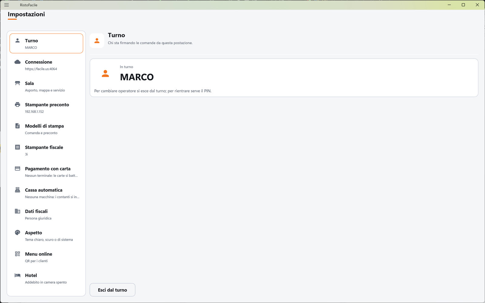

*Chi sta firmando le comande da questa postazione.*

| Elemento | Descrizione |
|---|---|
| **In turno** | Il nome dell'operatore entrato su questa cassa, oppure *Nessun operatore*. Le comande mandate da qui portano il suo nome. |
| *Per cambiare operatore si esce dal turno; per rientrare serve il PIN.* | Promemoria, visibile quando c'è un operatore in turno. |
| **Esci dal turno** | Chiude il turno (chiede conferma) e riporta alla schermata di [accesso](accesso.md). Compare solo con un operatore in turno. |
| **Accedi** | Apre la schermata di [accesso](accesso.md). Compare solo quando nessuno è in turno. |

### Connessione

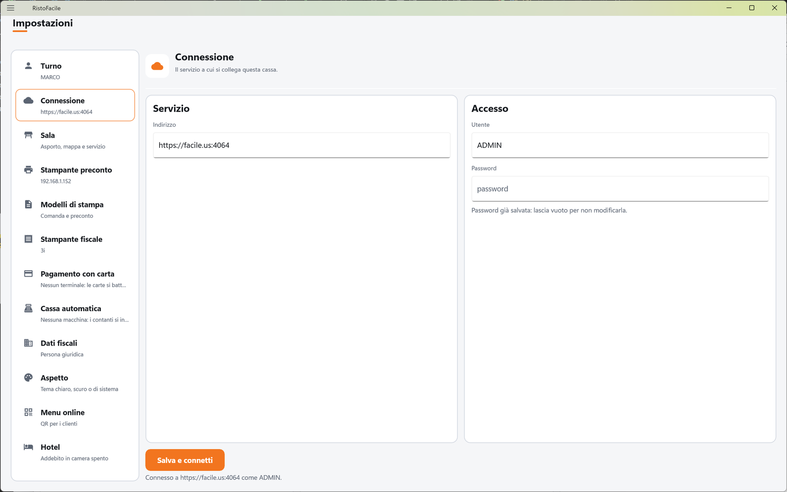

*Il servizio a cui si collega questa cassa.* Vale solo per questa cassa.

| Elemento | Descrizione |
|---|---|
| **Indirizzo** (riquadro **Servizio**) | L'indirizzo del servizio RistoFacile del locale, con la porta: per esempio `http://192.168.1.50:8080`. Si scrive a mano: chiedilo a chi ha installato il servizio. Su iPad e Mac, in `http`, scrivi l'IP o il nome del computer senza dominio (vedi [Prima configurazione](../introduzione/prima-configurazione.md#prima-di-cominciare)). |
| **Utente** (riquadro **Accesso**) | Il nome utente con cui la cassa si presenta al servizio. |
| **Password** | La password di quell'utente. Non viene mai rimostrata: se ne è già salvata una compare *Password già salvata: lascia vuoto per non modificarla.* |
| **Salva e connetti** | Salva i tre dati e prova subito una lettura vera dal servizio (l'elenco delle sale). Durante la prova gira la rotellina. |
| Riga di esito | *Connesso a* (indirizzo) *come* (utente)*.* se tutto è a posto, *Non configurato.* se la cassa non è collegata. |

Sotto la voce **Connessione**, a sinistra, si legge l'indirizzo in uso.

<!-- DA VERIFICARE: la ricerca del servizio per nome del sito e' stata tolta (commit 96b9f62 del repo RistoFacile); confermare che l'indirizzo si scrive sempre a mano e che non tornera'. -->

### Sala

*Il tavolo dell'asporto e come questa postazione segue la sala.* Due linguette in testa:
**Tavolo asporto** e **Mappa e servizio**.

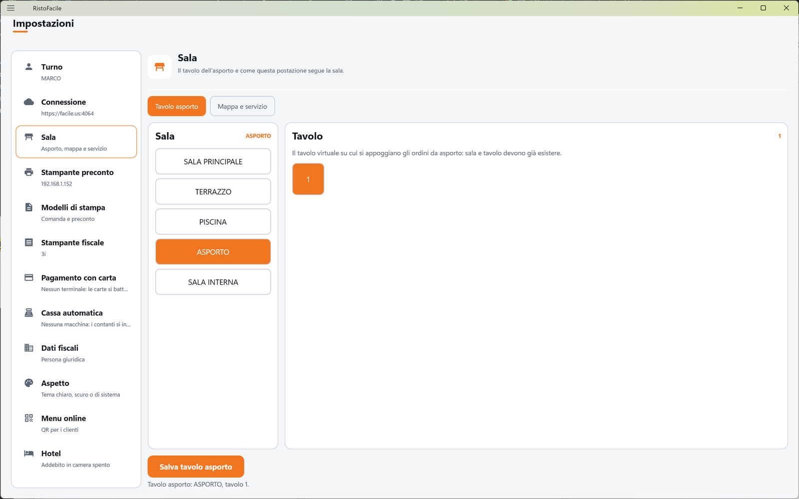

**Tavolo asporto**

| Elemento | Descrizione |
|---|---|
| **Sala** | Tutte le sale dell'impianto, anche quelle che non compaiono sulla mappa. Tocca la sala che contiene il tavolo virtuale dell'asporto: il suo nome si vede in arancione accanto al titolo. |
| **Tavolo** | I tavoli della sala scelta. Tocca quello da usare per l'asporto (un secondo tocco lo deseleziona). *Il tavolo virtuale su cui si appoggiano gli ordini da asporto: sala e tavolo devono già esistere.* |
| **Salva tavolo asporto** | Salva la scelta **per questa cassa**. |
| Riga di esito | Per esempio *Tavolo asporto: Asporto, tavolo 99.* oppure *Nessun tavolo asporto configurato.* |

Se su questa cassa non è mai stato scelto un tavolo, la cassa prova a ricavarlo dagli ordini di
asporto già fatti; la scelta fatta qui vale sempre di più.

**Mappa e servizio**

| Elemento | Descrizione |
|---|---|
| **Prenotazioni in mappa** | *Con quanto anticipo la mappa segnala un tavolo prenotato. Zero la spegne.* Cursore da 0 a 24 ore (proposta: 1 ora). Sotto, a parole, la scelta: *Le prenotazioni confermate compaiono sulla mappa 2 ore prima.* oppure *Segnalazione disattivata: la mappa non mostra le prenotazioni.* |
| **Aggiornamento automatico** | *Ogni quanti secondi le schermate di sala mostrano il lavoro degli altri dispositivi. Zero lo spegne.* Cursore da 0 a 60 secondi a passi di 5 (proposta: 5). Sotto: *Le schermate di sala controllano ogni 5 secondi se un altro dispositivo ha cambiato qualcosa.* oppure *Aggiornamento automatico spento: le schermate si aggiornano solo riaprendole.* |
| **Tagliando di via in cucina** | *Quando da questa postazione si dà il via a un'uscita, in cucina esce anche il tagliando stampato.* Pulsante **SI'** / **NO** (proposto **SI'**): ogni tocco lo inverte. |

I tre valori valgono solo per questa cassa e si salvano appena li cambi: non c'è un pulsante
**Salva**.

### Stampante preconto

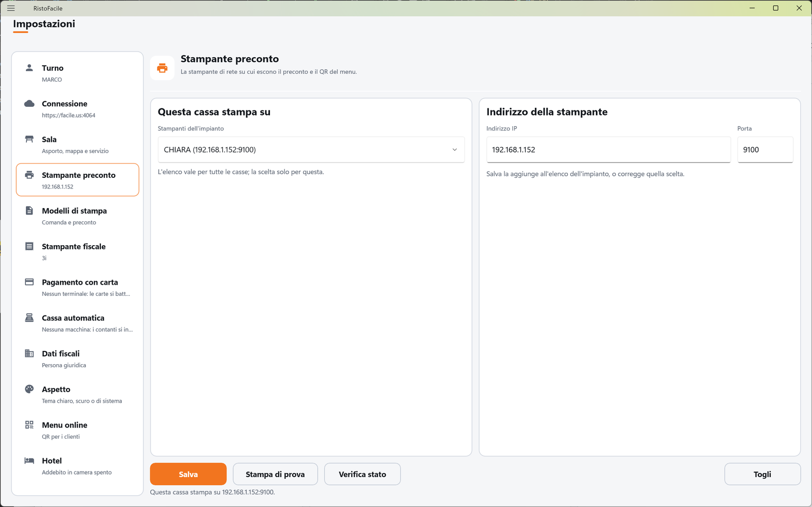

*La stampante di rete su cui escono il preconto e il QR del menu.*

| Elemento | Descrizione |
|---|---|
| **Stampanti dell'impianto** (riquadro **Questa cassa stampa su**) | Tendina con le stampanti già registrate sull'impianto. Sceglierne una la rende subito quella di questa cassa. *L'elenco vale per tutte le casse; la scelta solo per questa.* Se l'impianto non ne ha ancora: *Nessuna stampante sull'impianto: scrivi indirizzo e porta qui a fianco e premi Salva.* |
| **Indirizzo IP** (riquadro **Indirizzo della stampante**) | L'indirizzo della stampante in rete, per esempio `192.168.1.200`. Obbligatorio. |
| **Porta** | Di solito `9100` (è la proposta). |
| Riga di esito | Per esempio *Questa cassa stampa su Banco (192.168.1.200:9100).* oppure *Nessuna stampante configurata su questa cassa.* |

Sotto la voce, a sinistra, si legge l'indirizzo della stampante in uso.

### Modelli di stampa

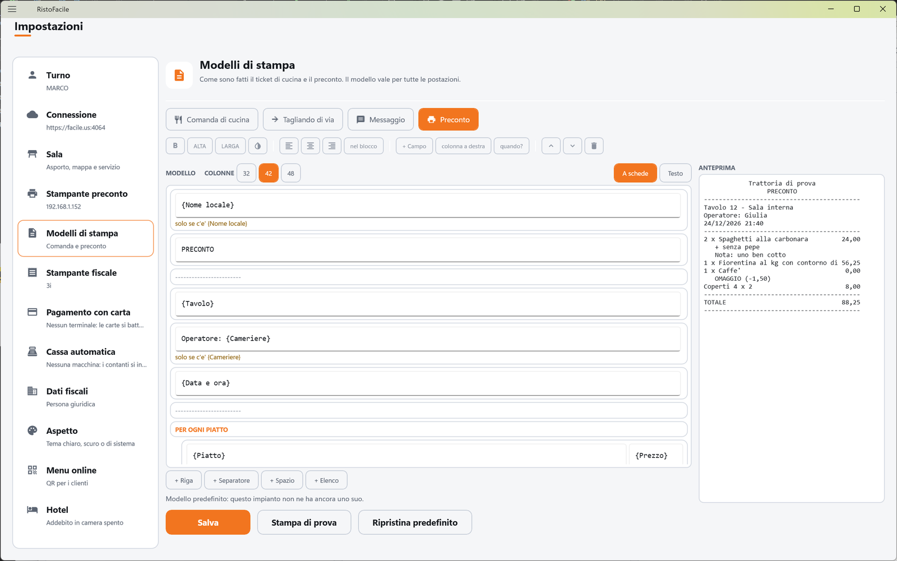

*Come sono fatti il ticket di cucina e il preconto. Il modello vale per tutte le postazioni.*

| Elemento | Descrizione |
|---|---|
| **Comanda di cucina**, **Tagliando di via**, **Messaggio**, **Preconto** | Il documento da modificare. Se il modello aperto ha modifiche non salvate, cambiando documento la cassa chiede conferma. |
| **MODELLO** | La zona di modifica. Si lavora in due modi: **A schede** (ogni riga del documento è una scheda da compilare) o **Testo** (il modello scritto per intero, per chi lo conosce). Se un modello non si può rappresentare a schede la cassa resta sul testo e ne dice il motivo. |
| **COLONNE** **32** / **42** / **48** | Larghezza della carta in caratteri (solo nella modifica a schede): 32 per la carta da 58 mm, 42 per le Epson TM da 80 mm, 48 per quasi tutte le altre da 80 mm. |
| Barra dei tasti (modifica a schede) | Su una riga scelta: grassetto, **ALTA**, **LARGA**, bianco su nero; allineamento a sinistra, al centro, a destra o **nel blocco**; **+ Campo** (inserisce un dato del documento scelto da un elenco, per esempio il nome del piatto); **colonna a destra** (aggiunge una seconda casella allineata a destra, per esempio per i prezzi); **quando?** (*Stampala sempre* oppure *Solo se c'e'* un certo dato); frecce per spostare in alto o in basso; cestino per eliminare. |
| **+ Riga**, **+ Separatore**, **+ Spazio**, **+ Elenco** | Aggiungono una scheda. **+ Elenco** chiede *Di cosa vuoi fare l'elenco?* (per esempio le righe della comanda). |
| **ANTEPRIMA** | Il documento come uscirà sulla carta, composto con dati di prova. |
| Riga in fondo | Da dove viene il modello: *Modello di questo impianto.*, *Modello di questo impianto (ultima copia scaricata: il servizio non risponde).* oppure *Modello predefinito: questo impianto non ne ha ancora uno suo.* |
| **Salva** | Salva il modello sul servizio: *Modello salvato: vale per tutte le postazioni.* |
| **Stampa di prova** | Stampa il modello sulla stampante del preconto di questa cassa. |
| **Ripristina predefinito** | Cancella il modello dell'impianto e torna alla stampa di fabbrica (chiede conferma). |

<!-- DA VERIFICARE: elenco dei campi proposti da "+ Campo" e delle condizioni di "quando?" per ciascun documento: valutare una scheda dedicata ai modelli di stampa. -->

### Stampanti fiscali

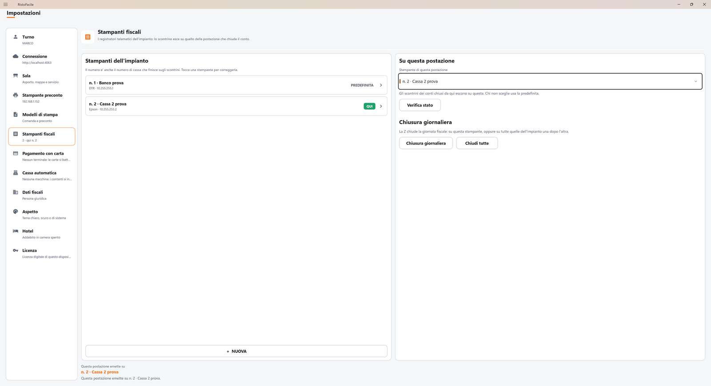

*I registratori telematici dell'impianto: lo scontrino esce su quello della postazione che chiude il conto.*
Un impianto può avere **più stampanti fiscali**, per esempio una per ogni cassa. L'elenco vale per
tutto l'impianto; quale stampante usa questa cassa vale solo qui.

Il pannello ha due parti.

**Stampanti dell'impianto** (a sinistra) è l'elenco: per ogni stampante si legge *n. numero · descrizione*,
sotto la marca e l'indirizzo, e a destra la scritta **PREDEFINITA** e, per quella che usa questa cassa,
la pastiglia verde **QUI**. Tocca una stampante per correggerla; **+ NUOVA** ne aggiunge una.

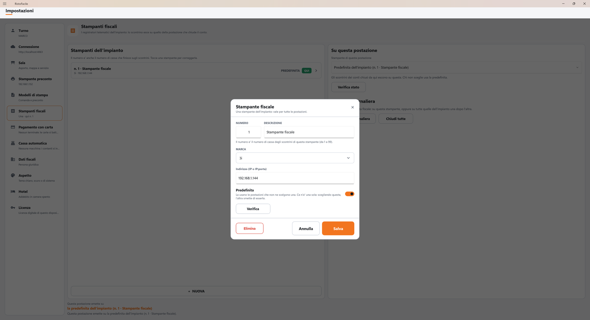

| Elemento della scheda | Descrizione |
|---|---|
| **Numero** | Da 1 a 99, diverso per ogni stampante. È anche il **numero di cassa** che compare sugli scontrini di quella stampante e che conta per la licenza. **+ NUOVA** propone il primo numero libero. Quando correggi una stampante il numero non si cambia (la scheda dice *Il numero è il numero di cassa sugli scontrini e nella licenza: per cambiarlo elimina la stampante e aggiungila di nuovo.*). |
| **Descrizione** | Il nome che riconosci, per esempio *Cassa 1*, *Banco bar*. |
| **Marca** | **Epson**, **DTR**, **3i**, **RCH**, **Custom**, **Axon**, **Ditron**. |
| **Indirizzo (IP o IP:porta)** | L'indirizzo del registratore in rete, per esempio `192.168.1.100`. Con **Ditron** si scrive la porta logica del driver WinEcrCom, perché il Ditron è collegato al computer del servizio. |
| **Predefinita** | La usano le postazioni che non ne scelgono una. Ce n'è una sola: scegliendo questa, l'altra smette di esserlo. |
| **Verifica** | Interroga il registratore con i valori che hai scritto, prima di salvare. |
| **Elimina** | Toglie la stampante dall'elenco (chiede conferma). Compare solo quando ne correggi una. La conferma dice anche se la usa questa postazione o il [self order](self-order.md) per lo scontrino del saldo dal telefono. |

**Su questa postazione** (a destra):

- **Stampante di questa postazione** sceglie la stampante su cui escono gli scontrini dei conti chiusi
  da questa cassa. La prima voce è **Predefinita dell'impianto**: chi non sceglie nulla usa quella.
  La scelta vale solo per questa cassa e resta anche dopo che l'hai chiusa e riaperta.
- **Verifica stato** interroga la stampante di questa postazione.
- **Chiusura giornaliera** fa la chiusura fiscale (la Z) della stampante di questa postazione, dopo
  una conferma che ne dice il nome.
- **Chiudi tutte** fa la Z di ogni stampante dell'impianto, una dopo l'altra, per chi fa la
  chiusura serale da una sola cassa. Sotto compare l'esito **per stampante** (*CHIUSA* oppure
  *NON CHIUSA* con il motivo): una stampante spenta non ferma le altre. Premendo di nuovo
  **Chiudi tutte** la chiusura si ripete anche sulle stampanti che si erano già chiuse (una seconda
  chiusura a importo zero, senza danni): per riprovare una sola stampante, sceglila come stampante
  di questa postazione e usa **Chiusura giornaliera**. Due stampanti dell'elenco con lo **stesso
  indirizzo** sono la stessa stampante fisica: la Z si fa una volta sola e la seconda riga dice
  *Stessa stampante della n. X: chiusa con quella.* Una stampante senza indirizzo non si chiude e
  non conta come errore: la riga dice *Saltata: manca l'indirizzo.* con la scritta **SALTATA**.
- In fondo, *Questa postazione emette su …* ricorda la stampante in uso.

Se due postazioni usano la **stessa stampante fisica**, le loro richieste vanno in coda e nessuna
va persa.

!!! warning "Numeri di cassa e licenza"

    Ogni stampante dell'elenco è una cassa per la licenza, anche quando due voci indicano la stessa
    stampante fisica: due voci con lo stesso indirizzo contano come **due casse**. Per far emettere
    due postazioni sulla stessa stampante, lascia una sola voce e falla scegliere a entrambe.

!!! note "Due casse che modificano l'elenco insieme"

    **Salva** ed **Elimina** mandano al servizio l'elenco intero, così come lo vede questa cassa.
    Se due casse modificano l'elenco nello stesso momento vale l'ultimo salvataggio: la modifica
    dell'altra va persa. Prima di cambiare l'elenco, riapri **Impostazioni** per vederlo aggiornato.

!!! note "Se la stampante della postazione viene tolta"

    Se elimini dall'elenco la stampante scelta da una cassa (o da un palmare), quella postazione non
    passa da sola alla predefinita: finché non ne sceglie un'altra non può chiudere con lo scontrino e
    mostra *La stampante fiscale n. X non è nell'elenco del servizio.* Nell'elenco della postazione la
    voce compare come *n. X (non più nell'elenco)*.

!!! info "Impianti già in funzione"

    La stampante fiscale che avevi configurato prima diventa da sola la **predefinita**, con
    numero uguale al numero di cassa della ditta (oppure 1). Non devi rifare niente.

Le **Chiusure giornaliere** si fanno solo dalla cassa: il palmare non ha i pulsanti della Z.

### Pagamento con carta

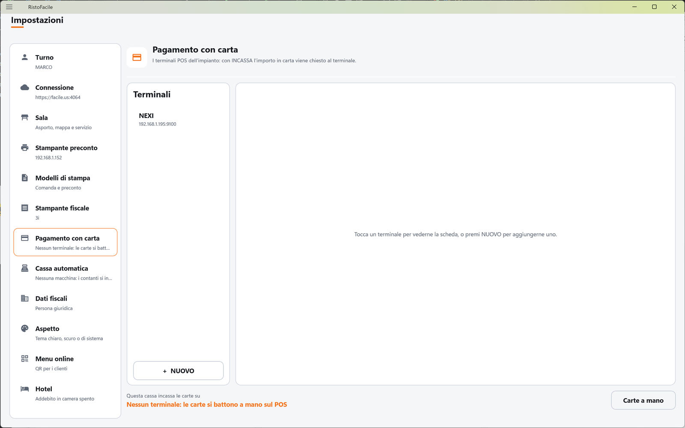

*I terminali POS dell'impianto: con INCASSA l'importo in carta viene chiesto al terminale.*
L'elenco dei terminali vale per tutto l'impianto; quale terminale usa questa cassa vale solo qui.

| Elemento | Descrizione |
|---|---|
| **Terminali** | L'elenco dei terminali POS dell'impianto, con nome e indirizzo. Quello usato da questa cassa porta la pastiglia verde **IN USO**. Tocca un terminale per aprirne la scheda. |
| **Scheda del terminale** | Si apre toccando un terminale o **+  NUOVO**. Finché non è aperta compare *Tocca un terminale per vederne la scheda, o premi NUOVO per aggiungerne uno.* |
| **Numero** | Il numero del terminale nell'impianto (maggiore di zero). Per un terminale nuovo è proposto il primo libero. |
| **Descrizione** | Il nome che vedi in elenco, per esempio *POS banco*. |
| **ID terminale** | Il codice del terminale scritto sul POS (per esempio `00000001`); non è il **Numero**. |
| **Indirizzo IP** / **Porta** | Dove si trova il terminale in rete. Porta proposta: `10000`. |
| **ID cassa** (riquadro **Su questa cassa**) | Il numero con cui questa cassa si presenta al terminale. Proposto `1`. |
| **Questa cassa incassa le carte su** | In fondo al pannello: il terminale in uso, oppure *Nessun terminale: le carte si battono a mano sul POS*. Lo stesso testo compare sotto la voce, a sinistra. |

<!-- DA VERIFICARE: a cosa serve in pratica "ID cassa" (con due casse sullo stesso terminale va dato un numero diverso a ciascuna?). -->

Al momento si gestiscono solo i terminali POS standard collegati in rete; i POS in cloud (per
esempio SumUp) non si configurano da qui.

### Cassa automatica

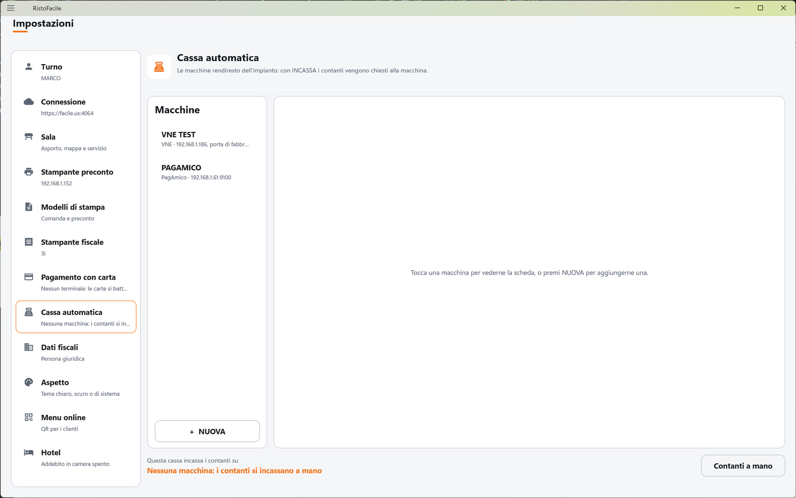

*Le macchine rendiresto dell'impianto: con INCASSA i contanti vengono chiesti alla macchina.*
L'elenco delle macchine vale per tutto l'impianto; quale macchina usa questa cassa vale solo qui.

| Elemento | Descrizione |
|---|---|
| **Macchine** | L'elenco delle casse automatiche dell'impianto; quella usata da questa cassa porta **IN USO**. Tocca una macchina per aprirne la scheda, o **+  NUOVA** per aggiungerne una. |
| **Numero** | Il numero della macchina nell'impianto (maggiore di zero). |
| **Descrizione** | Il nome in elenco, per esempio *Self ingresso*. |
| **Marca** | **PagAmico**, **VNE**, **CashDro** o **Cashlogy**. I campi e i pulsanti della scheda cambiano con la marca: vedi [Le marche](#le-marche-delle-casse-automatiche). |
| **Indirizzo IP** | Dove si trova la macchina in rete. Obbligatorio. |
| **Porta** | Vuota = la porta di fabbrica della marca (è mostrata in grigio nel campo): 9100 per PagAmico, 443 per VNE e CashDro (80 se l'indirizzo della CashDro comincia con `http://`), 8092 per Cashlogy. |
| **Password erogazione** | Solo per PagAmico: la password di erogazione impostata sulla macchina. Senza, la macchina rifiuta i comandi che danno denaro (resto, prelievo). |
| **Utente POS** / **Password POS** | Solo per CashDro, obbligatori: l'utente e la password creati sulla macchina, che li danno CashDro o il rivenditore. |
| **Impronta del certificato (facoltativa)** | Solo per CashDro: *Lasciala vuota alla prima prova: il servizio scrive nel giornale quella vista.* Copiata qui dal giornale, il servizio parla solo con quella macchina. Sono 64 cifre esadecimali; i due punti si possono lasciare. |
| **POS collegato alla macchina** | Solo per PagAmico e VNE, le macchine che hanno anche un POS. **SI'**: *la carta la incassa la macchina.* **NO**: *la carta va sul POS del bancone.* |
| **Questa cassa incassa i contanti su** | In fondo al pannello: la macchina in uso, oppure *Nessuna macchina: i contanti si incassano a mano*. |

Nel riquadro **Su questa cassa**, visibile con una macchina scelta:

| Elemento | Descrizione |
|---|---|
| *Incasso rimasto aperto (per esempio dopo un riavvio)? Sblocca restituisce al cliente quello che ha inserito.* | Spiega il pulsante **Sblocca incasso**. Con una Cashlogy si legge invece *Un incasso rimasto aperto si annulla dalla finestra del Cashlogy Connector, sul PC della macchina.* |
| Importo (*€ 0,00*) | L'importo da prelevare. |

La cassa automatica è solo della cassa: il palmare non la usa.

#### Le marche delle casse automatiche

| Marca | Incassa | Carta | Chiudi trattenendo | Preleva | Ricarica | Sblocca incasso |
|---|---|---|---|---|---|---|
| **PagAmico** | sì | sì, se ha il POS | sì | sì | sì | sì |
| **VNE** | sì | sì, se ha il POS | sì | sì | dal pannello della macchina | sì |
| **CashDro** | sì, solo contanti | no | no | no | dal pannello della macchina | sì |
| **Cashlogy** | sì, solo contanti | no | no | sì | dalla finestra del Connector | dalla finestra del Connector |

- **CashDro.** La cassa le parla in https. La CashDro non eroga denaro su comando: un rimborso o un resto che la macchina non ha dato si consegnano a mano.
  <!-- DA VERIFICARE: CashDro provata solo con una macchina finta; su una macchina vera vanno confermati annullo, ripresa dopo un riavvio e certificato (se cambia a ogni riavvio, l'impronta va lasciata vuota). -->
- **Cashlogy.** La cassa non parla con la macchina ma con il **Cashlogy Connector**, il programma di Cashlogy installato sul PC collegato alla macchina. **Il Connector va avviato su quel PC**: la cassa non lo avvia. La finestra di pagamento la apre il Connector, e un incasso già avviato si annulla solo da quella finestra. Se il Connector è stato riavviato e gli incassi non partono, tocca **Verifica stato**: rimette in contatto la cassa con il Connector.
  <!-- DA VERIFICARE: Cashlogy provata solo con un Connector finto; su una macchina vera vanno confermati il formato delle risposte e il riavvio del Connector. -->

### Dati fiscali

Sotto il titolo compare il nome della ditta. Due linguette: **Ditta** e **Fattura**. Servono
alla fattura elettronica e valgono per tutto l'impianto.

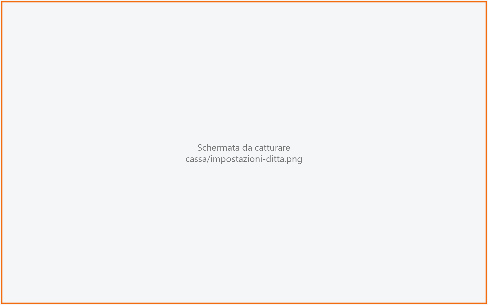

**Ditta**

| Elemento | Descrizione |
|---|---|
| **Partita IVA**, **Chi è** | In sola lettura: arrivano dall'anagrafica della ditta. **Chi è** vale *Persona giuridica*, *Ditta individuale* o *Persona fisica*; lo stesso testo compare sotto la voce, a sinistra. |
| **Regime fiscale** | Tocca per scegliere da un elenco (da *RF01 Ordinario* a *RF19 Regime forfettario*). Se manca: *Non impostato: la fattura elettronica non esce*. |
| **Indirizzo**, **CAP**, **Città**, **Prov.** | La sede da scrivere in fattura. CAP di 5 cifre, provincia di 2 lettere. |
| **Iscritta al Registro delle Imprese** | **SI'** / **NO**. Con **SI'**, per una persona giuridica, compaiono **Ufficio** (sigla della provincia), **Numero REA** e **Natura** (codice numerico). |
| **Capitale sociale** | Compare solo per le nature giuridiche che lo richiedono. |
| **Socio unico** | **SI'** / **NO**; compare solo per la natura che lo prevede. |
| **Per la fattura elettronica** | *Tutto a posto: la fattura elettronica può uscire.* oppure, in giallo, l'elenco di cosa manca. |
| **Salva dati ditta** | Salva sul servizio. |

<!-- DA VERIFICARE: tabella dei codici "Natura" (quale codice corrisponde a SPA, SRL, ecc.) e se Indirizzo/CAP/Citta' sono la sede legale o il domicilio fiscale. -->

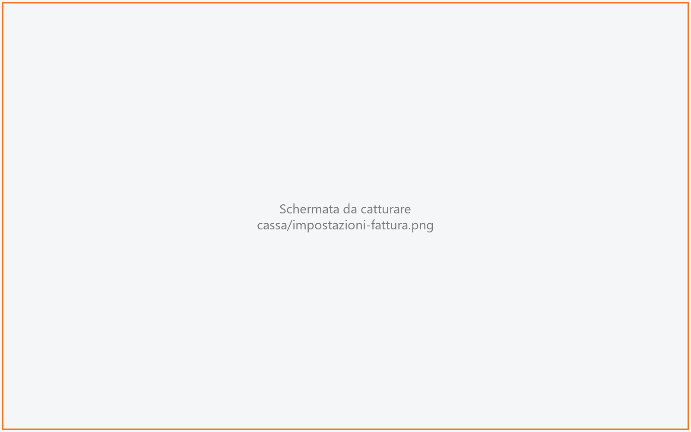

**Fattura**

| Elemento | Descrizione |
|---|---|
| **Invio per email** | *La casella da cui parte la copia della fattura per il cliente.* |
| **Server**, **Porta** | Il server di posta in uscita (per esempio `smtp.esempio.it`) e la porta (per esempio `587`). |
| **Utente**, **Password** | Le credenziali della casella. Sotto la password: *Non impostata*, *Impostata - lascia vuoto per non cambiarla* oppure *Verra' sostituita al salvataggio*. |
| **SSL**, **TLS** | **SI'** / **NO**, secondo quanto richiede il fornitore della posta. |
| Avviso in giallo | *La copia per email non partirebbe:* seguito da cosa manca. |
| **Salva posta** | Salva i dati della posta. |
| **Coperto e abbuono** | *Non arrivano dalla comanda: senza aliquota prendono quella della ditta, senza articolo escono come riga descrittiva.* |
| **Aliquota del coperto** | Tocca per scegliere un'aliquota IVA; *Default della ditta* se non scelta. **Azzera** la toglie. |
| **Articolo del coperto**, **Articolo dell'abbuono** | Tocca per scegliere un articolo dall'anagrafica (serve se devono muovere il magazzino); *Nessuno* se non scelto. **Azzera** lo toglie. |
| **Salva coperto e abbuono** | Salva le tre scelte sul servizio. |

### Aspetto

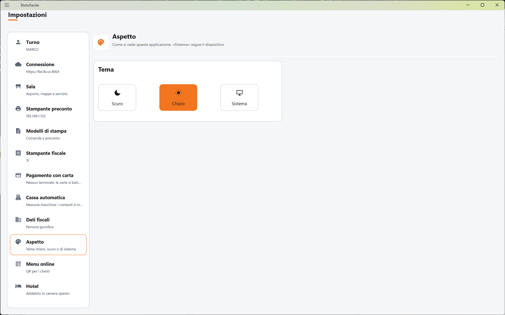

*Come si vede questa applicazione. «Sistema» segue il dispositivo.*

| Elemento | Descrizione |
|---|---|
| **Tema**: **Scuro**, **Chiaro**, **Sistema** | Tocca uno dei tre riquadri: il tema cambia subito e resta salvato su questa cassa. **Sistema** segue l'impostazione chiara/scura di Windows o del tablet. Il tema proposto è **Scuro**. |

### Menu online

*Indirizzo e QR code del menu che i clienti consultano dal tavolo.* Ha tre linguette:
**Qrcode**, **Sincronizzazione** e **Stile**. È descritto nella scheda
[Menu online](menu-online.md). Esiste solo sulla cassa.

### Hotel

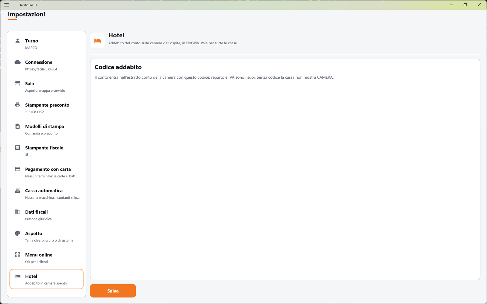

*Addebito del conto sulla camera dell'ospite, in HotWin. Vale per tutte le casse.*

| Elemento | Descrizione |
|---|---|
| **Codice addebito** | *Il conto entra nell'estratto conto della camera con questo codice: reparto e IVA sono i suoi. Senza codice la cassa non mostra CAMERA.* Elenco dei codici di addebito dell'hotel, ciascuno con il suo reparto: tocca quello da usare. |
| Avviso | *Su questo impianto non ci sono le tabelle dell'hotel: l'addebito in camera non si puo' usare.* quando il locale non è collegato a un hotel. |
| Stato sotto la voce | *Addebito in camera col codice* (codice), *Addebito in camera spento* oppure *Hotel non presente su questo impianto*. |

### Licenza

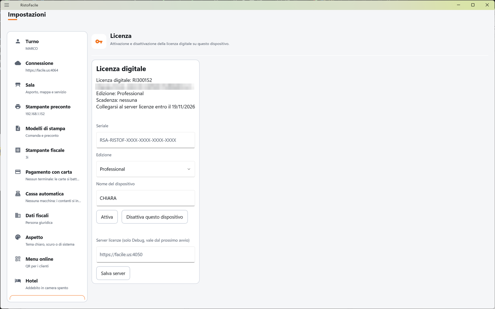

*Attivazione e disattivazione della licenza digitale su questo dispositivo.* Il pannello mostra
lo stato della licenza digitale e i campi **Seriale**, **Edizione** e **Nome del dispositivo**,
con i pulsanti **Attiva** e **Disattiva questo dispositivo**. È descritto nella scheda
[Licenza digitale](../introduzione/licenza.md).

## Pulsanti e comandi

| Comando | Effetto |
|---|---|
| Voce dell'elenco a sinistra | Mostra a destra il pannello corrispondente. |
| **Salva e connetti** (Connessione) | Salva indirizzo, utente e password e verifica il collegamento. |
| **Esci dal turno** / **Accedi** (Turno) | Chiude il turno dell'operatore / apre l'accesso. |
| **Tavolo asporto** / **Mappa e servizio** (Sala) | Passano da una linguetta all'altra. |
| **Salva tavolo asporto** | Salva sala e tavolo dell'asporto per questa cassa. |
| **SI'** / **NO** (Tagliando di via in cucina) | Accende o spegne il tagliando di via stampato. |
| **Salva** (Stampante preconto) | Registra indirizzo e porta nell'elenco dell'impianto (o corregge la stampante scelta) e la usa su questa cassa. *Salva la aggiunge all'elenco dell'impianto, o corregge quella scelta.* |
| **Stampa di prova** (Stampante preconto) | Manda una pagina di prova all'indirizzo scritto. |
| **Verifica stato** (Stampante preconto) | Chiede alla stampante se è pronta. |
| **Togli** (Stampante preconto) | Toglie la stampante scelta dall'elenco dell'impianto, per tutte le casse (chiede conferma). |
| **+ NUOVA** / **Salva** / **Elimina** (Stampanti fiscali) | Aggiunge una stampante all'elenco dell'impianto / salva la scheda / la toglie (chiede conferma). |
| **Verifica** / **Verifica stato** (Stampanti fiscali) | Interroga il registratore scritto nella scheda / quello di questa postazione. |
| **Chiusura giornaliera** / **Chiudi tutte** (Stampanti fiscali) | Fa la Z della stampante di questa postazione / di tutte le stampanti dell'impianto. |
| **+  NUOVO** (Pagamento con carta) | Apre una scheda vuota per un nuovo terminale. |
| **Salva** / **Togli** / **Chiudi** (scheda del terminale) | Salva il terminale nell'elenco dell'impianto / lo toglie (chiede conferma) / chiude la scheda. |
| **Usa su questa cassa** (Pagamento con carta) | Da adesso questa cassa incassa le carte sul terminale scelto, con l'**ID cassa** scritto. |
| **Verifica stato** (Pagamento con carta) | Interroga il terminale scelto e ne riporta la risposta. |
| **Carte a mano** | Questa cassa non usa più nessun terminale: le carte si battono a mano sul POS. |
| **+  NUOVA** (Cassa automatica) | Apre una scheda vuota per una nuova macchina. |
| **Salva** / **Togli** / **Chiudi** (scheda della macchina) | Salva la macchina nell'elenco dell'impianto / la toglie (chiede conferma) / chiude la scheda. |
| **Usa su questa cassa** (Cassa automatica) | Da adesso questa cassa incassa i contanti sulla macchina scelta. |
| **Verifica stato** (Cassa automatica) | Interroga la macchina. Con la Cashlogy rimette anche in contatto la cassa con il Connector. |
| **Sblocca incasso** | Chiude un incasso rimasto aperto restituendo al cliente il contante inserito (chiede conferma). Non c'è con la Cashlogy. Se la macchina non restituisce tutto, un avviso dice quanto denaro del cliente è rimasto dentro (e, a parte, il resto non erogato da dare a mano): va cercato nel giornale del servizio e restituito o registrato sul suo conto. Se la macchina non dice com'è finita (l'esito non arriva in tempo, o la macchina non dice quanto era entrato), l'avviso comincia con *ATTENZIONE* e chiede di controllare la macchina prima di dire che non è entrato denaro. |
| **Preleva** | Fa erogare dalla macchina l'importo scritto (chiede conferma). Non c'è con la CashDro. |
| **Ricarica** | Apre la ricarica del fondo cassa (solo PagAmico; sulla VNE la ricarica si fa dal pannello della macchina). |
| **FINE RICARICA** | Nella finestra della ricarica: chiude la ricarica. |
| **Contanti a mano** | Questa cassa non usa più nessuna macchina: i contanti si incassano a mano. |
| **Ditta** / **Fattura** (Dati fiscali) | Passano da una linguetta all'altra. |
| **Salva dati ditta** / **Salva posta** / **Salva coperto e abbuono** | Salvano sul servizio i dati della rispettiva sezione. |
| **Azzera** | Toglie l'aliquota o l'articolo scelto per coperto o abbuono. |
| **Salva** (Hotel) | Salva il codice di addebito scelto per tutto l'impianto. |
| **Spegni addebito** (Hotel) | Toglie la scelta del codice; poi tocca **Salva** per spegnere l'addebito in camera. |

## Come si fa

### Collegare la cassa al servizio

1. Tocca **Connessione**.
2. In **Indirizzo** scrivi l'indirizzo del servizio, per esempio `http://192.168.1.50:8080`.
3. Scrivi **Utente** e **Password**.
4. Tocca **Salva e connetti**.
5. Sotto il pulsante compare *Connesso a http://192.168.1.50:8080 come* (utente)*.*

### Scegliere la stampante del preconto

1. Tocca **Stampante preconto**.
2. Se l'impianto ha già delle stampanti, scegli quella vicina a questa cassa in **Stampanti
   dell'impianto**: è subito attiva.
3. Altrimenti scrivi **Indirizzo IP** e **Porta** e tocca **Salva**.
4. Tocca **Stampa di prova**: dalla stampante esce la pagina di prova e compare *Stampa di prova
   inviata a* (indirizzo)*.*

### Collegare un terminale POS a questa cassa

1. Tocca **Pagamento con carta**.
2. Tocca **+  NUOVO** (o un terminale già in elenco).
3. Compila **Descrizione**, **ID terminale**, **Indirizzo IP** e **Porta**, poi tocca **Salva**.
4. Con il terminale selezionato scrivi l'**ID cassa** e tocca **Usa su questa cassa**.
5. Tocca **Verifica stato** per controllare che il terminale risponda.
6. Il terminale porta la pastiglia **IN USO** e in fondo si legge *Questa cassa incassa le carte
   su* (nome del terminale).

### Ricaricare il fondo della cassa automatica

1. Tocca **Cassa automatica** e tocca la macchina in elenco.
2. Tocca **Ricarica**.
3. Si apre la finestra *Ricarica di* (macchina): inserisci monete e banconote nella macchina.
   L'importo caricato sale mentre inserisci.
4. Tocca **FINE RICARICA**.
5. Al termine compare l'esito della ricarica del fondo cassa.

Finché la finestra della ricarica è aperta la macchina non incassa.

### Spostare il tavolo dell'asporto

1. Tocca **Sala**, linguetta **Tavolo asporto**.
2. Tocca la sala e poi il tavolo virtuale dell'asporto.
3. Tocca **Salva tavolo asporto**.
4. Compare *Tavolo asporto salvato:* (sala)*, tavolo* (numero)*.*

## Controlli e messaggi

| Messaggio | Causa | Cosa fare |
|---|---|---|
| *Base URL e utente sono obbligatori.* | **Salva e connetti** con indirizzo o utente vuoti. | Compila **Indirizzo** e **Utente**. |
| *La password e' obbligatoria (nessuna password gia' salvata per questa installazione).* | Primo salvataggio senza password. | Scrivi la password. |
| *Connessione fallita.* (con il dettaglio) | Il servizio non risponde o rifiuta utente e password. | Controlla indirizzo, porta, utente e password e che il servizio sia acceso. |
| *Seleziona una sala e un tavolo per l'asporto.* | **Salva tavolo asporto** senza sala o tavolo. | Tocca prima la sala, poi il tavolo. |
| *Il tavolo asporto configurato (sala 2, tavolo 99) non esiste piu' in anagrafica: riselezionalo.* | Il tavolo scelto è stato cancellato. | Scegli un altro tavolo e salva. |
| *Impossibile caricare sale e tavoli:* … | La cassa non è collegata al servizio. | Sistema prima la **Connessione**. |
| *Inserisci l'indirizzo IP della stampante comande.* | **Salva**, **Stampa di prova** o **Verifica stato** con l'indirizzo vuoto. | Scrivi l'indirizzo IP. |
| *Porta della stampante comande non valida (di solito 9100).* | Porta non numerica o fuori intervallo. | Correggi la porta. |
| *Salvata solo su questa cassa (*indirizzo*): l'impianto non risponde (*…*).* | Il servizio non risponde: la stampante è stata salvata solo su questa cassa. | Riprova quando il servizio è raggiungibile, per averla nell'elenco dell'impianto. |
| *Stampa di prova non riuscita.* | La stampante non ha stampato. | Controlla che sia accesa, in rete e con la carta. |
| *Scegli prima una stampante dall'elenco dell'impianto.* | **Togli** senza una stampante scelta. | Scegli la stampante in **Stampanti dell'impianto**. |
| *Inserisci l'indirizzo della stampante fiscale.* | **Salva** o **Verifica** con l'indirizzo vuoto. | Scrivi l'indirizzo (o la porta logica per Ditron). |
| *L'identificativo 2 e' usato da piu' di una stampante fiscale.* | Hai dato a due stampanti lo stesso numero. | Scegli un numero libero (da 1 a 99). |
| *La stampante fiscale n. X non è nell'elenco del servizio.* | La stampante scelta da questa postazione è stata tolta dall'elenco. | Scegli un'altra stampante in **Stampante di questa postazione**. |
| *Verifica della stampante fiscale fallita.* | Il registratore non risponde o segnala un errore. | Leggi il dettaglio e controlla il registratore. |
| *L'id del terminale dev'essere un numero maggiore di zero.* / *La porta dev'essere un numero maggiore di zero.* | Numero o porta del terminale non validi. | Correggi il campo. |
| *Scegli un terminale dall'elenco.* | **Usa su questa cassa** senza un terminale scelto. | Tocca un terminale in elenco. |
| *Nessun terminale sull'impianto. Premi NUOVO per aggiungerne uno.* | L'impianto non ha terminali. | Tocca **+  NUOVO**. |
| *Il servizio non ha restituito nessun terminale: resta valido quello gia' scelto su questa cassa.* | Il servizio non ha dato l'elenco. | La cassa continua a usare il terminale scelto; riprova più tardi. |
| *Inserisci l'indirizzo IP della cassa automatica.* | **Salva** senza indirizzo. | Scrivi l'indirizzo. |
| *La porta dev'essere un numero maggiore di zero (lasciala vuota per quella di fabbrica).* | Porta non valida. | Correggi o svuota il campo. |
| *La CashDro vuole l'utente e la password POS creati sulla macchina (li da' CashDro o il rivenditore).* | **Salva** di una CashDro senza **Utente POS** o **Password POS**. | Scrivi utente e password. |
| *L'impronta del certificato e' fatta di 64 cifre esadecimali (i due punti si possono lasciare).* … | L'impronta scritta non è valida. | Ricopiala dal giornale del servizio, o lasciala vuota. |
| *Non riesco a leggere le casse automatiche dal servizio: finche' non le leggo, non si salva …* / *Le casse automatiche dell'impianto non si leggono dal servizio: non salvo, …* | Il servizio non ha dato l'elenco delle macchine. **Salva** e **Togli** sono bloccati, perché salvare sostituirebbe l'elenco dell'impianto con la sola macchina a video. | Riapri la pagina quando il servizio risponde. Se il dettaglio parla del file delle casse automatiche danneggiato, va corretto o tolto sul PC del servizio. |
| *Scrivi l'importo da prelevare, per esempio 50 o 12,50.* | **Preleva** senza un importo valido. | Scrivi l'importo. |
| *Prelievo dalla cassa automatica.* (con *Il contante potrebbe essere uscito lo stesso: controlla la macchina prima di riprovare.*) | La macchina non ha risposto durante il prelievo. | Controlla la macchina **prima** di ripetere: potresti prelevare due volte. |
| *Ricarica della cassa automatica.* (con *…premi di nuovo RICARICA per riprenderla.*) | La ricarica non si è aperta o la cassa ha perso il contatto con la macchina. | Tocca di nuovo **Ricarica**: riprende la ricarica rimasta aperta. |
| *Salvataggio dei dati della ditta non riuscito.* | Il servizio ha rifiutato i dati o non risponde. | Leggi il dettaglio e riprova. |
| *Dati della ditta salvati. Restano 2 cose da sistemare per la fattura elettronica.* | Mancano ancora dati obbligatori. | Completa quanto elencato in **Per la fattura elettronica**. |
| *Salvataggio della configurazione fattura non riuscito.* | Il servizio non risponde. | Riprova. |
| *Impossibile leggere i codici addebito dell'hotel:* … | Il servizio non risponde. | Controlla la connessione. |
| *Il modello ha un errore e non e' stato salvato:* … | Il modello di stampa contiene un errore. | Correggi la riga segnalata in rosso. |
| *Stampante comande non configurata: impostala nella sezione "Stampante preconto".* | **Stampa di prova** di un modello senza stampante. | Imposta la **Stampante preconto**. |

## Note

- **Cosa vale per chi.** Collegamento, turno, tavolo dell'asporto, stampante scelta, terminale POS
  e cassa automatica in uso, i tre valori di **Mappa e servizio** e il tema valgono solo per questa
  cassa. Elenco delle stampanti, dei terminali e delle macchine, elenco delle stampanti fiscali, modelli di
  stampa, dati fiscali, menu online e codice di addebito in camera valgono per tutto l'impianto.
- L'elenco delle stampanti fiscali si gestisce dalla cassa; il [palmare](../palmare/impostazioni.md)
  lo legge e sceglie la propria stampante.
- **Salva** e **Togli** della cassa automatica rileggono l'elenco dal servizio e cambiano solo la macchina a video: le modifiche fatte nel frattempo da un'altra cassa restano.
- **Togli** su stampanti, terminali e macchine li toglie per **tutte** le casse: quelle che li
  usavano tornano a lavorare a mano finché non ne scelgono un altro.

!!! warning "Prelievo e cassa automatica"

    Se durante un **Preleva** la macchina non risponde, il contante potrebbe essere uscito lo
    stesso. Controlla la macchina prima di ripetere l'operazione.

## Vedi anche

- [Prima configurazione](../introduzione/prima-configurazione.md)
- [Licenza digitale](../introduzione/licenza.md)
- [Menu online](menu-online.md)
- [Accesso operatore](accesso.md)
- [Sale e tavoli](sale-e-tavoli.md)
- [Asporto e domicilio](asporto.md)
- [Conto](conto.md)
- [Impostazioni del palmare](../palmare/impostazioni.md)
