# Impostazioni

Da qui si prepara la cassa al lavoro: a quale servizio si collega, chi è in turno, su quali
stampanti, terminali POS e casse automatiche lavora, i dati fiscali della ditta, l'aspetto
dell'app, l'addebito in camera, il sito del menu, il self order, i kiosk e la licenza digitale.
Da qui si chiude anche la giornata (produzione, chiusura della cassa e Z) e il titolare controlla
storni, sconti e preconti nel suo registro. È la schermata del titolare o di chi installa
l'impianto; il cassiere la apre di solito per uscire dal turno o per chiudere la giornata.

!!! info "In sintesi"

    - **Dove si trova:** Menu ▸ **Impostazioni**
    - **Chi la usa:** titolare, installatore; cassiere per il turno e la fine giornata
    - **Disponibile anche su:** [Palmare](../palmare/impostazioni.md) (con meno sezioni)

---

## A cosa serve

Alcune impostazioni valgono **solo per questa cassa** (il servizio a cui si collega, il tavolo
dell'asporto, la sala su cui si apre la mappa, i menu in vendita, quale stampante (anche fiscale),
quale POS e quale cassa automatica usa, il tagliando di via, il tema, il sito del menu), altre valgono
**per tutto l'impianto** e le vedono tutte le postazioni (l'elenco delle stampanti, dei terminali
POS e delle casse automatiche, l'elenco delle stampanti fiscali, i modelli di stampa, coperto e
abbuono, i dati della ditta, il codice di addebito in camera, il self order, i kiosk, la fine
giornata e il registro del titolare). Ogni pannello lo dice nella sua riga di
descrizione o nel messaggio che compare dopo il salvataggio.

Esempio: in un locale con due casse al banco, ciascuna con il suo registratore, le due stampanti
fiscali si registrano una volta nell'elenco dell'impianto e poi ogni cassa sceglie la sua; lo stesso
vale per la stampante di cassa, che ognuna sceglie fra quelle vicine.

## Prima di cominciare

- Per quasi tutti i pannelli la cassa deve essere collegata al servizio: comincia sempre da
  **Connessione** (vedi [Prima configurazione](../introduzione/prima-configurazione.md)).
- Il tavolo dell'asporto si sceglie fra sale e tavoli già creati in
  [Sale e tavoli](sale-e-tavoli.md).
- Per **Sala ▸ Coperto e conto** e per l'aliquota di **Dati ditta ▸ IVA e scontrini** servono le
  aliquote IVA e gli articoli già presenti in [Tabelle di base](tabelle-di-base.md) e
  [Articoli](articoli.md).
- Per la **Fine giornata** la produzione usa le distinte base degli articoli, che si compilano in
  Facile.

## La schermata

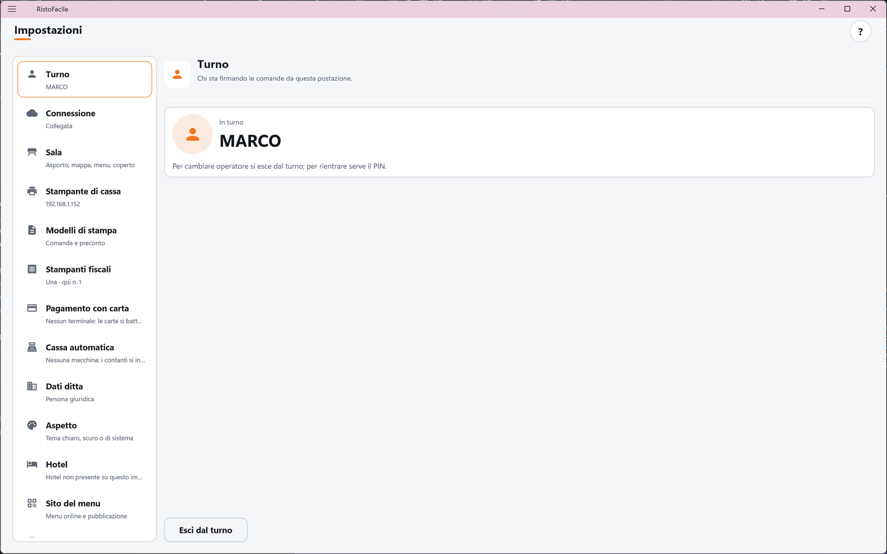

La schermata è divisa in due:

- **a sinistra** l'elenco delle voci: **Turno**, **Connessione**, **Sala**, **Stampante di cassa**,
  **Modelli di stampa**, **Stampanti fiscali**, **Pagamento con carta**, **Cassa automatica**,
  **Dati ditta**, **Aspetto**, **Hotel**, **Sito del menu**, **Self order**, **Kiosk**,
  **Fine giornata**, **Controllo**, **Licenza**. Sotto ogni nome, in piccolo, c'è lo stato attuale
  (per esempio chi è in turno, l'indirizzo del servizio, il terminale POS in uso; per le stampanti
  fiscali, per esempio, *2 · qui n. 2*, cioè 2 stampanti e questa cassa usa la n. 2) oppure un
  promemoria del contenuto (*Asporto, mappa, menu, coperto*; *Produzione, chiusura cassa e Z*;
  *Anomalie e preconti, col PIN*);
- **a destra** il pannello della voce scelta, con in testa titolo e una riga che dice a cosa
  serve, e in fondo i pulsanti e il messaggio con l'esito dell'ultima operazione.

All'apertura è selezionata la voce **Turno** (**Connessione**, se la cassa non è ancora collegata
a un servizio). La voce scelta è evidenziata con il bordo arancione.

## Campi e indicatori

### Turno

*Chi sta firmando le comande da questa postazione.*

| Elemento | Descrizione |
|---|---|
| **In turno** | Il nome dell'operatore entrato su questa cassa, oppure *Nessun operatore*. Le comande mandate da qui portano il suo nome. |
| *Per cambiare operatore si esce dal turno; per rientrare serve il PIN.* | Promemoria, visibile quando c'è un operatore in turno. |
| **Esci dal turno** | Chiude il turno (chiede conferma) e riporta alla schermata di [accesso](accesso.md). Compare solo con un operatore in turno. |
| **Accedi** | Apre la schermata di [accesso](accesso.md). Compare solo quando nessuno è in turno. |

### Connessione

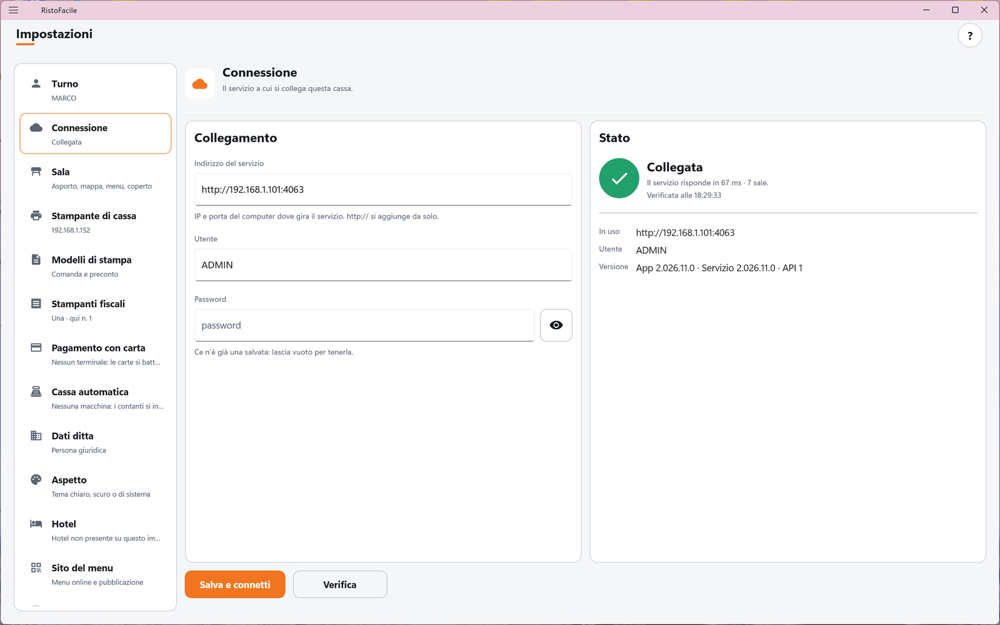

*Il servizio a cui si collega questa cassa.* Vale solo per questa cassa.

Il pannello ha due riquadri: **Collegamento** a sinistra, dove si scrivono i dati, e **Stato** a
destra, che dice se il collegamento funziona.

| Elemento | Descrizione |
|---|---|
| **Indirizzo del servizio** (riquadro **Collegamento**) | L'indirizzo del servizio RistoFacile del locale, con la porta: per esempio `192.168.1.50:8080`. *IP e porta del computer dove gira il servizio. http:// si aggiunge da solo.* Si scrive a mano: chiedilo a chi ha installato il servizio. Su iPad e Mac, in `http`, scrivi l'IP o il nome del computer senza dominio (vedi [Prima configurazione](../introduzione/prima-configurazione.md#prima-di-cominciare)). |
| **Utente** | Il nome utente con cui la cassa si presenta al servizio. |
| **Password** | La password di quell'utente. L'occhio accanto la mostra o la nasconde. Non viene mai rimostrata quella salvata: se ce n'è una compare *Ce n'è già una salvata: lascia vuoto per tenerla.* Se cambi **Utente**, la password va riscritta. |
| Stato (riquadro **Stato**) | Un cerchio verde con la spunta (*Collegata*, con il tempo di risposta e il numero delle sale), rosso con la croce se la prova non riesce (per esempio *Credenziali rifiutate*, *Nessuna risposta*, *Non raggiungibile*), giallo se la cassa è *Da configurare*. Sotto, l'ora dell'ultima prova (*Verificata alle …*). All'apertura del pannello la cassa prova da sola la connessione salvata. |
| **In uso**, **Utente** | L'indirizzo e l'utente che la cassa sta usando adesso. |
| **Versione** | La versione di questa cassa e, quando il servizio ha risposto, la sua versione e il livello con cui si parlano: per esempio *App 2.026.11.3 · Servizio 2.026.11.0 · API 1*. Come si legge il numero è spiegato in [Versione e compatibilità col servizio](#versione-e-compatibilita-col-servizio). È il dato da dare all'assistenza. |
| Riquadro ambra sotto la versione | Compare solo quando cassa e servizio non vanno d'accordo, e dice quale dei due va aggiornato (vedi [Note](#versione-e-compatibilita-col-servizio)). |
| *Hai cambiato i campi: la cassa usa ancora la connessione «In uso» finché non premi Salva e connetti.* | Riquadro ambra: compare appena modifichi indirizzo, utente o password. |
| **Salva e connetti** | Prova prima i dati scritti e li salva solo se il servizio risponde: un errore di battitura non sostituisce una connessione che funzionava. Se il servizio non risponde proprio, la cassa chiede se salvare lo stesso (**Salva lo stesso** / **Annulla**). Riuscito, sotto compare *Salvato. Collegata a* (indirizzo) *come* (utente)*.* |
| **Verifica** | Prova i dati scritti senza salvarli. Se li hai cambiati, sotto compare *Funziona. Premi Salva e connetti per usarla.* oppure *Niente salvato: la cassa usa ancora la connessione di prima.* |

Sotto la voce **Connessione**, a sinistra, si legge l'esito dell'ultima prova (per esempio
*Collegata*).

Sul PC del servizio la cassa installata dal setup (postazione **Server**) trova la connessione già
pronta: al primo avvio si collega da sola come **RISTO**. Lo fa una volta sola e mai sopra una
connessione già salvata; cucina e kiosk, anche sullo stesso PC, si collegano a mano.

Su ogni altro dispositivo l'indirizzo del servizio si scrive sempre a mano: la cassa non lo cerca
da sola.

### Sala

*Il tavolo dell'asporto, come questa postazione segue la sala, quali menu vende, coperto e conto.*
Quattro linguette in testa: **Tavolo asporto**, **Mappa e servizio**, **Menu in vendita** e
**Coperto e conto**.

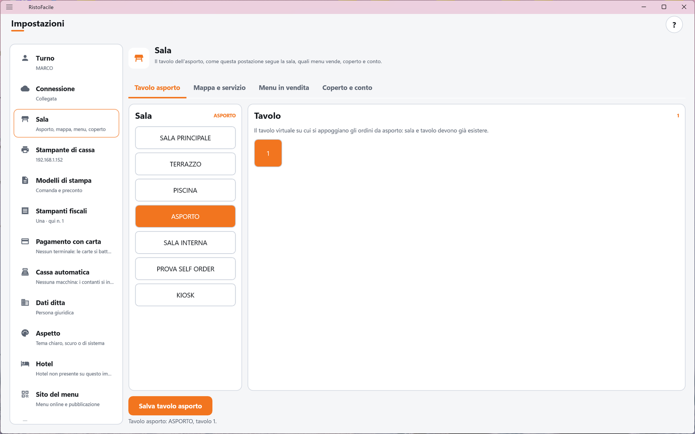

**Tavolo asporto**

| Elemento | Descrizione |
|---|---|
| **Sala** | Tutte le sale dell'impianto, anche quelle che non compaiono sulla mappa. Tocca la sala che contiene il tavolo virtuale dell'asporto: il suo nome si vede in arancione accanto al titolo. |
| **Tavolo** | I tavoli della sala scelta. Tocca quello da usare per l'asporto (un secondo tocco lo deseleziona). *Il tavolo virtuale su cui si appoggiano gli ordini da asporto: sala e tavolo devono già esistere.* |
| **Salva tavolo asporto** | Salva la scelta **per questa cassa**. |
| Riga di esito | Per esempio *Tavolo asporto: Asporto, tavolo 99.* oppure *Nessun tavolo asporto configurato.* |

Se su questa cassa non è mai stato scelto un tavolo, la cassa prova a ricavarlo dagli ordini di
asporto già fatti; la scelta fatta qui vale sempre di più.

**Mappa e servizio**

| Elemento | Descrizione |
|---|---|
| **Prenotazioni in mappa** | *Con quanto anticipo la mappa segnala un tavolo prenotato. Zero la spegne.* Cursore da 0 a 24 ore (proposta: 1 ora). Sotto, a parole, la scelta: *Le prenotazioni confermate compaiono sulla mappa 2 ore prima.* oppure *Segnalazione disattivata: la mappa non mostra le prenotazioni.* |
| **Aggiornamento automatico** | *Ogni quanti secondi le schermate di sala mostrano il lavoro degli altri dispositivi. Zero lo spegne.* Cursore da 0 a 60 secondi a passi di 5 (proposta: 5). Sotto: *Le schermate di sala controllano ogni 5 secondi se un altro dispositivo ha cambiato qualcosa.* oppure *Aggiornamento automatico spento: le schermate si aggiornano solo riaprendole.* |
| **Sala preferita** | *La sala su cui si apre la mappa di questa postazione. Durante il lavoro la mappa resta sull'ultima sala guardata.* Tocca **LA PRIMA** (la prima sala dell'elenco, la proposta) oppure il nome di una sala; accanto al titolo si legge la scelta. Se la sala scelta è stata tolta o spenta: *La sala preferita (codice 3) non c'e' piu' o non e' attiva: la mappa apre la prima.* |

I tre valori valgono solo per questa cassa e si salvano appena li cambi: non c'è un pulsante
**Salva**. L'interruttore del tagliando di via, che prima stava qui, ora è in
[Modelli di stampa](#modelli-di-stampa), linguetta **Tagliando di via**.

**Menu in vendita**

*Quali menu mostra la Comanda di questa postazione. Con TUTTI valgono anche i menu creati dopo; i
menu spenti o fuori orario restano nascosti comunque.*

| Elemento | Descrizione |
|---|---|
| **TUTTI** | La proposta: la [Comanda](comanda.md) di questa cassa mostra tutti i menu attivi, anche quelli creati in seguito. |
| Un pulsante per ogni menu | Tocca i menu da vendere da questa cassa (un secondo tocco li toglie); un menu spento porta la scritta *(non attivo)*. Se non ne scegli nessuno vale **TUTTI**. |
| **Salva menu in vendita** | Salva la scelta **per questa cassa**. Sotto: *Salvato. Questa postazione mostra tutti i menu attivi.* oppure *Salvato. Questa postazione mostra solo:* (elenco dei menu)*.* |

Esempio: la cassa del bar vende solo il menu *Bar*, quella della sala tutti.

**Coperto e conto**

Il riquadro **Coperto e abbuono**: *Non arrivano dalla comanda: senza aliquota prendono quella
della ditta, senza articolo escono come riga descrittiva.* Le tre scelte valgono per tutto
l'impianto e servono a scontrino e fattura.

| Elemento | Descrizione |
|---|---|
| **Aliquota del coperto** | Tocca per scegliere un'aliquota IVA; *Default della ditta* se non scelta. **Azzera** la toglie. |
| **Articolo del coperto**, **Articolo dell'abbuono** | Tocca per scegliere un articolo dall'anagrafica (serve se devono muovere il magazzino); *Nessuno* se non scelto. **Azzera** lo toglie. |
| *L'importo del coperto e il servizio % si impostano su ogni sala, in Sale e tavoli.* | Promemoria: vedi [Sale e tavoli](sale-e-tavoli.md). |
| **Salva coperto e abbuono** | Salva le tre scelte sul servizio. Sotto compare *Fattura salvata sull'impianto: coperto con aliquota* (codice)*.* oppure *Fattura salvata sull'impianto: coperto con l'aliquota di default della ditta.* |

### Stampante di cassa

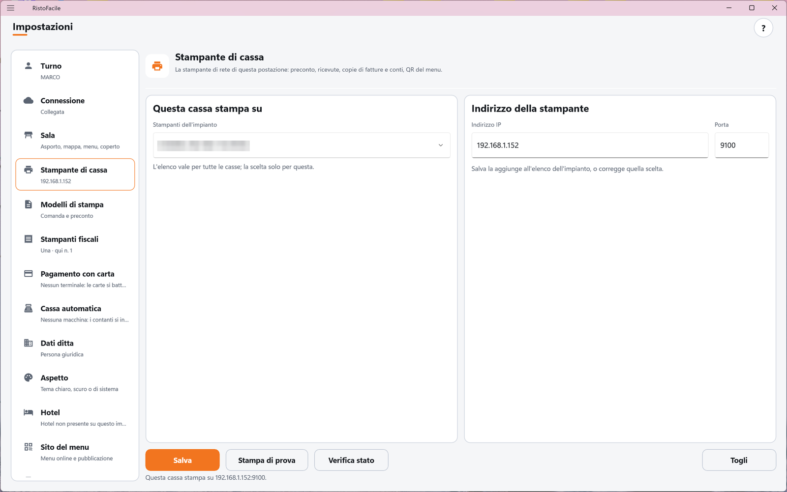

*La stampante di rete di questa postazione: preconto, ricevute, copie di fatture e conti, QR del menu.*
Ci esce anche lo stampato della [chiusura cassa](#fine-giornata).

| Elemento | Descrizione |
|---|---|
| **Stampanti dell'impianto** (riquadro **Questa cassa stampa su**) | Tendina con le stampanti già registrate sull'impianto. Sceglierne una la rende subito quella di questa cassa. *L'elenco vale per tutte le casse; la scelta solo per questa.* Se l'impianto non ne ha ancora: *Nessuna stampante sull'impianto: scrivi indirizzo e porta qui a fianco e premi Salva.* |
| **Indirizzo IP** (riquadro **Indirizzo della stampante**) | L'indirizzo della stampante in rete, per esempio `192.168.1.200`. Obbligatorio. |
| **Porta** | Di solito `9100` (è la proposta). |
| *Salva la aggiunge all'elenco dell'impianto, o corregge quella scelta.* | Promemoria sotto indirizzo e porta. |
| Riga di esito | Per esempio *Questa cassa stampa su Banco (192.168.1.200:9100).* oppure *Nessuna stampante configurata su questa cassa.* |

I pulsanti **Salva**, **Stampa di prova**, **Verifica stato** e **Togli** sono descritti in
[Pulsanti e comandi](#pulsanti-e-comandi). Sotto la voce, a sinistra, si legge l'indirizzo della
stampante in uso.

### Modelli di stampa

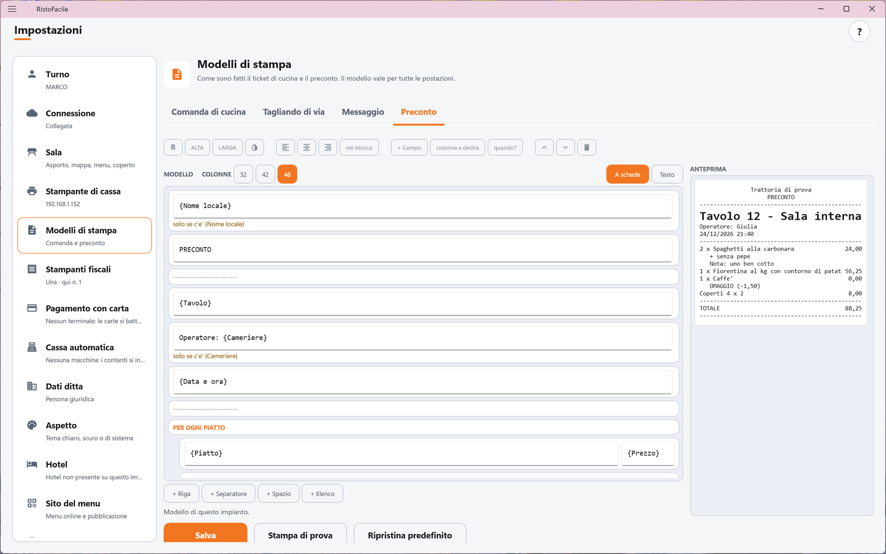

*Come sono fatti il ticket di cucina e il preconto. Il modello vale per tutte le postazioni.*

| Elemento | Descrizione |
|---|---|
| **Comanda di cucina**, **Tagliando di via**, **Messaggio**, **Preconto** | Il documento da modificare. Se il modello aperto ha modifiche non salvate, cambiando documento la cassa chiede conferma. |
| **Stampa il tagliando da questa postazione** | Solo nella linguetta **Tagliando di via**, sopra il modello: *Quando da qui si dà il via a un'uscita, in cucina esce anche il tagliando.* Pulsante **SI'** / **NO** (proposto **SI'**): ogni tocco lo inverte e la scelta si salva subito, **solo per questa cassa** (non fa parte del modello e non serve **Salva**). Con **NO**, il **VIA** dato da questa cassa non stampa il tagliando nei centri di produzione. |
| **MODELLO** | La zona di modifica. Si lavora in due modi: **A schede** (ogni riga del documento è una scheda da compilare) o **Testo** (il modello scritto per intero, per chi lo conosce). Se un modello non si può rappresentare a schede la cassa resta sul testo e ne dice il motivo. |
| **COLONNE** **32** / **42** / **48** | Larghezza della carta in caratteri (solo nella modifica a schede): 32 per la carta da 58 mm, 42 per le Epson TM da 80 mm, 48 per quasi tutte le altre da 80 mm. |
| Barra dei tasti (modifica a schede) | Su una riga scelta: grassetto, **ALTA**, **LARGA**, bianco su nero; allineamento a sinistra, al centro, a destra o **nel blocco**; **+ Campo** (inserisce un dato del documento scelto da un elenco, per esempio il nome del piatto); **colonna a destra** (aggiunge una seconda casella allineata a destra, per esempio per i prezzi); **quando?** (*Stampala sempre* oppure *Solo se c'e'* un certo dato); frecce per spostare in alto o in basso; cestino per eliminare. |
| **+ Riga**, **+ Separatore**, **+ Spazio**, **+ Elenco** | Aggiungono una scheda. **+ Elenco** chiede *Di cosa vuoi fare l'elenco?* (per esempio le righe della comanda). |
| **ANTEPRIMA** | Il documento come uscirà sulla carta, composto con dati di prova. |
| Riga in fondo | Da dove viene il modello: *Modello di questo impianto.*, *Modello di questo impianto (ultima copia scaricata: il servizio non risponde).* oppure *Modello predefinito: questo impianto non ne ha ancora uno suo.* |
| **Salva** | Salva il modello sul servizio: *Modello salvato: vale per tutte le postazioni.* |
| **Stampa di prova** | Stampa il modello sulla stampante di cassa di questa cassa. |
| **Ripristina predefinito** | Cancella il modello dell'impianto e torna alla stampa di fabbrica (chiede conferma). |

#### Campi e condizioni

**+ Campo** propone solo i dati del punto in cui sta la riga: fuori dagli elenchi i dati del
documento, dentro un elenco quelli di ogni sua voce. **quando?** propone sempre *Stampala sempre*
e, per ogni dato dello stesso punto, *Solo se c'e'* quel dato. Il **Tagliando di via** usa gli
stessi dati della **Comanda di cucina**.

| Documento | Fuori dagli elenchi | Elenchi (**+ Elenco**) e loro dati |
|---|---|---|
| Comanda di cucina, Tagliando di via | Centro di produzione, Uscita, Tavolo, Cameriere, Data e ora | **Piatti** (*PER OGNI PIATTO*): Piatto, Quantita', Nome del piatto · **Dettagli** (*PER OGNI DETTAGLIO*): Dettaglio · **Piatti tolti** (*PER OGNI PIATTO TOLTO*): Piatto tolto, Quantita', Nome del piatto · **Ristampa** (*SOLO SULLE COPIE*): Numero della copia, Ora dell'invio |
| Preconto | Nome locale, Tavolo, Cameriere, Data e ora, Totale | **Piatti**: Piatto, Quantita', Nome del piatto, Prezzo · **Dettagli**: Dettaglio · **Coperti e servizio** (*PER COPERTI E SERVIZIO*): Voce coperti o servizio, Importo coperti o servizio |
| Messaggio | Centro di produzione, Chi scrive, Data e ora | **Messaggio** (*PER OGNI RIGA DEL MESSAGGIO*): Riga del messaggio |

Dentro **Dettagli** e **Messaggio** *quando?* propone solo *Stampala sempre*.

### Stampanti fiscali

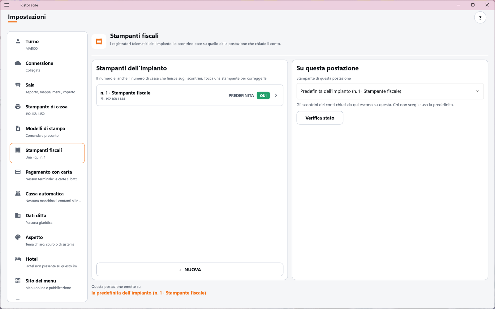

*I registratori telematici dell'impianto: lo scontrino esce su quello della postazione che chiude il conto.*
Un impianto può avere **più stampanti fiscali**, per esempio una per ogni cassa. L'elenco vale per
tutto l'impianto; quale stampante usa questa cassa vale solo qui.

Il pannello ha due parti.

**Stampanti dell'impianto** (a sinistra) è l'elenco: per ogni stampante si legge *n. numero · descrizione*,
sotto la marca e l'indirizzo, e a destra la scritta **PREDEFINITA** e, per quella che usa questa cassa,
la pastiglia verde **QUI**. Tocca una stampante per correggerla; **+ NUOVA** ne aggiunge una.

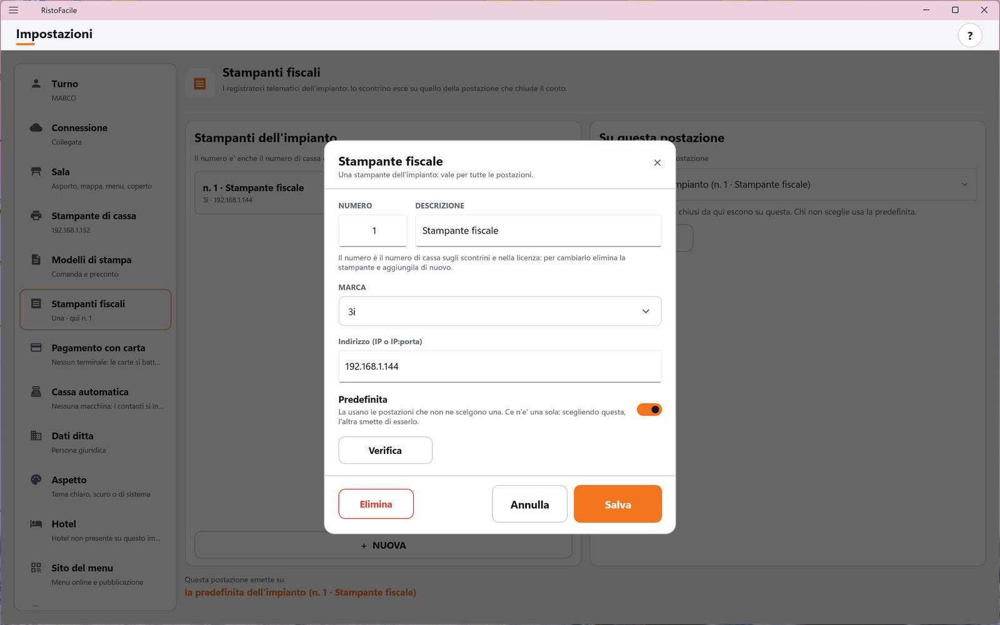

| Elemento della scheda | Descrizione |
|---|---|
| **Numero** | Da 1 a 99, diverso per ogni stampante. È anche il **numero di cassa** che compare sugli scontrini di quella stampante e che conta per la licenza. **+ NUOVA** propone il primo numero libero. Quando correggi una stampante il numero non si cambia (la scheda dice *Il numero è il numero di cassa sugli scontrini e nella licenza: per cambiarlo elimina la stampante e aggiungila di nuovo.*). |
| **Descrizione** | Il nome che riconosci, per esempio *Cassa 1*, *Banco bar*. |
| **Marca** | **Epson**, **DTR**, **3i**, **RCH**, **Custom**, **Axon**, **Ditron**, **RCHWeb**, **CustomWeb** (versione beta). Per i registratori RCH vedi [RCH o RCHWeb](#rch-o-rchweb), per i Custom [Custom o CustomWeb](#custom-o-customweb), qui sotto. |
| **Indirizzo (IP o IP:porta)** | L'indirizzo del registratore in rete, per esempio `192.168.1.100`. Con **Ditron** si scrive la porta logica del driver WinEcrCom, perché il Ditron è collegato al computer del servizio. |
| **Predefinita** | La usano le postazioni che non ne scelgono una. Ce n'è una sola: scegliendo questa, l'altra smette di esserlo. |
| **Verifica** | Interroga il registratore con i valori che hai scritto, prima di salvare. |
| **Elimina** | Toglie la stampante dall'elenco (chiede conferma). Compare solo quando ne correggi una. La conferma dice anche se la usa questa postazione o il [self order](self-order.md) per lo scontrino del saldo dal telefono. |

#### RCH o RCHWeb

I registratori RCH Print!F RT si collegano in due modi, che sul registratore sono alternativi:

| Marca | Come funziona | Cosa serve sul registratore |
|---|---|---|
| **RCH** | RistoFacile manda i comandi e il registratore non risponde: lo scontrino si registra senza numero, azzeramento e matricola letti dalla macchina, e un comando rifiutato si vede solo sul display. | Protocollo **XON-XOFF** sulla porta di rete. |
| **RCHWeb** | Il registratore risponde a ogni comando: RistoFacile sa se lo scontrino è uscito e ne registra numero, azzeramento e matricola; se un documento resta aperto lo annulla da solo. | Protocollo **STANDARD** sulla porta di rete e **risposta estesa** del web service. |

Con **RCHWeb** l'indirizzo è quello del registratore, senza porta. Sul registratore, dal menu
**SERVICE ▸ Connettività ▸ Ethernet**, il tecnico imposta **Protocollo PC** su **STANDARD** e
**WEBSRV: Risp. estesa** su **SI**. Se manca la risposta estesa, **Verifica** lo dice; se il
protocollo è rimasto XON-XOFF gli scontrini escono ma sul display del registratore compare
l'errore E20 a ogni comando.

!!! note "Un centesimo in contanti"

    I pagamenti in contanti si arrotondano ai cinque centesimi: su uno scontrino da 0,01 €
    pagato in contanti il registratore stampa *sconto a pagare 0,01* e *importo pagato 0,00*. Non
    è un errore.

#### Custom o CustomWeb

Anche i registratori Custom si collegano in due modi:

| Marca | Come funziona | Per quali registratori |
|---|---|---|
| **Custom** | RistoFacile manda i comandi (protocollo XON-XOFF) e il registratore non risponde: lo scontrino si registra senza numero, azzeramento e matricola letti dalla macchina, e un comando rifiutato si vede solo sul display. | Tutti i Custom collegati in rete con il protocollo XON-XOFF. |
| **CustomWeb** (versione beta) | Il registratore risponde a ogni documento: RistoFacile sa se lo scontrino è uscito e ne registra numero, azzeramento e matricola; se un documento resta aperto lo annulla da solo. | Solo quelli di terza generazione, che hanno il web service: K3-F RT, K3-N RT, Q3X-F RT, Q3X-N RT, P3-N RT, JSmart RT, Big Plus RT, KubeX-F RT, VKP80III-F RT, Fusion, Edge e le loro versioni *-N*. |

Con **CustomWeb** l'indirizzo è quello del registratore, senza porta. Il tecnico deve aver
impostato sul registratore il collegamento di rete con il protocollo XML del web service.
**Verifica** interroga il registratore e mostra modello, matricola e ultimo documento.

Con **CustomWeb** non si fanno dal programma versamenti, prelievi e stampa del giornale:
RistoFacile risponde che la funzione non è supportata su questa marca. Gli sconti arrivano al
registratore sempre come importo.

!!! warning "CustomWeb è in versione beta"

    Il collegamento **CustomWeb** è in **versione beta**: è scritto sul manuale del costruttore e non è ancora stato
    provato su un registratore Custom. Prima di usarlo in un locale va collaudato sulla macchina
    con il tecnico: uno scontrino, un reso, un annullo e una chiusura, controllando che numero e
    azzeramento registrati siano quelli stampati.

**Su questa postazione** (a destra):

- **Stampante di questa postazione** sceglie la stampante su cui escono gli scontrini dei conti chiusi
  da questa cassa. La prima voce è **Predefinita dell'impianto**: chi non sceglie nulla usa quella.
  La scelta vale solo per questa cassa e resta anche dopo che l'hai chiusa e riaperta.
- **Verifica stato** interroga la stampante di questa postazione.
- In fondo, *Questa postazione emette su …* ricorda la stampante in uso.

La chiusura fiscale (la Z) non si fa più da qui: si fa per tutte le stampanti dell'impianto, insieme
alla chiusura della cassa, dalla voce [Fine giornata](#fine-giornata).

Se due postazioni usano la **stessa stampante fisica**, le loro richieste vanno in coda e nessuna
va persa.

!!! warning "Numeri di cassa e licenza"

    Ogni stampante dell'elenco è una cassa per la licenza, anche quando due voci indicano la stessa
    stampante fisica: due voci con lo stesso indirizzo contano come **due casse**. Per far emettere
    due postazioni sulla stessa stampante, lascia una sola voce e falla scegliere a entrambe.

!!! note "Due casse che modificano l'elenco insieme"

    **Salva** ed **Elimina** mandano al servizio l'elenco intero, così come lo vede questa cassa.
    Se due casse modificano l'elenco nello stesso momento vale l'ultimo salvataggio: la modifica
    dell'altra va persa. Prima di cambiare l'elenco, riapri **Impostazioni** per vederlo aggiornato.

!!! note "Se la stampante della postazione viene tolta"

    Se elimini dall'elenco la stampante scelta da una cassa (o da un palmare), quella postazione non
    passa da sola alla predefinita: finché non ne sceglie un'altra non può chiudere con lo scontrino e
    mostra *La stampante fiscale n. X non è nell'elenco del servizio.* Nell'elenco della postazione la
    voce compare come *n. X (non più nell'elenco)*.

!!! info "Impianti già in funzione"

    La stampante fiscale che avevi configurato prima diventa da sola la **predefinita**, con
    numero uguale al numero di cassa della ditta (oppure 1). Non devi rifare niente.

!!! warning "Numeri di cassa e scontrini in sospeso"

    Uno scontrino rimasto **in sospeso** (la stampante non ha detto se è uscito, vedi
    [Conto](conto.md)) si riprende sulla stampante che ha **il suo numero di cassa**: il numero è
    l'identità della cassa. Per questo:

    - se elimini una stampante e ne aggiungi un'altra con **lo stesso numero**, anche su un altro
      registratore, gli scontrini in sospeso della prima si riprendono sulla nuova;
    - se dopo l'aggiornamento cambi il **numero di cassa della ditta** nel gestionale, la stampante
      nata dall'aggiornamento non è più quella «di prima»: i suoi scontrini escono con il suo numero
      (che per la licenza può contare come una cassa in più), e gli scontrini in sospeso di prima
      dell'aggiornamento si riprendono sulla stampante che ha il numero nuovo.

    Prima di eliminare una stampante o di cambiare il numero di cassa della ditta, risolvi gli
    scontrini in sospeso.

La Z si fa solo dalla cassa, con [Fine giornata](#fine-giornata): il palmare non ha i pulsanti
della Z.

### Pagamento con carta

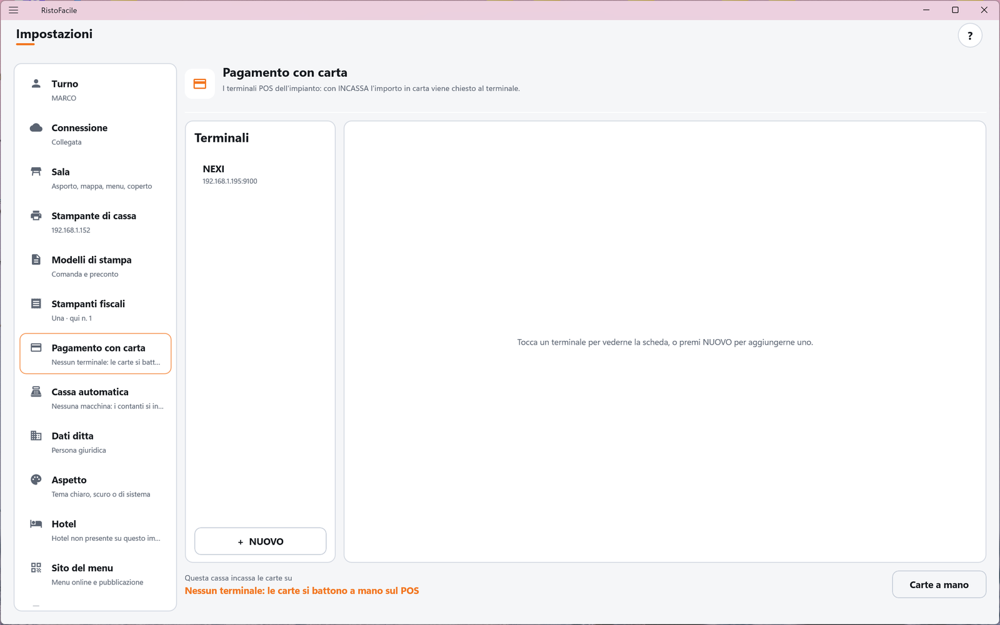

*I terminali POS dell'impianto: con INCASSA l'importo in carta viene chiesto al terminale.*
L'elenco dei terminali vale per tutto l'impianto; quale terminale usa questa cassa vale solo qui.

| Elemento | Descrizione |
|---|---|
| **Terminali** | L'elenco dei terminali POS dell'impianto, con nome e indirizzo. Quello usato da questa cassa porta la pastiglia verde **IN USO**. Tocca un terminale per aprirne la scheda. |
| **Scheda del terminale** | Si apre toccando un terminale o **+  NUOVO**. Finché non è aperta compare *Tocca un terminale per vederne la scheda, o premi NUOVO per aggiungerne uno.* |
| **Numero** | Il numero del terminale nell'impianto (maggiore di zero). Per un terminale nuovo è proposto il primo libero. |
| **Descrizione** | Il nome che vedi in elenco, per esempio *POS banco*. |
| **ID terminale** | Il codice del terminale scritto sul POS (per esempio `00000001`); non è il **Numero**. |
| **Indirizzo IP** / **Porta** | Dove si trova il terminale in rete. Porta proposta: `10000`. |
| **ID cassa** (riquadro **Su questa cassa**) | Il numero con cui questa cassa si presenta al terminale: il POS lo stampa sulla ricevuta, e serve a capire da quale cassa è partito un pagamento. Solo cifre, al massimo 8. Proposto `1`; con più casse sullo stesso terminale dai a ciascuna un numero diverso. I kiosk si presentano da soli come `900` più il loro numero (`901`, `902`...). |
| **Questa cassa incassa le carte su** | In fondo al pannello: il terminale in uso, oppure *Nessun terminale: le carte si battono a mano sul POS*. Lo stesso testo compare sotto la voce, a sinistra. |

L'**ID cassa** serve solo al pagamento con la carta: è il codice con cui la cassa si presenta al
terminale a ogni pagamento e compare sulle ricevute e sui riepiloghi del POS. La cassa lo completa
con zeri a sinistra (`1` diventa `00000001`). Due casse sullo stesso terminale funzionano anche con
lo stesso numero; dare un numero diverso a ciascuna serve a distinguerle sulle ricevute del POS.

Al momento si gestiscono solo i terminali POS standard collegati in rete; i POS in cloud (per
esempio SumUp) non si configurano da qui.

### Cassa automatica

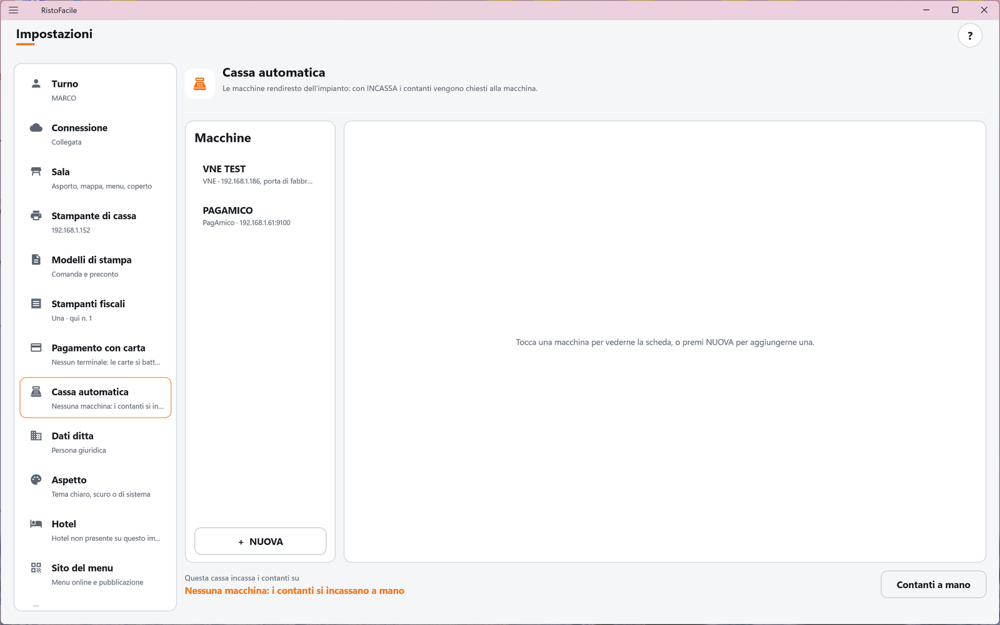

*Le macchine rendiresto dell'impianto: con INCASSA i contanti vengono chiesti alla macchina.*
L'elenco delle macchine vale per tutto l'impianto; quale macchina usa questa cassa vale solo qui.

| Elemento | Descrizione |
|---|---|
| **Macchine** | L'elenco delle casse automatiche dell'impianto; quella usata da questa cassa porta **IN USO**. Tocca una macchina per aprirne la scheda, o **+  NUOVA** per aggiungerne una. |
| **Numero** | Il numero della macchina nell'impianto (maggiore di zero). |
| **Descrizione** | Il nome in elenco, per esempio *Self ingresso*. |
| **Marca** | **PagAmico**, **VNE**, **CashDro** o **Cashlogy**. I campi e i pulsanti della scheda cambiano con la marca: vedi [Le marche](#le-marche-delle-casse-automatiche). |
| **Indirizzo IP** | Dove si trova la macchina in rete. Obbligatorio. |
| **Porta** | Vuota = la porta di fabbrica della marca (è mostrata in grigio nel campo): 9100 per PagAmico, 443 per VNE e CashDro (80 se l'indirizzo della CashDro comincia con `http://`), 8092 per Cashlogy. |
| **Password erogazione** | Solo per PagAmico: la password di erogazione impostata sulla macchina. Senza, la macchina rifiuta i comandi che danno denaro (resto, prelievo). |
| **Utente POS** / **Password POS** | Solo per CashDro, obbligatori: l'utente e la password creati sulla macchina, che li danno CashDro o il rivenditore. |
| **Impronta del certificato (facoltativa)** | Solo per CashDro: *Lasciala vuota alla prima prova: il servizio scrive nel giornale quella vista.* Copiata qui dal giornale, il servizio parla solo con quella macchina. Sono 64 cifre esadecimali; i due punti si possono lasciare. |
| **POS collegato alla macchina** | Solo per PagAmico e VNE, le macchine che hanno anche un POS. **SI'**: *la carta la incassa la macchina.* **NO**: *la carta va sul POS del bancone.* |
| **Questa cassa incassa i contanti su** | In fondo al pannello: la macchina in uso, oppure *Nessuna macchina: i contanti si incassano a mano*. |

Nel riquadro **Su questa cassa**, visibile con una macchina scelta:

| Elemento | Descrizione |
|---|---|
| *Incasso rimasto aperto (per esempio dopo un riavvio)? Sblocca restituisce al cliente quello che ha inserito.* | Spiega il pulsante **Sblocca incasso**. Con una Cashlogy si legge invece *Un incasso rimasto aperto si annulla dalla finestra del Cashlogy Connector, sul PC della macchina.* |
| Importo (*€ 0,00*) | L'importo da prelevare. |

La cassa automatica è solo della cassa: il palmare non la usa.

#### Le marche delle casse automatiche

| Marca | Incassa | Carta | Chiudi trattenendo | Preleva | Ricarica | Sblocca incasso |
|---|---|---|---|---|---|---|
| **PagAmico** | sì | sì, se ha il POS | sì | sì | sì | sì |
| **VNE** | sì | sì, se ha il POS | sì | sì | dal pannello della macchina | sì |
| **CashDro** | sì, solo contanti | no | no | no | dal pannello della macchina | sì |
| **Cashlogy** | sì, solo contanti | no | no | sì | dalla finestra del Connector | dalla finestra del Connector |

- **CashDro.** La cassa le parla in https. La CashDro non eroga denaro su comando: un rimborso o un resto che la macchina non ha dato si consegnano a mano.
  <!-- DA VERIFICARE: CashDro provata solo con una macchina finta; su una macchina vera vanno confermati annullo, ripresa dopo un riavvio e certificato (se cambia a ogni riavvio, l'impronta va lasciata vuota). -->
- **Una macchina, un programma.** La stessa CashDro o lo stesso Cashlogy Connector non vanno
  pilotati insieme dal gestionale Facile e da RistoFacile: i due programmi si rubano le operazioni.
  Se nel locale c'è anche Facile, la macchina la usa uno dei due.
- **Cashlogy.** La cassa non parla con la macchina ma con il **Cashlogy Connector**, il programma di Cashlogy installato sul PC collegato alla macchina. **Il Connector va avviato su quel PC**: la cassa non lo avvia. La finestra di pagamento la apre il Connector, e un incasso già avviato si annulla solo da quella finestra. Se il Connector è stato riavviato e gli incassi non partono, tocca **Verifica stato**: rimette in contatto la cassa con il Connector.
  <!-- DA VERIFICARE: Cashlogy provata solo con un Connector finto; su una macchina vera vanno confermati il formato delle risposte e il riavvio del Connector. -->

### Dati ditta

Sotto il titolo compare il nome della ditta; sotto la voce, a sinistra, si legge chi è la ditta
(*Persona giuridica*, *Ditta individuale* o *Persona fisica*). Sei linguette: **Ditta**,
**Fattura**, **Invio SdI**, **IVA e scontrini**, **Posta e SMS** e **OpenAPI**. Sono i dati della
ditta di Facile: valgono per tutto l'impianto e, cambiati qui, cambiano anche in Facile.

Ogni linguetta ha in fondo il suo pulsante **Salva dati ditta**: tutti salvano **insieme i dati di
tutte le linguette**, non solo quelli della linguetta aperta. Sotto il pulsante compare l'esito: *Dati della ditta salvati: la
fattura elettronica ha tutto quello che le serve.* oppure *Dati della ditta salvati. Restano 2 cose
da sistemare per la fattura elettronica.*

Se il servizio del locale è di una versione precedente, alcune parti restano spente con la scritta
*Il servizio non la gestisce ancora: va aggiornato.* (o *Il servizio non lo gestisce ancora: va
aggiornato.*): fai aggiornare il servizio.

#### Ditta

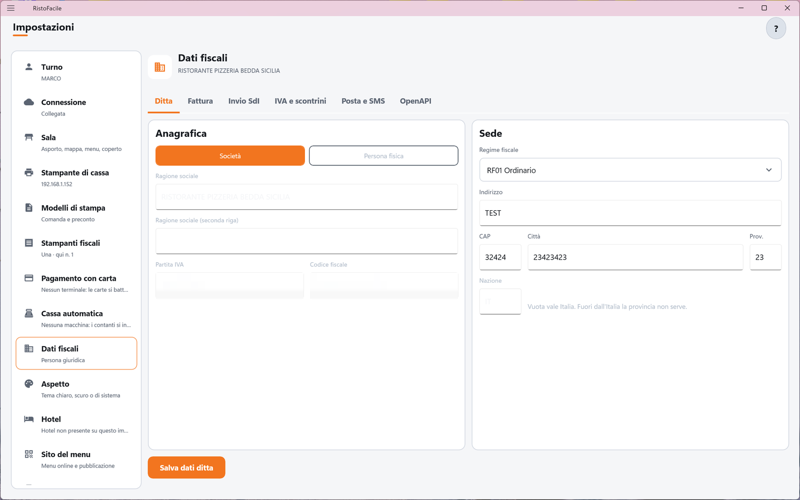

| Elemento | Descrizione |
|---|---|
| **Società** / **Persona fisica** (riquadro **Anagrafica**) | Che cos'è la ditta. Tocca il pulsante giusto: quello scelto diventa arancione. |
| **Ditta individuale** | Solo per la persona fisica: **SI'** / **NO**. |
| **Ragione sociale**, **Ragione sociale (seconda riga)** | Il nome della ditta come va in fattura (fino a 45 caratteri per riga). Per una persona fisica che non è ditta individuale le due caselle diventano **Cognome** e **Nome**. |
| **Partita IVA**, **Codice fiscale** | 11 e 16 caratteri al massimo. La partita IVA è anche l'utente dell'invio allo SdI. |
| **Regime fiscale** (riquadro **Sede**) | Tocca per scegliere da un elenco (da *RF01 Ordinario* a *RF19 Regime forfettario*). Se manca: *Non impostato: la fattura elettronica non esce*. |
| **Indirizzo**, **CAP**, **Città**, **Prov.** | La sede legale della ditta, cioè l'indirizzo che va nella fattura elettronica. Nel gestionale Facile sono i campi del domicilio fiscale (linguetta *Domicilio - Titolare* della ditta). CAP di 5 cifre, provincia di 2 lettere. |
| **Nazione** | *Vuota vale Italia. Fuori dall'Italia la provincia non serve.* |
| **Salva dati ditta** | Salva sul servizio i dati di tutte le linguette. |

Il codice di **Natura** giuridica è quello della tabella dell'Agenzia delle Entrate (Tabella B
delle istruzioni del modello Redditi; la stessa tabella è nelle
[istruzioni del modello 770](https://www1.agenziaentrate.gov.it/modulistica/dichiarazione/1997/modelli/770/770ter6.pdf)): i più comuni sono **1** società in accomandita per azioni,
**2** società a responsabilità limitata, **3** società per azioni, **24** società in nome
collettivo, **25** società in accomandita semplice. Sono validi i codici da 1 a 44 e da 50 a 58;
per gli altri chiedi al commercialista. Con 1, 2 e 3 serve anche il capitale sociale, con 2 anche
il socio unico.

#### Fattura

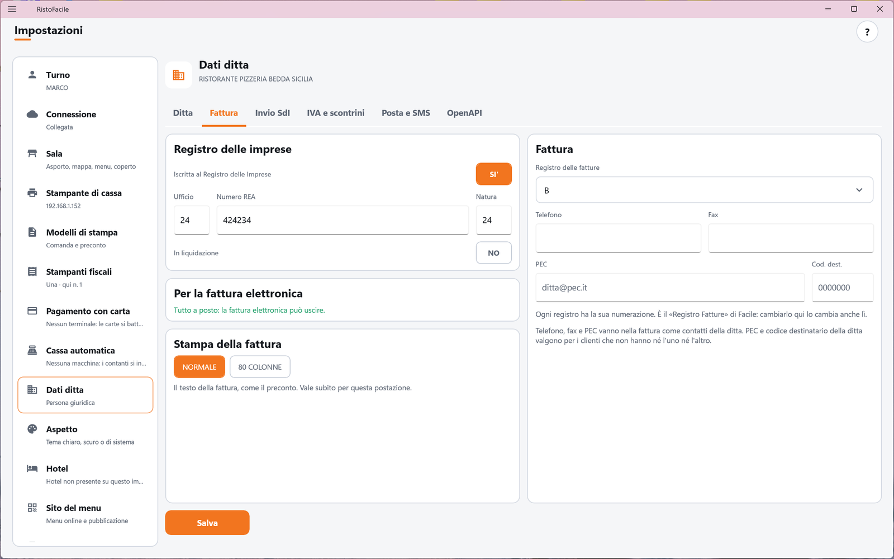

| Elemento | Descrizione |
|---|---|
| **Iscritta al Registro delle Imprese** (riquadro **Registro delle imprese**) | **SI'** / **NO**. Con **SI'**, per una società, compaiono **Ufficio** (sigla della provincia), **Numero REA**, **Natura** (codice numerico di due cifre) e l'interruttore **In liquidazione**. |
| **Capitale sociale** | Compare solo con **Natura** 1, 2 o 3. |
| **Socio unico** | **SI'** / **NO**; compare solo con **Natura** 2. |
| **In liquidazione** | **SI'** / **NO**: la società è in liquidazione. |
| **Per la fattura elettronica** | *Tutto a posto: la fattura elettronica può uscire.* oppure, in giallo, l'elenco di cosa manca. |
| **Registro delle fatture** (riquadro **Fattura**) | Tocca per scegliere il registro (una lettera da **A** a **Z**, poi da **AA** a **ZZ**). *Ogni registro ha la sua numerazione. È il «Registro Fatture» di Facile: cambiarlo qui lo cambia anche lì.* Se il servizio non lo prevede: *Il servizio non lo gestisce ancora*. |
| **Telefono**, **Fax**, **PEC** | I contatti della ditta da scrivere in fattura. |
| **Cod. dest.** | Il codice destinatario della ditta, 7 caratteri. *PEC e codice destinatario della ditta valgono per i clienti che non hanno né l'uno né l'altro.* |
| **NORMALE** / **80 COLONNE** (riquadro **Stampa della fattura**) | Come esce la copia della fattura sulla stampante di cassa di questa postazione. **NORMALE**: *Il testo della fattura, come il preconto.* **80 COLONNE**: la fattura impaginata da un modello Crystal da 80 mm. *Vale subito per questa postazione.* |
| **modello** | Solo con **80 COLONNE**: il numero del modello Crystal da 80 mm, per esempio 60001; vuoto, vale quello impostato sulla ditta in Facile. |
| **Salva dati ditta** | Salva sul servizio i dati di tutte le linguette. |

Coperto e abbuono, che prima stavano in questa linguetta, ora sono in
[Sala](#sala), linguetta **Coperto e conto**.

#### Invio SdI

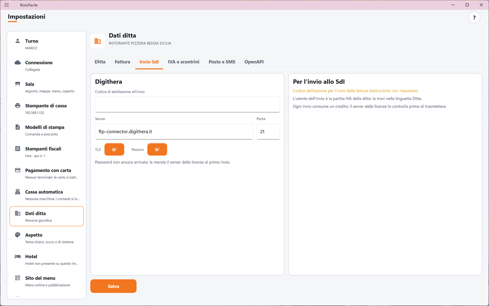

Il collegamento con Digithera, che trasmette le fatture elettroniche allo SdI.

| Elemento | Descrizione |
|---|---|
| **Codice di abilitazione all'invio** (riquadro **Digithera**) | Il codice numerico (fino a 9 cifre) che abilita la ditta all'invio. |
| **Server**, **Porta** | Dove si collega il servizio per trasmettere (porta proposta: 21). |
| **TLS**, **Passivo** | **SI'** / **NO**. La fattura parte verso il server con un collegamento FTP: **TLS** lo cifra, **Passivo** usa la modalità passiva, quella che passa dai firewall e dai router. |
| Riga della password | *Password presente: la manda il server delle licenze a ogni controllo del credito.* oppure *Password non ancora arrivata: la manda il server delle licenze al primo invio.* La password non si scrive qui. |
| **Per l'invio allo SdI** | *Tutto a posto: le fatture possono partire.* oppure, in giallo, l'elenco di cosa manca. Sotto: *L'utente dell'invio è la partita IVA della ditta: la trovi nella linguetta Ditta.* e *Ogni invio consuma un credito: il server delle licenze lo controlla prima di trasmettere.* |
| **Salva dati ditta** | Salva sul servizio i dati di tutte le linguette. |

Codice di abilitazione, server, porta e le scelte **TLS** e **Passivo** li fornisce RSA con il
servizio di invio delle fatture elettroniche, come la password e il credito degli invii.

#### IVA e scontrini

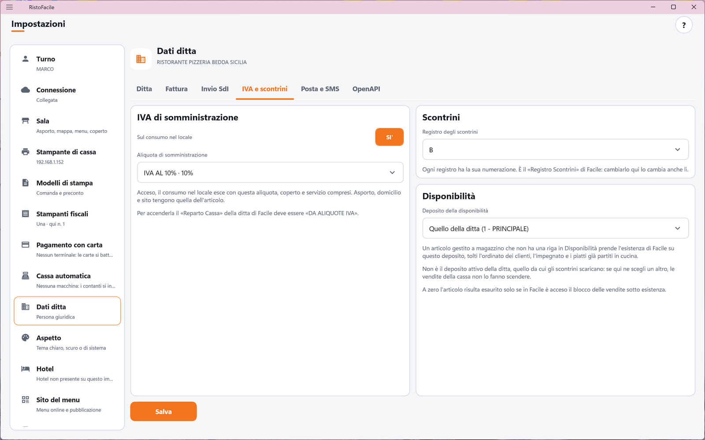

| Elemento | Descrizione |
|---|---|
| **Sul consumo nel locale** (riquadro **IVA di somministrazione**) | **SI'** / **NO**. *Acceso, il consumo nel locale esce con questa aliquota, coperto e servizio compresi. Asporto, domicilio e sito tengono quella dell'articolo.* Vedi [IVA di somministrazione](#iva-di-somministrazione). *Per accenderla il «Reparto Cassa» della ditta di Facile deve essere «DA ALIQUOTE IVA».* |
| **Aliquota di somministrazione** | Tocca per scegliere l'aliquota (di solito l'IVA al 10%); *Nessuna: scegli l'aliquota* se non scelta. Deve avere il reparto della stampante fiscale e una percentuale maggiore di zero. Si salva anche a interruttore spento. |
| **Registro degli scontrini** (riquadro **Scontrini**) | Tocca per scegliere il registro (da **A** a **Z**, poi da **AA** a **ZZ**). *Ogni registro ha la sua numerazione. È il «Registro Scontrini» di Facile: cambiarlo qui lo cambia anche lì.* |
| **Deposito della disponibilità** (riquadro **Disponibilità**) | Il deposito di Facile da cui la cassa prende l'esistenza degli articoli gestiti a magazzino che non hanno una riga in [Disponibilità](disponibilita.md#lesistenza-di-magazzino): l'esistenza di quel deposito, tolti l'ordinato dei clienti, l'impegnato e i piatti già partiti in cucina. Di partenza *Quello della ditta* (con il nome del deposito). Non è il deposito attivo della ditta, da cui gli scontrini scaricano: se ne scegli un altro, le vendite della cassa non lo fanno scendere. *A zero l'articolo risulta esaurito solo se in Facile è acceso il blocco delle vendite sotto esistenza.* |
| **Salva dati ditta** | Salva sul servizio i dati di tutte le linguette. |

#### Posta e SMS

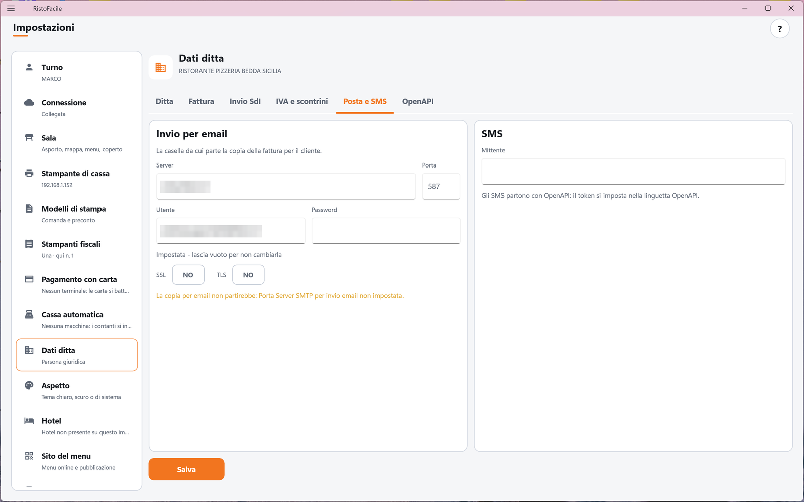

| Elemento | Descrizione |
|---|---|
| **Invio per email** | *La casella da cui parte la copia della fattura per il cliente.* |
| **Server**, **Porta** | Il server di posta in uscita (per esempio `smtp.esempio.it`) e la porta: nella casella si legge *es. 587*, ma vuota la porta non è impostata e va scritta. |
| **Utente**, **Password** | Le credenziali della casella. Sotto la password: *Non impostata*, *Impostata - lascia vuoto per non cambiarla* oppure *Verra' sostituita al salvataggio*. |
| **SSL**, **TLS** | **SI'** / **NO**, secondo quanto richiede il fornitore della posta. |
| Avviso in giallo | *La copia per email non partirebbe:* seguito da cosa manca. |
| **Mittente** (riquadro **SMS**) | Il nome che compare come mittente degli SMS ai clienti (fino a 45 caratteri). *Gli SMS partono con OpenAPI: il token si imposta nella linguetta OpenAPI.* |
| **Salva dati ditta** | Salva sul servizio i dati di tutte le linguette. |

#### OpenAPI

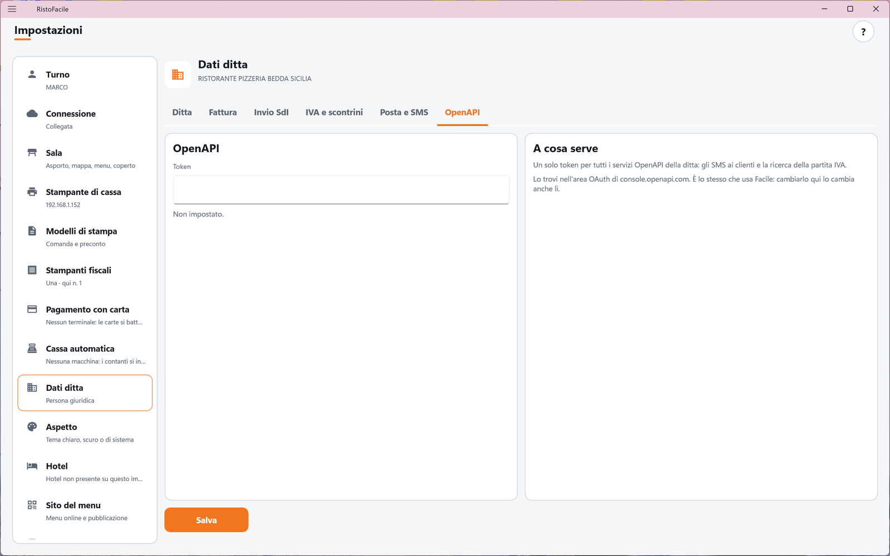

| Elemento | Descrizione |
|---|---|
| **Token** | Il token del servizio OpenAPI. Non viene mai rimostrato; sotto si legge *Non impostato.*, *Impostato - lascia vuoto per non cambiarlo.* oppure *Verra' sostituito al salvataggio.* Se in Facile gli SMS partono con un altro fornitore: *Non impostato. Facile manda gli SMS con un altro fornitore: salvando un token passano a OpenAPI.* |
| **A cosa serve** | *Un solo token per tutti i servizi OpenAPI della ditta: gli SMS ai clienti e la ricerca della partita IVA.* e *Lo trovi nell'area OAuth di console.openapi.com. È lo stesso che usa Facile: cambiarlo qui lo cambia anche lì.* |
| **Salva dati ditta** | Salva sul servizio i dati di tutte le linguette. |

!!! warning "Un token nuovo vale anche per Facile"

    Il token è lo stesso di Facile. Se in Facile gli SMS partivano con un altro fornitore, salvando
    un token da qui gli SMS passano a OpenAPI anche in Facile.

### Aspetto

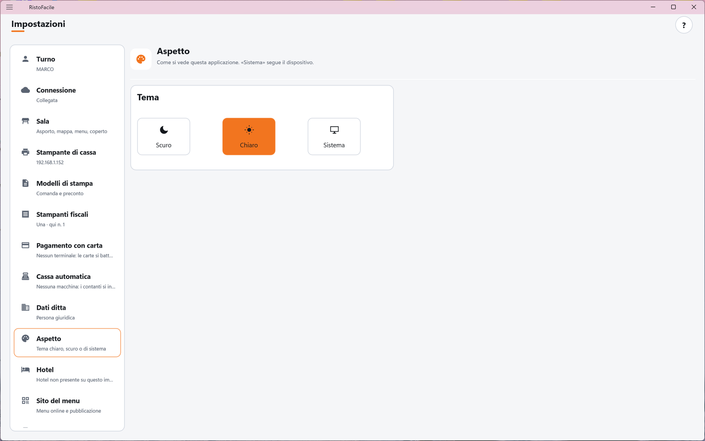

*Come si vede questa applicazione. «Sistema» segue il dispositivo.*

| Elemento | Descrizione |
|---|---|
| **Tema**: **Scuro**, **Chiaro**, **Sistema** | Tocca uno dei tre riquadri: il tema cambia subito e resta salvato su questa cassa. **Sistema** segue l'impostazione chiara/scura di Windows o del tablet. Il tema proposto è **Scuro**. |

### Hotel

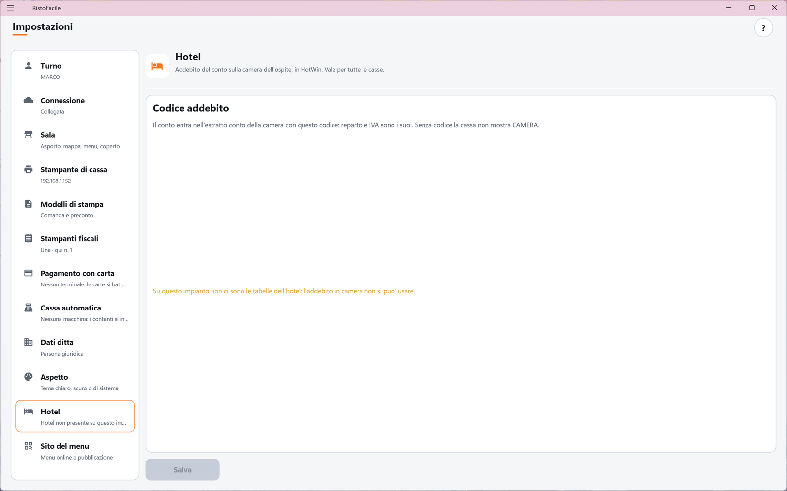

*Addebito del conto sulla camera dell'ospite, in HotWin. Vale per tutte le casse.*

| Elemento | Descrizione |
|---|---|
| **Codice addebito** | *Il conto entra nell'estratto conto della camera con questo codice: reparto e IVA sono i suoi. Senza codice la cassa non mostra CAMERA.* Elenco dei codici di addebito dell'hotel, ciascuno con il suo reparto: tocca quello da usare. |
| Avviso | *Su questo impianto non ci sono le tabelle dell'hotel: l'addebito in camera non si puo' usare.* quando il locale non è collegato a un hotel. |
| Stato sotto la voce | *Addebito in camera col codice* (codice), *Addebito in camera spento* oppure *Hotel non presente su questo impianto*. |

### Sito del menu

*Il menu online del locale: aspetto, contenuti e pubblicazione via FTP.* Ha dieci linguette, con
l'anteprima del sito a destra. È descritto nella scheda [Sito del menu](sito-menu.md). Esiste solo
sulla cassa.

### Self order

*Ordini dal telefono del cliente, col QR sul tavolo. Vale per tutte le casse.* Ha quattro
linguette: **Attivazione**, **Pausa**, **Codici QR** e **Asporto online** (gli ordini da casa
pagati con un link). È descritto nella scheda [Self order](self-order.md). Esiste solo sulla
cassa.

### Kiosk

*I totem per ordinare da soli: postazioni, menu, attesa e suggerimenti.* Sono le impostazioni che
valgono per tutti i kiosk del locale: si cambiano da qui e sono descritte nella scheda
[Kiosk](kiosk.md). Quello che si imposta sul totem stesso (collegamento, numero, POS, rendiresto,
stampante termica) è in [Configurazione del kiosk](../kiosk/configurazione.md).

### Fine giornata

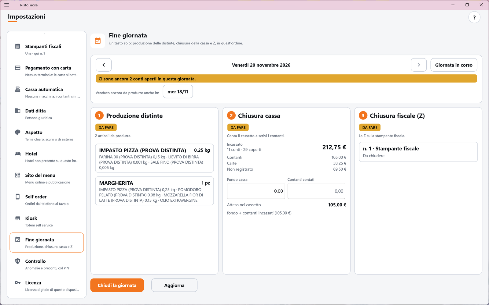

*Un tasto solo: produzione delle distinte, chiusura della cassa e Z, in quest'ordine.* La fine
giornata vale per tutto l'impianto: si fa da una sola cassa, per tutte le casse e tutte le
stampanti fiscali. La fa solo un operatore con il permesso **Puo' fare la fine giornata (chiusura
cassa e Z)** (scheda [Operatori](operatori.md)): lo stesso permesso serve per **Correggi cassa**.
Dopo l'aggiornamento il permesso è spento per tutti: il titolare lo deve dare a chi chiude la
giornata.

In alto c'è il giorno da chiudere, sotto le tre fasi affiancate, ciascuna con il suo numero (**1**,
**2**, **3**), il suo stato e quello che farà. In fondo i pulsanti e la riga dell'esito.

**Il giorno**

| Elemento | Descrizione |
|---|---|
| Frecce ‹ › e giorno | Il giorno mostrato, per esempio *Giovedì 19 novembre 2026*. Le frecce passano al giorno prima o dopo (non oltre oggi). All'apertura il pannello mostra la giornata in corso. |
| **Giornata in corso** | Torna alla giornata in corso. Fino alle 6 del mattino la giornata in corso è ancora quella del giorno prima: chi chiude dopo mezzanotte chiude la sera prima. |
| Riquadro ambra | *C'e' ancora un conto aperto in questa giornata.* oppure *Ci sono ancora 3 conti aperti in questa giornata.* Avvisa e basta: la giornata si chiude lo stesso. |
| **Venduto ancora da produrre anche in:** | Compare se in altri giorni ci sono piatti venduti e non ancora prodotti: un pulsante per giorno (per esempio *lun 16/11*). Toccalo per passare a quel giorno. |

**Gli stati delle fasi**

| Stato | Significato |
|---|---|
| **DA FARE** | La fase si farà con **Chiudi la giornata**. |
| **FATTA** | La fase è già fatta per questo giorno. |
| **DA SISTEMARE** | La fase non si è potuta leggere o non è riuscita: sotto c'è il motivo. |
| **NON SERVE** / **NON SI FA** | Non c'è niente da fare: niente da produrre (fase 1), oppure la Z non si fa (fase 3). |

**1 · Produzione distinte**

Per ogni piatto venduto nel giorno che ha una distinta base, la fine giornata registra in Facile una
produzione già chiusa: scarica dal magazzino gli ingredienti e carica il piatto, che la vendita
riporta poi a zero. I semilavorati (ingredienti che hanno a loro volta una distinta) si producono a
catena. Le distinte si compilano in Facile: qui si leggono e basta.

| Elemento | Descrizione |
|---|---|
| Riga dello stato | *3 articoli da produrre.*, *Fatte 2 produzioni.*, *Niente da produrre.* oppure *Niente da produrre: nessun articolo venduto ha la distinta base.* In **DA SISTEMARE** il motivo, per esempio quello che manca nelle causali di produzione della ditta, oppure *Venduto non letto:* … |
| Piatti da produrre | Per ognuno il nome, la quantità da produrre e, sotto, gli ingredienti con le quantità. Sotto il nome si legge *Venduti …* (e *gia' prodotti …* se una parte era già stata prodotta) oppure, per un semilavorato, *Semilavorato per i piatti della giornata*. |
| Produzioni fatte | Dopo la chiusura: per ogni produzione il piatto, *Produzione n. … alle … da …* e la quantità. |

**2 · Chiusura cassa**

Il riepilogo degli incassi del giorno, di tutto il locale, e la conta del cassetto.

| Elemento | Descrizione |
|---|---|
| **Incassato** | Il totale incassato, con *N conti · N coperti*, e sotto il totale per ogni forma di pagamento. |
| **Fondo cassa** | Il fondo lasciato nel cassetto. Si propone quello dell'ultima chiusura cassa (degli ultimi 60 giorni), altrimenti zero. |
| **Atteso nel cassetto** | Fondo più contanti incassati; sotto: *fondo + contanti incassati (€ …)*. |
| **Contanti contati** | Obbligatorio: i contanti che hai contato nel cassetto. |
| Differenza | Sotto la conta: *Eccedenza € …*, *Ammanco € …* oppure *Cassa in pari*. |
| Riga dello stato | *Conta il cassetto e scrivi i contanti.* prima; *Chiusa alle 23:40 da …* dopo, con il nome dell'operatore in turno che ha chiuso. Dopo una correzione: *Corretta alle 23:55 da …. Motivo: ….* Chiusa la cassa, **Fondo cassa** e **Contanti contati** si modificano solo con **Correggi cassa**. |
| **Motivo della correzione** | Compare solo dopo **Correggi cassa**, con i pulsanti **Salva correzione** e **Annulla**. Obbligatorio: resta nel registro delle chiusure. |

!!! note "Più casse, più cassetti"
    La chiusura cassa è una sola per tutto il locale: l'atteso somma i contanti incassati da
    **tutte le casse**. Con più casse, ognuna col suo cassetto, conta tutti i cassetti insieme e
    scrivi la somma in **Contanti contati**; anche il **Fondo cassa** è la somma dei fondi.

**3 · Chiusura fiscale (Z)**

La Z di **tutte** le stampanti fiscali dell'impianto, una dopo l'altra. Si fa solo sulla giornata in
corso: su un giorno passato la fase dice *La Z si fa solo sulla giornata in corso: chiude la
stampante adesso, non quel giorno.*

| Elemento | Descrizione |
|---|---|
| Riga dello stato | *La Z sulla stampante fiscale.* / *La Z su tutte le 2 stampanti fiscali.* prima; *Z fatta alle 23:45.* dopo; *Z non riuscita alle 23:45: si riprova col tasto.* se qualche stampante non si è chiusa; *Nessuna stampante fiscale sull'impianto.* |
| Una riga per stampante | *n. 1 · Banco* con *Da chiudere.* prima e, dopo, l'esito: **CHIUSA** (*Chiusa: azzeramento n. …*, oppure *Z uscita: confermata a mano da ….* quando l'ha confermata l'operatore guardando la stampante), **NON CHIUSA** con il motivo, oppure **SALTATA**. Una stampante senza indirizzo non si chiude e non conta come errore (*Senza indirizzo: si salta.*, poi *Saltata: manca l'indirizzo.*). Due stampanti con lo **stesso indirizzo** sono la stessa stampante fisica: la Z si fa una volta sola e la seconda dice *Stessa stampante della n. 1: chiusa con quella.* Una stampante spenta non ferma le altre. |

**Cosa succede quando tocchi Chiudi la giornata**

1. La cassa controlla che l'operatore in turno abbia il permesso **Puo' fare la fine giornata
   (chiusura cassa e Z)**. Se la cassa del giorno non è ancora chiusa, controlla anche che
   **Contanti contati** sia scritto.
2. Una conferma riassume cosa succederà, fase per fase (per esempio *2. Cassa: atteso € 350,00,
   contati € 348,50 (ammanco € 1,50).*), con in testa l'avviso dei conti ancora aperti.
3. Il servizio fa le tre fasi in ordine e **si ferma alla prima che non riesce**: se la produzione
   non riesce, cassa e Z non si fanno.
4. Toccando di nuovo **Chiudi la giornata** le fasi già fatte si saltano: la cassa non si richiude,
   la Z non si ripete se era riuscita. La produzione invece si rifà sempre, ma produce solo la
   differenza (per esempio i piatti venduti dopo).
5. Se la Z non è riuscita su qualche stampante, al nuovo tocco si rifà **solo sulle stampanti non
   ancora chiuse**: quelle già chiuse restano **CHIUSA** e non fanno un secondo azzeramento.
6. Se di una stampante non si sa se la Z è uscita (per esempio la risposta si è persa a metà), la
   cassa non la rifà da sola: al nuovo tocco chiede, stampante per stampante, *Su … non si sa se
   la Z e' uscita (…). Guarda la stampante: c'e' lo scontrino dell'azzeramento di oggi?* con tre
   risposte:
    - **Si', e' uscita**: la Z non si rifà e la stampante diventa **CHIUSA** (*Z uscita: confermata
      a mano da ….*);
    - **No, rifalla**: la Z si rifà su quella stampante;
    - **Non lo so**: la Z non si rifà e la stampante resta **NON CHIUSA**; la domanda torna al
      tocco successivo.
7. Appena la cassa si chiude, il riepilogo della chiusura cassa (incassi per pagamento, per
   documento e per operatore, fondo, contanti, atteso, contati, eccedenza o ammanco) esce sulla
   [stampante di cassa](#stampante-di-cassa) di questa postazione.

**Correggere la chiusura cassa**

Chiusa la cassa, **Fondo cassa** e **Contanti contati** si possono ancora correggere con **Correggi
cassa** (serve lo stesso permesso della fine giornata), per esempio se il cassetto è stato contato
male. La correzione rilegge gli incassi del giorno, anche quelli dei conti chiusi dopo la chiusura,
e rifà la chiusura cassa con la conta nuova; la chiusura di prima resta nel registro delle chiusure,
con chi l'ha corretta, quando e perché. Produzione e Z non si toccano. La procedura è in
[Correggere la chiusura cassa](#correggere-la-chiusura-cassa).

### Controllo

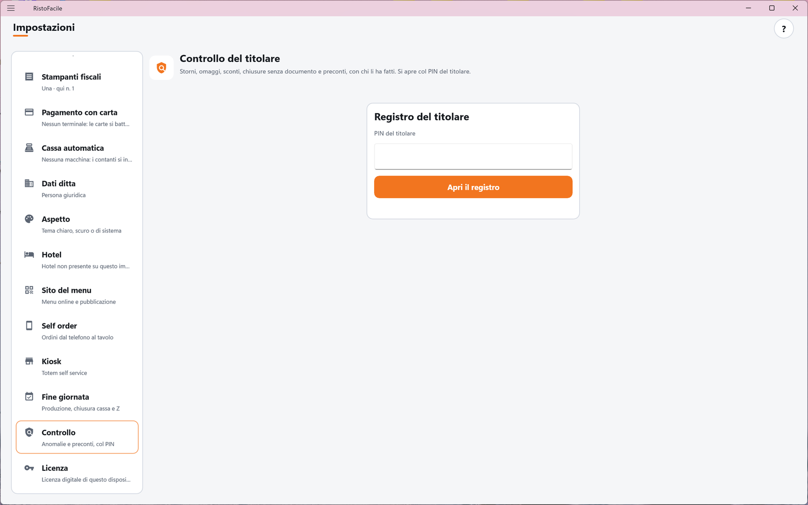

Il pannello si intitola **Controllo del titolare**: *Storni, omaggi, sconti, chiusure senza
documento e preconti, con chi li ha fatti. Si apre col PIN del titolare.* È il registro in cui il
servizio annota, da tutte le casse e i palmari, le operazioni che il titolare vuole tenere
d'occhio. Il PIN è unico per tutto l'impianto e non è il PIN degli operatori.

**La prima volta: impostare il PIN**

Finché il PIN non esiste il pannello mostra **Imposta il PIN del titolare**: *Il registro raccoglie
storni, omaggi, sconti, cambi di prezzo, chiusure senza documento e preconti, con chi li ha fatti.
Si apre solo con questo PIN, uguale per tutto l'impianto: sceglilo tu e non darlo ai dipendenti.*
Scrivi **Nuovo PIN (almeno 4 cifre)** e **Ripeti il PIN**, poi tocca **Imposta il PIN**: il registro
si apre e compare *PIN del titolare impostato. Tienilo per te: chi lo conosce vede il registro.*

!!! warning "Controllo sul lavoro dei dipendenti"

    Il pannello lo ricorda: *E' un controllo sul lavoro dei dipendenti: prima di usarlo vanno
    informati, e in alcuni casi serve un accordo o un'autorizzazione (art. 4 dello Statuto dei
    lavoratori). Chiedi al tuo consulente.*

**Aprire il registro**

Nel riquadro **Registro del titolare** scrivi il **PIN del titolare** e tocca **Apri il registro**.
Il registro si richiude da solo quando passi a un'altra voce delle Impostazioni o esci dalla
schermata: chi viene dopo alla cassa non lo trova aperto.

**Il registro aperto**

| Elemento | Descrizione |
|---|---|
| Frecce ‹ › e periodo | Il giorno mostrato (le frecce passano al giorno prima o dopo, non oltre oggi) oppure il periodo, per esempio *dal 21 ott al 19 nov 2026*. |
| **Oggi**, **Ieri**, **Ultimi 7 giorni**, **Ultimi 30 giorni** | Scelgono il periodo. |
| **Anomalie (N)** | Le operazioni **GRAVE** e **DA GUARDARE** del periodo (è la scheda proposta). |
| **Preconti (N)** / **Preconti (N da guardare)** | I conti per cui è stato stampato il preconto, con *da guardare* quelli incassati per meno del preconto. |
| **Tutto (N)** | Tutte le operazioni, anche le semplici **NOTA**. |
| **Tavolo** | Scrivi il numero di un tavolo per vedere solo quello; vuoto (*tutti*) li mostra tutti. |
| Operatori | In **Anomalie** e **Tutto**: **Tutti** oppure il nome di un operatore, per vedere solo le sue operazioni. |
| Una riga per operazione | La gravità (**GRAVE**, **DA GUARDARE**, **NOTA**), che cosa è successo (per esempio *Riga stornata dopo il preconto*), il dettaglio (quantità e articolo, oppure *Da € 12,00 a € 8,00*), *Tavolo 5 · sala 1* con chi l'ha fatto e da quale dispositivo, l'importo e l'ora. |
| Una riga per conto (**Preconti**) | Colonne **Conto**, **Preconto**, **Incassato**, **Differenza**: il tavolo, quando è uscito il preconto (o quanti preconti, e l'ultimo), *Chiuso alle …* oppure *Ancora aperto* con gli operatori, il totale del preconto, l'incassato e la differenza. |
| Riepilogo in fondo | Per esempio *12 eventi · 3 gravi · valore € 54,00* oppure *8 conti con preconto · 1 incassato meno del preconto · differenza totale € -6,00*. Senza risultati: *Niente da segnalare in questo periodo.* |

Alcune operazioni che finiscono nel registro, con la loro gravità:

| Gravità | Esempi |
|---|---|
| **GRAVE** | *Riga stornata dopo il preconto*, *Riga tolta dopo il preconto*, *Quantita' ridotta dopo il preconto*, *Omaggio dopo il preconto*, *Prezzo abbassato dopo il preconto*, *Incassato meno del preconto*, *Tavolo liberato con il conto aperto*, *Tavolo liberato dopo il preconto*, *Conto chiuso senza documento fiscale*, *Conto chiuso a zero* |
| **DA GUARDARE** | *Storno di una riga gia' in cucina*, *Riga gia' in cucina tolta*, *Quantita' ridotta su una riga gia' in cucina*, *Omaggio*, *Prezzo cambiato*, *Sconto sul conto*, *Abbuono sul conto*, *Prelievo dalla cassa automatica*, *Reso emesso*, *Scontrino annullato*, *Prelievo dalla cassa* (sulla stampante fiscale) |
| **NOTA** | *Descrizione cambiata*, *PIN del titolare sbagliato* |

In fondo al registro aperto: **Aggiorna** rilegge il periodo, **Cambia PIN** apre il riquadro
**Cambia il PIN del titolare** (**Nuovo PIN (almeno 4 cifre)**, **Ripeti il PIN**, **Annulla** /
**Cambia PIN**), **Chiudi il registro** lo richiude subito (*Registro chiuso.*).

### Licenza

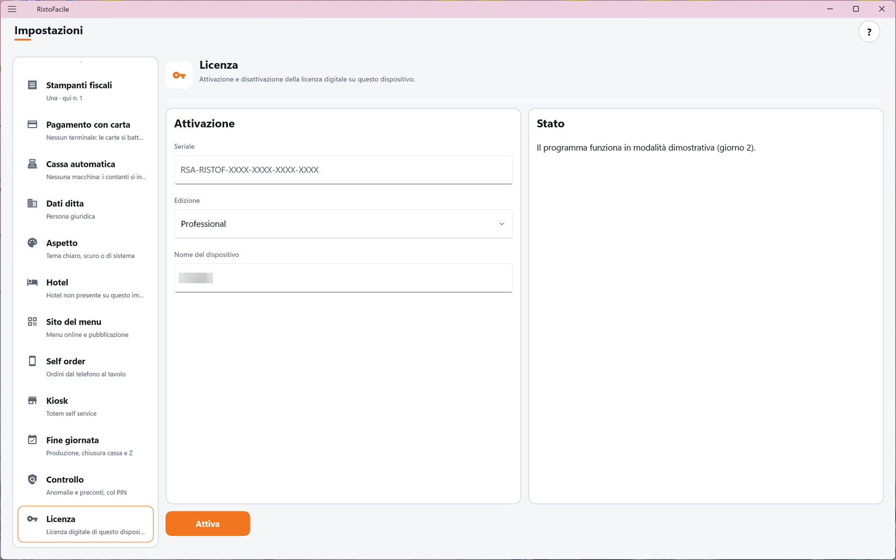

*Attivazione e disattivazione della licenza digitale su questo dispositivo.* Il pannello mostra
lo stato della licenza digitale e i campi **Seriale**, **Edizione** e **Nome del dispositivo**,
con i pulsanti **Attiva** e **Disattiva questo dispositivo** (al suo posto **Riprova**, quando la
licenza è bloccata). È descritto nella scheda [Licenza digitale](../introduzione/licenza.md).

## Pulsanti e comandi

| Comando | Effetto |
|---|---|
| Voce dell'elenco a sinistra | Mostra a destra il pannello corrispondente. |
| **Salva e connetti** (Connessione) | Prova indirizzo, utente e password e li salva se il servizio risponde (se non risponde proprio, chiede se salvarli lo stesso). |
| **Verifica** (Connessione) | Prova indirizzo, utente e password scritti senza salvarli. |
| **Esci dal turno** / **Accedi** (Turno) | Chiude il turno dell'operatore / apre l'accesso. |
| **Tavolo asporto** / **Mappa e servizio** (Sala) | Passano da una linguetta all'altra. |
| **Salva tavolo asporto** | Salva sala e tavolo dell'asporto per questa cassa. |
| **SI'** / **NO** (Tagliando di via in cucina) | Accende o spegne il tagliando di via stampato. |
| **Salva** (Stampante di cassa) | Registra indirizzo e porta nell'elenco dell'impianto (o corregge la stampante scelta) e la usa su questa cassa. *Salva la aggiunge all'elenco dell'impianto, o corregge quella scelta.* |
| **Stampa di prova** (Stampante di cassa) | Manda una pagina di prova all'indirizzo scritto. |
| **Verifica stato** (Stampante di cassa) | Chiede alla stampante se è pronta. |
| **Togli** (Stampante di cassa) | Toglie la stampante scelta dall'elenco dell'impianto, per tutte le casse (chiede conferma). |
| **+ NUOVA** / **Salva** / **Elimina** (Stampanti fiscali) | Aggiunge una stampante all'elenco dell'impianto / salva la scheda / la toglie (chiede conferma). |
| **Verifica** / **Verifica stato** (Stampanti fiscali) | Interroga il registratore scritto nella scheda / quello di questa postazione. |
| **+  NUOVO** (Pagamento con carta) | Apre una scheda vuota per un nuovo terminale. |
| **Salva** / **Togli** / **Chiudi** (scheda del terminale) | Salva il terminale nell'elenco dell'impianto / lo toglie (chiede conferma) / chiude la scheda. |
| **Usa su questa cassa** (Pagamento con carta) | Da adesso questa cassa incassa le carte sul terminale scelto, con l'**ID cassa** scritto. |
| **Verifica stato** (Pagamento con carta) | Interroga il terminale scelto e ne riporta la risposta. |
| **Carte a mano** | Questa cassa non usa più nessun terminale: le carte si battono a mano sul POS. |
| **+  NUOVA** (Cassa automatica) | Apre una scheda vuota per una nuova macchina. |
| **Salva** / **Togli** / **Chiudi** (scheda della macchina) | Salva la macchina nell'elenco dell'impianto / la toglie (chiede conferma) / chiude la scheda. |
| **Usa su questa cassa** (Cassa automatica) | Da adesso questa cassa incassa i contanti sulla macchina scelta. |
| **Verifica stato** (Cassa automatica) | Interroga la macchina. Con la Cashlogy rimette anche in contatto la cassa con il Connector. |
| **Sblocca incasso** | Chiude un incasso rimasto aperto restituendo al cliente il contante inserito (chiede conferma). Non c'è con la Cashlogy. Se la macchina non restituisce tutto, un avviso dice quanto denaro del cliente è rimasto dentro (e, a parte, il resto non erogato da dare a mano): va cercato nel giornale del servizio e restituito o registrato sul suo conto. Se la macchina non dice com'è finita (l'esito non arriva in tempo, o la macchina non dice quanto era entrato), l'avviso comincia con *ATTENZIONE* e chiede di controllare la macchina prima di dire che non è entrato denaro. |
| **Preleva** | Fa erogare dalla macchina l'importo scritto (chiede conferma). Non c'è con la CashDro. |
| **Ricarica** | Apre la ricarica del fondo cassa (solo PagAmico; sulla VNE la ricarica si fa dal pannello della macchina). |
| **FINE RICARICA** | Nella finestra della ricarica: chiude la ricarica. |
| **Contanti a mano** | Questa cassa non usa più nessuna macchina: i contanti si incassano a mano. |
| **Ditta** / **Fattura** / **Invio SdI** / **IVA e scontrini** / **Posta e SMS** / **OpenAPI** (Dati ditta) | Passano da una linguetta all'altra. |
| **Salva dati ditta** (Dati ditta) | In ogni linguetta: salva sul servizio i dati di **tutte** le linguette dei dati della ditta. |
| **Società** / **Persona fisica** (Dati ditta ▸ Ditta) | Dicono che cos'è la ditta; con **Persona fisica** compare **Ditta individuale**. |
| **SI'** / **NO** (Dati ditta) | Accendono o spengono l'interruttore accanto: iscrizione al registro delle imprese, socio unico, in liquidazione, TLS e passivo dell'invio SdI, IVA di somministrazione, SSL e TLS della posta. |
| **Salva menu in vendita** (Sala) | Salva per questa cassa i menu scelti. |
| **TUTTI** (Sala ▸ Menu in vendita) | Toglie le scelte: questa cassa vende tutti i menu attivi. |
| **LA PRIMA** / nome di una sala (Sala ▸ Mappa e servizio) | Sceglie la sala su cui si apre la mappa di questa cassa; si salva subito. |
| **Salva coperto e abbuono** (Sala) | Salva sul servizio aliquota del coperto e articoli di coperto e abbuono. |
| **Azzera** | Toglie l'aliquota o l'articolo scelto per coperto o abbuono. |
| **SI'** / **NO** (Modelli di stampa ▸ Tagliando di via) | Accende o spegne, per questa cassa, la stampa del tagliando di via. |
| **Salva** (Hotel) | Salva il codice di addebito scelto per tutto l'impianto. |
| **Spegni addebito** (Hotel) | Toglie la scelta del codice; poi tocca **Salva** per spegnere l'addebito in camera. |
| Frecce ‹ › / **Giornata in corso** (Fine giornata) | Passano al giorno prima o dopo / tornano alla giornata in corso. |
| Giorno sotto *Venduto ancora da produrre anche in:* (Fine giornata) | Passa a quel giorno. |
| **Chiudi la giornata** (Fine giornata) | Dopo una conferma fa, in ordine, la produzione delle distinte, la chiusura della cassa (con la stampa del riepilogo) e la Z di tutte le stampanti fiscali, fermandosi alla prima fase che non riesce. Ritoccato salta le fasi già fatte. |
| **Ristampa cassa** (Fine giornata) | Compare con la cassa chiusa: ristampa il riepilogo della chiusura cassa sulla stampante di cassa (*Chiusura cassa ristampata.*). |
| **Correggi cassa** (Fine giornata) | Compare con la cassa chiusa; serve il permesso **Puo' fare la fine giornata (chiusura cassa e Z)**. Riapre **Fondo cassa** e **Contanti contati** e fa comparire **Motivo della correzione** (*Correggi fondo e contanti contati, scrivi il motivo e salva: gli incassi si rileggono.*). Durante la correzione **Chiudi la giornata** è spento. |
| **Salva correzione** (Fine giornata) | Dopo una conferma rilegge gli incassi, rifà la chiusura cassa con fondo e contati nuovi e ristampa il riepilogo sulla stampante di cassa (*Chiusura cassa corretta.*). La chiusura di prima resta nel registro. |
| **Annulla** (Fine giornata, correzione) | Lascia la correzione e rimette fondo e contati della chiusura salvata. |
| **Aggiorna** (Fine giornata) | Rilegge dal servizio lo stato del giorno mostrato. La conta già scritta resta. |
| **Imposta il PIN** (Controllo) | Imposta il primo PIN del titolare e apre il registro. |
| **Apri il registro** (Controllo) | Apre il registro con il PIN scritto. |
| **Oggi** / **Ieri** / **Ultimi 7 giorni** / **Ultimi 30 giorni** / frecce ‹ › (Controllo) | Scelgono il periodo del registro. |
| **Anomalie** / **Preconti** / **Tutto** (Controllo) | Passano da una scheda all'altra del registro. |
| **Tutti** / nome di un operatore (Controllo) | Mostrano le operazioni di tutti o di un solo operatore. |
| **Aggiorna** (Controllo) | Rilegge il registro del periodo. |
| **Cambia PIN** (Controllo) | Apre il riquadro per cambiare il PIN del titolare; lì **Cambia PIN** lo salva, **Annulla** lo chiude. |
| **Chiudi il registro** (Controllo) | Richiude il registro: per riaprirlo serve di nuovo il PIN. |

## Come si fa

### Collegare la cassa al servizio

1. Tocca **Connessione**.
2. In **Indirizzo del servizio** scrivi IP e porta del servizio, per esempio `192.168.1.50:8080`.
3. Scrivi **Utente** e **Password**.
4. Tocca **Salva e connetti**.
5. Il cerchio dello **Stato** diventa verde (*Collegata*) e sotto il pulsante compare *Salvato.
   Collegata a http://192.168.1.50:8080 come* (utente)*.*

### Scegliere la stampante di cassa

1. Tocca **Stampante di cassa**.
2. Se l'impianto ha già delle stampanti, scegli quella vicina a questa cassa in **Stampanti
   dell'impianto**: è subito attiva.
3. Altrimenti scrivi **Indirizzo IP** e **Porta** e tocca **Salva**.
4. Tocca **Stampa di prova**: dalla stampante esce la pagina di prova e compare *Stampa di prova
   inviata a* (indirizzo)*.*

### Collegare un terminale POS a questa cassa

1. Tocca **Pagamento con carta**.
2. Tocca **+  NUOVO** (o un terminale già in elenco).
3. Compila **Descrizione**, **ID terminale**, **Indirizzo IP** e **Porta**, poi tocca **Salva**.
4. Con il terminale selezionato scrivi l'**ID cassa** e tocca **Usa su questa cassa**.
5. Tocca **Verifica stato** per controllare che il terminale risponda.
6. Il terminale porta la pastiglia **IN USO** e in fondo si legge *Questa cassa incassa le carte
   su* (nome del terminale).

### Ricaricare il fondo della cassa automatica

1. Tocca **Cassa automatica** e tocca la macchina in elenco.
2. Tocca **Ricarica**.
3. Si apre la finestra *Ricarica di* (macchina): inserisci monete e banconote nella macchina.
   L'importo caricato sale mentre inserisci.
4. Tocca **FINE RICARICA**.
5. Al termine compare l'esito della ricarica del fondo cassa.

Finché la finestra della ricarica è aperta la macchina non incassa.

### Accendere l'IVA di somministrazione

1. In Facile apri Archivi ▸ Ditte ▸ Modifica, premi **F7 - Impo. Prot.** e controlla che
   **Reparto Cassa** sia **DA ALIQUOTE IVA**: con **DA REPARTI** l'IVA di somministrazione non si
   accende.
2. Nella cassa tocca **Dati ditta**, linguetta **IVA e scontrini**.
3. Tocca **NO** accanto a **Sul consumo nel locale**: diventa **SI'**.
4. Tocca **Aliquota di somministrazione** e scegli l'aliquota (per esempio *IVA AL 10%*).
5. Tocca **Salva**: da questo momento tavoli, banco e kiosk «mangio qui» escono con
   quell'aliquota.

### Spostare il tavolo dell'asporto

1. Tocca **Sala**, linguetta **Tavolo asporto**.
2. Tocca la sala e poi il tavolo virtuale dell'asporto.
3. Tocca **Salva tavolo asporto**.
4. Compare *Tavolo asporto salvato:* (sala)*, tavolo* (numero)*.*

### Chiudere la giornata

1. A fine servizio chiudi i conti ancora aperti: se ne restano, la fine giornata lo segnala in un
   riquadro ambra.
2. Tocca **Fine giornata**: compare la giornata in corso, con le tre fasi e il loro stato.
3. Conta i contanti nel cassetto. Controlla il **Fondo cassa** proposto e scrivi il conteggio in
   **Contanti contati**: sotto compare la differenza (*Cassa in pari*, *Eccedenza …* o
   *Ammanco …*).
4. Tocca **Chiudi la giornata**.
5. Leggi il riepilogo della conferma e tocca **Chiudi la giornata**.
6. Dalla stampante di cassa esce il riepilogo della chiusura cassa, le stampanti fiscali fanno la
   Z una dopo l'altra e in fondo compare *Giornata chiusa.*: le tre fasi sono **FATTA**.

Se una fase si ferma, la cassa mostra *La giornata non e' chiusa del tutto.* con il motivo, e la
fase diventa **DA SISTEMARE**. Sistema la causa (per esempio accendi la stampante fiscale rimasta
spenta) e tocca di nuovo **Chiudi la giornata**: le fasi già fatte non si ripetono.

### Correggere la chiusura cassa

1. Tocca **Fine giornata** e, se serve, vai al giorno da correggere con le frecce.
2. Tocca **Correggi cassa**: **Fondo cassa** e **Contanti contati** tornano modificabili e compare
   **Motivo della correzione**.
3. Correggi il fondo o i contanti contati: sotto si aggiorna la differenza.
4. Scrivi il motivo (per esempio *contati due volte i 50 euro*).
5. Tocca **Salva correzione**.
6. Leggi la conferma (*La chiusura cassa si rifa' con fondo … e contati …, rileggendo gli incassi.
   Quella di prima resta nel registro.*) e tocca **Correggi**.
7. Dalla stampante di cassa esce il riepilogo nuovo e la riga dello stato diventa *Corretta alle
   … da …. Motivo: ….*

### Chiudere un giorno passato

1. Tocca **Fine giornata**.
2. Con la freccia ‹ (o con il giorno sotto *Venduto ancora da produrre anche in:*) vai al giorno
   da chiudere.
3. Scrivi **Contanti contati**, se la cassa di quel giorno non è ancora chiusa.
4. Tocca **Chiudi la giornata** e conferma.
5. Compare *Giornata chiusa (la Z si fa solo sulla giornata in corso).*: produzione e cassa sono
   fatte, la Z no.

### Guardare le anomalie del giorno

1. Tocca **Controllo**.
2. Scrivi il **PIN del titolare** e tocca **Apri il registro**.
3. Si apre la scheda **Anomalie**; tocca **Oggi** per vedere la giornata, **Preconti** per i conti
   incassati per meno del preconto.
4. Quando hai finito tocca **Chiudi il registro**: compare *Registro chiuso.*

## Controlli e messaggi

| Messaggio | Causa | Cosa fare |
|---|---|---|
| *Indirizzo non valido. Scrivi IP e porta del servizio, per esempio 192.168.1.50:8080.* | **Salva e connetti** o **Verifica** con l'indirizzo vuoto o scritto male. | Correggi **Indirizzo del servizio**. |
| *Manca l'utente del servizio.* | **Utente** vuoto. | Scrivi l'utente. |
| *Manca la password.* / *Utente cambiato: scrivi anche la sua password.* | Nessuna password salvata, oppure hai cambiato utente: la password salvata vale solo per quello di prima. | Scrivi la password. |
| *Niente salvato. Credenziali rifiutate: Il servizio risponde ma non accetta utente e password. Controlla maiuscole e minuscole.* | Utente o password sbagliati. Con gli stessi *Niente salvato.* compaiono anche *RistoFacile non attivo* (a quell'indirizzo risponde un servizio senza RistoFacile) ed *Errore del servizio*. | Correggi utente e password, o controlla porta e versione del servizio. La connessione di prima resta in uso. |
| *Nessuna risposta* / *Non raggiungibile* (finestra con **Salva lo stesso** / **Annulla**) | Il servizio non risponde: PC spento, servizio fermo, porta o nome sbagliati. Il dettaglio dice il motivo (per esempio *Il computer c'è ma su quella porta non risponde niente: il servizio è avviato? La porta è giusta?*). | Controlla che il PC del servizio sia acceso e in rete. **Salva lo stesso** solo se sei sicuro dei dati: compare *Salvato senza verifica.* |
| *Seleziona una sala e un tavolo per l'asporto.* | **Salva tavolo asporto** senza sala o tavolo. | Tocca prima la sala, poi il tavolo. |
| *Il tavolo asporto configurato (sala 2, tavolo 99) non esiste piu' in anagrafica: riselezionalo.* | Il tavolo scelto è stato cancellato. | Scegli un altro tavolo e salva. |
| *Impossibile caricare sale e tavoli:* … | La cassa non è collegata al servizio. | Sistema prima la **Connessione**. |
| *Il servizio è più vecchio di questa app: va aggiornato il server.* | Il servizio del locale è di una versione precedente a questa app: non conosce ancora tutto quello che l'app gli chiede. Compare anche quando il servizio è così vecchio da non saper dire la sua versione. | Fai aggiornare il servizio sul computer dove è installato. Intanto si continua a lavorare, ma qualche funzione può non andare. |
| *Questa app è più vecchia del servizio: va aggiornata.* | Il servizio è stato aggiornato e non accetta più questa versione dell'app. | Aggiorna l'app. Intanto si continua a lavorare, ma qualche funzione può non andare. |
| *Questa app è la 2.026.11.3, il servizio la 2.026.12.0: va aggiornata l'app.* | App e servizio sono di release diverse (cambia l'anno o la versione di Facile) e quella dell'app è la più vecchia. Il livello dell'API è compatibile. Vedi [Versione e compatibilità col servizio](#versione-e-compatibilita-col-servizio). | Aggiorna l'app. Intanto si continua a lavorare, ma qualche funzione può non andare. |
| *Questa app è la 2.026.12.0, il servizio la 2.026.11.0: va aggiornato il server.* | App e servizio sono di release diverse e quella del servizio è la più vecchia. Il livello dell'API è compatibile. Vedi [Versione e compatibilità col servizio](#versione-e-compatibilita-col-servizio). | Fai aggiornare il servizio sul computer dove è installato. Intanto si continua a lavorare, ma qualche funzione può non andare. |
| *Inserisci l'indirizzo IP della stampante comande.* | **Salva**, **Stampa di prova** o **Verifica stato** con l'indirizzo vuoto. | Scrivi l'indirizzo IP. |
| *Porta della stampante comande non valida (di solito 9100).* | Porta non numerica o fuori intervallo. | Correggi la porta. |
| *Salvata solo su questa cassa (*indirizzo*): l'impianto non risponde (*…*).* | Il servizio non risponde: la stampante è stata salvata solo su questa cassa. | Riprova quando il servizio è raggiungibile, per averla nell'elenco dell'impianto. |
| *Stampa di prova non riuscita.* | La stampante non ha stampato. | Controlla che sia accesa, in rete e con la carta. |
| *Scegli prima una stampante dall'elenco dell'impianto.* | **Togli** senza una stampante scelta. | Scegli la stampante in **Stampanti dell'impianto**. |
| *Inserisci l'indirizzo della stampante fiscale.* | **Salva** o **Verifica** con l'indirizzo vuoto. | Scrivi l'indirizzo (o la porta logica per Ditron). |
| *L'identificativo 2 e' usato da piu' di una stampante fiscale.* | Hai dato a due stampanti lo stesso numero. | Scegli un numero libero (da 1 a 99). |
| *La stampante fiscale n. X non è nell'elenco del servizio.* | La stampante scelta da questa postazione è stata tolta dall'elenco. | Scegli un'altra stampante in **Stampante di questa postazione**. |
| *Verifica della stampante fiscale fallita.* | Il registratore non risponde o segnala un errore. | Leggi il dettaglio e controlla il registratore. |
| *La stampante RCHWeb non riporta nella risposta il numero del documento, la chiusura e lo stato: va attivata la risposta estesa sulla cassa …* | Con la marca **RCHWeb**, sul registratore la risposta estesa del web service è spenta. | Sul registratore: **SERVICE ▸ Connettività ▸ Ethernet**, **WEBSRV: Risp. estesa** su **SI** e **Protocollo PC** su **STANDARD**. |
| *Documento emesso; la stampante non ha riportato il numero del documento: va letto sullo scontrino.* | Con la marca **CustomWeb**, il registratore ha emesso lo scontrino ma non ne ha comunicato il numero (succede con le versioni meno recenti del suo programma interno). | Leggi il numero sullo scontrino stampato. Se succede a ogni scontrino, il tecnico aggiorna il registratore. |
| *La stampante CustomWeb non ha confermato lo scontrino (…): non si sa se e' uscito. Controlla sul giornale della stampante prima di riemetterlo.* | Con la marca **CustomWeb**, la risposta del registratore non è arrivata e non è stato possibile capire se lo scontrino è uscito. | Guarda se lo scontrino è stato stampato; se serve fai una lettura del giornale dal registratore. Riemetti solo se non è uscito. |
| *L'id del terminale dev'essere un numero maggiore di zero.* / *La porta dev'essere un numero maggiore di zero.* | Numero o porta del terminale non validi. | Correggi il campo. |
| *Scegli un terminale dall'elenco.* | **Usa su questa cassa** senza un terminale scelto. | Tocca un terminale in elenco. |
| *Nessun terminale sull'impianto. Premi NUOVO per aggiungerne uno.* | L'impianto non ha terminali. | Tocca **+  NUOVO**. |
| *Il servizio non ha restituito nessun terminale: resta valido quello gia' scelto su questa cassa.* | Il servizio non ha dato l'elenco. | La cassa continua a usare il terminale scelto; riprova più tardi. |
| *Inserisci l'indirizzo IP della cassa automatica.* | **Salva** senza indirizzo. | Scrivi l'indirizzo. |
| *La porta dev'essere un numero maggiore di zero (lasciala vuota per quella di fabbrica).* | Porta non valida. | Correggi o svuota il campo. |
| *La CashDro vuole l'utente e la password POS creati sulla macchina (li da' CashDro o il rivenditore).* | **Salva** di una CashDro senza **Utente POS** o **Password POS**. | Scrivi utente e password. |
| *L'impronta del certificato e' fatta di 64 cifre esadecimali (i due punti si possono lasciare).* … | L'impronta scritta non è valida. | Ricopiala dal giornale del servizio, o lasciala vuota. |
| *Non riesco a leggere le casse automatiche dal servizio: finche' non le leggo, non si salva …* / *Le casse automatiche dell'impianto non si leggono dal servizio: non salvo, …* | Il servizio non ha dato l'elenco delle macchine. **Salva** e **Togli** sono bloccati, perché salvare sostituirebbe l'elenco dell'impianto con la sola macchina a video. | Riapri la pagina quando il servizio risponde. Se il dettaglio parla del file delle casse automatiche danneggiato, va corretto o tolto sul PC del servizio. |
| *Scrivi l'importo da prelevare, per esempio 50 o 12,50.* | **Preleva** senza un importo valido. | Scrivi l'importo. |
| *Prelievo dalla cassa automatica.* (con *Il contante potrebbe essere uscito lo stesso: controlla la macchina prima di riprovare.*) | La macchina non ha risposto durante il prelievo. | Controlla la macchina **prima** di ripetere: potresti prelevare due volte. |
| *Ricarica della cassa automatica.* (con *…premi di nuovo RICARICA per riprenderla.*) | La ricarica non si è aperta o la cassa ha perso il contatto con la macchina. | Tocca di nuovo **Ricarica**: riprende la ricarica rimasta aperta. |
| *Salvataggio dei dati della ditta non riuscito.* | Il servizio ha rifiutato i dati o non risponde. | Leggi il dettaglio e riprova. |
| *Dati della ditta salvati. Restano 2 cose da sistemare per la fattura elettronica.* | Mancano ancora dati obbligatori. | Completa quanto elencato in **Per la fattura elettronica**. |
| *Salvataggio dei dati della ditta non riuscito.* con *Scegli un'aliquota con il reparto della cassa, oppure spegni l'IVA di somministrazione.* | **IVA di somministrazione** accesa senza aliquota. | Scegli l'aliquota o rimetti **NO**. |
| *Salvataggio dei dati della ditta non riuscito.* con *… Aliquota IVA di somministrazione non impostata o non valida …* | L'aliquota scelta non esiste più, non ha il reparto della stampante fiscale o è allo 0%. | Scegli un'altra aliquota, oppure dai a questa il reparto in Tabelle di base ▸ Aliquote IVA. |
| *Salvataggio dei dati della ditta non riuscito.* con *… IVA di somministrazione accesa con il reparto di cassa preso dal reparto dell'articolo: in Facile apri Archivi → Ditte → Modifica, premi F7 - Impo. Prot. e metti «Reparto Cassa» su «DA ALIQUOTE IVA».* | In Facile il reparto della stampante si prende dal reparto dell'articolo: lo scontrino non uscirebbe sull'aliquota di somministrazione. | Fai come dice il messaggio in Facile, poi salva di nuovo. |
| *Dati della ditta non leggibili dal servizio:* … | All'apertura delle Impostazioni il servizio non ha dato i dati della ditta. | Controlla la **Connessione** e riapri la schermata. |
| *Il servizio non la gestisce ancora: va aggiornato.* / *Il servizio non lo gestisce ancora: va aggiornato.* | In **Dati ditta**: il servizio è di una versione che non conosce ancora anagrafica, invio SdI, SMS o OpenAPI; quei campi restano spenti. | Fai aggiornare il servizio. |
| *Salvataggio della configurazione fattura non riuscito.* | **Salva coperto e abbuono** (Sala ▸ Coperto e conto): il servizio non risponde. | Riprova. |
| *Elenco dei menu non leggibile dal servizio:* … | Sala ▸ **Menu in vendita**: il servizio non ha dato i menu. | Controlla la **Connessione** e riapri la linguetta. |
| *La sala preferita (codice 3) non c'e' piu' o non e' attiva: la mappa apre la prima.* | La sala scelta in **Sala preferita** è stata cancellata o spenta. | Scegli un'altra sala o **LA PRIMA**. |
| *Impossibile leggere i codici addebito dell'hotel:* … | Il servizio non risponde. | Controlla la connessione. |
| *Il modello ha un errore e non e' stato salvato:* … | Il modello di stampa contiene un errore. | Correggi la riga segnalata in rosso. |
| *Stampante comande non configurata: impostala nella sezione "Stampante di cassa".* | **Stampa di prova** di un modello senza stampante. | Imposta la **Stampante di cassa**. |
| *Conta i contanti nel cassetto e scrivili in «Contanti contati»: senza la conta la cassa non si chiude.* | **Chiudi la giornata** con **Contanti contati** vuoto, mentre la cassa del giorno è ancora da chiudere. | Conta il cassetto e scrivi l'importo. |
| *Il fondo cassa non e' un importo valido.* | **Fondo cassa** scritto male o negativo. | Scrivi un importo, per esempio `100` o `100,00`. |
| *La giornata non e' chiusa del tutto.* (con il motivo) | Una fase non è riuscita: le fasi dopo non si sono fatte. Il motivo è anche nella fase segnata **DA SISTEMARE**. | Sistema la causa e tocca di nuovo **Chiudi la giornata**. |
| *La Z non e' riuscita su tutte le stampanti: il motivo e' accanto a ciascuna.* | Qualche stampante fiscale non si è chiusa (spenta, senza carta, in errore). | Leggi il motivo sotto la stampante **NON CHIUSA**, sistemala e tocca di nuovo **Chiudi la giornata**: la Z si rifà solo sulle stampanti non chiuse. |
| *Su alcune stampanti non si sa se la Z e' uscita: controlla lo scontrino dell'azzeramento e ripremi.* | Su qualche stampante la risposta della Z si è persa: l'azzeramento può essere uscito o no. | Guarda sulla stampante se c'è lo scontrino dell'azzeramento di oggi, poi tocca di nuovo **Chiudi la giornata** e rispondi alla domanda della cassa. |
| *Su … non si sa se la Z e' uscita (…). Guarda la stampante: c'e' lo scontrino dell'azzeramento di oggi?* (finestra **Z da controllare**) | **Chiudi la giornata** ritoccato dopo una Z incerta. | **Si', e' uscita** se lo scontrino c'è, **No, rifalla** se non c'è, **Non lo so** per lasciarla in sospeso. |
| *… non e' abilitato a fare la fine giornata. Il permesso si da' dalla cassa, in Menu ▸ Operatori.* (e *… a correggere la chiusura cassa.*) | **Chiudi la giornata**, **Correggi cassa** o **Salva correzione** senza il permesso **Puo' fare la fine giornata (chiusura cassa e Z)**. | Fallo fare a un operatore abilitato, o dai il permesso in [Operatori](operatori.md). |
| *Scrivi i contanti contati nel cassetto.* | **Salva correzione** con **Contanti contati** vuoto. | Scrivi l'importo. |
| *Scrivi il motivo della correzione: resta nel registro delle chiusure.* | **Salva correzione** senza motivo. | Scrivi il motivo. |
| *Correzione non riuscita:* … (con *Correzione della chiusura cassa non riuscita.*) | Il servizio non ha accettato la correzione o non ha risposto. | Leggi il dettaglio, tocca **Aggiorna** e riprova. |
| *Produzione delle distinte non riuscita:* … | La produzione in Facile non è andata a buon fine. Se invece il motivo parla delle causali di produzione, mancano nella ditta di Facile. | Leggi il dettaglio; sistema le causali in Facile e riprova. |
| *Venduto non letto:* … / *Incassi non letti:* … | Il servizio non è riuscito a leggere il venduto o gli incassi del giorno. | Tocca **Aggiorna**; se insiste, controlla il servizio. |
| *La chiusura cassa e' registrata ma non e' uscita sulla stampante di cassa: usa «Ristampa cassa».* | La cassa è chiusa ma la stampante di cassa non ha stampato il riepilogo. | Controlla la stampante e tocca **Ristampa cassa**. |
| *Chiusura non riuscita:* … (con *Chiusura della giornata non riuscita.*) | Il servizio non ha risposto alla chiusura. | Tocca **Aggiorna** per vedere quali fasi sono fatte, poi riprova. |
| *Il servizio non ha ancora la fine giornata: va aggiornato.* | Il servizio è di una versione precedente alla fine giornata. | Fai aggiornare il servizio. |
| *Giornata non letta:* … | Il servizio non ha risposto. | Controlla la **Connessione** e tocca **Aggiorna**. |
| *Il PIN deve avere almeno 4 cifre.* / *I due PIN non sono uguali.* | **Controllo**: PIN nuovo troppo corto, oppure diverso nelle due caselle. | Riscrivi il PIN. |
| *PIN del titolare sbagliato.* | **Apri il registro** con un PIN sbagliato. Il tentativo finisce nel registro come **NOTA**. | Riscrivi il PIN. |
| *Troppi PIN sbagliati: riprova fra qualche minuto.* | Troppi PIN sbagliati di fila: il registro si blocca per qualche minuto. | Aspetta e riprova. |
| *Il PIN del titolare non e' ancora stato impostato.* | Il PIN non esiste ancora sul servizio. | Riapri **Controllo** e imposta il PIN. |
| *Il servizio non conosce ancora il registro: va aggiornato.* | Il servizio è di una versione precedente al registro. | Fai aggiornare il servizio. |
| *Impossibile raggiungere il servizio.* (…) / *Il registro non risponde.* (…) | Il servizio non risponde. | Controlla la **Connessione**. |

## Note

### Versione e compatibilità col servizio

La cassa, il palmare, il monitor di cucina e il kiosk chiedono al servizio la sua versione e controllano di andare d'accordo con lui:

- all'avvio dell'app;
- quando l'app torna in primo piano;
- dopo **Salva e connetti** (sul kiosk, **Salva e verifica**).

**Come si legge il numero di versione.** App e servizio hanno la stessa forma, per esempio *2.026.11.3*, cioè «per Facile 2026 B11, build 3 dell'app»:

- **Formato:** il primo numero è sempre 2, il secondo è l'anno (026 = 2026), il terzo è la versione di Facile (B11), il quarto è la build dell'app.
- **Build:** a ogni cambio di anno o di versione di Facile tutte le app vengono ripubblicate e la build riparte da 0.
- **Setup per Windows:** i file si chiamano *RistoFacileSetup_2.026.11.00.exe* e *RistoFacileAggiornamento_2.026.11.00.exe* e hanno la loro build. In Windows, in *App installate*, compare come *RistoFacile* con versione *2.26.1100* (= 2.026.11.00: Windows accetta solo tre numeri, quindi versione di Facile e build del setup sono uniti).
- **Licenza:** nella pagina della licenza la release compare nella forma *2026 B11.00*.

Se non vanno d'accordo compare una volta un avviso, e lo stesso testo resta nel riquadro ambra sotto la **Versione**. Se è il livello dell'API a non essere compatibile, l'avviso è *Il servizio è più vecchio di questa app: va aggiornato il server.* oppure *Questa app è più vecchia del servizio: va aggiornata.*

Se invece il livello dell'API va bene ma app e servizio sono di release diverse (cambia l'anno o la versione di Facile), l'avviso dice quale dei due aggiornare:

- *Questa app è la 2.026.11.3, il servizio la 2.026.12.0: va aggiornata l'app.*
- *Questa app è la 2.026.12.0, il servizio la 2.026.11.0: va aggiornato il server.*

Il kiosk non mostra mai avvisi a schermo: lo dice solo nel riquadro ambra della configurazione. L'avviso non blocca: si continua a lavorare, ma conviene aggiornare subito, perché qualche funzione può non andare. Lo stesso avviso non si ripete a ogni ritorno in primo piano; ricompare se cambia, o dopo un nuovo **Salva e connetti**.

Se il servizio non risponde, o non è un servizio RistoFacile, l'avviso non compare: è un problema di collegamento e lo dice lo **Stato** della connessione.

### IVA di somministrazione

Quello che si consuma nel locale è *somministrazione* e ha l'IVA al 10%, qualunque sia l'aliquota
dell'articolo; quello che si porta via ha l'aliquota dell'articolo. Con l'interruttore acceso la
cassa lo applica da sola su scontrino, fattura e movimenti di magazzino:

| Dove | Aliquota |
|---|---|
| Tavolo di sala, anche con il [self order](self-order.md) | di somministrazione |
| [Vendita al banco](vendita-al-banco.md) | di somministrazione (il banco conta sempre come consumo nel locale) |
| [Kiosk](../kiosk/index.md), «Mangio qui» | di somministrazione |
| [Asporto e domicilio](asporto.md), ordini dal sito, kiosk «Porto via» | quella dell'articolo |

- Prendono l'aliquota di somministrazione anche **coperto** e **servizio**. Le righe con un'aliquota
  allo 0% (esenti, non imponibili, non soggette) tengono la loro.
- Spento l'interruttore, ogni riga esce con l'aliquota del suo articolo.
- Se l'aliquota scelta non è più valida (cancellata, senza reparto o allo 0%), nel locale
  scontrino e fattura **non escono**: preconto e totali invece si vedono lo stesso. Il kiosk
  rifiuta «Mangio qui» prima che il cliente paghi.
- Ogni aliquota usata dagli articoli, anche quelle esenti, deve avere il suo reparto della stampante
  fiscale: una riga esente senza reparto finisce sul reparto di ripiego della stampante.

!!! warning "Il tavolo dell'asporto su ogni cassa e palmare"

    La cassa riconosce l'asporto dal tavolo virtuale scelto in **Sala ▸ Tavolo asporto**. Su un
    dispositivo dove quel tavolo non è scelto, una comanda aperta sul tavolo dell'asporto conta come
    un tavolo di sala ed esce al 10%. Sceglilo su ogni cassa e su ogni palmare.

!!! warning "Impostazione condivisa con Facile e HotWin"

    Interruttore e aliquota sono gli stessi della ditta di Facile («Documenti con IVA per
    somministraz.» e «IVA Somministr. Pubblico») e l'aliquota è anche l'«IVA clienti» di HotWin:
    cambiarli dalla cassa li cambia anche lì. In Facile **Reparto Cassa** deve restare
    **DA ALIQUOTE IVA**: se torna su **DA REPARTI**, nel locale scontrino e fattura non escono
    finché non lo rimetti.

- **Cosa vale per chi.** Collegamento, turno, tavolo dell'asporto, i tre valori di **Mappa e
  servizio**, i menu in vendita, stampante scelta, terminale POS e cassa automatica in uso, il
  tagliando di via, il tema e il sito del menu valgono solo per questa cassa. Elenco delle
  stampanti, dei terminali e delle macchine, elenco delle stampanti fiscali, modelli di stampa,
  coperto e abbuono, dati della ditta, codice di addebito in camera, self order, kiosk, fine giornata
  e PIN del titolare valgono per tutto l'impianto.
- L'elenco delle stampanti fiscali si gestisce dalla cassa; il [palmare](../palmare/impostazioni.md)
  lo legge e sceglie la propria stampante.
- **Salva** e **Togli** della cassa automatica rileggono l'elenco dal servizio e cambiano solo la macchina a video: le modifiche fatte nel frattempo da un'altra cassa restano.
- **Togli** su stampanti, terminali e macchine li toglie per **tutte** le casse: quelle che li
  usavano tornano a lavorare a mano finché non ne scelgono un altro.

!!! warning "Prelievo e cassa automatica"

    Se durante un **Preleva** la macchina non risponde, il contante potrebbe essere uscito lo
    stesso. Controlla la macchina prima di ripetere l'operazione.

## Vedi anche

- [Prima configurazione](../introduzione/prima-configurazione.md)
- [Licenza digitale](../introduzione/licenza.md)
- [Sito del menu](sito-menu.md)
- [Self order](self-order.md)
- [Kiosk](kiosk.md)
- [Configurazione del kiosk](../kiosk/configurazione.md)
- [Accesso operatore](accesso.md)
- [Sale e tavoli](sale-e-tavoli.md)
- [Asporto e domicilio](asporto.md)
- [Conto](conto.md)
- [Impostazioni del palmare](../palmare/impostazioni.md)
