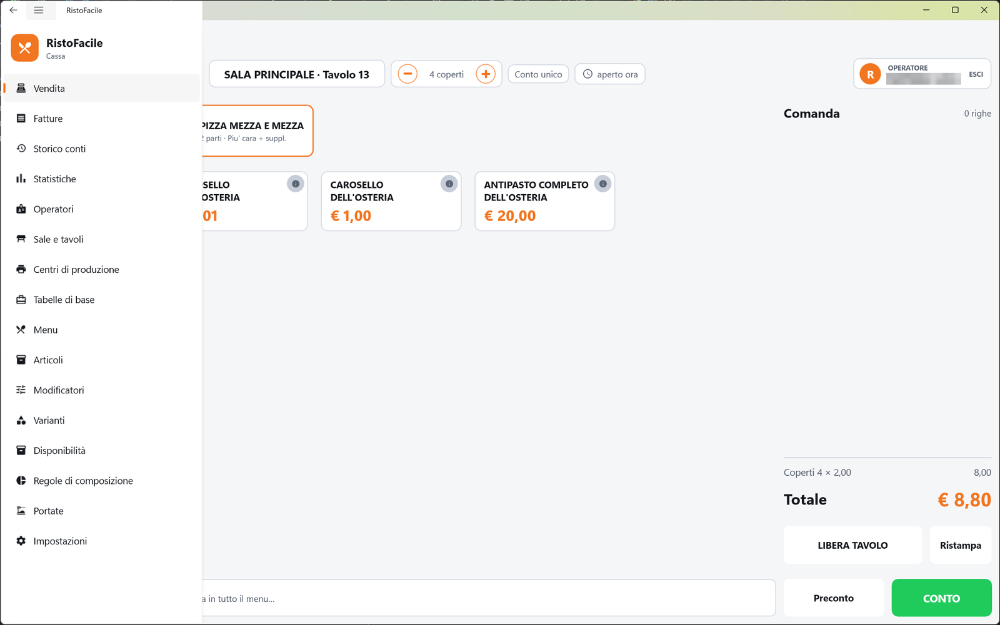

# Cassa

La cassa è l'app RistoFacile che sta al banco, su un PC o un tablet Windows. È il posto di
comando del locale: da qui si lavorano i tavoli (mappa della sala, comanda, conto con scontrino o
fattura), si seguono asporto, domicilio e prenotazioni, si consultano fatture, storico e
statistiche, e si preparano tutte le anagrafiche che palmari e monitor di cucina usano.

## A chi serve

- **Al cassiere**, che apre i tavoli, batte le comande, fa i preconti e incassa.
- **Ai camerieri** che lavorano dalla cassa invece che dal palmare.
- **Al titolare**, che prepara sale, menu, articoli, operatori e impostazioni, e a fine serata
  controlla incassi e statistiche.

Prima di usare la cassa ognuno entra con il proprio nome e, se ce l'ha, il PIN: vedi
[Accesso operatore](accesso.md). Su una cassa nuova si comincia dalla
[Prima configurazione](../introduzione/prima-configurazione.md).

## Il menu laterale

Il menu laterale si apre con il pulsante in alto a sinistra. In testa porta la scritta
**RistoFacile** / **Cassa**; sotto, le voci, in quest'ordine:

| Voce | A cosa serve |
|---|---|
| **Vendita** | La [Mappa della sala](mappa-sala.md): i tavoli con il loro stato. Da qui si apre la [Comanda](comanda.md) di un tavolo e poi il [Conto](conto.md), e si raggiungono [Vendita al banco](vendita-al-banco.md), [Asporto e domicilio](asporto.md), [Prenotazioni](prenotazioni.md) e [Messaggi alla cucina](messaggi.md). |
| **Fatture** | Le [fatture](fatture.md) emesse dalla cassa: ritrovarle, riaprirne il PDF, rimandarle per email, ristamparne la copia di cortesia. |
| **Storico conti** | I [conti già chiusi](storico-conti.md), con documento, pagamento e voci; da qui si emette lo scontrino dei conti chiusi senza documento. |
| **Statistiche** | Gli [incassi di un periodo](statistiche.md): totali, coperti, medie, pagamenti, sale, camerieri, articoli più venduti. |
| **Operatori** | Camerieri e cassieri: nome, PIN e permessi (sconti, storni, chiusure). Vedi [Operatori](operatori.md). |
| **Sale e tavoli** | Le [sale e i loro tavoli](sale-e-tavoli.md), con posti, coperto, servizio e listino. |
| **Centri di produzione** | Cucina, pizzeria, bar…: dove esce la comanda, su stampante, monitor o entrambi. Vedi [Centri di produzione](centri-di-produzione.md). |
| **Tabelle di base** | [Reparti, categorie merceologiche, listini e aliquote IVA](tabelle-di-base.md). |
| **Menu** | I [menu del locale](menu.md), con le loro sezioni e i piatti. |
| **Articoli** | L'[anagrafica degli articoli](articoli.md): descrizione, prezzo, IVA, reparto, allergeni. |
| **Modificatori** | Le intensità delle varianti (poco, molto, extra) e il loro effetto sul prezzo. Vedi [Modificatori](modificatori.md). |
| **Varianti** | I gruppi di varianti (cottura, aggiunte…) e le varianti di ciascun gruppo. Vedi [Varianti](varianti-anagrafica.md). |
| **Disponibilità** | Piatti esauriti, sospesi o fuori stagione, e le porzioni disponibili. Vedi [Disponibilità](disponibilita.md). |
| **Regole di composizione** | Le regole della pizza mezza e mezza e il calcolo del suo prezzo. Vedi [Regole di composizione](regole-di-composizione.md). |
| **Portate** | Le uscite (antipasti, primi, secondi…) e quali aspettano il via. Vedi [Portate](portate.md). |
| **Impostazioni** | Collegamento al servizio, turno, sala, stampanti, POS, cassa automatica, dati fiscali, aspetto, [menu online](menu-online.md), hotel e licenza. Vedi [Impostazioni](impostazioni.md). |

L'indice di questo manuale, nella scheda **Cassa**, segue le stesse voci nello stesso ordine.

## L'operatore in turno

Il nome di chi è entrato si legge in alto a destra nella [Comanda](comanda.md), nel riquadro
**OPERATORE**, insieme a **ESCI**. Tutto quello che si batte porta quel nome, e le operazioni
delicate (sconti, omaggi, storni, chiusura senza documento) dipendono dai suoi permessi.

A fine turno tocca **ESCI** e conferma: la cassa torna alla schermata **Chi sei?** per il collega.
Il turno si apre e si chiude anche da Menu ▸ Impostazioni ▸ **Turno**. Se la cassa viene chiusa e
riaperta senza uscire, riparte con lo stesso operatore.
