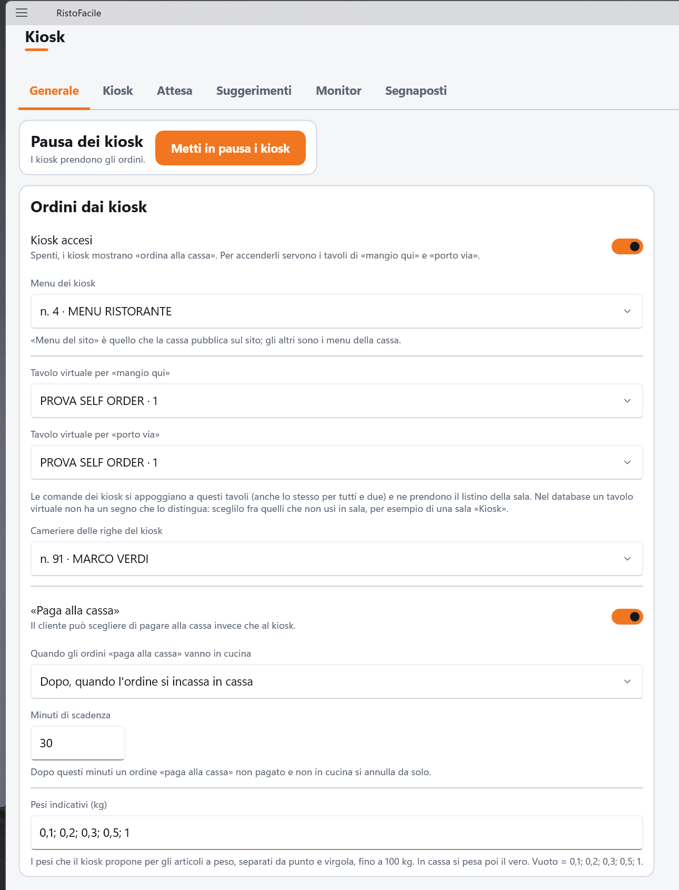
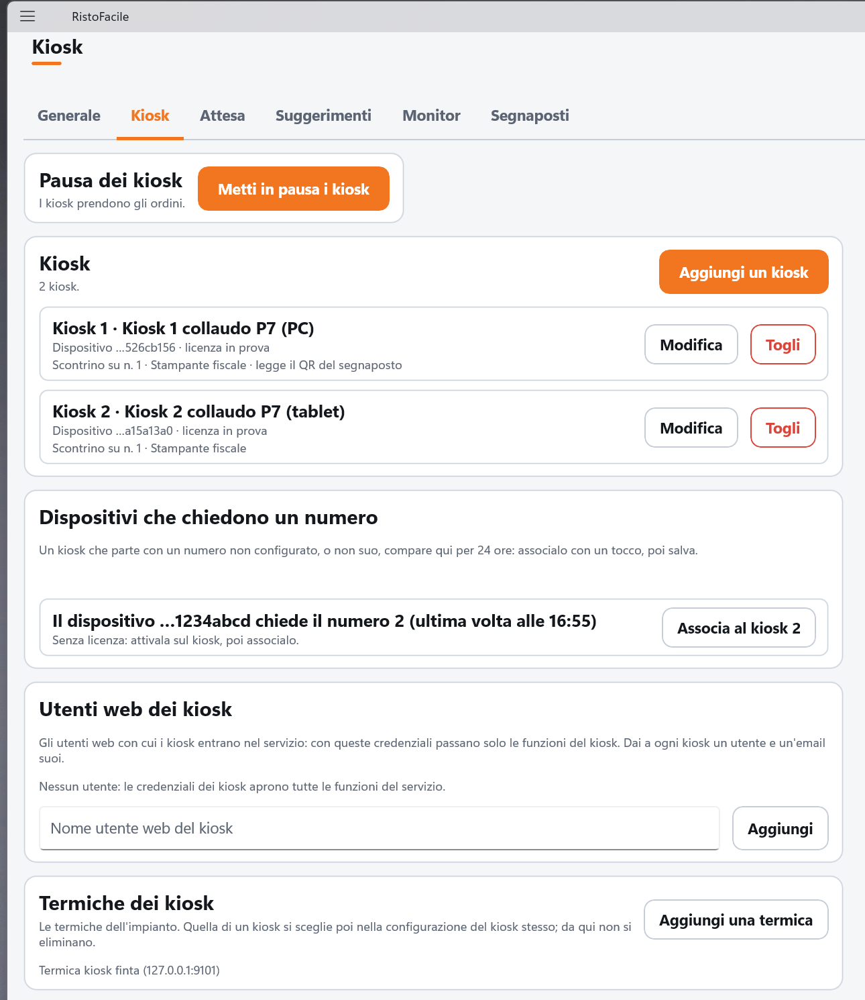
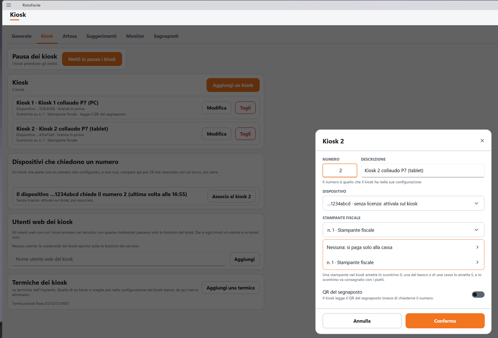
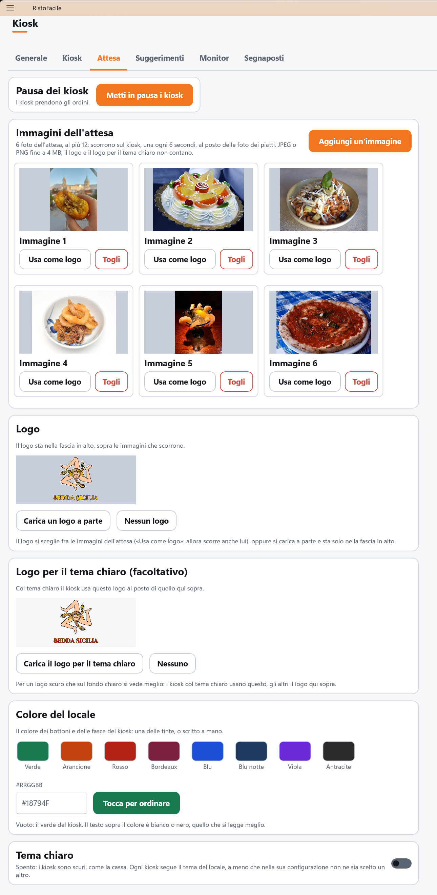
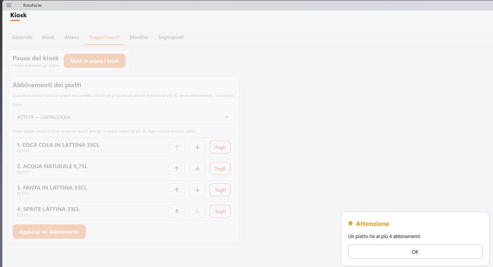
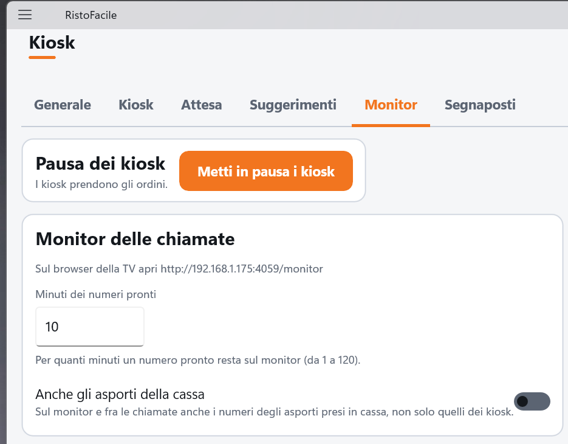

# Kiosk

Da questa schermata il titolare decide come lavorano **tutti i kiosk** del locale: li accende e li
mette in pausa, sceglie il menu e i tavoli virtuali su cui finiscono gli ordini, associa a ogni
kiosk il suo dispositivo e la sua stampante fiscale, sceglie le immagini dell'attesa, i
suggerimenti dei piatti, i minuti del monitor in sala e stampa i segnaposti. Quello che si fa sul
kiosk stesso (collegamento, numero, POS, rendiresto) è in
[Configurazione del kiosk](../kiosk/configurazione.md).

!!! info "In sintesi"

    - **Dove si trova:** Menu ▸ **Kiosk** (subito sotto **Self order**)
    - **Chi la usa:** titolare (configurazione); qualunque cassiere (pausa)
    - **Disponibile anche su:** solo cassa

---

## A cosa serve

Il kiosk non ha impostazioni per il locale: le prende tutte dal servizio, e qui le cambi. Un
esempio: arriva un secondo totem. Sul totem scegli il numero 2 e lo colleghi al servizio; in cassa,
linguetta **Kiosk**, compare *Il dispositivo …1234abcd chiede il numero 2*: tocchi **Associa al
kiosk 2**, scegli la stampante fiscale, confermi e tocchi **Salva**. Da quel momento il totem prende
ordini. Nel mezzo di una serata storta, invece, basta **Metti in pausa i kiosk**: tutti i kiosk
scrivono *Kiosk momentaneamente chiuso: ordina alla cassa* finché non riprendi.

## Prima di cominciare

- Per cambiare la configurazione l'operatore deve avere il permesso del **menu online**. Senza, la
  schermata mostra solo la pausa (vedi «Controlli e messaggi»).
- I tavoli virtuali dei kiosk vanno creati prima in [Sale e tavoli](sale-e-tavoli.md): conviene una
  sala a parte, per esempio «Kiosk», con tavoli che non usi in sala.
- Il menu dei kiosk è uno dei [Menu](menu.md) della cassa, oppure quello del sito.
- Le stampanti fiscali si registrano in [Impostazioni](impostazioni.md) ▸ **Stampanti fiscali**.
- Il kiosk deve aver consegnato la sua **licenza** al servizio (vedi
  [Configurazione del kiosk](../kiosk/configurazione.md#licenza-digitale-pin-esci)): finché nessun
  kiosk l'ha fatto, in cima alla schermata c'è il riquadro ambra
  *Nessun kiosk ha ancora consegnato la licenza: avvia RistoKiosk e attivane la licenza.*

## La schermata

In alto il titolo **Kiosk** e sei linguette: **Generale**, **Kiosk**, **Attesa**, **Suggerimenti**,
**Monitor** e **Segnaposti**. Sotto le linguette, su tutte, il riquadro **Pausa dei kiosk** con lo
stato (*I kiosk prendono gli ordini.* oppure *I kiosk sono in pausa: mostrano «ordina alla
cassa».*) e il pulsante **Metti in pausa i kiosk** o **Riprendi gli ordini**.

In basso a sinistra l'esito dell'ultima operazione e *Ultima modifica* con data, ora e chi ha
salvato; in basso a destra **Salva**, che vale per le linguette Generale, Kiosk, Attesa e Monitor.
Suggerimenti e Segnaposti non hanno **Salva**: i suggerimenti si salvano a ogni tocco, i segnaposti
si stampano e basta.

### Linguetta Kiosk

Quattro riquadri:

- **Kiosk**: l'elenco dei kiosk, con **Aggiungi un kiosk**. Ogni riga dice numero e descrizione
  (es. «Kiosk 1 · Ingresso»), il dispositivo e la sua licenza, la stampante fiscale e, se vale,
  *legge il QR del segnaposto*; a destra **Modifica** e **Togli**.
- **Dispositivi che chiedono un numero**: *Un kiosk che parte con un numero non configurato, o non
  suo, compare qui per 24 ore: associalo con un tocco, poi salva.* Una riga per dispositivo, con
  **Associa al kiosk N**; senza richieste, *Nessun dispositivo in attesa.*
- **Utenti web dei kiosk**: i nomi degli utenti con cui i kiosk entrano nel servizio, con
  **Togli**, e in fondo il campo *Nome utente web del kiosk* con **Aggiungi**.
- **Termiche dei kiosk**: le stampanti termiche dell'impianto, con **Aggiungi una termica**.

**Aggiungi un kiosk**, **Modifica** e **Associa al kiosk N** aprono la scheda del kiosk (**Nuovo
kiosk** o **Kiosk 2**) con **Annulla** e **Conferma**.

### Linguetta Attesa

- **Immagini dell'attesa**: le immagini che scorrono sul kiosk quando aspetta un cliente, con
  **Aggiungi un'immagine**. Ogni immagine ha **Usa come logo** e **Togli**; quella scelta come logo
  porta il bollino **LOGO**.
- **Logo**: l'anteprima del logo, **Carica un logo a parte** e **Nessun logo**.
- **Logo per il tema chiaro (facoltativo)**: l'anteprima su un fondo chiaro, **Carica il logo per
  il tema chiaro** e **Nessuno**.
- **Colore del locale**: otto tinte da toccare (Verde, Arancione, Rosso, Bordeaux, Blu, Blu notte,
  Viola, Antracite), il campo **#RRGGBB** e l'anteprima del bottone del kiosk («Tocca per
  ordinare»).
- **Tema chiaro**: l'interruttore del tema del locale.

### Linguetta Suggerimenti

**Abbinamenti dei piatti**: *Quando il cliente mette un piatto nel carrello, il kiosk gli propone
gli articoli abbinati (al più 4); senza abbinamenti, i consigliati.* Il campo **Piatto**, l'elenco
dei suoi abbinamenti in ordine, con le frecce su e giù e **Togli**, e **Aggiungi un abbinamento**.

### Linguetta Monitor

**Monitor delle chiamate**: l'indirizzo da aprire sulla TV della sala, **Minuti dei numeri pronti**
e l'interruttore **Anche gli asporti della cassa** (vedi [Chiamate](chiamate.md)).

### Linguetta Segnaposti

**Segnaposti numerati**: *Sei per foglio A4, con il numero grande e il QR SEG-numero, che il kiosk
legge quando ha «QR del segnaposto» acceso.* I campi **Dal numero** e **Al numero** e il pulsante
**Stampa**.

## Campi e indicatori

### Generale

| Elemento | Descrizione |
|---|---|
| **Kiosk accesi** | *Spenti, i kiosk mostrano «ordina alla cassa». Per accenderli servono i tavoli di «mangio qui» e «porto via».* Spenti, in cassa non ci sono nemmeno le [Chiamate](chiamate.md) né il monitor in sala. |
| **Menu dei kiosk** | **Menu del sito** (quello che la cassa pubblica sul sito) oppure uno dei menu della cassa, con il numero («n. 4 · MENU RISTORANTE»; *(spento)* se il menu è spento). |
| **Tavolo virtuale per «mangio qui»** / **per «porto via»** | Il tavolo su cui finiscono gli ordini di chi mangia nel locale e di chi porta via; può essere lo stesso per tutti e due. Il listino della sua sala decide i prezzi del kiosk. **Nessuno** = non impostato. Sotto: *Nel database un tavolo virtuale non ha un segno che lo distingua: sceglilo fra quelli che non usi in sala, per esempio di una sala «Kiosk».* |
| Riquadro ambra sotto un tavolo | *Questo è anche il tavolo dell'asporto di questa cassa: usa un tavolo virtuale a parte.* Vedi le Note. |
| **Cameriere delle righe del kiosk** | L'operatore a cui vanno le righe degli ordini del kiosk, oppure **Nessuno**. |
| **«Paga alla cassa»** | *Il cliente può scegliere di pagare alla cassa invece che al kiosk.* Sotto: *Spento: i clienti dei kiosk senza stampante fiscale o senza POS né rendiresto pagano comunque alla cassa, e i piatti vanno in cucina solo dopo il pagamento (quelli a peso subito, per la pesata). Per mandarli in cucina subito, accendilo e scegli «subito».* |
| **Quando gli ordini «paga alla cassa» vanno in cucina** | Solo con «Paga alla cassa» acceso: **Subito, alla conferma dell'ordine** oppure **Dopo, quando l'ordine si incassa in cassa**. Gli ordini pagati al kiosk vanno in cucina appena pagati. |
| **Minuti di scadenza** | Da 1 a 1440 (di partenza 30), sempre a video: *Dopo questi minuti un ordine da pagare alla cassa, non pagato e non in cucina, si annulla da solo. Vale anche con «paga alla cassa» spento, per gli ordini dei kiosk senza stampante fiscale o senza POS né rendiresto.* |
| **Pesi indicativi (kg)** | I pesi che il kiosk propone per gli articoli a peso, separati da punto e virgola, maggiori di 0 e fino a 100 kg (es. 0,1; 0,2; 0,5). In cassa poi si pesa il vero (vedi [Comanda](comanda.md#un-ordine-del-kiosk-con-gli-articoli-a-peso)). Vuoto = 0,1; 0,2; 0,3; 0,5; 1. |

### Kiosk

| Elemento | Descrizione |
|---|---|
| **NUMERO** (scheda del kiosk) | Da 1 a 99: *Il numero è quello che il kiosk ha nella sua configurazione.* Due kiosk non hanno lo stesso numero. |
| **DESCRIZIONE** | Facoltativa (es. «Kiosk dell'entrata»): compare sul kiosk, nell'esito del collegamento. |
| **DISPOSITIVO** | Il dispositivo associato a quel numero: il servizio accetta gli ordini del kiosk solo da lui. L'elenco ha **Nessun dispositivo** (*Il kiosk non entra finché non ne associ uno.*), i dispositivi con la licenza Kiosk (attiva o in prova) e quelli che hanno chiesto un numero, ognuno con le ultime 8 cifre (es. «…1234abcd»), la licenza, se è già di un altro kiosk e quale numero chiede. Sotto, se c'è, il pulsante **Associa il dispositivo che chiede il numero N (…)**. |
| **STAMPANTE FISCALE** | **Nessuna: si paga solo alla cassa** oppure una delle stampanti fiscali dell'impianto. *Una stampante nel kiosk emette lo scontrino lì; una del banco o di una cassa lo emette lì, e lo scontrino va consegnato con i piatti.* |
| **QR del segnaposto** | *Il kiosk legge il QR del segnaposto invece di chiederne il numero.* Serve un lettore 2D sul kiosk. |
| Licenza del dispositivo | Nella riga del kiosk: *licenza attiva*, *licenza in prova* oppure *senza licenza: attivala sul kiosk*. |
| **Dispositivi che chiedono un numero** | Per esempio *Il dispositivo …1234abcd chiede il numero 2 (ultima volta alle 16:55)*, con sotto *Senza licenza: attivala sul kiosk, poi associalo.*, *Adesso è il kiosk 1.* o *Non è ancora associato a nessun kiosk.* |
| **Utenti web dei kiosk** | *Gli utenti web con cui i kiosk entrano nel servizio: con queste credenziali passano solo le funzioni del kiosk. Dai a ogni kiosk un utente e un'email suoi.* Ogni riga ha il nome, la descrizione e l'email dell'utente; *Non è fra gli utenti web: le credenziali del kiosk non entrano.* se l'utente non esiste. Elenco vuoto: *Nessun utente: le credenziali dei kiosk aprono tutte le funzioni del servizio.* |
| Avviso ambra su un utente | *L'email … è anche di …: entrando con l'email, riceverebbe le restrizioni del kiosk. Dai al kiosk un'email sua.* Vedi le Note. |
| **Termiche dei kiosk** | *Le termiche dell'impianto. Quella di un kiosk si sceglie poi nella configurazione del kiosk stesso; da qui non si eliminano.* |
| **DESCRIZIONE**, **INDIRIZZO IP**, **PORTA** (finestra **Termica di un kiosk**) | *Entra nell'impianto; la preconto di questa cassa non cambia.* La porta di solito è 9100. |

### Attesa

| Elemento | Descrizione |
|---|---|
| **Immagini dell'attesa** | Le foto che scorrono sul kiosk, al più 12; il logo e il logo per il tema chiaro non contano. Il testo sopra le conta, per esempio *3 foto dell'attesa, al più 12: scorrono sul kiosk, una ogni 6 secondi, al posto delle foto dei piatti. JPEG o PNG fino a 4 MB; il logo e il logo per il tema chiaro non contano.* Senza foto: *Nessuna foto dell'attesa: il kiosk fa scorrere le foto dei piatti consigliati e delle sezioni. …* Misura consigliata: 1080×1920 per un kiosk in verticale, 1920×1080 in orizzontale. |
| **Immagine N · non più nel servizio** | L'immagine non c'è più sul servizio: toglila, o ricaricala. |
| **Logo** | Il logo sta in una fascia in alto sul kiosk, al posto del nome del locale. Scelto fra le immagini: *Il logo sta nella fascia in alto ed è anche fra le immagini che scorrono.* Caricato a parte: *Il logo sta nella fascia in alto, sopra le immagini che scorrono.* Senza: *Nessun logo: in alto il kiosk mostra il nome del locale.* |
| **Logo per il tema chiaro (facoltativo)** | *Per un logo scuro che sul fondo chiaro si vede meglio: i kiosk col tema chiaro usano questo, gli altri il logo qui sopra.* Senza: *Nessuno: col tema chiaro il kiosk usa il logo qui sopra.* Come il logo, sta fuori dalle 12 foto dell'attesa. |
| **Colore del locale** | *Il colore dei bottoni e delle fasce del kiosk: una delle tinte, o scritto a mano.* Si scrive come **#RRGGBB** (es. #18794F); vuoto = il verde del kiosk. Il testo sopra il colore è bianco o nero, quello che si legge meglio. |
| **Tema chiaro** | *Spento: i kiosk sono scuri, come la cassa. Ogni kiosk segue il tema del locale, a meno che nella sua configurazione non ne sia scelto un altro.* Con un servizio non ancora aggiornato, al posto dell'interruttore (e dei pulsanti del logo per il tema chiaro): *Il servizio non lo conosce ancora: aggiornalo per sceglierlo.* |

### Suggerimenti

| Elemento | Descrizione |
|---|---|
| **Piatto** | Il piatto di cui vedi gli abbinamenti: il tocco apre l'elenco degli articoli. |
| Elenco degli abbinamenti | *Dopo questo piatto il kiosk propone questi articoli, in quest'ordine (al più 4). Ogni cambio si salva subito.* Senza abbinamenti: *Nessun abbinamento: dopo questo piatto il kiosk propone i consigliati delle categorie che il cliente non ha ancora nel carrello.* |

### Monitor e Segnaposti

| Elemento | Descrizione |
|---|---|
| **Sul browser della TV apri …** | L'indirizzo del monitor in sala. Con le chiamate non attive: *L'indirizzo del monitor compare qui quando le chiamate sono attive.* |
| **Minuti dei numeri pronti** | *Per quanti minuti un numero pronto resta sul monitor (da 1 a 120).* Di partenza 10. |
| **Anche gli asporti della cassa** | *Sul monitor e fra le chiamate anche i numeri degli asporti presi in cassa, non solo quelli dei kiosk.* Di partenza spento. |
| **Dal numero** / **Al numero** (Segnaposti) | Da 1 a 99, con il primo non oltre l'ultimo. Di partenza 1 e 99. |

## Pulsanti e comandi

| Comando | Effetto |
|---|---|
| **Metti in pausa i kiosk** / **Riprendi gli ordini** | Vale subito, senza **Salva**: in pausa tutti i kiosk scrivono *Kiosk momentaneamente chiuso: ordina alla cassa* (lo vedono entro un minuto). Sotto: *Kiosk in pausa: mostrano «ordina alla cassa».* oppure *Ordini dai kiosk ripresi.* |
| **Metti in pausa** / **Riprendi** | Al posto del pulsante di prima quando la cassa non conosce lo stato della pausa (configurazione non letta). |
| **Aggiungi un kiosk** | Apre la scheda **Nuovo kiosk**, con il primo numero libero. |
| **Modifica** | Apre la scheda del kiosk. |
| **Togli** (kiosk) | Chiede *…: il suo dispositivo smette di ordinare finché non lo associ a un altro numero. Toglierlo?*; con **Togli** il kiosk esce dall'elenco (effettivo con **Salva**). |
| **Associa al kiosk N** | Apre la scheda del kiosk N (o di un kiosk nuovo con quel numero) con il dispositivo già scelto. |
| **Associa il dispositivo che chiede il numero N (…)** | Nella scheda: sceglie il dispositivo che ha chiesto quel numero. |
| **Conferma** (scheda del kiosk) | Mette il kiosk nell'elenco: *Kiosk N pronto: Salva per renderlo effettivo.* |
| **Aggiungi** (utenti web) | Aggiunge il nome scritto, dopo aver controllato che l'utente web esista: *Utente … aggiunto: Salva per renderlo effettivo.* |
| **Togli** (utente) | Chiede *Le credenziali di … tornano libere su tutte le funzioni del servizio. Toglierlo dai kiosk?* |
| **Aggiungi una termica** / **Aggiungi** | Registra subito la termica nell'impianto, senza **Salva** e senza toccare la preconto di questa cassa: *Aggiunta all'impianto: … Sceglila nella configurazione del kiosk.* Se indirizzo e porta ci sono già: *C'è già nell'impianto: … Sceglila nella configurazione del kiosk.* |
| **Aggiungi un'immagine** | Sceglie un file dal disco (o dalla galleria) e lo carica sul servizio: *Immagine aggiunta: Salva per renderla effettiva.* |
| **Usa come logo** | Fa di quell'immagine il logo, che continua anche a scorrere: *Logo scelto: Salva per renderlo effettivo.* |
| **Togli** (immagine) | Toglie l'immagine; il file si cancella dal servizio dopo **Salva** (*Immagine tolta: Salva per renderla effettiva.*). Un'immagine appena caricata e mai salvata si cancella subito (*Immagine tolta.*). |
| **Carica un logo a parte** | Carica un logo che sta solo nella fascia in alto e non scorre: *Logo caricato: Salva per renderlo effettivo.* |
| **Nessun logo** | Toglie il logo: in alto torna il nome del locale. |
| **Carica il logo per il tema chiaro** / **Nessuno** | Carica il logo che usano i kiosk col tema chiaro (*Logo per il tema chiaro caricato: Salva per renderlo effettivo.*), oppure lo toglie (*Logo per il tema chiaro tolto: Salva per renderlo effettivo.*). |
| Interruttore **Tema chiaro** | Sceglie il tema del locale; vale con **Salva**. |
| Tocco su una tinta | Scrive il suo colore nel campo **#RRGGBB**. |
| **Piatto** (Suggerimenti) | Apre l'elenco degli articoli per scegliere il piatto, poi ne legge gli abbinamenti. |
| **Aggiungi un abbinamento** | Apre l'elenco degli articoli: quello scelto si aggiunge in fondo e si salva subito. |
| Frecce su / giù, **Togli** (abbinamento) | Spostano o tolgono l'abbinamento; si salva subito: *Abbinamenti salvati: il kiosk li propone dalla prossima lettura del menu.* |
| **Stampa** (Segnaposti) | Prepara il PDF dei segnaposti scelti, sei per foglio A4, e lo mostra (finestra **Segnaposti dei kiosk**). Il suo **Stampa**, su Windows, apre il PDF con l'app dei PDF del PC, da cui si stampa (vedi [Fatture](fatture.md)). |
| **Salva** | Salva la configurazione: *Salvato: i kiosk sono accesi.*, *Salvato: i kiosk sono accesi ma in pausa.* oppure *Salvato: i kiosk sono spenti.* |

## Come si fa

### Accendere i kiosk la prima volta

1. Apri Menu ▸ **Kiosk**, linguetta **Generale**.
2. Scegli il **Menu dei kiosk**.
3. Scegli il **Tavolo virtuale per «mangio qui»** e quello **per «porto via»**.
4. Scegli il **Cameriere delle righe del kiosk**.
5. Se vuoi «Pago alla cassa», accendi **«Paga alla cassa»** e scegli quando quegli ordini vanno in
   cucina.
6. Accendi **Kiosk accesi** e tocca **Salva**: in basso compare *Salvato: i kiosk sono accesi.*

### Associare un kiosk nuovo

1. Sul kiosk scegli il numero e collegalo al servizio (vedi
   [Configurazione del kiosk](../kiosk/configurazione.md#collegare-il-kiosk-al-servizio)): il kiosk
   dice *Questo dispositivo non è il kiosk n. 2: associalo dalla cassa.* oppure *Il kiosk n. 2 non è
   configurato: aggiungilo dalla cassa.*
2. In cassa apri Menu ▸ **Kiosk**, linguetta **Kiosk**: in **Dispositivi che chiedono un numero**
   compare *Il dispositivo … chiede il numero 2*. Se non c'è, esci dalla schermata e rientra.
3. Tocca **Associa al kiosk 2**: si apre la scheda con il dispositivo già scelto.
4. Scrivi la **DESCRIZIONE** e scegli la **STAMPANTE FISCALE** (o **Nessuna: si paga solo alla
   cassa**); accendi **QR del segnaposto** se il kiosk ha il lettore 2D.
5. Tocca **Conferma**, poi **Salva**. In **Dispositivi che chiedono un numero** compare
   *Nessun dispositivo in attesa.*
6. Sul kiosk tocca **Rileggi lo stato**: compare *Collegato: questo è il kiosk n. 2 «…».*

### Dare al kiosk il suo utente web

1. Crea nel gestionale un utente web per il kiosk, con un'**email sua** (non di un operatore).
2. In cassa, linguetta **Kiosk**, riquadro **Utenti web dei kiosk**, scrivi il nome utente e tocca
   **Aggiungi**.
3. Tocca **Salva**.
4. Sul kiosk collega il servizio con quell'utente (vedi
   [Installazione](../kiosk/installazione.md#lutente-web-del-kiosk)): l'avviso giallo sulle
   credenziali non ristrette non compare più.

### Registrare la termica di rete di un kiosk

1. Linguetta **Kiosk**, riquadro **Termiche dei kiosk**: tocca **Aggiungi una termica**.
2. Scrivi la **DESCRIZIONE** (es. «Termica del kiosk 1»), l'**INDIRIZZO IP** e la **PORTA**.
3. Tocca **Aggiungi**: in basso compare *Aggiunta all'impianto: … Sceglila nella configurazione del
   kiosk.*
4. Sul kiosk, nel riquadro **Stampante termica**, tocca **Rileggi gli elenchi** e scegli la termica
   nuova.

### Scegliere le immagini dell'attesa e il logo

1. Linguetta **Attesa**: tocca **Aggiungi un'immagine** e scegli un JPEG o un PNG.
2. Ripeti per le altre immagini (al più 12 foto; il logo e il logo per il tema chiaro non
   contano). Su Windows la finestra dei file si apre nella cartella dell'ultima immagine scelta, la
   prima volta in **Immagini**.
3. Per il logo tocca **Usa come logo** su una delle immagini, oppure **Carica un logo a parte**.
4. Tocca una tinta, o scrivi il colore in **#RRGGBB**.
5. Se vuoi i kiosk chiari, accendi **Tema chiaro** e, se il logo è chiaro e sul fondo chiaro non si
   vede, tocca **Carica il logo per il tema chiaro** e scegli una versione scura del logo.
6. Tocca **Salva**. Il kiosk mostra le immagini e il logo alla prossima lettura dello stato (entro
   un minuto).

### Suggerire le bibite con un piatto

1. Linguetta **Suggerimenti**: tocca **Piatto** e scegli il piatto (es. CAPRICCIOSA).
2. Tocca **Aggiungi un abbinamento** e scegli l'articolo da proporre (es. COCA COLA).
3. Ripeti fino a 4 articoli; con le frecce decidi l'ordine.
4. Ogni tocco è già salvato: sul kiosk, dopo il piatto, il cliente legge *Con CAPRICCIOSA ti
   consigliamo…* con quegli articoli.

### Stampare i segnaposti

1. Linguetta **Segnaposti**: scrivi **Dal numero** e **Al numero** (es. da 1 a 12).
2. Tocca **Stampa**: si apre il PDF, sei segnaposti per foglio A4, ciascuno con il numero e il QR.
3. Stampalo, ritaglia i segnaposti e mettili accanto ai kiosk.

## Controlli e messaggi

| Messaggio | Causa | Cosa fare |
|---|---|---|
| *Nessun kiosk ha ancora consegnato la licenza: avvia RistoKiosk e attivane la licenza.* | Nessun dispositivo kiosk ha una licenza, nemmeno in prova. | Attiva la licenza sul kiosk (vedi [Configurazione del kiosk](../kiosk/configurazione.md)). |
| *Per configurare i kiosk serve il permesso del menu online. Da qui puoi comunque mettere in pausa i kiosk o riprendere gli ordini.* | L'operatore non ha il permesso del menu online. | Usa solo la pausa, o fai configurare a chi ha il permesso. |
| *Configurazione dei kiosk non letta dal servizio: … Riapri la pagina prima di cambiarla.* / *Configurazione dei kiosk non letta: il servizio ha risposto senza dati. Riapri la pagina prima di cambiarla.* | Il servizio non ha dato la configurazione. Le linguette non compaiono. | Esci e rientra nella schermata. |
| *La configurazione dei kiosk non è stata letta dal servizio: riapri la pagina prima di salvare.* | **Salva** senza una lettura riuscita. | Riapri la schermata. |
| *La configurazione è stata cambiata da un'altra postazione: la ricarico. Rifai le modifiche che non avevi salvato.* | Fra la lettura e il **Salva** un'altra cassa ha salvato, o ha cambiato la pausa. La schermata riparte dalla configurazione nuova. | Rifai le modifiche e salva. |
| *Ci sono modifiche non salvate: la pagina non si rilegge finché non salvi.* | Sei tornato sulla schermata con modifiche non salvate. | Tocca **Salva**, oppure esci e rientra dopo averle annullate. |
| **Pausa dei kiosk** — *Le modifiche non salvate di questa pagina si perdono: la pagina riparte dalla configurazione del servizio. Continuare?* | Pausa con modifiche non salvate. | **Continua** per mettere in pausa, oppure annulla e salva prima. |
| *Per accendere i kiosk scegli i tavoli virtuali di «mangio qui» e «porto via».* | **Kiosk accesi** senza i due tavoli. | Scegli i tavoli. |
| *I pesi indicativi vanno in kg, maggiori di 0 e fino a 100, separati da punto e virgola: per esempio 0,1; 0,2; 0,5.* | Pesi scritti male. | Correggili. |
| *I minuti della scadenza vanno da 1 a 1440.* / *I minuti dei numeri pronti sul monitor vanno da 1 a 120.* | Valore fuori misura. | Correggilo. |
| *Il colore del locale va scritto come #RRGGBB, per esempio #18794F (vuoto = il verde del kiosk).* | Colore scritto male (es. «verde»). | Tocca una tinta, o scrivilo come #RRGGBB. |
| *Per cambiare la configurazione dei kiosk serve il permesso del menu online in scrittura.* | Il permesso c'è, ma in sola lettura. | Fai salvare a chi ha il permesso. |
| *Impossibile salvare la configurazione dei kiosk.* / *Impossibile cambiare la pausa dei kiosk.* | Il servizio non risponde. | Controlla il collegamento e riprova. |
| *Il numero del kiosk va da 1 a 99: è quello che il kiosk ha nella sua configurazione.* | Numero fuori misura nella scheda. | Correggilo. |
| *Il numero N è già di un altro kiosk.* | Due kiosk con lo stesso numero. | Scegli un altro numero. |
| *Il dispositivo … è già del kiosk N: toglilo da lì prima.* | Lo stesso dispositivo su due kiosk. | Togli il dispositivo dall'altro kiosk, o togli quel kiosk. |
| *«…» è già fra gli utenti dei kiosk.* | Utente già in elenco. | Nessuna azione. |
| *Nessun utente web «…»: crealo prima nel gestionale, con un'email sua.* | Il nome non è fra gli utenti web. | Crea l'utente nel gestionale. |
| *Scrivi l'indirizzo IP della stampante termica del kiosk.* / *La porta va da 1 a 65535 (di solito 9100).* | Termica senza indirizzo, o porta sbagliata. | Correggi. |
| *Impossibile aggiungere la stampante termica.* | Il servizio non risponde. | Riprova. |
| *Immagine non valida: per il kiosk servono JPEG o PNG.* | File di un altro tipo (es. GIF). | Scegli un JPEG o un PNG. |
| *Immagine troppo grande: 6720 KB, al massimo 4096 KB.* | File oltre 4 MB. | Riducilo. |
| *Immagine non valida: il file è vuoto.* | File vuoto. | Scegline un altro. |
| *Questa immagine c'è già fra quelle dell'attesa.* | Stessa immagine caricata due volte. | Nessuna azione. |
| *Ci sono già 12 foto dell'attesa: eliminane una prima di aggiungerne un'altra.* | Limite raggiunto: compare prima che si apra la finestra dei file. | Togli una foto. |
| *Il servizio ha già 16 immagini del kiosk, contando quelle tolte: le cancella col Salva. Salva per liberare il posto, poi aggiungi l'immagine.* | Fra foto, loghi e immagini tolte o sostituite e non ancora salvate, il servizio ne tiene al più 16: le tolte occupano il posto fino al **Salva**. | Tocca **Salva**, poi aggiungi. |
| *Il servizio ha già 16 immagini del kiosk, contando quelle caricate o tolte e non ancora salvate: salva, o eliminane una, prima di aggiungerne un'altra.* | Lo stesso limite, detto dal servizio. | Come sopra. |
| *Ci sono 13 foto dell'attesa, al più 12: togline una e salva di nuovo.* | Al **Salva** le foto dell'attesa sono più di 12. | Togli le foto in più e tocca **Salva**. |
| *Un'immagine dell'attesa non c'era più nel servizio (eliminata da un'altra postazione, o caricata più di un'ora fa e mai salvata): l'ho tolta dalla configurazione. Ricaricala se serve.* | Al **Salva** un'immagine non c'era più sul servizio. | Ricaricala, se serve. |
| *Per caricare le immagini dei kiosk serve il permesso del menu online in scrittura.* | Permesso mancante. | Fai caricare a chi ha il permesso. |
| *Un piatto ha al più 4 abbinamenti.* | Quinto abbinamento. | Togline uno. |
| *Un piatto non si abbina a se stesso (…).* / *L'articolo … è abbinato due volte.* | Abbinamento con il piatto stesso, o doppio. | Scegli un altro articolo. |
| *La pagina sta finendo un'altra operazione: l'abbinamento non è stato salvato. Riprova tra un momento.* | Un'altra operazione era in corso. | Riprova. |
| *Per cambiare gli abbinamenti serve il permesso del menu online in scrittura.* / *Per vedere gli abbinamenti serve il permesso del menu online.* | Permesso mancante. | Fai fare a chi ha il permesso. |
| *Impossibile salvare gli abbinamenti del piatto.* / *Impossibile leggere gli abbinamenti del piatto.* | Il servizio non risponde. | Riprova. |
| *I segnaposti vanno da 1 a 99, con il primo non oltre l'ultimo.* | Numeri sbagliati (es. da 5 a 3). | Correggili. |
| *Impossibile preparare i segnaposti.* | Il servizio non risponde. | Riprova. |

## Note

- **Il tavolo dell'asporto.** Se scegli come tavolo del kiosk quello dell'asporto di questa cassa,
  sulla [mappa della sala](mappa-sala.md) quel tavolo diventa del kiosk e porta agli
  [Ordini dal kiosk](ordini-kiosk.md); la coda dell'asporto resta raggiungibile solo da
  **Asporto e domicilio**. Per questo la schermata lo segnala: usa un tavolo a parte.
- **Il dispositivo.** Il servizio riconosce un kiosk dal dispositivo, non solo dal numero: copiare la
  configurazione su un altro tablet non basta, il tablet nuovo va associato. Un dispositivo che
  chiede un numero resta nell'elenco per 24 ore.
- **L'email degli utenti dei kiosk.** Le credenziali di un kiosk aprono solo le funzioni del kiosk.
  Se l'utente del kiosk ha la stessa email di un operatore, chi entra con quell'email riceve le
  restrizioni del kiosk: per questo ogni kiosk ha bisogno di un'email sua.
- **Gli abbinamenti non passano da Salva.** Ogni tocco li salva subito. Se due casse cambiano gli
  abbinamenti dello stesso piatto, vale l'ultimo salvataggio: l'elenco a video è sempre quello che
  il servizio ha appena salvato.
- **Le immagini** si caricano subito sul servizio, ma entrano nella configurazione solo con
  **Salva**. Un'immagine caricata e mai salvata, dopo un'ora, il servizio la può cancellare da
  solo: al **Salva** la schermata se ne accorge e lo dice. Il servizio non lascia cancellare
  un'immagine che i kiosk stanno usando.
- **La pausa** la può mettere qualunque operatore, anche senza il permesso del menu online. Cambia
  la configurazione: una schermata aperta su un'altra cassa, al suo **Salva**, riceve il messaggio
  della configurazione cambiata e rilegge, senza riscrivere la pausa vecchia.
- **La voce Kiosk c'è sempre** nel menu, anche senza kiosk: senza licenze lo dice il riquadro ambra.
- **Ordinabile dal kiosk.** Un piatto si toglie dai kiosk nella composizione del [Menu](menu.md),
  con **Ordinabile dal kiosk**.
- **«Paga alla cassa» e gli ordini a peso.** Non cambiare «paga alla cassa» né l'invio in cucina
  mentre ci sono ordini del kiosk con articoli a peso ancora aperti: il servizio decide quando
  mandare in cucina il resto dell'ordine al momento dell'incasso, con le impostazioni di quel
  momento. Un ordine nato con «paga alla cassa» spento (la riga a peso già in cucina, le altre in
  attesa del pagamento) e incassato dopo aver acceso «paga alla cassa» con **subito** lascia le
  altre righe in attesa del via, che per gli ordini del kiosk di solito nessuno dà. Se succede, dai
  il via a mano dalla [comanda](comanda.md) o dal palmare.
- **Il tema** cambiato da qui arriva a un kiosk quando torna all'attesa: il cliente che sta
  ordinando finisce con il tema di prima.

## Vedi anche

- [Ordini dal kiosk](ordini-kiosk.md)
- [Configurazione del kiosk](../kiosk/configurazione.md)
- [Installazione del kiosk](../kiosk/installazione.md)
- [Chiamate](chiamate.md)
- [Menu](menu.md)
- [Self order](self-order.md)
