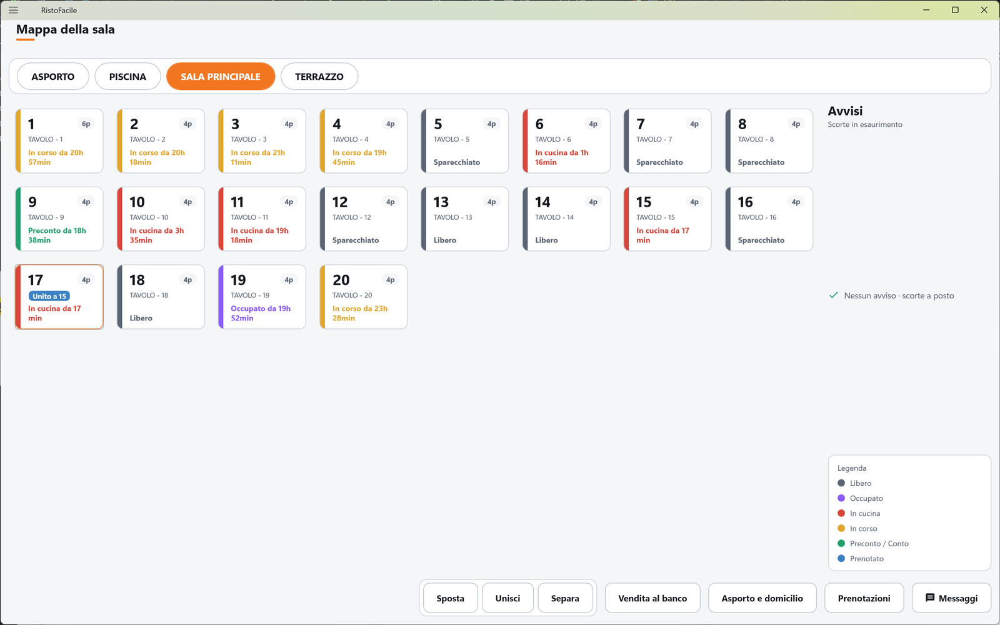
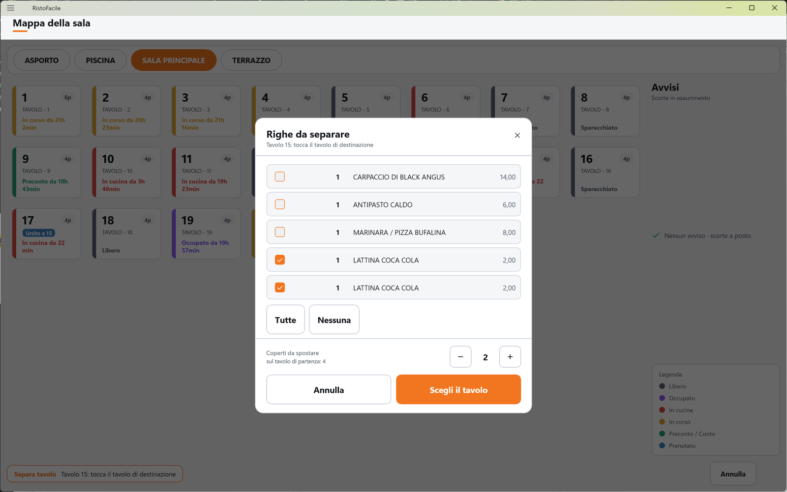

# Mappa della sala

È la schermata principale della cassa: mostra i tavoli della sala scelta, ognuno colorato secondo
il punto in cui si trova il suo conto. Toccando un tavolo si apre la sua comanda; dalla barra in
basso si spostano, uniscono e separano i tavoli e si va al banco, all'asporto, alle prenotazioni e
ai messaggi per la cucina. La usano il cassiere e il responsabile di sala.

!!! info "In sintesi"

    - **Dove si trova:** Menu ▸ Vendita (è anche la prima schermata dopo l'accesso)
    - **Chi la usa:** cassiere / responsabile di sala / cameriere
    - **Disponibile anche su:** Palmare ([Sala](../palmare/sala.md))

---

## A cosa serve

Durante il servizio la mappa risponde a colpo d'occhio a «quali tavoli sono liberi?», «dove
aspettano ancora i piatti?», «chi ha chiesto il conto?». Le tessere si aggiornano da sole quando
un collega lavora da un altro dispositivo (palmare o altra cassa).

Esempio: una coppia al tavolo 4 viene raggiunta da due amici. Tocchi **Unisci**, poi il tavolo 4
(che tiene il conto), poi il tavolo 5 accostato: il 5 mostra **Unito a 4** e un unico conto raccoglie
tutto.

## Prima di cominciare

- Sale e tavoli si creano in [Sale e tavoli](sale-e-tavoli.md); da lì si decide anche l'ordine in
  cui i tavoli compaiono nella mappa.
- Gli avvisi di scorte in esaurimento compaiono solo per gli articoli con una soglia di avviso
  impostata in [Disponibilità](disponibilita.md).
- L'anticipo con cui la mappa segnala le prenotazioni si imposta in
  [Impostazioni](impostazioni.md) ▸ Sala ▸ Mappa e servizio ▸ **Prenotazioni in mappa**
  (predefinito: 1 ora; zero spegne la segnalazione).
- Il tavolo usato per gli ordini d'asporto si sceglie in Impostazioni ▸ Sala ▸ **Tavolo asporto**.

## La schermata

La schermata ha quattro zone.

- **In alto, le sale.** Una pastiglia per sala; quella scelta è arancione. Tornando alla mappa la
  cassa ripropone l'ultima sala usata.
- **Al centro, i tavoli.** Una tessera per tavolo, su quante colonne ci stanno nella larghezza
  dello schermo.
- **A destra, gli avvisi e la legenda.** In alto **Avvisi** - **Scorte in esaurimento**: una riga
  per ogni articolo che sta finendo (es. «Tiramisù: ultime 3 porzioni»), oppure il segno di spunta
  verde con «Nessun avviso · scorte a posto». In basso la **Legenda** dei colori.
- **In basso, la barra dei comandi:** il gruppo **Sposta** / **Unisci** / **Separa** e i pulsanti
  **Vendita al banco**, **Asporto e domicilio**, **Chiamate**, **Prenotazioni**, **Messaggi**.
  **Chiamate** c'è solo quando i kiosk sono accesi e hanno la licenza. Quando uno fra
  Sposta, Unisci e Separa è in corso, al posto dei pulsanti compaiono un riquadro arancione che dice
  cosa toccare adesso e il pulsante **Annulla**.

### La tessera del tavolo

Ogni tessera mostra:

- a sinistra una **barra colorata**: il colore è lo stato del tavolo (vedi la legenda);
- in alto il **numero del tavolo**, grande, e a destra i **posti** (es. **4p**);
- al centro, in azzurro, l'**ora della prenotazione** se il tavolo è prenotato per oggi; in questo
  caso anche il bordo destro della tessera diventa una banda azzurra;
- sotto il numero la **descrizione del tavolo**, oppure il riquadro azzurro **Unito a 12** (il
  tavolo fa parte del conto del 12) o **Asporto** (è il tavolo degli ordini d'asporto);
- in basso, colorati come la barra, lo **stato e da quanto è aperto** il tavolo: es. «In cucina da
  25 min», «Occupato - appena aperto», «Preconto da 1h 40min». Sul tavolo dell'asporto al posto
  della durata c'è il numero di ordini in coda: «nessun ordine», «1 ordine», «3 ordini».

## Campi e indicatori

### Legenda dei colori

| Colore | Stato | Significato |
|---|---|---|
|  grigio | **Libero** | Nessun conto aperto. In grigio compaiono anche i tavoli segnati «Non disp.» o «Sparecchiato». |
|  viola | **Occupato** | Il tavolo è stato aperto ma non è ancora stato battuto niente. |
|  ambra | **In corso** | Ci sono piatti battuti e non ancora mandati in cucina. |
|  rosso | **In cucina** | Almeno un piatto è stato mandato in cucina. |
|  verde | **Preconto / Conto** | È stato fatto il preconto, o il conto è in chiusura. |
|  azzurro | **Prenotato** | Prenotazione confermata in arrivo: banda azzurra a destra e ora della prenotazione. In azzurro è anche il tavolo dell'asporto. |

Il colore segue l'ultima cosa fatta sul conto: se dopo un invio in cucina (rosso) o dopo il
preconto (verde) si batte un altro piatto, il tavolo torna ambra (**In corso**) finché non lo si
manda in cucina.

### Altri indicatori

| Elemento | Descrizione |
|---|---|
| **Pastiglie delle sale** | Una per sala, in alto. Tocca per vedere i tavoli di quella sala. |
| **4p** | Posti del tavolo. |
| **Ora azzurra** (es. **20:30**) | Prenotazione confermata per oggi su quel tavolo, non ancora arrivata. Compare a partire dall'anticipo impostato (es. un'ora prima) e resta finché il cliente non viene segnato come arrivato. Con più prenotazioni sullo stesso tavolo si vede la più vicina. |
| **Unito a N** | Il tavolo è unito al conto del tavolo N: non ha un conto suo. |
| **Asporto** | È il tavolo virtuale degli ordini d'asporto e a domicilio. |
| **Avvisi - Scorte in esaurimento** | Articoli sotto la soglia di avviso impostata in [Disponibilità](disponibilita.md), con le porzioni rimaste. |

## Pulsanti e comandi

| Comando | Effetto |
|---|---|
| **Tocco su un tavolo** | Apre la [Comanda](comanda.md) del tavolo. Su un tavolo libero il conto viene aperto in quel momento e il tavolo diventa **Occupato**. Su un tavolo unito si apre il conto del tavolo a cui è unito. Sul tavolo dell'asporto si apre l'elenco [Asporto e domicilio](asporto.md). Mentre la comanda si apre compare «Apertura tavolo…». |
| **Sposta** | Sposta il conto di un tavolo su un altro tavolo libero. Vedi «Spostare un tavolo». |
| **Unisci** | Unisce un tavolo al conto di un altro. Vedi «Unire due tavoli». |
| **Separa** | Porta alcune righe e/o coperti di un conto su un altro tavolo libero, che diventa un conto a sé. Vedi «Separare un tavolo». |
| **Annulla** | Compare durante Sposta, Unisci o Separa: interrompe l'operazione senza cambiare nulla. Lo stesso effetto ha toccare di nuovo il tavolo di partenza. |
| **Vendita al banco** | Apre la [Vendita al banco](vendita-al-banco.md). |
| **Asporto e domicilio** | Apre l'elenco degli ordini [Asporto e domicilio](asporto.md). |
| **Chiamate** | Apre le [Chiamate](chiamate.md): i numeri degli ordini da ritirare al banco, in preparazione e pronti, e l'indirizzo del monitor in sala. C'è solo quando i kiosk sono accesi e hanno la licenza. |
| **Prenotazioni** | Apre le [Prenotazioni](prenotazioni.md). |
| **Messaggi** | Apre i [Messaggi alla cucina](messaggi.md). |

## Come si fa

### Aprire un tavolo

1. Se serve, tocca la pastiglia della sala in alto.
2. Tocca il tavolo. Compare «Apertura tavolo…».
3. Si apre la [Comanda](comanda.md) del tavolo; tornando alla mappa il tavolo è viola (**Occupato**)
   se non hai battuto niente.

### Spostare un tavolo

1. Tocca **Sposta**. Il riquadro in basso dice **Sposta tavolo** - «Tocca il tavolo da spostare».
2. Tocca il tavolo che ha il conto. Il riquadro dice «Tavolo 7: tocca il tavolo di destinazione».
3. Tocca il tavolo libero su cui spostarlo. Il conto passa sul nuovo tavolo con il suo stato, e il
   tavolo di partenza torna libero.

### Unire due tavoli

1. Tocca **Unisci**. Il riquadro dice **Unisci tavoli** - «Tocca il tavolo che tiene il conto».
2. Tocca il tavolo che terrà il conto unico (deve avere un conto aperto). Il riquadro dice
   «Conto sul tavolo 4: tocca il tavolo da unire».
3. Tocca il tavolo da unire. Se aveva già un conto, le sue righe e i suoi coperti passano sul conto
   del primo tavolo. La sua tessera mostra **Unito a 4**.

### Separare un tavolo

1. Tocca **Separa**. Il riquadro dice **Separa tavolo** - «Tocca il tavolo da separare».
2. Tocca il tavolo con il conto. Si apre la finestra **Righe da separare**.
3. Spunta le righe da portare sull'altro tavolo (**Tutte** / **Nessuna** per fare prima). Le
   varianti e le parti di una pizza composta seguono la loro riga.
4. Con **−** e **+** di **Coperti da spostare** indica quanti coperti passano sull'altro tavolo
   (al massimo quelli del tavolo di partenza non ancora pagati).
5. Tocca **Scegli il tavolo**, poi tocca il tavolo libero di destinazione. Sul tavolo di
   destinazione si apre un conto nuovo con le righe e i coperti scelti.

## Controlli e messaggi

| Messaggio | Causa | Cosa fare |
|---|---|---|
| *Il tavolo 13 e' unito al 12: si apre il conto del 12.* | Hai toccato un tavolo unito. | Nessuna azione: si apre il conto giusto. |
| *Il tavolo 20 e' quello degli ordini d'asporto: sposta/unisci/separa non si applicano.* | Durante Sposta, Unisci o Separa hai toccato il tavolo dell'asporto. L'operazione viene annullata. | Gli ordini d'asporto si gestiscono da [Asporto e domicilio](asporto.md). |
| *Il tavolo 13 e' gia' unito a un altro conto: parti dal tavolo che tiene il conto.* | Unisci o Separa partendo da un tavolo unito. | Tocca il tavolo che tiene il conto. |
| *Il tavolo 6 non ha un conto aperto.* | Unisci o Separa partendo da un tavolo senza conto. | Parti da un tavolo occupato. |
| *Il tavolo di partenza non ha una comanda aperta.* | Sposta partendo da un tavolo senza conto. | Parti da un tavolo occupato. |
| *6 coperti non stanno sul tavolo ...: ha al massimo 4 posti.* | Sposta verso un tavolo con meno posti dei coperti del conto. | Scegli un tavolo più grande, o alza i posti massimi del tavolo in [Sale e tavoli](sale-e-tavoli.md). |
| *3 coperti non stanno sul tavolo ...: ha al massimo 2 posti. Scegli un altro tavolo.* | Separa verso un tavolo con meno posti dei coperti scelti. | Tocca un altro tavolo. |
| *Su questo tavolo non c'e' niente da separare.* | Il conto non ha righe separabili né coperti non pagati. | Nessuna azione. |
| *Scegli almeno una riga o qualche coperto da separare.* | **Scegli il tavolo** senza aver scelto niente. | Spunta almeno una riga o aumenta i coperti. |
| *Impossibile spostare il tavolo.* / *Impossibile unire i tavoli.* / *Impossibile separare il tavolo.* (seguiti dal dettaglio) | Il servizio ha rifiutato l'operazione, ad esempio perché il tavolo di destinazione è già occupato o unito a un altro conto. | Leggi il dettaglio e scegli un altro tavolo. |
| *Impossibile caricare la mappa della sala.* / *Impossibile caricare i tavoli della sala.* | Il servizio non risponde. | Controlla il collegamento; la mappa si ricarica tornando sulla schermata. |

## Note

- Se il servizio non è ancora configurato, aprendo la mappa la cassa passa da sola alle
  [Impostazioni](impostazioni.md).
- Toccare un tavolo libero **apre il conto** sul servizio: il tavolo risulta occupato anche sugli
  altri dispositivi. Se l'hai aperto per sbaglio, liberalo dalla Comanda con **LIBERA TAVOLO**.
- La mappa si aggiorna da sola con le modifiche fatte da palmari e altre casse, ma non mentre è in
  corso Sposta, Unisci o Separa.
- La durata sulle tessere («da 25 min») è fotografata quando la mappa viene disegnata: si aggiorna
  al ricaricamento, non minuto per minuto.
- Separando **solo i coperti**, senza nessuna riga, la finestra lo permette ma il servizio rifiuta
  l'operazione. <!-- DA VERIFICARE: la finestra dice "Nessuna riga: puoi comunque separare solo i coperti.", ma il servizio risponde "nessuna riga da separare" se non si sceglie almeno una riga. Quale dei due comportamenti e' quello voluto? -->

## Vedi anche

- [Comanda](comanda.md)
- [Sale e tavoli](sale-e-tavoli.md)
- [Disponibilità](disponibilita.md)
- [Asporto e domicilio](asporto.md)
- [Chiamate](chiamate.md)
- [Prenotazioni](prenotazioni.md)
- [Vendita al banco](vendita-al-banco.md)
- [Messaggi alla cucina](messaggi.md)
- [Sala sul palmare](../palmare/sala.md)
- [Self order](self-order.md)
