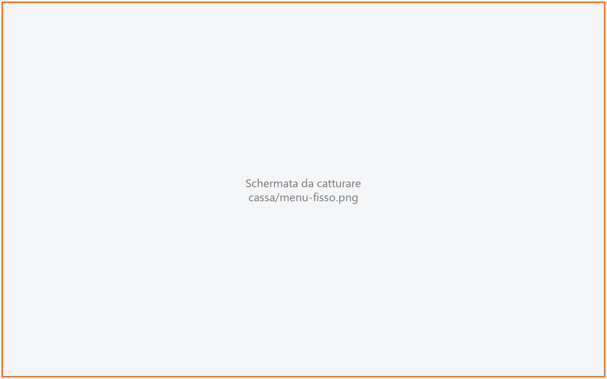

# Menu fisso

Serve a vendere un menu a prezzo fisso, ad esempio il «Menu del giorno» a € 25,00 con antipasto,
primo e dolce: si sceglie un piatto per ogni sezione e il menu entra in comanda con il suo prezzo,
seguito dai piatti scelti. La barra del titolo mostra il nome del menu. La usano il cassiere e i
camerieri.

!!! info "In sintesi"

    - **Dove si trova:** in [Comanda](comanda.md), tessera **MENU INTERO** - «un piatto per sezione» in testa alle sezioni del menu
    - **Chi la usa:** cassiere / cameriere
    - **Disponibile anche su:** Palmare (dalla [Comanda](../palmare/comanda.md))

---

## A cosa serve

Il cliente prende il menu degustazione. Invece di battere i piatti uno per uno, tocchi **MENU
INTERO** sotto il nome del menu: la schermata elenca le sezioni del menu e ti fa scegliere i piatti
sezione per sezione. Il prezzo è quello fisso del menu, più gli eventuali supplementi dei piatti
(es. «+ € 3,00» per il filetto). In cucina i piatti arrivano come righe normali, ognuno alla sua
cucina e con la sua portata.

## Prima di cominciare

- Il menu deve avere un **prezzo** e un **articolo** di vendita, impostati in [Menu](menu.md):
  senza, la tessera **MENU INTERO** non compare e il menu si vende piatto per piatto.
- Per ogni sezione del menu si stabilisce in [Menu](menu.md) se è obbligatoria e quanti piatti si
  possono scegliere; il supplemento di un piatto si imposta sulla sua voce di menu.
- Il menu deve essere valido nel giorno e nell'ora correnti, altrimenti in Comanda non compare.

## La schermata

La schermata ha tre colonne.

- **A sinistra - SEZIONI.** Una tessera per sezione del menu, con il nome e la regola di scelta
  (es. «obbligatoria · scegli 1»). A destra della tessera il riquadro giallo **MANCA** finché la
  sezione non è completa, poi il conteggio dei piatti scelti (es. «1/1»). La sezione aperta ha il
  bordo arancione. In fondo il pulsante **Annulla**.
- **Al centro - i piatti.** In alto il nome della sezione aperta e la sua regola (es. «Primi ·
  obbligatoria · scegli 1»); sotto, una tessera per piatto con il nome e il prezzo, che qui è
  **incluso** oppure il supplemento (es. «+ € 3,00»). **ULTIME n** sui piatti che stanno finendo; i
  piatti esauriti non compaiono.
- **A destra - il menu com'è composto.** Il nome del menu e «Prezzo fisso € 25,00», poi le sezioni
  con i piatti scelti (o «da scegliere»). Ogni piatto scelto ha una **X**: toccandolo lo togli. In
  fondo i supplementi, il **Totale** e **AGGIUNGI ALLA COMANDA**.

## Campi e indicatori

| Elemento | Descrizione |
|---|---|
| **Regola della sezione** | «obbligatoria · scegli 1», «obbligatoria · da 1 a 2», «obbligatoria · almeno 1», «facoltativa · al massimo 2» oppure «facoltativa». |
| **MANCA** | La sezione non ha ancora i piatti richiesti. |
| **1/1**, **2/3**… | Piatti scelti sul massimo consentito (solo il numero se non c'è un massimo). |
| **incluso** / **+ € 3,00** | Il piatto è compreso nel prezzo, oppure ha un supplemento. |
| **+ Filetto € 3,00** | Righe dei supplementi, sopra il totale. |
| **Totale** | Prezzo fisso più i supplementi. Finché mancano sezioni dice «manca 1 sezione» o «mancano 2 sezioni». |

## Pulsanti e comandi

| Comando | Effetto |
|---|---|
| **Tocco su una sezione** | Mostra i suoi piatti al centro. |
| **Tocco su un piatto** | Lo aggiunge alla sezione. Nelle sezioni in cui si sceglie un solo piatto, un secondo tocco sostituisce il piatto scelto. Quando una sezione è completa si passa da soli alla prossima sezione ancora da completare. |
| **Tocco su un piatto scelto** (colonna destra) | Lo toglie dal menu. |
| **AGGIUNGI ALLA COMANDA** | Mette il menu in comanda e torna alla Comanda. |
| **Annulla** | Torna alla Comanda senza aggiungere nulla. |

## Come si fa

### Vendere un menu fisso

1. In Comanda tocca **MENU INTERO** sotto il nome del menu.
2. Nella prima sezione tocca il piatto scelto: la sezione mostra «1/1» e si passa alla successiva.
3. Ripeti per le altre sezioni, finché nessuna dice **MANCA**.
4. Controlla il **Totale** e tocca **AGGIUNGI ALLA COMANDA**. In comanda compare una riga con il
   nome del menu e il prezzo, con i piatti scelti scritti sotto; ogni piatto ha anche una riga sua
   (con «€ menu» al posto del prezzo), nel gruppo della sua portata.

### Cambiare un piatto già scelto

1. Nella colonna destra tocca il piatto da togliere (quello con la **X**).
2. Tocca la sezione e scegli il nuovo piatto.

## Controlli e messaggi

| Messaggio | Causa | Cosa fare |
|---|---|---|
| *Manca "Primi" (obbligatoria · scegli 1).* | **AGGIUNGI ALLA COMANDA** con una sezione incompleta. Si apre la sezione che manca. | Scegli il piatto. |
| *Scegli almeno un piatto.* | Nessun piatto scelto (menu con sole sezioni facoltative). | Scegli almeno un piatto. |
| *In "Contorni" se ne possono scegliere al massimo 2: tocca a destra quello da togliere.* | Sezione già piena (con massimo maggiore di 1). | Togli prima un piatto dalla colonna destra. |
| *Questo menu non ha un prezzo fisso: si vende piatto per piatto dalle sue sezioni.* | Il menu non ha prezzo o articolo di vendita. | Torna in Comanda e batti i piatti dalle sezioni, o completa il menu in [Menu](menu.md). |
| *Nessuna sezione di questo menu ha piatti disponibili.* | Tutti i piatti del menu sono esauriti o disattivati. | Controlla [Menu](menu.md) e [Disponibilità](disponibilita.md). |
| *Il menu e' in comanda, ma questi piatti non sono stati scritti: …. Battili dalle loro sezioni.* | Il servizio ha accettato il menu ma non tutti i piatti. | Batti i piatti mancanti dalle loro sezioni in Comanda. |
| *Il menu e' in comanda, ma non e' stato possibile assegnarlo al Conto 2: resta da assegnare.* | Con un conto acceso in Comanda, l'assegnazione non è riuscita. | Assegnalo da [Dividi conto](dividi-conto.md). |
| *Impossibile caricare il menu.* / *Impossibile aggiungere il menu alla comanda.* (seguiti dal dettaglio) | Il servizio non risponde. | Riprova. |

## Note

- Il prezzo del menu (fisso più supplementi) sta sulla riga del menu; i piatti hanno prezzo zero e
  in comanda al posto del prezzo mostrano «€ menu».
- I piatti vanno in cucina come righe normali, ognuno al suo centro di produzione e con la portata
  della sua sezione. La riga del menu non va in cucina.
- In comanda il **+** sul menu o su uno dei suoi piatti non funziona: per un secondo menu si tocca
  di nuovo **MENU INTERO**, così ogni menu ha le sue scelte.
- Stornando il menu si stornano anche i suoi piatti.
- Se in Comanda era acceso un conto (es. **Conto 2**), il menu finisce su quel conto.

## Vedi anche

- [Comanda](comanda.md)
- [Menu](menu.md)
- [Disponibilità](disponibilita.md)
- [Comanda sul palmare](../palmare/comanda.md)
