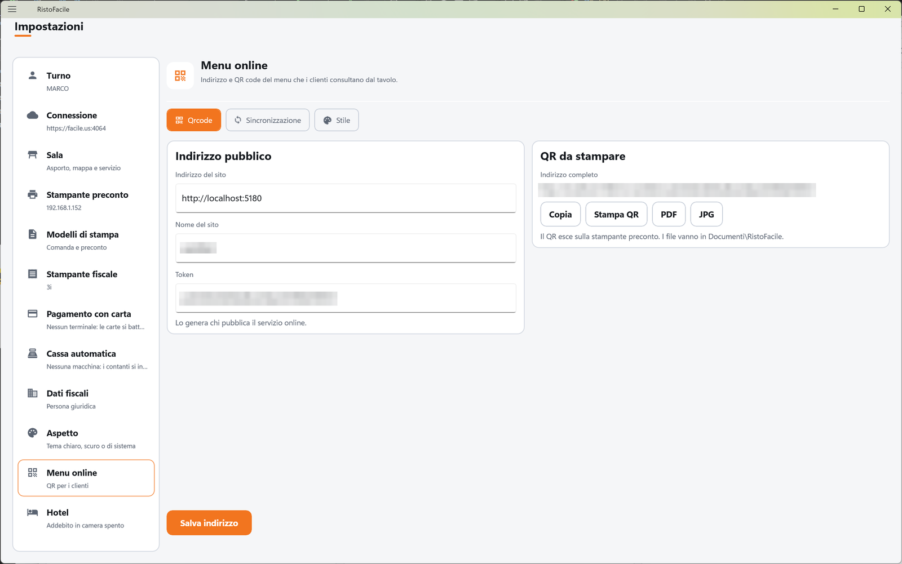
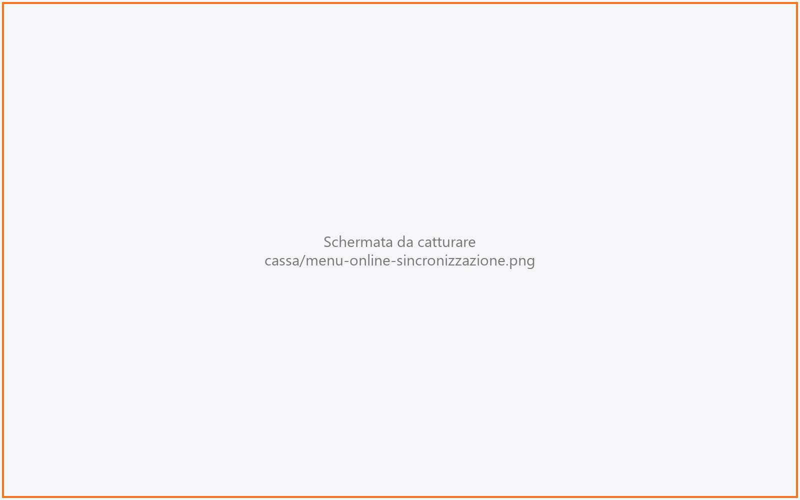
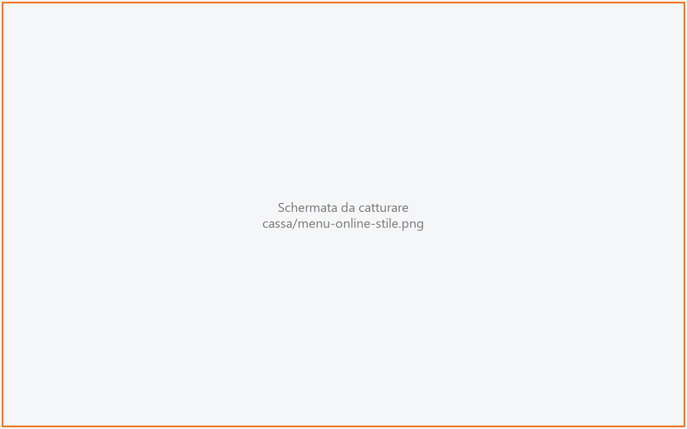

# Menu online

Il menu online è la pagina che il cliente apre sul suo telefono inquadrando il QR stampato sul
tavolo: mostra i piatti del menu, con prezzi e allergeni. Da questo pannello il titolare (o chi
installa) imposta l'indirizzo della pagina, ne stampa o esporta il QR, collega il servizio che
la pubblica su Internet e ne sceglie l'aspetto.

!!! info "In sintesi"

    - **Dove si trova:** Menu ▸ Impostazioni ▸ **Menu online**
    - **Chi la usa:** titolare, installatore
    - **Disponibile anche su:** solo cassa

---

## A cosa serve

Un locale vuole togliere i menu di carta dai tavoli. L'installatore pubblica il menu su
Internet e comunica tre dati: l'indirizzo del sito, il nome del sito del locale e il token. Il
titolare li vede qui, controlla l'indirizzo completo che ne risulta, e stampa il QR sulla
stampante del preconto (oppure lo esporta in PDF o JPG per farlo stampare su cartoncini da
tavolo). Da quel momento il cliente inquadra il QR e consulta il menu sul suo telefono.

I dati del menu online sono del ristorante, non della cassa: stanno sul servizio e li vedono
tutte le casse.

## Prima di cominciare

- La cassa deve essere collegata al servizio: [Impostazioni](impostazioni.md) ▸ **Connessione**.
- Per stampare il QR serve la stampante del preconto di questa cassa:
  [Impostazioni](impostazioni.md) ▸ **Stampante preconto**.
- I piatti e le sezioni che il cliente vede vengono dal [Menu](menu.md) e dagli
  [Articoli](articoli.md).
- Indirizzo del sito, nome del sito, token e codice di accesso li fornisce chi pubblica il menu
  su Internet.

## La schermata

In testa il titolo *Menu online* con la riga *Indirizzo e QR code del menu che i clienti
consultano dal tavolo.* Sotto, tre linguette:

- **Qrcode**: l'indirizzo pubblico del menu e il QR da stampare (è quella aperta all'inizio);
- **Sincronizzazione**: il collegamento con il servizio su Internet che pubblica il menu;
- **Stile**: come appare la pagina del menu sul telefono del cliente, con un'anteprima.

In fondo al pannello, durante un'operazione, gira la rotellina e compare il messaggio con
l'esito (per esempio *Indirizzo salvato.*).

## Campi e indicatori

### Qrcode

| Elemento | Descrizione |
|---|---|
| **Indirizzo del sito** (riquadro **Indirizzo pubblico**) | L'indirizzo del sito che ospita i menu, per esempio `https://menu.iltuoristorante.it`. Se lo scrivi senza `https://` la cassa lo aggiunge da sola nell'indirizzo completo. |
| **Nome del sito** | Il nome del locale nel sito, per esempio `trattoria`: solo lettere minuscole, cifre e trattino, al massimo 40 caratteri. |
| **Token** | Il codice segreto che rende l'indirizzo del menu non indovinabile (32 caratteri, almeno 24). *Lo genera chi pubblica il servizio online.* |
| **Indirizzo completo** (riquadro **QR da stampare**) | L'indirizzo che finisce nel QR, composto dai tre campi. Finché ne manca uno compare *Compila indirizzo, nome e token: qui comparira' il link da stampare sul QR.* |
| *Il QR esce sulla stampante preconto. I file vanno in Documenti\RistoFacile.* | Dove escono il QR stampato e i file esportati. |

<!-- DA VERIFICARE: il campo Token si puo' modificare ma "Salva indirizzo" salva solo indirizzo e nome del sito; dopo il salvataggio il campo torna al token del servizio. Confermare se il token va solo letto (allora andrebbe reso non modificabile) o se deve potersi scrivere da qui. -->

Sulla cassa non si vede il disegno del QR, solo l'indirizzo che contiene: per vederlo stampalo o
esportalo.

### Sincronizzazione

| Elemento | Descrizione |
|---|---|
| **Indirizzo del servizio** (riquadro **Servizio**) | L'indirizzo del servizio su Internet a cui il locale manda il menu, per esempio `https://menuesempio.com`. |
| **Codice del ristorante** | Il codice con cui quel servizio riconosce il locale, per esempio `trattoriadaluigi`. |
| **Codice di accesso** (riquadro **Autorizzazione**) | Il codice ricevuto da chi gestisce il servizio. Si scrive nascosto. *Si vede una volta sola, quando viene generato. Lasciandolo vuoto resta quello gia' salvato.* Se c'è già, compare *Codice di accesso gia' configurato.* |

<!-- DA VERIFICARE: ogni quanto il servizio del locale manda il menu aggiornato (piatti, prezzi, foto) al servizio su Internet, e se serve fare qualcosa dopo aver cambiato il menu. -->

### Stile

| Elemento | Descrizione |
|---|---|
| **Nome mostrato** (riquadro **Testi**) | Il nome del locale in testa alla pagina, per esempio *Trattoria da Luigi*. Se vuoto, nell'anteprima compare *Il tuo locale*. |
| **Sottotitolo** | Una riga sotto il nome, per esempio *Cucina siciliana*. |
| **Nota in fondo** | Una riga in fondo al menu, per esempio *Coperto 2,00 - servizio non incluso*. |
| **Logo** | **Scegli immagine** apre la scelta del file, **Togli** lo toglie. *PNG o JPG, fino a 96 KB.* |
| **Colore d'accento** (riquadro **Aspetto**) | Il colore dei titoli e dei prezzi: tocca uno dei 24 riquadri colorati. Accanto si legge il codice del colore scelto. |
| **Tema** | **Chiaro** o **Scuro**: il fondo della pagina del menu. |
| **Carattere** | Il tipo di scrittura: *Di sistema*, *Lineare*, *Con grazie*, *Classico*, *Geometrico*, *Macchina da scrivere*, *Stretto*. |
| **Anteprima** | Un esempio della pagina con nome, sottotitolo, logo, colori e carattere scelti. È un'approssimazione: sul telefono del cliente il carattere può essere leggermente diverso. |
| **Prezzi** | **SI'** / **NO**: mostra o nasconde i prezzi nel menu. |
| **Legenda degli allergeni** | **SI'** / **NO**: mostra o nasconde la riga con gli allergeni. |
| *Il logo caricato e' un SVG: sul telefono si vede, qui l'anteprima non lo disegna.* | Compare se il logo salvato è un disegno vettoriale. |

Se l'utente con cui la cassa è collegata al servizio non ha il permesso di modificare lo stile,
i campi di questa linguetta e **Salva aspetto** restano spenti.

<!-- DA VERIFICARE: quale permesso serve per modificare lo stile del menu online e dove si assegna. -->

## Pulsanti e comandi

| Comando | Effetto |
|---|---|
| **Qrcode** / **Sincronizzazione** / **Stile** | Passano da una linguetta all'altra. |
| **Salva indirizzo** | Salva sul servizio **Indirizzo del sito** e **Nome del sito**: *Indirizzo salvato.* |
| **Copia** | Copia l'indirizzo completo negli appunti: *Indirizzo copiato.* |
| **Stampa QR** | Stampa il QR del menu sulla stampante del preconto di questa cassa: *QR inviato alla stampante.* |
| **PDF** | Salva il QR in un file PDF (`menu-qr.pdf`) nella cartella Documenti\RistoFacile e apre la cartella. |
| **JPG** | Salva il QR in un'immagine JPG (`menu-qr.jpg`) nella stessa cartella. Solo sulla cassa Windows. |
| **Salva collegamento** | Salva indirizzo del servizio, codice del ristorante e (se scritto) codice di accesso: *Credenziali salvate.* |
| **Scegli immagine** / **Togli** | Sceglie o toglie il logo. |
| Riquadri colorati | Scelgono il colore d'accento. |
| **Chiaro** / **Scuro** | Scelgono il tema della pagina. |
| **SI'** / **NO** | Accendono o spengono prezzi e legenda degli allergeni. |
| **Salva aspetto** | Salva sul servizio tutta la linguetta **Stile**: *Aspetto salvato.* |

## Come si fa

### Stampare il QR del menu per i tavoli

1. Apri Menu ▸ Impostazioni ▸ **Menu online**, linguetta **Qrcode**.
2. Controlla **Indirizzo del sito**, **Nome del sito** e **Token**.
3. Tocca **Salva indirizzo**.
4. Controlla l'**Indirizzo completo**: aprendolo dal browser di un telefono deve comparire il menu.
5. Tocca **Stampa QR**.
6. Dalla stampante del preconto esce il foglietto con il QR e compare *QR inviato alla stampante.*

### Esportare il QR per la tipografia

1. Nella linguetta **Qrcode** tocca **PDF** (oppure **JPG**).
2. Si apre la cartella Documenti\RistoFacile con il file `menu-qr.pdf` (o `menu-qr.jpg`)
   selezionato, e in fondo compare *Salvato in* (percorso del file).

Ogni esportazione sovrascrive il file precedente con lo stesso nome.

### Cambiare l'aspetto del menu

1. Apri la linguetta **Stile**.
2. Scrivi **Nome mostrato**, **Sottotitolo** e **Nota in fondo**; se vuoi, tocca **Scegli
   immagine** per il logo.
3. Scegli colore d'accento, tema e carattere; controlla il risultato nell'**Anteprima**.
4. Tocca **Salva aspetto**.
5. Compare *Aspetto salvato.*
   <!-- DA VERIFICARE: dopo quanto tempo il nuovo aspetto si vede sul telefono dei clienti. -->

## Controlli e messaggi

| Messaggio | Causa | Cosa fare |
|---|---|---|
| *Il token e' troppo corto: servono almeno 24 caratteri. Il servizio lo rifiuterebbe.* | Token scritto con meno di 24 caratteri. | Ricopia il token completo. |
| *Servono indirizzo del sito, nome del sito e token.* | **Salva indirizzo** con un campo vuoto. | Compila i tre campi. |
| *Configura e salva l'indirizzo prima di stampare.* | **Stampa QR** senza un indirizzo completo. | Compila e salva la linguetta **Qrcode**. |
| *Configura e salva l'indirizzo prima di esportare il QR.* | **PDF** o **JPG** senza un indirizzo completo. | Come sopra. |
| *Stampa non riuscita.* | La stampante del preconto non ha stampato. | Controlla la stampante in Impostazioni ▸ **Stampante preconto**. |
| *Esportazione del QR non riuscita.* | Il file non si è potuto scrivere (o **JPG** toccato su un dispositivo diverso dalla cassa Windows). | Leggi il dettaglio; usa **PDF**. |
| *Serve anche il codice del ristorante: senza, il centro non sa di chi e' il menu.* | **Salva collegamento** con l'indirizzo del servizio ma senza codice del ristorante. | Scrivi il **Codice del ristorante**. |
| *Salvataggio dell'indirizzo non riuscito.* / *Salvataggio delle credenziali non riuscito.* / *Salvataggio dell'aspetto non riuscito.* | Il servizio ha rifiutato il dato o non risponde (per esempio un nome del sito con caratteri non ammessi). | Leggi il dettaglio e correggi. |
| *Immagine troppo pesante (*… *KB). Il limite e' 96 KB: usa un file piu' piccolo.* | Logo oltre il limite. | Riduci l'immagine. |
| *Non sono riuscito a leggere l'immagine.* | Il file scelto non si apre. | Scegli un altro file PNG o JPG. |
| *Il servizio non ha restituito la configurazione del menu online.* | Il servizio ha risposto senza dati. | Riprova; se persiste, chiama l'assistenza. |
| *Configurazione del menu online non leggibile.* | Il servizio non risponde o l'utente non ha il permesso. | Controlla la connessione. |

## Note

!!! warning "Il QR stampato non si cambia"

    L'indirizzo completo finisce su carta, sui tavoli. Se cambi indirizzo del sito, nome del sito
    o token, i QR già stampati smettono di portare al menu e vanno ristampati tutti.

- Il QR sulla carta lo disegna la stampante del preconto: la cassa le manda solo l'indirizzo.
- Le impostazioni valgono per tutto il locale: modificarle da una cassa le cambia per tutte. Se
  un'altra cassa le ha cambiate mentre le stavi modificando, compare *Un'altra postazione ha
  modificato questi dati prima di te: adesso vedi la versione aggiornata, rifai la modifica e
  salva.*
- Il palmare non ha questo pannello.

## Vedi anche

- [Impostazioni](impostazioni.md)
- [Menu](menu.md)
- [Articoli](articoli.md)
- [Self order](self-order.md)
