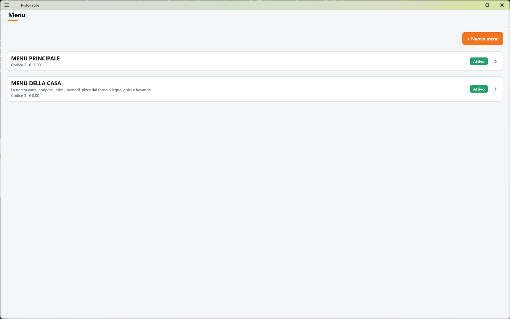
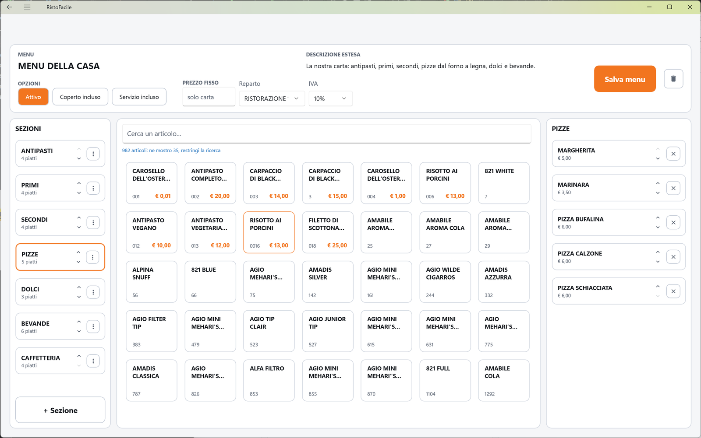
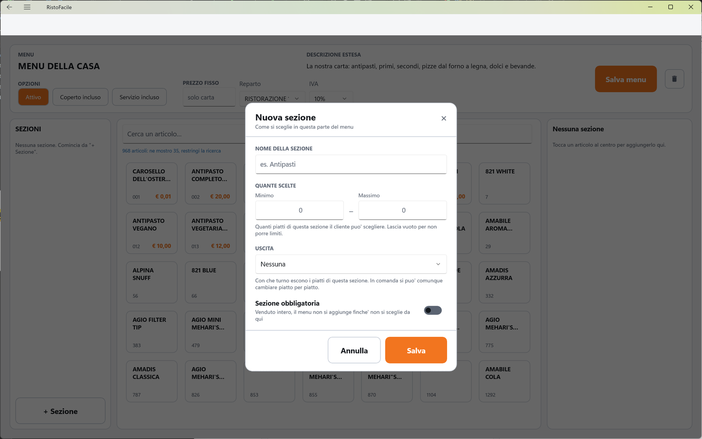
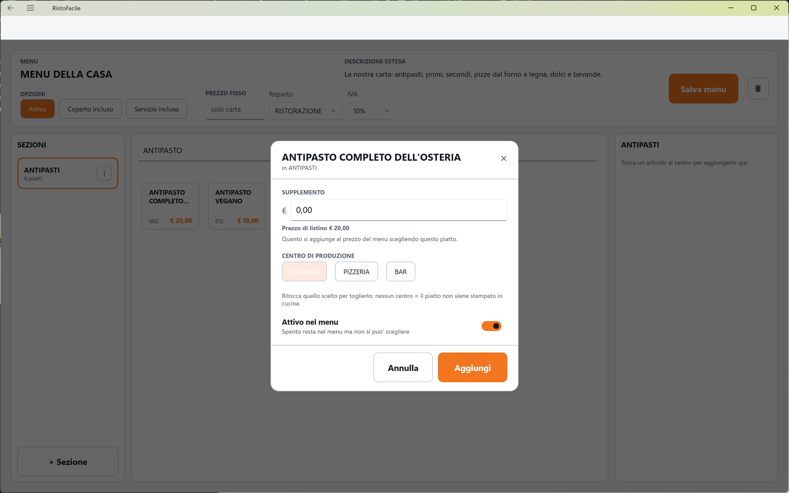
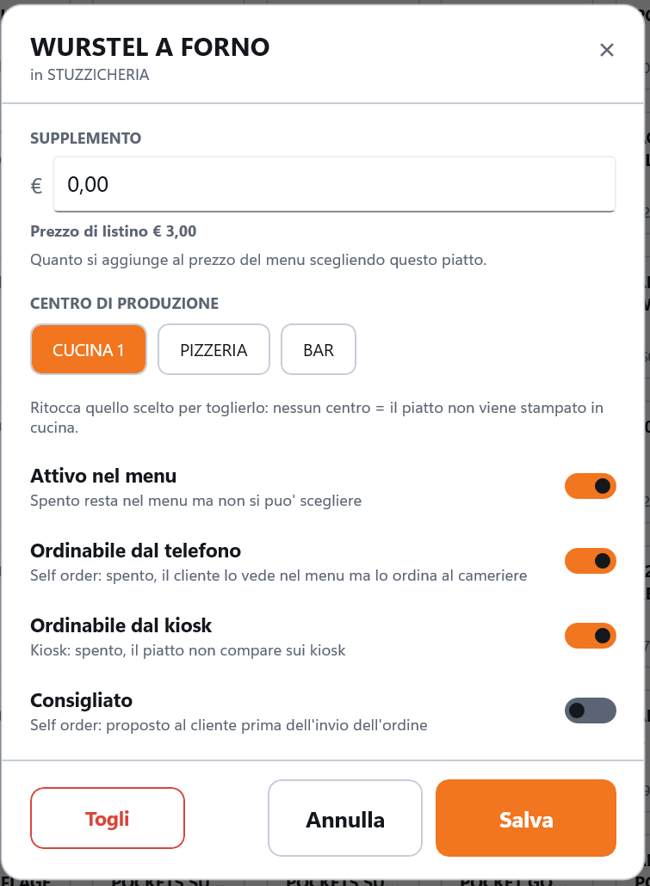

# Menu

Il menu è la carta del locale: è diviso in **sezioni** (Antipasti, Primi, Pizze, Bevande…) e ogni
sezione contiene dei **piatti**, presi dall'anagrafica [articoli](articoli.md). È quello che il
cameriere vede in [Comanda](comanda.md), sulla cassa e sul palmare. Qui il titolare crea i menu e
li compone.

!!! info "In sintesi"

    - **Dove si trova:** Menu ▸ Menu, poi tocco su un menu (o **+ Nuovo menu**)
    - **Chi la usa:** titolare / responsabile
    - **Disponibile anche su:** solo cassa (il palmare mostra gli stessi menu ma non li modifica)

---

## A cosa serve

Un locale può avere più menu: la carta normale, il menu del pranzo di lavoro, il menu degustazione.
In Comanda compaiono le sezioni di tutti i menu attivi e validi in quel momento, nell'ordine
deciso qui, e dentro ogni sezione i piatti nell'ordine deciso qui.

Per ogni piatto la composizione del menu decide anche **dove va in cucina** (il
[centro di produzione](centri-di-produzione.md)) e la sezione decide **con che uscita** escono i
suoi piatti (la [portata](portate.md)): per esempio la sezione Antipasti esce in «prima uscita» e la
sezione Primi in «seconda uscita».

Un menu può avere anche un **prezzo fisso**: allora in Comanda si può vendere anche intero (pranzo
di lavoro a 15 €, un piatto per sezione), oltre che piatto per piatto.

## Prima di cominciare

- Gli articoli da mettere nel menu, in [Articoli](articoli.md).
- Almeno un reparto e un'aliquota IVA, in [Tabelle di base](tabelle-di-base.md).
- I [centri di produzione](centri-di-produzione.md), se i piatti vanno stampati in cucina.
- Le [portate](portate.md), se vuoi dare un'uscita alle sezioni.

## La schermata

### L'elenco dei menu

Una riga per menu, in ordine di codice: il nome, la descrizione estesa (se c'è), il codice e il
prezzo fisso, le etichette **min N pers.**, **Coperto incluso**, **Servizio incluso** quando
valgono, e a destra lo stato **Attivo** (verde) o **Disattivo** (rosso). In alto il pulsante
**+ Nuovo menu**. Toccando una riga si apre la composizione del menu.

### La composizione del menu

In alto la **testata** con i dati del menu, il pulsante **Salva menu** e il cestino per eliminare il
menu. Sotto, tre colonne:

- **SEZIONI** (a sinistra): una tessera per sezione con il nome e un riassunto (es. «4 piatti ·
  obbligatoria · scegli 1»), le frecce su e giù per spostarla e il tasto con i tre puntini per le
  sue opzioni. In fondo **+ Sezione**. Se il menu non ha sezioni: *Nessuna sezione. Comincia da
  "+ Sezione".*
- **Il catalogo articoli** (al centro): la casella **Cerca un articolo…** e una griglia di tessere
  con nome, codice e prezzo. La griglia non scorre: mostra quanti articoli ci stanno e, se sono di
  più, avvisa (es. «1200 articoli: ne mostro 24, restringi la ricerca»).
- **I piatti della sezione** (a destra): in testa il nome della sezione scelta, poi una riga per
  piatto con nome, prezzo di listino, le note *non va in cucina*, *non attivo*, *non dal
  telefono*, *non dal kiosk* o *consigliato* quando valgono, il supplemento in arancione, le frecce per spostarlo e la **X** per toglierlo. Sezione vuota:
  *Tocca un articolo al centro per aggiungerlo qui.*

## Campi e indicatori

**Testata del menu**

| Elemento | Descrizione |
|---|---|
| **MENU** | Il nome del menu (**Nome del menu**), in maiuscolo. Obbligatorio. |
| **DESCRIZIONE ESTESA** | Facoltativa, **per il menu online (opzionale)**. |
| **OPZIONI** ▸ **Attivo** | Spento, il menu non compare in Comanda. |
| **OPZIONI** ▸ **Coperto incluso**, **Servizio incluso** | Segnano che il prezzo del menu comprende coperto e servizio. <!-- DA VERIFICARE: nel codice di cassa e servizio questi due indicatori sono solo salvati, non tolgono coperto o servizio dal conto. --> |
| **PREZZO FISSO** | Vuoto (**solo carta**): il menu si vende solo piatto per piatto. Con un prezzo, in Comanda compare anche **MENU INTERO**. |
| **Reparto**, **IVA** | Obbligatori: il menu venduto intero finisce sullo scontrino con questo reparto e questa aliquota. |

**Opzioni della sezione** (finestra **Nuova sezione** / **Opzioni sezione** — «Come si sceglie in questa parte del menu»)

| Elemento | Descrizione |
|---|---|
| **NOME DELLA SEZIONE** | Obbligatorio (es. Antipasti). |
| **QUANTE SCELTE** ▸ **Minimo**, **Massimo** | «Quanti piatti di questa sezione il cliente puo' scegliere. Lascia vuoto per non porre limiti.» |
| **USCITA** | La portata con cui escono i piatti della sezione; **Nessuna** per non darne. «Con che turno escono i piatti di questa sezione. In comanda si puo' comunque cambiare piatto per piatto.» Compare solo se ci sono portate attive. |
| **Sezione obbligatoria** | «Venduto intero, il menu non si aggiunge finche' non si sceglie da qui». |

**Dettagli del piatto** (finestra con il nome del piatto e «in *sezione*»)

| Elemento | Descrizione |
|---|---|
| **SUPPLEMENTO** | In euro. «Quanto si aggiunge al prezzo del menu scegliendo questo piatto.» Sotto compare il **Prezzo di listino** dell'articolo (o *Nessun prezzo in listino*). |
| **CENTRO DI PRODUZIONE** | Il reparto dove esce la comanda di questo piatto. «Ritocca quello scelto per toglierlo: nessun centro = il piatto non viene stampato in cucina.» Mostra solo i centri attivi. |
| **Attivo nel menu** | «Spento resta nel menu ma non si puo' scegliere». |
| **Ordinabile dal telefono** | «Self order: spento, il cliente lo vede nel menu ma lo ordina al cameriere» (vedi [Self order](self-order.md)). |
| **Ordinabile dal kiosk** | «Kiosk: spento, il piatto non compare sui kiosk». Di partenza acceso. Nell'elenco dei piatti un piatto spento porta la nota *non dal kiosk*. |
| **Consigliato** | «Self order: proposto al cliente prima dell'invio dell'ordine». Anche il kiosk mostra i consigliati, nell'attesa e dopo un piatto senza abbinamenti. |

## Pulsanti e comandi

| Comando | Effetto |
|---|---|
| **+ Nuovo menu** | Apre la composizione di un menu nuovo. |
| **Attivo** / **Coperto incluso** / **Servizio incluso** | Accendono e spengono l'opzione (da salvare con **Salva menu**). |
| **Salva menu** | Salva la testata. Su un menu nuovo, dopo il salvataggio si sbloccano le sezioni. |
| Cestino | Elimina il menu, dopo conferma. |
| **+ Sezione** | Apre la finestra **Nuova sezione**. È spento finché il menu non è salvato. |
| Tocco su una sezione | La sceglie: a destra compaiono i suoi piatti. |
| Tre puntini sulla sezione | Apre **Opzioni sezione**. |
| Frecce su / giù | Spostano la sezione o il piatto di un posto. Lo spostamento è salvato subito. |
| Tocco su un articolo del catalogo | Apre i dettagli del piatto per aggiungerlo alla sezione scelta, con il pulsante **Aggiungi**. |
| Tocco su un piatto | Apre i suoi dettagli, con il pulsante **Salva**. |
| **X** sul piatto, **Togli** | Toglie il piatto dalla sezione, **senza chiedere conferma**. |
| **Elimina** (opzioni sezione) | Elimina la sezione, dopo conferma. |
| **Annulla** | Chiude la finestra senza salvare. |

## Come si fa

### Creare un menu da zero

1. Tocca **+ Nuovo menu**.
2. Scrivi il nome in **MENU** (es. CARTA).
3. Scegli **Reparto** e **IVA**.
4. Tocca **Salva menu**. Il menu è creato e **+ Sezione** si accende.
5. Tocca **+ Sezione**, scrivi **Antipasti**, scegli l'**USCITA** e tocca **Salva**.
6. Con la sezione scelta, cerca un articolo in **Cerca un articolo…** e toccalo.
7. Nella finestra scegli il **CENTRO DI PRODUZIONE** (es. CUCINA) e tocca **Aggiungi**. Il piatto
   compare a destra.
8. Ripeti per gli altri piatti e le altre sezioni.

### Creare un menu a prezzo fisso

1. Nella testata scrivi il **PREZZO FISSO** (es. 15).
2. Tocca **Salva menu**.
3. Per ogni sezione apri **Opzioni sezione** e imposta **Minimo** e **Massimo** (es. 1 e 1) e, se il
   cliente deve per forza sceglierne uno, accendi **Sezione obbligatoria**.
4. Per i piatti che costano di più, apri il piatto e scrivi il **SUPPLEMENTO**.
5. In Comanda il menu compare anche come **MENU INTERO** (vedi [Menu fissi](menu-fisso.md)).

### Togliere temporaneamente un piatto

1. Tocca il piatto nella colonna di destra.
2. Spegni **Attivo nel menu**.
3. Tocca **Salva**. Il piatto resta in sezione con la nota *non attivo* e non compare più in
   Comanda.

Per un piatto finito solo per stasera usa invece [Disponibilità](disponibilita.md).

### Togliere un piatto dai kiosk

1. Tocca il piatto nella colonna di destra.
2. Spegni **Ordinabile dal kiosk**.
3. Tocca **Salva**. Il piatto mostra la nota *non dal kiosk*: sui kiosk non compare più, mentre in
   Comanda e sul telefono del self order resta.

## Controlli e messaggi

| Messaggio | Causa | Cosa fare |
|---|---|---|
| *La descrizione del menu e' obbligatoria.* | Nome del menu vuoto. | Scrivi il nome. |
| *Il prezzo fisso deve essere un numero. Lascialo vuoto se il menu si vende solo piatto per piatto.* | Prezzo fisso non valido. | Correggi o svuota il prezzo. |
| *Scegli reparto e aliquota IVA: un menu si vende, e senza aliquota non puo' finire su uno scontrino.* | Manca reparto o IVA. | Scegli entrambi. |
| *Salva prima il menu: le sezioni hanno bisogno di un menu a cui appartenere.* | Hai provato ad aggiungere una sezione a un menu non salvato. | Tocca **Salva menu**. |
| *La descrizione della sezione e' obbligatoria.* | Nome della sezione vuoto. | Scrivi il nome. |
| *Le selezioni minime non possono superare le massime.* | Minimo maggiore del massimo. | Correggi i valori. |
| *Scegli prima una sezione: il piatto deve finire da qualche parte.* | Hai toccato un articolo senza sezione scelta. | Tocca una sezione o creane una. |
| *"…" e' gia' in questa sezione.* | L'articolo c'è già nella sezione. | Nessuna azione. |
| *Il supplemento deve essere un numero.* | Supplemento non valido. | Correggi il supplemento. |
| *Il menu non esiste piu'.* | Il menu è stato eliminato da un'altra postazione. | Torna all'elenco. |
| **Elimina menu** — *Eliminare definitivamente il menu "…"? L'operazione non e' reversibile.* | Hai toccato il cestino. | **Elimina** o **Annulla**. |
| *Impossibile eliminare il menu (verificare che non contenga sezioni).* | Il menu ha ancora delle sezioni, o il servizio non risponde. | Elimina prima le sezioni. |
| **Elimina sezione** — *Eliminare la sezione "…"? I piatti che contiene vanno tolti prima.* | Hai toccato **Elimina** nelle opzioni della sezione. | **Elimina** o **Annulla**. |
| *Impossibile eliminare la sezione (verificare che sia vuota).* | La sezione contiene piatti, o il servizio non risponde. | Togli prima i piatti. |
| *Impossibile creare l'articolo del menu: …* | Il servizio ha rifiutato l'articolo con cui il menu si vende. | Leggi il dettaglio, controlla reparto e IVA. |
| *Impossibile leggere l'anagrafica articoli.* / *Impossibile leggere reparti e aliquote.* | Il servizio non risponde. | Controlla il collegamento. |
| *Impossibile caricare i menu.* / *Impossibile caricare il menu.* / *Impossibile salvare il menu.* / *Impossibile salvare la sezione.* / *Impossibile caricare i piatti della sezione.* / *Impossibile riordinare le sezioni.* / *Impossibile riordinare i piatti.* / *Impossibile aggiungere il piatto alla sezione.* / *Impossibile salvare il piatto.* / *Impossibile togliere il piatto dalla sezione.* | Il servizio non risponde o rifiuta l'operazione. | Controlla il collegamento e riprova. |
| *Un'altra postazione ha modificato questi dati prima di te: adesso vedi la versione aggiornata, rifai la modifica e salva.* | Modifica concorrente da un'altra postazione. | Rifai la modifica. |
| *Un'altra postazione ha eliminato questi dati mentre li stavi modificando: non ci sono piu' e non c'e' niente da salvare.* | Dato eliminato altrove. | Nessuna azione. |

## Note

- Un piatto senza centro di produzione (*non va in cucina*) non viene stampato né mandato al
  monitor di cucina: va bene per bevande servite dal banco o prodotti già pronti.
- Il **supplemento** si aggiunge al prezzo anche quando il piatto si vende da solo, non solo nel
  menu intero: in Comanda il prezzo del piatto è prezzo di listino più supplemento.
- Il prezzo mostrato nel catalogo e nei dettagli del piatto è quello del listino 1; in Comanda vale
  il listino della sala (vedi [Sale e tavoli](sale-e-tavoli.md)).
- Per vendere il menu la cassa crea da sola un articolo con lo stesso nome, il reparto e l'IVA
  scelti; non compare nell'elenco [Articoli](articoli.md).
- I giorni e gli orari di validità di un menu non si impostano da qui, ma vengono rispettati in
  Comanda: un menu fuori orario non mostra le sue sezioni. Il numero minimo di persone (etichetta
  **min N pers.**) si vede nell'elenco ma non si imposta da qui.
  <!-- DA VERIFICARE: dove si impostano giorni, orari e minimo di persone del menu (gestionale?). Il minimo di persone non risulta applicato in Comanda. -->
- Il catalogo articoli si apre subito dalla copia salvata sul dispositivo e si aggiorna dal servizio
  in sottofondo (vedi [Articoli](articoli.md)).
- **Casse non aggiornate.** Una cassa di una versione precedente non conosce **Ordinabile dal
  kiosk**: quando salva un piatto lo riaccende, e il piatto torna sui kiosk. Aggiorna tutte le casse
  insieme (vedi [Installazione del kiosk](../kiosk/installazione.md#aggiornare-un-impianto-al-kiosk)).
- Gli articoli che il kiosk propone dopo un piatto (gli abbinamenti) non si scelgono qui ma in
  Menu ▸ [Kiosk](kiosk.md#linguetta-suggerimenti) ▸ **Suggerimenti**.

## Vedi anche

- [Articoli](articoli.md)
- [Centri di produzione](centri-di-produzione.md)
- [Portate](portate.md)
- [Comanda](comanda.md)
- [Menu fissi](menu-fisso.md)
- [Disponibilità](disponibilita.md)
- [Menu online](menu-online.md)
- [Kiosk](kiosk.md)
