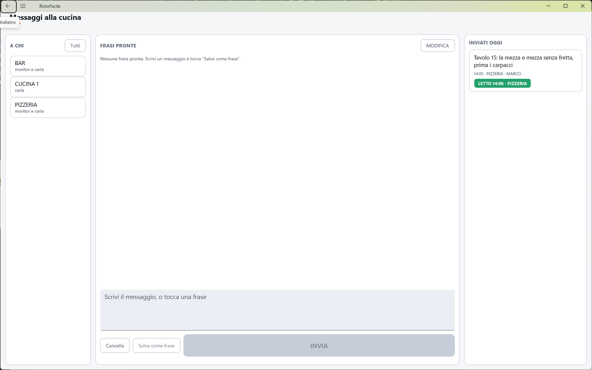

# Messaggi alla cucina

Serve a mandare un messaggio scritto a una o più cucine (i centri di produzione): «accelerare il
12», «il 7 è arrivato», «una forchetta in più al 4». Il messaggio arriva sul monitor di cucina o
esce su carta, e da qui si vede se è stato letto. La usano il cassiere e il responsabile di sala.

!!! info "In sintesi"

    - **Dove si trova:** Menu ▸ Vendita, pulsante **Messaggi** nella barra in basso della [Mappa della sala](mappa-sala.md)
    - **Chi la usa:** cassiere / responsabile di sala
    - **Disponibile anche su:** Palmare ([Messaggi](../palmare/messaggi.md))

---

## A cosa serve

In pieno servizio non sempre si può andare in cucina a parlare. Da qui scegli a chi scrivere,
tocchi una frase pronta o scrivi il testo, e tocchi **INVIA**. Sul monitor del centro il
messaggio resta in evidenza finché qualcuno non lo segna come letto; nella colonna di destra lo
vedi passare da **NON LETTO** a **LETTO 20:41 · Mario**. Il messaggio non è legato a un tavolo: se
serve, il numero del tavolo va scritto nel testo.

## Prima di cominciare

- I centri di produzione e il loro tipo (monitor, carta o entrambi) si impostano in
  [Centri di produzione](centri-di-produzione.md).
- Per i centri su carta serve la stampante del centro (o quella del preconto, che fa da ripiego),
  in [Impostazioni](impostazioni.md).

## La schermata

La schermata ha tre colonne.

- **A CHI** (sinistra): una tessera per ogni centro di produzione attivo, con il nome e, sotto, dove
  arriva il messaggio (**monitor**, **carta** oppure **monitor e carta**). Il centro scelto ha il
  bordo arancione e il segno di spunta. In alto il pulsante **Tutti**. Se c'è un solo centro, è già
  scelto.
- **FRASI PRONTE** (centro): l'elenco delle frasi pronte, con il pulsante **MODIFICA** in alto; sotto,
  la casella del messaggio («Scrivi il messaggio, o tocca una frase») e i pulsanti **Cancella**,
  **Salva come frase** e **INVIA**.
- **INVIATI OGGI** (destra): i messaggi mandati, dal più recente, con testo, ora, centro, chi l'ha
  scritto e lo stato.

## Campi e indicatori

| Elemento | Descrizione |
|---|---|
| **Tessera del centro** | Nome del centro e dove riceve: **monitor**, **carta** o **monitor e carta**. Tocca per sceglierlo o toglierlo; se ne possono scegliere più di uno. |
| **Casella del messaggio** | Testo libero, fino a 500 caratteri. Toccare una frase pronta la aggiunge in fondo al testo già scritto. |
| **Frasi pronte** | Frasi salvate, le stesse per tutte le casse e i palmari del locale. |
| **Messaggio inviato** | Testo (fino a tre righe), poi ora · centro · mittente (es. «20:35 · Cucina · MARCO»), poi lo stato. Con più centri scelti compare un messaggio per centro. |
| **NON LETTO** (giallo) | Il messaggio è sul monitor del centro e nessuno l'ha ancora segnato come letto. |
| **LETTO 20:41 · Mario** (verde) | Letto dal monitor, con l'ora e il nome di chi l'ha segnato. |
| **STAMPATO** (grigio) | Centro solo su carta: il foglietto è uscito. Su questi centri «letto» non arriva mai. |
| **NON STAMPATO** (giallo) | Centro solo su carta: il foglietto non è uscito. |

Lo stato si aggiorna da solo ogni pochi secondi finché la schermata è aperta.

## Pulsanti e comandi

| Comando | Effetto |
|---|---|
| **Tutti** | Sceglie tutti i centri; se erano già tutti scelti, li toglie tutti. |
| **Tocco su una frase** | Aggiunge la frase alla casella del messaggio. In modifica, invece, la cancella dall'elenco (la **X** rossa lo indica). |
| **MODIFICA** / **FATTO** | Entra ed esce dalla modifica delle frasi pronte. |
| **Cancella** | Svuota la casella del messaggio. |
| **Salva come frase** | Aggiunge il testo della casella alle frasi pronte. Spento con la casella vuota. |
| **INVIA** | Manda il messaggio ai centri scelti: compare in **INVIATI OGGI**, sui monitor dei centri e, per i centri su carta, esce il foglietto. Spento con la casella vuota. |

## Come si fa

### Mandare un messaggio alla cucina

1. In **A CHI** tocca il centro (es. «Cucina»), o **Tutti**.
2. Tocca una frase pronta (es. «Accelerare») e completa il testo (es. «Accelerare il 12»).
3. Tocca **INVIA**. La casella si svuota e il messaggio compare in **INVIATI OGGI** come **NON
   LETTO** (o **STAMPATO** per i centri su carta).
4. Quando in cucina lo segnano come letto, lo stato diventa **LETTO** con l'ora e il nome.

### Preparare le frasi pronte

1. Scrivi la frase nella casella (es. «Tavolo arrivato»).
2. Tocca **Salva come frase**. La frase compare nell'elenco.
3. Per toglierne una tocca **MODIFICA**, tocca la frase da eliminare e poi **FATTO**.

## Controlli e messaggi

| Messaggio | Causa | Cosa fare |
|---|---|---|
| *Scegli almeno un centro di produzione a cui mandare il messaggio.* | **INVIA** senza nessun centro scelto. | Tocca almeno un centro in **A CHI**. |
| *Messaggio inviato, ma il foglietto non e' uscito:* (seguito dal centro e dal motivo, es. *Bar: nessuna stampante configurata.*) | Il messaggio è registrato ma la stampa sul centro non è riuscita. | Controlla la stampante del centro; avvisa a voce. |
| *Il messaggio non e' partito.* (seguito dal dettaglio) | Il servizio non ha accettato il messaggio. | Riprova; se persiste, controlla il collegamento. |
| *La frase c'e' gia'.* | **Salva come frase** con una frase già presente. | Nessuna azione. |
| *Non e' stato possibile salvare le frasi.* (seguito dal dettaglio) | Il servizio non ha salvato l'elenco delle frasi. | Riprova. |
| *Il servizio non conosce ancora i messaggi alla cucina: va aggiornato.* | Il servizio installato è più vecchio della cassa: **INVIA** resta spento. | Fai aggiornare il servizio RistoFacile. |
| *Impossibile caricare:* (seguito dal dettaglio) | Il servizio non risponde. | Esci e rientra nella schermata. |
| *Nessun centro di produzione attivo.* | Non ci sono centri attivi. | Creali in [Centri di produzione](centri-di-produzione.md). |
| *Nessuna frase pronta. Scrivi un messaggio e tocca "Salva come frase".* | L'elenco delle frasi è vuoto. | Facoltativo: prepara le frasi più usate. |
| *Nessun messaggio mandato oggi.* | Nessun messaggio recente. | Nessuna azione. |

## Note

- Le frasi pronte sono condivise: chi le modifica da una cassa o da un palmare le cambia per tutti.
- La colonna **INVIATI OGGI** mostra i messaggi di tutti, non solo i tuoi. <!-- DA VERIFICARE: il titolo dice "oggi", ma il servizio restituisce i messaggi di oggi e di ieri. Va corretto il titolo o il servizio? -->
- Sul monitor di cucina il messaggio resta in evidenza finché qualcuno non tocca il tasto per segnarlo
  letto: vedi [Monitor di cucina](../kds/monitor.md).
- Sui centri solo su carta non c'è conferma di lettura: lo stato si ferma a **STAMPATO**.

## Vedi anche

- [Mappa della sala](mappa-sala.md)
- [Centri di produzione](centri-di-produzione.md)
- [Monitor di cucina](../kds/monitor.md)
- [Messaggi sul palmare](../palmare/messaggi.md)
