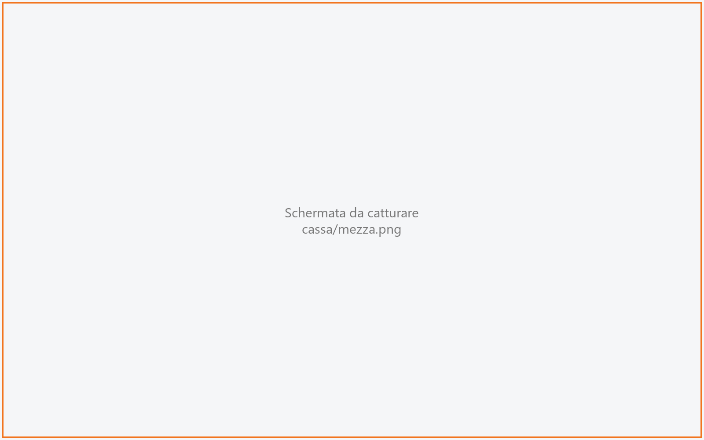

# Componi la pizza

Serve a battere un piatto fatto di più parti, il caso classico è la pizza **mezza e mezza**: si
sceglie un gusto per ogni parte, eventualmente con le sue varianti, e la cassa calcola il prezzo
secondo la regola di composizione (la più cara, la media…). La usano il cassiere e i camerieri.

!!! info "In sintesi"

    - **Dove si trova:** in [Comanda](comanda.md), tessera della combinazione (es. «Mezza e mezza») in cima ai piatti della sezione; per correggere una pizza già battuta, **DETTAGLI** ▸ **Modifica composizione**
    - **Chi la usa:** cassiere / cameriere
    - **Disponibile anche su:** Palmare (dalla [Comanda](../palmare/comanda.md))

---

## A cosa serve

Il cliente chiede «metà Diavola e metà Quattro formaggi». In Comanda, nella sezione delle pizze,
tocchi la tessera della combinazione: si apre questa schermata con due parti vuote. Tocchi
**Diavola**, poi **Quattro formaggi**, e il totale mostra il prezzo della pizza secondo la regola
(es. «Paghi la piu' cara»). Con **AGGIUNGI ALLA COMANDA** la pizza entra in comanda come una riga
sola, con le due metà scritte sotto («½ Diavola», «½ Quattro formaggi»).

## Prima di cominciare

- Le combinazioni (numero di parti, regola di prezzo, supplemento) si creano in
  [Regole di composizione](regole-di-composizione.md). La tessera della combinazione compare solo
  nelle sezioni che contengono articoli della categoria merceologica della regola.
- I gusti proposti sono i piatti attivi della sezione da cui sei partito, esclusi quelli esauriti.
- Le varianti dei gusti: [Varianti](varianti-anagrafica.md).

## La schermata

La schermata ha tre colonne, come la Comanda.

- **A sinistra - COMPOSIZIONE.** Le regole di composizione possibili per quella sezione (es.
  «Mezza e mezza - 2 parti · Paghi la piu' cara», «Tre gusti - 3 parti · Media pesata»); quella in
  uso ha il bordo arancione. In fondo il pulsante **Annulla**.
- **Al centro - i gusti.** Una tessera per piatto con nome e prezzo; **ULTIME n** sui piatti che
  stanno finendo. Dopo la prima parte, in cima può comparire una riga che spiega perché l'elenco si
  è accorciato (vedi «Campi e indicatori»).
- **A destra - la pizza.** Il nome della regola e il dettaglio (es. «2 parti · Paghi la piu'
  cara»), poi una riga per parte: la frazione (**1/2**, **2/2**…), il gusto scelto con il suo
  prezzo, le varianti in arancione e il pulsante **VARIANTI**. Sotto: gli eventuali supplementi, il
  **Totale** e il pulsante **AGGIUNGI ALLA COMANDA** (in modifica **SALVA MODIFICHE**).

## Campi e indicatori

| Elemento | Descrizione |
|---|---|
| **Regole di composizione** (colonna sinistra) | Nome della regola, numero di parti e regola di prezzo. Tocca un'altra regola per cambiarla al volo: le parti già scelte restano (fino al nuovo numero di parti), con le loro varianti. |
| **1/2**, **2/2**… | La frazione di ogni parte. |
| **Tocca un gusto** | Compare sulla parte che verrà riempita dal prossimo tocco (bordo arancione). Le altre parti vuote dicono «da scegliere». |
| **Tocca il gusto che la sostituisce** | Compare sulla parte piena che hai toccato: il prossimo gusto toccato prende il suo posto. |
| **Varianti della parte** | In arancione sotto il gusto, separate da virgole; quelle a pagamento con il «+». |
| **Solo gusti di Forno pizze: un piatto solo non si prepara in due stazioni.** | Dopo la prima parte l'elenco mostra solo i gusti che vanno allo stesso centro di produzione. Se la prima parte non va in cucina: «Solo gusti che non vanno in cucina, come la prima parte scelta.» |
| **Supplemento composizione € 1,00** | Con la regola «Piu' cara + suppl.»: il supplemento fisso della regola. Sotto compaiono anche le varianti a pagamento («+ Bufala € 1,50»). |
| **Totale** | Prezzo della pizza secondo la regola, varianti comprese. Finché mancano parti dice «manca 1 parte» o «mancano 2 parti». |

Le regole di prezzo possibili sono: **Paghi la piu' cara** (prezzo del gusto più caro), **Media
pesata** (media dei prezzi delle parti), **Piu' cara + suppl.** (il più caro più il supplemento
della regola).

## Pulsanti e comandi

| Comando | Effetto |
|---|---|
| **Tocco su un gusto** | Riempie la prima parte vuota, oppure sostituisce la parte selezionata. |
| **Tocco su una parte** | La seleziona per sostituirla (bordo arancione); toccala di nuovo per deselezionarla. |
| **VARIANTI** | Apre le [Varianti](varianti.md) di quella parte. Compare solo se il gusto ha varianti. |
| **AGGIUNGI ALLA COMANDA** | Mette la pizza in comanda e torna alla Comanda. Resta spento finché tutte le parti non hanno un gusto. |
| **SALVA MODIFICHE** | Al posto di AGGIUNGI quando correggi una pizza già in comanda: aggiorna la stessa riga (nota, omaggio, portata e assegnazione al conto restano). |
| **Annulla** | Torna alla Comanda senza aggiungere né cambiare nulla. |

## Come si fa

### Battere una pizza mezza e mezza

1. In Comanda apri la sezione delle pizze e tocca la tessera della combinazione in cima.
2. Tocca il primo gusto: riempie **1/2**.
3. Tocca il secondo gusto: riempie **2/2**. Il **Totale** mostra il prezzo.
4. Se serve, tocca **VARIANTI** su una parte e scegli le varianti.
5. Tocca **AGGIUNGI ALLA COMANDA**. In comanda compare una riga con i due gusti nel nome e, sotto,
   «½ Diavola» e «½ Quattro formaggi».

### Cambiare un gusto prima di confermare

1. Tocca la parte da cambiare: compare «Tocca il gusto che la sostituisce».
2. Tocca il nuovo gusto. Le varianti della parte sostituita si cancellano.

### Correggere una pizza già battuta

1. In Comanda tocca la riga della pizza, poi **DETTAGLI** ▸ **Modifica composizione**.
2. Si apre questa schermata con le parti e le varianti già scelte.
3. Cambia quello che serve e tocca **SALVA MODIFICHE**.

## Controlli e messaggi

| Messaggio | Causa | Cosa fare |
|---|---|---|
| *Tutte le parti sono gia' assegnate: tocca la parte da sostituire, poi scegli il nuovo gusto.* | Tocco su un gusto con tutte le parti piene. | Tocca prima la parte da cambiare. |
| *Nessun gusto disponibile per questa composizione.* | Nella sezione non ci sono piatti disponibili per la regola. | Controlla la sezione e le [Regole di composizione](regole-di-composizione.md). |
| *Regola di composizione non trovata.* | La regola è stata cancellata nel frattempo. | Torna in Comanda e riprova. |
| *La composizione e' gia' partita per la cucina: da qui non si modifica piu'.* | Modifica di una pizza già inviata. | Stornala e ribattila. |
| *La composizione non e' piu' in comanda.* | La riga è stata tolta da un altro dispositivo. | Torna in Comanda. |
| *Non piu' a menu: Capricciosa. Restano nel piatto; per cambiarle tocca la parte e scegli un altro gusto.* | In modifica, un gusto della pizza non è più nel menu. | Lascialo o sostituiscilo. |
| *Impossibile aggiungere la composizione: nessuna delle parti ha un'aliquota IVA in anagrafica.* | Nessun gusto ha l'aliquota IVA. | Imposta l'aliquota negli [Articoli](articoli.md). |
| *Il piatto e' in comanda, ma queste parti non sono state scritte: …. Aprilo dalla comanda per completarlo, o toglilo e ribattilo.* | Il servizio ha accettato la pizza ma non tutte le parti. | Correggi la pizza da **Modifica composizione** o toglila e ribattila. |
| *Il piatto e' in comanda, ma non e' stato possibile assegnarlo al Conto 2: resta da assegnare.* | Con un conto acceso in Comanda, l'assegnazione non è riuscita. | Assegnala da [Dividi conto](dividi-conto.md). |

## Note

- La pizza va alla cucina dei suoi gusti e prende la portata della sezione dei gusti.
- Se in Comanda era acceso un conto (es. **Conto 2**), la pizza nuova finisce su quel conto.
- In modifica la pizza resta la stessa riga: nota, omaggio e assegnazione ai conti non si perdono.
  Se la riga era offerta resta offerta al nuovo prezzo.

## Vedi anche

- [Comanda](comanda.md)
- [Varianti](varianti.md)
- [Regole di composizione](regole-di-composizione.md)
- [Comanda sul palmare](../palmare/comanda.md)
