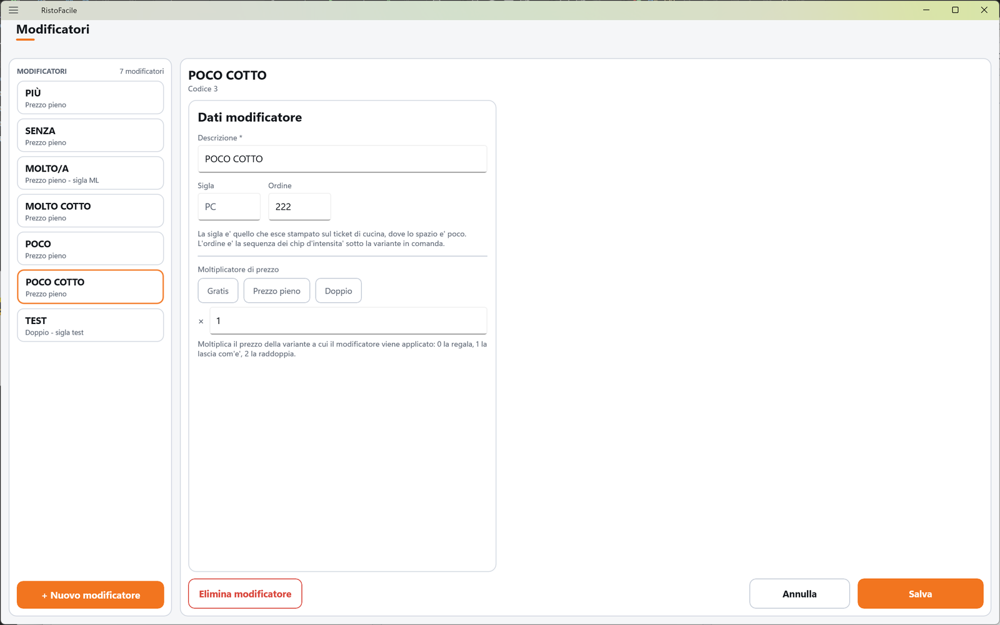

# Modificatori

Un modificatore è un'**intensità** che si aggiunge a una variante: «poco», «molto», «extra».
Qui il titolare li crea e decide quanto ciascuno pesa sul prezzo della variante.

!!! info "In sintesi"

    - **Dove si trova:** Menu ▸ Modificatori
    - **Chi la usa:** titolare / responsabile
    - **Disponibile anche su:** solo cassa (i modificatori si usano anche dal palmare, ma si creano qui)

---

## A cosa serve

Quando il cameriere aggiunge una variante a un piatto (es. «+ mozzarella»), può sceglierne anche
l'intensità: «poca mozzarella», «extra mozzarella». Il modificatore cambia il prezzo della variante
moltiplicandolo: con **Gratis** la variante non si paga, con **Prezzo pieno** resta com'è, con
**Doppio** costa il doppio.

Esempio: «+ mozzarella» costa 1,00 €. Con il modificatore EXTRA a moltiplicatore 1,5 la riga
«+ mozzarella (EXTRA)» costa 1,50 €; con POCO a moltiplicatore 0 non si paga.

Un modificatore non è una nota libera: per le richieste scritte a mano c'è la nota della riga in
Comanda.

## Prima di cominciare

*Nessun prerequisito.* Per usarli servono le [varianti](varianti-anagrafica.md) a cui applicarli.

## La schermata

- **A sinistra, l'elenco**: in alto **MODIFICATORI** e il numero di modificatori; una tessera per
  modificatore con il nome e, sotto, il moltiplicatore (**Gratis**, **Prezzo pieno**, **Doppio** o
  «Molt. 1,5») e la sigla. L'elenco segue l'**ordine** impostato. In fondo **+ Nuovo modificatore**.
- **A destra, la scheda** del modificatore toccato, con la sezione **Dati modificatore**. Finché
  non ne scegli uno compare **Tocca un modificatore** con «Un modificatore e' un'intensita' che
  moltiplica il prezzo di una variante: poco, molto, extra. Non e' una nota libera.»

In fondo alla scheda: **Elimina modificatore** a sinistra, **Annulla** e **Salva** a destra.

## Campi e indicatori

| Elemento | Descrizione |
|---|---|
| **Descrizione \*** | Obbligatoria (es. POCO COTTO, EXTRA), in maiuscolo. È il testo che si aggiunge tra parentesi alla variante sulla riga della comanda. |
| **Sigla** | Abbreviazione di due o tre caratteri (es. PC). «La sigla e' quello che esce stampato sul ticket di cucina, dove lo spazio e' poco.» <!-- DA VERIFICARE: nel codice della cassa la riga della variante stampata porta la Descrizione del modificatore, non la Sigla. Dove viene usata la sigla? --> |
| **Ordine** | La posizione del modificatore fra i pulsanti d'intensità che compaiono sotto la variante in Comanda. Per un modificatore nuovo si propone l'ultimo ordine più 10. |
| **Moltiplicatore di prezzo** | Tre pulsanti rapidi, **Gratis** (0), **Prezzo pieno** (1), **Doppio** (2), e il campo **×** per un valore qualsiasi (es. 1,5). «Moltiplica il prezzo della variante a cui il modificatore viene applicato: 0 la regala, 1 la lascia com'e', 2 la raddoppia.» |

## Pulsanti e comandi

| Comando | Effetto |
|---|---|
| **+ Nuovo modificatore** | Apre una scheda vuota con moltiplicatore 1,00. |
| **Gratis** / **Prezzo pieno** / **Doppio** | Scrivono 0, 1 o 2 nel campo del moltiplicatore. |
| **Salva** | Salva il modificatore. È spento finché la **Descrizione** è vuota. |
| **Annulla** | Rimette la scheda com'era; su un modificatore nuovo, chiude la scheda. |
| **Elimina modificatore** | Elimina il modificatore, dopo conferma. |

## Come si fa

### Creare il modificatore «EXTRA» che costa una volta e mezza

1. Tocca **+ Nuovo modificatore**.
2. In **Descrizione \*** scrivi EXTRA, in **Sigla** EX.
3. Nel campo **×** scrivi 1,5.
4. Tocca **Salva**. Nell'elenco compare EXTRA con «Molt. 1,5 - sigla EX».

### Cambiare l'ordine dei pulsanti d'intensità

1. Tocca un modificatore e cambia il suo **Ordine** (numeri più bassi vengono prima).
2. Tocca **Salva**. L'elenco si riordina e in Comanda i pulsanti seguono lo stesso ordine.

## Controlli e messaggi

| Messaggio | Causa | Cosa fare |
|---|---|---|
| *La descrizione e' obbligatoria.* | Descrizione vuota. | Scrivi la descrizione. |
| *Il moltiplicatore di prezzo dev'essere un numero maggiore o uguale a zero.* | Moltiplicatore non valido o negativo. | Correggi il valore. |
| *L'ordine dev'essere un numero valido.* | Ordine non numerico. | Scrivi un numero. |
| **Modifiche non salvate** — *La scheda di "…" ha modifiche non salvate. Vuoi abbandonarle?* | Hai cambiato modificatore senza salvare. | **Abbandona** o **Resta qui**. |
| **Elimina modificatore** — *Eliminare definitivamente "…"? Le varianti che lo richiedono resteranno senza intensita' da scegliere.* | Hai toccato **Elimina modificatore**. | **Elimina** o **Annulla**. |
| *Un'altra postazione ha modificato questi dati prima di te: adesso vedi la versione aggiornata, rifai la modifica e salva.* | Modifica concorrente. | Rifai la modifica. |
| *Un'altra postazione ha eliminato questi dati mentre li stavi modificando: non ci sono piu' e non c'e' niente da salvare.* | Eliminato altrove. | Nessuna azione. |
| *Impossibile caricare i modificatori.* / *Impossibile salvare il modificatore.* / *Impossibile eliminare il modificatore.* / *Impossibile proporre il codice del modificatore.* | Il servizio non risponde o rifiuta l'operazione. | Controlla il collegamento e riprova. |

## Note

- Un modificatore non si può disattivare: o c'è o si elimina.
- Il moltiplicatore agisce solo sul prezzo della **variante**, non su quello del piatto.
- Cambiare il moltiplicatore non ritocca le righe già battute: il prezzo della variante si calcola
  quando la si aggiunge alla riga.

## Vedi anche

- [Varianti (anagrafica)](varianti-anagrafica.md)
- [Varianti in Comanda](varianti.md)
- [Comanda](comanda.md)
