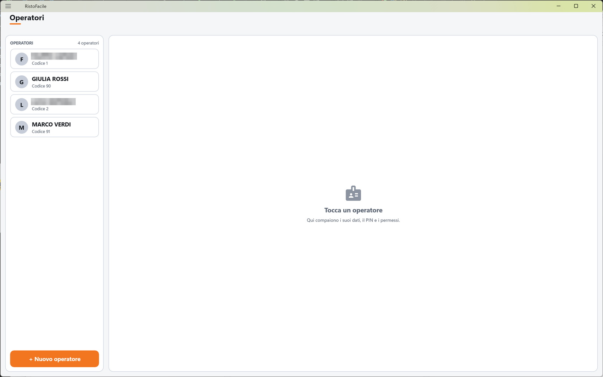
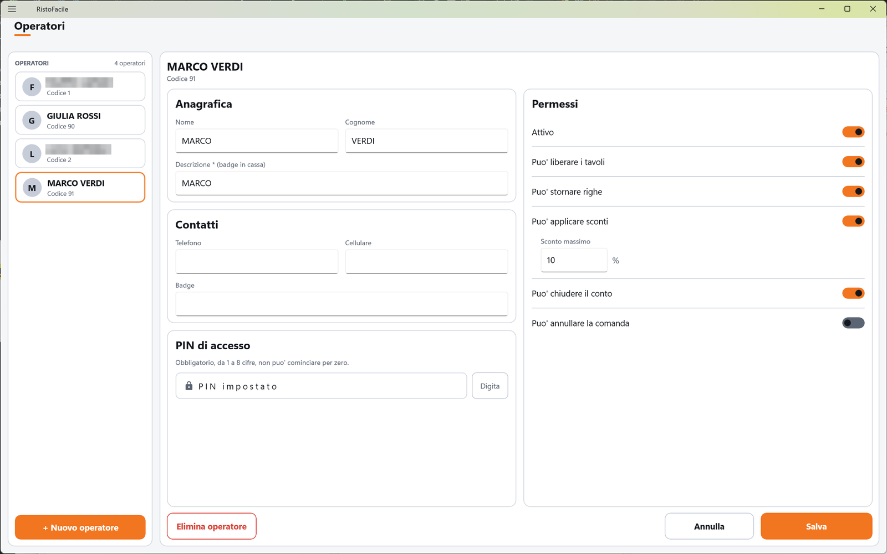

# Operatori

Qui crei e modifichi le persone che usano la cassa e il palmare: il nome con cui compaiono, il PIN
che digitano per entrare e le operazioni delicate che possono fare (sconti, storni, chiusure).
La usa il titolare o il responsabile di sala.

!!! info "In sintesi"

    - **Dove si trova:** Menu ▸ Operatori
    - **Chi la usa:** titolare / responsabile
    - **Disponibile anche su:** solo cassa (il palmare usa gli stessi operatori ma non li modifica)

---

## A cosa serve

Ogni operatore entra in cassa o sul palmare scegliendo il proprio nome e digitando il proprio PIN.
Da quel momento l'app sa chi sta lavorando e gli permette solo quello che la sua scheda consente:
un cameriere nuovo, per esempio, può prendere le comande ma non stornare righe né fare sconti; il
responsabile di sala può fare sconti fino al 20% e chiudere un conto senza scontrino.

Quando un operatore senza permesso tenta un'operazione riservata, l'app lo ferma e gli dice che
il permesso si concede da questa schermata.

## Prima di cominciare

*Nessun prerequisito.*

## La schermata

La schermata è divisa in due colonne.

- **A sinistra, l'elenco.** In alto la scritta **OPERATORI** e il numero di operatori (es.
  «12 operatori»). Sotto, una tessera per operatore, in ordine alfabetico: l'iniziale in un
  cerchio, il nome (nome e cognome, oppure la descrizione se nome e cognome sono vuoti) e il
  codice. Gli operatori disattivati portano la pastiglia rossa **Disattivo**. In fondo il pulsante
  **+ Nuovo operatore**.
- **A destra, la scheda** dell'operatore toccato. Finché non ne scegli uno compare la scritta
  **Tocca un operatore** con «Qui compaiono i suoi dati, il PIN e i permessi.».

La scheda ha in testa il nome dell'operatore (per un operatore nuovo: **Nuovo operatore**) e, sotto,
il codice («Codice 4», oppure «Nuovo - codice 5 proposto»). Il contenuto è su due colonne:

- a sinistra le sezioni **Anagrafica**, **Contatti** e **PIN di accesso**;
- a destra la sezione **Permessi**.

In fondo, sempre visibili anche se la scheda scorre: **Elimina operatore** a sinistra,
**Annulla** e **Salva** a destra.

## Campi e indicatori

| Elemento | Descrizione |
|---|---|
| **Nome** | Nome di battesimo. Facoltativo. |
| **Cognome** | Facoltativo. Nome e cognome, se ci sono, sono quello che si vede nell'elenco. |
| **Descrizione \* (badge in cassa)** | Obbligatoria. Il nome breve con cui l'operatore compare nella schermata di accesso, nel riquadro dell'operatore in Comanda e nei messaggi dell'app (es. *«MARCO non è abilitato ad applicare sconti.»*). Si scrive in maiuscolo mentre digiti. |
| **Telefono**, **Cellulare** | Recapiti, facoltativi. |
| **Badge** | Codice del badge dell'operatore, facoltativo. <!-- DA VERIFICARE: il campo Badge viene solo salvato; nessuna schermata dell'app lo legge (non si entra col badge). A cosa serve? --> |
| **PIN di accesso** | Obbligatorio, da 1 a 8 cifre, non può cominciare per zero. Si vede solo come pallini; per un operatore che ha già un PIN la casella dice **PIN impostato**, per uno senza **Nessun PIN**. Toccala (o tocca **Digita**) per scriverlo con il tastierino. |
| **Attivo** | Spento, l'operatore non compare più fra quelli che possono entrare e l'accesso gli viene rifiutato. Resta in elenco con la pastiglia **Disattivo**. |
| **Puo' liberare i tavoli** | Permette di liberare un tavolo aperto su cui non è stato battuto nulla. |
| **Puo' stornare righe** | Permette di stornare le righe di una comanda e di una vendita al banco. |
| **Puo' applicare sconti** | Permette lo sconto e l'abbuono sul conto e l'omaggio di una riga. Acceso, mostra sotto il campo **Sconto massimo**. |
| **Sconto massimo** | In %, solo cifre intere. È il tetto dello sconto sul conto, calcolato sullo sconto effettivo (percentuale più abbuono). **Zero vuol dire nessuno sconto**, non «nessun limite». L'omaggio di una riga non tiene conto del tetto. |
| **Puo' chiudere il conto** | Permette di chiudere un conto **senza documento fiscale**, di chiudere un tavolo con il conto a zero e di addebitare il conto in camera (con il collegamento all'hotel). Il normale incasso con scontrino non richiede questo permesso. |
| **Puo' annullare la comanda** | Permette di annullare una vendita al banco e un ordine d'asporto. |

Tutta la riga di un permesso è sensibile al tocco, non solo l'interruttore.

## Pulsanti e comandi

| Comando | Effetto |
|---|---|
| **+ Nuovo operatore** | Apre una scheda vuota con il primo codice libero già proposto. |
| **Digita** | Apre il tastierino del PIN. |
| **Salva** | Salva la scheda. È spento finché la **Descrizione** è vuota. |
| **Annulla** | Rimette la scheda com'era all'ultimo salvataggio; su un operatore nuovo, chiude la scheda. |
| **Elimina operatore** | Cancella l'operatore, dopo conferma. Compare solo su un operatore già salvato. |

Il tastierino del PIN (finestra **PIN di accesso**) ha i tasti da **0** a **9**, **C** che svuota
tutto, il tasto con la freccia che cancella l'ultima cifra, **Annulla** e **Conferma**. Le cifre si
vedono come pallini; si può scrivere anche con la tastiera del PC. Il PIN confermato passa nella
scheda, ma **va salvato con Salva**.

## Come si fa

### Aggiungere un cameriere

1. Tocca **+ Nuovo operatore**.
2. Scrivi **Nome** e **Cognome** e, in **Descrizione \* (badge in cassa)**, il nome breve (es. MARCO).
3. Tocca **Digita**, scrivi il PIN e tocca **Conferma**.
4. Accendi i permessi che gli servono.
5. Tocca **Salva**. Il cameriere compare nell'elenco e può entrare con il suo PIN.

### Cambiare il PIN di un operatore

1. Tocca l'operatore nell'elenco.
2. Tocca **Digita**, scrivi il nuovo PIN e tocca **Conferma**.
3. Tocca **Salva**.

Se non tocchi **Digita**, il PIN esistente resta quello che era.

### Concedere gli sconti fino al 10%

1. Tocca l'operatore.
2. Accendi **Puo' applicare sconti**.
3. In **Sconto massimo** scrivi 10.
4. Tocca **Salva**.

### Togliere l'accesso a chi non lavora più

1. Tocca l'operatore.
2. Spegni **Attivo**.
3. Tocca **Salva**. Nell'elenco compare la pastiglia **Disattivo** e l'operatore non può più entrare.

Disattivare è preferibile a eliminare quando l'operatore ha già lavorato.
<!-- DA VERIFICARE: eliminare un operatore che compare su comande e conti già chiusi è consentito? Cosa succede allo storico? -->

## Controlli e messaggi

| Messaggio | Causa | Cosa fare |
|---|---|---|
| *La descrizione e' obbligatoria.* | Hai salvato senza **Descrizione**. | Compila la descrizione. |
| *Il PIN e' obbligatorio: e' quello che questo operatore digita per entrare.* | Operatore nuovo, o senza PIN, salvato senza PIN. | Tocca **Digita** e scrivi il PIN. |
| *Il PIN non puo' cominciare per zero: in archivio e' un numero, quindi "0123" diventerebbe 123 e "000000" varrebbe 0, cioe' nessun PIN.* | Il PIN comincia con 0. | Scegli un PIN che non cominci per zero. |
| *Il PIN deve essere un numero da 1 a 8 cifre.* | PIN non valido. | Correggi il PIN. |
| **Modifiche non salvate** — *La scheda di "…" ha modifiche non salvate. Vuoi abbandonarle?* | Hai toccato un altro operatore o **+ Nuovo operatore** senza salvare. | **Abbandona** per perdere le modifiche, **Resta qui** per tornare alla scheda. |
| **Elimina operatore** — *Eliminare definitivamente l'operatore "…"? L'operazione non e' reversibile.* | Hai toccato **Elimina operatore**. | **Elimina** per confermare, **Annulla** per rinunciare. |
| *Un'altra postazione ha modificato questi dati prima di te: adesso vedi la versione aggiornata, rifai la modifica e salva.* | Lo stesso operatore è stato modificato da un'altra cassa mentre lo modificavi. | La scheda è già ricaricata: rifai la modifica e salva. |
| *Un'altra postazione ha eliminato questi dati mentre li stavi modificando: non ci sono piu' e non c'e' niente da salvare.* | L'operatore è stato eliminato da un'altra cassa. | Nessuna azione. |
| *Impossibile caricare gli operatori.* / *Impossibile salvare l'operatore.* / *Impossibile eliminare l'operatore.* / *Impossibile determinare il prossimo codice operatore.* | Il servizio non risponde o rifiuta l'operazione; sotto compare il dettaglio. | Controlla il collegamento al servizio e riprova. |

Messaggi che compaiono **altrove** a chi non ha il permesso:

| Messaggio | Dove |
|---|---|
| *… non e' abilitato a liberare i tavoli. Il permesso si da' in Impostazioni -> Operatori.* (e simili per *stornare le righe*, *annullare un ordine*, *annullare una vendita*) | Comanda, Vendita al banco, Asporto |
| *… non e' abilitato ad applicare sconti.* / *… non ha uno sconto massimo impostato: va messo in Impostazioni -> Operatori.* / *Sconto …% oltre il massimo consentito a … (…%).* | Conto |
| *… non e' abilitato a chiudere un conto senza documento fiscale.* | Conto |

Nei messaggi il percorso è indicato come «Impostazioni -> Operatori»: la voce si trova in realtà
direttamente nel menu, **Menu ▸ Operatori**.

## Note

- Il codice dell'operatore è proposto dall'app e non si può cambiare dopo il primo salvataggio.
- Se modifichi l'operatore con cui sei collegato su questa cassa, i nuovi permessi valgono subito.
  Su un'altra cassa o un palmare dove lo stesso operatore è già entrato, i permessi si rileggono
  alla prossima apertura di una comanda o di un conto.
- Il PIN salvato non si può rileggere: la scheda dice solo se c'è (**PIN impostato**).

## Vedi anche

- [Accesso operatore](accesso.md)
- [Conto](conto.md)
- [Comanda](comanda.md)
- [Vendita al banco](vendita-al-banco.md)
- [Asporto e domicilio](asporto.md)
