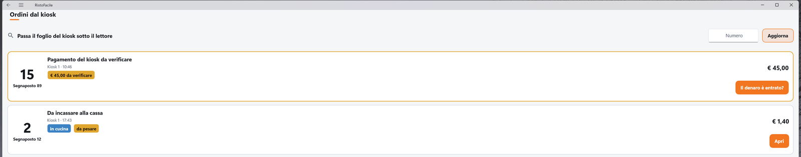
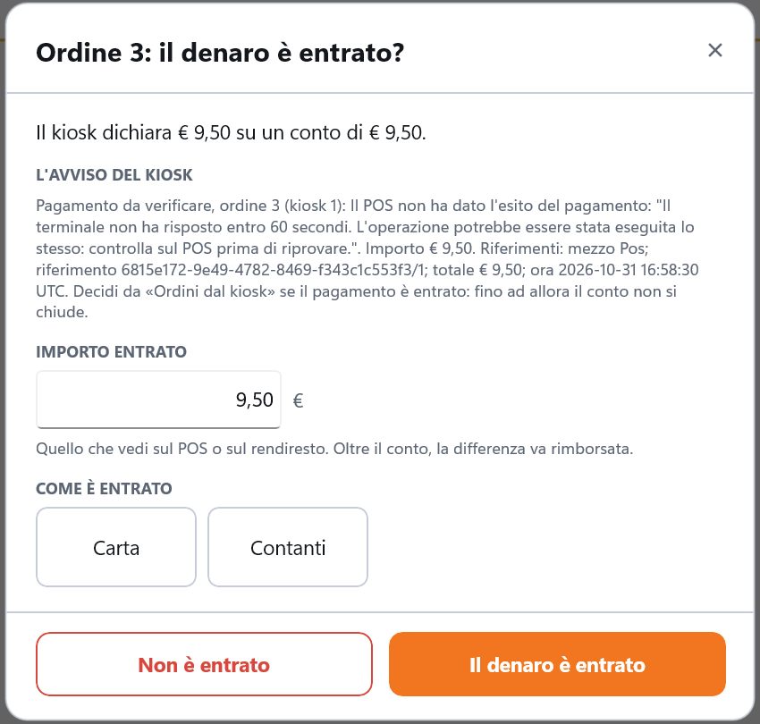
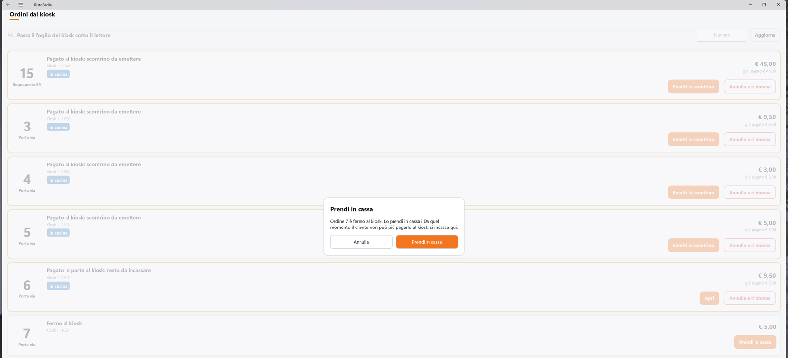
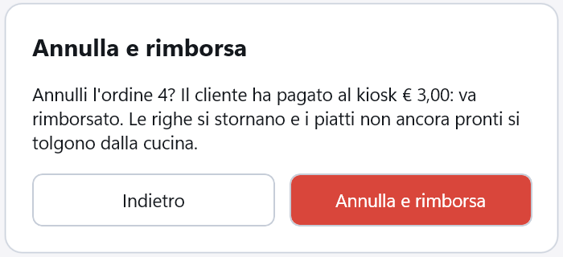

# Ordini dal kiosk

L'elenco degli ordini del kiosk ancora aperti, con quello che ciascuno chiede alla cassa: da
incassare, da verificare, con lo scontrino da emettere, da rimborsare. Da qui il cassiere apre la
comanda di un ordine da incassare, decide se il denaro di un pagamento incerto è entrato, emette lo
scontrino di un ordine già pagato o lo annulla e rimborsa il cliente. Il kiosk non chiede mai alla
cassa soldi che ha già preso: la schermata e il servizio lo impediscono.

!!! info "In sintesi"

    - **Dove si trova:** dalla [Mappa della sala](mappa-sala.md), pulsante **Kiosk** in basso, tocco sul tavolo del kiosk o promemoria del kiosk passato sotto il lettore; da **Apri** su un avviso del kiosk
    - **Chi la usa:** cassiere
    - **Disponibile anche su:** solo cassa (il palmare non apre gli ordini del kiosk)

---

## A cosa serve

Un cliente sceglie **Pago alla cassa** al kiosk: il kiosk stampa il promemoria con il numero 15 e un
QR, e il cliente viene al banco. Passi il promemoria sotto il lettore: si apre questa schermata con
l'ordine 15 in cima, bordato di arancione. Tocchi **Apri**, si apre la sua comanda, tocchi
**CONTO** e incassi come sempre.

Un altro cliente ha pagato con la carta, ma il POS non ha dato l'esito: l'ordine dice
*Pagamento del kiosk da verificare*. Guardi il giornale del POS, vedi l'addebito, tocchi
**Il denaro è entrato?**, scegli **Carta** e confermi: l'ordine va in cucina e lo scontrino esce
senza far pagare di nuovo il cliente.

## Prima di cominciare

- I kiosk configurati dalla voce [Kiosk](kiosk.md), con i tavoli virtuali di «mangio qui» e «porto
  via»: senza, il pulsante **Kiosk** non compare sulla mappa.
- Per leggere il QR del promemoria: un **lettore 2D** collegato alla cassa, programmato come
  tastiera con il suffisso **Invio** (come quello dei segnaposti, vedi
  [Configurazione del kiosk](../kiosk/configurazione.md#collegare-il-lettore-di-qr-dei-segnaposto)).
- Per emettere gli scontrini: la stampante fiscale della postazione, in
  [Impostazioni](impostazioni.md) ▸ **Stampanti fiscali**.
- I permessi dell'operatore, in [Operatori](operatori.md): **Annulla l'ordine** vuole **Puo'
  annullare la comanda**; **Annulla e rimborsa** vuole **Puo' annullare la comanda** e anche
  **Puo' chiudere il conto**. **Apri**, **Prendi in cassa**, **Emetti lo scontrino** e la verifica
  (**Il denaro è entrato** e **Non è entrato**) non chiedono permessi: non fanno uscire denaro.

## La schermata

- **In alto**: *Passa il foglio del kiosk sotto il lettore*, il campo **Numero** per cercare un
  ordine e il pulsante **Aggiorna**.
- **Sotto**, l'esito dell'ultima operazione (per esempio *Ordine 9: annullato.*).
- **L'elenco**: una riga per ordine, dal più urgente (prima il denaro da decidere, poi gli scontrini
  da emettere, poi gli incassi; gli ordini ancora in mano al cliente in fondo) e, a parità, dal più
  vecchio: gli ordini di un altro giorno stanno in cima fra quelli del loro stato. Senza ordini:
  *Nessun ordine del kiosk aperto.*

Ogni riga mostra:

- a sinistra il **numero** dell'ordine, grande, e sotto dove va: **Segnaposto 12** o **Porta via**;
  per un ordine di un altro giorno, sotto il numero anche la data (per esempio *31/10*), perché il
  numero riparte ogni giorno e un ordine vecchio rimasto aperto può avere lo stesso numero di uno
  di oggi;
- al centro lo **stato** (vedi la tabella), il kiosk e l'ora (*Kiosk 1 · 17:43*) e i bollini:
  **€ … da verificare**, **in cucina**, **da pesare**, **conto aperto in cassa**;
- a destra il **totale** e, se il cliente ha già pagato al kiosk, *già pagato € …*;
- in basso a destra i pulsanti che lo stato permette.

Gli ordini che aspettano la cassa adesso (da verificare, scontrino, resto, non pagato) hanno il
bordo ambra; quello cercato con il QR o aperto da un avviso sta in cima con il bordo arancione.
L'elenco si aggiorna da solo ogni 10 secondi, senza ridisegnarsi se non cambia niente.

**Il denaro è entrato?** apre la finestra della verifica: in testa quanto dichiara il kiosk (*Il
kiosk dichiara € 9,50 su un conto di € 9,50.*), sotto **L'AVVISO DEL KIOSK** con il testo
dell'avviso, **IMPORTO ENTRATO** e **COME È ENTRATO** (**Carta** o **Contanti**), e i pulsanti
**Non è entrato** e **Il denaro è entrato**.

## Campi e indicatori

### Gli stati

| Stato (a video) | Che cosa vuol dire | Pulsanti |
|---|---|---|
| **Pagamento del kiosk da verificare** | Il kiosk non sa se il cliente ha pagato (POS senza esito, rendiresto incerto, contanti trattenuti, ordine scaduto mentre pagava). Finché non decidi, il conto non si chiude in nessun modo. | **Il denaro è entrato?** |
| **Pagato al kiosk: scontrino da emettere** | Il cliente ha pagato tutto al kiosk e l'ordine è in cucina, ma lo scontrino non è uscito. | **Emetti lo scontrino**, **Annulla e rimborsa** |
| **Pagato in parte al kiosk: resto da incassare** | Al kiosk è entrata solo una parte (per esempio contanti trattenuti, verificati come entrati). | **Apri** per incassare il resto, **Annulla e rimborsa** |
| **In cucina, non pagato** | Un «paga alla cassa» mandato in cucina subito e scaduto senza passare dalla cassa. | **Apri** |
| **Da incassare alla cassa** | Un «paga alla cassa», un ordine preso dalla cassa o un pagamento dato per non entrato. | **Apri**; **Annulla l'ordine** solo se non è in cucina, non ha denaro del kiosk e il conto non si sta incassando |
| **Fermo al kiosk** | L'ordine è confermato al kiosk ma non pagato: il cliente è ancora davanti al kiosk, o se n'è andato. | **Prendi in cassa** |
| **Al kiosk il cliente sta pagando** | Il pagamento al kiosk è in corso. | nessuno: aspetta l'esito |

### I bollini

| Elemento | Descrizione |
|---|---|
| **€ … da verificare** | Il denaro del kiosk ancora da verificare. |
| **in cucina** | Almeno una riga è già partita per la cucina. |
| **da pesare** | Ci sono articoli a peso con il peso indicativo del kiosk: si pesano in comanda prima del conto. |
| **conto aperto in cassa** | Una postazione ha già cominciato a incassare questo ordine. |
| **già pagato € …** | Il denaro che il kiosk ha già preso. |

### La verifica

| Elemento | Descrizione |
|---|---|
| Riga dell'importo dichiarato | *Il kiosk dichiara € … su un conto di € ….* Quando il kiosk non ha letto l'importo, in un riquadro ambra: *Il kiosk non ha letto l'importo: ha segnato € …, che è il totale dell'ordine, non quello che il cliente ha messo. Guarda il POS o il rendiresto e scrivi quanto è entrato davvero.* |
| **L'AVVISO DEL KIOSK** | Il testo dell'avviso del pagamento, con il motivo e i riferimenti dell'operazione. |
| **IMPORTO ENTRATO** | *Quello che vedi sul POS o sul rendiresto. Oltre il conto, la differenza va rimborsata.* È proposto l'importo dichiarato dal kiosk; vuoto se il kiosk non lo conosceva. |
| **COME È ENTRATO** | **Carta** o **Contanti**: va scelto ogni volta. |

## Pulsanti e comandi

| Comando | Effetto |
|---|---|
| **Numero** | Mostra solo gli ordini il cui numero comincia con le cifre scritte. Per i kiosk senza stampante termica, che non stampano il promemoria: il cliente dice il suo numero. |
| **Aggiorna** | Rilegge subito l'elenco. |
| QR del promemoria sotto il lettore | Mette l'ordine in cima, con il bordo arancione, e svuota il campo **Numero**. |
| **Apri** | Rilegge l'ordine e apre la sua [comanda](comanda.md), sempre quella giusta (mai una comanda nuova sul tavolo virtuale). Se intanto l'ordine è cambiato lo dice e aggiorna l'elenco. |
| **Prendi in cassa** | Chiede conferma, poi prende l'ordine fermo al kiosk e apre la sua comanda: da quel momento il kiosk non lo incassa più. |
| **Emetti lo scontrino** | Chiude il conto con quello che il cliente ha pagato al kiosk ed emette lo scontrino, senza importi nuovi. |
| **Il denaro è entrato?** | Apre la verifica. |
| **Il denaro è entrato** (verifica) | Chiede conferma con l'importo e il mezzo (**Sì, è entrato** / **Indietro**), poi registra il pagamento. |
| **Non è entrato** (verifica) | Chiede conferma (**Non è entrato** / **Indietro**): l'ordine diventa da incassare alla cassa. |
| **X** o tocco fuori (verifica) | Chiude la verifica senza decidere. |
| **Annulla l'ordine** | Con il permesso **Puo' annullare la comanda**: chiede conferma (**Annulla l'ordine** / **Indietro**), poi storna le righe e chiude l'ordine senza documento: non va in cucina. Senza permesso il pulsante c'è, ma il tocco dice quale permesso manca. |
| **Annulla e rimborsa** | Con i permessi **Puo' annullare la comanda** e **Puo' chiudere il conto**: chiede conferma (**Annulla e rimborsa** / **Indietro**), poi storna le righe, toglie dalla cucina i piatti non ancora pronti, chiude l'ordine senza documento e lascia l'avviso del rimborso. |

## Come si fa

### Incassare un ordine «paga alla cassa»

1. Il cliente arriva con il promemoria: passalo sotto il lettore, sulla mappa della sala o in questa
   schermata. Senza promemoria, scrivi il suo numero nel campo **Numero**.
2. L'ordine compare in cima con il bordo arancione: tocca **Apri**.
3. Si apre la comanda dell'ordine. Se una riga dice **DA PESARE**, pesala (vedi
   [Comanda](comanda.md#un-ordine-del-kiosk-con-gli-articoli-a-peso)).
4. Tocca **CONTO** e incassa come sempre (vedi [Conto](conto.md)): niente coperto né servizio.
5. Con l'invio in cucina **dopo**, le righe partono per la cucina al primo **INCASSA**.
6. A chiusura riuscita torni a questa schermata e l'ordine non c'è più.

### Decidere un pagamento da verificare

1. Controlla la periferica: il **giornale del POS** se l'addebito c'è; il **rendiresto** quanto ha
   incassato e restituito per quell'ordine.
2. Tocca **Il denaro è entrato?** sull'ordine.
3. Se il denaro c'è: scrivi in **IMPORTO ENTRATO** quello che vedi sul POS o sul rendiresto,
   scegli **Carta** o **Contanti** e tocca **Il denaro è entrato**, poi **Sì, è entrato**.
4. Se l'importo copre il conto, l'ordine va in cucina ed esce lo scontrino: *Ordine 3: scontrino
   n. … emesso.* Se è di più, la conferma lo dice (*… € … vanno rimborsati al cliente.*) e nasce
   l'avviso del rimborso.
5. Se non copre, la cassa dice *Ordine 18: pagamento verificato. Resta da incassare € 3,00: apro la
   comanda, incassalo da CONTO.* e apre la comanda: tocca **CONTO** e incassa il resto.
6. Se il denaro non c'è: tocca **Non è entrato**, poi di nuovo **Non è entrato**. L'ordine diventa
   *Da incassare alla cassa*: il cliente paga in cassa con **Apri**.

### Emettere lo scontrino di un ordine pagato al kiosk

1. Sull'ordine *Pagato al kiosk: scontrino da emettere* tocca **Emetti lo scontrino**.
2. Lo scontrino esce sulla stampante di questa postazione (o su quella su cui era già cominciato):
   *Ordine 27: scontrino n. … emesso.* Consegnalo al cliente con i piatti.
3. Se la stampante non sa dire se lo scontrino è uscito, compare **Scontrino: esito incerto**:
   guarda la stampante e tocca **È uscito** o **Non è uscito**. Con **Guardo dopo** lo scontrino
   resta in sospeso: quando hai guardato, tocca di nuovo **Emetti lo scontrino**.

### Prendere in cassa un ordine fermo al kiosk

Serve quando un cliente lascia il kiosk a metà del pagamento (il POS ha rifiutato, ha cambiato idea)
e viene a pagare al banco.

1. Sull'ordine *Fermo al kiosk* tocca **Prendi in cassa**.
2. Conferma con **Prendi in cassa** il messaggio *Ordine 7 è fermo al kiosk. Lo prendi in cassa? Da
   quel momento il cliente non può più pagarlo al kiosk: si incassa qui.*
3. Si apre la comanda dell'ordine: incassalo dal **CONTO**.
4. Al kiosk, se il cliente prova a pagarlo, legge *Questo ordine si paga alla cassa.*

### Annullare un ordine non pagato

Per un «paga alla cassa» che il cliente non è venuto a pagare, o un ordine preso in cassa e poi
lasciato.

1. Sull'ordine *Da incassare alla cassa* tocca **Annulla l'ordine**.
2. Conferma *Annulli l'ordine 9 (€ 5,00)? Le righe si stornano e l'ordine non va in cucina.* con
   **Annulla l'ordine**.
3. Compare *Ordine 9: annullato.* e l'ordine esce dall'elenco.

Un ordine già in cucina non si annulla: si incassa.

### Annullare e rimborsare un ordine pagato al kiosk

1. Sull'ordine pagato (*scontrino da emettere* o *resto da incassare*) tocca **Annulla e rimborsa**.
2. Conferma con **Annulla e rimborsa**.
3. Compare *Ordine 4: annullato. Rimborsa € 3,00 al cliente (l'avviso del rimborso resta finché non
   lo segni visto).* e in alto l'avviso 💶 *Ordine 4 annullato dalla cassa (MARCO): rimborsa
   € 3,00 (pagati al kiosk con la carta).*, con il nome dell'operatore che l'ha annullato.
4. Rimborsa il cliente: la carta si storna sul POS, i contanti si rendono a mano.
5. **Solo dopo aver rimborsato davvero**, tocca **Visto** sull'avviso e rispondi **Sì, fatto**: il
   servizio segna il denaro come rimborsato e l'avviso sparisce da tutte le postazioni. Se il
   servizio non riesce a registrarlo, l'avviso resta con *Rimborso non registrato: riprova fra
   poco. L'avviso resta: riprova con «visto».*

È l'unico modo di chiudere senza documento un ordine pagato al kiosk.

## Controlli e messaggi

| Messaggio | Causa | Cosa fare |
|---|---|---|
| *Ordine del kiosk non trovato o già chiuso* | Hai passato il QR di un ordine chiuso o che non c'è. | Nessuna azione: l'ordine è già incassato o annullato. |
| *Ordini del kiosk non letti dal servizio.* | Il servizio non risponde. | Controlla il collegamento e tocca **Aggiorna**. |
| *Elenco non aggiornato: il servizio non risponde.* | L'aggiornamento automatico non è riuscito. | L'elenco riprova da solo; controlla il collegamento. |
| *Nessun ordine con il numero «…».* | Il numero cercato non c'è fra gli ordini aperti. | Controlla il numero, o svuota il campo. |
| *Ordine …: già chiuso.* / *Ordine …: già chiuso o non più fra gli ordini del kiosk.* | L'ordine è stato chiuso intanto (anche da questa stessa operazione, se la risposta si è persa). | Nessuna azione: l'elenco è aggiornato. |
| *Ordine … è cambiato: …. L'elenco è aggiornato.* | Fra l'ultimo giro e il tocco su **Apri** l'ordine ha cambiato stato. | Guarda lo stato nuovo e usa i suoi pulsanti. |
| *Ordine …: … non ha avuto risposta dal servizio. Se l'ordine non è più nell'elenco è stato chiuso; altrimenti riprova.* | La risposta del servizio si è persa. | Ripeti: non si emette due volte e non si rimborsa due volte. |
| *Al kiosk il cliente sta pagando: aspetta l'esito* | Il cliente sta pagando al kiosk. | Aspetta: l'ordine cambia stato da solo. |
| *L'ordine non è fermo al kiosk: aggiorna l'elenco* | **Prendi in cassa** su un ordine che intanto è cambiato. | Tocca **Aggiorna**. |
| *Questo ordine non ha uno scontrino da emettere: aggiorna l'elenco* / *Questo ordine non ha un pagamento da verificare: aggiorna l'elenco* / *Questo ordine non si annulla da qui: aggiorna l'elenco* | Il pulsante non vale più per lo stato dell'ordine. | Tocca **Aggiorna**. |
| *Su questo ordine c'è denaro del kiosk: usa «Annulla e rimborsa»* | **Annulla l'ordine** su un ordine con denaro del kiosk. | Usa **Annulla e rimborsa**, o decidi prima la verifica. |
| *L'ordine è già in cucina: incassalo, non si annulla* | **Annulla l'ordine** su un ordine già in cucina. | Incassalo. |
| *Il conto si sta incassando da una postazione: finisci prima l'incasso* | Un'altra postazione ha già cominciato a incassare l'ordine. | Finisci l'incasso da lì. |
| *«Annulla e rimborsa» vale solo per gli ordini pagati al kiosk: aggiorna l'elenco* | L'ordine non ha più denaro del kiosk. | Tocca **Aggiorna**. |
| *C'è uno scontrino in sospeso per questo ordine: risolvilo prima con «Emetti lo scontrino»* | Lo scontrino dell'ordine è in sospeso: potrebbe essere uscito. | Tocca **Emetti lo scontrino** e rispondi alla domanda sull'esito. |
| *L'ordine non si è potuto annullare: riprova* | Il servizio non ha potuto chiudere l'ordine. | Riprova. |
| *Ordine …: lo scontrino non è uscito. Riprova con «Emetti lo scontrino».* (o il messaggio della stampante) | La stampante fiscale ha rifiutato o non risponde. | Risolvi il problema della stampante e tocca di nuovo **Emetti lo scontrino**. |
| *Ordine …: nessuna stampante fiscale sull'impianto, lo scontrino non si emette da qui.* | Sull'impianto non c'è una stampante fiscale. | Configurala in [Impostazioni](impostazioni.md). |
| *Ordine …: … Lo scontrino non è uscito: scegli un'altra stampante per questa postazione in Impostazioni, o emettilo da un'altra cassa con «Emetti lo scontrino».* | La stampante fiscale di questa postazione non è più configurata; la prima parte del messaggio dice quale. | Scegli un'altra stampante in [Impostazioni](impostazioni.md) ▸ **Stampanti fiscali**, o emetti da un'altra cassa. |
| *Ordine …: scontrino n. … emesso. Se non è su questa stampante è uscito su quella del kiosk o di un'altra postazione: consegnalo con i piatti.* | Lo scontrino era già stato cominciato altrove. | Cerca lo scontrino su quella stampante. |
| *Ordine …: lo scontrino resta in sospeso. Quando hai guardato la stampante, concludi con «Emetti lo scontrino».* | Hai risposto **Guardo dopo** sull'esito incerto. | Guarda la stampante, poi **Emetti lo scontrino**. |
| *Pagamento verificato, ma lo scontrino non è uscito: riprova con «Emetti lo scontrino».* | La verifica è registrata, la stampante no. | Tocca **Emetti lo scontrino**. |
| *Scrivi quanto è entrato: l'importo che vedi sul POS o sul rendiresto.* | **Il denaro è entrato** senza importo. | Scrivi l'importo. |
| *Scegli come è entrato il denaro: con la carta o in contanti.* | Mezzo non scelto. | Tocca **Carta** o **Contanti**. |
| **Il denaro è entrato** — *Confermi che per l'ordine … sono entrati € … con la carta?* | Conferma della verifica; dice anche se c'è da rimborsare o da incassare il resto. | **Sì, è entrato** o **Indietro**. |
| **Il denaro non è entrato** — *Al kiosk il cliente non ha pagato l'ordine …? L'ordine passa da incassare alla cassa.* | Conferma di **Non è entrato**. | **Non è entrato** o **Indietro**. |
| *Ordine …: chiuso. Se l'hai annullato tu, rimborsa il cliente: la somma è nell'avviso 💶 del rimborso.* | La risposta di **Annulla e rimborsa** si è persa, ma l'ordine è chiuso. | Rimborsa la somma dell'avviso. |
| *MARCO non e' abilitato a annullare un ordine del kiosk (permesso «Puo' annullare la comanda»). Il permesso si da' in Impostazioni -> Operatori.* | **Annulla l'ordine** senza il permesso. | Fallo fare a un operatore abilitato, o dai il permesso in [Operatori](operatori.md). |
| *MARCO non e' abilitato a annullare e rimborsare un ordine del kiosk (permessi «Puo' annullare la comanda» e «Puo' chiudere il conto»). …* | **Annulla e rimborsa** senza uno dei due permessi. | Come sopra. |
| *Nessun operatore collegato: per … serve un operatore abilitato.* | Nessun operatore in turno. | Entra con il tuo PIN. |
| *C'e' un incasso in corso su questo conto: finiscilo prima, poi apri l'avviso.* | Hai toccato **Apri** su un avviso mentre il conto sotto sta incassando (POS, cassa automatica, scontrino). Il conto resta. | Finisci l'incasso, poi tocca di nuovo **Apri**. |

## Note

- **Un ordine preso dalla cassa non scade.** Gli ordini «paga alla cassa» non pagati si annullano
  da soli dopo i minuti della scadenza; un ordine preso con **Prendi in cassa** no. Se il cliente se
  ne va, annullalo tu con **Annulla l'ordine**.
- **Preso anche se l'incasso non riesce.** Quando la cassa incassa un ordine fermo al kiosk, prima
  lo prende: se poi l'incasso non va (stampante spenta, carta rifiutata), l'ordine resta preso dalla
  cassa e il kiosk non lo può più pagare. Si finisce dalla cassa.
- **Gli ordini del kiosk non si liberano.** Il tocco sul loro tavolo porta qui, e il servizio rifiuta
  di liberarli in altro modo (*Gli ordini del kiosk si annullano da «Ordini dal kiosk»*): si chiudono
  incassandoli, con **Annulla l'ordine** o con **Annulla e rimborsa**.
- **Le righe trattenute partono al primo incasso.** Con l'invio in cucina **dopo**, le righe di un
  «paga alla cassa» partono per la cucina alla prima chiusura tentata dalla cassa: con
  **INCASSA E STAMPA** anche se subito dopo la stampante fiscale non risponde e il conto resta
  aperto, e anche con **CHIUDI SENZA DOCUMENTO**. Per non farle partire, l'ordine va annullato con
  **Annulla l'ordine**.
- **Gli ordini del kiosk non si spostano.** Sposta, unisci e separa non valgono mai su un ordine del
  kiosk, nemmeno dopo l'incasso o il via in cucina: *Gli ordini del kiosk non si spostano, non si
  uniscono e non si separano: gestiscili da «Ordini dal kiosk»*.
- **Un pagato che non basta più.** Se il totale di un ordine pagato al kiosk sale sopra quello che il
  cliente ha pagato, l'ordine passa da *scontrino da emettere* a *Pagato in parte al kiosk: resto da
  incassare*: la differenza si incassa dal conto.
- **Dopo «Annulla e rimborsa»** i piatti non ancora pronti si tolgono dal monitor di cucina; quelli
  già pronti o serviti restano preparati (le loro righe sono stornate, quindi non compaiono più né
  sul monitor di cucina né fra le [Chiamate](chiamate.md)). Avvisa la cucina.
- **Il denaro in eccesso** (verifica oltre il conto, pagamento arrivato su un ordine già chiuso,
  storno dopo il pagamento) non lo restituisce il kiosk: compare l'avviso 💶 del rimborso e lo rendi
  tu (vedi [Pagamenti, per il personale](../kiosk/pagamenti.md)).
- **Il «visto» del rimborso registra il rimborso.** Con **Sì, fatto** sull'avviso 💶 il servizio
  segna quel denaro come rimborsato: daglielo solo dopo aver reso davvero i soldi al cliente. Un
  secondo rimborso sulla stessa comanda (per esempio un pagamento arrivato dopo l'annullo) ha un
  avviso a sé, con il suo «visto».
- **Un limite molto lontano: i posti del tavolo virtuale.** Ogni ordine del kiosk occupa un posto
  del suo tavolo virtuale anche dopo la chiusura; finiti i posti (decine di migliaia di ordini sullo
  stesso tavolo) il servizio riusa quello di un ordine chiuso, il più vecchio fra quelli che non
  hanno più denaro aperto (un rimborso non ancora segnato visto, una verifica da decidere). Il
  tavolo smette di aprire ordini nuovi solo se **tutte** le sue comande chiuse hanno denaro aperto.
  Il denaro di un pagamento arrivato su un ordine già chiuso resta aperto anche dopo il visto, ma
  occupa solo il posto di quell'ordine.
  In quel caso chiudi i casi in sospeso (rimborsa e segna visto gli avvisi 💶, decidi le verifiche)
  oppure scegli per i kiosk un altro tavolo virtuale in [Kiosk](kiosk.md).
- **Un pagamento arrivato tardi.** Se il kiosk registra il pagamento di un ordine che avevi dato per
  non entrato, l'ordine torna da verificare e compare l'avviso *Il kiosk ha registrato il pagamento
  dell'ordine … dopo che era stato dato per non entrato: controlla prima di incassare.*
- **La carta del POS di questa cassa.** Se la carta passa sul POS della cassa e poi il conto non si
  può chiudere con lei (il kiosk ha registrato il pagamento intanto, o il conto l'ha chiuso un'altra
  postazione), la cassa chiede di stornarla: vedi [Conto](conto.md#carta-da-stornare).
- **Chi ha fatto cosa.** Verifica, **Annulla l'ordine** e **Annulla e rimborsa** mandano al
  servizio anche l'operatore della cassa: il suo nome resta nel registro del servizio e negli
  avvisi di rimborso.
- **Il lettore** ascolta in questa schermata e sulla mappa della sala, non al banco. Un codice che
  non è un promemoria del kiosk (per esempio il QR di un segnaposto) non fa niente.

## Vedi anche

- [Kiosk](kiosk.md)
- [Mappa della sala](mappa-sala.md)
- [Comanda](comanda.md)
- [Conto](conto.md)
- [Pagamenti, per il personale](../kiosk/pagamenti.md)
- [Chiamate](chiamate.md)
