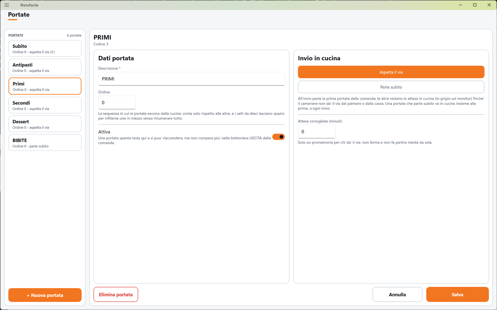

# Portate

Le portate sono le **uscite** del servizio: antipasti, primi, secondi, dolci. Decidono in che
sequenza i piatti partono per la cucina e quali aspettano il via del cameriere. Qui il titolare le
crea e ne fissa l'ordine.

!!! info "In sintesi"

    - **Dove si trova:** Menu ▸ Portate
    - **Chi la usa:** titolare / responsabile
    - **Disponibile anche su:** solo cassa (le uscite si usano anche dal palmare, ma si creano qui)

---

## A cosa serve

Un tavolo ordina antipasti, primi e secondi in una volta sola. Quando il cameriere invia la
comanda, in cucina parte subito solo la **prima** uscita (gli antipasti); primi e secondi restano in
attesa — in grigio sul [monitor di cucina](../kds/monitor.md) — finché il cameriere non dà il via
dal palmare o dalla cassa. Così la cucina non prepara i secondi mentre il tavolo è ancora agli
antipasti.

Una portata segnata **Parte subito** (per esempio le bevande o il pane) invece va in cucina insieme
alla prima, a ogni invio.

L'elenco delle portate è la bottoniera **USCITA** della [Comanda](comanda.md). Ogni sezione del
[Menu](menu.md) può avere la sua uscita preimpostata, che il cameriere può comunque cambiare piatto
per piatto.

## Prima di cominciare

*Nessun prerequisito.*

## La schermata

- **A sinistra, l'elenco** (**PORTATE** e il numero di portate), in ordine di uscita: ogni tessera
  mostra il nome e, sotto, l'ordine, se parte subito o aspetta il via e l'eventuale attesa (es.
  «Ordine 20 - aspetta il via (10')»). Le portate spente portano la pastiglia **Disattivata**. In
  fondo **+ Nuova portata**.
- **A destra, la scheda** della portata toccata, con **Dati portata** e **Invio in cucina**.
  Finché non scegli nulla compare **Tocca una portata** con «Le portate sono le uscite: decidono in
  che sequenza i piatti partono per la cucina. La bottoniera USCITA della comanda e' questo
  elenco.»

In fondo alla scheda **Elimina portata**, **Annulla** e **Salva**.

## Campi e indicatori

**Dati portata**

| Elemento | Descrizione |
|---|---|
| **Descrizione \*** | Obbligatoria (es. ANTIPASTI, PRIMI). |
| **Ordine** | «La sequenza in cui le portate escono dalla cucina: conta solo rispetto alle altre, e i salti da dieci lasciano spazio per infilarne una in mezzo senza rinumerare tutto.» Per una portata nuova si propone l'ultimo ordine più 10. |
| **Attiva** | «Una portata spenta resta qui e si puo' riaccendere, ma non compare piu' nella bottoniera USCITA della comanda.» |

**Invio in cucina**

| Elemento | Descrizione |
|---|---|
| **Aspetta il via** / **Parte subito** | «All'invio parte la prima portata della comanda; le altre restano in attesa in cucina (in grigio sul monitor) finche' il cameriere non da' il via dal palmare o dalla cassa. Una portata che parte subito va in cucina insieme alla prima, a ogni invio.» |
| **Attesa consigliata (minuti)** | «Solo un promemoria per chi da' il via: non ferma e non fa partire niente da sola.» <!-- DA VERIFICARE: l'attesa consigliata non risulta mostrata in Comanda, sul palmare o sul monitor di cucina; dove la vede chi dà il via? --> |

## Pulsanti e comandi

| Comando | Effetto |
|---|---|
| **+ Nuova portata** | Apre una scheda vuota. |
| **Salva** | Salva la portata. Spento finché la **Descrizione** è vuota. |
| **Annulla** | Rimette la scheda com'era; su una portata nuova, chiude la scheda. |
| **Elimina portata** | Elimina la portata, dopo conferma. |

## Come si fa

### Impostare le uscite di un ristorante

1. Tocca **+ Nuova portata**, scrivi ANTIPASTI (ordine proposto: 10) e tocca **Salva**.
2. Ripeti per PRIMI (20), SECONDI (30), DOLCI (40).
3. Crea BEVANDE e tocca **Parte subito**, poi **Salva**.
4. Nel [Menu](menu.md), per ogni sezione apri **Opzioni sezione** e scegli l'**USCITA**
   corrispondente.
5. In Comanda la bottoniera **USCITA** mostra le portate in quest'ordine.

### Infilare una portata in mezzo

1. Tocca **+ Nuova portata** e scrivi la descrizione (es. INTERMEZZO).
2. In **Ordine** scrivi un numero fra quelli delle due portate vicine (es. 25 fra 20 e 30).
3. Tocca **Salva**. Nell'elenco la portata si colloca al suo posto.

## Controlli e messaggi

| Messaggio | Causa | Cosa fare |
|---|---|---|
| *La descrizione e' obbligatoria.* | Descrizione vuota. | Scrivi la descrizione. |
| *L'ordine dev'essere un numero valido.* | Ordine non numerico. | Scrivi un numero. |
| *I minuti di attesa devono essere un numero maggiore o uguale a zero.* | Attesa non valida. | Correggi i minuti, oppure lascia 0. |
| **Modifiche non salvate** — *La scheda di "…" ha modifiche non salvate. Vuoi abbandonarle?* | Hai cambiato portata senza salvare. | **Abbandona** o **Resta qui**. |
| **Elimina portata** — *Eliminare definitivamente la portata "…"? Le righe di comanda che la usano resteranno senza uscita.* | Hai toccato **Elimina portata**. | **Elimina** o **Annulla**. |
| *Un'altra postazione ha modificato questi dati prima di te: adesso vedi la versione aggiornata, rifai la modifica e salva.* | Modifica concorrente. | Rifai la modifica. |
| *Un'altra postazione ha eliminato questi dati mentre li stavi modificando: non ci sono piu' e non c'e' niente da salvare.* | Eliminata altrove. | Nessuna azione. |
| *Impossibile caricare le portate.* / *Impossibile salvare la portata.* / *Impossibile eliminare la portata.* / *Impossibile proporre il codice della portata.* | Il servizio non risponde o rifiuta l'operazione. | Controlla il collegamento e riprova. |

## Note

- Le righe senza uscita partono sempre subito: non hanno un'uscita da cui dare il via.
- Una portata **Parte subito** non conta come «prima uscita»: con bevande e antipasti nella stessa
  comanda partono le bevande e gli antipasti; i primi aspettano.
- Eliminare una portata lascia senza uscita le righe di comanda che la usavano: per toglierla
  dalla Comanda senza conseguenze, spegni **Attiva**.

## Vedi anche

- [Comanda](comanda.md)
- [Menu](menu.md)
- [Monitor di cucina](../kds/monitor.md)
- [Centri di produzione](centri-di-produzione.md)
