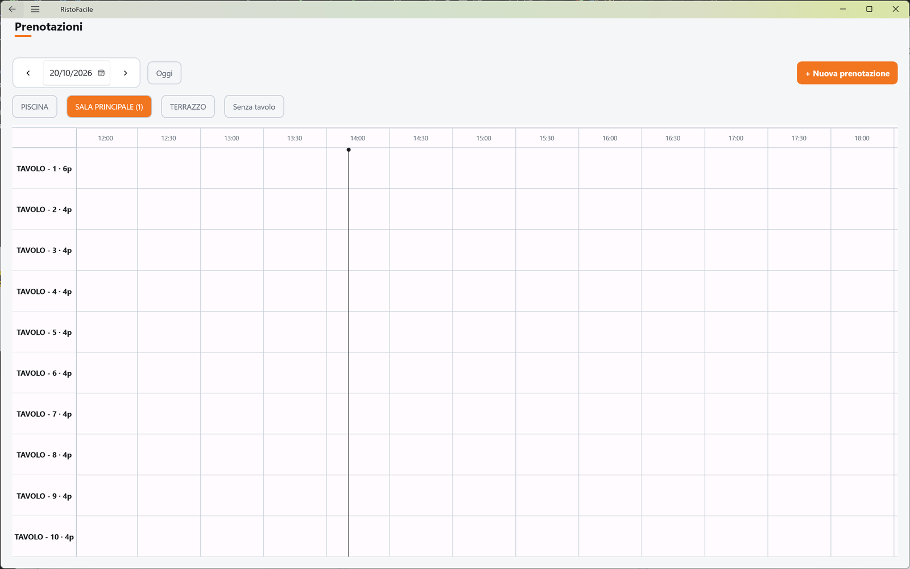
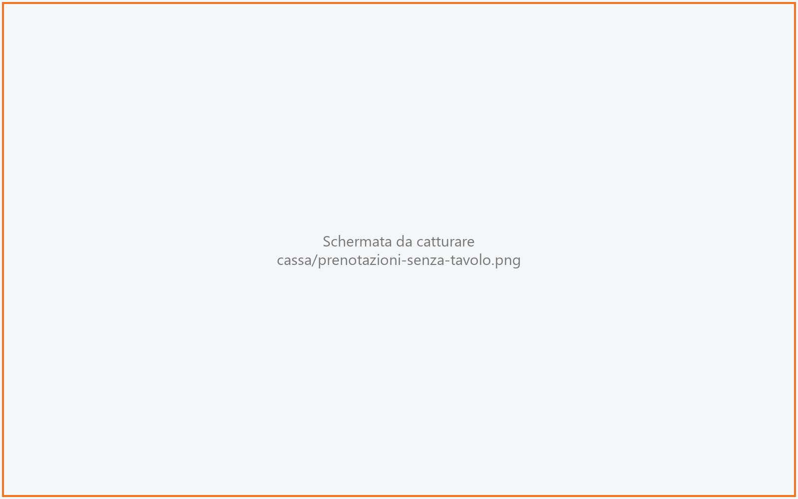
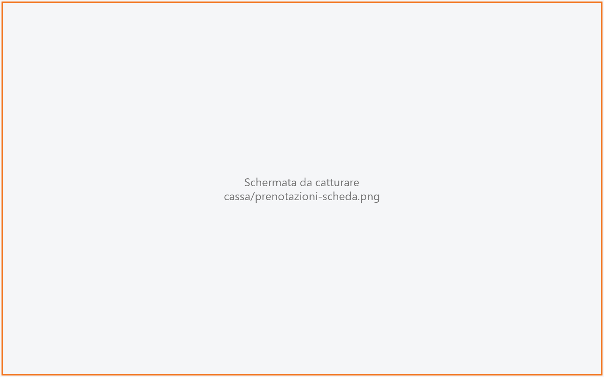
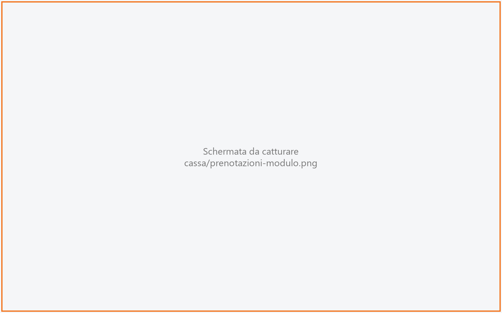

# Prenotazioni

Il registro delle prenotazioni: un calendario della giornata con i tavoli della sala in riga e
l'orario in colonna. Da qui il cassiere prende una prenotazione, la conferma, la sposta e, quando
il cliente arriva, lo fa accomodare aprendo la comanda del tavolo.

!!! info "In sintesi"

    - **Dove si trova:** Menu ▸ Vendita ▸ Mappa della sala ▸ **Prenotazioni** (barra in basso)
    - **Chi la usa:** cassiere, titolare
    - **Disponibile anche su:** [Palmare](../palmare/prenotazioni.md)

---

## A cosa serve

Un cliente telefona per sabato sera: quattro persone alle 20:30. Vai al sabato con le frecce,
tocchi la cella del tavolo 12 alle 20:30 e il modulo si apre con giorno, ora e tavolo già
compilati: scrivi il nome e salvi. Sabato sera, quando il cliente entra, tocchi la sua
prenotazione e **Cliente arrivato**: la cassa apre la comanda del tavolo 12 con quattro coperti.

## Prima di cominciare

- Sale e tavoli devono esistere: si creano in [Sale e tavoli](sale-e-tavoli.md). Il numero di
  posti del tavolo serve per l'avviso di capacità.
- La sala del tavolo dell'asporto non compare nel registro (vedi [Impostazioni](impostazioni.md)).

## La schermata

- **Barra del giorno**: le frecce ‹ e › per il giorno prima e dopo, la data (toccala per
  sceglierne una dal calendario), la pastiglia **Oggi** e, a destra, **+ Nuova prenotazione**.
- **Pastiglie delle sale**: una per sala, con tra parentesi il numero di prenotazioni del giorno
  (*Sala interna (3)*). L'ultima, **Senza tavolo**, raccoglie le prenotazioni a cui non è ancora
  stato assegnato un tavolo.
- **Registro**: una riga per tavolo della sala scelta (nome del tavolo e posti, per esempio
  *T12 · 4p*) e l'orario della giornata intera a passi di mezz'ora; scorre in orizzontale. Ogni
  prenotazione è un blocco con nome e persone (*Rossi · 4p*), lungo quanto la sua durata.
  Arancione pieno = confermata; arancione chiaro = da confermare.

Il registro si apre già sull'ora utile: oggi un'ora prima dell'ora attuale; negli altri giorni
un'ora prima della prima prenotazione, o alle 18:00 se non ce ne sono.

Se la sala non ha tavoli compare *Questa sala non ha tavoli* con
*Aggiungili da Impostazioni → Sale e tavoli*.

La schermata si aggiorna da sola con le prenotazioni inserite dalle altre postazioni e dai
palmari, tranne mentre è aperta una scheda o il modulo.

### Senza tavolo

Con la pastiglia **Senza tavolo** il registro diventa un elenco: ora, nome, numero di coperti e
stato. Se è vuoto compare *Nessuna prenotazione senza tavolo* —
*Ogni prenotazione del giorno ha gia' un tavolo assegnato*.

### La scheda della prenotazione

Si apre toccando una prenotazione nel registro o nell'elenco. Riporta il nome, i coperti e il
tavolo (*4 coperti · Sala 1, tavolo 12*, oppure *Nessun tavolo assegnato*), l'**Ora**, lo
**Stato** e i comandi. Si chiude con la **X** o toccando fuori.

### Il modulo Prenotazione

Due riquadri: **Cliente** (nome, telefono, coperti, note) e **Quando e dove** (data, ora e i
tavoli della sala come pulsanti). In fondo **Annulla** e **Salva**.

## Campi e indicatori

| Elemento | Descrizione |
|---|---|
| **Nome** | Nome del cliente. Obbligatorio. |
| **Telefono** | Facoltativo. |
| **Coperti** | Numero di persone, maggiore di zero. Proposto 2. |
| **Note** | Facoltative (*Allergie, seggiolone, tavolo tranquillo...*). |
| **Data** | Giorno della prenotazione. |
| **Ora** | Ora di arrivo. |
| **Tavolo** | I tavoli della sala: tocca un tavolo per assegnarlo, toccalo di nuovo per toglierlo. Senza tavolo la prenotazione finisce in **Senza tavolo**. |
| Avviso di capacità | *Attenzione: il tavolo ha al massimo N posti, la prenotazione ne richiede M.* Non impedisce di salvare. |
| Avviso di doppia assegnazione | *Attenzione: questo tavolo e' gia' assegnato ad un'altra prenotazione in questa data.* Non impedisce di salvare. |
| **Stato** | *Da confermare* (appena creata), *Confermata*. Le prenotazioni arrivate, annullate o non presentate escono dal registro. |

La durata della prenotazione (la lunghezza del blocco nel registro) è di 90 minuti per le
prenotazioni nuove e dalla cassa non si modifica.

## Pulsanti e comandi

| Comando | Effetto |
|---|---|
| **‹** / **›** | Giorno precedente / successivo. |
| **Oggi** | Torna alla giornata di oggi. |
| **+ Nuova prenotazione** | Apre il modulo vuoto sulla data mostrata, con la sala scelta e l'ora da cui parte il registro. |
| Pastiglia di una sala | Mostra il registro di quella sala. |
| **Senza tavolo** | Mostra l'elenco delle prenotazioni senza tavolo. |
| Tocco su una cella vuota | Apre il modulo con data, ora, sala e tavolo già compilati. |
| Tocco su una prenotazione | Apre la scheda. |
| **Conferma** | Solo *Da confermare*: la prenotazione diventa *Confermata*. |
| **Cliente arrivato** | Solo *Confermata*: apre la comanda del tavolo con i coperti della prenotazione e ti porta nella [Comanda](comanda.md). La prenotazione esce dal registro. |
| **Modifica** | Apre il modulo con i dati della prenotazione. |
| **Annulla** (scheda) | Solo *Da confermare*: chiede conferma e annulla la prenotazione. |
| **Non presentato** | Solo *Confermata*: chiede conferma e segna il cliente come non presentato. |
| **Salva** | Salva la prenotazione e torna al registro. |
| **Annulla** (modulo) | Chiude il modulo senza salvare. |

## Come si fa

### Prendere una prenotazione

1. Porta il registro sul giorno giusto con **‹**, **›** o toccando la data.
2. Tocca la pastiglia della sala.
3. Tocca la cella del tavolo all'ora della prenotazione.
4. Scrivi **Nome**, **Telefono** e **Coperti**, ed eventuali **Note**.
5. Tocca **Salva**.
6. La prenotazione compare nel registro in arancione chiaro (*Da confermare*).

### Confermare una prenotazione

1. Tocca la prenotazione.
2. Tocca **Conferma**.
3. Il blocco diventa arancione pieno (*Confermata*).

### Spostare una prenotazione su un altro tavolo o orario

1. Tocca la prenotazione, poi **Modifica**.
2. Cambia **Data** o **Ora**, oppure tocca un altro tavolo.
3. Tocca **Salva**. Il blocco si sposta nel registro.

### Far accomodare il cliente

1. Tocca la prenotazione confermata.
2. Tocca **Cliente arrivato**.
3. Si apre la [Comanda](comanda.md) del tavolo, con il numero di coperti della prenotazione.

## Controlli e messaggi

| Messaggio | Causa | Cosa fare |
|---|---|---|
| *Il nome del cliente e' obbligatorio.* | **Salva** con il nome vuoto. | Scrivi il nome. |
| *Numero di coperti non valido.* | Coperti vuoti, zero o non numerici. | Scrivi un numero maggiore di zero. |
| *Durata non valida.* | La durata della prenotazione non è valida. | <!-- DA VERIFICARE: dalla cassa la durata non si vede ne' si modifica: in che caso puo' comparire questo messaggio? --> |
| *Attenzione: il tavolo ha al massimo N posti, la prenotazione ne richiede M. Salvare lo stesso? Al loro arrivo servira' unire un altro tavolo.* | Al **Salva**, i coperti superano i posti del tavolo. | **Salva** per tenere il tavolo, **Cambia tavolo** per sceglierne un altro. |
| *Annullare questa prenotazione? Uscira' dal registro.* | Conferma di **Annulla** nella scheda. | **Annulla prenotazione** per procedere, **Indietro** per tenerla. |
| *Segnare il cliente come non presentato? Uscira' dal registro.* | Conferma di **Non presentato**. | **Conferma** per procedere, **Indietro** per tenerla. |
| *Assegna un tavolo alla prenotazione prima di far accomodare il cliente.* | **Cliente arrivato** su una prenotazione senza tavolo. | Assegna un tavolo con **Modifica**, poi riprova. |
| *Impossibile caricare le prenotazioni.* | Il servizio non risponde. | Controlla la connessione e riapri la schermata. |
| *Impossibile caricare i tavoli della sala.* | Il servizio non ha restituito i tavoli. | Riprova toccando di nuovo la sala. |
| *Impossibile salvare la prenotazione.* | Il salvataggio non è andato a buon fine. | Riprova. |
| *Impossibile aggiornare la prenotazione.* | Conferma, annullamento o non presentato non salvati. | Riprova. |
| *Impossibile far accomodare il cliente.* | L'apertura della comanda o l'aggiornamento della prenotazione non sono riusciti. | Riprova; se il tavolo risulta già aperto, entra dalla [Mappa della sala](mappa-sala.md). |
| *Impossibile preparare la prenotazione.* / *Impossibile caricare la prenotazione.* | Il modulo non ha potuto leggere sale, tavoli o la prenotazione. | Chiudi il modulo e riprova. |

## Note

- Gli avvisi di capacità e di doppia assegnazione sono solo di cortesia: la prenotazione si
  salva comunque.
- **Cliente arrivato su un tavolo già aperto**: se sul tavolo c'è già una comanda aperta, la
  prenotazione viene collegata a quella e non se ne apre un'altra.
- Al momento una prenotazione **confermata** non si annulla dalla scheda: l'unica uscita, oltre
  all'arrivo, è **Non presentato**. <!-- DA VERIFICARE: e' voluto che una prenotazione confermata non si possa annullare (es. il cliente disdice)? -->
- Il modulo non ha la scelta della sala: mostra i tavoli della sala da cui è stato aperto (o,
  in modifica, della sala del tavolo già assegnato). <!-- DA VERIFICARE: dalla cassa come si sposta una prenotazione in un'altra sala, e come si assegna un tavolo a una prenotazione "Senza tavolo" (in modifica il modulo non carica i tavoli di nessuna sala)? -->
- Una nuova prenotazione creata con **+ Nuova prenotazione** mentre è scelta la pastiglia
  **Senza tavolo** nasce senza sala e senza tavolo.
- **Prenotazioni sulla mappa**: le prenotazioni confermate compaiono sulle tessere dei tavoli
  della [Mappa della sala](mappa-sala.md) con un'ora di anticipo; l'anticipo (da 0, cioè spento,
  a 24 ore) si imposta per postazione in Impostazioni ▸ Sala ▸ **Mappa e servizio** ▸
  **Prenotazioni in mappa**.

## Vedi anche

- [Mappa della sala](mappa-sala.md)
- [Comanda](comanda.md)
- [Sale e tavoli](sale-e-tavoli.md)
- [Impostazioni](impostazioni.md)
- [Prenotazioni sul palmare](../palmare/prenotazioni.md)
