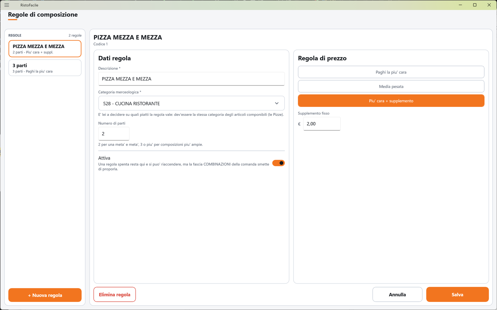

# Regole di composizione

Una regola di composizione dice che i piatti di una categoria si possono comporre **a parti** —
la pizza mezza e mezza, la pizza a tre gusti — e con quale criterio si calcola il prezzo del piatto
composto. Qui il titolare crea e modifica le regole.

!!! info "In sintesi"

    - **Dove si trova:** Menu ▸ Regole di composizione
    - **Chi la usa:** titolare / responsabile
    - **Disponibile anche su:** solo cassa (le composizioni si vendono anche dal palmare, ma le regole si creano qui)

---

## A cosa serve

Il cliente chiede metà margherita e metà diavola. Con una regola «PIZZA MEZZA E MEZZA» sulla
categoria delle pizze, in Comanda, nelle sezioni del menu che contengono pizze, compare in alto la
fascia **COMBINAZIONI** con la regola: il cameriere la tocca, sceglie le due metà e la cassa
calcola il prezzo (vedi [Mezza e mezza](mezza.md)).

Il prezzo del piatto composto si calcola dai prezzi dei piatti scelti:

- **Paghi la piu' cara**: margherita 6 € + diavola 8 € → 8 €;
- **Media pesata**: la media dei prezzi delle parti → 7 €;
- **Piu' cara + supplemento**: il prezzo più alto più un supplemento fisso → con 1 € di
  supplemento, 9 €.

Alle parti si aggiungono le eventuali varianti scelte.

## Prima di cominciare

- La categoria merceologica dei piatti componibili (es. PIZZE), in [Tabelle di base](tabelle-di-base.md),
  assegnata agli [articoli](articoli.md).

## La schermata

- **A sinistra, l'elenco** (**REGOLE** e il numero di regole): una tessera per regola con il nome
  e, sotto, il numero di parti e il criterio di prezzo (es. «2 parti - Paghi la piu' cara»). Le
  regole spente portano la pastiglia **Disattiva**. In fondo **+ Nuova regola**.
- **A destra, la scheda** della regola toccata, su due colonne: **Dati regola** e
  **Regola di prezzo**. Finché non scegli nulla compare **Tocca una regola** con «Una regola dice
  che i piatti di una categoria si possono comporre a parti - la pizza mezza e mezza - e con che
  criterio si calcola il prezzo del piatto composto.»

In fondo alla scheda **Elimina regola**, **Annulla** e **Salva**.

## Campi e indicatori

**Dati regola**

| Elemento | Descrizione |
|---|---|
| **Descrizione \*** | Obbligatoria (es. PIZZA MEZZA E MEZZA). È il nome che compare in Comanda. |
| **Categoria merceologica \*** | Obbligatoria; si sceglie con la finestra **Scegli merceologica**. «E' lei a decidere su quali piatti la regola vale: dev'essere la stessa categoria degli articoli componibili (le Pizze).» |
| **Numero di parti** | «2 per una meta' e meta', 3 o piu' per composizioni piu' ampie.» Almeno 2. |
| **Attiva** | «Una regola spenta resta qui e si puo' riaccendere, ma la fascia COMBINAZIONI della comanda smette di proporla.» |

**Regola di prezzo**

| Elemento | Descrizione |
|---|---|
| **Paghi la piu' cara** / **Media pesata** / **Piu' cara + supplemento** | Il criterio di prezzo del piatto composto (vedi sopra). |
| **Supplemento fisso** | In euro, solo con **Piu' cara + supplemento**. In Comanda compare come «Supplemento composizione € …». |

## Pulsanti e comandi

| Comando | Effetto |
|---|---|
| **+ Nuova regola** | Apre una scheda vuota con 2 parti. |
| Casella **Categoria merceologica \*** | Apre la finestra **Scegli merceologica** (vedi [Articoli](articoli.md)). |
| **Salva** | Salva la regola. Spento finché la **Descrizione** è vuota. |
| **Annulla** | Rimette la scheda com'era; su una regola nuova, chiude la scheda. |
| **Elimina regola** | Elimina la regola, dopo conferma. |

## Come si fa

### Creare la pizza mezza e mezza

1. Tocca **+ Nuova regola**.
2. In **Descrizione \*** scrivi PIZZA MEZZA E MEZZA.
3. Tocca **Categoria merceologica \*** e scegli la categoria delle pizze.
4. Lascia **Numero di parti** a 2.
5. Tocca **Paghi la piu' cara**.
6. Tocca **Salva**. La regola compare nell'elenco con «2 parti - Paghi la piu' cara»; in Comanda,
   nelle sezioni con le pizze, compare la fascia **COMBINAZIONI**.

## Controlli e messaggi

| Messaggio | Causa | Cosa fare |
|---|---|---|
| *La descrizione e' obbligatoria.* | Descrizione vuota. | Scrivi la descrizione. |
| *La categoria merceologica e' obbligatoria: e' lei a dire su quali piatti la regola vale.* | Manca la categoria. | Scegli la categoria. |
| *Il numero di parti dev'essere almeno 2.* | Parti meno di 2. | Correggi il numero. |
| *Il supplemento dev'essere un numero maggiore o uguale a zero.* | Supplemento non valido. | Correggi il supplemento. |
| *Categoria non trovata in anagrafica.* | La categoria scelta non esiste più. | Scegline un'altra. |
| **Modifiche non salvate** — *La scheda di "…" ha modifiche non salvate. Vuoi abbandonarle?* | Hai cambiato regola senza salvare. | **Abbandona** o **Resta qui**. |
| **Elimina regola** — *Eliminare definitivamente la regola "…"? I piatti di quella categoria non si potranno piu' comporre a parti.* | Hai toccato **Elimina regola**. | **Elimina** o **Annulla**. |
| *Un'altra postazione ha modificato questi dati prima di te: adesso vedi la versione aggiornata, rifai la modifica e salva.* | Modifica concorrente. | Rifai la modifica. |
| *Un'altra postazione ha eliminato questi dati mentre li stavi modificando: non ci sono piu' e non c'e' niente da salvare.* | Eliminata altrove. | Nessuna azione. |
| *Impossibile caricare le regole di composizione.* / *Impossibile salvare la regola di composizione.* / *Impossibile eliminare la regola di composizione.* / *Impossibile proporre il codice della regola.* | Il servizio non risponde o rifiuta l'operazione. | Controlla il collegamento e riprova. |

## Note

- Il prezzo di ogni parte è il prezzo intero del piatto scelto (con l'eventuale supplemento del
  menu), non la sua frazione: con **Media pesata** le parti valgono tutte uguale.
- Una regola salvata su questa cassa è subito visibile nella sua Comanda.
  <!-- DA VERIFICARE: sulle altre casse e sui palmari già aperti la regola nuova compare solo al riavvio dell'app? (le regole stanno in memoria per tutta la sessione) -->

## Vedi anche

- [Mezza e mezza](mezza.md)
- [Comanda](comanda.md)
- [Tabelle di base](tabelle-di-base.md)
- [Articoli](articoli.md)
