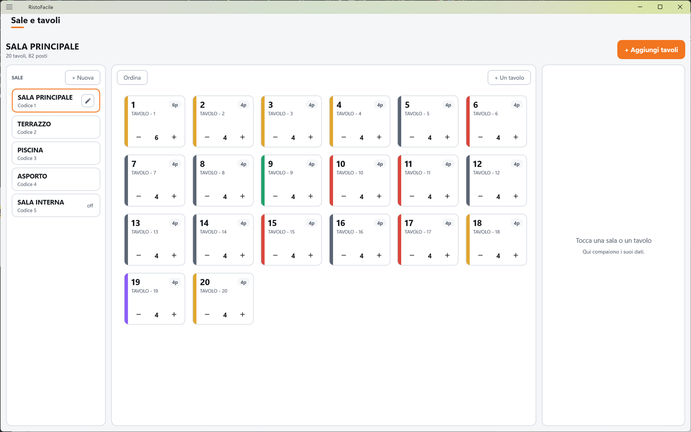
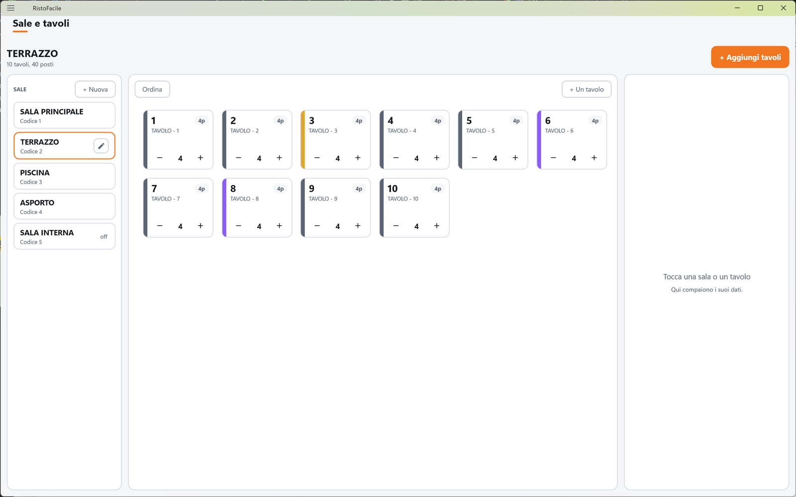
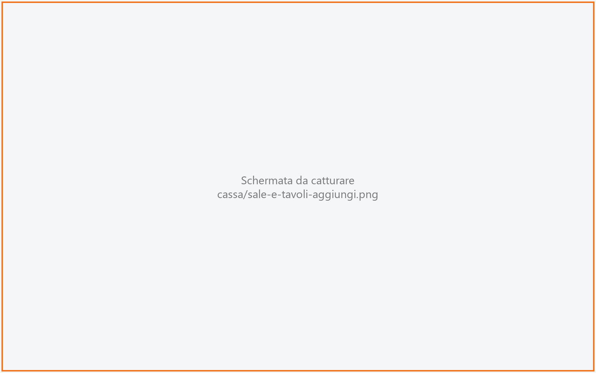

# Sale e tavoli

Qui si allestisce il locale: le sale (sala interna, veranda, dehors…) e i tavoli di ciascuna,
con i posti, il prezzo del coperto, la percentuale di servizio e il listino della sala.
La usa il titolare quando prepara il locale o quando cambia la disposizione.

!!! info "In sintesi"

    - **Dove si trova:** Menu ▸ Sale e tavoli
    - **Chi la usa:** titolare / responsabile
    - **Disponibile anche su:** solo cassa (il palmare usa le stesse sale e gli stessi tavoli ma non li modifica)

---

## A cosa serve

Le sale e i tavoli creati qui sono quelli che cassieri e camerieri vedono nella
[Mappa della sala](mappa-sala.md) e sul palmare, **nello stesso ordine** in cui li disponi qui.
I dati della sala entrano nel conto: all'apertura di un tavolo il prezzo del coperto viene preso
dalla sala, la percentuale di servizio viene aggiunta al conto e i prezzi degli articoli si
leggono dal listino della sala.

Esempio: la veranda ha un coperto di 2,50 € e il 10% di servizio, la sala interna un coperto di
2,00 € e niente servizio: basta impostarli nelle due sale.

## Prima di cominciare

- Se una sala deve usare un listino diverso da quello normale, il listino deve già esistere.
  <!-- DA VERIFICARE: dove si creano i listini (gestionale Facile?) -->

## La schermata

In alto il nome della sala scelta (o **Scegli una sala**) con il conteggio dei tavoli e dei posti
(es. «12 tavoli, 48 posti»), e a destra il pulsante **+ Aggiungi tavoli**. Sotto, tre colonne:

- **A sinistra, le sale**: la scritta **SALE** con il pulsante **+ Nuova**, poi una tessera per
  sala con nome e codice. Le sale disattivate portano la scritta **off**. Sulla sala selezionata
  compare l'icona della matita, che apre la sua scheda.
- **Al centro, i tavoli della sala scelta**, nell'ordine in cui si vedranno in vendita. Ogni
  tessera mostra il numero del tavolo, i posti (es. «4p»), il nome e, in basso, i tasti **−** e
  **+** per cambiare i posti al volo. In alto ci sono i pulsanti **Ordina** e **+ Un tavolo**.
  Se la sala è vuota compare *Nessun tavolo in questa sala. Usa "+ Aggiungi tavoli".*
- **A destra, la scheda** della sala o del tavolo che stai modificando. Finché non ne scegli
  uno compare **Tocca una sala o un tavolo** con «Qui compaiono i suoi dati.».

## Campi e indicatori

**Scheda della sala — Dati sala**

| Elemento | Descrizione |
|---|---|
| **Descrizione \*** | Obbligatoria. Il nome della sala (es. SALA PRINCIPALE), in maiuscolo. |
| **Listino** | Il listino prezzi usato per i tavoli di questa sala. Vuoto vuol dire **Listino di default della ditta**. Si sceglie toccando la casella. |
| **Coperto (€)** | Prezzo del coperto a persona, proposto all'apertura di ogni tavolo della sala. Zero o più. |
| **Servizio (%)** | Percentuale di servizio aggiunta al conto dei tavoli della sala, da 0 a 100. |
| **Sala attiva** | Spenta, la sala non compare più nella scelta della sala in vendita, ma resta qui per poterla riattivare. |

Il codice della sala è assegnato in automatico (il primo numero libero).

**Scheda del tavolo — Dati tavolo**

| Elemento | Descrizione |
|---|---|
| **Codice** | Il numero del tavolo. Si sceglie solo alla creazione (viene proposto il primo libero); poi non si cambia più. |
| **Posti** | Numero di posti, maggiore di zero. |
| **Descrizione** | Il nome del tavolo (es. TAVOLO 12 VERANDA). Se vuota, il tavolo si chiama «Tavolo» seguito dal numero. |
| **Posti massimi (0 = come i posti)** | Il massimo di posti a cui il tavolo si può allargare. Non può essere meno di **Posti**. Con i tasti **+** della tessera non si va oltre questo valore. <!-- DA VERIFICARE: i posti massimi hanno effetto anche in vendita o nelle prenotazioni? Nel codice della cassa sono usati solo come limite dei tasti +. --> |

**Pannello «Aggiungi tavoli»**

| Elemento | Descrizione |
|---|---|
| **Da** … **a** | L'intervallo dei numeri dei tavoli da creare (es. da 1 a 10). Proposto a partire dal primo numero libero. |
| **posti** | I posti di ciascun tavolo creato. |

## Pulsanti e comandi

| Comando | Effetto |
|---|---|
| **+ Nuova** | Apre la scheda di una sala nuova. |
| Matita sulla sala | Apre la scheda della sala selezionata. |
| **+ Aggiungi tavoli** | Apre in fondo alla colonna centrale il pannello per creare tanti tavoli in un colpo solo. |
| **Crea** | Crea i tavoli dell'intervallo, chiamandoli «Tavolo N». I numeri già esistenti vengono saltati. |
| **+ Un tavolo** | Apre la scheda di un tavolo nuovo nella sala scelta. |
| Tocco su un tavolo | Apre la sua scheda. |
| **−** / **+** sulla tessera | Tolgono o aggiungono un posto (da 1 a 99). La modifica è salvata subito. |
| **Ordina** / **Fine** | Accende e spegne il riordino: al posto di **−** e **+** compaiono le frecce, che spostano il tavolo di una posizione prima o dopo. Ogni spostamento è salvato subito. |
| **Torna al listino di default** | Toglie il listino della sala. |
| **Salva** | Salva la scheda aperta (sala o tavolo). |
| **Annulla** | Chiude la scheda senza salvare. |
| **Elimina sala** / **Elimina tavolo** | Elimina, dopo conferma. Compaiono solo su sale e tavoli già salvati. |

Nella finestra **Scegli listino** cerchi per descrizione o codice nella casella
**Descrizione o codice listino**, poi tocchi la riga del listino (colonne **DESCRIZIONE** e
**CODICE**). **Annulla** torna alla scheda senza cambiare nulla.

## Come si fa

### Creare una sala con i suoi tavoli

1. Tocca **+ Nuova**.
2. Scrivi la **Descrizione \***, il **Coperto (€)** e, se c'è, il **Servizio (%)**.
3. Tocca **Salva**. La sala compare nell'elenco a sinistra ed è già selezionata.
4. Tocca **+ Aggiungi tavoli**.
5. Scrivi l'intervallo (es. da 1 a 12) e i posti di ogni tavolo.
6. Tocca **Crea**. Al centro compaiono i tavoli «Tavolo 1» … «Tavolo 12».

### Dare un listino diverso a una sala

1. Seleziona la sala e tocca la matita.
2. Tocca la casella **Listino**.
3. Tocca il listino nella finestra **Scegli listino**.
4. Tocca **Salva**.

### Cambiare l'ordine dei tavoli

1. Seleziona la sala.
2. Tocca **Ordina**. Sulle tessere compaiono le frecce.
3. Tocca la freccia a sinistra o a destra del tavolo da spostare, finché è al posto giusto.
4. Tocca **Fine**. In vendita i tavoli si vedono in questo ordine.

Finché non ordini a mano, i tavoli si vedono in ordine di numero.

### Rinominare un tavolo

1. Tocca il tavolo.
2. Scrivi la nuova **Descrizione**.
3. Tocca **Salva**.

## Controlli e messaggi

| Messaggio | Causa | Cosa fare |
|---|---|---|
| *La descrizione e' obbligatoria.* | Sala salvata senza descrizione. | Compila la descrizione. |
| *Il codice deve essere un numero maggiore di zero.* | Codice di sala o di tavolo non valido. | Correggi il codice. |
| *Il prezzo del coperto deve essere un numero maggiore o uguale a zero.* | Coperto non valido. | Correggi il coperto. |
| *La percentuale di servizio deve essere fra 0 e 100.* | Servizio fuori intervallo. | Correggi la percentuale. |
| *I posti devono essere un numero maggiore di zero.* | Posti mancanti o a zero (scheda o pannello). | Scrivi i posti. |
| *I posti massimi devono essere un numero maggiore o uguale a zero.* | Posti massimi non validi. | Correggi, oppure lascia 0. |
| *I posti massimi non possono essere meno dei posti.* | Posti massimi inferiori ai posti. | Alza i posti massimi o abbassa i posti. |
| *Il tavolo ha al massimo N posti: per andare oltre alza prima i posti massimi dalla sua scheda.* | Hai toccato **+** oltre i posti massimi. | Alza i **Posti massimi** nella scheda del tavolo. |
| *Intervallo non valido: "da" e "a" devono essere numeri, e "a" non puo' essere minore di "da".* | Intervallo del pannello sbagliato. | Correggi **Da** e **a**. |
| *Si possono creare al massimo 60 tavoli per volta.* | Intervallo troppo ampio. | Crea i tavoli in più passaggi. |
| *Esistono gia' tutti i tavoli di questo intervallo.* | Tutti i numeri dell'intervallo sono già usati. | Scegli un altro intervallo. |
| *Creati N tavoli su M. Primo errore: …* | Una parte dei tavoli non è stata creata. | Leggi l'errore e riprova per i tavoli mancanti. |
| *N tavoli non hanno cambiato ordine. L'elenco viene ricaricato.* | Lo spostamento non è stato salvato per alcuni tavoli. | Controlla l'ordine e ripeti lo spostamento. |
| **Elimina sala** — *Eliminare definitivamente la sala "…"? L'operazione non e' reversibile.* | Hai toccato **Elimina sala**. | **Elimina** o **Annulla**. |
| **Elimina tavolo** — *Eliminare definitivamente il tavolo "…"? L'operazione non e' reversibile.* | Hai toccato **Elimina tavolo**. | **Elimina** o **Annulla**. |
| *Impossibile eliminare la sala (verificare che non contenga tavoli).* | La sala ha ancora dei tavoli, oppure il servizio non risponde. | Elimina prima i tavoli. |
| *Impossibile eliminare il tavolo (verificare che non abbia una comanda aperta).* | Il tavolo ha una comanda aperta, oppure il servizio non risponde. | Chiudi prima il conto del tavolo. |
| *Un'altra postazione ha modificato questi dati prima di te: adesso vedi la versione aggiornata, rifai la modifica e salva.* | Sala o tavolo modificati da un'altra cassa nel frattempo. | Rifai la modifica e salva. |
| *Un'altra postazione ha eliminato questi dati mentre li stavi modificando: non ci sono piu' e non c'e' niente da salvare.* | Sala o tavolo eliminati da un'altra cassa. | Nessuna azione. |
| *Impossibile caricare le sale.* / *Impossibile caricare i tavoli.* / *Impossibile salvare la sala.* / *Impossibile salvare il tavolo.* / *Impossibile aggiornare i posti.* | Il servizio non risponde o rifiuta l'operazione. | Controlla il collegamento e riprova. |
| *Impossibile caricare i listini. (…)* | Finestra **Scegli listino**: il servizio non risponde. | Riprova. |
| *Nessun listino disponibile.* | Non ci sono listini. | — |

## Note

- I tasti **−** / **+** e le frecce di **Ordina** salvano **subito**, senza **Salva**. La scheda
  invece va salvata.
- Il coperto viene copiato nella comanda all'apertura del tavolo: un nuovo prezzo vale per i
  tavoli aperti dopo la modifica. Il listino della sala si rilegge ogni volta che si apre la
  comanda, quindi vale per gli articoli battuti da quel momento.
- La percentuale di servizio viene riletta a ogni apertura del conto.
- Una sala disattivata sparisce dalla vendita ma i suoi tavoli restano.

## Vedi anche

- [Mappa della sala](mappa-sala.md)
- [Conto](conto.md)
- [Prenotazioni](prenotazioni.md)
- [Articoli](articoli.md)
