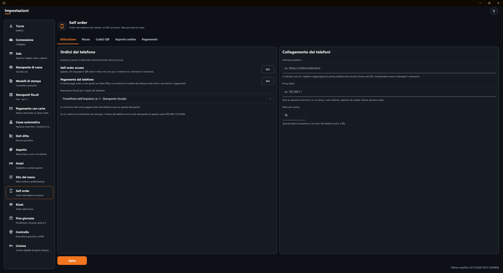
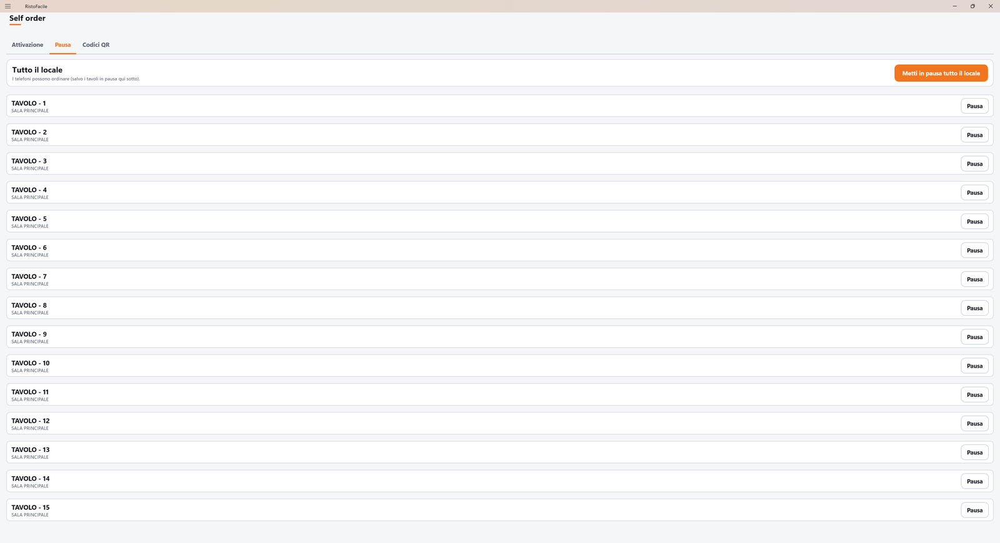
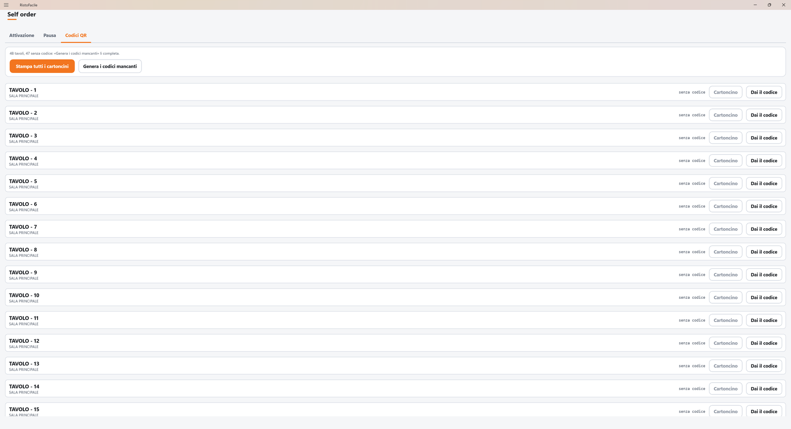
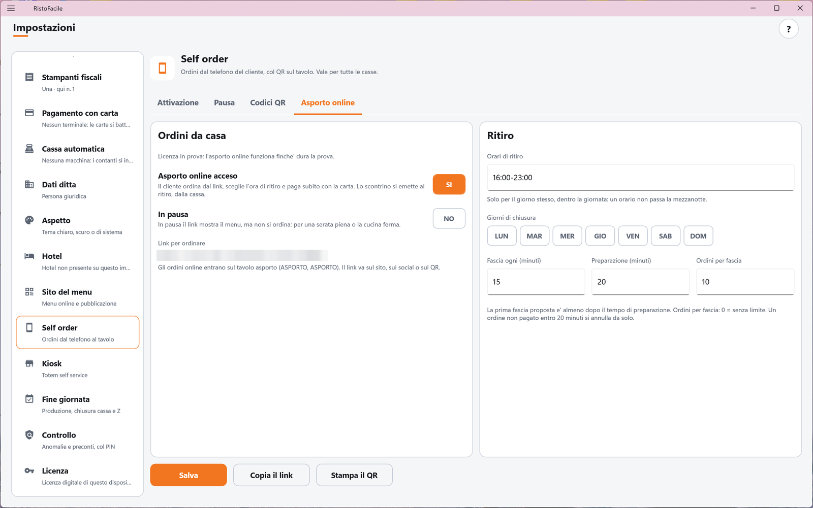
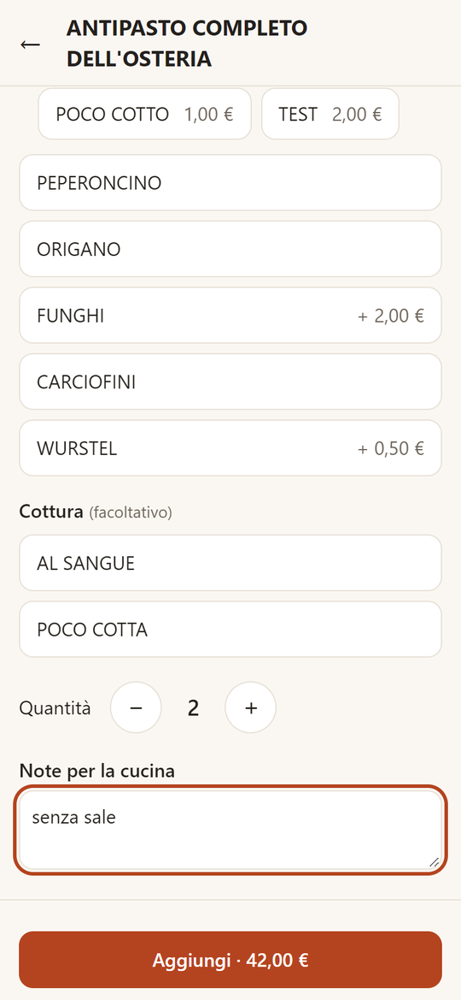
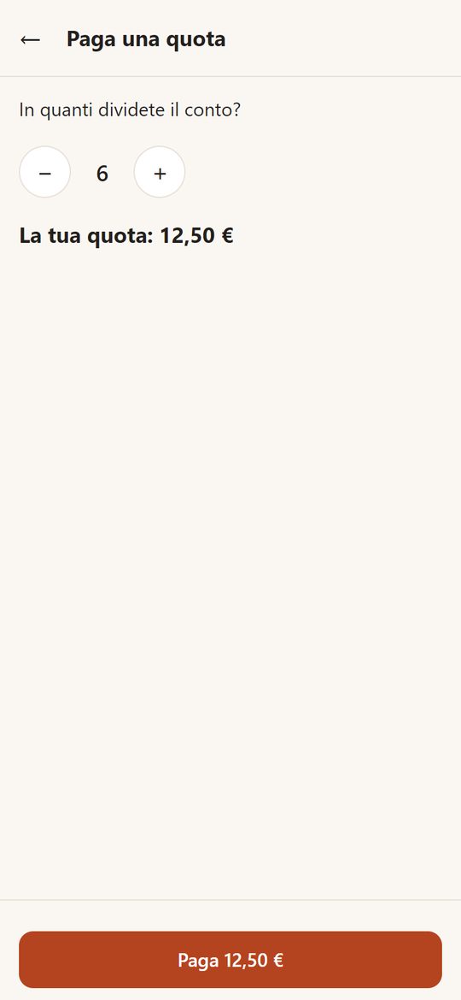
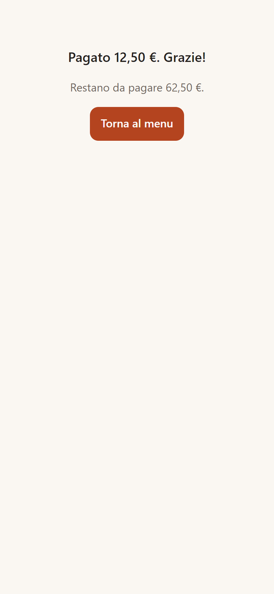

# Self order

Con il self order il cliente inquadra il QR sul tavolo, sfoglia il menu sul proprio telefono, manda
l'ordine in cucina, chiama il cameriere, chiede il conto e, se lo accendi, paga tutto o la sua quota.
Da questa schermata il titolare accende il servizio, lo mette in pausa e stampa i cartoncini con i
QR; in sala cassa e palmare ricevono gli avvisi dei telefoni. Dalla stessa schermata si accende
anche l'**asporto online**: il cliente ordina da casa con un link, sceglie l'ora di ritiro e paga
subito con la carta.

!!! info "In sintesi"

    - **Dove si trova:** Menu ▸ Impostazioni ▸ **Self order**
    - **Chi la usa:** titolare (impostazioni, cartoncini); cassiere e camerieri (avvisi, pausa, conto)
    - **Disponibile anche su:** gli avvisi e il blocco del telefono anche sul [Palmare](../palmare/index.md); le impostazioni solo sulla cassa

---

## A cosa serve

Il tavolo lo apre sempre il personale: finché il tavolo non è aperto, chi inquadra il QR vede il
menu ma non può ordinare (il telefono dice *Il tavolo non è ancora aperto: chiedi al cameriere di
aprirlo, poi inquadra di nuovo il QR.*). Da lì in poi i clienti ordinano da soli, anche più telefoni sullo stesso
tavolo, e le loro righe finiscono nella stessa comanda del cameriere: in cucina escono come quelle
battute dalla cassa, rispettando le uscite. Il cameriere vede subito l'avviso sulla mappa e sulla
comanda, e al conto trova già scalato quello che il tavolo ha pagato dal telefono.

Un esempio: il tavolo 5 ordina due antipasti e due pizze. Gli antipasti partono subito; le pizze, che
sono nell'uscita dei secondi, aspettano il **VIA** del cameriere, come se le avesse battute lui.

L'**asporto online** usa lo stesso menu per chi ordina da casa: il link si mette sul sito, sui
social o in un QR stampato. Il cliente sceglie un'ora di ritiro fra quelle libere e paga subito
con la carta; l'ordine entra sul tavolo virtuale dell'asporto e lo scontrino si emette quando il
cliente passa a ritirare. Esempio: con ritiro dalle 19:00 alle 22:30 a fasce di 15 minuti e 20
minuti di preparazione, chi ordina alle 19:10 può scegliere il ritiro dalle 19:30 in poi.

## Prima di cominciare

- La licenza deve comprendere il modulo **Self order** (vedi [Licenza digitale](../introduzione/licenza.md));
  con la licenza in prova funziona finché dura la prova.
- Il servizio deve essere raggiungibile dai telefoni dei clienti da internet, con un indirizzo
  `https`: lo prepara chi installa il servizio (vedi
  [Pubblicare il self order su internet](../appendici/self-order-internet.md)).
- I piatti che il cliente vede sono quelli dei menu scelti nel [Sito del menu](sito-menu.md), linguetta **Menu e note**, e salvati con **Salva**: sistemalo prima.
- Sale e tavoli devono esistere (vedi [Sale e tavoli](sale-e-tavoli.md)).
- Per il pagamento dal telefono il servizio deve avere configurato Nexi.
- Per l'**asporto online**: il modulo **Asporto online** nella licenza (con la licenza in prova
  funziona finché dura la prova), Nexi configurato nel servizio (si paga solo con Nexi),
  l'**Indirizzo pubblico** scritto nella linguetta **Attivazione** e il tavolo dell'asporto scelto
  in [Impostazioni ▸ Sala ▸ Tavolo asporto](impostazioni.md#sala). Il tavolo serve solo per
  accenderlo: per spegnere l'asporto online, o salvarne le impostazioni da spento, non serve.

## La schermata

È un pannello delle [Impostazioni](impostazioni.md#self-order): *Ordini dal telefono del cliente,
col QR sul tavolo. Vale per tutte le casse.* Ha quattro linguette in alto: **Attivazione**,
**Pausa**, **Codici QR** e **Asporto online**. In basso a sinistra compare l'esito dell'ultima
operazione.

- **Attivazione**: gli interruttori del self order e del pagamento dal telefono, l'indirizzo
  pubblico e i limiti, con il pulsante **Salva**.
- **Pausa**: la pausa di tutto il locale e, sotto, l'elenco dei tavoli con la pausa di ciascuno.
- **Codici QR**: l'elenco dei tavoli con il loro codice e i pulsanti per stampare i cartoncini.
- **Asporto online**: a sinistra il riquadro **Ordini da casa** (accensione, pausa e link per
  ordinare), a destra il riquadro **Ritiro** (orari, giorni di chiusura e fasce); in basso
  **Salva**, **Copia il link** e **Stampa il QR**.

## Campi e indicatori

| Elemento | Descrizione |
|---|---|
| **Self order acceso** | Acceso, i telefoni possono vedere il menu e ordinare. Spento, chi inquadra il QR vede il menu in sola lettura: niente ordini, chiamate o pagamenti (sul telefono: *Da qui puoi consultare il menu: per ordinare chiedi al cameriere.*). |
| **Pagamento dal telefono** | Acceso, nel conto del telefono compaiono **Paga tutto** e **Paga una quota**. Si può accendere solo se il servizio ha configurato Nexi: altrimenti la riga sotto lo dice. |
| **Indirizzo pubblico** | L'indirizzo con cui i telefoni raggiungono il servizio da internet, per esempio `https://ordina.trattoria.it`. È quello stampato nei QR: se lo cambi vanno ristampati tutti i cartoncini. |
| **Pezzi per ordine** | Quanti piatti al massimo può mandare un telefono in un solo invio, da 1 a 99 (proposto 15). |
| **Proxy fidati** | Da compilare solo se lo dice chi ha installato il servizio; altrimenti lascialo vuoto. |
| Riga della stampante | Dice dove esce la comanda di un ordine dal telefono se il centro di produzione non stampa: sulla stampante delle comande di questa cassa, oppure solo ai centri di produzione se la cassa non ne ha una. |
| **Stampante fiscale per il saldo dal telefono** | La stampante su cui esce lo scontrino quando il conto viene saldato dal telefono. La prima voce è **Predefinita dell'impianto**; si sceglie fra le stampanti dell'elenco di [Impostazioni ▸ Stampanti fiscali](impostazioni.md#stampanti-fiscali). Si salva con **Salva**. |
| Riga della licenza | Dice se il modulo è in licenza, in prova o assente. |
| Codice del tavolo (linguetta **Codici QR**) | Il codice di sei caratteri che sta nel QR del tavolo, oppure *senza codice*. |

Nella linguetta **Asporto online**:

| Elemento | Descrizione |
|---|---|
| Riga della licenza (riquadro **Ordini da casa**) | Senza il modulo, in un riquadro ambra: *L'asporto online e' un modulo della licenza: chiedilo al rivenditore per poterlo accendere.* Con la licenza in prova: *Licenza in prova: l'asporto online funziona finche' dura la prova.* |
| **Asporto online acceso** | **SI** / **NO**. *Il cliente ordina dal link, sceglie l'ora di ritiro e paga subito con la carta. Lo scontrino si emette al ritiro, dalla cassa.* Spento, il link mostra solo il menu. |
| **In pausa** | **SI** / **NO**. *In pausa il link mostra il menu, ma non si ordina: per una serata piena o la cucina ferma.* |
| **Link per ordinare** | L'indirizzo da dare ai clienti, con sotto dove entrano gli ordini: *Gli ordini online entrano sul tavolo asporto (*sala*,* tavolo*). Il link va sul sito, sui social o sul QR.* È il link del tavolo virtuale dell'asporto: aprendo la linguetta, se quel tavolo non ha ancora un codice, la cassa glielo dà da sola. Se manca qualcosa la riga lo dice: *Configura prima il tavolo asporto in Impostazioni: gli ordini online entrano li'.* oppure *Scrivi l'indirizzo pubblico nella scheda Attivazione: senza, il link non si puo' comporre.* |
| **Orari di ritiro** (riquadro **Ritiro**) | Le fasce in cui si può ritirare, separate da virgole: per esempio `12:00-14:30, 19:00-22:30`. *Solo per il giorno stesso, dentro la giornata: un orario non passa la mezzanotte.* Due orari non si possono sovrapporre. |
| **Giorni di chiusura** | **LUN**, **MAR**, **MER**, **GIO**, **VEN**, **SAB**, **DOM**: tocca i giorni in cui l'asporto online è chiuso (diventano arancioni). In quei giorni non si ordina. |
| **Fascia ogni (minuti)** | Ogni quanti minuti il cliente può scegliere l'ora di ritiro, da 5 a 60 (proposta: 15). |
| **Preparazione (minuti)** | Il tempo minimo fra l'ordine e il ritiro, da 0 a 180 (proposta: 20). *La prima fascia proposta e' almeno dopo il tempo di preparazione.* |
| **Ordini per fascia** | Quanti ordini al massimo per ogni fascia; *0 = senza limite* (è la proposta). Una fascia piena non si può più scegliere. |
| *Un ordine non pagato entro 20 minuti si annulla da solo.* | Promemoria sotto le fasce. |

## Pulsanti e comandi

| Comando | Effetto |
|---|---|
| **Salva** (Attivazione) | Salva interruttori, indirizzo e limiti sul servizio. Sotto compare *Salvato: il self order e' acceso.* oppure *Salvato: il self order e' spento, i QR mostrano solo il menu.* |
| **Metti in pausa tutto il locale** / **Riprendi gli ordini** (Pausa) | In pausa i telefoni vedono ancora il menu ma non possono ordinare, in nessun tavolo. |
| **Pausa** / **Riprendi** accanto a un tavolo (Pausa) | Ferma o riprende gli ordini dai telefoni solo per quel tavolo. |
| **Stampa tutti i cartoncini** (Codici QR) | Prepara il PDF dei cartoncini di tutti i tavoli che hanno il codice, da stampare e ritagliare. |
| **Genera i codici mancanti** (Codici QR) | Dà il codice ai tavoli che non lo hanno ancora; quelli che lo hanno lo tengono. |
| **Cartoncino** accanto a un tavolo | Prepara il PDF del solo cartoncino di quel tavolo. |
| **Dai il codice** / **Codice nuovo** accanto a un tavolo | Dà il primo codice al tavolo, oppure lo cambia: il cartoncino già stampato smette di funzionare. |
| **SI** / **NO** (Asporto online) | Accendono o spengono **Asporto online acceso** e **In pausa**; la scelta vale dopo **Salva**. |
| Giorno della settimana (Asporto online) | Lo segna come giorno di chiusura, o lo toglie. |
| **Salva** (Asporto online) | Salva accensione, pausa, orari, giorni e fasce sul servizio. Sotto compare *Salvato: l'asporto online e' acceso.*, *Salvato: l'asporto online e' in pausa.* oppure *Salvato: l'asporto online e' spento, il link mostra solo il menu.* |
| **Copia il link** (Asporto online) | Copia il link per ordinare negli appunti, da incollare sul sito o sui social: *Link copiato.* |
| **Stampa il QR** (Asporto online) | Prepara il PDF con il QR del link per ordinare, da stampare (per esempio per la vetrina o i volantini). |

## Come si fa

### Accendere il self order la prima volta

1. Apri Menu ▸ **Impostazioni** ▸ **Self order**, linguetta **Attivazione**.
2. Scrivi l'**Indirizzo pubblico** che ti ha dato chi ha installato il servizio.
3. Accendi **Self order acceso** (e, se vuoi, **Pagamento dal telefono**).
4. Tocca **Salva**: sotto compare *Salvato: il self order e' acceso.*
5. Passa alla linguetta **Codici QR** e tocca **Genera i codici mancanti**.
6. Tocca **Stampa tutti i cartoncini**, stampa il PDF e metti ogni cartoncino sul suo tavolo.

### Accendere l'asporto online

1. Controlla che in [Impostazioni ▸ Sala](impostazioni.md#sala), linguetta **Tavolo asporto**, sia
   scelto il tavolo dell'asporto, e che nella linguetta **Attivazione** di questa schermata ci sia
   l'**Indirizzo pubblico**.
2. Apri Menu ▸ **Impostazioni** ▸ **Self order**, linguetta **Asporto online**: sotto **Link per
   ordinare** compare il link.
3. Scrivi gli **Orari di ritiro**, per esempio `19:00-22:30`, e tocca i **Giorni di chiusura**.
4. Controlla **Fascia ogni (minuti)**, **Preparazione (minuti)** e **Ordini per fascia**.
5. Tocca **NO** accanto ad **Asporto online acceso**: diventa **SI**.
6. Tocca **Salva**: sotto compare *Salvato: l'asporto online e' acceso.*
7. Tocca **Copia il link** e incollalo sul sito o sui social, oppure **Stampa il QR** e stampa il
   PDF.

### Fermare per una sera l'asporto online

1. Apri la linguetta **Asporto online**.
2. Tocca **NO** accanto a **In pausa**: diventa **SI**.
3. Tocca **Salva**: compare *Salvato: l'asporto online e' in pausa.* Il link mostra il menu ma non
   si ordina.
4. Per riprendere rimetti **In pausa** su **NO** e tocca **Salva**.

### Servire un tavolo che ordina dal telefono

1. Apri il tavolo come sempre, dalla [Mappa della sala](mappa-sala.md): finché è libero, i telefoni non ordinano.
2. Quando il tavolo ordina compare in alto il riquadro *… ha ordinato dal telefono*, e sulla tessera del tavolo l'icona 📱.
3. Tocca **Apri** per andare alla comanda, oppure **Visto** per togliere l'avviso; **✕** chiude il riquadro senza segnarlo visto.
4. Nella [Comanda](comanda.md) le righe del telefono hanno la scritta *dal telefono*; si mandano in cucina da sole, e le uscite dopo la prima aspettano il tuo **VIA**.

### Fermare un telefono che ordina a sproposito

1. Nella comanda tocca una riga con *dal telefono*.
2. Tocca **📱 Blocca questo telefono** e conferma con **Blocca**.
3. La cassa chiede se mettere in pausa anche tutto il tavolo: tocca **Metti in pausa** per fermare anche gli altri telefoni, **No** per lasciarli.

### Chiudere un conto pagato in parte dal telefono

1. Apri il [Conto](conto.md): nel pannello del pagamento c'è la riga **Pagato dal telefono** con l'importo, e il **Residuo** è già scalato.
2. Incassa il resto come sempre, scegliendo **Scontrino** o **Fattura**.
3. Lo scontrino o la fattura contengono anche quanto pagato dal telefono, come pagamento elettronico.

## Controlli e messaggi

| Messaggio | Causa | Cosa fare |
|---|---|---|
| *Il self order al tavolo e' un modulo della licenza: chiedilo al rivenditore per poterlo accendere.* | La licenza non comprende il modulo. | Chiedi il modulo al rivenditore. |
| *Senza l'indirizzo pubblico i QR non porterebbero da nessuna parte: scrivilo prima di accendere il self order.* | Hai acceso il self order senza indirizzo. | Scrivi l'**Indirizzo pubblico** e salva. |
| *L'indirizzo pubblico va scritto intero, per esempio https://ordina.trattoria.it* | L'indirizzo non è completo. | Scrivilo con `https://` davanti. |
| *I pezzi per ordine vanno da 1 a 99.* | Il limite è fuori misura. | Correggi **Pezzi per ordine**. |
| *Nexi non e' configurato nel servizio: il pagamento dal telefono non si puo' accendere.* | Il servizio non ha le credenziali di Nexi. | Rivolgiti a chi ha installato il servizio. |
| *Le impostazioni del self order non sono state lette dal servizio: riapri la pagina prima di salvare.* | All'apertura il servizio non ha risposto. | Esci e rientra nella schermata. |
| *Codice nuovo* — *…: il cartoncino gia' stampato smette di funzionare e i telefoni collegati vanno scollegati. Continuare?* | Stai cambiando il codice di un tavolo. | Conferma con **Cambia codice** solo se ristampi il cartoncino. |
| *Tavolo in pausa: si riprende da Self order, linguetta Pausa.* | Dopo il blocco di un telefono hai messo in pausa il tavolo. | Riprendi il tavolo dalla linguetta **Pausa**. |
| *Su questo tavolo c'e' un pagamento dal telefono: il conto si chiude con lo scontrino o la fattura, non senza documento, in camera o diviso.* | Nel conto ci sono pagamenti dal telefono, o un pagamento in corso. | Chiudi con **Scontrino** o **Fattura**. |
| *Non riesco a sapere dal servizio se il tavolo ha pagato dal telefono: riprova fra un attimo.* | Il servizio non ha risposto alla domanda sui pagamenti. | Riprova; se insiste, controlla il collegamento. |
| *Il conto e' cambiato mentre lo incassavi (un ordine dal telefono o un'altra postazione): ricontrolla il totale, ora € …, e premi di nuovo.* | Mentre eri sul conto è arrivato un ordine o un pagamento dal telefono. | Ricontrolla il totale e incassa di nuovo. |
| *L'asporto online e' un modulo della licenza: chiedilo al rivenditore per poterlo accendere.* | **Salva** con **Asporto online acceso** su **SI**, ma la licenza non comprende il modulo. | Chiedi il modulo al rivenditore. |
| *Nexi non e' configurato nel servizio (cfg\nexi.json): l'asporto online si paga solo con Nexi e non si puo' accendere.* | Il servizio non ha le credenziali di Nexi. | Rivolgiti a chi ha installato il servizio. |
| *Configura prima il tavolo asporto in Impostazioni* | **Salva** dell'asporto online acceso senza tavolo dell'asporto su questa cassa. Spento si salva lo stesso, e resta il tavolo che il servizio aveva già. | Scegli il tavolo in Impostazioni ▸ **Sala**, linguetta **Tavolo asporto**. |
| *Scrivi prima l'indirizzo pubblico nella scheda Attivazione: senza, il link dell'asporto non porta da nessuna parte.* | Hai acceso l'asporto online senza indirizzo pubblico. | Scrivi l'**Indirizzo pubblico** nella linguetta **Attivazione** e salva. |
| *Gli orari vanno scritti come 12:00-14:30, 19:00-22:30.* | Un orario di ritiro non si legge. | Correggi **Orari di ritiro**. |
| *Senza orari di ritiro non si puo' ordinare: scrivine almeno uno.* | Asporto online acceso senza orari. | Scrivi almeno un orario. |
| *Passo, preparazione e massimo per fascia sono numeri interi.* | Una delle tre caselle delle fasce non è un numero intero. | Correggi la casella. |
| *Impossibile salvare l'asporto online.* con *Asporto online: …* | Il servizio ha rifiutato i dati: per esempio *Asporto online: due orari si sovrappongono.*, *Asporto online: l'orario 22:00-01:00 finisce prima di cominciare (oltre la mezzanotte non si può).*, *Asporto online: il passo delle fasce va da 5 a 60 minuti.*, *Asporto online: il tempo di preparazione va da 0 a 180 minuti.* | Correggi come dice il messaggio e salva di nuovo. |
| *Il tavolo asporto (sala 2, tavolo 99) non esiste piu': sceglilo di nuovo in Impostazioni.* | Il tavolo dell'asporto scelto su questa cassa è stato cancellato. | Scegline un altro in Impostazioni ▸ **Sala** ▸ **Tavolo asporto**. |
| *Impossibile preparare il codice del tavolo asporto:* … | Aprendo la linguetta **Asporto online**, il servizio non ha dato il codice al tavolo dell'asporto. | Controlla la connessione e riapri la linguetta. |

Gli avvisi dei telefoni che compaiono in alto su mappa, comanda e conto:

| Icona | Avviso | Cosa fare |
|---|---|---|
| 📱 | *… ha ordinato dal telefono* | Controlla la comanda. |
| ✋ | *… chiama il cameriere* | Vai al tavolo. |
| 🧾 | *… chiede il conto* | Porta il conto o il preconto. |
| 💳 | *… ha pagato € … dal telefono* | Niente: il pagamento è già nel conto. |
| 🖨 | *Comanda di … dal telefono non stampata: è in cucina sul monitor, ristampala dalla cassa* | Ristampa la comanda dalla cassa. |
| 💳 | *… ha pagato tutto dal telefono, ma lo scontrino non è uscito (…): emettilo dalla cassa* | Apri il conto ed emetti lo scontrino. |
| 💶 | *…: € … pagati dal telefono su un conto già chiuso, da rimborsare dal portale Nexi (operazione …)* | Rimborsa il cliente dal portale Nexi. |

## Note

- **Cosa vede il cliente.** Il menu del locale con foto, ingredienti e allergeni; per ogni piatto le
  scelte obbligatorie, le varianti e le note per la cucina. Prima dell'invio il telefono propone i
  piatti segnati **Consigliato** nel menu. Dopo l'invio vede il conto di tutto il tavolo, anche le
  righe del cameriere, con lo stato di ogni piatto (*in attesa*, *in preparazione*, *pronto*,
  *servito*) e i tasti **Chiama il cameriere** e **Chiedi il conto**. Lo stato viene dal monitor di
  cucina; per i centri con la sola stampante il piatto è *in preparazione* da quando la comanda è
  uscita in cucina.

    { .telefono }
    { .telefono }
    { .telefono }

- **Piatti da chiedere al cameriere.** Nella composizione del [Menu](menu.md), un piatto con
  **Ordinabile dal telefono** spento si vede sul telefono ma si ordina al cameriere.
- **I tavoli virtuali del kiosk** non prendono ordini dal telefono: non hanno codice né cartoncino
  (**Stampa tutti i cartoncini** li salta), e un QR che punta a uno di loro, o a un tavolo con un
  ordine del kiosk aperto, mostra al cliente *Questo tavolo non accetta ordini dal telefono:
  ordina al kiosk o chiedi al personale.* Così il conto di un ordine del kiosk non si mescola con i
  pagamenti dal telefono.
- **Il prezzo lo decide la cassa.** Il telefono mostra i prezzi del menu online, ma il servizio li
  ricalcola all'invio: se nel frattempo sono cambiati, il cliente vede il totale nuovo e deve
  confermare di nuovo. Un piatto esaurito non si può ordinare.
- **Pagamento dal telefono.** Il cliente paga tutto oppure una quota, dividendo il conto per il
  numero di persone (la quota è arrotondata per eccesso al centesimo). Paga sulla pagina di Nexi:
  il locale non vede mai la carta. Quando i pagamenti dal telefono coprono tutto il conto, il
  servizio chiude il tavolo da solo ed emette lo scontrino sulla stampante fiscale scelta per il saldo dal telefono (la predefinita, se non ne hai scelta una).
- Se chiudi il conto in cassa mentre un cliente sta pagando, il suo pagamento viene annullato; se
  arriva lo stesso, resta da rimborsare e compare l'avviso 💶.
- **Asporto online: le fasce di ritiro.** Le ore proposte al cliente partono dall'inizio di ogni
  orario e vanno avanti di **Fascia ogni (minuti)** fino alla fine compresa (con `19:00-22:30` e 15
  minuti: 19:00, 19:15 … 22:30). Si vedono solo quelle che cadono almeno **Preparazione (minuti)**
  dopo il momento dell'ordine, e solo per il giorno stesso. Nei **Giorni di chiusura**, in pausa o
  quando le fasce del giorno sono finite, l'asporto online risulta chiuso.
- **Asporto online: il tavolo.** Il link è quello del tavolo virtuale dell'asporto scelto su
  questa cassa in Impostazioni ▸ Sala: se lo cambi, il link cambia e quello vecchio va sostituito
  sul sito e sui social. L'asporto online è uno solo per tutto il locale: se due casse hanno
  scelto un tavolo dell'asporto diverso, vale quello della cassa che ha salvato per ultima.
  <!-- DA VERIFICARE: come arriva in cassa un ordine dell'asporto online (avviso, elenco Asporto, comanda in cucina) e come si chiude al ritiro: il pagamento con la carta fatto online compare gia' nel conto come per il self order? -->
- **Asporto online: ordini non pagati.** Il cliente paga subito con la carta; un ordine non pagato
  entro 20 minuti si annulla da solo.

!!! warning "Con pagamenti dal telefono, solo scontrino o fattura"

    Un conto con pagamenti dal telefono si chiude solo con lo scontrino o la fattura, perché il
    pagamento elettronico deve comparire nel documento. **Chiudi senza documento**, l'addebito in
    camera e **Dividi** vengono rifiutati.

## Vedi anche

- [Mappa della sala](mappa-sala.md)
- [Comanda](comanda.md)
- [Conto](conto.md)
- [Asporto e domicilio](asporto.md)
- [Impostazioni](impostazioni.md)
- [Sito del menu](sito-menu.md)
- [Pubblicare il self order su internet](../appendici/self-order-internet.md)
