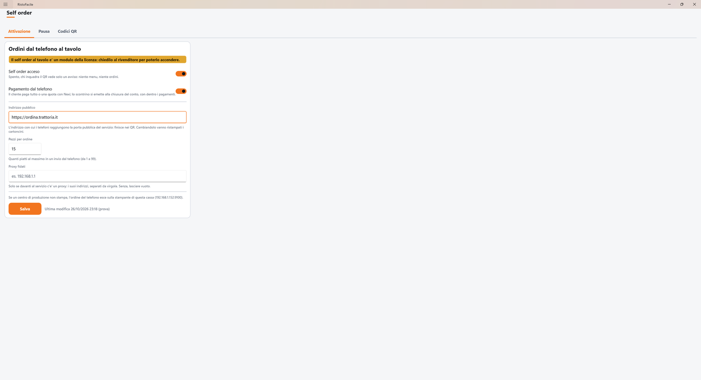
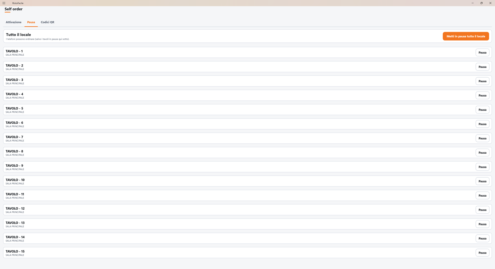
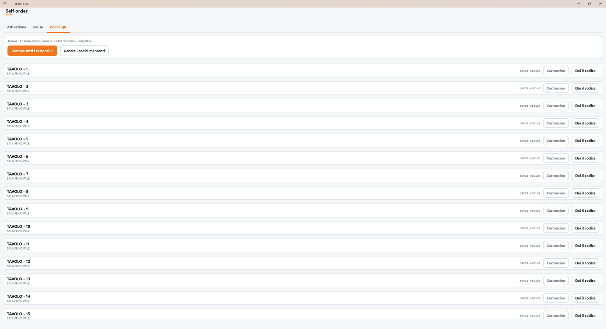
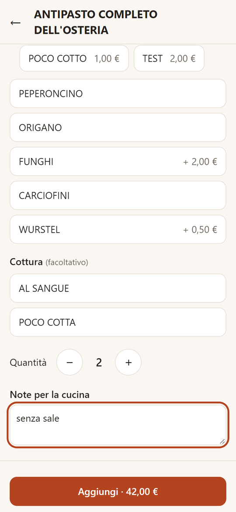
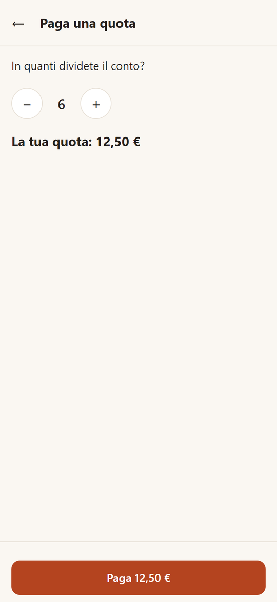
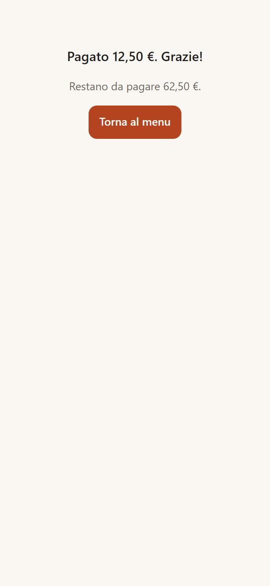

# Self order

Con il self order il cliente inquadra il QR sul tavolo, sfoglia il menu sul proprio telefono, manda
l'ordine in cucina, chiama il cameriere, chiede il conto e, se lo accendi, paga tutto o la sua quota.
Da questa schermata il titolare accende il servizio, lo mette in pausa e stampa i cartoncini con i
QR; in sala cassa e palmare ricevono gli avvisi dei telefoni.

!!! info "In sintesi"

    - **Dove si trova:** Menu ▸ Self order
    - **Chi la usa:** titolare (impostazioni, cartoncini); cassiere e camerieri (avvisi, pausa, conto)
    - **Disponibile anche su:** gli avvisi e il blocco del telefono anche sul [Palmare](../palmare/index.md); le impostazioni solo sulla cassa

---

## A cosa serve

Il tavolo lo apre sempre il personale: finché il tavolo non è aperto, chi inquadra il QR vede il
menu ma non può ordinare (il telefono dice *Il tavolo non è ancora aperto: chiedi al cameriere di
aprirlo, poi inquadra di nuovo il QR.*). Da lì in poi i clienti ordinano da soli, anche più telefoni sullo stesso
tavolo, e le loro righe finiscono nella stessa comanda del cameriere: in cucina escono come quelle
battute dalla cassa, rispettando le uscite. Il cameriere vede subito l'avviso sulla mappa e sulla
comanda, e al conto trova già scalato quello che il tavolo ha pagato dal telefono.

Un esempio: il tavolo 5 ordina due antipasti e due pizze. Gli antipasti partono subito; le pizze, che
sono nell'uscita dei secondi, aspettano il **VIA** del cameriere, come se le avesse battute lui.

## Prima di cominciare

- La licenza deve comprendere il modulo **Self order** (vedi [Licenza digitale](../introduzione/licenza.md));
  con la licenza in prova funziona finché dura la prova.
- Il servizio deve essere raggiungibile dai telefoni dei clienti da internet, con un indirizzo
  `https`: lo prepara chi installa il servizio (vedi
  [Pubblicare il self order su internet](../appendici/self-order-internet.md)).
- I piatti che il cliente vede sono quelli del [Menu online](menu-online.md): sistemalo prima.
- Sale e tavoli devono esistere (vedi [Sale e tavoli](sale-e-tavoli.md)).
- Per il pagamento dal telefono il servizio deve avere configurato Nexi.

## La schermata

La schermata ha tre linguette in alto: **Attivazione**, **Pausa** e **Codici QR**. In basso a
sinistra compare l'esito dell'ultima operazione.

- **Attivazione**: gli interruttori del self order e del pagamento dal telefono, l'indirizzo
  pubblico e i limiti, con il pulsante **Salva**.
- **Pausa**: la pausa di tutto il locale e, sotto, l'elenco dei tavoli con la pausa di ciascuno.
- **Codici QR**: l'elenco dei tavoli con il loro codice e i pulsanti per stampare i cartoncini.

## Campi e indicatori

| Elemento | Descrizione |
|---|---|
| **Self order acceso** | Acceso, i telefoni possono vedere il menu e ordinare. Spento, chi inquadra il QR vede il menu in sola lettura: niente ordini, chiamate o pagamenti (sul telefono: *Da qui puoi consultare il menu: per ordinare chiedi al cameriere.*). |
| **Pagamento dal telefono** | Acceso, nel conto del telefono compaiono **Paga tutto** e **Paga una quota**. Si può accendere solo se il servizio ha configurato Nexi: altrimenti la riga sotto lo dice. |
| **Indirizzo pubblico** | L'indirizzo con cui i telefoni raggiungono il servizio da internet, per esempio `https://ordina.trattoria.it`. È quello stampato nei QR: se lo cambi vanno ristampati tutti i cartoncini. |
| **Pezzi per ordine** | Quanti piatti al massimo può mandare un telefono in un solo invio, da 1 a 99 (proposto 15). |
| **Proxy fidati** | Da compilare solo se lo dice chi ha installato il servizio; altrimenti lascialo vuoto. |
| Riga della stampante | Dice dove esce la comanda di un ordine dal telefono se il centro di produzione non stampa: sulla stampante delle comande di questa cassa, oppure solo ai centri di produzione se la cassa non ne ha una. |
| Riga della licenza | Dice se il modulo è in licenza, in prova o assente. |
| Codice del tavolo (linguetta **Codici QR**) | Il codice di sei caratteri che sta nel QR del tavolo, oppure *senza codice*. |

## Pulsanti e comandi

| Comando | Effetto |
|---|---|
| **Salva** (Attivazione) | Salva interruttori, indirizzo e limiti sul servizio. Sotto compare *Salvato: il self order e' acceso.* oppure *Salvato: il self order e' spento, i QR mostrano solo il menu.* |
| **Metti in pausa tutto il locale** / **Riprendi gli ordini** (Pausa) | In pausa i telefoni vedono ancora il menu ma non possono ordinare, in nessun tavolo. |
| **Pausa** / **Riprendi** accanto a un tavolo (Pausa) | Ferma o riprende gli ordini dai telefoni solo per quel tavolo. |
| **Stampa tutti i cartoncini** (Codici QR) | Prepara il PDF dei cartoncini di tutti i tavoli che hanno il codice, da stampare e ritagliare. |
| **Genera i codici mancanti** (Codici QR) | Dà il codice ai tavoli che non lo hanno ancora; quelli che lo hanno lo tengono. |
| **Cartoncino** accanto a un tavolo | Prepara il PDF del solo cartoncino di quel tavolo. |
| **Dai il codice** / **Codice nuovo** accanto a un tavolo | Dà il primo codice al tavolo, oppure lo cambia: il cartoncino già stampato smette di funzionare. |

## Come si fa

### Accendere il self order la prima volta

1. Apri Menu ▸ **Self order**, linguetta **Attivazione**.
2. Scrivi l'**Indirizzo pubblico** che ti ha dato chi ha installato il servizio.
3. Accendi **Self order acceso** (e, se vuoi, **Pagamento dal telefono**).
4. Tocca **Salva**: sotto compare *Salvato: il self order e' acceso.*
5. Passa alla linguetta **Codici QR** e tocca **Genera i codici mancanti**.
6. Tocca **Stampa tutti i cartoncini**, stampa il PDF e metti ogni cartoncino sul suo tavolo.

### Servire un tavolo che ordina dal telefono

1. Apri il tavolo come sempre, dalla [Mappa della sala](mappa-sala.md): finché è libero, i telefoni non ordinano.
2. Quando il tavolo ordina compare in alto il riquadro *… ha ordinato dal telefono*, e sulla tessera del tavolo l'icona 📱.
3. Tocca **Apri** per andare alla comanda, oppure **Visto** per togliere l'avviso; **✕** chiude il riquadro senza segnarlo visto.
4. Nella [Comanda](comanda.md) le righe del telefono hanno la scritta *dal telefono*; si mandano in cucina da sole, e le uscite dopo la prima aspettano il tuo **VIA**.

### Fermare un telefono che ordina a sproposito

1. Nella comanda tocca una riga con *dal telefono*.
2. Tocca **📱 Blocca questo telefono** e conferma con **Blocca**.
3. La cassa chiede se mettere in pausa anche tutto il tavolo: tocca **Metti in pausa** per fermare anche gli altri telefoni, **No** per lasciarli.

### Chiudere un conto pagato in parte dal telefono

1. Apri il [Conto](conto.md): nel pannello del pagamento c'è la riga **Pagato dal telefono** con l'importo, e il **Residuo** è già scalato.
2. Incassa il resto come sempre, scegliendo **Scontrino** o **Fattura**.
3. Lo scontrino o la fattura contengono anche quanto pagato dal telefono, come pagamento elettronico.

## Controlli e messaggi

| Messaggio | Causa | Cosa fare |
|---|---|---|
| *Il self order al tavolo e' un modulo della licenza: chiedilo al rivenditore per poterlo accendere.* | La licenza non comprende il modulo. | Chiedi il modulo al rivenditore. |
| *Senza l'indirizzo pubblico i QR non porterebbero da nessuna parte: scrivilo prima di accendere il self order.* | Hai acceso il self order senza indirizzo. | Scrivi l'**Indirizzo pubblico** e salva. |
| *L'indirizzo pubblico va scritto intero, per esempio https://ordina.trattoria.it* | L'indirizzo non è completo. | Scrivilo con `https://` davanti. |
| *I pezzi per ordine vanno da 1 a 99.* | Il limite è fuori misura. | Correggi **Pezzi per ordine**. |
| *Nexi non e' configurato nel servizio: il pagamento dal telefono non si puo' accendere.* | Il servizio non ha le credenziali di Nexi. | Rivolgiti a chi ha installato il servizio. |
| *Le impostazioni del self order non sono state lette dal servizio: riapri la pagina prima di salvare.* | All'apertura il servizio non ha risposto. | Esci e rientra nella schermata. |
| *Codice nuovo* — *…: il cartoncino gia' stampato smette di funzionare e i telefoni collegati vanno scollegati. Continuare?* | Stai cambiando il codice di un tavolo. | Conferma con **Cambia codice** solo se ristampi il cartoncino. |
| *Tavolo in pausa: si riprende da Self order, linguetta Pausa.* | Dopo il blocco di un telefono hai messo in pausa il tavolo. | Riprendi il tavolo dalla linguetta **Pausa**. |
| *Su questo tavolo c'e' un pagamento dal telefono: il conto si chiude con lo scontrino o la fattura, non senza documento, in camera o diviso.* | Nel conto ci sono pagamenti dal telefono, o un pagamento in corso. | Chiudi con **Scontrino** o **Fattura**. |
| *Non riesco a sapere dal servizio se il tavolo ha pagato dal telefono: riprova fra un attimo.* | Il servizio non ha risposto alla domanda sui pagamenti. | Riprova; se insiste, controlla il collegamento. |
| *Il conto e' cambiato mentre lo incassavi (un ordine dal telefono o un'altra postazione): ricontrolla il totale, ora € …, e premi di nuovo.* | Mentre eri sul conto è arrivato un ordine o un pagamento dal telefono. | Ricontrolla il totale e incassa di nuovo. |

Gli avvisi dei telefoni che compaiono in alto su mappa, comanda e conto:

| Icona | Avviso | Cosa fare |
|---|---|---|
| 📱 | *… ha ordinato dal telefono* | Controlla la comanda. |
| ✋ | *… chiama il cameriere* | Vai al tavolo. |
| 🧾 | *… chiede il conto* | Porta il conto o il preconto. |
| 💳 | *… ha pagato € … dal telefono* | Niente: il pagamento è già nel conto. |
| 🖨 | *Comanda di … dal telefono non stampata: è in cucina sul monitor, ristampala dalla cassa* | Ristampa la comanda dalla cassa. |
| 💳 | *… ha pagato tutto dal telefono, ma lo scontrino non è uscito (…): emettilo dalla cassa* | Apri il conto ed emetti lo scontrino. |
| 💶 | *…: € … pagati dal telefono su un conto già chiuso, da rimborsare dal portale Nexi (operazione …)* | Rimborsa il cliente dal portale Nexi. |

## Note

- **Cosa vede il cliente.** Il menu del locale con foto, ingredienti e allergeni; per ogni piatto le
  scelte obbligatorie, le varianti e le note per la cucina. Prima dell'invio il telefono propone i
  piatti segnati **Consigliato** nel menu. Dopo l'invio vede il conto di tutto il tavolo, anche le
  righe del cameriere, con lo stato di ogni piatto (*in attesa*, *in preparazione*, *pronto*,
  *servito*) e i tasti **Chiama il cameriere** e **Chiedi il conto**. Lo stato viene dal monitor di
  cucina; per i centri con la sola stampante il piatto è *in preparazione* da quando la comanda è
  uscita in cucina.

    { .telefono }
    { .telefono }
    { .telefono }

- **Piatti da chiedere al cameriere.** Nella composizione del [Menu](menu.md), un piatto con
  **Ordinabile dal telefono** spento si vede sul telefono ma si ordina al cameriere.
- **Il prezzo lo decide la cassa.** Il telefono mostra i prezzi del menu online, ma il servizio li
  ricalcola all'invio: se nel frattempo sono cambiati, il cliente vede il totale nuovo e deve
  confermare di nuovo. Un piatto esaurito non si può ordinare.
- **Pagamento dal telefono.** Il cliente paga tutto oppure una quota, dividendo il conto per il
  numero di persone (la quota è arrotondata per eccesso al centesimo). Paga sulla pagina di Nexi:
  il locale non vede mai la carta. Quando i pagamenti dal telefono coprono tutto il conto, il
  servizio chiude il tavolo da solo ed emette lo scontrino sulla stampante fiscale del locale.
- Se chiudi il conto in cassa mentre un cliente sta pagando, il suo pagamento viene annullato; se
  arriva lo stesso, resta da rimborsare e compare l'avviso 💶.

!!! warning "Con pagamenti dal telefono, solo scontrino o fattura"

    Un conto con pagamenti dal telefono si chiude solo con lo scontrino o la fattura, perché il
    pagamento elettronico deve comparire nel documento. **Chiudi senza documento**, l'addebito in
    camera e **Dividi** vengono rifiutati.

## Vedi anche

- [Mappa della sala](mappa-sala.md)
- [Comanda](comanda.md)
- [Conto](conto.md)
- [Menu online](menu-online.md)
- [Pubblicare il self order su internet](../appendici/self-order-internet.md)
