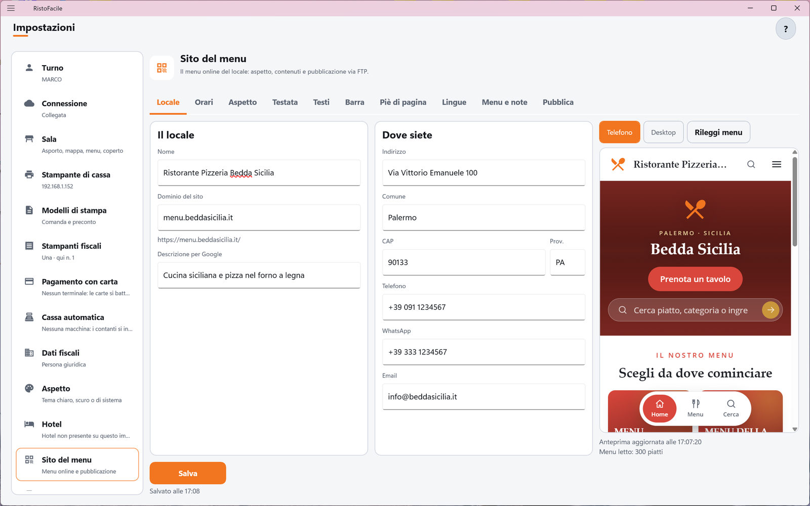
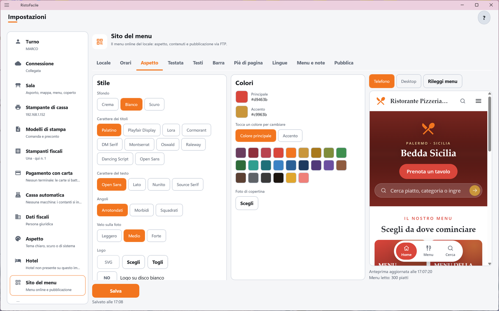
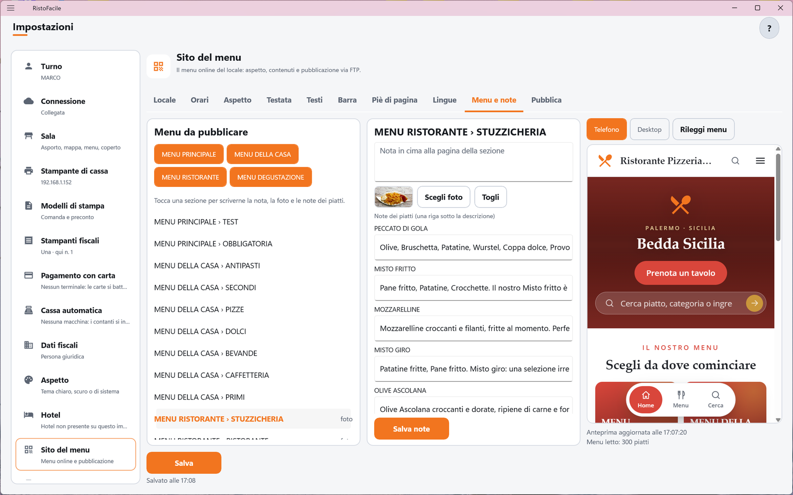
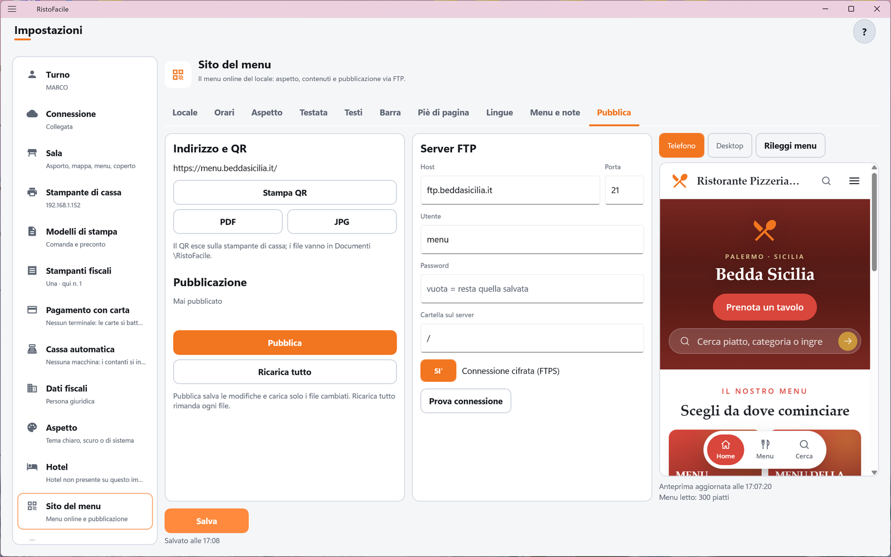

# Sito del menu

Il sito del menu è il sito internet del locale con il menu: piatti, prezzi, foto e allergeni,
più orari, contatti e una copertina. Il cliente lo apre sul suo telefono inquadrando il QR stampato
sul tavolo. Da questo pannello il titolare prepara il sito, lo guarda in anteprima come lo vedrà il
cliente e lo pubblica sullo spazio internet del locale.

!!! info "In sintesi"

    - **Dove si trova:** Menu ▸ Impostazioni ▸ **Sito del menu**
    - **Chi la usa:** titolare, installatore
    - **Disponibile anche su:** solo cassa

---

## A cosa serve

Un locale vuole togliere i menu di carta dai tavoli. Il titolare scrive nome, indirizzo e orari,
sceglie colori e caratteri, aggiunge una nota e una foto alle sezioni del menu e controlla tutto
nell'anteprima a destra. Quando è contento tocca **Pubblica**: la cassa compone le pagine del sito
dal menu attuale e le carica sul server FTP del locale. Poi stampa il QR con l'indirizzo del sito e
lo mette sui tavoli.

Il sito è fatto di pagine fisse: prende piatti e prezzi del momento in cui lo pubblichi. Dopo aver
cambiato il menu, gli articoli o i prezzi, pubblicalo di nuovo.

## Prima di cominciare

- La cassa deve essere collegata al servizio: [Impostazioni](impostazioni.md) ▸ **Connessione**.
  Il menu si legge da lì.
- I piatti e le sezioni vengono dal [Menu](menu.md); nomi, descrizioni in lingua, foto e allergeni
  dagli [Articoli](articoli.md).
- Per pubblicare servono un dominio (per esempio `menu.iltuolocale.it`) e uno spazio sul web con
  accesso FTP: host, utente e password li dà chi gestisce l'hosting.
- Per stampare il QR serve la stampante di cassa: [Impostazioni](impostazioni.md) ▸ **Stampante di cassa**.

## La schermata

In testa il titolo *Sito del menu* con la riga *Il menu online del locale: aspetto, contenuti e
pubblicazione via FTP.* Sotto, dieci linguette: **Locale**, **Orari**, **Aspetto**, **Testata**,
**Testi**, **Barra**, **Piè di pagina**, **Lingue**, **Menu e note**, **Pubblica**.

A sinistra i campi della linguetta scelta, a destra l'**anteprima** del sito: segue ogni modifica
già prima del salvataggio. Sopra l'anteprima:

- **Telefono** / **Desktop**: il sito come appare su un telefono o su un computer;
- **Rileggi menu**: rilegge dal servizio menu, piatti, foto e note, se nel frattempo sono cambiati.

Sotto l'anteprima due righe di stato: quando è stata aggiornata (*Anteprima aggiornata alle* …) e
quanti piatti sono stati letti (*Menu letto: N piatti*, seguito dagli eventuali avvisi).

In fondo **Salva**. Con modifiche non salvate compaiono **Annulla modifiche** e la riga *Modifiche
non salvate: l'anteprima le mostra gia', il sito online no.*; dopo il salvataggio, *Salvato alle* (ora).

## Campi e indicatori

### Locale

| Elemento | Descrizione |
|---|---|
| **Nome** (riquadro **Il locale**) | Il nome del locale, in alto in ogni pagina del sito. |
| **Dominio del sito** | Il dominio su cui sta il sito, per esempio `menu.trattoria.it`, senza `https://`. Sotto compare l'indirizzo completo, che è quello del QR. |
| **Descrizione per Google** | La frase che i motori di ricerca mostrano sotto il nome del sito. |
| **Indirizzo**, **Comune**, **CAP**, **Prov.** (riquadro **Dove siete**) | L'indirizzo del locale, nella parte contatti del sito. |
| **Telefono**, **WhatsApp**, **Email** | I contatti del locale. Il telefono serve anche al tasto **Chiama** della barra in basso. |

### Orari

*Due fasce per giorno, come 12:30 e 15:00. Un giorno senza orari esce come Chiuso.* Per ogni giorno,
da lunedì a domenica, quattro caselle: inizio e fine della prima fascia, inizio e fine della seconda.

### Aspetto

| Elemento | Descrizione |
|---|---|
| **Sfondo** (riquadro **Stile**) | **Crema**, **Bianco** o **Scuro**. |
| **Carattere dei titoli** | *Palatino*, *Playfair Display*, *Lora*, *Cormorant*, *DM Serif*, *Montserrat*, *Oswald*, *Raleway*, *Dancing Script*, *Open Sans*. |
| **Carattere del testo** | *Open Sans*, *Lato*, *Nunito*, *Source Serif*. |
| **Angoli** | **Arrotondati**, **Morbidi** o **Squadrati**: la forma di riquadri e pulsanti. |
| **Velo sulla foto** | **Leggero**, **Medio** o **Forte**: quanto si scurisce la foto di copertina sotto i testi. |
| **Logo** | **Scegli** carica il logo (un'immagine o un disegno SVG), **Togli** lo toglie. Con un logo compare **Logo su disco bianco**: **SI'** lo mette su un cerchio bianco. |
| **Principale** / **Accento** (riquadro **Colori**) | I due colori del sito, con il loro codice. |
| **Tocca un colore per cambiare** | Scegli **Colore principale** o **Accento**, poi tocca uno dei 24 riquadri colorati. |
| **Foto di copertina** | **Scegli** carica la foto grande in testa al sito, **Togli** la toglie. |

### Testata

La copertina in cima alla prima pagina.

| Elemento | Descrizione |
|---|---|
| **Sopra il titolo** (riquadro **Testi della copertina**) | Una riga piccola sopra il titolo, per esempio *Capo d'Orlando · Sicilia*. |
| **Titolo** | Il titolo grande. Vuoto, si usa il nome del locale. |
| **Sottotitolo** | Una riga sotto il titolo. |
| **Campo di ricerca** | **SI'** mette nella copertina la casella per cercare un piatto. |
| **Altezza** (riquadro **Forma**) | **Alta**, **Media** o **Bassa**. |
| **Testi** | **Al centro** o **A sinistra**. |
| **Pulsante (facoltativo)** | Testo e link di un pulsante nella copertina (per esempio *Prenota un tavolo* con il link `tel:+390941123456`), e il suo stile: **Colore**, **Accento**, **Chiaro**, **Contorno**. |

### Testi

| Elemento | Descrizione |
|---|---|
| **Sopra il titolo**, **Titolo**, **Testo** (riquadro **Sopra le schede del menu**) | Il titolo e il testo che introducono l'elenco dei menu nella prima pagina. |
| **Nota generale (coperto, avvertenze)** (riquadro **Note del menu**) | Le righe in fondo al menu, per esempio il coperto. Una riga per voce. |
| **Nota sugli allergeni** | Il testo sugli allergeni in fondo al menu. |

### Barra

| Elemento | Descrizione |
|---|---|
| **Sezioni del menu** (riquadro **Barra in alto**) | **SI'** mette nella barra in alto le voci principali del menu; se sono troppe, una voce sola *Menu*. |
| **Orari e contatti** | **SI'** aggiunge alla barra in alto la voce che porta a orari e contatti. |
| **Pulsante Prenota (testo e link)** | Testo e link del pulsante di prenotazione nella barra in alto. |
| **Home**, **Menu**, **Cerca**, **Chiama** (riquadro **Barra in basso sul telefono**) | Le voci della barra in basso che si vede sui telefoni. **Chiama** telefona al numero della linguetta **Locale**. |
| **Striscia di avviso in cima (vuota = niente striscia)** | Un avviso in cima a ogni pagina, per esempio *Chiusi per ferie dal 10 al 20 agosto*, con un link facoltativo (testo e indirizzo). |

### Piè di pagina

| Elemento | Descrizione |
|---|---|
| **Scuro** / **Chiaro** / **Colore** | Il fondo del piè di pagina. |
| **Motto** | Una riga sotto il nome, per esempio *Trattoria · Pizzeria*. |
| **Ragione sociale e P.IVA** | Ragione sociale e partita IVA del locale. |
| **Link alla privacy** | L'indirizzo della pagina sulla privacy. |
| **Credito RistoFacile** | **SI'** mostra la riga che il sito è fatto con RistoFacile. |
| **Colonna orari** / **Colonna contatti** | **SI'** mettono nel piè di pagina gli orari e i contatti. |
| **Colonna di testo libero (titolo e testo)** (riquadro **Colonna libera e social**) | Una colonna con titolo (all'inizio *Da sapere*) e testo a piacere. Senza testo non compare. |
| **Facebook**, **Instagram**, **TripAdvisor**, **TikTok**, **WhatsApp** | Gli indirizzi delle pagine social del locale. Quelle vuote non compaiono. |

### Lingue

| Elemento | Descrizione |
|---|---|
| **Lingua principale** (riquadro **Lingue del sito**) | **Italiano** o **English**. |
| **Anche in** … | **SI'** aggiunge la seconda lingua: *Con un'altra lingua accesa, in alto nel sito compare il selettore IT · EN e chi lo tocca resta sulla stessa pagina. Nomi e descrizioni dei piatti vengono dalle descrizioni in lingua degli articoli; le note restano solo nella lingua principale.* |
| *Testi in* … *(vuoto = resta in* …*)* | A destra, ogni testo del sito (copertina, barre, piè di pagina, nomi e descrizioni delle sezioni) con la sua casella **Traduzione**. Senza un'altra lingua accesa compare *Accendi un'altra lingua per scriverne i testi.* |

### Menu e note

| Elemento | Descrizione |
|---|---|
| **Menu da pubblicare** | I menu del locale: quelli accesi finiscono sul sito. Con tutti accesi vanno sul sito anche i menu creati dopo. |
| Elenco delle sezioni | Le sezioni dei menu accesi; con più menu, il nome del menu davanti (*MENU RISTORANTE › STUZZICHERIA*). A destra *nota* e *foto* dicono se la sezione le ha già. |
| **Nota in cima alla pagina della sezione** | Il testo in testa alla pagina della sezione scelta. |
| **Scegli foto** / **Togli** | La foto della sezione. Si salva subito, senza **Salva note**. |
| **Note dei piatti (una riga sotto la descrizione)** | Per ogni piatto della sezione una riga di nota, fino a 250 caratteri (*Nessuna nota* se vuota). |

Note e foto delle sezioni stanno sul servizio: le vedono tutte le casse.

### Pubblica

| Elemento | Descrizione |
|---|---|
| Indirizzo del sito (riquadro **Indirizzo e QR**) | L'indirizzo completo, quello che finisce nel QR. |
| *Il QR esce sulla stampante di cassa; i file vanno in Documenti\RistoFacile.* | Dove escono il QR stampato e i file esportati. |
| *Mai pubblicato* / *Ultima pubblicazione:* … (riquadro **Pubblicazione**) | Data, ora ed esito dell'ultima pubblicazione riuscita. |
| Esito | Sotto, in verde o in rosso, l'esito dell'ultima prova o pubblicazione, e durante il caricamento l'avanzamento (*Caricamento N di M:* …). |
| **Host**, **Porta** (riquadro **Server FTP**) | Il server FTP dello spazio web e la sua porta (di solito 21). |
| **Utente**, **Password** | Le credenziali FTP. La password si scrive nascosta; vuota, resta quella già salvata (*Password salvata su questa cassa.*). |
| **Cartella sul server** | La cartella in cui caricare il sito, per esempio `/` o `/public_html`. |
| **Connessione cifrata (FTPS)** | **SI'** cifra la connessione con il server. |

## Pulsanti e comandi

| Comando | Effetto |
|---|---|
| Linguette | Passano da un gruppo di impostazioni all'altro. |
| **Telefono** / **Desktop** | Cambiano la misura dell'anteprima. |
| **Rileggi menu** | Rilegge dal servizio menu, piatti e note e rifà l'anteprima. |
| **Salva** | Salva tutte le linguette su questa cassa: *Salvato alle* (ora). Passa anche al self order i menu scelti e l'aspetto (colori, caratteri, angoli, logo). **Non** pubblica il sito. |
| **Annulla modifiche** | Dopo la conferma (*Torno all'ultima versione salvata?*) riporta tutto all'ultimo salvataggio. |
| **Scegli** / **Togli** | Logo e foto di copertina (linguetta **Aspetto**). |
| Pastiglie **SI'** / **NO** e pulsanti di scelta | Accendono o spengono un'opzione, scelgono un valore. |
| Pastiglie dei menu | Accendono o spengono un menu da pubblicare (*Almeno un menu va pubblicato.*). |
| **Salva note** | Salva sul servizio la nota della sezione e le note dei piatti: *Note salvate.* |
| **Scegli foto** / **Togli** | Mettono o tolgono la foto della sezione (linguetta **Menu e note**). |
| **Stampa QR** | Stampa il QR con l'indirizzo del sito sulla stampante di cassa: *QR stampato.* |
| **PDF** / **JPG** | Salvano il QR in `menu-qr.pdf` o `menu-qr.jpg` nella cartella Documenti\RistoFacile e la aprono: *QR salvato in* (percorso). |
| **Pubblica** | Salva, legge il menu, compone il sito e carica sul server solo i file cambiati, togliendo quelli che non servono più. |
| **Ricarica tutto** | Come **Pubblica**, ma ricarica ogni file. |
| **Prova connessione** | Si collega al server FTP e controlla la cartella; con il dominio scritto, controlla anche che il sito mostri proprio quella cartella e, se ne trova un'altra giusta, la scrive in **Cartella sul server**. |

## Come si fa

### Preparare il sito

1. Apri Menu ▸ Impostazioni ▸ **Sito del menu**.
2. Nella linguetta **Locale** scrivi nome, dominio e contatti; in **Orari** gli orari di apertura.
3. In **Aspetto** scegli sfondo, caratteri e colori; carica logo e foto di copertina.
4. Completa le altre linguette che ti servono, guardando l'anteprima a destra.
5. In **Menu e note** accendi i menu da pubblicare.
6. Tocca **Salva**.
7. In fondo compare *Salvato alle* (ora).

### Scrivere la nota e la foto di una sezione

1. Apri la linguetta **Menu e note** e tocca la sezione nell'elenco.
2. Scrivi la nota in cima e, se serve, le note dei piatti.
3. Tocca **Salva note**: compare *Note salvate.*
4. Per la foto tocca **Scegli foto** e scegli l'immagine: accanto alla sezione compare *foto*.

### Pubblicare il sito

1. Apri la linguetta **Pubblica** e compila **Host**, **Porta**, **Utente**, **Password** e
   **Cartella sul server**.
2. Tocca **Prova connessione**: in verde compare l'esito (per esempio *Connesso a* … *: la
   cartella* … *e' quella che* … *mostra.*).
3. Tocca **Pubblica**.
4. Sotto scorre l'avanzamento del caricamento; alla fine compare l'esito (*Caricati N file, N
   invariati, N rimossi.*) e la data dell'ultima pubblicazione.
5. Apri l'indirizzo del sito dal browser di un telefono per controllarlo.

### Stampare il QR per i tavoli

1. Nella linguetta **Pubblica** controlla l'indirizzo in **Indirizzo e QR**.
2. Tocca **Stampa QR**.
3. Dalla stampante di cassa esce il QR e compare *QR stampato.*

Per farlo stampare in tipografia tocca **PDF** o **JPG**: si apre la cartella Documenti\RistoFacile
con il file `menu-qr.pdf` o `menu-qr.jpg`. Ogni esportazione sovrascrive la precedente.

## Controlli e messaggi

| Messaggio | Causa | Cosa fare |
|---|---|---|
| *Scrivi prima il dominio del sito (scheda Locale): e' l'indirizzo che finisce nel QR.* | **Stampa QR**, **PDF** o **JPG** senza dominio. | Scrivi il **Dominio del sito** nella linguetta **Locale**. |
| *Scrivi prima il dominio del sito (scheda Locale).* | **Pubblica** senza dominio. | Come sopra. |
| *Servono host, utente e password FTP.* | Prova o pubblicazione con un dato FTP mancante. | Compila il riquadro **Server FTP**. |
| *Utente o password FTP non accettati dal server.* | Credenziali FTP sbagliate. | Ricopia utente e password. |
| *Il server* … *non esiste: controlla l'host.* | Host scritto male. | Correggi **Host**. |
| *Server* … *non raggiungibile: controlla host, porta e rete.* | Il server non risponde. | Controlla host, porta e collegamento a internet. |
| *Il server non supporta FTPS: togli la spunta FTPS solo se il server e' vostro e la rete e' sicura.* | Server senza connessione cifrata. | Chiedi a chi gestisce l'hosting; spegni **Connessione cifrata (FTPS)** solo nel caso detto. |
| *Connessione cifrata con* … *non riuscita: il certificato del server non e' valido per questo nome, controlla l'host.* | L'host non è quello del certificato. | Usa il nome del server che dà l'hosting. |
| *Connesso a* …*, ma la cartella* … *non esiste sul server.* | **Cartella sul server** sbagliata (senza dominio scritto). | Correggi la cartella. |
| *Connesso a* … *. … mostra la cartella* … *, non* … *: l'ho messa in "Cartella sul server". Salva e pubblica di nuovo.* | Il dominio legge un'altra cartella: la cassa l'ha trovata. | Tocca **Salva** e poi **Pubblica**. |
| *Connesso a* …*, ma* … *non mostra i file di* … *ne' delle altre cartelle provate. Chiedi a chi gestisce l'hosting quale cartella usa questo dominio, o se il dominio punta davvero a questo server.* | Il dominio non porta a questo spazio FTP, o usa una cartella non trovata. | Come dice il messaggio. |
| *File caricati in* … *sul server FTP, ma* … *non li mostra: il dominio legge un'altra cartella. Premi "Prova connessione": cerca lei quella giusta.* | Pubblicazione nella cartella sbagliata. | Tocca **Prova connessione**, poi **Salva** e **Pubblica**. |
| *Il sito era gia' aggiornato.* | **Pubblica** senza niente di cambiato. | Nessuna azione. |
| *Pubblicazione interrotta: il sito online e' quello di prima, piu' i file gia' caricati.* | La pubblicazione si è fermata a metà. | Tocca di nuovo **Pubblica**. |
| *Pubblicazione non riuscita:* … / *Errore FTP:* … | Errore durante la pubblicazione. | Leggi il dettaglio; prova **Prova connessione**. |
| *Da correggere prima di pubblicare:* … | Un valore delle impostazioni non è accettato. | Correggi il valore indicato. |
| *La pubblicazione FTP si fa dalla cassa (Windows o Mac), non dal telefono o dal tablet.* | Pubblicazione da un dispositivo diverso. | Pubblica dalla cassa. |
| *Licenza Chilkat non valida su questa cassa: la pubblicazione FTP non puo' partire.* | Problema della cassa. | Chiama l'assistenza. |
| *Salvataggio non riuscito.* | Le impostazioni non si sono potute scrivere. | Leggi il dettaglio e riprova. |
| *Salvato su questa cassa, ma il menu del self order sul servizio non e' stato aggiornato.* | Salvato, ma il servizio non ha preso i menu scelti. | Controlla la connessione e salva di nuovo. |
| *Salvato su questa cassa, ma la pagina del self order non ha preso l'aspetto del sito.* | Salvato, ma il servizio non ha preso l'aspetto. | Come sopra. |
| *Impostazioni del sito non leggibili: riparto da quelle predefinite.* | Il file delle impostazioni di questa cassa è rovinato. | Ricontrolla le linguette e salva. |
| *Immagine del logo non leggibile.* / *Foto di copertina non leggibile.* / *Non sono riuscito a leggere il file.* | Il file scelto non si apre. | Scegli un'altra immagine. |
| *Note non salvate.* / *Foto della sezione non salvata.* / *Foto della sezione non tolta.* | Il servizio non ha preso la modifica. | Leggi il dettaglio e riprova. |
| *Le note di questa sezione non sono salvate. Le lascio perdere?* | Passi a un'altra sezione con note non salvate. | **Resta qui** e tocca **Salva note**, oppure **Lascia perdere**. |
| *Almeno un menu va pubblicato.* | Hai provato a spegnere l'ultimo menu acceso. | Accendi prima un altro menu. |
| *Note e foto delle sezioni si salvano solo su database PostgreSQL: qui non sono disponibili.* | Il servizio usa un database che non le prevede. | Nota, foto e note dei piatti non si possono usare; il resto del sito sì. |
| *Il servizio non ha ancora le rotte del sito del menu: va aggiornato per scrivere note e foto.* | Servizio di una versione precedente. | Aggiorna il servizio. |
| *Menu non letto:* … | La lettura del menu dal servizio non è riuscita. | Controlla la connessione e tocca **Rileggi menu**. |
| *Anteprima non riuscita:* … / *Da correggere:* … | L'anteprima non si è potuta comporre. | Leggi il dettaglio; correggi il valore indicato. |
| *Stampa del QR non riuscita.* | La stampante di cassa non ha stampato. | Controlla la stampante in Impostazioni ▸ **Stampante di cassa**. |
| *Esportazione del QR non riuscita.* | Il file non si è potuto scrivere. | Leggi il dettaglio e riprova. |

## Note

!!! warning "Il sito non si aggiorna da solo"

    Il sito pubblicato è una copia del menu del momento della pubblicazione: piatti, prezzi, foto
    e note cambiati dopo compaiono solo con un nuovo **Pubblica**. Anche **Salva** non tocca il
    sito online: aggiorna solo l'anteprima e le impostazioni di questa cassa.

!!! warning "Il QR stampato non si cambia"

    Il QR contiene l'indirizzo del sito. Se cambi il dominio, i QR già stampati non portano più al
    sito e vanno ristampati tutti.

- Le impostazioni del sito, immagini e password FTP comprese, restano su **questa** cassa: le
  altre casse non le vedono. Prepara e pubblica il sito sempre dalla stessa cassa.
- Il sito non sa quali piatti sono esauriti in quel momento: la [Disponibilità](disponibilita.md)
  vale per le comande, non per il sito.
- La prima volta che si apre il pannello, nome, sottotitolo, nota, colore, tema, dominio e logo del
  vecchio menu online diventano il punto di partenza.
- **Salva** passa al [Self order](self-order.md) i menu scelti (con un menu solo, quello; con più
  menu, tutti quelli validi in quel momento) e l'aspetto del sito: la pagina del self order sul
  telefono del cliente prende gli stessi colori, caratteri, angoli e logo.
- Il palmare non ha questo pannello.

## Vedi anche

- [Impostazioni](impostazioni.md)
- [Menu](menu.md)
- [Articoli](articoli.md)
- [Self order](self-order.md)
