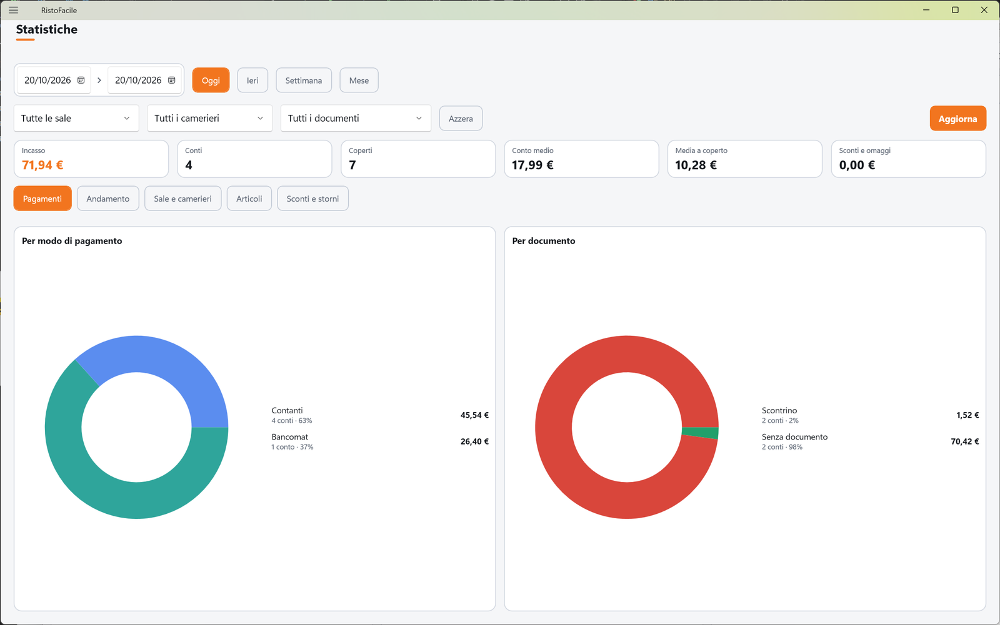

# Statistiche

Questa schermata riassume gli incassi di un periodo: quanto è entrato, in quanti conti e coperti,
come è stato pagato, con quale documento, in quali ore o giorni, da quale sala e cameriere, quali
piatti si sono venduti di più e quanto si è lasciato in sconti, omaggi e storni. Serve al titolare
e al responsabile di sala.

!!! info "In sintesi"

    - **Dove si trova:** Menu ▸ Statistiche
    - **Chi la usa:** titolare, responsabile di sala
    - **Disponibile anche su:** solo cassa

---

## A cosa serve

A fine serata vuoi sapere quanto hai incassato e quanto di questo è arrivato in contanti; a fine
mese vuoi vedere quali giorni rendono di più, quale cameriere ha servito di più e quali piatti
escono meglio. Le statistiche contano tutti i conti chiusi del periodo e mostrano una sezione alla
volta, ciascuna su un'unica schermata senza scorrere.

## Prima di cominciare

*Nessun prerequisito.* Le statistiche contano i conti chiusi dalla cassa e dal palmare.

## La schermata

Dall'alto verso il basso:

- **il periodo**: le due date e i pulsanti **Oggi**, **Ieri**, **Settimana**, **Mese** (quello
  attivo è colorato);
- **gli altri filtri**: sala, cameriere, tipo di documento, e i pulsanti **Azzera** e **Aggiorna**;
- **la striscia dei sei numeri**: **Incasso**, **Conti**, **Coperti**, **Conto medio**,
  **Media a coperto**, **Sconti e omaggi**;
- **le pastiglie delle sezioni**: **Pagamenti**, **Andamento**, **Sale e camerieri**,
  **Articoli**, **Sconti e storni**; a destra, in giallo, l'eventuale avviso dei conti senza
  pagamento registrato;
- **il contenuto della sezione scelta**, su due schede affiancate (grafico e numeri).

## Campi e indicatori

### Filtri

| Elemento | Descrizione |
|---|---|
| **Periodo** (due date) | Dalla data… alla data di apertura del conto. Se cambi una data a mano, il periodo diventa personalizzato (il riquadro delle date si colora) e i dati si ricaricano da soli. |
| **Tutte le sale** | Limita alla sala scelta. |
| **Tutti i camerieri** | Limita ai conti del cameriere scelto (solo operatori attivi). |
| **Tutti i documenti** | Limita per tipo di chiusura: **Scontrino**, **Fattura**, **Senza documento**, **Pagamento non registrato**, **Addebito in camera**. Anche la classifica degli articoli conta solo i conti filtrati. |

### I sei numeri

| Elemento | Descrizione |
|---|---|
| **Incasso** | Totale incassato nel periodo filtrato. |
| **Conti** | Numero di conti chiusi. |
| **Coperti** | Totale dei coperti. |
| **Conto medio** | Incasso diviso per il numero di conti. |
| **Media a coperto** | Incasso diviso per i coperti; *—* se non ci sono coperti. |
| **Sconti e omaggi** | Somma di sconti/abbuoni e del valore delle voci date in omaggio. |
| Avviso giallo *n conti senza pagamento registrato* | Una parte dell'incasso viene da conti di cui non si sa come sono stati pagati (chiusi prima che la cassa annotasse il pagamento). |

### Le sezioni

| Sezione | Contenuto |
|---|---|
| **Pagamenti** | Due ciambelle: **Per modo di pagamento** (Contanti, Bancomat, Carte, Buoni pasto, Assegni, Credito, Addebito camera, Non registrato) e **Per documento** (Scontrino, Fattura, Senza documento, Addebito camera, Non registrato). Accanto a ogni voce: importo, numero di conti e percentuale sull'incasso. |
| **Andamento** | Grafico a colonne con la tabella **Dettaglio**: su un giorno solo *Incasso per ora di apertura del conto*, su più giorni *Incasso per giorno*. Ogni voce riporta conti e coperti. |
| **Sale e camerieri** | Barre **Per cameriere** e **Per sala**, con il primo in classifica in cima. |
| **Articoli** | **I piu' venduti**: i primi 20 articoli per quantità, con importo e quantità venduta; **Per categoria (panini, bibite, vini...)**: l'incasso per categoria merceologica dell'articolo. |
| **Sconti e storni** | Quattro riquadri: **Sconti e abbuoni** (*su n conti*), **Omaggi** (*n righe in omaggio, al prezzo pieno*), **Storni** (*n righe stornate*) e **Valore servito** (*incasso + sconti + omaggi: quanto sarebbe valso a prezzo pieno*). |

Toccando una fetta o una colonna dei grafici compare il valore.

## Pulsanti e comandi

| Comando | Effetto |
|---|---|
| **Oggi** | Periodo: oggi. |
| **Ieri** | Periodo: ieri. |
| **Settimana** | Periodo: da lunedì della settimana in corso a oggi. |
| **Mese** | Periodo: dal primo del mese in corso a oggi. |
| **Azzera** | Rimette tutte le sale, tutti i camerieri, tutti i documenti e il periodo **Oggi**. |
| **Aggiorna** | Rilegge i dati con i filtri attuali (es. per contare i conti chiusi nel frattempo). |
| **Pagamenti** / **Andamento** / **Sale e camerieri** / **Articoli** / **Sconti e storni** | Mostra la sezione scelta. |

## Come si fa

### Vedere l'incasso della serata per modo di pagamento

1. Tocca **Menu ▸ Statistiche**: il periodo è **Oggi** e la sezione è **Pagamenti**.
2. Leggi l'**Incasso** nella striscia in alto.
3. Nella ciambella **Per modo di pagamento** leggi quanto è entrato in contanti, bancomat, carte…

### Confrontare i giorni del mese

1. Tocca **Mese**.
2. Tocca **Andamento**.
3. Il grafico mostra una colonna per giorno; la tabella **Dettaglio** riporta importo, conti e
   coperti di ciascun giorno.

### Vedere i piatti più venduti di una sala

1. Scegli il periodo.
2. Nella tendina **Tutte le sale** scegli la sala.
3. Tocca **Articoli**: a sinistra la classifica dei più venduti, a destra l'incasso per categoria.

## Controlli e messaggi

| Messaggio | Causa | Cosa fare |
|---|---|---|
| *Nessun conto chiuso con questi filtri.* | Nel periodo e con i filtri scelti non ci sono conti chiusi. | Allarga il periodo o tocca **Azzera**. |
| *Statistiche non caricate.* | Il servizio non ha risposto o ha dato errore; sotto c'è il dettaglio. | Controlla il collegamento al servizio e tocca **Aggiorna**. |
| *Sale e camerieri non si sono letti: restano periodo e documento.* | Non è stato possibile leggere sale e operatori. | Usa gli altri filtri; riapri la schermata più tardi. |

## Note

- Le statistiche contano **tutti** i conti chiusi del periodo (lo [Storico conti](storico-conti.md)
  invece ne mostra al massimo 200): per i totali di periodi lunghi usa questa schermata.
- Il giorno di un conto è il giorno di **apertura** del tavolo, non quello di chiusura: un tavolo
  aperto alle 23:50 e chiuso dopo mezzanotte conta nel giorno in cui è stato aperto.
- Ogni volta che rientri nella schermata, un periodo **Oggi**, **Ieri**, **Settimana** o **Mese** si
  ricalcola sulla data del giorno; un periodo scelto a mano resta quello.
- Nella classifica degli articoli le voci stornate non contano; gli omaggi sì, a importo zero. Le
  parti di un mezzo e mezzo e i piatti dentro un menu fisso non si contano come piatti a sé.
- Filtrando per tipo di documento un tavolo diviso in più conti, se il pagamento dei singoli conti
  non è stato registrato, il conto contribuisce con importo zero: non si sa quale parte spetti ai
  conti filtrati.
- Gli articoli senza categoria merceologica compaiono sotto *Senza categoria*.
<!-- DA VERIFICARE: la schermata è accessibile a qualunque operatore? Nel codice non si vede un controllo dei permessi. -->

## Vedi anche

- [Storico conti](storico-conti.md)
- [Fatture](fatture.md)
- [Conto](conto.md)
- [Articoli](articoli.md) — categoria merceologica dell'articolo
