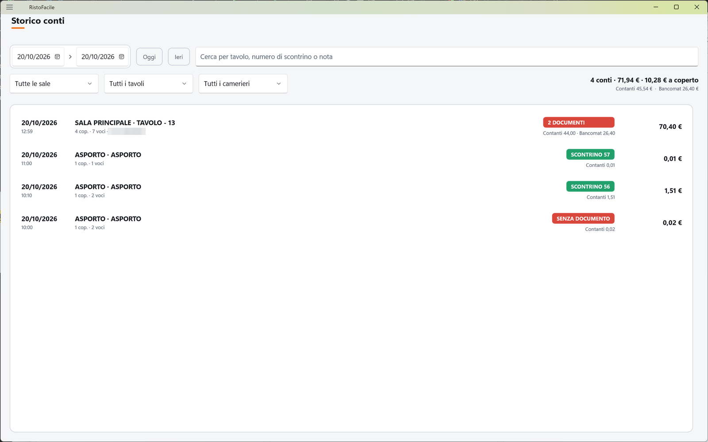
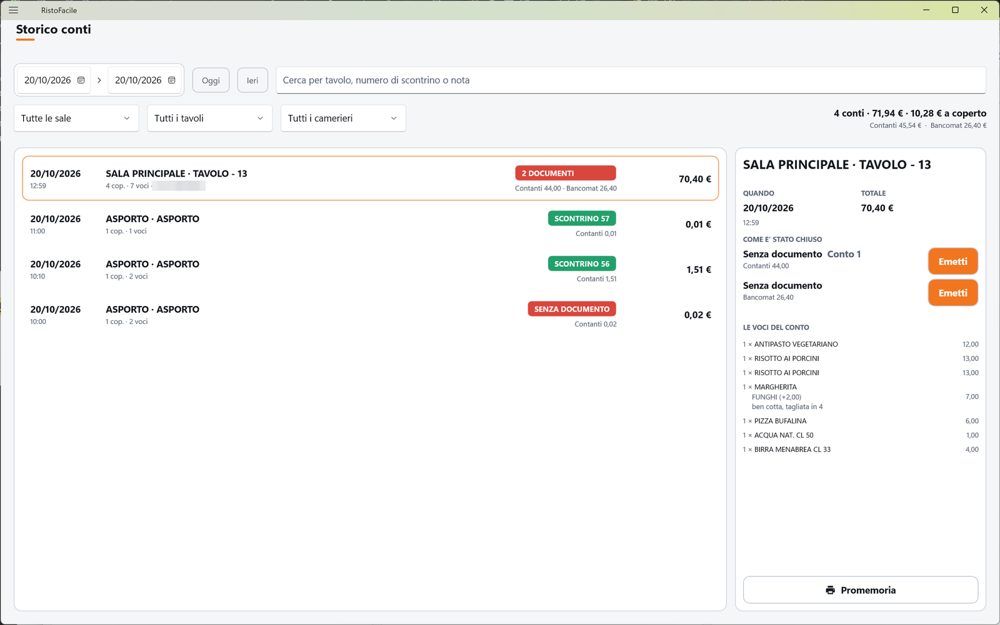

# Storico conti

Qui ritrovi i conti già chiusi: quando, a quale tavolo, con quale documento (scontrino, fattura,
addebito in camera o nessuno), come sono stati pagati e cosa c'era dentro. Serve al cassiere per
rispondere a un cliente o ristampare un promemoria, e al titolare per controllare la serata.

!!! info "In sintesi"

    - **Dove si trova:** Menu ▸ Storico conti
    - **Chi la usa:** cassiere, titolare
    - **Disponibile anche su:** solo cassa

---

## A cosa serve

Un cliente torna e chiede quanto ha speso ieri sera, o vuole un riepilogo di cosa ha ordinato; a
fine servizio vuoi sapere quanti conti hai chiuso e quanto è entrato in contanti e quanto con il
bancomat. Lo storico risponde a queste domande: in alto il riepilogo del periodo, sotto l'elenco
dei conti, a destra il dettaglio del conto scelto.

Un conto incassato è un documento emesso: da qui **non si modifica, non si riapre e non si
storna**. Si consulta, si ristampa un promemoria non fiscale e, solo per i conti chiusi senza
documento, si emette il documento mancante.

## Prima di cominciare

- Per **Promemoria** serve la stampante preconto, che si imposta in [Impostazioni](impostazioni.md).
- I filtri per sala, tavolo e cameriere usano le sale e gli operatori definiti in
  [Sale e tavoli](sale-e-tavoli.md) e [Operatori](operatori.md).

## La schermata

La schermata ha tre parti:

- **in alto, i filtri su due righe**: sopra il periodo, i pulsanti **Oggi** e **Ieri** e la
  ricerca; sotto le tendine di sala, tavolo e cameriere, il pulsante **Azzera** e, a destra, il
  **riepilogo del periodo**;
- **a sinistra, l'elenco** dei conti chiusi, dal più recente;
- **a destra, la scheda** del conto scelto, che compare solo quando tocchi una riga.

## Campi e indicatori

| Elemento | Descrizione |
|---|---|
| **Periodo** (due date) | Dalla data… alla data di apertura del conto. All'apertura vale oggi–oggi. Cambiando una data l'elenco si ricarica da solo. |
| **Cerca per tavolo, numero di scontrino o nota** | Testo libero: cerca nel numero del tavolo, nel numero dello scontrino e nelle note del conto. La ricerca parte quando premi **Invio**. |
| **Tutte le sale** | Tendina della sala. Scegliendo una sala si riempie la tendina dei tavoli. |
| **Tutti i tavoli** | Tendina del tavolo: contiene i tavoli solo dopo che hai scelto una sala. |
| **Tutti i camerieri** | Tendina del cameriere che ha servito il tavolo (solo operatori attivi). |
| Riepilogo (in alto a destra) | Numero di conti, totale e media a coperto del periodo filtrato, es. *18 conti · 1.240,00 € · 31,00 € a coperto*; sotto, il totale per modo di pagamento (Contanti, Bancomat, Carta, Buoni, Assegni, Credito) e quanti conti non hanno il pagamento registrato. |
| Data e orario (riga) | Giorno e orario di apertura → chiusura, es. *20:15 → 22:40*. |
| Tavolo (riga) | Sala e tavolo, es. *Sala interna · Tavolo 12*; per le vendite che non sono di un tavolo, *Vendita al banco*, *Asporto*, *Domicilio* o *Kiosk*. Sotto coperti, numero di voci e cameriere (es. *4 cop. · 12 voci · Marco*). |
| Pastiglia del documento (riga) | Come è stato chiuso il conto: **SCONTRINO n** (verde), **FATTURA n** (blu), **IN CAMERA** (blu, addebito sulla camera dell'hotel), **SENZA DOCUMENTO** (rosso), **NON REGISTRATO** (giallo, vedi Note). Su un tavolo diviso in più conti compare **n DOCUMENTI**. |
| Pagamento (riga) | Importi per modo di pagamento, es. *Contanti 40,00 · Bancomat 30,00*, oppure *Pagamento non registrato*. |
| Totale (riga) | Totale del conto. |
| Titolo della scheda | Sala e tavolo del conto. |
| **QUANDO** | Data e orario di apertura e chiusura. |
| **TOTALE** | Totale del conto. Se l'incassato è diverso dal totale compare sotto *Incassato …*: va guardato, non corretto. |
| **COME E' STATO CHIUSO** | Un documento per riga: *Scontrino n. …*, *Fattura n. …*, *Addebito in camera n. …* o *Senza documento*, con *Conto n* se il tavolo era diviso, e sotto i pagamenti. |
| **LE VOCI DEL CONTO** | Le voci del conto con quantità (o peso in kg), descrizione, varianti, note e importo. Le voci stornate portano la scritta **STORNO** al posto dell'importo. |
| Note del conto | Sopra i pulsanti, se il conto ha delle note. |

## Pulsanti e comandi

| Comando | Effetto |
|---|---|
| **Oggi** / **Ieri** | Porta il periodo a quel giorno e ricarica. |
| **Azzera** | Rimette tutti i filtri come all'apertura (oggi, tutte le sale, tutti i tavoli, tutti i camerieri, ricerca vuota). Compare solo se un filtro è cambiato. |
| Tocco su una riga | Apre la scheda del conto. Toccando di nuovo la stessa riga la scheda si chiude. |
| **Promemoria** | Stampa sulla stampante preconto un *PROMEMORIA CONTO* non fiscale con le voci, il totale e i pagamenti. Compare solo se la stampante preconto è configurata. |
| **Incassa ed emetti** | Compare solo su un conto chiuso **senza documento**. Apre la schermata del [Conto](conto.md) su quel conto per emettere ora lo scontrino o la fattura. |
| **Emetti** (accanto a un documento) | Compare su un singolo conto di un tavolo diviso chiuso senza documento. Apre il [Conto](conto.md) con le sole voci e i coperti di quel conto, per emetterne lo scontrino. |

## Come si fa

### Controllare l'incasso della serata

1. Tocca **Menu ▸ Storico conti**: il periodo è già oggi.
2. Leggi in alto a destra il riepilogo: numero di conti, totale, media a coperto e, sotto, quanto è
   entrato per ciascun modo di pagamento.
3. Per vedere solo una sala o un cameriere scegli la voce nella tendina: elenco e riepilogo si
   aggiornano.

### Ristampare il promemoria di un conto

1. Trova il conto (periodo, ricerca o filtri).
2. Tocca la riga: a destra si apre la scheda.
3. Tocca **Promemoria**.
4. La stampante preconto stampa il foglietto e compare *Promemoria del conto … stampato.*

### Emettere il documento di un conto chiuso senza

1. Trova il conto con la pastiglia **SENZA DOCUMENTO** e tocca la riga.
2. Tocca **Incassa ed emetti** (o **Emetti** accanto al singolo conto, se il tavolo era diviso).
3. Si apre la schermata del [Conto](conto.md): scegli il documento, controlla i pagamenti e
   conferma come descritto in quella pagina. I soldi risultano già incassati: non parte il
   pagamento con il POS carte né la cassa automatica.
4. Al termine torni allo storico e la riga mostra il documento emesso.

!!! warning "Emissione di un documento fiscale"
    **Incassa ed emetti** ed **Emetti** emettono un documento fiscale vero (scontrino o fattura).
    Sul singolo conto di un tavolo diviso si può emettere solo lo scontrino: la fattura va fatta
    dal gestionale.

## Controlli e messaggi

| Messaggio | Causa | Cosa fare |
|---|---|---|
| *Nessun conto chiuso con questi filtri.* | Nel periodo e con i filtri scelti non ci sono conti chiusi. | Allarga il periodo o tocca **Azzera**. |
| *Storico dei conti non caricato.* | Il servizio non ha risposto o ha dato errore; sotto c'è il dettaglio. | Controlla il collegamento al servizio; poi cambia un filtro o premi **Invio** nella ricerca per riprovare. |
| *Sale e camerieri non si sono letti: resta il filtro per data.* | Non è stato possibile leggere sale e operatori. | Usa il filtro per data; riapri la schermata più tardi. |
| *Tavoli non letti: …* | Non è stato possibile leggere i tavoli della sala scelta. | Riprova scegliendo di nuovo la sala. |
| *Righe del conto non lette.* | Le voci del conto scelto non si sono lette. | Tocca di nuovo la riga per riprovare. |
| *Nessuna stampante preconto configurata: si imposta in Impostazioni.* | Manca la stampante preconto. | Configurala in [Impostazioni](impostazioni.md). |
| *Promemoria non stampato.* | Il conto non si è riletto (*Il conto non si e' riletto.*) o la stampante ha segnalato un errore. | Controlla la stampante preconto e riprova. |
| *Questo conto si documenta con lo scontrino: la fattura va fatta dal gestionale.* | Nel Conto aperto con **Emetti** hai scelto la fattura. | Emetti lo scontrino, oppure fai la fattura dal gestionale. |

## Note

- Lo storico mostra solo i conti **chiusi**; i tavoli ancora aperti sono nella
  [Mappa della sala](mappa-sala.md).
- Le vendite al banco, gli ordini d'asporto e a domicilio e quelli del kiosk compaiono con *Vendita
  al banco*, *Asporto*, *Domicilio* o *Kiosk* al posto della sala e del tavolo; lo stesso testo
  esce sul promemoria.
- L'elenco mostra al massimo i 200 conti più recenti del periodo, e il riepilogo in alto somma solo
  quelli. Per i totali di periodi lunghi usa le [Statistiche](statistiche.md), che contano tutti i
  conti.
- La ricerca sul tavolo trova anche i numeri che *contengono* quello scritto: cercando `1` escono
  anche i tavoli 10, 11, 21…
- **NON REGISTRATO** indica un conto chiuso prima che la cassa annotasse documento e pagamento: la
  scheda lo dice con *Di questo conto non e' stato registrato ne' il documento ne' il pagamento:
  e' un conto chiuso prima che la cassa lo annotasse.* Non significa che il conto non sia stato
  pagato.
- Le voci stornate restano visibili con la scritta **STORNO**: lo storno si vede, non si nasconde.
- Il promemoria riporta in fondo *Promemoria non fiscale. Non vale come documento commerciale.*
- L'elenco si ricarica ogni volta che apri la schermata: un conto appena chiuso compare subito.

## Vedi anche

- [Conto](conto.md)
- [Dividi conto](dividi-conto.md)
- [Fatture](fatture.md)
- [Statistiche](statistiche.md)
- [Impostazioni](impostazioni.md) — stampante preconto
