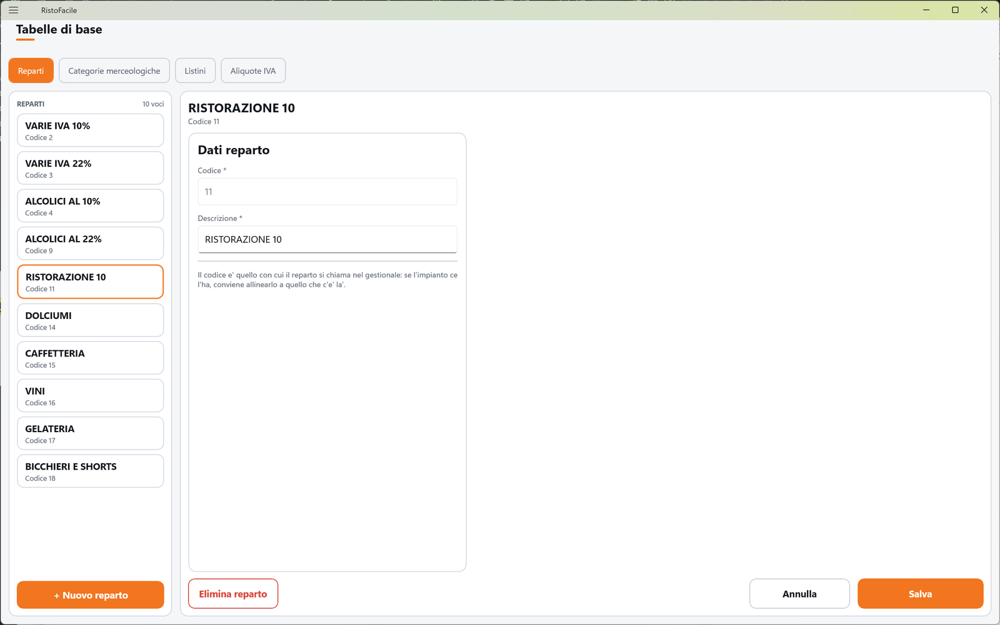
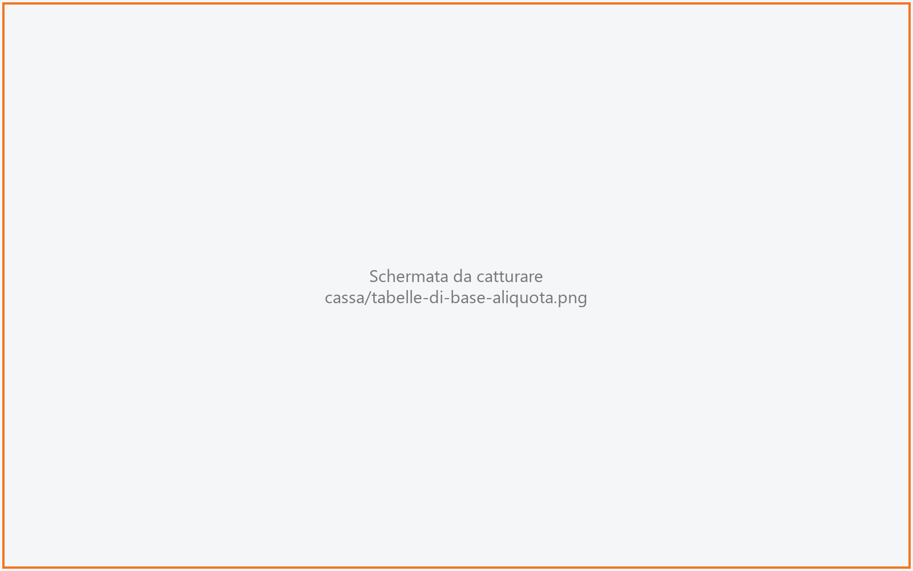

# Tabelle di base

Raccoglie in una sola schermata le quattro tabelle che servono a descrivere gli articoli: i
**reparti**, le **categorie merceologiche**, i **listini** e le **aliquote IVA**. Si compilano di
solito una volta, quando si allestisce la cassa, e si ritoccano di rado. La usa il titolare o
l'installatore.

!!! info "In sintesi"

    - **Dove si trova:** Menu ▸ Tabelle di base; anche dalla matita accanto a reparto, categoria e IVA nella scheda di un [articolo](articoli.md)
    - **Chi la usa:** titolare / installatore
    - **Disponibile anche su:** solo cassa

---

## A cosa serve

Ogni articolo ha un reparto, una categoria merceologica e un'aliquota IVA, e il suo prezzo sta in
un listino. Le quattro tabelle definiscono queste voci:

- il **reparto** raggruppa gli articoli per la cassa e per il gestionale. Non decide dove esce la
  comanda: quello lo fa il [centro di produzione](centri-di-produzione.md);
- la **categoria merceologica** raggruppa i piatti per famiglia (primi, dolci, vini) ed è quella su
  cui si aprono le [statistiche](statistiche.md);
- il **listino** è un elenco di prezzi: ogni sala può averne uno diverso e la cassa applica quello
  della sala del tavolo (vedi [Sale e tavoli](sale-e-tavoli.md));
- l'**aliquota IVA** decide, oltre alla percentuale, su quale **reparto della stampante fiscale**
  vengono registrate le righe dello scontrino.

Queste tabelle sono condivise con il gestionale: un reparto creato qui si vede anche lì, e viceversa.

## Prima di cominciare

- Per le aliquote: sapere come è programmata la stampante fiscale (quale reparto corrisponde a
  quale aliquota).

## La schermata

In alto quattro pulsanti scelgono la tabella: **Reparti**, **Categorie merceologiche**,
**Listini**, **Aliquote IVA**. Sotto, due colonne:

- **a sinistra l'elenco** della tabella scelta (**REPARTI**, **CATEGORIE**, **LISTINI** o
  **ALIQUOTE**) con il numero di voci, in ordine di codice; ogni tessera mostra descrizione e
  codice. In fondo il pulsante per aggiungere (**+ Nuovo reparto**, **+ Nuova categoria**,
  **+ Nuovo listino**, **+ Nuova aliquota**);
- **a destra la scheda** della voce toccata. Finché non ne scegli una compare l'invito
  (**Tocca un reparto**, **Tocca una categoria**, **Tocca un listino**, **Tocca un'aliquota**) con
  una frase che spiega a cosa serve la tabella.

Nell'elenco delle aliquote ogni tessera mostra anche il tipo, l'eventuale natura e, a destra, la
percentuale; le aliquote senza reparto della stampante fiscale portano la pastiglia gialla
**senza reparto**.

In fondo alla scheda: il pulsante per eliminare (**Elimina reparto**, **Elimina categoria**,
**Elimina listino**, **Elimina aliquota**) a sinistra, **Annulla** e **Salva** a destra.

## Campi e indicatori

**Reparti, categorie, listini** (scheda **Dati reparto** / **Dati categoria** / **Dati listino**)

| Elemento | Descrizione |
|---|---|
| **Codice \*** | Numero della voce. Proposto il primo libero; alla creazione puoi cambiarlo per allinearlo al gestionale. Dopo il salvataggio non si cambia più. |
| **Descrizione \*** | Il nome della voce, in maiuscolo (es. CUCINA, BAR). |
| **Dove si vende** | Solo per le categorie: due pulsanti, **Vendita al banco** e **Ristorante**, accesi o spenti indipendentemente. Sotto, una frase riassume la scelta (es. *Solo al banco: in sala questa categoria non compare.*). |

Sotto i campi, una nota ricorda cosa non si tocca da qui: per le categorie, che le altre colonne
della tabella (sconti per listino, provvigioni) restano invariate; per i reparti, che conviene
usare lo stesso codice del gestionale.

**Aliquote IVA** (scheda **Dati aliquota**)

| Elemento | Descrizione |
|---|---|
| **Codice \*** | Numero dell'aliquota. Proposto il primo libero. Dopo il salvataggio non si cambia più. |
| **Descrizione \*** | Es. IVA 10%, ESENTE ART. 10. |
| **Aliquota %** | La percentuale, da 0 a 100. |
| **Reparto cassa** | Sezione **Registratore telematico**. «Il reparto su cui la RT registra le righe degli articoli con questa aliquota. Deve corrispondere a come e' programmata la stampante fiscale.» Usa un numero da 1 a 9: è il limite che la scheda articolo impone quando crea un'aliquota al volo. <!-- DA VERIFICARE: qui non c'è controllo sul massimo; un reparto oltre 9 funziona con la stampante fiscale? --> |
| **Tipo** | Sezione **Classificazione fiscale**. Uno dei 14 tipi di legge: Imponibile, Esente, Non imponibile, Non soggetto, Ritenuta d'acconto, Non imp. art. 8/2, Rettifica, Export / import, Crediti diversi, Corrispettivi ventilazione, Escluso art. 15, Regime del margine, Reverse charge, Assolta in altro stato UE. |
| **Natura (fattura elettronica)** | Compare solo per i tipi che la prevedono (es. Esente → N4; Non imponibile → N3.1 … N3.6) e dichiara perché l'imposta non si applica. Ritoccare la natura scelta la toglie. |

## Pulsanti e comandi

| Comando | Effetto |
|---|---|
| **Reparti** / **Categorie merceologiche** / **Listini** / **Aliquote IVA** | Cambia la tabella mostrata. |
| **+ Nuovo reparto** (e simili) | Apre una scheda vuota con il primo codice libero. |
| **Vendita al banco** / **Ristorante** | Accendono e spengono la vendita della categoria in quel punto. |
| **Salva** | Salva la voce. È spento finché la **Descrizione** è vuota. |
| **Annulla** | Rimette la scheda com'era; su una voce nuova, chiude la scheda. |
| **Elimina …** | Elimina la voce, dopo conferma. |

## Come si fa

### Creare le aliquote per lo scontrino

1. Tocca **Aliquote IVA**.
2. Tocca **+ Nuova aliquota**.
3. Scrivi la **Descrizione \*** (es. IVA 10%) e in **Aliquota %** scrivi 10.
4. In **Reparto cassa** scrivi il numero del reparto programmato sulla stampante fiscale per il 10%.
5. Lascia il **Tipo** su **Imponibile**.
6. Tocca **Salva**. L'aliquota compare nell'elenco senza la pastiglia **senza reparto**.

### Aggiungere un listino per la terrazza

1. Tocca **Listini**.
2. Tocca **+ Nuovo listino**.
3. Scrivi la **Descrizione \*** (es. LISTINO TERRAZZA).
4. Tocca **Salva**.
5. Assegna il listino alla sala in [Sale e tavoli](sale-e-tavoli.md).

<!-- DA VERIFICARE: i prezzi del nuovo listino si inseriscono dalla scheda articolo della cassa o solo dal gestionale? -->

### Correggere una voce mentre compili un articolo

1. Nella scheda dell'articolo tocca la casella del reparto, della categoria o dell'IVA.
2. Nell'elenco che si apre tocca la **matita** accanto alla voce.
3. Si apre questa schermata sulla voce: correggila e tocca **Salva**.
4. Torna indietro: l'elenco di scelta è già aggiornato.

## Controlli e messaggi

| Messaggio | Causa | Cosa fare |
|---|---|---|
| *Il codice dev'essere un numero maggiore di zero.* (reparti, categorie, listini) / *Il codice deve essere un numero maggiore di zero.* (aliquote) | Codice mancante o non valido. | Correggi il codice. |
| *La descrizione e' obbligatoria.* | Descrizione vuota. | Compila la descrizione. |
| *Codice non disponibile: il N e' gia' in uso.* | Alla creazione hai scelto un codice già usato. | Scegli un altro codice. |
| *L'aliquota deve essere una percentuale fra 0 e 100.* | Percentuale non valida. | Correggi la percentuale. |
| *Nessun reparto impostato: gli articoli con questa aliquota usciranno sul reparto di ripiego dello scontrino.* | Aliquota salvata senza **Reparto cassa** (il salvataggio avviene lo stesso). | Imposta il reparto appena lo conosci. |
| *La voce non esiste piu': l'elenco e' stato ricaricato.* | La voce toccata è stata eliminata nel frattempo. | Nessuna azione. |
| **Modifiche non salvate** — *La scheda di "…" ha modifiche non salvate. Vuoi abbandonarle?* | Hai cambiato voce o tabella senza salvare. | **Abbandona** o **Resta qui**. |
| **Elimina** — *Eliminare definitivamente "…"? Gli articoli che la usano resteranno senza.* | Eliminazione di reparto, categoria o listino. | **Elimina** o **Annulla**. |
| **Elimina aliquota** — *Eliminare definitivamente l'aliquota "…"? L'operazione non e' reversibile.* | Eliminazione di un'aliquota. | **Elimina** o **Annulla**. |
| *Impossibile eliminare l'aliquota (verificare che non sia assegnata a degli articoli).* | L'aliquota è usata da qualche articolo, oppure il servizio non risponde. | Cambia prima l'aliquota agli articoli. |
| *Un'altra postazione ha modificato questi dati prima di te: adesso vedi la versione aggiornata, rifai la modifica e salva.* | Modifica concorrente da un'altra postazione. | Rifai la modifica e salva. |
| *Un'altra postazione ha eliminato questi dati mentre li stavi modificando: non ci sono piu' e non c'e' niente da salvare.* | Voce eliminata altrove. | Nessuna azione. |
| *Impossibile caricare la tabella.* / *Impossibile caricare le aliquote IVA.* / *Impossibile salvare.* / *Impossibile salvare l'aliquota.* / *Impossibile eliminare.* / *Impossibile proporre il codice.* / *Impossibile leggere la voce.* | Il servizio non risponde o rifiuta l'operazione. | Controlla il collegamento e riprova. |

## Note

- Eliminare un reparto, una categoria o un listino **non** è bloccato se qualche articolo li usa:
  gli articoli restano senza.
  <!-- DA VERIFICARE: cosa succede a una sala il cui listino viene eliminato (torna al listino di default?) -->
- Le categorie spente in **Vendita al banco** non compaiono nella [Vendita al banco](vendita-al-banco.md).
  <!-- DA VERIFICARE: l'interruttore «Ristorante» ha effetto sulla cassa? Nel codice della cassa la vendita al tavolo parte dal Menu, non dalle categorie. -->
- Un'aliquota senza **Reparto cassa** si riconosce dalla pastiglia **senza reparto**: le sue righe
  escono sul reparto di ripiego dello scontrino.

## Vedi anche

- [Articoli](articoli.md)
- [Sale e tavoli](sale-e-tavoli.md)
- [Centri di produzione](centri-di-produzione.md)
- [Statistiche](statistiche.md)
- [Impostazioni](impostazioni.md)
