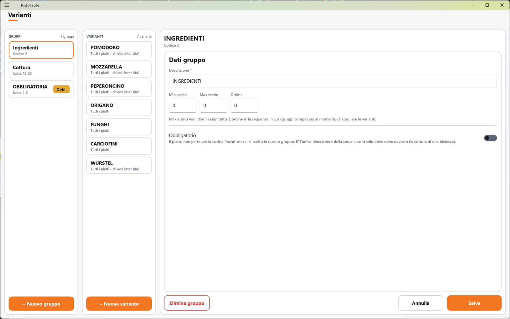
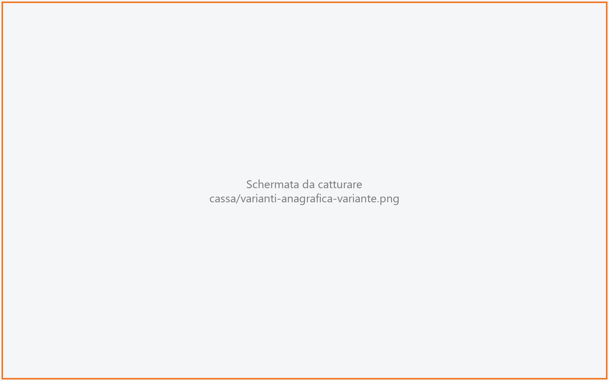

# Varianti

Le varianti sono le scelte e le aggiunte che si fanno su un piatto: «ben cotta», «senza
cipolla», «+ mozzarella». Si raccolgono in **gruppi** (Cottura, Pane, Aggiunte…). Qui il titolare
crea i gruppi, le varianti di ciascun gruppo e i loro prezzi. Il modo in cui il cameriere le sceglie
in Comanda è descritto in [Varianti (in Comanda)](varianti.md).

!!! info "In sintesi"

    - **Dove si trova:** Menu ▸ Varianti
    - **Chi la usa:** titolare / responsabile
    - **Disponibile anche su:** solo cassa (le varianti si usano anche dal palmare, ma si creano qui)

---

## A cosa serve

Quando il cameriere tocca un piatto in Comanda, può aggiungere le varianti dei gruppi che lo
riguardano. Il gruppo decide come si sceglie: quante varianti al minimo e al massimo, in che ordine
compare e se è **obbligatorio**. Un gruppo obbligatorio blocca: il piatto non parte per la cucina
finché non si è scelto (la cottura di una bistecca).

La variante decide a quali piatti si applica, quanto costa e se chiede anche un'**intensità**
(«poco», «molto», «extra»: vedi [Modificatori](modificatori.md)).

Esempio: il gruppo COTTURA, obbligatorio, con le varianti AL SANGUE, MEDIA, BEN COTTA legate
all'articolo Tagliata; il gruppo AGGIUNTE, facoltativo, con «+ MOZZARELLA» a 1,00 € su tutti i
piatti.

## Prima di cominciare

- Gli [articoli](articoli.md), se una variante vale solo per un piatto.
- I [modificatori](modificatori.md), se una variante deve chiedere l'intensità.

## La schermata

Tre colonne:

- **GRUPPI** (a sinistra): il numero di gruppi e una tessera per gruppo con il nome, il vincolo
  sulle scelte o il codice, e la pastiglia **Obbl.** sui gruppi obbligatori. Se ci sono varianti
  rimaste senza gruppo compare anche la voce **Senza gruppo** («N varianti da ricollocare»). In
  fondo **+ Nuovo gruppo**.
- **VARIANTI** (al centro): le varianti del gruppo scelto, con il numero; ogni tessera mostra il
  nome e a quali piatti si applica («Tutti i piatti», «Tutti i piatti - chiede intensita'», «Solo
  *codice*»). Le varianti spente portano la pastiglia **Off**. In fondo **+ Nuova variante**, spento
  finché il gruppo non è salvato. Senza un gruppo scelto: *Scegli un gruppo a sinistra per vederne
  le varianti.*
- **La scheda** (a destra) del gruppo o della variante toccati. Finché non scegli nulla compare
  **Tocca un gruppo** con «Un gruppo raccoglie le scelte che si fanno su un piatto (la cottura, il
  pane). Le sue varianti sono le singole opzioni, e ognuna puo' avere un prezzo per listino.»

## Campi e indicatori

**Scheda del gruppo — Dati gruppo**

| Elemento | Descrizione |
|---|---|
| **Descrizione \*** | Obbligatoria (es. COTTURA, PANE). |
| **Min scelte**, **Max scelte** | Quante varianti del gruppo vanno scelte al minimo e al massimo. «Max a zero vuol dire nessun tetto.» |
| **Ordine** | «L'ordine e' la sequenza in cui i gruppi compaiono al momento di scegliere le varianti.» |
| **Obbligatorio** | «Il piatto non parte per la cucina finche' non si e' scelto in questo gruppo. E' l'unico blocco vero della cassa: usarlo solo dove serve davvero (la cottura di una bistecca).» |

**Scheda della variante — Dati variante**

| Elemento | Descrizione |
|---|---|
| **Descrizione \*** | Obbligatoria (es. BEN COTTA). |
| **Ordine** | La posizione della variante nel gruppo. Per una variante nuova si propone l'ultima più 10. |
| **Gruppo \*** | Il gruppo a cui appartiene (tendina **Scegli il gruppo**). Cambiandolo, la variante si sposta. |
| **Si applica a** | Il piatto a cui è legata la variante, scelto con la finestra **Cerca articolo**. **Tutti** la toglie. «Vuoto significa tutti i piatti: e' il caso normale. Si lega a un articolo solo quando quella scelta ha senso su quel piatto e basta.» |
| **Categorie al banco** | Le categorie sotto cui la variante compare nella [Vendita al banco](vendita-al-banco.md) (tendina a scelta multipla; **Tutte** le toglie: «Su tutte le categorie»). In Comanda non ha effetto. |
| **Chiede l'intensità** | «Sotto la variante compaiono i chip poco / molto / extra, e finche' non se ne sceglie uno la comanda non si conferma.» |
| **Modificatori ammessi** | Solo se la variante chiede l'intensità: quali modificatori propone (es. per «Pomodoro»: più, senza, poco). **Tutti** svuota la scelta: «Tutti i modificatori». |
| **Attiva** | «Una variante spenta resta qui e si puo' riaccendere, ma non compare piu' fra le scelte in comanda.» |

**Prezzi** (solo su una variante già salvata)

«Senza nessun prezzo la variante non costa niente. Un prezzo vale per il listino e il piatto
indicati, e Tutti copre il caso normale.» Ogni riga mostra listino («Tutti i listini» o «Listino
N»), piatto («Tutti i piatti» o il codice) e prezzo. Toccando una riga o **+ Prezzo** si apre sotto
la riga di modifica:

| Elemento | Descrizione |
|---|---|
| **Listino** | Il listino del prezzo, dalla finestra **Scegli listino**; **Tutti** per tutti i listini. Si sceglie solo su un prezzo nuovo. |
| **Piatto** | Il piatto a cui vale il prezzo, dalla finestra **Cerca articolo**; **Tutti** per tutti i piatti. Si sceglie solo su un prezzo nuovo. |
| **Prezzo** | In euro. |

Se una variante ha sia un prezzo per tutti i piatti sia uno per un piatto preciso, su quel piatto
vale il secondo.

<!-- DA VERIFICARE: nel codice della Comanda contano solo i prezzi «Tutti i listini»; un prezzo legato a un listino preciso non viene mai applicato. È un limite noto o un difetto? -->

## Pulsanti e comandi

| Comando | Effetto |
|---|---|
| **+ Nuovo gruppo** | Apre la scheda di un gruppo nuovo. |
| **+ Nuova variante** | Apre la scheda di una variante nuova nel gruppo scelto. |
| **Salva** | Salva il gruppo o la variante. Spento finché la **Descrizione** è vuota. |
| **Annulla** | Rimette la scheda com'era. |
| **Elimina gruppo** | Elimina il gruppo dopo conferma; le sue varianti finiscono in **Senza gruppo**. |
| **Elimina variante** | Elimina la variante dopo conferma. Vanno tolti prima i suoi prezzi. |
| **+ Prezzo** | Apre la riga di un prezzo nuovo. |
| **Salva prezzo** | Salva il prezzo. |
| **Elimina** (prezzo) | Elimina il prezzo, dopo conferma. |

## Come si fa

### Creare un gruppo obbligatorio per la cottura

1. Tocca **+ Nuovo gruppo**.
2. In **Descrizione \*** scrivi COTTURA, in **Min scelte** 1 e in **Max scelte** 1.
3. Accendi **Obbligatorio**.
4. Tocca **Salva**. Il gruppo compare con la pastiglia **Obbl.** e **+ Nuova variante** si accende.
5. Tocca **+ Nuova variante**, scrivi AL SANGUE e, in **Si applica a**, scegli la Tagliata.
6. Tocca **Salva**. Ripeti per MEDIA e BEN COTTA.

### Dare un prezzo a una variante

1. Tocca il gruppo e poi la variante.
2. Nella sezione **Prezzi** tocca **+ Prezzo**.
3. Lascia **Listino** e **Piatto** su **Tutti** e scrivi il **Prezzo** (es. 1,00).
4. Tocca **Salva prezzo**. La riga compare nell'elenco dei prezzi.

### Ricollocare le varianti rimaste senza gruppo

1. Tocca **Senza gruppo**.
2. Tocca una variante.
3. Nella tendina **Gruppo \*** scegli il nuovo gruppo.
4. Tocca **Salva**. La variante torna a comparire in Comanda.

## Controlli e messaggi

| Messaggio | Causa | Cosa fare |
|---|---|---|
| *La descrizione e' obbligatoria.* | Descrizione vuota. | Scrivi la descrizione. |
| *Il minimo di scelte non puo' essere maggiore del massimo.* | Min più alto del Max. | Correggi i valori. |
| *Scegli il gruppo della variante: senza gruppo in comanda non compare.* | Variante senza gruppo. | Scegli il gruppo. |
| *Il codice listino dev'essere un numero maggiore o uguale a zero (0 = tutti).* / *Il tipo listino dev'essere un numero maggiore o uguale a zero.* | Listino del prezzo non valido. | Riscegli il listino. |
| *Il prezzo dev'essere un numero.* | Prezzo non valido. | Correggi il prezzo. |
| *Articolo non trovato in anagrafica.* | Il piatto legato non esiste più. | Scegli un altro piatto o **Tutti**. |
| **Modifiche non salvate** — *La scheda di "…" ha modifiche non salvate. Vuoi abbandonarle?* | Hai cambiato scheda senza salvare. | **Abbandona** o **Resta qui**. |
| **Elimina gruppo** — *Eliminare definitivamente il gruppo "…"?* (con varianti: *… Le sue N varianti vengono scollegate: restano in archivio sotto "Senza gruppo", da dove si possono spostare in un altro gruppo, ma finche' restano li' in comanda non compaiono.*) | Hai toccato **Elimina gruppo**. | **Elimina** o **Annulla**. |
| **Elimina variante** — *Eliminare definitivamente la variante "…"? Vanno tolti prima i suoi prezzi.* | Hai toccato **Elimina variante**. | **Elimina** o **Annulla**. |
| *Impossibile eliminare la variante (verificare che non abbia prezzi).* | La variante ha ancora prezzi, o il servizio non risponde. | Elimina prima i prezzi. |
| **Elimina prezzo** — *Eliminare definitivamente questo prezzo? La variante torna a costare quello che costa di listino.* | Hai toccato **Elimina** su un prezzo. | **Elimina** o **Annulla**. Senza nessun prezzo, la variante non costa nulla. |
| **Varianti senza gruppo** — «Sono rimaste da un gruppo eliminato e in comanda non compaiono. Aprine una e scegli il suo nuovo gruppo, oppure eliminala.» | Hai toccato **Senza gruppo**. | Ricolloca o elimina le varianti. |
| *Un'altra postazione ha modificato questi dati prima di te: adesso vedi la versione aggiornata, rifai la modifica e salva.* | Modifica concorrente. | Rifai la modifica. |
| *Un'altra postazione ha eliminato questi dati mentre li stavi modificando: non ci sono piu' e non c'e' niente da salvare.* | Eliminato altrove. | Nessuna azione. |
| *Impossibile caricare i gruppi di varianti.* / *Impossibile caricare le varianti del gruppo.* / *Impossibile caricare i prezzi della variante.* / *Impossibile salvare il gruppo.* / *Impossibile salvare la variante.* / *Impossibile salvare il prezzo.* / *Impossibile eliminare il gruppo.* / *Impossibile eliminare il prezzo.* / *Impossibile leggere le varianti del gruppo.* / *Impossibile proporre il codice del gruppo.* / *Impossibile proporre il codice della variante.* / *Impossibile rileggere la variante.* | Il servizio non risponde o rifiuta l'operazione. | Controlla il collegamento e riprova. |

## Note

- Listino e piatto di un prezzo già salvato non si cambiano: per spostarlo, eliminalo e creane uno
  nuovo.
- Il prezzo di una variante si calcola quando la si aggiunge alla riga: cambiarlo non ritocca le
  comande già battute.

## Vedi anche

- [Varianti (in Comanda)](varianti.md)
- [Modificatori](modificatori.md)
- [Articoli](articoli.md)
- [Comanda](comanda.md)
- [Vendita al banco](vendita-al-banco.md)
