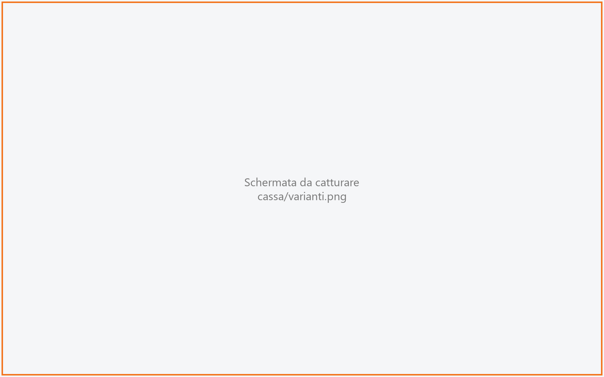

# Varianti

Qui si scelgono le varianti (aggiunte, eliminazioni, cotture…) di **una parte** di una pizza
composta, ad esempio «metà Margherita **senza origano**». Per le varianti di un piatto normale non
si passa di qui: si scelgono direttamente in Comanda, nella finestra **DETTAGLI** della riga. La
usano il cassiere e i camerieri.

!!! info "In sintesi"

    - **Dove si trova:** in [Componi la pizza](mezza.md), pulsante **VARIANTI** su una parte già scelta
    - **Chi la usa:** cassiere / cameriere
    - **Disponibile anche su:** Palmare (dalla composizione della pizza, vedi [Comanda](../palmare/comanda.md))

---

## A cosa serve

In una pizza metà e metà ogni metà può avere le sue varianti: la metà Diavola «con doppia
mozzarella», la metà Margherita «senza basilico». Dalla composizione si tocca **VARIANTI** sulla
metà da personalizzare, si scelgono le varianti e si conferma: si torna alla composizione con le
varianti scritte sotto quella parte e il prezzo aggiornato.

## Prima di cominciare

- I gruppi di varianti, le varianti e i loro prezzi si gestiscono in
  [Varianti](varianti-anagrafica.md); le intensità («poco», «tanto», «doppio»…) in
  [Modificatori](modificatori.md).
- Il pulsante **VARIANTI** compare solo sulle parti il cui articolo ha almeno una variante
  applicabile.

## La schermata

- **In alto** il titolo «Varianti - » seguito dal nome del gusto (es. «Varianti - Margherita»).
- **Al centro**, un blocco per ogni gruppo di varianti che riguarda l'articolo, nell'ordine
  stabilito in anagrafica: il nome del gruppo e, sotto, una pastiglia per ogni variante. Le
  pastiglie vanno a capo quando non stanno su una riga. Le varianti accese sono evidenziate.
- **Sotto un gruppo**, per ogni variante accesa che richiede l'intensità, la riga «Nome variante ·
  intensità» con le pastiglie delle intensità disponibili.
- **In basso** i pulsanti **Annulla** e **CONFERMA VARIANTI**.

## Campi e indicatori

| Elemento | Descrizione |
|---|---|
| **Nome del gruppo** (es. **Aggiunte**) | Il gruppo di varianti. Se è obbligatorio il titolo lo dice: «Cottura · obbligatoria», oppure «Impasto · obbligatoria, almeno 2» quando ne servono più di una. |
| **Pastiglia della variante** | Toccala per accenderla, toccala di nuovo per spegnerla. In un gruppo con un massimo non se ne possono accendere più del massimo. |
| **… · intensità** | Compare per le varianti accese che richiedono l'intensità. Si sceglie una sola pastiglia; accanto al nome compare l'effetto sul prezzo: «gratis», «×2» e così via (nessuna indicazione quando l'intensità lascia il prezzo pieno). Le intensità proposte possono essere limitate dalla singola variante. |

## Pulsanti e comandi

| Comando | Effetto |
|---|---|
| **CONFERMA VARIANTI** | Torna a [Componi la pizza](mezza.md): sotto la parte compaiono le varianti scelte (quelle a pagamento con il «+») e il totale della pizza le comprende. Resta spento finché i gruppi obbligatori non sono completi e ogni variante che lo richiede non ha la sua intensità. |
| **Annulla** | Torna alla composizione senza cambiare le varianti della parte. |

## Come si fa

### Aggiungere una variante a metà pizza

1. In [Componi la pizza](mezza.md) tocca **VARIANTI** sotto la parte (es. «1/2 Margherita»).
2. Tocca la pastiglia della variante (es. **Bufala**).
3. Se compare la riga «Bufala · intensità», tocca l'intensità voluta.
4. Tocca **CONFERMA VARIANTI**. Sotto la parte compare «+ Bufala» e il totale della pizza cresce
   del prezzo della variante.

### Correggere le varianti già scelte

1. Tocca di nuovo **VARIANTI** sulla stessa parte: le varianti già scelte si presentano accese.
2. Spegni o accendi le pastiglie e tocca **CONFERMA VARIANTI**.

## Controlli e messaggi

| Messaggio | Causa | Cosa fare |
|---|---|---|
| *Puoi scegliere al massimo 2 opzioni per "Aggiunte".* | Hai cercato di accendere una variante oltre il massimo del gruppo. | Spegnine una prima di accenderne un'altra. |
| *Impossibile caricare le varianti.* (seguito dal dettaglio) | Il servizio non risponde. | Torna indietro con **Annulla** e riprova. |

## Note

- Il prezzo di ogni variante viene fissato nel momento della scelta: se poi cambia in anagrafica,
  la pizza già battuta non cambia.
- L'intensità moltiplica il prezzo della variante (es. «×2» lo raddoppia, «gratis» lo azzera) e
  finisce nel testo della variante, così la cucina la legge (es. «Mozzarella (doppia)»).
- Scegliendo un altro gusto per una parte, le varianti di quella parte si cancellano.

## Vedi anche

- [Componi la pizza (mezza e mezza)](mezza.md)
- [Comanda](comanda.md) - varianti di un piatto normale, dalla finestra **DETTAGLI**
- [Varianti (anagrafica)](varianti-anagrafica.md)
- [Modificatori](modificatori.md)
