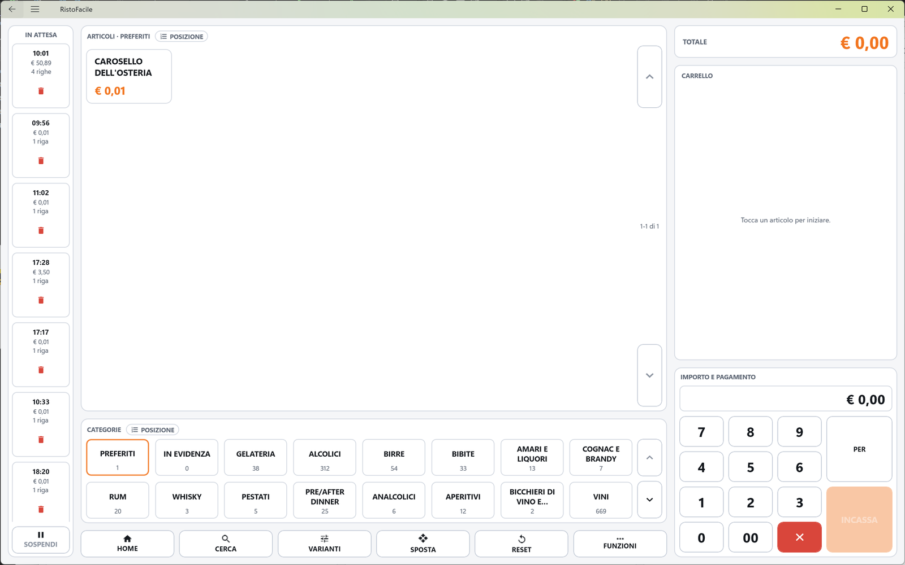
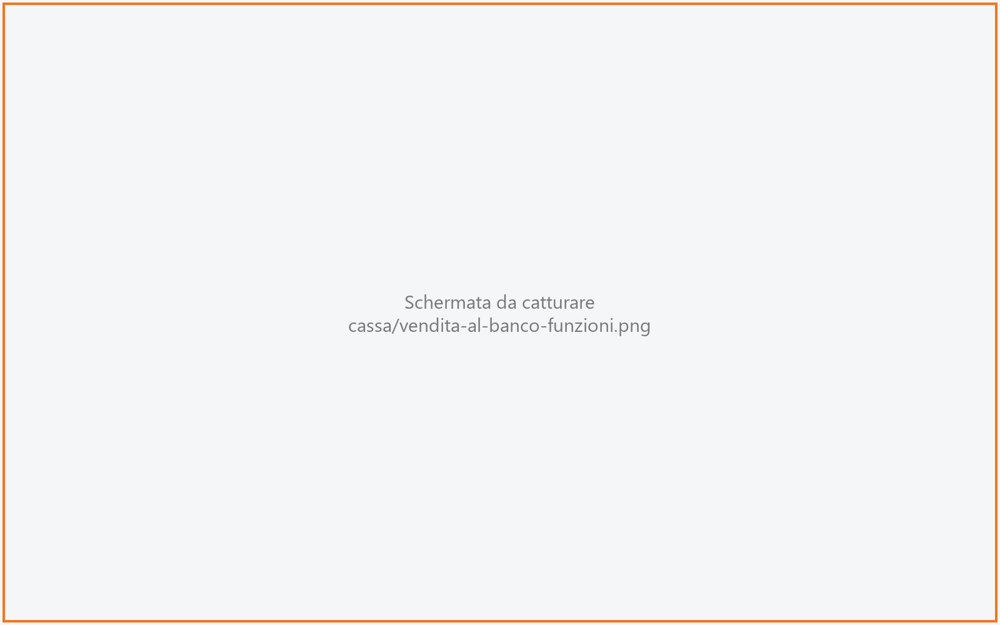
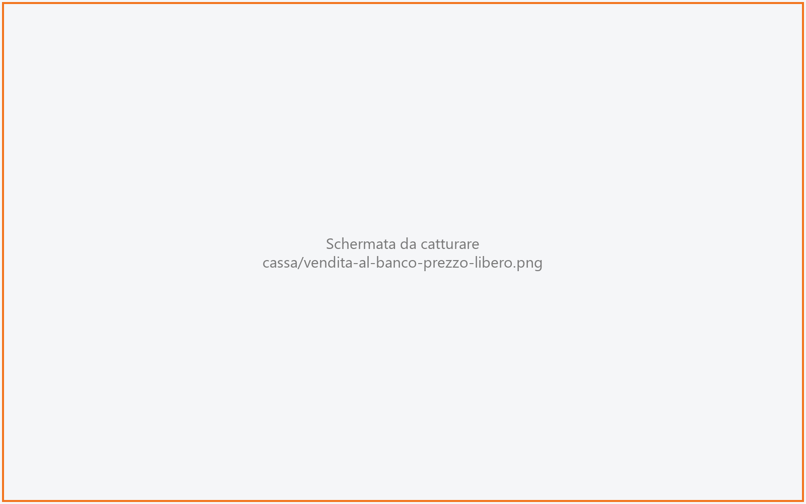
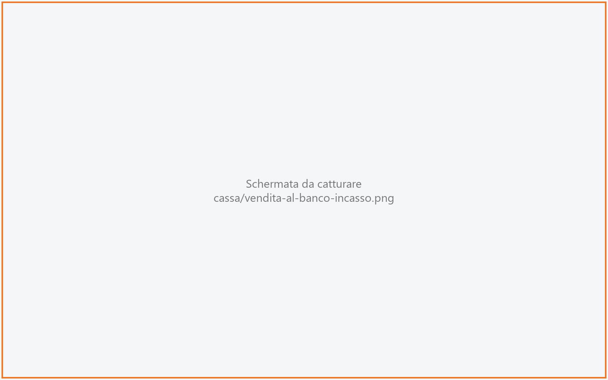

# Vendita al banco

La schermata della vendita al bancone: il cassiere tocca le tessere degli articoli, il carrello
si riempie, e con **INCASSA** si sceglie come paga il cliente e si emette lo scontrino (o la
fattura) senza cambiare schermata. Serve al cassiere del bar o del banco, dove non c'è un tavolo
da aprire e niente va in cucina.

!!! info "In sintesi"

    - **Dove si trova:** Menu ▸ Vendita ▸ Mappa della sala ▸ pulsante **Vendita al banco** in alto
    - **Chi la usa:** cassiere
    - **Disponibile anche su:** [Palmare](../palmare/sala.md), solo in versione tablet (pulsante **Vendita al banco** nella Sala)

---

## A cosa serve

Al banco il cliente chiede, paga e se ne va: due caffè e una brioche, una bottiglia d'acqua, un
gelato a peso. Qui non si sceglie un tavolo e non si manda nulla in cucina: si toccano le tessere,
si incassa e si emette lo scontrino. Se mentre batti arriva un altro cliente puoi **sospendere** la
vendita in corso, servire lui e riprendere la prima con un tocco.

Le tessere non vengono dal menu del ristorante ma dalle **categorie merceologiche** segnate per la
vendita al banco, con i prezzi del listino del tavolo dell'asporto (o, se manca, del listino della
ditta).

## Prima di cominciare

- Il **tavolo dell'asporto** deve essere impostato su questa cassa: le vendite al banco si
  appoggiano a quel tavolo virtuale ([Impostazioni](impostazioni.md) ▸ **Sala** ▸ **Tavolo asporto**).
  Se non è impostato, la cassa prova a ricavarlo dagli ordini d'asporto già fatti.
- Almeno una categoria merceologica deve avere la pastiglia **Vendita al banco** accesa
  ([Tabelle di base](tabelle-di-base.md), scheda della categoria merceologica).
- Gli articoli devono avere un prezzo nel listino: un articolo senza prezzo entra nel carrello ma
  non esce sullo scontrino.
- Per le tessere **PREFERITI** e **IN EVIDENZA**: sulla scheda dell'articolo i campi
  **Posizione in PREFERITI** e **Posizione in IN EVIDENZA** ([Articoli](articoli.md)).
- Per incassare con la carta sul terminale, con la cassa automatica o per emettere lo scontrino
  servono le periferiche configurate in [Impostazioni](impostazioni.md) (**Pagamento con carta**,
  **Cassa automatica**, **Stampante fiscale**).

## La schermata

La schermata è divisa in tre colonne.

- **A sinistra, IN ATTESA**: le vendite sospese, una pastiglia per vendita, con il pulsante
  **SOSPENDI** in fondo. Se non ce ne sono si legge *nessuna*.
- **Al centro**, dall'alto in basso:
    - la zona **ARTICOLI**: le tessere degli articoli della categoria scelta (nome e prezzo), con
      le frecce **▲ ▼** a destra per sfogliare le pagine e l'indicazione delle tessere mostrate
      (per esempio *1-12 di 40*). Il titolo dice anche la categoria scelta (**ARTICOLI · BAR**);
    - la zona **CATEGORIE**: due file di tessere, con il numero di articoli sotto il nome. Le prime
      due sono sempre **PREFERITI** e **IN EVIDENZA**, poi le categorie merceologiche;
    - la fila dei tasti **HOME**, **CERCA**, **VARIANTI**, **SPOSTA**, **RESET**, **FUNZIONI**.
- **A destra**:
    - il **TOTALE** della vendita, in grande;
    - il **CARRELLO** con le righe battute. A carrello vuoto si legge *Tocca un articolo per
      iniziare.*;
    - la zona **IMPORTO E PAGAMENTO**: la riga di battuta, il tastierino numerico, il tasto
      **PER** e il tasto **INCASSA**.

Quante tessere stanno in una pagina dipende dalla grandezza dello schermo.

## Campi e indicatori

| Elemento | Descrizione |
|---|---|
| **IN ATTESA** | Le vendite sospese. Ogni pastiglia mostra l'ora di apertura, il totale (o *vuota* se non ha righe) e il numero di righe (*1 riga*, *3 righe*), più un cestino rosso. Compaiono anche le vendite aperte sulle altre casse del locale. |
| **ARTICOLI** | Tessere della categoria scelta: nome dell'articolo e prezzo; *—* se l'articolo non ha prezzo nel listino. In modalità varianti il titolo diventa **VARIANTI** e le tessere mostrano le varianti. |
| Pastiglia dell'ordine (accanto a **ARTICOLI** e a **CATEGORIE**) | Cambia l'ordine in cui vedi le tessere, a ogni tocco: **POSIZIONE**, **NOME**, **PREZZO**, **MODIFICA** (per le categorie manca **PREZZO**). Non sposta niente in archivio: cambia solo la vista su questa cassa, che se la ricorda. Quando non è **POSIZIONE** la pastiglia è evidenziata. |
| **CATEGORIE** | **PREFERITI**, **IN EVIDENZA** e le categorie merceologiche segnate per il banco, con il numero di articoli. All'apertura è scelta **PREFERITI** se contiene articoli, altrimenti la prima categoria. |
| **TOTALE** | Somma delle righe del carrello, escluse quelle stornate. |
| **CARRELLO** | Una riga per articolo battuto: quantità (o chili, per gli articoli a peso), descrizione, importo. Sotto la descrizione possono comparire **OMAGGIO -x,xx** (in verde), **STORNATA** (in rosso) e le varianti attaccate, con il loro sovrapprezzo. |
| Riga di battuta | Mostra in grande l'importo digitato sul tastierino. A sinistra può comparire il moltiplicatore (**3 ×**) impostato con **PER**, e il prezzo che aspetta il prossimo articolo (**€ 2,50 al prossimo**). |

## Pulsanti e comandi

| Comando | Effetto |
|---|---|
| Tocco su una tessera articolo | Aggiunge l'articolo al carrello, al prezzo di listino (o al prezzo impostato con **CAMBIA PREZZO**, o moltiplicato per **PER**). Se l'articolo è venduto a peso si apre prima il tastierino del peso. |
| Tocco su una categoria | Mostra gli articoli di quella categoria. |
| **▲ ▼** | Pagina precedente e successiva delle tessere articolo o delle categorie. |
| Tocco su una riga del carrello | Seleziona la riga (bordo arancione) e mostra sotto i suoi quattro tasti. |
| **−** / **+** sulla riga | Toglie o aggiunge un pezzo. Togliere l'ultimo pezzo elimina la riga. |
| **€** sulla riga | Mette sulla riga il prezzo digitato sul tastierino, dopo una conferma. |
| Cestino sulla riga | Elimina la riga dal carrello. |
| **SOSPENDI** | Mette da parte la vendita in corso tra quelle **IN ATTESA** e libera il carrello. Attivo solo con una vendita in corso. |
| Tocco su una pastiglia **IN ATTESA** | Riprende quella vendita nel carrello. |
| Cestino sulla pastiglia **IN ATTESA** | Butta via la vendita sospesa, dopo una conferma. Serve il permesso **Puo' annullare la comanda**. |
| **HOME** | Torna alla mappa della sala. |
| **CERCA** | Apre **Interroga articolo**: scrivi almeno due lettere del nome o del codice e tocca il risultato per batterlo. **Chiudi** chiude la ricerca. |
| **VARIANTI** / **ARTICOLI** | Ribalta le tessere sulle varianti della categoria scelta, e ritorno. Acceso, il tasto è blu e si chiama **ARTICOLI**. |
| **SPOSTA** / **FINE** | Modalità riordino: il tocco non vende ma scambia di posto due tessere (o due categorie). Acceso, il tasto è giallo e si chiama **FINE**. |
| **RESET** | Annulla tutta la vendita in corso, dopo una conferma: le righe vengono tolte. Senza vendita in corso azzera solo la battuta. |
| **FUNZIONI** | Apre le funzioni accessorie (vedi sotto). |
| **0**-**9**, **00** | Digitano l'importo **in centesimi**, come su un registratore di cassa: **150** è € 1,50. |
| Tasto rosso con la **X** | Azzera la battuta, il moltiplicatore **PER** e il prezzo in attesa. Non tocca il carrello. |
| **PER** | Prende il numero digitato come quantità del prossimo articolo: **3**, **PER**, tocco sul caffè = tre caffè. |
| **INCASSA** | Apre la finestra **Incasso**. Attivo solo con una vendita in corso. |

### Funzioni

| Comando | Effetto |
|---|---|
| **CAMBIA PREZZO** | Con una riga selezionata ne cambia il prezzo (dopo la conferma); senza riga selezionata il prezzo vale per il prossimo articolo battuto. L'importo va digitato prima. Sugli articoli a peso è il prezzo al chilo. |
| **PREZZO LIBERO** | Batte una riga a importo libero, senza articolo: l'importo va digitato prima. |
| **OMAGGIO** | Offre la riga selezionata (la riga va a zero e mostra **OMAGGIO**); sulla riga già in omaggio, lo toglie. Serve il permesso **Puo' applicare sconti**. |
| **STORNO RIGA** | Storna la riga selezionata: resta a video come **STORNATA** ma non conta nel totale. Serve il permesso **Puo' stornare righe**. |
| **CORREGGI PESO** | Riapre il tastierino del peso sulla riga a peso selezionata. |
| **Chiudi** | Chiude la finestra. |

### Prezzo libero

In alto l'importo digitato. **Descrizione (facoltativa)** è il testo della riga (se resta vuoto
diventa *Vendita libera* seguito dall'aliquota, per esempio *Vendita libera 10%*). **Aliquota IVA**
compare solo se le aliquote utilizzabili sono più di una: l'aliquota decide su quale reparto della
stampante fiscale esce la riga. **BATTI** aggiunge la riga, **Annulla** chiude senza aggiungere.

### Tastierino del peso

Si apre toccando un articolo venduto a peso, o con **CORREGGI PESO**. Il titolo è il nome
dell'articolo, sotto il prezzo al chilo. Il peso si digita **in grammi** (nessuna virgola): sotto
compaiono i chili e a destra l'importo, che si aggiorna mentre digiti. **C** cancella l'ultima
cifra. **CONFERMA** (attivo solo con un peso maggiore di zero) aggiunge o corregge la riga,
**Annulla** chiude.

### Incasso

La finestra **Incasso** è il conto della vendita al banco: importi, resto, documento ed emissione
funzionano come nella schermata [Conto](conto.md), a cui si rimanda per i dettagli. Qui c'è la
versione ridotta:

| Elemento | Descrizione |
|---|---|
| **Incasso** e importo | Il totale da incassare. |
| **CONTANTI**, **CARTA**, **BANCOMAT**, **BUONI PASTO**, **CREDITO** | Toccare il pulsante mette in quel campo l'importo che manca: al banco di solito basta un tocco. Il campo accanto resta scrivibile per i pagamenti misti. Dopo che la carta è passata, o la cassa automatica ha incassato, o lo scontrino è uscito, gli importi non si cambiano più. |
| **Mancano € x,xx** / **Resto € x,xx** | Quanto manca a coprire il totale, o il resto da dare. |
| **Cassa automatica** | Compare solo se questa cassa ha una cassa automatica scelta in Impostazioni. La spunta dice se usarla; sotto: **Solo contanti**, **Contanti e carta** o **Spenta**. |
| **Documento**: **Scontrino** / **Fattura** / **Camera** | Il documento da emettere. **Camera** compare solo con il collegamento all'hotel attivo. Con **Fattura** compare il campo del cliente (**Scegli il cliente**), con **Camera** quello della camera (**Scegli la camera**). |
| **Annulla** | Chiude la finestra. La vendita resta com'è, con le sue righe. |
| **Senza documento** | Chiude la vendita senza emettere alcun documento fiscale (vedi [Note](#note)). Non compare con **Fattura** né con **Camera**. |
| **SCONTRINO** / **FATTURA** / **CAMERA** / **STAMPA** | Incassa ed emette il documento scelto. Diventa **STAMPA** quando la carta è già stata addebitata e manca solo lo scontrino. |

Nella finestra **Incasso** non ci sono lo sconto e l'abbuono della schermata del conto a tavolo.

## Come si fa

### Battere e incassare una vendita

1. Dalla mappa della sala tocca **Vendita al banco**.
2. Tocca la categoria, poi le tessere degli articoli: ogni tocco aggiunge una riga al carrello.
3. Tocca **INCASSA**.
4. Tocca il metodo di pagamento (per esempio **CONTANTI**): il campo si riempie con il totale.
   Se il cliente dà di più, scrivi nel campo quanto ha dato: compare il **Resto**.
5. Lascia **Scontrino** come documento e tocca **SCONTRINO**.
6. Lo scontrino esce sulla stampante fiscale; la finestra si chiude e il carrello si svuota,
   pronto per il cliente successivo.

### Battere più pezzi dello stesso articolo

1. Digita la quantità sul tastierino (per esempio **3**).
2. Tocca **PER**: nella riga di battuta compare **3 ×**.
3. Tocca la tessera dell'articolo. Nel carrello compare una riga con quantità 3.

### Vendere un articolo a peso

1. Tocca la tessera dell'articolo a peso: si apre il tastierino del peso.
2. Digita i grammi (per esempio **350**): compaiono *0,350 kg* e l'importo.
3. Tocca **CONFERMA**. Nel carrello la riga mostra i chili.

### Cambiare il prezzo di una riga

1. Tocca la riga nel carrello.
2. Digita il nuovo prezzo sul tastierino, in centesimi (**250** = € 2,50).
3. Tocca **€** sulla riga (oppure **FUNZIONI** ▸ **CAMBIA PREZZO**).
4. Conferma con **Cambia**. Il totale della riga si aggiorna.

### Battere un importo senza articolo

1. Digita l'importo sul tastierino.
2. Tocca **FUNZIONI** ▸ **PREZZO LIBERO**.
3. Scrivi la descrizione, se vuoi, e scegli l'**Aliquota IVA**.
4. Tocca **BATTI**. La riga compare nel carrello.

### Attaccare una variante a una riga

1. Tocca la riga del carrello a cui attaccare la variante.
2. Tocca **VARIANTI**: le tessere mostrano le varianti della categoria scelta.
3. Tocca la variante. Se la variante chiede un'intensità, scegli quella giusta nella finestra
   che si apre.
4. Sotto la riga compare la variante, con il suo sovrapprezzo. Toccando di nuovo la stessa
   variante la stacchi.
5. Tocca **ARTICOLI** per tornare agli articoli.

### Sospendere una vendita e riprenderla

1. Con una vendita in corso tocca **SOSPENDI**: il carrello si svuota e la vendita compare
   in **IN ATTESA** con la sua ora.
2. Servi il cliente successivo.
3. Tocca la pastiglia della vendita in attesa: le sue righe tornano nel carrello.

### Cambiare il posto delle tessere

1. Scegli la categoria e tocca **SPOSTA**: sopra le tessere compare *Tocca la tessera da spostare.*
2. Tocca la prima tessera, poi quella con cui scambiarla: le due tessere si scambiano di posto.
3. Tocca **FINE** per tornare a vendere.

Lo stesso vale per le categorie. Il nuovo ordine è salvato in archivio e vale per tutte le casse.

## Controlli e messaggi

| Messaggio | Causa | Cosa fare |
|---|---|---|
| *Nessun tavolo configurato per la vendita al banco: impostalo in Impostazioni.* | Su questa cassa non è impostato il tavolo dell'asporto. | Impostalo in Impostazioni ▸ **Sala** ▸ **Tavolo asporto**. |
| *Nessuna categoria e' marcata "vendita al banco": la spunta si mette in Tabelle di base, sulla scheda della categoria merceologica.* | Nessuna categoria merceologica è abilitata al banco. | Accendi **Vendita al banco** sulla categoria in Tabelle di base. |
| *Il catalogo della vendita al banco richiede il backend aggiornato su questa installazione.* | Il servizio installato nel locale è di una versione precedente. | Fai aggiornare il servizio. |
| *Impossibile leggere il catalogo del banco. (…)* | Il servizio non ha risposto. | Controlla la connessione e riapri la schermata. |
| *Impossibile preparare la vendita al banco.* | Errore all'apertura della schermata. | Controlla la connessione e riapri la schermata. |
| *"…" non ha un prezzo in listino: entra in vendita ma NON comparira' sullo scontrino. Sistema il listino prima di incassare.* | L'articolo toccato non ha prezzo nel listino. | Togli la riga o cambia il prezzo, e sistema il listino. |
| *Nessun operatore in turno: la riga non si puo' firmare.* | Nessun operatore collegato alla cassa. | Accedi con il tuo operatore. |
| *Digita quanti pezzi prima di PER.* | **PER** toccato senza un numero digitato. | Digita la quantità, poi **PER**. |
| *Digita prima quanto deve costare, poi premi PREZZO.* | **CAMBIA PREZZO** o **€** senza importo digitato. | Digita il prezzo, poi riprova. |
| *Digita prima l'importo sul tastierino, poi PREZZO LIBERO.* | **PREZZO LIBERO** senza importo digitato. | Digita l'importo, poi riprova. |
| *Nessuna aliquota IVA utilizzabile.* | Nessuna aliquota ha un reparto della stampante fiscale. | Sistema le aliquote IVA (reparto di cassa). |
| *Tocca prima la riga da offrire.* / *Tocca prima la riga da stornare.* / *Tocca prima una riga venduta a peso.* | La funzione agisce sulla riga selezionata. | Tocca la riga nel carrello, poi la funzione. |
| *Tocca prima la riga del carrello a cui attaccare la variante.* | Variante toccata senza riga selezionata. | Seleziona la riga, poi la variante. |
| *La riga e' stornata: …* / *La riga e' in omaggio: …* | Su una riga stornata o in omaggio non si cambiano prezzo e varianti. | Per la riga in omaggio: togli l'omaggio, modifica, rimettilo. |
| *Non sei abilitato ad applicare sconti: l'omaggio va concesso da chi lo e'.* | Manca il permesso **Puo' applicare sconti**. | Fai fare l'operazione a un operatore abilitato. |
| *… non e' abilitato a stornare le righe. Il permesso si da' in Impostazioni -> Operatori.* | Manca il permesso **Puo' stornare righe**. | Come sopra, o assegna il permesso in [Operatori](operatori.md). |
| *… non e' abilitato a annullare una vendita. Il permesso si da' in Impostazioni -> Operatori.* | Cestino su una vendita in attesa senza il permesso **Puo' annullare la comanda**. | Come sopra. |
| *Le tessere si spostano dentro una categoria: scegline una qui sotto. L'ordine di PREFERITI e IN EVIDENZA si imposta dalla scheda dell'articolo.* | **SPOSTA** usato su PREFERITI o IN EVIDENZA. | Scegli una categoria merceologica, oppure imposta le posizioni sulla scheda dell'articolo. |
| *PREFERITI e IN EVIDENZA stanno sempre in testa: non si spostano.* | Si è provato a spostare una delle due tessere fisse. | — |
| *Non c'e' niente da incassare: batti prima gli articoli.* | **INCASSA** con il carrello vuoto. | Batti gli articoli. |
| *La vendita che avevi aperto e' stata incassata da un'altra cassa. …* | Un'altra cassa ha ripreso e incassato questa vendita. | Niente: la schermata si azzera, le righe sono già pagate. |
| *Un'altra cassa ha buttato la vendita che avevi aperto: …* (**Rimetti** / **Azzera**) | Un'altra cassa ha buttato la vendita mentre la stavi battendo. | **Rimetti** riporta le righe su una vendita nuova; **Azzera** le lascia perdere. |
| *Il prezzo della riga non e' stato cambiato.*, *Quantita' non aggiornata.*, *Riga non rimossa.*, *"…" non e' stato registrato.* | Il servizio non ha registrato la modifica. | Controlla la connessione e ripeti. |

Per i messaggi della finestra **Incasso** (pagamenti che non coprono il totale, carta, cassa
automatica, stampante fiscale, fattura) vedi [Conto](conto.md).

## Note

- **Niente cucina.** Le righe battute al banco non vanno a nessun centro di produzione e non
  stampano comande. Per questo una riga tolta dal carrello è cancellata davvero.
- **La vendita esiste dal primo articolo.** Toccato il primo articolo, la vendita è registrata nel
  servizio. Se esci con **HOME** senza incassare, la ritrovi fra quelle **IN ATTESA**.
- **Più casse.** Le vendite **IN ATTESA** sono di tutto il locale: ogni cassa vede anche quelle
  aperte sulle altre e le può riprendere. La schermata si riallinea da sola ogni 15 secondi.
- **Il cestino su una vendita in attesa non lascia traccia:** la vendita sparisce senza alcuna
  registrazione. **RESET** invece toglie le righe ma lascia aperta la vendita (vuota).
- **Chiudere senza scontrino.** **Senza documento** chiude e registra la vendita senza emettere
  nessun documento fiscale, senza far passare la carta e senza usare la cassa automatica. Serve
  quando la stampante fiscale non c'è o è guasta, ed è riservato agli operatori con il permesso
  **Puo' chiudere il conto**: agli altri il pulsante risponde
  *… non e' abilitato a chiudere un conto senza documento fiscale.* Il testo della conferma parla
  di «tavolo» anche al banco: *Il tavolo verra' chiuso e liberato per € … SENZA emettere nessuno
  scontrino. Procedere?* Lo scontrino si può emettere più tardi da [Storico conti](storico-conti.md).
- **Senza stampante fiscale** configurata nel servizio, **SCONTRINO** non chiude la vendita: compare
  *Su questo impianto non c'e' una stampante fiscale configurata: per liberare il tavolo usa CHIUDI
  SENZA DOCUMENTO, e lo scontrino lo emetti piu' tardi da Storico conti.* Al banco il pulsante si
  chiama **Senza documento**.
- **La fattura è un documento vero** anche se non passa dalla stampante fiscale: si emette dal
  servizio come al tavolo (vedi [Conto](conto.md)).
- Le vendite al banco non compaiono nell'elenco [Asporto e domicilio](asporto.md), anche se usano
  lo stesso tavolo virtuale.

<!-- DA VERIFICARE: se la sala del tavolo dell'asporto ha una percentuale di servizio, il totale della finestra Incasso la aggiunge, mentre il TOTALE del carrello no: e' voluto al banco? -->
<!-- DA VERIFICARE: durante l'emissione dello scontrino (fino a qualche minuto con alcune stampanti) la finestra Incasso non mostra un indicatore di attesa: confermare cosa vede il cassiere a video. -->

## Vedi anche

- [Mappa della sala](mappa-sala.md)
- [Conto](conto.md)
- [Storico conti](storico-conti.md)
- [Tabelle di base](tabelle-di-base.md)
- [Articoli](articoli.md)
- [Varianti](varianti-anagrafica.md)
- [Operatori](operatori.md)
- [Impostazioni](impostazioni.md)
