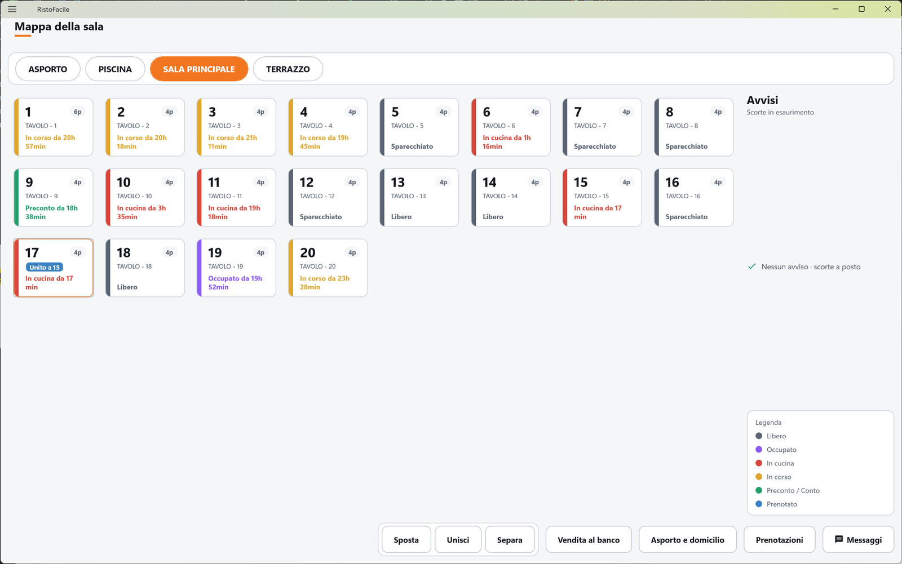

# Manuale RistoFacile

Benvenuto nella guida operativa di **RistoFacile**, il programma di R.S.A. per ristoranti,
pizzerie e bar.

RistoFacile sono tre app che lavorano insieme, collegate al **servizio** RistoFacile installato
nel locale:

- la **Cassa**, sul PC o sul tablet al banco: la mappa della sala, le comande, il conto, lo
  scontrino, e tutte le anagrafiche del locale (sale, menu, articoli, operatori…);
- il **Palmare**, sul telefono o sul tablet dei camerieri: si prende la comanda al tavolo, la si
  manda in cucina, si dà il via alle portate e, se serve, si incassa;
- il **Monitor di cucina**, lo schermo in cucina, in pizzeria o al bar: i piatti da preparare
  arrivano da soli e chi cucina li fa avanzare con un tocco.

Accanto alle tre app c'è il **[Kiosk](kiosk/index.md)**, il totem dove il cliente ordina e paga da
solo.

Quello che si batte su un dispositivo compare subito sugli altri: il tavolo aperto dal palmare è
occupato anche sulla cassa, il piatto segnato pronto in cucina risulta pronto sul palmare.

Il manuale è organizzato **una scheda per ogni schermata**: per ciascuna trovi a cosa serve, il
significato di ogni campo, i comandi disponibili e le procedure passo passo per le operazioni più
frequenti. Per farti un'idea di come si lavora, comincia da
[Una serata, dal tavolo al conto](introduzione/una-serata.md).

## Da dove iniziare

-   :material-rocket-launch: **Prima configurazione**

    ---

    Il primo avvio di cassa, palmari e monitor: collegamento al servizio, licenza, operatori.

    [:octicons-arrow-right-24: Vai alla guida](introduzione/prima-configurazione.md)

-   :material-silverware-fork-knife: **Una serata**

    ---

    Dal tavolo al conto, passo passo: comanda, cucina, preconto, incasso.

    [:octicons-arrow-right-24: Segui la serata](introduzione/una-serata.md)

-   :material-cash-register: **Cassa**

    ---

    La mappa della sala, la comanda, il conto e le anagrafiche del locale.

    [:octicons-arrow-right-24: Apri la cassa](cassa/index.md)

-   :material-cellphone: **Palmare**

    ---

    L'app dei camerieri: sala, comanda, conto, asporto e prenotazioni dal telefono.

    [:octicons-arrow-right-24: Apri il palmare](palmare/index.md)

-   :material-chef-hat: **Monitor di cucina**

    ---

    Il tabellone dei piatti in coda, in lavorazione e pronti.

    [:octicons-arrow-right-24: Apri il monitor](kds/index.md)

-   :material-book-open-variant: **Glossario**

    ---

    I termini usati nelle app e nel manuale: comanda, portata, VIA, preconto…

    [:octicons-arrow-right-24: Consulta il glossario](appendici/glossario.md)

## Come cercare

Usa il campo di ricerca in alto: funziona sul testo di tutte le pagine, quindi puoi cercare il
**nome esatto di un pulsante** (es. «INVIA IN CUCINA»), l'etichetta di un campo o il testo di un
messaggio che ti è comparso a video. Tutti i messaggi sono raccolti anche in
[Messaggi a video](appendici/messaggi.md), in ordine alfabetico.

!!! tip "Suggerimento"

    Ogni pagina ha un indice laterale con le sezioni: per andare direttamente ai pulsanti, alle
    procedure o ai messaggi, usa quello invece di scorrere.

In alto trovi una scheda per ciascuna app. Nella **Cassa** l'indice ricalca il menu laterale
dell'app, voce per voce; nel **Palmare** segue le linguette in basso. Vedi
[Convenzioni del manuale](introduzione/convenzioni.md).
