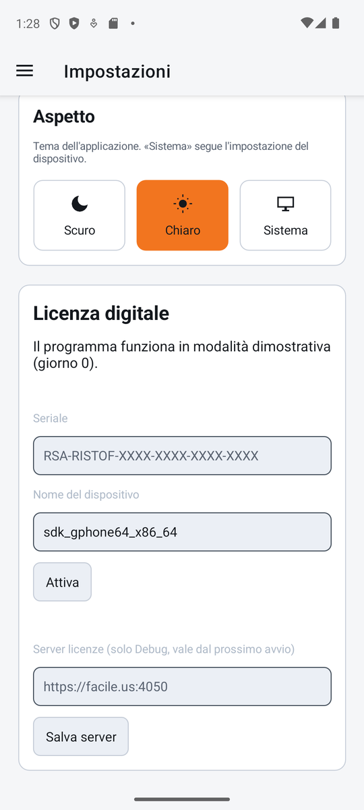
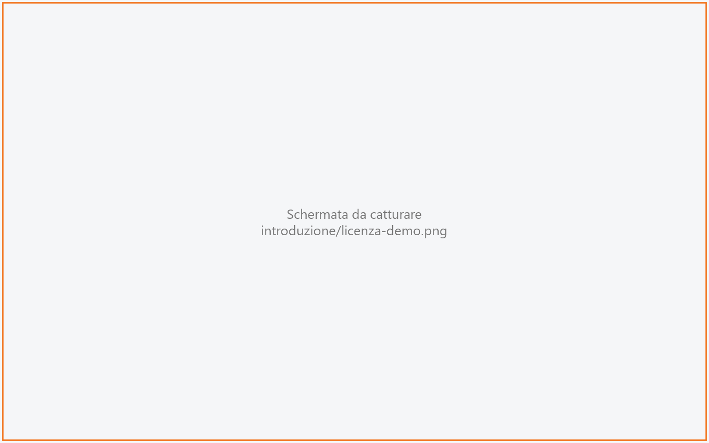

# Licenza digitale

La licenza digitale è il permesso di usare RistoFacile su un dispositivo. Si attiva una volta,
scrivendo il seriale ricevuto da RSA, e da quel momento il dispositivo si tiene in regola da
solo collegandosi ogni tanto al server delle licenze. Questa scheda serve al titolare e a chi
installa.

!!! info "In sintesi"

    - **Dove si trova:** cassa: Menu ▸ Impostazioni ▸ **Licenza**; palmare: Menu ▸ Impostazioni,
      riquadro **Licenza digitale** in fondo; all'avvio, se il dispositivo non ha né licenza né
      demo
    - **Chi la usa:** titolare, installatore
    - **Disponibile anche su:** cassa e palmare; il monitor di cucina non ha una licenza sua

---

## A cosa serve

Ogni dispositivo occupa un **posto** della licenza del locale:

| Dispositivo | Posto occupato |
|---|---|
| **Cassa** | Una postazione dell'edizione acquistata: **Lite**, **Small**, **Professional** o **Evolution**. |
| **Palmare** | Un posto **Mobile**. Il palmare non sceglie l'edizione. |
| **Monitor di cucina** | Nessuno: è un **modulo aggiuntivo** (KDS) della licenza della cassa. |

Esempio: una pizzeria con licenza Professional per una cassa e tre posti Mobile attiva la cassa
con il seriale scegliendo **Professional**, poi attiva i tre palmari con lo stesso seriale. Se
prova ad attivare un quarto palmare, il server risponde che non ci sono posti Mobile liberi.

Senza licenza RistoFacile funziona in **modalità dimostrativa** (demo): si può lavorare, ma
ogni tanto compare la finestra della demo.

## Prima di cominciare

- Il **seriale** della licenza, ricevuto da RSA (nella forma `RSA-RISTOF-XXXX-XXXX-XXXX-XXXX`).
- Un collegamento a **Internet**: attivazione e disattivazione parlano con il server delle
  licenze di RSA, non con il servizio del locale.
- Per il monitor di cucina: la cassa deve essere collegata al servizio del locale
  ([Impostazioni](../cassa/impostazioni.md) ▸ **Connessione**).

## La schermata

All'avvio, prima di qualunque altra schermata, l'app mostra per un attimo *Verifica della
licenza...*. Se il dispositivo ha la licenza o è in demo si prosegue; altrimenti si apre la
pagina **Licenza digitale** e da lì non si va oltre finché non c'è una licenza.

La pagina (uguale a quella dentro le Impostazioni) contiene, dall'alto:

- il titolo **Licenza digitale** e lo **stato** della licenza su questo dispositivo;
- in arancione gli **avvisi** (scadenza vicina, server non raggiungibile da tempo);
- i campi **Seriale**, **Edizione** (solo sulla cassa) e **Nome del dispositivo**;
- i pulsanti **Attiva**, **Disattiva questo dispositivo**, **Riprova** e **Continua**, ciascuno
  visibile solo quando serve;
- in grassetto l'**esito** dell'ultima operazione.

In demo, ogni tanto, al cambio di schermata si apre la **finestra della demo** a tutto schermo
(vedi sotto).

## Campi e indicatori

| Elemento | Descrizione |
|---|---|
| Stato | Con la licenza: *Licenza digitale:* (codice), *Cliente:*, *Edizione:*, *Scadenza:* (data o *nessuna*) ed eventualmente *Collegarsi al server licenze entro il* (data). In demo: *Il programma funziona in modalità dimostrativa (giorno 12).* Senza licenza: *Questo dispositivo non ha ancora una licenza.* |
| Avvisi (in arancione) | *La licenza scade il* (data)*. Rinnovala per non passare in modalità dimostrativa.* (da 30 giorni prima della scadenza); *Il programma non riesce a contattare il server licenze. Collegati a Internet entro il* (data)*.* |
| **Seriale** | Il seriale della licenza. Si scrive in maiuscolo da solo e senza correzioni automatiche. |
| **Edizione** | Solo sulla cassa: **Lite**, **Small**, **Professional** (proposta) o **Evolution**. Scegli quella acquistata. |
| **Nome del dispositivo** | Il nome con cui il dispositivo compare nella licenza, per esempio *Cassa banco* o *Palmare Marco*. È proposto il nome del dispositivo; massimo 50 caratteri. |
| Esito | Il risultato di **Attiva** o **Disattiva**, per esempio *Licenza attivata.* |

## Pulsanti e comandi

| Comando | Effetto |
|---|---|
| **Attiva** | Manda seriale, edizione e nome al server delle licenze e attiva questo dispositivo. |
| **Disattiva questo dispositivo** | Visibile solo con la licenza attiva. Chiede *Disattivare questo dispositivo? Il posto della licenza digitale torna libero.* e, con **Disattiva**, libera il posto. |
| **Riprova** | Visibile quando l'app è bloccata (vedi *Controlli e messaggi*): ripete la verifica della licenza. |
| **Continua** | Visibile sulla pagina aperta all'avvio quando c'è una licenza o la demo: entra nell'app. |

Nella **finestra della demo**:

| Comando | Effetto |
|---|---|
| **OK** | Chiude la finestra e si continua a lavorare. |
| **Attiva** | Chiude la finestra e apre la pagina **Licenza digitale**. |

I due pulsanti restano spenti per qualche secondo, con il conto alla rovescia (*OK (3)*,
*Attiva (3)*). Sulla cassa Windows valgono anche i tasti ++f2++ (**OK**) e ++f3++ (**Attiva**).

## Come si fa

### Attivare la cassa

1. Apri Menu ▸ Impostazioni ▸ **Licenza** (oppure la pagina che si apre all'avvio, o **Attiva**
   nella finestra della demo).
2. Scrivi il **Seriale**.
3. In **Edizione** scegli l'edizione acquistata.
4. Controlla il **Nome del dispositivo**.
5. Tocca **Attiva**.
6. Compare *Licenza attivata.* e lo stato mostra codice, cliente, edizione e scadenza.

Attivando la cassa si chiede insieme anche il modulo del monitor di cucina: non serve un
passaggio a parte.

### Attivare un palmare

1. Apri Menu ▸ Impostazioni e scorri fino al riquadro **Licenza digitale**.
2. Scrivi il **Seriale** (lo stesso della cassa) e controlla il **Nome del dispositivo**.
3. Tocca **Attiva**.
4. Compare *Licenza attivata.*: il palmare occupa un posto Mobile.

### Spostare la licenza su un altro dispositivo

1. Sul **vecchio** dispositivo apri la licenza e tocca **Disattiva questo dispositivo**.
2. Conferma con **Disattiva**: compare *Dispositivo disattivato.* e il vecchio dispositivo torna
   alla pagina della licenza (non si può più usare finché non viene riattivato).
3. Sul **nuovo** dispositivo attiva la licenza con lo stesso seriale.

<!-- DA VERIFICARE: cosa fare se il vecchio dispositivo e' rotto o perso e non si puo' disattivare (lo libera l'assistenza RSA?). -->

Se reinstalli l'app sullo **stesso** dispositivo non serve riattivarla: al primo avvio con
Internet la licenza viene ripresa da sola.

## La modalità dimostrativa

Al primo avvio, se il dispositivo non ha una licenza, RistoFacile parte in demo da solo. Se in
quel momento non c'è Internet la demo parte lo stesso e viene registrata al primo collegamento.
Se il server delle licenze non concede la demo al dispositivo, si apre la pagina della licenza
con *Questo dispositivo non ha ancora una licenza.*

La **finestra della demo** ha il titolo *C O P I A   N O N   A T T I V A T A* e il testo
*RistoFacile funziona in modalità dimostrativa: per toglierla attiva la licenza digitale.*
Compare al cambio di schermata, sempre più spesso man mano che passano i giorni di demo:

| Giorni di demo | Quando compare | Attesa prima di poterla chiudere |
|---|---|---|
| fino a 15 | mai | - |
| da 16 a 29 | una schermata ogni 250 | 10 secondi |
| da 30 a 89 | una schermata ogni 4 | 10 secondi |
| da 90 a 149 | una schermata ogni 2 | 10 secondi fino al giorno 99, poi un secondo in più ogni 10 giorni (fino a 14) |
| da 150 | a ogni schermata | da 15 secondi, un secondo in più ogni 10 giorni, al massimo 20 |

Se nessuno la chiude, la finestra si chiude da sola dopo il doppio dell'attesa. Non si chiude
con il tasto indietro.

Durante un **incasso** (dal tocco su **INCASSA** allo scontrino emesso o all'annullamento) la
finestra non compare mai: se era il momento, compare alla prima schermata dopo l'incasso.

## Il monitor di cucina

Il monitor di cucina **non si attiva**: chiede al servizio del locale se una cassa ha la licenza
digitale con il modulo del monitor. Lo chiede all'apertura del monitor e poi ogni ora. La cassa,
dal canto suo, comunica la sua situazione al servizio all'avvio, dopo un'attivazione o una
disattivazione, dopo il salvataggio della **Connessione** e comunque una volta al giorno.

| Risposta | Cosa si vede sul monitor |
|---|---|
| Una cassa ha la licenza con il modulo | Il monitor lavora normalmente. |
| Una cassa è in demo | In cima compare la striscia gialla *RistoFacile in modalità demo*. |
| Nessuna delle due | Al posto delle comande compare *Il monitor di cucina è un modulo aggiuntivo di RistoFacile e la licenza digitale di questo ristorante non lo comprende.* e le comande non vengono più lette. |

Se il servizio non risponde, il monitor usa l'ultima risposta avuta per **7 giorni**. Un monitor
appena installato lavora normalmente per 7 giorni anche se non ha mai avuto una risposta. Quando
il modulo torna disponibile, le comande ricompaiono da sole.

<!-- DA VERIFICARE: il modulo del monitor di cucina e' compreso in tutte le edizioni o va acquistato a parte? La cassa lo chiede sempre all'attivazione. -->

## Senza Internet

- La cassa e il palmare lavorano anche senza Internet: la licenza si controlla con il server una
  volta al giorno, quando c'è rete.
- Se il controllo non riesce da troppo tempo compare l'avviso *Il programma non riesce a
  contattare il server licenze. Collegati a Internet entro il* (data)*.* Superata quella data
  l'app si blocca con *Il programma deve collegarsi al server licenze. Controlla la connessione a
  Internet e premi Riprova.*
- Attivare e disattivare richiedono sempre Internet.

## Il rinnovo

- Da 30 giorni prima della scadenza la pagina della licenza mostra *La licenza scade il*
  (data)*. Rinnovala per non passare in modalità dimostrativa.*
- Se la licenza viene rinnovata prima della scadenza, il dispositivo prende il rinnovo da solo
  al controllo giornaliero.
- Se la licenza scade, l'app passa in demo: lo stato dice *La licenza è scaduta il* (data)*: il
  programma funziona in modalità dimostrativa finché non la rinnovi.* e la finestra della demo ha
  il titolo *L I C E N Z A   S C A D U T A   I L* (data). Dopo una scadenza i giorni di demo
  partono da 16, quindi la finestra compare da subito. Dopo il rinnovo, riavvia l'app con
  Internet: la licenza torna attiva.

<!-- DA VERIFICARE: dopo una scadenza, confermare che basta riavviare l'app con Internet (in demo il controllo giornaliero non gira) e che non serve riscrivere il seriale. -->

## Controlli e messaggi

| Messaggio | Causa | Cosa fare |
|---|---|---|
| *Il seriale non è scritto correttamente.* | Il seriale non ha la forma giusta. | Ricopialo con attenzione. |
| *Seriale non riconosciuto per questo programma.* | Il seriale non esiste o non è di RistoFacile. | Controlla il seriale ricevuto da RSA. |
| *Non ci sono postazioni libere per l'edizione Professional.* (eventualmente con *Libere:* e le edizioni con posti liberi) | Tutte le postazioni di quell'edizione sono occupate. | Scegli l'edizione giusta, oppure libera una cassa con **Disattiva questo dispositivo**. |
| *Non ci sono posti Mobile liberi su questa licenza.* | Tutti i posti Mobile sono occupati (palmare). | Disattiva un palmare non più usato o chiedi altri posti a RSA. |
| *L'edizione* (nome) *non è prevista per questo programma.* | Edizione non compresa nella licenza. | Scegli l'edizione acquistata. |
| *La licenza è scaduta. Contatta RSA Software.* | Attivazione di una licenza scaduta. | Rinnova la licenza. |
| *La licenza è revocata. Contatta RSA Software.* / *La licenza è bloccata. Contatta RSA Software.* / *La licenza è corrotta. Contatta RSA Software.* | La licenza non è utilizzabile. | Contatta RSA. |
| *La release* … *non è coperta dall'assistenza: la licenza copre fino alla* … | La versione dell'app è più recente di quella coperta dalla licenza. | Rinnova l'assistenza o usa la versione coperta. |
| *Troppi tentativi: riprova fra* … *minuti.* | Troppe richieste in poco tempo. | Aspetta e riprova. |
| *Il server licenze non risponde. Controlla la connessione.* | Manca Internet o il server non risponde. | Controlla la rete e riprova. |
| *Licenza attivata, ma il dispositivo non riesce a salvarla: vale solo per questa sessione.* | Il dispositivo non riesce a scrivere la licenza. | Riprova l'attivazione; se si ripete, chiama l'assistenza. |
| *Questo dispositivo non ha una licenza attiva.* | **Disattiva** su un dispositivo senza licenza. | Nessuna azione. |
| *Questo dispositivo è stato disattivato.* | Il posto del dispositivo è stato liberato. | Riattiva con il seriale. |
| *La licenza è stata revocata.* | La licenza è stata revocata. | Contatta RSA. |
| *La data del dispositivo è indietro rispetto all'ultima usata dal programma. Correggi data e ora e premi Riprova.* | Orologio del dispositivo spostato indietro. | Correggi data e ora, poi **Riprova**. |
| *Il server licenze ha rifiutato la richiesta (codice* … *). Contatta l'assistenza.* | Risposta inattesa del server. | Contatta l'assistenza con il codice. |

## Note

!!! warning "Disattivare blocca il dispositivo"

    Dopo **Disattiva questo dispositivo** l'app torna alla pagina della licenza e non si può usare
    finché non viene riattivata con un seriale. Non è un modo per tornare alla demo.

- Il seriale serve sia per la cassa sia per i palmari: cambia solo il posto che il dispositivo
  occupa.
- Se la licenza viene tolta o sospesa mentre si lavora, l'app torna alla pagina della licenza e
  si riparte con **Continua** quando la situazione è di nuovo a posto.

## Vedi anche

- [Prima configurazione](prima-configurazione.md)
- [Impostazioni della cassa](../cassa/impostazioni.md)
- [Impostazioni del palmare](../palmare/impostazioni.md)
- [Monitor di cucina](../kds/monitor.md)
