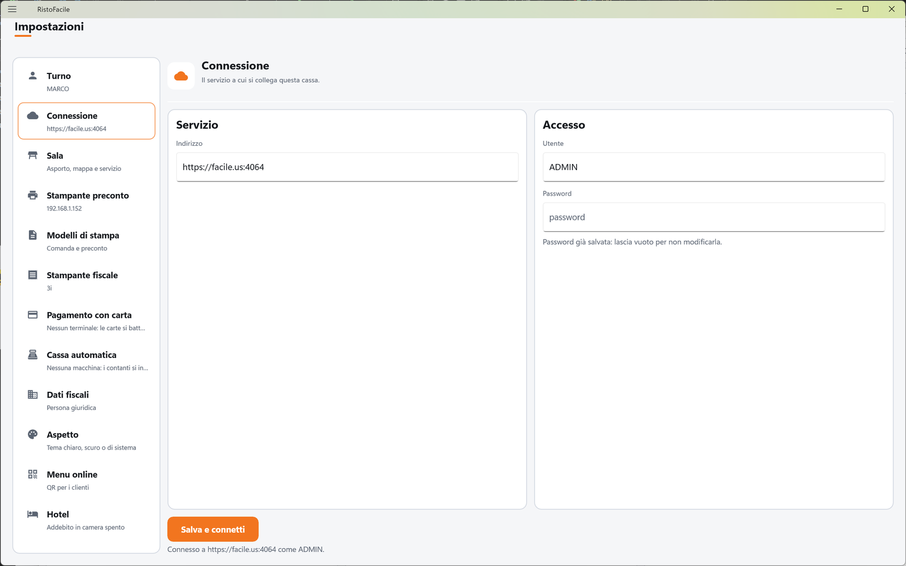
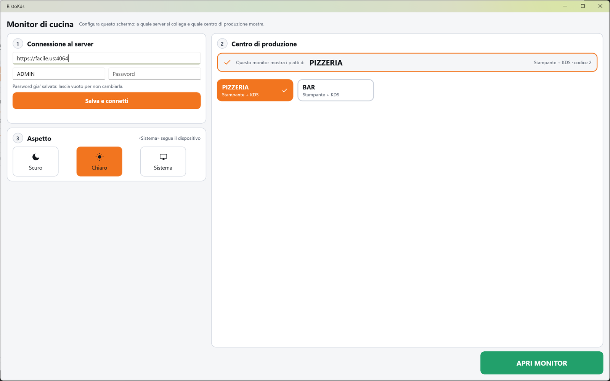

# Prima configurazione

Questa guida accompagna il primo avvio delle tre app di RistoFacile, nell'ordine in cui conviene
farlo: prima la **cassa**, poi i **palmari**, infine i **monitor di cucina**. È pensata per il
titolare o per chi installa; il cameriere e il cuoco non devono fare nulla di tutto questo.

!!! info "In sintesi"

    - **Dove si trova:** si fa al primo avvio di ciascuna app
    - **Chi la usa:** titolare, installatore
    - **Disponibile anche su:** cassa, palmare e monitor di cucina, ciascuno con i suoi passi

---

## A cosa serve

Tutte e tre le app lavorano collegate al **servizio RistoFacile** installato nel locale: è lui
che conserva sale, tavoli, menu, comande e conti. Al primo avvio ogni app va quindi collegata al
servizio; cassa e palmare vanno anche attivati con la licenza digitale, e su cassa e palmare ci
si entra scegliendo un operatore. Il monitor di cucina, invece, deve sapere quale centro di
produzione mostrare (la cucina, la pizzeria, il bar…).

## Prima di cominciare

Tieni a portata di mano:

- l'**indirizzo del servizio** del locale con la porta (per esempio `http://192.168.1.50:8080`),
  con **utente** e **password**: li fornisce chi ha installato il servizio;
- il **seriale** della licenza digitale e l'**edizione** acquistata (vedi
  [Licenza digitale](licenza.md));
- un collegamento a **Internet** per l'attivazione della licenza;
- per le stampanti, i POS e il registratore telematico: i loro indirizzi in rete.

Dispositivi e servizio devono stare nella stessa rete del locale.

## La schermata

All'avvio di cassa e palmare compare per un attimo *Verifica della licenza...*. Su un
dispositivo nuovo l'app parte in modalità dimostrativa e, non essendo ancora collegata al
servizio, apre da sola la schermata **Impostazioni**: è da lì che si comincia.

Il monitor di cucina si apre invece sempre sulla sua pagina di configurazione (titolo *RistoKds -
Configurazione*), divisa in tre passi numerati.

## Campi e indicatori

I dati da inserire, app per app:

| Dato | Cassa | Palmare | Monitor di cucina |
|---|---|---|---|
| Indirizzo del servizio | Impostazioni ▸ Connessione ▸ **Indirizzo** | Impostazioni ▸ Connessione ▸ **Base URL** | Passo **1 Connessione al server** ▸ *Base URL* |
| Utente e password del servizio | **Utente**, **Password** | **Utente**, **Password** | *Utente*, *Password* |
| Seriale della licenza | Impostazioni ▸ Licenza ▸ **Seriale** | Impostazioni ▸ Licenza digitale ▸ **Seriale** | non serve |
| Edizione | Impostazioni ▸ Licenza ▸ **Edizione** | non serve (posto Mobile) | non serve |
| Operatore | si crea in [Operatori](../cassa/operatori.md), si sceglie all'[accesso](../cassa/accesso.md) | si sceglie all'[accesso](../palmare/accesso.md) | non serve |
| Centro di produzione | - | - | Passo **2 Centro di produzione** |

## Pulsanti e comandi

| Comando | Effetto |
|---|---|
| **Salva e connetti** | Su tutte e tre le app: salva indirizzo, utente e password del servizio e verifica il collegamento. |
| **Attiva** | Cassa e palmare: attiva la licenza digitale su questo dispositivo. |
| **Accedi** / **ACCEDI** | Cassa e palmare, in Impostazioni ▸ Turno: apre la scelta dell'operatore. |
| **APRI MONITOR** | Monitor di cucina: apre il tabellone del centro scelto. Spento finché non hai scelto un centro. |

## Come si fa

### 1. La cassa

1. Avvia RistoFacile. Dopo *Verifica della licenza...* si apre **Impostazioni** (sulla voce
   **Turno**).
2. Tocca **Connessione**. Scrivi **Indirizzo**, **Utente** e **Password** del servizio e tocca
   **Salva e connetti**. Deve comparire *Connesso a* (indirizzo) *come* (utente)*.*
3. Tocca **Licenza**. Scrivi il **Seriale**, scegli l'**Edizione**, controlla il **Nome del
   dispositivo** (per esempio *Cassa banco*) e tocca **Attiva**. Deve comparire *Licenza
   attivata.* (Vedi [Licenza digitale](licenza.md).)
4. Apri Menu ▸ **Operatori** e crea almeno un operatore, con il suo PIN se vuoi che serva per
   entrare (vedi [Operatori](../cassa/operatori.md)).
5. Torna in Menu ▸ Impostazioni ▸ **Turno** e tocca **Accedi**: scegli il tuo nome (e digita il
   PIN). Si apre la mappa della sala con il tuo nome in turno.
6. Completa le impostazioni della cassa (vedi [Impostazioni](../cassa/impostazioni.md)):
    - **Stampante preconto**: la stampante vicino alla cassa;
    - **Stampanti fiscali**: i registratori telematici (uno per cassa, se ne hai più d'uno) e quale usa questa cassa;
    - **Pagamento con carta** e **Cassa automatica**, se ci sono;
    - **Sala ▸ Tavolo asporto**, se fai asporto o domicilio;
    - **Dati fiscali**, se emetti fatture elettroniche.
7. Prepara l'anagrafica del locale, se il servizio non l'ha già:
   [Sale e tavoli](../cassa/sale-e-tavoli.md),
   [Centri di produzione](../cassa/centri-di-produzione.md),
   [Tabelle di base](../cassa/tabelle-di-base.md), [Articoli](../cassa/articoli.md),
   [Menu](../cassa/menu.md).

La cassa è pronta: in **Turno** si legge il tuo nome, sotto **Connessione** l'indirizzo del
servizio.

<!-- DA VERIFICARE: al punto 4 si entra in Operatori senza essere ancora entrati come operatore (la cassa e' arrivata alle Impostazioni da sola perche' non era collegata). Confermare che e' il percorso previsto per creare il primo operatore; se la cassa viene riavviata prima di crearlo, la schermata di accesso mostra "Nessun operatore attivo..." senza un pulsante per proseguire. -->

### 2. I palmari

1. Avvia RistoApp sul palmare. Dopo *Verifica della licenza...* si apre **Impostazioni**.
2. Nel riquadro **Connessione** scrivi **Base URL**, **Utente** e **Password** e tocca **Salva e
   connetti**. Deve comparire *Connesso a* (indirizzo) *come* (utente)*.*
3. In **Stampante preconto** scegli la stampante su cui il cameriere stamperà il preconto.
4. In **Asporto** scegli sala e tavolo dell'asporto e tocca **Salva tavolo asporto**, se il
   cameriere prende ordini da asporto.
5. Scorri fino al riquadro **Licenza digitale**: scrivi il **Seriale**, dai al palmare un
   **Nome del dispositivo** riconoscibile (per esempio *Palmare 1*) e tocca **Attiva**. Il
   palmare occupa un posto Mobile.
6. In **Turno** tocca **ACCEDI**: il cameriere sceglie il suo nome e digita il PIN.
7. Si apre la **Sala**: il palmare è pronto.

Ripeti per ogni palmare. Vedi [Impostazioni del palmare](../palmare/impostazioni.md) e
[Accesso](../palmare/accesso.md).

### 3. I monitor di cucina

1. Dalla cassa, in [Centri di produzione](../cassa/centri-di-produzione.md), controlla che il
   centro da mostrare sia di tipo *Monitor KDS* o *Stampante + KDS*: gli altri sul monitor non
   compaiono.
2. Avvia RistoKds sul monitor. Si apre la pagina di configurazione.
3. Passo **1 Connessione al server**: scrivi *Base URL*, *Utente* e *Password* e tocca **Salva e
   connetti**. Deve comparire *Connesso a* (indirizzo) *come* (utente)*.*
4. Passo **2 Centro di produzione**: tocca la tessera del centro che questo monitor deve
   mostrare. Nel riquadro in alto si legge *Questo monitor mostra i piatti di* seguito dal nome
   del centro.
5. Se vuoi, al passo **3 Aspetto** scegli **Scuro**, **Chiaro** o **Sistema**.
6. Tocca **APRI MONITOR**: si apre il tabellone del centro.

Il monitor di cucina non ha una licenza sua né un operatore: funziona se una cassa del locale ha
la licenza digitale con il modulo del monitor (vedi [Licenza digitale](licenza.md#il-monitor-di-cucina)).
Vedi anche [Scelta del centro](../kds/centro.md) e [Monitor](../kds/monitor.md).

## Controlli e messaggi

| Messaggio | Causa | Cosa fare |
|---|---|---|
| *Base URL e utente sono obbligatori.* | **Salva e connetti** con indirizzo o utente vuoti. | Compila i campi. |
| *La password e' obbligatoria (nessuna password gia' salvata per questa installazione).* | Primo collegamento senza password. | Scrivi la password. |
| *Connessione fallita.* (cassa e palmare) / *Connessione fallita:* … (monitor) | Indirizzo, porta, utente o password sbagliati, oppure servizio spento. | Controlla i dati e che il servizio sia acceso e raggiungibile in rete. |
| *Non configurato: inserisci indirizzo e credenziali del server.* | Monitor di cucina avviato senza collegamento. | Compila il passo 1. |
| *Nessun centro da mostrare a monitor. Sul KDS compaiono solo i centri di tipo «Monitor KDS» o «Stampante + KDS»: imposta il tipo del centro dalla Cassa → Centri di produzione.* | Nessun centro adatto al monitor. | Imposta il tipo del centro dalla cassa. |
| *Scegli prima un centro di produzione (passo 2).* | **APRI MONITOR** senza un centro. | Tocca una tessera al passo 2. |
| *Il server licenze non risponde. Controlla la connessione.* | Attivazione senza Internet. | Collega il dispositivo a Internet e riprova. |
| *Nessun operatore attivo in anagrafica. Creane uno dalla cassa (Impostazioni - Operatori) prima di poter entrare.* | All'accesso non c'è nessun operatore. | Crea un operatore dalla cassa in Menu ▸ **Operatori**. |

## Note

- La licenza digitale si può attivare anche più tardi: nel frattempo cassa e palmare lavorano in
  modalità dimostrativa, con la finestra della demo che compare sempre più spesso.
- Collegamento, stampante scelta, terminale POS, tavolo dell'asporto e tema valgono per il
  singolo dispositivo: vanno impostati su ciascuno. Elenco delle stampanti, elenco delle stampanti fiscali e
  dati della ditta valgono per tutto il locale e si impostano una volta.
- Se reinstalli l'app su un iPhone o un iPad, il collegamento al servizio va reimpostato.

## Vedi anche

- [Licenza digitale](licenza.md)
- [Impostazioni della cassa](../cassa/impostazioni.md)
- [Impostazioni del palmare](../palmare/impostazioni.md)
- [Accesso operatore](../cassa/accesso.md)
- [Operatori](../cassa/operatori.md)
- [Scelta del centro](../kds/centro.md)
- [Una serata, dal tavolo al conto](una-serata.md)
