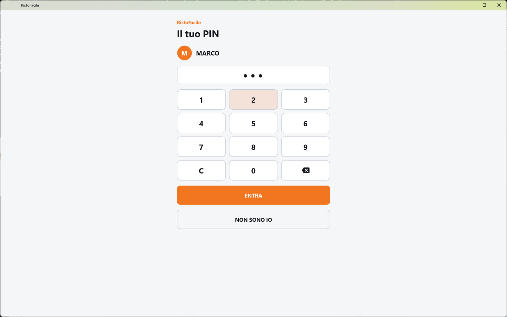
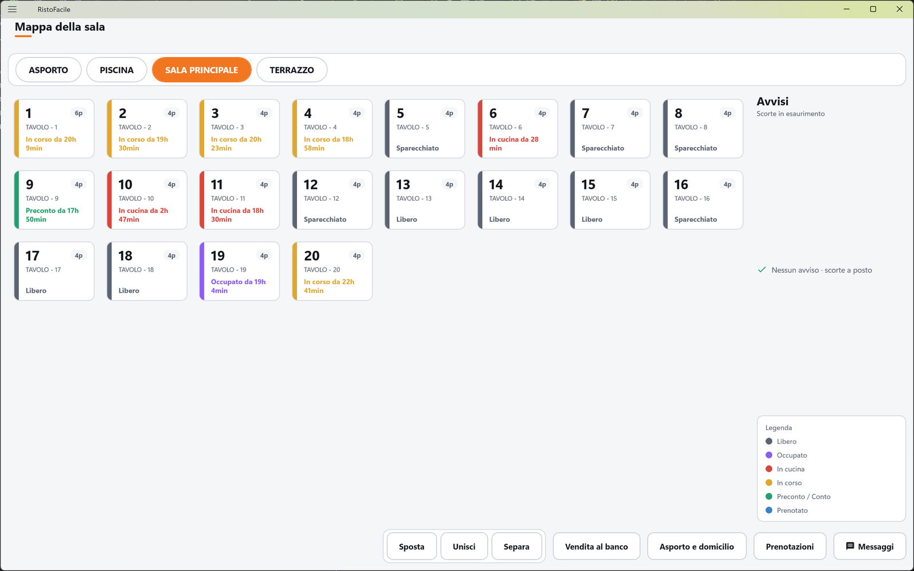
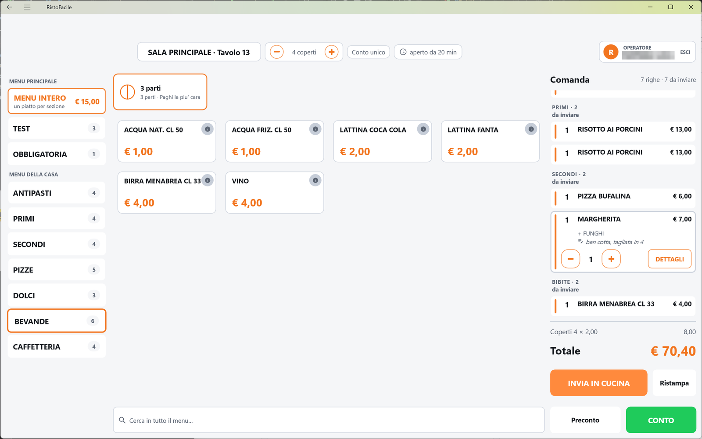
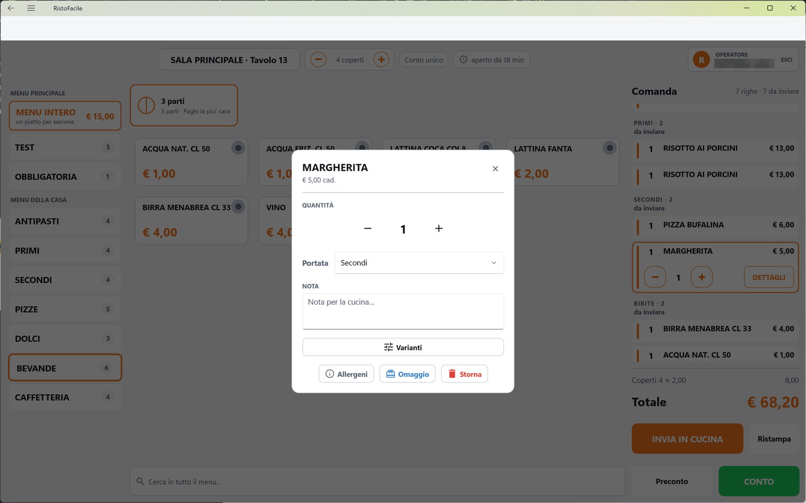
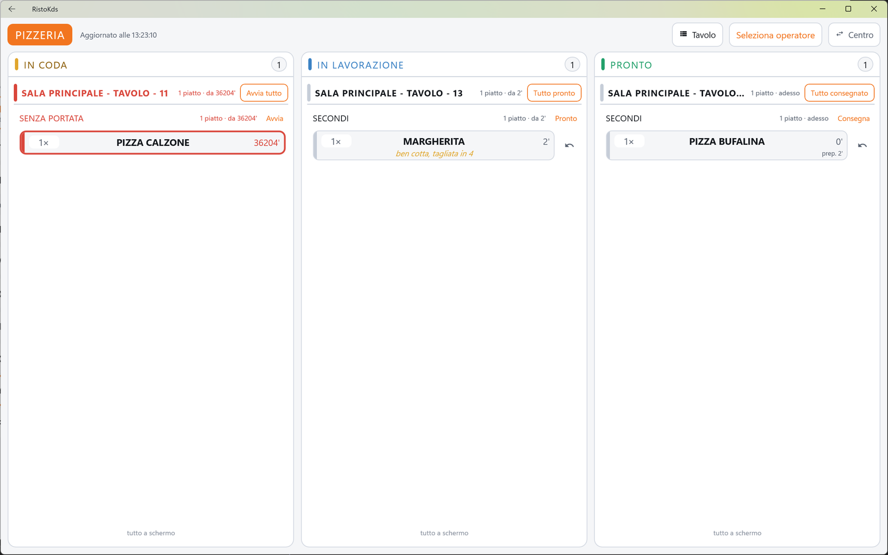
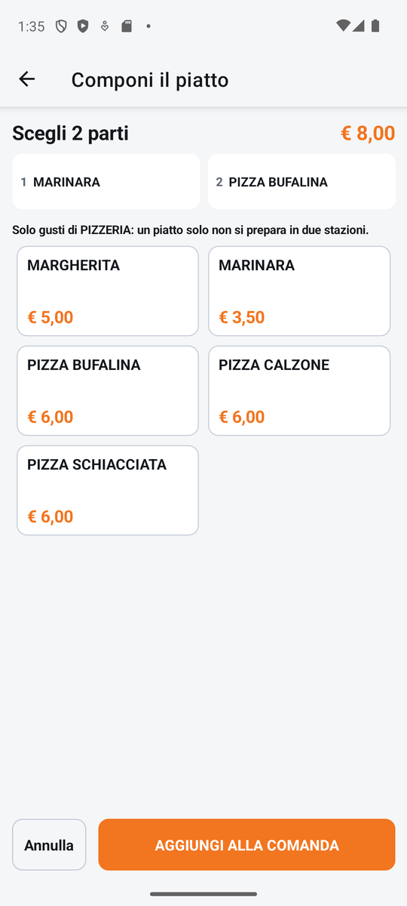
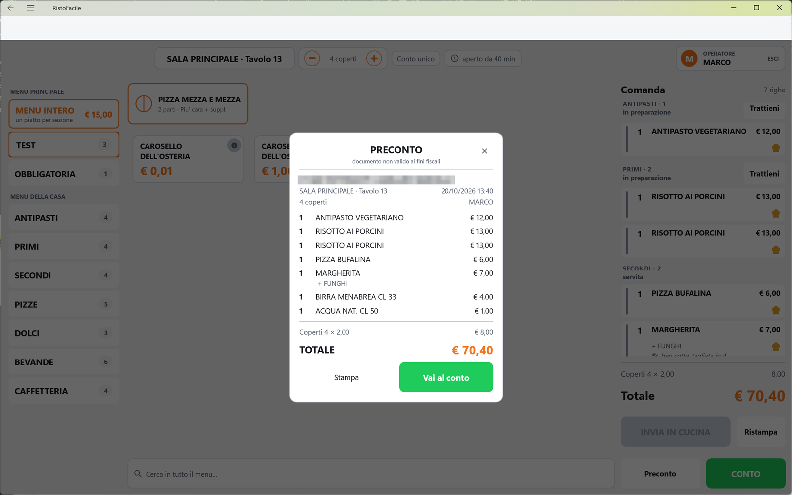
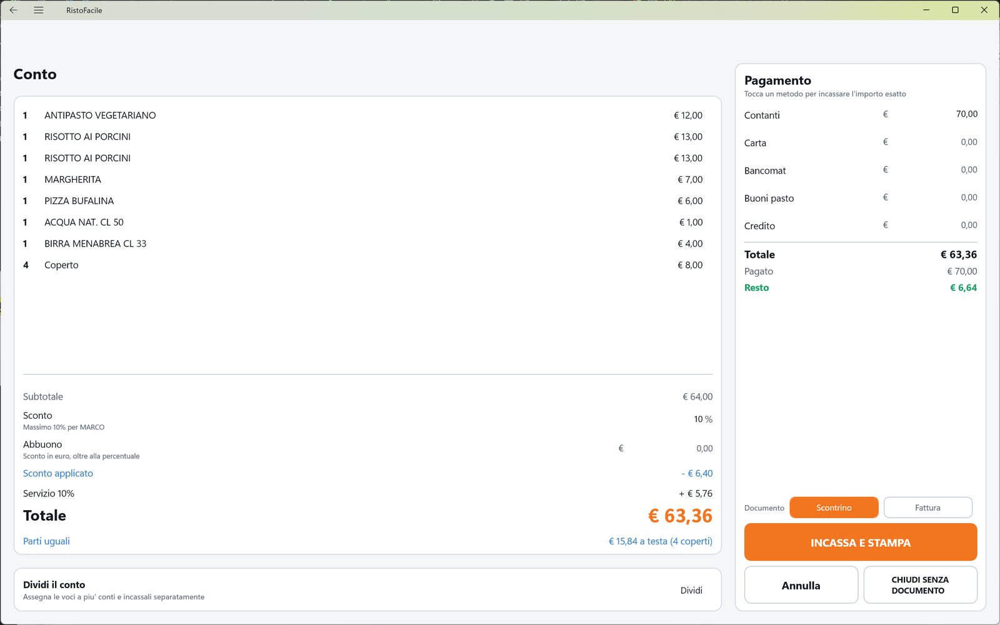
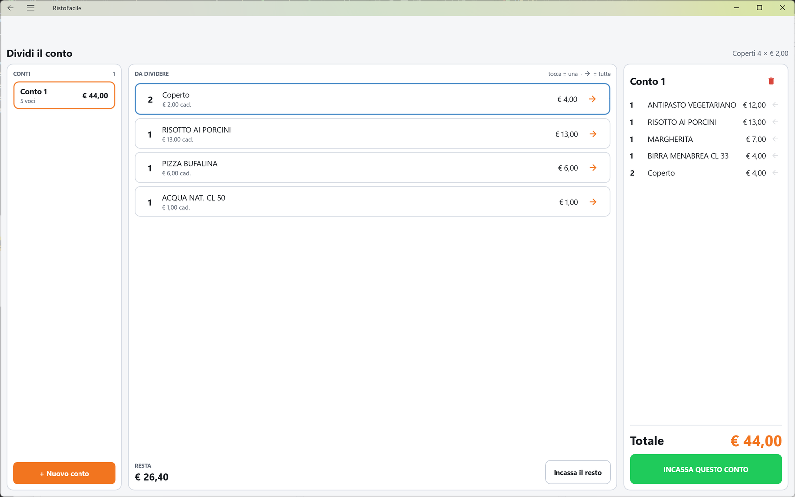

# Una serata, dal tavolo al conto

Questa pagina segue un tavolo dall'arrivo dei clienti all'incasso, passando per la cassa, il
palmare del cameriere e il monitor della pizzeria. Non spiega ogni pulsante: per quello ogni
passaggio rimanda alla scheda della sua schermata. Serve a chi comincia, per vedere come si
lavora con RistoFacile in una serata normale.

!!! info "In sintesi"

    - **Dove si trova:** si comincia dalla [Mappa della sala](../cassa/mappa-sala.md) della cassa o dalla [Sala](../palmare/sala.md) del palmare
    - **Chi la usa:** cassiere, cameriere, pizzaiolo
    - **Disponibile anche su:** cassa, palmare e monitor di cucina, ciascuno per la sua parte

---

## Prima di cominciare

- Cassa, palmare e monitor sono collegati al servizio del locale e attivati (vedi
  [Prima configurazione](prima-configurazione.md)).
- Esistono le sale e i tavoli ([Sale e tavoli](../cassa/sale-e-tavoli.md)), il menu con le sue
  sezioni ([Menu](../cassa/menu.md)), le portate ([Portate](../cassa/portate.md)) e i centri di
  produzione, con il monitor della pizzeria ([Centri di produzione](../cassa/centri-di-produzione.md)).
- Ogni cassiere e cameriere ha il suo nome e il suo PIN ([Operatori](../cassa/operatori.md)).

## 1. Inizio turno: «Chi sei?»

1. Sulla cassa compare la schermata **Chi sei?** con l'elenco degli operatori.
2. Tocca il tuo nome (es. **MARCO**).
3. Digita il tuo PIN: per ogni cifra compare un pallino.
4. Tocca **ENTRA**. Si apre la mappa della sala, e da questo momento tutto quello che batti porta
   il tuo nome.

Sul palmare il cameriere fa lo stesso all'avvio. Vedi [Accesso operatore](../cassa/accesso.md) e
[Accesso sul palmare](../palmare/accesso.md).

## 2. La mappa della sala

In alto ci sono le sale: tocca quella in cui lavori (es. **SALA PRINCIPALE**). Al centro i tavoli,
ognuno con una barra colorata che dice a che punto è:

| Colore | Stato | Vuol dire |
|---|---|---|
|  grigio | **Libero** | Nessun conto aperto. |
|  viola | **Occupato** | Tavolo aperto, ancora niente battuto. |
|  ambra | **In corso** | Piatti battuti ma non ancora mandati in cucina. |
|  rosso | **In cucina** | Almeno un piatto è in cucina. |
|  verde | **Preconto / Conto** | Il preconto è fatto, o il conto è in chiusura. |
|  azzurro | **Prenotato** | Prenotazione in arrivo, con l'ora. |

La mappa si aggiorna da sola quando un collega lavora dal palmare o da un'altra cassa. Vedi
[Mappa della sala](../cassa/mappa-sala.md).

## 3. Il tavolo si siede

Quattro persone si siedono al tavolo 14.

- **Sulla cassa** tocca il tavolo 14: si apre direttamente la [Comanda](../cassa/comanda.md) del
  tavolo, con **4 coperti** (quanti sono i posti del tavolo).
- **Sul palmare** il cameriere tocca il tavolo 14 nella [Sala](../palmare/sala.md); il palmare
  chiede *Vuoi occupare il tavolo 14?* e lui tocca **Occupa**.

In tutti e due i casi il tavolo risulta occupato su tutti i dispositivi. Se le persone sono di
più o di meno, cambia i coperti con **−** e **+** nella testata della comanda.

## 4. La comanda

1. Tocca una sezione a sinistra (**ANTIPASTI**, **PRIMI**, **PIZZE**, **BEVANDE**…): al centro
   compaiono i suoi piatti.
2. Tocca i piatti ordinati. Ogni tocco aggiunge una riga alla comanda, a destra, con la striscia
   arancione: è **da inviare**.
3. Ripeti per le altre sezioni. In cima alla comanda il riepilogo dice quante righe ci sono e
   quante sono da inviare.

### Una nota e una variante

Il cliente vuole la Margherita ben cotta, tagliata in quattro, e con i funghi.

1. Tocca la riga della Margherita, poi **DETTAGLI**. Si apre la finestra della riga, con la
   quantità, la **Portata**, la **NOTA**, **Varianti**, **Allergeni**, **Omaggio** e **Storna**.
2. In **NOTA** scrivi «ben cotta, tagliata in 4».
3. Tocca **Varianti**, accendi **+ FUNGHI** e tocca **Salva varianti**: la riga passa da 5,00 a
   7,00 €.
4. Chiudi la finestra con la **X**. Sotto il nome del piatto compaiono la variante e la nota.

Vedi [Comanda](../cassa/comanda.md) e, per le varianti, [Varianti](../cassa/varianti-anagrafica.md).

## 5. In cucina: INVIA IN CUCINA e VIA

1. Tocca **INVIA IN CUCINA**. Le righe prendono la striscia grigia con il cappello da chef: sono
   **in cucina**. In mappa il tavolo diventa rosso.
2. Le righe sono raggruppate per portata. Le portate che partono subito (gli antipasti, le bibite)
   sono già **in preparazione**; primi e secondi restano **in attesa del via**, con accanto il
   pulsante **VIA**.
3. Quando il tavolo ha finito gli antipasti, il cameriere tocca **VIA** sul gruppo dei primi: i
   primi arrivano in cucina.

Se ha dato il via troppo presto, finché la cucina non ha cominciato il cameriere può toccare
**Trattieni**: la portata torna in attesa. Vedi [Portate](../cassa/portate.md).

Ogni piatto va al centro di produzione assegnato a quel piatto nel menu: le pizze alla pizzeria,
le bevande al bar, i primi in cucina, sulla stampante, sul monitor o su tutti e due.

## 6. Sul monitor della pizzeria

1. Le pizze del tavolo arrivano nella colonna **IN CODA**, raggruppate per tavolo. Sotto la
   Margherita compare in giallo la nota del cameriere, «ben cotta, tagliata in 4».
2. Il pizzaiolo tocca **Avvia tutto** sulla testata del tavolo: le pizze passano **IN
   LAVORAZIONE**.
3. Quando una pizza è pronta la tocca: passa in **PRONTO**, con il tempo di preparazione (es.
   «prep. 2'»). Sul palmare e sulla cassa la portata risulta pronta.
4. Quando il cameriere la porta al tavolo, il pizzaiolo tocca **Consegna**: la pizza sparisce dal
   monitor e in cassa la portata diventa **servita**.

Vedi [Monitor](../kds/monitor.md).

## 7. Una mezza e mezza dal palmare

Dal tavolo chiedono una pizza metà marinara e metà bufalina. Il cameriere la batte dal palmare.

{ .telefono }

1. Nella comanda del tavolo apre la sezione **PIZZE** e tocca la tessera **½ PIZZA MEZZA E
   MEZZA** - «componi».
2. Tocca **MARINARA** per la prima metà e **PIZZA BUFALINA** per la seconda.
3. Tocca **AGGIUNGI ALLA COMANDA**.
4. In comanda compare la riga «MARINARA / PIZZA BUFALINA», con le due metà scritte sotto.

Il prezzo segue la regola di composizione (per esempio la metà più cara). Vedi
[Comanda sul palmare](../palmare/comanda.md) e [Componi la pizza](../cassa/mezza.md).

## 8. Il preconto

A fine cena il tavolo chiede il conto da controllare.

1. Nella Comanda tocca **Preconto**. Si apre l'anteprima **PRECONTO** - «documento non valido ai
   fini fiscali», con il tavolo, i coperti, le righe e il totale.
2. Tocca **Stampa** per stamparlo e portarlo al tavolo. In mappa il tavolo diventa verde.
3. Quando il cliente vuole pagare, tocca **Vai al conto**.

Il preconto non chiude niente: il tavolo resta aperto e si possono ancora aggiungere piatti.

## 9. Il conto

A sinistra le righe del conto, poi:

- **Subtotale**: la somma delle righe;
- **Sconto**, in percentuale, fino al massimo concesso all'operatore (sotto si legge, per esempio,
  «Massimo 10% per MARCO»);
- **Abbuono**, uno sconto in euro, per arrotondare;
- **Servizio 10%**, se la sala lo prevede;
- il **Totale** e, sotto, **Parti uguali** con la quota «a testa».

A destra il **Pagamento**: **Contanti**, **Carta**, **Bancomat**, **Buoni pasto**, **Credito**.
«Tocca un metodo per incassare l'importo esatto»: toccando il nome di un metodo, la cassa ci mette
quanto manca. Sotto, **Pagato** e **Resto**, e la scelta del **Documento**: **Scontrino** o
**Fattura**.

Esempio: subtotale 64,00 €, sconto del 10% (− 6,40), servizio + 5,76, totale **63,36 €**. Il
cliente paga con una banconota da 70.

1. Nel campo **Sconto** scrivi 10.
2. In **Contanti** scrivi 70,00.
3. Controlla il **Resto**: 6,64 €.
4. Lascia acceso **Scontrino** e tocca **INCASSA E STAMPA**.
5. Il servizio emette lo scontrino sulla stampante fiscale, la cassa torna alla mappa e il tavolo
   è di nuovo **Libero**.

!!! warning "INCASSA E STAMPA o CHIUDI SENZA DOCUMENTO"

    **INCASSA E STAMPA** incassa ed emette lo **scontrino fiscale** (o la fattura).
    **CHIUDI SENZA DOCUMENTO** chiude il conto e libera il tavolo **senza emettere nessuno
    scontrino**: serve solo quando la stampante fiscale manca o è guasta, ed è riservato agli
    operatori abilitati (**Puo' chiudere il conto**). Lo scontrino si può emettere più tardi dallo
    [Storico conti](../cassa/storico-conti.md). Non toccarlo al posto di INCASSA E STAMPA.

Vedi [Conto](../cassa/conto.md) e, sul palmare, [Conto](../palmare/conto.md).

## 10. Se il tavolo paga diviso

Due coppie vogliono pagare ognuna la sua parte.

1. Nel conto tocca **Dividi**. Si apre la divisione con il **Conto 1** già attivo.
2. Tocca le voci della prima coppia: ogni tocco sposta una voce sul Conto 1, che arriva a 44,00 €.
3. Tocca **INCASSA QUESTO CONTO** e incassa come al punto precedente.
4. Si torna alla divisione: tocca **Incassa il resto** (26,40 €). Nel conto compare *Parte di
   questo tavolo e' gia' stata incassata: qui c'e' solo quello che resta.*
5. Incassa il resto. Quando l'ultimo conto è incassato il tavolo torna **Libero**.

Ogni conto ha il suo scontrino. Vedi [Dividi il conto](../cassa/dividi-conto.md).

## 11. Durante il servizio: sposta, unisci, separa

Nel corso della serata i tavoli cambiano. Dalla barra in basso della mappa della sala:

- **Sposta**: i clienti del 14 chiedono di passare al 15. Tocca **Sposta**, il tavolo 14 e poi il
  15: tutta la comanda passa sul 15 e il 14 torna libero.
- **Unisci**: arrivano altri amici e si accosta il 17. Tocca **Unisci**, il 15 (che tiene il conto)
  e poi il 17: sulla tessera del 17 compare **Unito a 15** e il conto è uno solo.
- **Separa**: una parte della tavolata si sposta a un altro tavolo e paga per conto suo. Tocca
  **Separa** e il tavolo; scegli le righe e i coperti da spostare, tocca **Scegli il tavolo** e poi
  il tavolo libero di destinazione, che diventa un conto a sé.

Vedi [Mappa della sala](../cassa/mappa-sala.md) e [Sala sul palmare](../palmare/sala.md).

## 12. Fine turno

1. Nella Comanda tocca **ESCI** in alto a destra, nel riquadro dell'operatore.
2. Alla domanda *Vuoi uscire? MARCO non firmera' piu' le comande su questo dispositivo, e per
   rientrare servira' il PIN.* tocca **Esci**.
3. La cassa torna a **Chi sei?**, pronta per il collega.

Sul palmare il cameriere esce dalla linguetta [Io](../palmare/io.md) ▸ **ESCI**.

## Vedi anche

- [Le tre app di RistoFacile](index.md)
- [Prima configurazione](prima-configurazione.md)
- [Mappa della sala](../cassa/mappa-sala.md)
- [Comanda](../cassa/comanda.md)
- [Conto](../cassa/conto.md)
- [Comanda sul palmare](../palmare/comanda.md)
- [Monitor](../kds/monitor.md)
- [Glossario](../appendici/glossario.md)
