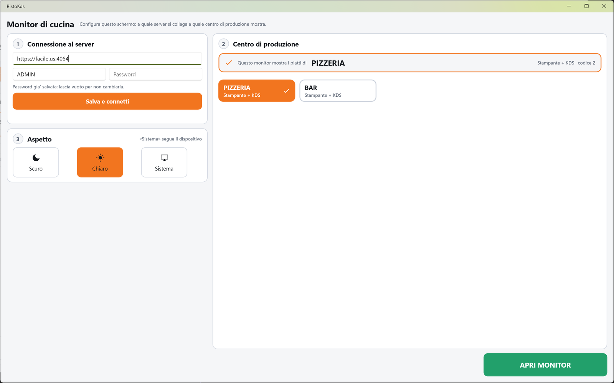

# Scelta del centro

La schermata di configurazione del monitor di cucina: si collega il monitor al servizio del
ristorante, si sceglie quale centro di produzione mostra (cucina, pizzeria, bar…) e si sceglie il
tema. È la prima schermata che compare ogni volta che l'app si avvia; da qui si apre il tabellone.

!!! info "In sintesi"

    - **Dove si trova:** all'avvio dell'app; dal tabellone, pastiglia **Impostazioni** in alto a destra, poi **Apri la configurazione**
    - **Chi la usa:** installatore, titolare (una volta); chi accende il monitor (ogni giorno, per toccare **APRI MONITOR**)
    - **Disponibile anche su:** solo monitor di cucina

---

## A cosa serve

Si usa davvero una volta, quando si installa lo schermo: si scrive l'indirizzo del servizio e le
credenziali, si sceglie il centro (es. PIZZERIA) e da quel momento il monitor mostra solo i piatti
della pizzeria. Il monitor ricorda la scelta: alle accensioni successive basta toccare
**APRI MONITOR**.

## Prima di cominciare

- L'indirizzo del servizio RistoFacile del locale (es. http://192.168.1.10:8080), con utente e
  password: li fornisce chi ha installato il servizio.
- Almeno un centro di produzione attivo di tipo **Monitor KDS** o **Stampante + KDS**, impostato
  dalla cassa (vedi [Centri di produzione](../cassa/centri-di-produzione.md)).

## La schermata

In alto il titolo **Monitor di cucina** con «Configura questo schermo: a quale server si collega e
quale centro di produzione mostra.». Sotto, tre passi numerati.

A sinistra:

- **1 Connessione al server**: il campo dell'indirizzo («Base URL (es. http://192.168.1.10:8080)»),
  **Utente** e **Password** affiancati, il pulsante **Salva e connetti** e sotto l'esito, in verde
  quando il collegamento riesce (es. «Connesso a http://192.168.1.10:8080 come cucina.»). Se una
  password è già salvata compare «Password gia' salvata: lascia vuoto per non cambiarla.»;
- **3 Aspetto**: tre riquadri **Scuro**, **Chiaro** e **Sistema** («Sistema» segue il dispositivo).

A destra:

- **2 Centro di produzione**: in alto il riquadro della scelta, «Questo monitor mostra i piatti
  di» seguito dal nome del centro scelto e dal suo tipo e codice (es. «Monitor KDS · codice 2»);
  finché non c'è una scelta dice «Nessun centro selezionato» in giallo e «Scegli qui sotto quale
  cucina/bar guarda questo monitor.». Sotto, la riga **Lampeggio dei piatti che escono insieme** con
  il suo cursore dei minuti, e le tessere dei centri disponibili, con nome e tipo: il centro scelto
  ha il segno di spunta.

In basso a destra il pulsante **APRI MONITOR**; finché non è scelto un centro accanto compare
«Scegli prima un centro di produzione (passo 2).».

## Campi e indicatori

| Elemento | Descrizione |
|---|---|
| **Base URL** | L'indirizzo del servizio RistoFacile, con il numero di porta. |
| **Utente** | L'utente con cui il monitor si collega al servizio. |
| **Password** | La password. Se è già salvata, lasciando il campo vuoto resta quella. |
| **Esito della connessione** | In verde quando il monitor è collegato. |
| Riga della versione | Sotto l'esito: la versione del monitor e, quando il servizio ha risposto, quella del servizio. Sotto ancora, in ambra, l'eventuale avviso di versioni che non vanno d'accordo. |
| **Questo monitor mostra i piatti di** | Il centro scelto, con tipo e codice. |
| **Talloncino quando i piatti sono pronti** | Interruttore, spento all'inizio. Acceso, quando segni pronti dei piatti esce sulla stampante del centro un foglietto per tavolo da dare al cameriere: vedi [Il talloncino dei piatti pronti](monitor.md#il-talloncino-dei-piatti-pronti). Compare solo se il centro scelto ha una stampante. |
| **Lampeggio dei piatti che escono insieme** | «Per quanti minuti lampeggia un piatto rimasto indietro rispetto a quello di un altro reparto. Zero lo spegne, l'ultima tacca non smette.» Un cursore da **0** a **∞**, di partenza su **1**: a **0** nessun segnale; da **1** a **9** la card lampeggia per quei minuti, poi resta velata di blu; su **∞** lampeggia finché il piatto resta indietro. Sotto il cursore una frase dice la scelta fatta (es. «Lampeggia per 1 minuto, poi resta acceso fisso.»). Vedi [I piatti che escono insieme](monitor.md#i-piatti-che-escono-insieme). |
| **Tessere dei centri** | I centri attivi di tipo **Monitor KDS** o **Stampante + KDS**. |
| **Scuro / Chiaro / Sistema** | Il tema del monitor. Lo scuro è quello di partenza: stanca meno gli occhi nei turni lunghi; in una cucina molto illuminata si legge meglio il chiaro. |

## Pulsanti e comandi

| Comando | Effetto |
|---|---|
| **Salva e connetti** | Salva indirizzo e credenziali, si collega al servizio e carica i centri. |
| **Tessera di un centro** | Sceglie il centro. La scelta resta memorizzata sul monitor. |
| **Talloncino quando i piatti sono pronti** | Accende o spegne il talloncino dei piatti pronti. La scelta resta memorizzata sul monitor. |
| **Cursore del lampeggio** | Trascinalo per scegliere per quanti minuti il tabellone fa lampeggiare i piatti rimasti indietro. La scelta resta memorizzata sul monitor. |
| **Scuro / Chiaro / Sistema** | Cambia il tema subito. |
| **APRI MONITOR** | Apre il [tabellone](monitor.md) del centro scelto. È spento finché non scegli un centro. |

## Come si fa

### Installare un monitor nuovo

1. Avvia l'app del monitor di cucina.
2. In **1 Connessione al server** scrivi l'indirizzo del servizio, l'utente e la password.
3. Tocca **Salva e connetti**: sotto compare «Connesso a … come …» in verde e, a destra, le
   tessere dei centri.
4. In **2 Centro di produzione** tocca la tessera del centro (es. CUCINA): compare la spunta e il
   riquadro dice «Questo monitor mostra i piatti di CUCINA».
5. Se serve, scegli il tema in **3 Aspetto**.
6. Tocca **APRI MONITOR**: si apre il tabellone della cucina.

### Accendere il talloncino dei piatti pronti

1. Sul tabellone tocca la pastiglia **Impostazioni** in alto a destra, poi **Apri la configurazione**.
2. In **2 Centro di produzione**, sotto il centro scelto, accendi **Talloncino quando i piatti sono pronti**.
3. Tocca **APRI MONITOR**: da qui in avanti i piatti segnati pronti escono anche sul talloncino.

Se l'interruttore non c'è, il centro non ha una stampante: impostala dalla cassa in
[Centri di produzione](../cassa/centri-di-produzione.md).

### Cambiare il centro di un monitor

1. Sul tabellone tocca la pastiglia **Impostazioni** in alto a destra, poi **Apri la configurazione**.
2. Tocca la tessera del nuovo centro.
3. Tocca **APRI MONITOR**.

## Controlli e messaggi

| Messaggio | Causa | Cosa fare |
|---|---|---|
| *Non configurato: inserisci indirizzo e credenziali del server.* | Il monitor non è ancora collegato a un servizio. | Compila il passo 1 e tocca **Salva e connetti**. |
| *Base URL e utente sono obbligatori.* | Indirizzo o utente vuoti. | Compilali. |
| *La password e' obbligatoria (nessuna password gia' salvata per questa installazione).* | Primo collegamento senza password. | Scrivi la password. |
| *Connessione fallita: …* | Il servizio non risponde o le credenziali sono sbagliate. | Controlla indirizzo, rete e credenziali. |
| *Impossibile caricare le stazioni. (…)* | Il servizio non ha restituito i centri. | Controlla il collegamento e riprova **Salva e connetti**. |
| *Nessun centro da mostrare a monitor. Sul KDS compaiono solo i centri di tipo «Monitor KDS» o «Stampante + KDS»: imposta il tipo del centro dalla Cassa → Centri di produzione.* | Nessun centro adatto al monitor. | Imposta il tipo del centro dalla cassa ([Centri di produzione](../cassa/centri-di-produzione.md)). |
| *Scegli prima un centro di produzione (passo 2).* | Manca la scelta del centro. | Tocca una tessera. |
| *Il servizio è più vecchio di questa app: va aggiornato il server.* | Il servizio del locale è di una versione precedente a questa app: non conosce ancora tutto quello che l'app gli chiede. Compare anche quando il servizio è così vecchio da non saper dire la sua versione. | Fai aggiornare il servizio sul computer dove è installato. Intanto si continua a lavorare, ma qualche funzione può non andare. |
| *Questa app è più vecchia del servizio: va aggiornata.* | Il servizio è stato aggiornato e non accetta più questa versione dell'app. | Aggiorna l'app. Intanto si continua a lavorare, ma qualche funzione può non andare. |
| *Questa app è la 2.026.11.3, il servizio la 2.026.12.0: va aggiornata l'app.* | App e servizio sono di release diverse (cambia l'anno o la versione di Facile) e quella dell'app è la più vecchia. Il livello dell'API è compatibile. Vedi [Versione e compatibilità col servizio](../cassa/impostazioni.md#versione-e-compatibilita-col-servizio). | Aggiorna l'app. Intanto si continua a lavorare, ma qualche funzione può non andare. |
| *Questa app è la 2.026.12.0, il servizio la 2.026.11.0: va aggiornato il server.* | App e servizio sono di release diverse e quella del servizio è la più vecchia. Il livello dell'API è compatibile. Vedi [Versione e compatibilità col servizio](../cassa/impostazioni.md#versione-e-compatibilita-col-servizio). | Fai aggiornare il servizio sul computer dove è installato. Intanto si continua a lavorare, ma qualche funzione può non andare. |

## Note

- All'avvio l'app si apre sempre su questa schermata, anche se il centro è già scelto: il tabellone
  si apre solo toccando **APRI MONITOR**.
- La scelta del centro, il tema, il talloncino dei piatti pronti e il lampeggio valgono solo per
  questo monitor.
- Il monitor ha la sua copia di indirizzo e credenziali del servizio, separata da quella della cassa
  e dei palmari.
- Quando e come il monitor controlla di andare d'accordo con il servizio: vedi
  [Versione e compatibilità col servizio](../cassa/impostazioni.md#versione-e-compatibilita-col-servizio).

## Vedi anche

- [Monitor](monitor.md)
- [Monitor di cucina](index.md)
- [Centri di produzione](../cassa/centri-di-produzione.md)
