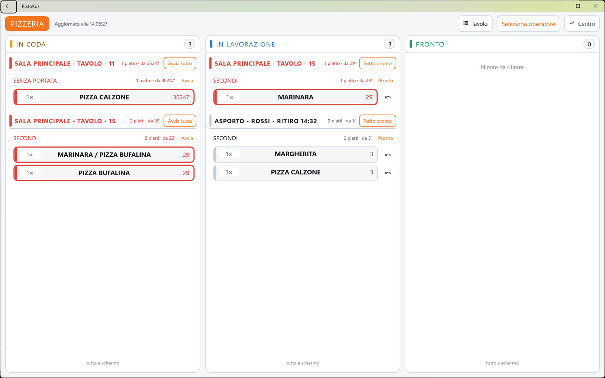

# Monitor di cucina

Il monitor di cucina è l'app RistoFacile che si installa sullo schermo appeso in cucina, al bar o
in pizzeria, al posto (o accanto) alla stampante delle comande. Mostra i piatti da preparare in tre
colonne - **IN CODA**, **IN LAVORAZIONE**, **PRONTO** - e chi cucina li fa avanzare con un tocco.

## A chi serve

- **A chi cucina**, che vede in ogni momento cosa c'è da fare, da quanto aspetta ogni piatto e
  quali tavoli sono pronti per uscire, senza foglietti da staccare.
- **Ai camerieri**, che sul palmare vedono quando la cucina ha segnato pronti i piatti dei loro
  tavoli.

## Un monitor per centro di produzione

Ogni monitor guarda **un solo centro di produzione**: la cucina, la pizzeria, il bar… Un locale con
cucina e pizzeria ha due monitor, ognuno impostato sul suo centro; due monitor possono anche
guardare lo stesso centro (per esempio due schermi nella stessa cucina).

Il centro si sceglie alla prima installazione nella schermata [Scelta del centro](centro.md), che è
anche la schermata delle impostazioni del monitor. Sul monitor compaiono solo i centri che sulla
cassa sono impostati come **Monitor KDS** o **Stampante + KDS** (vedi
[Centri di produzione](../cassa/centri-di-produzione.md)).

## Come arrivano gli ordini

1. Il cameriere batte la comanda sul [palmare](../palmare/comanda.md) o sulla
   [cassa](../cassa/comanda.md) e tocca **INVIA IN CUCINA**.
2. Ogni piatto va al centro di produzione indicato per quell'articolo nel menu.
3. Entro pochi secondi il piatto compare sul monitor di quel centro, nella colonna **IN CODA**, con
   il tavolo, la quantità, le note e il tempo d'attesa.
4. Chi cucina tocca il piatto quando comincia (passa in **IN LAVORAZIONE**), lo tocca quando è
   pronto (passa in **PRONTO**) e lo tocca di nuovo quando esce dalla cucina (sparisce).

Se il menu è organizzato in portate, le portate successive alla prima arrivano **in attesa**:
grigie e non toccabili, finché il cameriere non dà il **VIA** dal palmare o dalla cassa.

I **messaggi** scritti dalla sala (vedi [Messaggi](../palmare/messaggi.md)) compaiono a tutto
schermo sopra il tabellone finché qualcuno non tocca **LETTO**.

Il monitor si aggiorna da solo ogni pochi secondi: non serve toccarlo per vedere le comande nuove.

## La licenza

Il monitor di cucina è un **modulo aggiuntivo** di RistoFacile. Il monitor non si attiva da solo:
chiede al servizio del ristorante se la licenza digitale delle casse comprende il modulo, all'avvio
e poi ogni ora.

- **Con il modulo** il monitor lavora normalmente.
- **Con una cassa in prova (demo)** il monitor lavora e mostra in cima la striscia gialla
  «RistoFacile in modalità demo».
- **Senza il modulo** al posto delle comande compare il messaggio «Il monitor di cucina è un modulo
  aggiuntivo di RistoFacile e la licenza digitale di questo ristorante non lo comprende.».

Se il servizio non risponde, il monitor tiene buona l'ultima risposta ricevuta per sette giorni; se
non ha mai ricevuto una risposta (monitor appena installato), lavora per sette giorni dalla prima
domanda. Un problema di rete all'avvio quindi non spegne la cucina. Vedi
[Licenza digitale](../introduzione/licenza.md).

## Le schermate del monitor

- [Scelta del centro](centro.md): collegamento al servizio, centro di produzione, tema.
- [Monitor](monitor.md): il tabellone delle comande.
