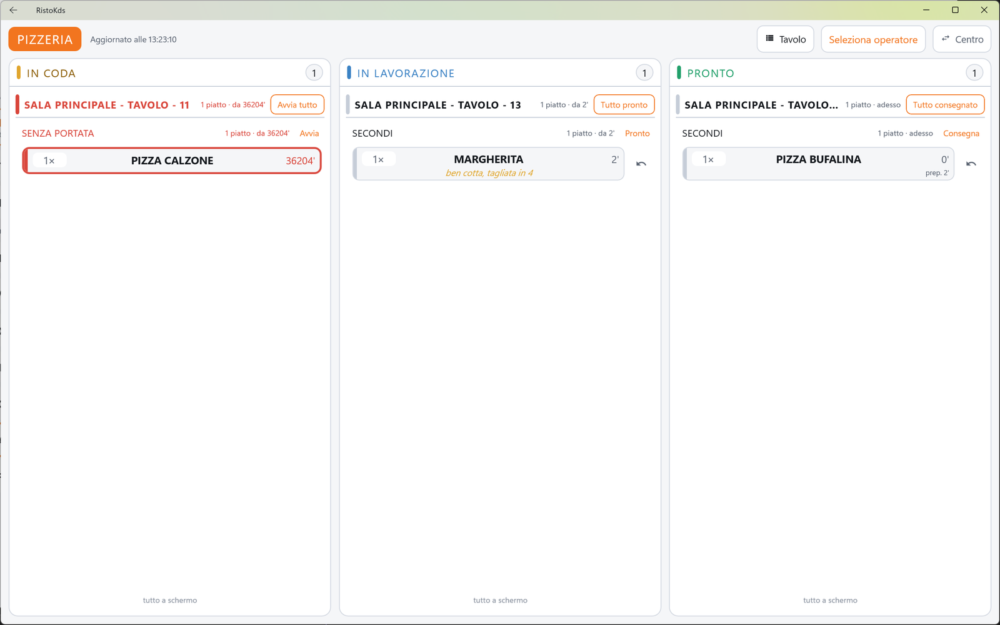
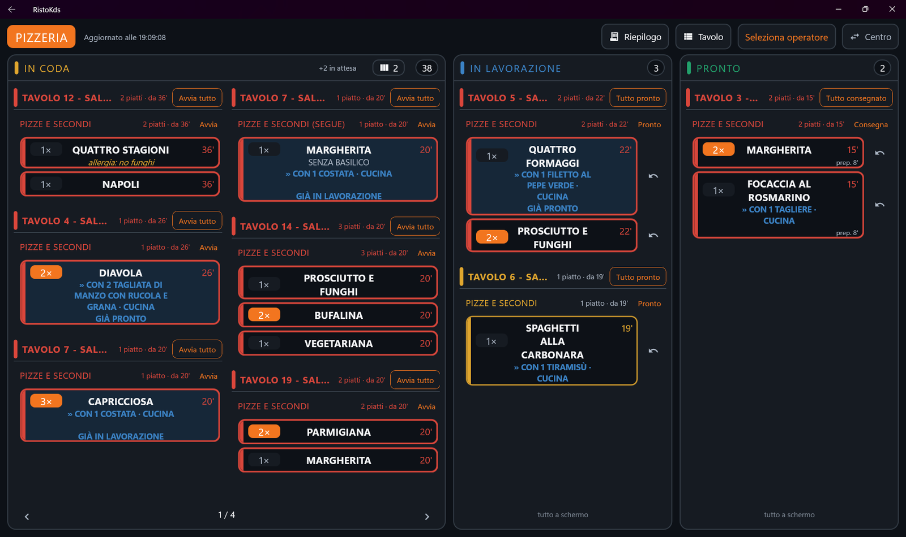
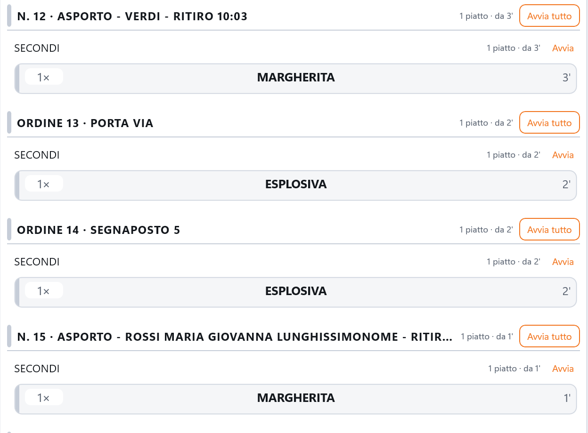
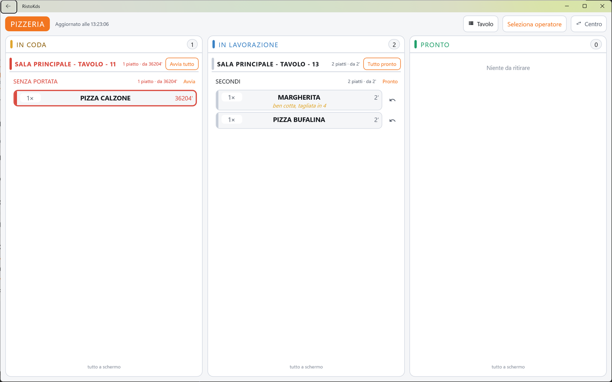
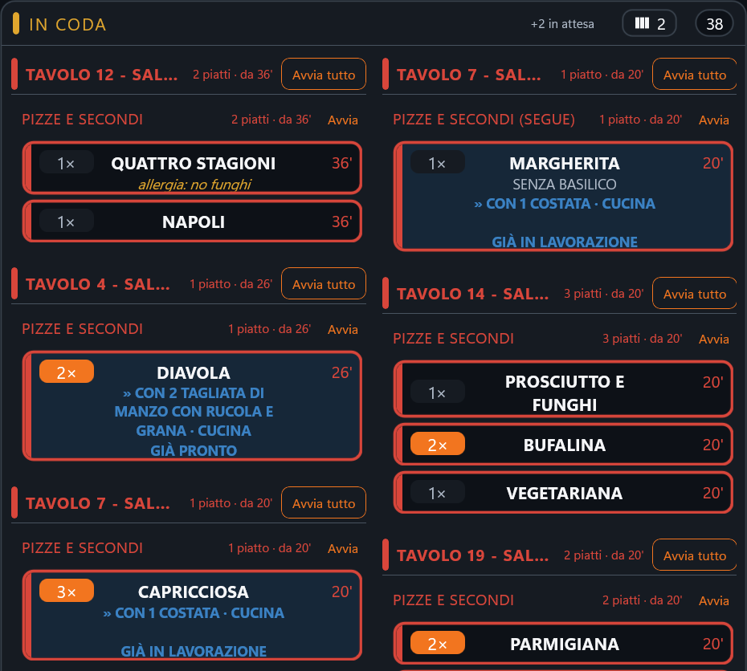
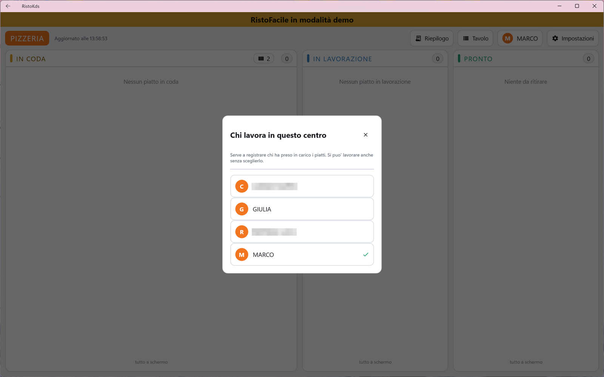
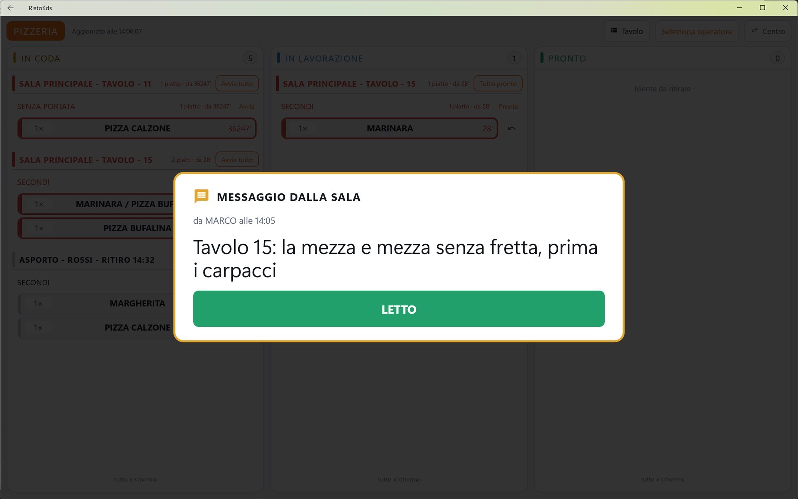

# Monitor

Il tabellone della cucina: tutti i piatti del centro di produzione, divisi in tre colonne secondo
lo stato - **IN CODA**, **IN LAVORAZIONE**, **PRONTO** - con il tavolo, la quantità, le note e da
quanto aspettano. Chi cucina tocca un piatto per farlo avanzare. Serve alla cucina (o al bar, alla
pizzeria) per tutto il servizio.

!!! info "In sintesi"

    - **Dove si trova:** Scelta del centro ▸ **APRI MONITOR**
    - **Chi la usa:** cuoco, pizzaiolo, barista
    - **Disponibile anche su:** solo monitor di cucina

---

## A cosa serve

Al posto dei foglietti appesi: il cameriere invia la comanda e i piatti compaiono **IN CODA**. Il
cuoco tocca quelli che inizia (vanno **IN LAVORAZIONE**), li tocca quando sono finiti (vanno in
**PRONTO**: in sala il cameriere lo vede sul palmare) e li tocca di nuovo quando escono dal passe
(spariscono). Il colore e il tempo di ogni piatto dicono quali sono in ritardo.

Esempio: alle 20:40 la colonna IN CODA mostra «Tavolo 12 - Sala principale» con tre piatti da 15
minuti, il bordo giallo: è il tavolo da fare per primo.

## Prima di cominciare

- Il monitor collegato al servizio e con il centro scelto (vedi [Scelta del centro](centro.md)).
- Gli articoli del menu assegnati al centro di produzione giusto (vedi [Menu](../cassa/menu.md)).
- La licenza digitale con il modulo del monitor di cucina (vedi [Monitor di cucina](index.md)).

## La schermata

### La testata

Da sinistra:

- la pastiglia arancione con il **nome del centro** (es. CUCINA): dice quale cucina è questo
  schermo;
- **Aggiornato alle 20:41:15**: l'ora dell'ultimo aggiornamento riuscito. Se l'ora resta ferma, il
  monitor non riceve più dati dal servizio (non è «una cucina tranquilla»). Mentre un tocco viene
  registrato compaiono una rotellina e «Salvataggio…»;
- la pastiglia del **raggruppamento**: **Portata** oppure **Tavolo** (vedi sotto);
- la pastiglia dell'**operatore**: il nome di chi lavora al centro, oppure «Seleziona operatore» in
  arancione;
- la pastiglia **Impostazioni**, che apre [le impostazioni del tabellone](#le-impostazioni-del-tabellone) e, da lì,
  la [Scelta del centro](centro.md).

### Le tre colonne

| Colonna | Colore | Cosa contiene | Se è vuota |
|---|---|---|---|
| **IN CODA** | ambra | Piatti arrivati che nessuno ha ancora iniziato, e in fondo quelli **in attesa** del via. | «Nessun piatto in coda» |
| **IN LAVORAZIONE** | azzurro | Piatti che qualcuno sta preparando. | «Nessun piatto in lavorazione» |
| **PRONTO** | verde | Piatti finiti che aspettano di uscire in sala. | «Niente da ritirare» |

In testa a ogni colonna c'è il **numero di piatti da fare**. Nella colonna IN CODA, accanto, «+3 in
attesa» conta a parte i piatti fermi in attesa del via.

Le colonne non scorrono: se i piatti non stanno in una schermata si dividono in **pagine**. In fondo
a ogni colonna compare «1 / 3» fra due frecce, oppure «tutto a schermo» quando non c'è niente di
nascosto. Le pagine girano da sole ogni otto secondi; toccando una freccia (o un piatto) la rotazione
si ferma per 25 secondi, così chi sta leggendo una pagina non se la vede cambiare sotto gli occhi.

### La colonna IN CODA divisa

Sugli schermi larghi (un monitor Full HD) la colonna **IN CODA** è larga il doppio delle altre due e
si può dividere in più colonne affiancate, come quelle di un giornale: i piatti che starebbero nella
pagina successiva compaiono accanto. Il contatore in fondo conta le schermate: con IN CODA divisa in
due, «1 / 2» vuol dire che a schermo ci sono le prime due pagine di quattro.

In testa alla colonna, prima del conteggio, c'è un pulsantino con il simbolo delle colonne e un
numero (es. «2»): dice in quante colonne è divisa IN CODA. Di partenza sono due. Toccandolo passi
alla divisione successiva - una colonna, due e, dove lo schermo lo permette, tre - e poi di nuovo a
una. La scelta resta memorizzata su questo monitor.

Il massimo dipende dalla larghezza dello schermo: il monitor non divide oltre il punto in cui i
titoli dei gruppi non si leggerebbero più. Sugli schermi stretti (un tablet) le tre colonne restano
larghe uguali e il pulsantino non c'è.

### I gruppi

Dentro ogni colonna i piatti sono raggruppati su due livelli, con la pastiglia del raggruppamento:

- **Portata** (di partenza): prima la portata (es. «Antipasti», «Primi», «Senza portata»), nell'ordine
  in cui escono, e dentro ogni portata i tavoli. Serve a sapere «quanti antipasti devo fare».
- **Tavolo**: prima il tavolo (es. «Tavolo 12 - Sala principale», oppure «n. 27 · Asporto - Rossi -
  ritiro 20:30»), dal più vecchio, e dentro ogni tavolo le portate. Serve a far uscire un tavolo tutto
  insieme. Il tavolo sta prima della sala perché, se la colonna è stretta, il monitor taglia la fine
  del titolo.

Ogni gruppo ha una testata con il nome e l'attesa più lunga (es. «da 12'»; «in attesa» per i gruppi
fermi; «adesso» per quelli appena arrivati). La riga della portata, sotto il tavolo, porta anche il
conteggio dei piatti (es. «3 piatti · da 12'»); quella del tavolo no, per lasciare posto al nome. Un gruppo che continua dalla
pagina precedente porta «(segue)»; un gruppo in attesa porta «· IN ATTESA».

### Gli ordini da asporto e del kiosk

Al posto del tavolo, gli ordini da asporto hanno un titolo che comincia con il **numero
dell'ordine**, quello che si chiama al banco e sul monitor in sala (vedi [Chiamate](../cassa/chiamate.md)).
Il numero sta in testa perché, se il titolo è lungo o la colonna è stretta, il monitor taglia la
fine del titolo:

| Ordine | Titolo |
|---|---|
| Kiosk, il cliente mangia nel locale con il segnaposto 12 | «Ordine 27 · Segnaposto 12» |
| Kiosk, da portare via | «Ordine 27 · Porta via» |
| Asporto preso dalla cassa o dal palmare | «n. 27 · Asporto - Rossi - ritiro 20:30» (il titolo di sempre, preceduto dal numero) |

A video i titoli dei gruppi sono in maiuscolo. Un ordine senza numero del giorno (preso prima
dell'aggiornamento che ha introdotto i numeri) ha il titolo di sempre, senza il numero.

Gli ordini del kiosk da pagare **non arrivano in cucina finché non sono pagati**: un ordine pagato
al kiosk compare appena è pagato, uno da pagare alla cassa compare quando la cassa lo incassa (a
meno che i kiosk siano impostati per mandarlo in cucina subito: vedi l'invio in cucina in
[Configurazione del kiosk](../kiosk/configurazione.md#le-impostazioni-del-servizio)).

### La card del piatto

Ogni piatto è una card con:

- la **quantità** in un riquadro (es. «2×»);
- il **nome del piatto**, su più righe se serve;
- sotto il nome, le **varianti** (es. «SENZA BASILICO») e, in blu, i piatti degli altri centri che
  **escono insieme** a questo (es. «» CON 1 COSTATA · CUCINA»: vedi
  [I piatti che escono insieme](#i-piatti-che-escono-insieme));
- la **nota** del cameriere, in giallo (es. «senza cipolla»);
- a destra il **tempo** in minuti (es. «12'»; «—» se non è disponibile). In IN CODA e IN
  LAVORAZIONE è l'attesa da quando il piatto è arrivato in cucina; in PRONTO è da quanto il piatto
  aspetta al passe, e sotto c'è il tempo di preparazione (es. «prep. 8'») o «al passe»;
- accanto alla card, nelle colonne IN LAVORAZIONE e PRONTO, il pulsante con la freccia per
  **tornare indietro** di uno stato. Un piatto già consegnato si recupera con **Richiama**.

I piatti **in attesa** del via sono sbiaditi e non si possono toccare.

### La forma compatta

Il tabellone ha due densità, che si scelgono dalla pastiglia **Impostazioni**:

- **Normale**: una card per piatto, con il suo bordo colorato e la sua attesa.
- **Compatta** (di partenza): un riquadro per tavolo e i piatti in riga dentro il riquadro, senza
  card. Ne entrano molti di più per pagina.

Nella forma compatta:

- la testata del riquadro porta il tavolo in grande, la sala in piccolo, l'attesa più lunga del
  tavolo (es. «19'») e il pulsante con il **doppio chevron** arancione, che manda avanti tutti i
  piatti del riquadro;
- la barra a sinistra del riquadro, il nome del tavolo e l'attesa prendono il colore del tempo;
- ogni piatto è una riga: quantità, nome e, sotto, varianti, nota e righe blu dei piatti che escono
  insieme. Il tocco sulla riga manda avanti il piatto;
- in **IN LAVORAZIONE** e **PRONTO** a destra della riga resta la freccia per tornare indietro, e in
  **PRONTO** il tempo di preparazione («prep. 8'»);
- la colonna **IN CODA** si può dividere in più sottocolonne che nella forma normale.

### Le impostazioni del tabellone

La pastiglia **Impostazioni** apre un riquadro sopra il tabellone. Le scelte valgono subito, si
vedono sul tabellone dietro e restano memorizzate su quel monitor.

| Voce | Scelte |
|---|---|
| **Densità** | **Normale** o **Compatta**. |
| **Riga della portata** | **Sempre**, oppure **Solo se serve**: il nome della portata compare solo nei tavoli che ne hanno più di una. |
| **Piatti che escono insieme** | **Una riga**: la riga blu «» CON ...» sta su una riga e si taglia se è lunga. **Per intero**: va a capo. |
| **Attesa su ogni piatto** | **Sì**: l'attesa compare anche accanto a ogni piatto. **No**: resta solo sul tavolo. |
| **Centro, server e aspetto** | **Apri la configurazione** porta alla [Scelta del centro](centro.md). |

Le tre voci di mezzo valgono solo con la densità compatta. Si chiude con la **X** o toccando fuori
dal riquadro.

### I colori del tempo

| Colonna | Bordo giallo | Bordo rosso |
|---|---|---|
| IN CODA e IN LAVORAZIONE | da 10 minuti d'attesa | da 20 minuti d'attesa |
| PRONTO | da 3 minuti al passe | da 6 minuti al passe |

Il colore è sul bordo della card, sul tempo e sulle barre colorate a sinistra della card e del gruppo, e il conteggio del
gruppo diventa rosso quando c'è un piatto in ritardo grave. In PRONTO le soglie sono più strette:
un piatto pronto da sei minuti si sta raffreddando.

### I piatti che escono insieme

Quando un piatto deve uscire insieme a piatti preparati da un altro centro (stesso tavolo, stessa
portata), sotto il nome compare in blu una riga per ognuno, con quantità, piatto e centro: «» CON 1
COSTATA · CUCINA».

Se l'altro centro è più avanti - il suo piatto è già in lavorazione o pronto mentre il tuo è in una
colonna precedente - il tuo piatto è **rimasto indietro** e il monitor lo segnala:

- sotto la riga blu compare **GIÀ IN LAVORAZIONE** oppure **GIÀ PRONTO**;
- la card si vela di blu e **lampeggia lentamente** per il tempo scelto (un minuto, se non l'hai
  cambiato), poi resta velata senza lampeggiare.

Il segnale sparisce da solo quando il piatto raggiunge la colonna dell'altro. Esempio: la costata
del tavolo 7 è in lavorazione in cucina e la capricciosa dello stesso tavolo è ancora in coda in
pizzeria: sul monitor della pizzeria la capricciosa lampeggia con «GIÀ IN LAVORAZIONE»; appena il
pizzaiolo la tocca, smette.

Per quanti minuti dura il lampeggio si sceglie nella [Scelta del centro](centro.md), col cursore
della riga **Lampeggio dei piatti che escono insieme**: a **0** restano solo le righe blu, su **∞**
lampeggia finché il piatto resta indietro.

- I piatti **in attesa** del via non lampeggiano: non è ancora il loro momento.
- Se l'altro centro lavora solo con la stampante, senza monitor, il monitor non sa a che punto è il
  suo piatto: la riga blu c'è, il segnale no.
- Il monitor si aggiorna ogni quattro secondi: il segnale arriva con qualche secondo di ritardo.

## Campi e indicatori

| Elemento | Descrizione |
|---|---|
| **Nome del centro** | Il centro di produzione mostrato da questo schermo. |
| **Aggiornato alle …** | L'ora dell'ultimo aggiornamento riuscito. |
| **Portata / Tavolo** | Il raggruppamento in uso. |
| **Operatore** | Chi lavora al centro: il suo nome viene registrato su chi ha preso in carico i piatti. |
| **Conteggio della colonna** | I piatti da fare, esclusi quelli in attesa. |
| **+N in attesa** | Piatti fermi in attesa del via del cameriere. |
| **1 / 3** / **tutto a schermo** | La pagina mostrata della colonna. |
| **Pulsantino delle colonne** (in testa a IN CODA) | In quante colonne è divisa IN CODA. Solo sugli schermi larghi. |
| **2×** | La quantità del piatto. |
| **Nota in giallo** | La nota del cameriere per la cucina. |
| **Riga blu «» CON …»** | Un piatto di un altro centro che esce insieme a questo. |
| **GIÀ IN LAVORAZIONE** / **GIÀ PRONTO** | L'altro centro è più avanti: questo piatto è rimasto indietro. |
| **12'** | Minuti d'attesa (o al passe, in PRONTO). |
| **prep. 8'** / **al passe** | Solo in PRONTO: quanto ci è voluto a preparare il piatto. |

## Pulsanti e comandi

| Comando | Effetto |
|---|---|
| **Tocco sulla card** | Fa avanzare il piatto di uno stato: da IN CODA a IN LAVORAZIONE, da IN LAVORAZIONE a PRONTO, da PRONTO a consegnato (sparisce dal monitor). Nessuna conferma. |
| **Freccia accanto alla card** | Riporta il piatto allo stato precedente (da PRONTO a IN LAVORAZIONE, da IN LAVORAZIONE a IN CODA). |
| **Avvia / Pronto / Consegna** (testata di un gruppo interno) | Fa avanzare insieme tutti i piatti del gruppo. |
| **Avvia tutto / Tutto pronto / Tutto consegnato** (testata del tavolo, solo nel raggruppamento per **Tavolo**) | Fa avanzare insieme tutti i piatti del tavolo in quella colonna. |
| **Frecce in fondo alla colonna** | Pagina precedente / successiva. |
| **Pulsantino delle colonne** (in testa a IN CODA) | Passa alla divisione successiva della colonna IN CODA: una, due o tre colonne, secondo la larghezza dello schermo. La scelta resta memorizzata su questo monitor. |
| **Portata / Tavolo** | Cambia il raggruppamento. La scelta resta memorizzata su questo monitor. |
| **Operatore** | Apre la finestra **Chi lavora in questo centro**. |
| **Richiama** | Apre **RICHIAMA IN PRONTO**: i piatti di questo centro consegnati negli ultimi 30 minuti, dal più recente. Toccandone uno torna in PRONTO (vedi [Correggere un tocco sbagliato](#correggere-un-tocco-sbagliato)). |
| **Impostazioni** | Apre [le impostazioni del tabellone](#le-impostazioni-del-tabellone): densità, riga della portata, piatti che escono insieme, attesa su ogni piatto e **Apri la configurazione**, che torna alla [Scelta del centro](centro.md). |
| **Doppio chevron** (forma compatta) | Manda avanti tutti i piatti del riquadro, come **Avvia tutto**, **Tutto pronto** e **Tutto consegnato** della forma normale. |
| **LETTO** | Chiude il messaggio dalla sala (vedi sotto). |

Su un gruppo spezzato fra due pagine, i pulsanti del gruppo fanno avanzare solo i piatti che si
vedono. Sui gruppi in attesa del via il pulsante non c'è: il via lo dà il cameriere.

### Chi lavora in questo centro

La pastiglia dell'operatore apre l'elenco degli operatori attivi: tocca il tuo nome (compare la
spunta). «Serve a registrare chi ha preso in carico i piatti. Si puo' lavorare anche senza
sceglierlo.» Se c'è un solo operatore attivo è scelto da solo. Si chiude con la **X** o toccando
fuori.

### Messaggio dalla sala

Quando la sala manda un messaggio a questo centro (vedi [Messaggi](../palmare/messaggi.md)), il
tabellone viene coperto da un riquadro con il bordo giallo: **MESSAGGIO DALLA SALA**, chi l'ha
mandato e a che ora (es. «da Mario alle 20:41»), il testo in grande e il pulsante **LETTO**. Se i
messaggi da leggere sono più di uno, in alto a destra c'è «1 di 3». Il riquadro non si chiude
toccando fuori: solo con **LETTO**. Entro pochi secondi il cameriere vede «LETTO» con l'ora e il nome di chi
lavora al centro (o del centro, se nessuno si è selezionato). Mentre c'è un messaggio le pagine non
girano.

## Come si fa

### Preparare e far uscire un piatto

1. Quando inizi un piatto in **IN CODA**, toccalo: passa in **IN LAVORAZIONE**.
2. Quando è pronto, toccalo: passa in **PRONTO**. Sul palmare del cameriere la portata risulta
   pronta.
3. Quando il cameriere lo porta via, toccalo: sparisce dal monitor.

### Far uscire tutto un tavolo insieme

1. Tocca la pastiglia **Portata** per passare a **Tavolo**.
2. Nella colonna **IN LAVORAZIONE** trova il tavolo.
3. Quando tutto è pronto tocca **Tutto pronto** nella testata del tavolo.
4. Tutti i piatti del tavolo passano in **PRONTO**.

### Il talloncino dei piatti pronti

Se nella [scelta del centro](centro.md#accendere-il-talloncino-dei-piatti-pronti) è acceso
**Talloncino quando i piatti sono pronti**, il monitor stampa un foglietto per ogni tavolo con i
piatti appena segnati pronti, da dare al cameriere perché sappia dove portarli.

1. Segna pronti i piatti come al solito, uno alla volta o con **Tutto pronto**.
2. Il monitor aspetta **15 secondi dall'ultimo piatto segnato pronto**: se nel frattempo ne segni
   altri, l'attesa riparte.
3. Esce un talloncino per tavolo (o per ordine da asporto) sulla stampante del centro, con il nome
   del centro, il tavolo, data e ora, e i piatti con le quantità e le varianti.

Esempio: segni pronte in fila 2 capricciose del tavolo 1, 1 capricciosa del tavolo 2 e una
margherita del tavolo 1. Escono due talloncini: tavolo 1 con 2 capricciose e 1 margherita, tavolo 2
con 1 capricciosa.

- Un piatto riportato indietro prima della stampa non va sul talloncino, nemmeno se lo riporta indietro un
  altro monitor; lo stesso vale per un piatto tolto dalla comanda in cassa.
- Se esci dal tabellone (per esempio con **Impostazioni** e **Apri la configurazione**) prima dei 15 secondi, il talloncino esce subito.
- Ogni monitor stampa solo i piatti segnati pronti su di lui.
- Se i piatti di un tavolo vengono segnati pronti a più di 15 secondi l'uno dall'altro, per quel
  tavolo escono più talloncini.
- Al momento il talloncino non si ristampa.
- Se la stampante non stampa, il monitor ti avvisa **una volta sola**: l'avviso ricompare solo dopo che un
  talloncino è tornato a uscire e la stampante si è fermata di nuovo.

### Correggere un tocco sbagliato

1. Trova il piatto nella colonna in cui è finito per errore.
2. Tocca la freccia accanto alla card.
3. Il piatto torna nella colonna precedente.

Un piatto toccato per errore in PRONTO passa a consegnato e sparisce dal tabellone, dove la freccia
non lo raggiunge più. Per recuperarlo:

1. Tocca la pastiglia **Richiama** in alto.
2. Si apre **RICHIAMA IN PRONTO**: i piatti del centro segnati consegnati negli ultimi 30 minuti,
   dal più recente (al massimo 20), ognuno con quantità, piatto, tavolo e ora della consegna.
3. Tocca il piatto da recuperare: torna in **PRONTO** e l'elenco si chiude.

Se non c'è niente da recuperare l'elenco dice *Nessun piatto consegnato negli ultimi 30 minuti.*
Un piatto consegnato da più tempo non si richiama dal monitor, ma resta comunque nella comanda in
cassa: se va ancora preparato, avvisa la cucina a voce o con un [messaggio](../cassa/messaggi.md).

- Non compaiono i piatti di un tavolo con il conto già chiuso né quelli di un ordine d'asporto
  rifiutato, non ritirato o annullato.
- Il piatto richiamato riprende il tempo al passe da quando era stato segnato pronto. Il palmare del
  cameriere non riceve un secondo avviso e il talloncino dei pronti non si ristampa (se non era
  ancora uscito, esce una volta sola).
- Un ordine d'asporto già incassato che, consegnato dal monitor, è uscito dalle **Chiamate** e dal
  monitor in sala non ci torna: il richiamo riguarda solo il tabellone della cucina.

## Controlli e messaggi

| Messaggio | Causa | Cosa fare |
|---|---|---|
| *Impossibile avanzare il ticket. (…)* | Il servizio non ha registrato il tocco. | Il monitor rilegge lo stato vero: ritocca il piatto se serve. |
| *L'avanzamento e' andato a buon fine solo in parte. (…)* | Con un pulsante di gruppo, alcuni piatti sono avanzati e altri no. | Controlla i piatti rimasti e toccali uno per uno. |
| *Impossibile riportare indietro il ticket. (…)* | Il servizio non ha registrato il ritorno indietro. | Riprova. |
| *Impossibile richiamare il piatto. (…)* | Il servizio non ha riportato in PRONTO il piatto scelto in **Richiama**. | Riprova; se un altro monitor l'ha già richiamato, è di nuovo in PRONTO. |
| *Nessun piatto consegnato negli ultimi 30 minuti.* | In **Richiama**: niente da recuperare. | — |
| *Il servizio di RistoFacile non sa ancora richiamare i piatti consegnati: va aggiornato.* | Il servizio è di una versione precedente. | Fai aggiornare il servizio. |
| *Elenco non disponibile: il servizio non risponde. (…)* | In **Richiama**: il servizio non ha risposto. | Controlla la rete e riapri **Richiama**. |
| *Impossibile aggiornare i ticket. (…)* / *Aggiornamento dei ticket non riuscito.* | Il servizio non risponde. L'ora di «Aggiornato alle» resta ferma. | Controlla la rete e il servizio; il monitor riprova da solo. |
| *Talloncino di … non stampato: … Non lo ripeto finché un talloncino non torna a uscire: intanto avvisa i camerieri a voce.* | La stampante del centro non ha stampato il talloncino di quel tavolo (dopo i due punti il motivo, es. stampante spenta o irraggiungibile). | Avvisa i camerieri a voce e controlla la stampante: finché non riparte, i talloncini successivi mancano **senza altri avvisi**. Il talloncino non viene ristampato. |
| *Talloncini non stampati: il servizio non risponde. (…) Non lo ripeto finché un talloncino non torna a uscire: intanto avvisa i camerieri a voce.* | Al momento di stampare il monitor non ha raggiunto il servizio. | Avvisa i camerieri a voce; controlla la rete e il servizio. Anche questo avviso esce una volta sola. |
| *RistoFacile in modalità demo* | Una cassa del locale è in prova. | Nessuna: il monitor funziona. |
| *Il monitor di cucina è un modulo aggiuntivo di RistoFacile e la licenza digitale di questo ristorante non lo comprende.* | La licenza non comprende il monitor di cucina. Le comande non vengono mostrate. | Contatta il rivenditore. Quando il modulo viene attivato le comande ricompaiono da sole alla verifica successiva (il monitor chiede ogni ora, e a ogni riapertura del tabellone). |

## Note

- **Il tocco non chiede conferma**: si corregge con la freccia. Toccare una card in PRONTO la fa
  sparire dal monitor.
- Se due monitor guardano lo stesso centro, un tocco su uno si vede sull'altro al giro successivo.
- Un piatto **stornato** dal cameriere sparisce dal monitor; quando il conto del tavolo viene chiuso
  spariscono anche i suoi piatti rimasti (non quelli degli ordini d'asporto, che restano finché non
  vengono consegnati).
- I piatti **in attesa** del via restano in fondo alla colonna IN CODA, sbiaditi; compaiono come
  normali quando il cameriere tocca **VIA** sul palmare o sulla cassa.
- Il monitor si aggiorna da solo ogni quattro secondi.
- Gli ordini da asporto si riconoscono dal titolo, che comincia con il numero dell'ordine:
  «n. 27 · Asporto - nome - ritiro 20:30», e per il kiosk «Ordine 27 · Porta via» o
  «Ordine 27 · Segnaposto 12» (vedi sopra).
- **Ordini da portare via e monitor in sala**: quando tutti i piatti di un ordine da asporto o del
  kiosk, già incassato, sono consegnati qui, il suo numero sparisce subito dal monitor in sala (vedi
  [Chiamate](../cassa/chiamate.md)). Toccare «consegnato» subito dopo «pronto» lascia il numero
  sulla TV solo pochi secondi: per questi ordini segna consegnato quando il cliente ha ritirato.
  Quando invece li consegna il banco dalla schermata Chiamate, i piatti già pronti escono da soli
  dalla colonna PRONTO; quelli non ancora pronti restano qui, da preparare.
- Quando la cucina segna pronto un piatto, sul [palmare](../palmare/comanda.md) lo stato della
  portata diventa «pronta» (o «2 pronti») e, se il cameriere ha acceso il richiamo, arriva una
  notifica sul telefono.

## Vedi anche

- [Scelta del centro](centro.md)
- [Monitor di cucina](index.md)
- [Comanda sul palmare](../palmare/comanda.md)
- [Messaggi alla cucina](../palmare/messaggi.md)
- [Centri di produzione](../cassa/centri-di-produzione.md)
- [Chiamate](../cassa/chiamate.md)
