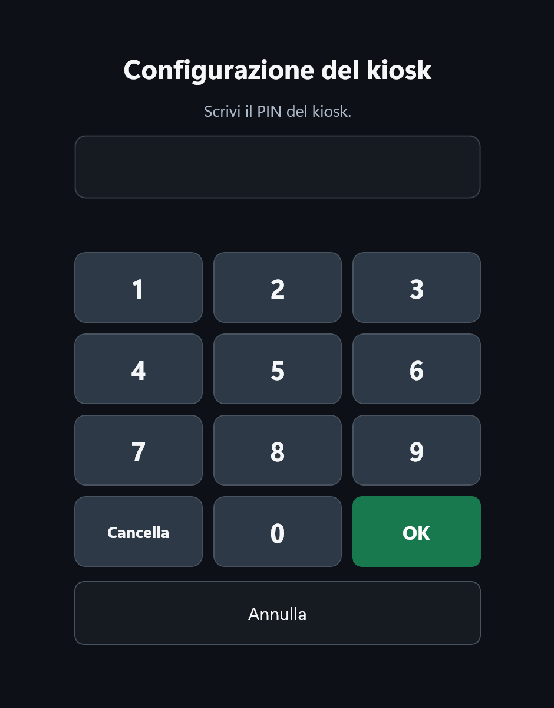
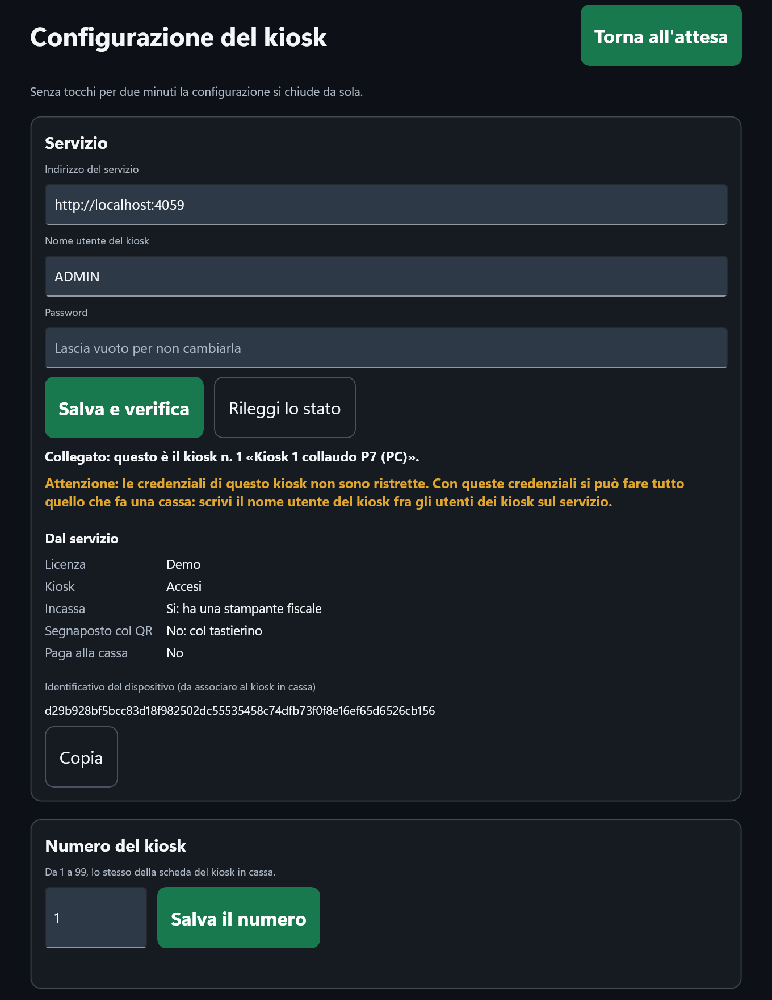
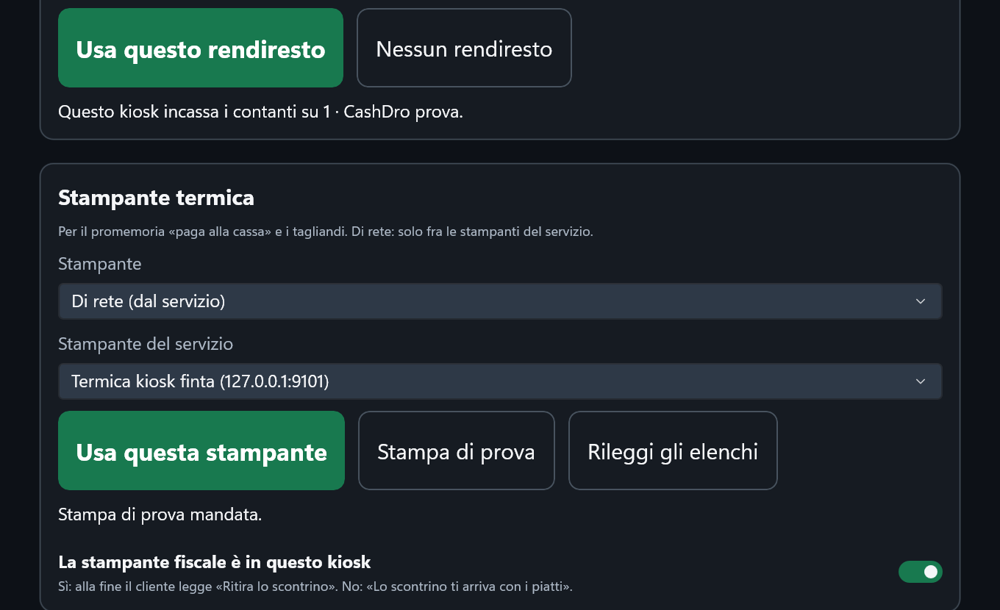

# Configurazione del kiosk

La schermata del personale: si collega il kiosk al servizio del locale, gli si dà il suo numero, si
attiva la licenza e si scelgono le periferiche (POS, rendiresto, stampante termica). Si apre solo
con il **PIN del kiosk**, che non è il PIN degli operatori. In fondo a questa pagina ci sono anche
le impostazioni che valgono per tutti i kiosk del locale: stanno sul servizio e si cambiano dalla
cassa, voce [Kiosk](../cassa/kiosk.md).

!!! info "In sintesi"

    - **Dove si trova:** sull'attesa del kiosk, tieni premuto per 3 secondi l'angolo in alto a sinistra, poi scrivi il PIN
    - **Chi la usa:** il titolare o chi installa il kiosk
    - **Disponibile anche su:** solo kiosk

---

## A cosa serve

Il kiosk sta davanti ai clienti: per questo non ha menu né pulsanti per il personale, e la sua
configurazione è nascosta dietro un gesto e un PIN. Ci si entra per collegarlo la prima volta, per
cambiare POS, rendiresto o stampante, per leggere lo stato che gli dà il servizio e per chiudere
l'app. Lasciata senza tocchi per due minuti, la configurazione si chiude da sola e il kiosk torna
ad accogliere i clienti.

## Prima di cominciare

- Il servizio RistoFacile del locale acceso, con il suo indirizzo, e un **utente web dedicato al
  kiosk** (vedi [Installazione](installazione.md#lutente-web-del-kiosk)).
- Il POS, il rendiresto e la stampante termica di rete vanno prima **registrati sul servizio**
  dalla cassa, in [Impostazioni](../cassa/impostazioni.md) (**Pagamento con carta**,
  **Cassa automatica**, **Stampante preconto**): il kiosk li sceglie solo da quegli elenchi.
- Il kiosk va **aggiunto e associato in cassa**, voce [Kiosk](../cassa/kiosk.md), con il suo
  numero (vedi [Le impostazioni del servizio](#le-impostazioni-del-servizio)).

## La schermata

**Il PIN.** Dopo il tocco lungo compare **Configurazione del kiosk** con *Scrivi il PIN del
kiosk.*, il tastierino (**1**…**9**, **0**, **Cancella**, **OK**) e **Annulla**, che torna
all'attesa. Il PIN si scrive sempre con i tasti a video: la tastiera del dispositivo non compare.

**La configurazione** è una colonna di riquadri, dall'alto:

- in testa **Configurazione del kiosk** con **Torna all'attesa**, e sotto *Senza tocchi per due
  minuti la configurazione si chiude da sola.*;
- **Servizio**: indirizzo, utente e password, l'esito del collegamento, quello che decide il
  servizio (**Dal servizio**) e l'identificativo del dispositivo;
- **Numero del kiosk**;
- **POS (carta)**, **Rendiresto (contanti)** e **Stampante termica**;
- **Licenza digitale**, come nelle impostazioni del palmare;
- **PIN del kiosk** ed **Esci**.

## Campi e indicatori

### Servizio

| Elemento | Descrizione |
|---|---|
| **Indirizzo del servizio** | L'indirizzo del servizio del locale con la porta, scritto per intero, per esempio `http://192.168.1.10:4063`. Anche il kiosk Android parla con il servizio in `http` sulla rete del locale. |
| **Nome utente del kiosk** | L'utente web dedicato al kiosk (non quello di una cassa). |
| **Password** | La sua password. Se è già salvata il campo dice *Lascia vuoto per non cambiarla*. |
| Riga di esito | Per esempio *Collegato: questo è il kiosk n. 1 «Ingresso».*, oppure il motivo per cui non va (vedi «Controlli e messaggi»). |
| Avviso in giallo | *Attenzione: le credenziali di questo kiosk non sono ristrette. …*: il nome utente non è fra gli utenti dei kiosk sul servizio. Vedi [Installazione](installazione.md#lutente-web-del-kiosk). |
| **Dal servizio** ▸ **Licenza** | **Licenza Kiosk attiva**, **Demo** o **Senza licenza**. |
| **Dal servizio** ▸ **Kiosk** | **Accesi**, **In pausa** o **Spenti dalla cassa**. |
| **Dal servizio** ▸ **Incassa** | **Sì: ha una stampante fiscale** oppure **No: senza stampante fiscale si paga solo alla cassa**. |
| **Dal servizio** ▸ **Segnaposto col QR** | **Sì: col lettore di QR** oppure **No: col tastierino**. |
| **Dal servizio** ▸ **Paga alla cassa** | **Sì** se è acceso «paga alla cassa» per i kiosk. |
| **Identificativo del dispositivo (da associare al kiosk in cassa)** | Il codice di questo PC o tablet, lungo 64 caratteri. Il servizio accetta gli ordini di un kiosk solo dal dispositivo associato al suo numero. |

Le righe **Dal servizio** sono in sola lettura: si cambiano sul servizio, non qui.

### Numero del kiosk

| Elemento | Descrizione |
|---|---|
| **Numero del kiosk** | *Da 1 a 99, lo stesso della scheda del kiosk in cassa.* Due kiosk dello stesso locale hanno numeri diversi. Di partenza è 1. |

### POS (carta)

| Elemento | Descrizione |
|---|---|
| **Terminale** | I terminali registrati sul servizio. Il kiosk non annulla un pagamento con la carta: il cliente segue le istruzioni sul terminale. |
| **Id con cui il kiosk si presenta al POS (finisce sulla ricevuta)** | Proposto `KIOSK1` per il kiosk n. 1, `KIOSK2` per il n. 2 e così via. Al più 16 caratteri. |
| Riga di esito | Per esempio *Questo kiosk incassa con la carta su POS ingresso, id cassa KIOSK1.* |

### Rendiresto (contanti)

| Elemento | Descrizione |
|---|---|
| **Rendiresto** | Le casse automatiche registrate sul servizio, con quello che sanno fare: per esempio *1 · CashDro ingresso · contanti, annullo dal kiosk*. Con PagAmico e VNE con il POS collegato compare anche *carta sulla macchina*: in quel caso la carta si paga sulla macchina e il POS separato non serve. Con Cashlogy compare *annullo solo dalla macchina*. L'elenco non mostra indirizzi né password. |
| Riga di esito | Per esempio *Questo kiosk incassa i contanti su 1 · CashDro ingresso.* |

### Stampante termica

| Elemento | Descrizione |
|---|---|
| **Stampante** | **Nessuna**, **Di rete (dal servizio)** oppure **USB (collegata al kiosk)**. Serve per il promemoria «paga alla cassa», per i tagliandi (resto da ricevere, pagamento da verificare) e per la ricevuta del POS. |
| **Stampante del servizio** | Con **Di rete**: le stampanti registrate sul servizio. Il kiosk stampa solo su una di queste. |
| **Stampante USB** | Con **USB**: su Windows le stampanti installate nel PC, su Android le periferiche USB collegate al tablet. |
| Riga di esito | Per esempio *Promemoria e tagliandi su Termica ingresso.*, oppure *Nessuna stampante termica: senza promemoria la vista finale dice il numero da dire alla cassa.* |
| **La stampante fiscale è in questo kiosk** | *Sì: alla fine il cliente legge «Ritira lo scontrino». No: «Lo scontrino ti arriva con i piatti».* Cambia solo il testo della schermata finale: quale stampante fiscale emette lo scontrino lo decide il servizio. Di partenza è acceso. |

### Licenza digitale, PIN, Esci

| Elemento | Descrizione |
|---|---|
| **Licenza digitale** | Come sul palmare: **Seriale**, **Nome del dispositivo** e **Attiva**. Il kiosk occupa un **posto Kiosk**: non si sceglie l'edizione. Vedi [Licenza digitale](../introduzione/licenza.md). |
| **PIN del kiosk** | *Apre questa configurazione e chiude l'app. Non è il PIN degli operatori.* |
| **Esci** | *Chiude RistoKiosk: finché non si riapre, il kiosk non accetta ordini.* |

### Le impostazioni del servizio

Alcune scelte valgono per **tutti i kiosk** del locale e stanno nella configurazione dei kiosk sul
servizio. Si cambiano dalla cassa, Menu ▸ **Kiosk**: le etichette esatte e i passi sono in
[Kiosk](../cassa/kiosk.md).

| Impostazione | Dove, in cassa | Cosa decide |
|---|---|---|
| **Kiosk accesi** | Generale | Di partenza spenti. Spenti, i kiosk scrivono *Kiosk momentaneamente chiuso: ordina alla cassa*, e in cassa non ci sono né le [Chiamate](../cassa/chiamate.md) né il monitor in sala. |
| **Pausa dei kiosk** | sopra le linguette | Ferma gli ordini su tutti i kiosk, che scrivono *Kiosk momentaneamente chiuso: ordina alla cassa*. La mette qualunque cassiere. |
| **Menu dei kiosk** | Generale | Il menu che i kiosk mostrano: uno dei menu della cassa, oppure **Menu del sito**. |
| **Tavolo virtuale per «mangio qui»** e **per «porto via»** | Generale | Il tavolo su cui finiscono gli ordini di chi mangia nel locale e di chi porta via (possono essere lo stesso). Il listino della loro sala decide i prezzi del kiosk. |
| **Cameriere delle righe del kiosk** | Generale | L'operatore a cui vanno le righe degli ordini del kiosk. |
| **«Paga alla cassa»** | Generale | Accende «Pago alla cassa» fra i modi di pagamento. Un kiosk senza stampante fiscale paga sempre alla cassa, anche con questa spenta. |
| **Quando gli ordini «paga alla cassa» vanno in cucina** | Generale | **Subito, alla conferma dell'ordine** oppure **Dopo, quando l'ordine si incassa in cassa**. Gli ordini pagati al kiosk vanno in cucina appena pagati. |
| **Minuti di scadenza** | Generale | Dopo quanti minuti un ordine «paga alla cassa» non pagato si annulla da solo. Di partenza 30. Un ordine già mandato in cucina («subito») non si annulla: in cassa compare l'avviso *Ordine 27 non pagato (kiosk 1, porta via): è in cucina e dopo 30 minuti non è ancora passato dalla cassa.* |
| **Pesi indicativi (kg)** | Generale | I pesi proposti per gli articoli a peso. Di partenza 0,1 / 0,2 / 0,3 / 0,5 / 1 kg. |
| I kiosk: **NUMERO**, **DESCRIZIONE**, **DISPOSITIVO**, **STAMPANTE FISCALE**, **QR del segnaposto** | Kiosk | Per ogni kiosk: il numero (1-99), una descrizione (compare nell'esito del collegamento), il dispositivo associato, la stampante fiscale dello scontrino (senza, il kiosk non incassa) e il segnaposto col QR (il kiosk legge il QR del segnaposto con il lettore). |
| **Utenti web dei kiosk** | Kiosk | I nomi degli utenti web dei kiosk: vedi [Installazione](installazione.md#lutente-web-del-kiosk). |
| **Termiche dei kiosk** | Kiosk | Le termiche di rete dell'impianto, fra cui il kiosk sceglie la sua. |
| **Immagini dell'attesa**, **Logo**, **Colore del locale** | Attesa | Le immagini che scorrono sull'attesa, il logo della fascia in alto e il colore dei bottoni. |
| **Abbinamenti dei piatti** | Suggerimenti | Gli articoli che il kiosk propone dopo un piatto. |
| **Minuti dei numeri pronti**, **Anche gli asporti della cassa** | Monitor | Vedi [Chiamate](../cassa/chiamate.md#prima-di-cominciare). |

!!! note "Il numero dell'ordine sullo scontrino"
    Lo scontrino di un ordine del kiosk porta in testa il numero e dove va, per esempio
    «ORDINE 27 - SEGNAPOSTO 12» o «ORDINE 27 - PORTA VIA». Questa riga la stampano **solo le
    stampanti fiscali RCH**: sulle altre marche lo scontrino esce senza.

## Pulsanti e comandi

| Comando | Effetto |
|---|---|
| Tocco lungo di 3 secondi nell'angolo in alto a sinistra (attesa) | Apre il PIN. Un tocco breve non fa niente. |
| **OK** (PIN) | Con il PIN giusto apre la configurazione. |
| **Annulla** (PIN) | Torna all'attesa. |
| **Torna all'attesa** | Chiude la configurazione e il kiosk torna ad accogliere i clienti. |
| **Salva e verifica** | Salva indirizzo, utente e password, consegna al servizio lo stato della licenza e chiede al servizio lo stato del kiosk: sotto compare l'esito. |
| **Rileggi lo stato** | Chiede di nuovo lo stato al servizio, senza salvare niente: dopo un cambio sul servizio (dispositivo associato, kiosk acceso). |
| **Copia** | Copia l'identificativo del dispositivo: *Copiato: incollalo nella scheda del kiosk, in cassa.* |
| **Salva il numero** | Salva il numero del kiosk: *Questo è il kiosk n. 2.* |
| **Usa questo POS** | Il kiosk incassa la carta sul terminale scelto, con l'id scritto. |
| **Stato del POS** | Interroga il terminale: *Il POS risponde: …* oppure *Il POS non risponde: …*. |
| **Nessun POS** | Il kiosk non accetta la carta (resta il rendiresto, se ha il POS). |
| **Usa questo rendiresto** / **Nessun rendiresto** | Sceglie la cassa automatica dei contanti, oppure nessuna. |
| **Usa questa stampante** | Sceglie la stampante termica. Con una USB su Android il tablet chiede il permesso (vedi [Installazione](installazione.md#android)). |
| **Stampa di prova** | Stampa sulla termica scelta «PROVA DI STAMPA», il numero del kiosk, data e ora e *Promemoria e tagliandi usciranno qui.*. Sotto: *Stampa di prova mandata.* |
| **Rileggi gli elenchi** | Rilegge dal servizio terminali, rendiresto e stampanti. |
| Interruttore **La stampante fiscale è in questo kiosk** | Vedi sopra. |
| **Cambia il PIN** | Chiede il PIN nuovo due volte. |
| **Esci dall'app** | Chiede *Chiudere RistoKiosk? Finché non si riapre, il kiosk non accetta ordini.*: con **Esci** l'app si chiude. È l'unico modo di chiuderla: Alt+F4 e la X su Windows, il tasto Indietro su Android non fanno niente. |

## Come si fa

### Il primo avvio

1. Avvia RistoKiosk. Su Windows compare per un attimo la finestrella *Avvio del kiosk...*.
2. Compare **Imposta il PIN del kiosk**: scegli un PIN da 4 a 8 cifre e tocca **OK**.
3. A *Ripeti il PIN per conferma.* scrivilo di nuovo e tocca **OK**.
4. La configurazione si apre da sola, senza chiedere di nuovo il PIN.
5. Prosegui con «Collegare il kiosk al servizio».

### Collegare il kiosk al servizio

1. Nel riquadro **Servizio** scrivi **Indirizzo del servizio**, **Nome utente del kiosk** e
   **Password**.
2. Tocca **Salva e verifica**.
3. La prima volta l'esito è *Collegato al servizio, ma: Questo dispositivo non è il kiosk n. 1:
   associalo dalla cassa.*: il servizio non sa ancora che questo dispositivo è il kiosk n. 1.
4. In cassa apri Menu ▸ **Kiosk**, linguetta **Kiosk**: in **Dispositivi che chiedono un numero**
   compare il dispositivo, con le ultime 8 cifre dell'identificativo. Tocca **Associa al kiosk 1**,
   scegli la stampante fiscale, tocca **Conferma** e poi **Salva** (vedi
   [Kiosk](../cassa/kiosk.md#associare-un-kiosk-nuovo)).
5. Sul kiosk tocca **Rileggi lo stato**.
6. Compare *Collegato: questo è il kiosk n. 1 «…».*, e in **Dal servizio** la licenza e
   **Accesi**.

!!! note "Riconoscere il dispositivo giusto"
    In cassa il dispositivo si vede con le ultime 8 cifre dell'identificativo (es. «…1234abcd»):
    sono le ultime 8 del codice che il kiosk mostra sotto **Identificativo del dispositivo**. Con
    **Copia** lo copi per intero.

### Cambiare il numero del kiosk

1. Nel riquadro **Numero del kiosk** scrivi il numero (da 1 a 99).
2. Tocca **Salva il numero**.
3. Compare *Questo è il kiosk n.* (numero)*.*, e sotto **Servizio** l'esito del collegamento con il
   numero nuovo.

### Scegliere POS, rendiresto e stampante termica

1. Nel riquadro **POS (carta)** scegli il **Terminale**, controlla l'id e tocca **Usa questo POS**;
   poi **Stato del POS** per provarlo: deve dire *Il POS risponde: …*.
2. Nel riquadro **Rendiresto (contanti)** scegli la macchina e tocca **Usa questo rendiresto**.
3. Nel riquadro **Stampante termica** scegli **Di rete (dal servizio)** o
   **USB (collegata al kiosk)**, poi la stampante, e tocca **Usa questa stampante**.
4. Tocca **Stampa di prova**: dalla termica esce il foglietto «PROVA DI STAMPA».
5. Accendi o spegni **La stampante fiscale è in questo kiosk**.
6. Tocca **Torna all'attesa**.

### Registrare sul servizio la termica di rete del kiosk

Il kiosk stampa in rete **solo su una stampante registrata sul servizio**: la termica non si
scrive sul kiosk, si registra dalla cassa.

1. Su una cassa apri Menu ▸ **Kiosk**, linguetta **Kiosk**, riquadro **Termiche dei kiosk**, e tocca
   **Aggiungi una termica**.
2. Scrivi la descrizione, l'indirizzo IP e la porta della termica del kiosk (di solito 9100) e tocca
   **Aggiungi**. La termica entra nell'impianto; la stampante preconto della cassa non cambia.
3. Sul kiosk, in **Stampante termica**, tocca **Rileggi gli elenchi** e scegli la termica nuova.

### Collegare il lettore di QR dei segnaposto

Vale quando sul servizio è acceso il segnaposto col QR per questo kiosk (in **Dal servizio**:
**Segnaposto col QR** ▸ **Sì: col lettore di QR**).

1. Programma il lettore 2D come **tastiera** con il suffisso **Invio** (non Tab): con il Tab il
   codice non si chiude e il kiosk non lo legge.
2. Collega il lettore al kiosk (USB).
3. Ogni segnaposto porta un QR con il codice `SEG-` e il numero, per esempio `SEG-12`. Il kiosk
   accetta anche le minuscole, gli zeri davanti (`seg-007`) e un altro separatore al posto del
   trattino.
4. Prova: nella schermata del segnaposto avvicina un cartoncino al lettore; il kiosk passa da solo
   al pagamento con quel numero.

I cartoncini dei segnaposto con il QR si stampano dalla cassa, Menu ▸ **Kiosk**, linguetta
**Segnaposti** (vedi [Kiosk](../cassa/kiosk.md#stampare-i-segnaposti)). Il **QR del segnaposto** si
accende kiosk per kiosk nella sua scheda, linguetta **Kiosk**.

### Chiudere l'app

1. Apri la configurazione (tocco lungo, PIN).
2. Nel riquadro **Esci** tocca **Esci dall'app**.
3. Conferma con **Esci**: RistoKiosk si chiude.

## Controlli e messaggi

| Messaggio | Causa | Cosa fare |
|---|---|---|
| *Il PIN va da 4 a 8 cifre.* | Hai scelto un PIN troppo corto o troppo lungo. | Scegline uno da 4 a 8 cifre. |
| *I due PIN non coincidono: ricomincia.* | Il PIN ripetuto è diverso dal primo. | Scrivi di nuovo il PIN, due volte uguale. |
| *PIN sbagliato: ancora 4 tentativi.* | Il PIN non è giusto. | Riprova. |
| *Troppi errori: PIN bloccato per 5 minuti.* | Cinque PIN sbagliati di fila. | Aspetta 5 minuti: intanto anche il PIN giusto risponde *PIN bloccato: riprova fra 5 minuti.* |
| *Scrivi l'indirizzo del servizio e le credenziali del kiosk.* | Il kiosk non è ancora collegato. | Compila il riquadro **Servizio** e tocca **Salva e verifica**. |
| *L'indirizzo del servizio va scritto per intero, per esempio http://192.168.1.10:4063.* | Manca `http://` o la porta. | Scrivi l'indirizzo intero. |
| *Manca il nome utente.* / *Manca la password.* | Campo vuoto. | Compilalo. |
| *Il servizio non risponde.* (seguito dal dettaglio) | Indirizzo sbagliato, servizio spento o rete assente. | Controlla l'indirizzo e che il servizio sia acceso e raggiungibile. |
| *Il servizio rifiuta le credenziali: controlla nome utente e password.* | Utente o password sbagliati. | Correggili. |
| *Collegato al servizio, ma: Questo dispositivo non è il kiosk n. 1: associalo dalla cassa.* | Al numero 1 è associato un altro dispositivo, o nessuno. | Associalo in cassa: Menu ▸ **Kiosk**, **Associa al kiosk 1**, poi **Salva**. Oppure correggi il **Numero del kiosk**. |
| *Collegato al servizio, ma: Il kiosk n. 2 non è configurato: aggiungilo dalla cassa.* | Sul servizio non c'è un kiosk con questo numero. | In cassa, Menu ▸ **Kiosk**, tocca **Associa al kiosk 2** (o **Aggiungi un kiosk**) e salva; oppure correggi il numero. |
| *Collegato al servizio, ma: Kiosk non attivo, ordina alla cassa* | La licenza del kiosk non c'è o è scaduta. | Attiva la licenza nel riquadro **Licenza digitale**. |
| *Attenzione: le credenziali di questo kiosk non sono ristrette. …* | L'utente del kiosk non è fra gli utenti dei kiosk sul servizio. | Fallo aggiungere (vedi [Installazione](installazione.md#lutente-web-del-kiosk)). |
| *Il numero del kiosk va da 1 a 99.* | Numero fuori misura. | Correggilo. |
| *Nessun terminale configurato sul servizio.* | Sul servizio non c'è nessun POS. | Registralo dalla cassa, in Impostazioni ▸ **Pagamento con carta**. |
| *Nessun rendiresto configurato sul servizio.* | Sul servizio non c'è nessuna cassa automatica. | Registrala dalla cassa, in Impostazioni ▸ **Cassa automatica**. |
| *Il rendiresto scelto (id 1) non c'è più sul servizio: scegline un altro.* | La macchina è stata tolta dal servizio. | Scegli un'altra macchina, o **Nessun rendiresto**. |
| *La stampante USB scelta (…) non è collegata.* | La termica USB è staccata o spenta. | Ricollegala e tocca **Rileggi gli elenchi**. |
| *Permesso USB negato: collega di nuovo la stampante e tocca «Consenti».* | Su Android non hai dato il permesso alla stampante. | Stacca e ricollega la stampante e tocca **Consenti**. |
| *Queste credenziali sono di un kiosk: si stampa solo sulle stampanti configurate nel servizio.* | La stampante scelta non è (più) fra quelle registrate sul servizio. | Registrala dalla cassa e sceglila di nuovo dall'elenco. |

## Note

- **Tutto schermo.** Su Windows il kiosk si apre a tutto schermo sempre sullo **schermo
  principale**: sul totem, lo schermo del kiosk deve essere quello principale (vedi
  [Installazione](installazione.md#windows)).
- **I due minuti.** La configurazione e la pagina del PIN lasciate senza tocchi per due minuti
  tornano all'attesa; anche scrivere nei campi conta come un tocco.
- **Il PIN è solo di questo kiosk.** Si salva sul dispositivo e non si confronta con i PIN degli
  operatori.
- **Licenza scaduta.** Se la licenza manca e la demo è finita, all'avvio il kiosk mostra
  *Kiosk non attivo* con *La licenza del kiosk non è attiva.* e chiede subito il PIN: dopo il PIN si
  apre la pagina della licenza. Un cliente non può aprirla.
- **La finestra della modalità dimostrativa** compare solo quando il kiosk torna all'attesa, mai a
  metà di un ordine o di un pagamento.
- **La stampa USB** su Windows usa una stampante installata nel PC; su Android la periferica USB
  collegata al tablet.
  <!-- DA VERIFICARE: la stampa sulla termica USB (Windows e Android) non e' ancora stata provata su una stampante vera (Piano 9). -->

## Vedi anche

- [Installazione](installazione.md)
- [Percorso del cliente](percorso.md)
- [Pagamenti, per il personale](pagamenti.md)
- [Kiosk, in cassa](../cassa/kiosk.md)
- [Impostazioni della cassa](../cassa/impostazioni.md)
- [Licenza digitale](../introduzione/licenza.md)
