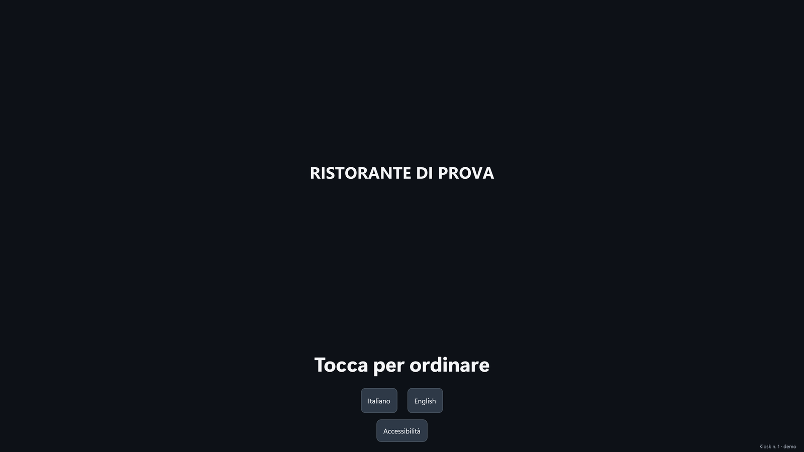

# Kiosk

Il kiosk è l'app RistoFacile (RistoKiosk) che gira su un **totem Windows** o su un **tablet
Android** all'ingresso del locale. Il cliente ordina da solo: sceglie se mangia lì o porta via,
compone l'ordine con le foto, le varianti, i menu a prezzo fisso e i suggerimenti, e paga con la
carta, in contanti al rendiresto, oppure alla cassa. Alla fine vede **il suo numero**, lo stesso
che compare sul [monitor in sala](../cassa/chiamate.md#il-monitor-in-sala), nelle
[Chiamate](../cassa/chiamate.md) e sul [monitor di cucina](../kds/monitor.md).

## A chi serve

- **Al cliente**, che ordina e paga senza fare la fila alla cassa. Chi mangia nel locale prende un
  **segnaposto** numerato e aspetta al tavolo: il vassoio gli viene portato lì. Chi porta via
  guarda il monitor in sala e ritira al banco quando il suo numero è pronto.
- **Al personale**, che riceve l'ordine già in cucina e pagato; alla cassa arrivano solo gli avvisi
  dei casi da sistemare (un pagamento da verificare, un resto da dare, uno scontrino da emettere) e
  gli ordini da incassare, tutti in [Ordini dal kiosk](../cassa/ordini-kiosk.md).

## Le tre configurazioni

Il kiosk funziona con qualunque combinazione di periferiche. In pratica i locali scelgono una di
queste tre:

| Configurazione | Cosa c'è al kiosk | Come paga il cliente | Lo scontrino |
|---|---|---|---|
| **Scontrino al kiosk** | POS e/o rendiresto, e la stampante fiscale accanto al kiosk | carta o contanti, al kiosk | esce al kiosk: alla fine il cliente legge «Ritira lo scontrino» |
| **Scontrino con i piatti** | POS e/o rendiresto; la stampante fiscale è altrove nel locale | carta o contanti, al kiosk | esce sulla stampante fiscale del locale e arriva con i piatti: il cliente legge «Lo scontrino ti arriva con i piatti» |
| **Si paga alla cassa** | nessuna periferica di pagamento (al più una stampante termica) | alla cassa | lo emette la cassa all'incasso |

- Nelle prime due il kiosk **incassa**: per questo, in cassa (Menu ▸ [Kiosk](../cassa/kiosk.md)),
  al kiosk va assegnata una stampante fiscale. Senza, il kiosk accetta solo «Pago alla cassa».
- Nella terza il kiosk stampa un **promemoria** con il numero e un codice QR, e il cliente va alla
  cassa a pagare. L'ordine va in cucina **subito** oppure **solo dopo l'incasso**, a scelta del
  locale (vedi [Configurazione](configurazione.md#le-impostazioni-del-servizio)).
- «Pago alla cassa» si può accendere anche accanto alla carta e ai contanti; con gli **articoli a
  peso** è l'unico modo, perché il prezzo esatto si conosce solo dopo la pesata.

## Come si lavora

1. **Installazione**: il kiosk si installa come un'app e si blocca il sistema operativo perché il
   cliente non ne esca. Vedi [Installazione](installazione.md).
2. **Configurazione**: con il PIN del kiosk si collega al servizio e si scelgono POS, rendiresto e
   stampante; dalla cassa, voce [Kiosk](../cassa/kiosk.md), si accendono i kiosk e si decide come
   lavorano. Vedi [Configurazione](configurazione.md).
3. **Il cliente ordina**: nove schermate, dall'attesa al numero. Vedi
   [Percorso del cliente](percorso.md).
4. **Il personale** incassa gli ordini «paga alla cassa» e interviene quando qualcosa non è andato
   liscio. Vedi [Ordini dal kiosk](../cassa/ordini-kiosk.md) e
   [Pagamenti, per il personale](pagamenti.md).

## Licenza

Ogni kiosk occupa un **posto Kiosk** della licenza RistoFacile, come ogni palmare occupa un posto
Mobile (vedi [Licenza digitale](../introduzione/licenza.md)). Il kiosk funziona anche in modalità
dimostrativa. Senza licenza né demo il servizio non accetta i suoi ordini e il kiosk scrive
*Kiosk non attivo, ordina alla cassa*.

## Vedi anche

- [Chiamate e monitor in sala](../cassa/chiamate.md)
- [Monitor di cucina](../kds/monitor.md)
- [Impostazioni della cassa](../cassa/impostazioni.md): stampanti fiscali, POS, cassa automatica
- [Self order](../cassa/self-order.md): l'ordine dal telefono del cliente al tavolo, che è un'altra cosa
