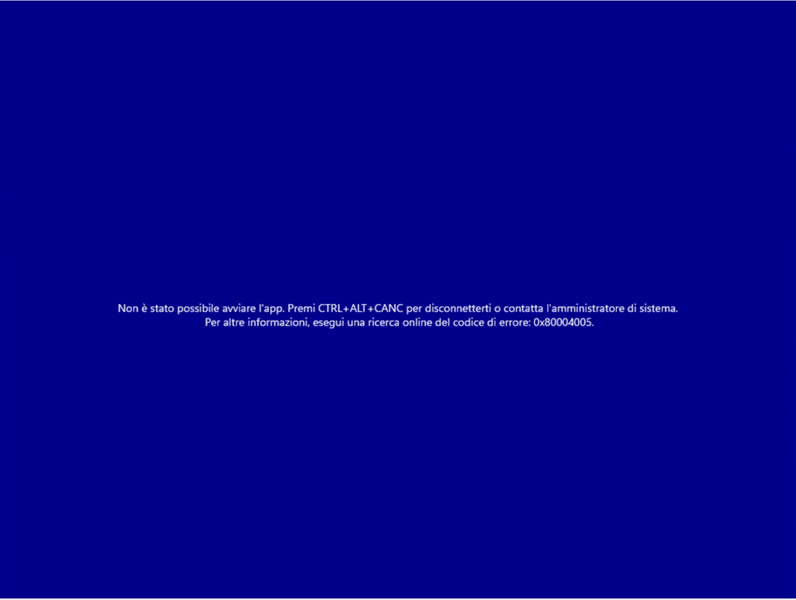
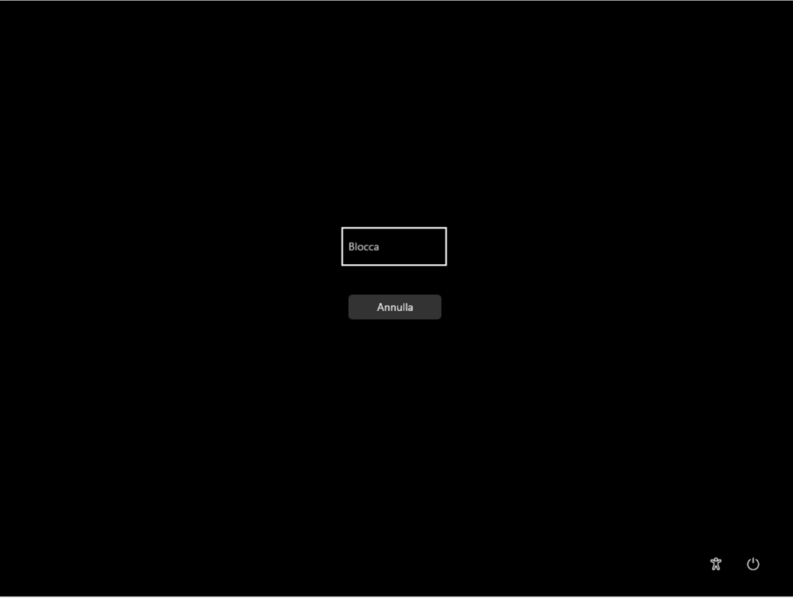
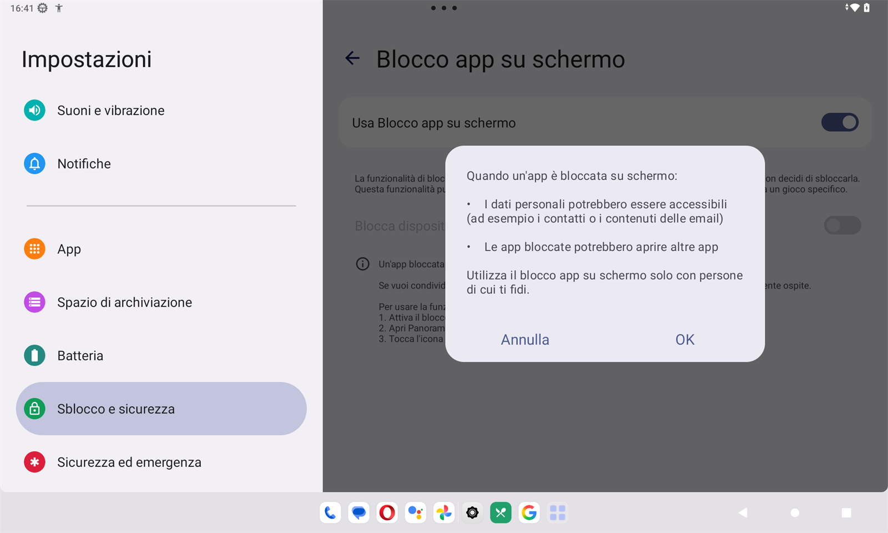
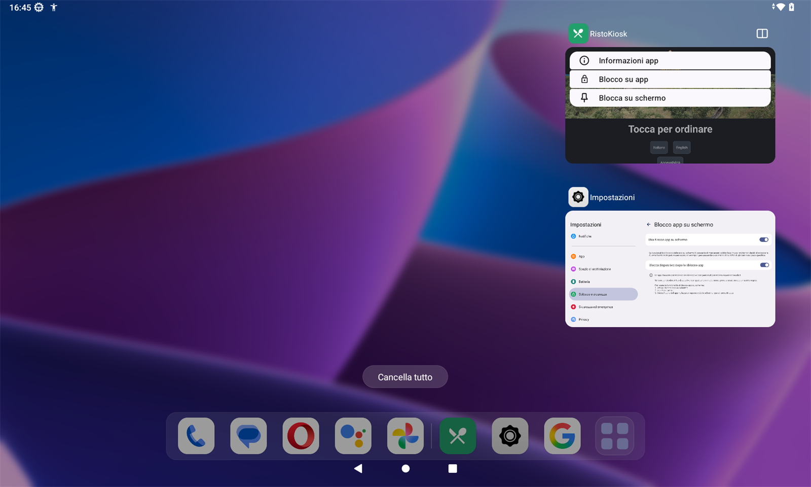

# Installazione del kiosk

Questa pagina è per **chi installa il kiosk** nel locale: come preparare il totem Windows o il
tablet Android perché il cliente non possa uscire dall'app, e quale utente del servizio dargli.
La configurazione dell'app, dopo l'installazione, è in [Configurazione](configurazione.md).

!!! info "In sintesi"

    - **Dove si trova:** sul totem o sul tablet, prima del primo avvio di RistoKiosk
    - **Chi la usa:** chi installa (rivenditore, assistenza, titolare esperto)
    - **Disponibile anche su:** Windows e Android

---

## A cosa serve

Il kiosk sta in mano ai clienti. L'app da sola si apre a tutto schermo, non si chiude con Alt+F4,
con la X o con il tasto Indietro, e si esce solo con il PIN del kiosk. Ma il **blocco del sistema
operativo** non lo fa l'app: va impostato su Windows o su Android, così che il cliente non possa
passare ad altri programmi, al desktop o alle impostazioni. Allo stesso modo, il kiosk va
collegato al servizio con un **utente web suo**, che può fare solo quello che serve al kiosk.

## Prima di cominciare

- Il servizio RistoFacile installato e acceso nel locale, raggiungibile dalla rete del kiosk.
- L'archivio del locale su **PostgreSQL**: RistoFacile e il kiosk lavorano su PostgreSQL; gli
  archivi c-tree non sono supportati.
- Un **posto Kiosk** libero sulla licenza RistoFacile del locale, oppure la modalità dimostrativa
  (vedi [Licenza digitale](../introduzione/licenza.md)).
- Per un totem Windows: un PC con Windows 10 o 11 e lo schermo del totem; per un tablet: Android usato in
  orizzontale (un tablet da 10 pollici va bene).
- Le periferiche che si useranno: POS, rendiresto, stampante termica (di rete o USB), lettore di
  QR 2D a tastiera per i segnaposto.

**Il programma.** Il pacchetto d'installazione del kiosk è in preparazione: per ora RistoKiosk lo
installa chi ha installato il servizio (rivenditore o assistenza). Sul totem Windows va nella
cartella `C:\Facile\RistoKiosk`, con i componenti di Windows che servono anche alla cassa; sul
tablet Android si installa l'app RistoKiosk. Da lì in poi valgono i passi di questa pagina.

## La schermata

Non applicabile: l'installazione si fa nel sistema operativo. Dopo il primo avvio il kiosk chiede
di scegliere il PIN (vedi [Configurazione](configurazione.md#il-primo-avvio)).

## Campi e indicatori

Non applicabile.

## Pulsanti e comandi

Non applicabile.

## Come si fa

### L'utente web del kiosk

Il kiosk si collega al servizio con un nome utente e una password, come le casse. Per il kiosk va
creato **un utente web apposta**, che non sia quello di una cassa, con un'**email sua**, e il suo
nome va scritto fra gli **utenti web dei kiosk** in cassa.

1. Crea l'utente web del kiosk, come gli utenti delle casse, con un'email che non sia di un
   operatore.
2. In cassa apri Menu ▸ **Kiosk**, linguetta **Kiosk**, riquadro **Utenti web dei kiosk**: scrivi il
   nome utente, tocca **Aggiungi** e poi **Salva** (vedi
   [Kiosk](../cassa/kiosk.md#dare-al-kiosk-il-suo-utente-web)). Le maiuscole non contano.
3. Sul kiosk scrivi quel nome e la sua password nella configurazione, riquadro **Servizio**, e
   tocca **Salva e verifica**.
4. L'avviso giallo *Attenzione: le credenziali di questo kiosk non sono ristrette. …* non deve
   comparire.

**Perché.** Le credenziali stanno salvate su un dispositivo che resta tutto il giorno davanti ai
clienti. Con le credenziali di una cassa, chi riuscisse a leggerle potrebbe fare tutto quello che fa
una cassa: aprire e chiudere conti, emettere documenti, leggere le configurazioni del servizio.
Quella delle casse automatiche contiene anche la **password della CashDro**. Con un utente scritto
fra gli utenti dei kiosk, invece:

- il servizio accetta le sue credenziali **solo sulle operazioni del kiosk** (stato, menu, foto,
  ordine e pagamento, licenza, POS, rendiresto e stampa); per tutto il resto risponde *Queste
  credenziali sono di un kiosk: operazione non permessa.*;
- quell'utente **non può entrare** come operatore web né chiedere il **recupero della password**;
- stampa solo sulle stampanti **registrate sul servizio** (vedi
  [Configurazione](configurazione.md#registrare-sul-servizio-la-termica-di-rete-del-kiosk)).

Con l'elenco vuoto nessuno è ristretto e il kiosk lo segnala in configurazione.

!!! note "Un'email per ogni kiosk"
    Il servizio riconosce l'utente del kiosk anche dalla sua email. Se la stessa email è anche di un
    operatore, chi entra con quell'email riceve le restrizioni del kiosk: in cassa lo segnala un
    avviso ambra sull'utente (*L'email … è anche di …*). Dai a ogni kiosk un utente e un'email suoi.

### Windows

Il totem si blocca con l'**Accesso assegnato** di Windows nella forma **a più app**, con
RistoKiosk come unica app permessa e avviata da sola. Windows crea un account **Kiosk** che entra
in automatico all'accensione, senza password. La procedura è provata su **Windows 11 Pro**.

!!! warning "Non usare la procedura guidata delle Impostazioni"
    **Impostazioni ▸ Account ▸ Altri utenti ▸ Chiosco** propone solo le app dello Store e Microsoft
    Edge: RistoKiosk, che è un programma classico, non è nell'elenco. Anche la modalità chiosco
    **a una sola app** scritta a mano non lo avvia: all'accesso compare su fondo blu *Non è stato
    possibile avviare l'app. Premi CTRL+ALT+CANC per disconnetterti o contatta l'amministratore di
    sistema.* con il codice di errore 0x80004005.



**Prima di bloccare il PC:**

1. Installa RistoKiosk sul PC (di partenza in `C:\Facile\RistoKiosk`).
2. Imposta lo schermo del totem come **schermo principale** di Windows. Il kiosk si apre a tutto
   schermo sempre sullo schermo principale; spostato su un altro schermo con la tastiera, torna da
   solo a tutto schermo su quello.
3. Controlla che nel menu Start di tutti gli utenti ci sia il collegamento **RistoKiosk**, per
   esempio `C:\ProgramData\Microsoft\Windows\Start Menu\Programs\RistoKiosk.lnk`: il suo
   percorso serve nel file del passo seguente.

**Il file dell'Accesso assegnato.** Con il Blocco note salva questo testo come
`C:\Facile\kiosk.xml`. Se RistoKiosk o il suo collegamento stanno in un'altra cartella, correggi i
due percorsi:

```xml
<?xml version="1.0" encoding="utf-8"?>
<AssignedAccessConfiguration
  xmlns="http://schemas.microsoft.com/AssignedAccess/2017/config"
  xmlns:rs5="http://schemas.microsoft.com/AssignedAccess/201810/config"
  xmlns:v5="http://schemas.microsoft.com/AssignedAccess/2022/config">
  <Profiles>
    <Profile Id="{3B7C1D2E-5A4F-4E6B-8C9D-0A1B2C3D4E5F}" Name="RistoKiosk">
      <AllAppsList>
        <AllowedApps>
          <App DesktopAppPath="C:\Facile\RistoKiosk\RistoKiosk.exe" rs5:AutoLaunch="true" />
        </AllowedApps>
      </AllAppsList>
      <rs5:FileExplorerNamespaceRestrictions>
      </rs5:FileExplorerNamespaceRestrictions>
      <v5:StartPins><![CDATA[
        { "pinnedList": [ { "desktopAppLink": "%ALLUSERSPROFILE%\\Microsoft\\Windows\\Start Menu\\Programs\\RistoKiosk.lnk" } ] }
      ]]></v5:StartPins>
      <Taskbar ShowTaskbar="false" />
    </Profile>
  </Profiles>
  <Configs>
    <Config>
      <AutoLogonAccount rs5:DisplayName="Kiosk" />
      <DefaultProfile Id="{3B7C1D2E-5A4F-4E6B-8C9D-0A1B2C3D4E5F}" />
    </Config>
  </Configs>
</AssignedAccessConfiguration>
```

**Applicare il blocco.** Windows accetta il file solo se lo applica l'account di sistema, non un
amministratore qualsiasi:

1. Salva come `C:\Facile\applica-kiosk.ps1` queste righe:

    ```powershell
    $o = Get-CimInstance -Namespace root\cimv2\mdm\dmmap -ClassName MDM_AssignedAccess
    $o.Configuration = [System.Net.WebUtility]::HtmlEncode((Get-Content 'C:\Facile\kiosk.xml' -Raw))
    Set-CimInstance -CimInstance $o
    ```

2. Apri **Windows PowerShell** come amministratore e scrivi:

    ```powershell
    $a = New-ScheduledTaskAction -Execute powershell.exe -Argument '-NoProfile -ExecutionPolicy Bypass -File C:\Facile\applica-kiosk.ps1'
    Register-ScheduledTask -TaskName ApplicaKiosk -Action $a -User SYSTEM -RunLevel Highest -Force
    Start-ScheduledTask -TaskName ApplicaKiosk
    ```

3. Dopo qualche secondo togli l'attività con
   `Unregister-ScheduledTask -TaskName ApplicaKiosk -Confirm:$false`.
4. Controlla in **Impostazioni ▸ Account ▸ Altri utenti** che ci sia l'account **Kiosk**.
5. Spegni la **Game Bar**, sempre nella finestra di PowerShell come amministratore:

    ```powershell
    New-Item 'HKLM:\SOFTWARE\Policies\Microsoft\Windows\GameDVR' -Force
    New-ItemProperty 'HKLM:\SOFTWARE\Policies\Microsoft\Windows\GameDVR' -Name AllowGameDVR -Value 0 -PropertyType DWord -Force
    ```

    Senza questo passo, a ogni accensione compare davanti al kiosk *Questa app è stata bloccata
    dall'amministratore di sistema.*: Windows prova ad aprire la Game Bar e l'Accesso assegnato la
    blocca.

**Il primo avvio nel chiosco:**

1. Riavvia il PC: entra da solo l'account **Kiosk** e si apre RistoKiosk a tutto schermo, senza
   barra delle applicazioni.
2. Scegli il PIN del kiosk e collega il kiosk al servizio (vedi
   [Configurazione](configurazione.md#il-primo-avvio)). Le impostazioni valgono per l'account
   **Kiosk**: quelle fatte prima con un altro account non le vede.
3. Tocca **Torna all'attesa**.
4. Riavvia ancora il PC: deve tornare da solo su *Tocca per ordinare*, senza che nessuno tocchi
   niente. RistoKiosk parte 10-15 secondi dopo l'avvio di Windows.

**Cosa può fare chi ha una tastiera.** Sul totem, con l'Accesso assegnato:

- **Alt+Tab**, **Windows+D**, **Windows+R**, **Ctrl+Maiusc+Esc** e **Alt+F4** non fanno niente;
- il tasto **Windows** apre un menu Start ridotto, con la sola icona di RistoKiosk, la ricerca
  (che non accetta testo) e il pulsante di spegnimento, e per quel momento ricompare la barra;
- **Ctrl+Alt+Canc** mostra solo **Blocca** e **Annulla**, più accessibilità e spegnimento: niente
  Gestione attività, niente desktop. Dopo **Blocca**, alla schermata di blocco basta **Accedi**
  sull'account **Kiosk**, senza password, e si torna al kiosk com'era.



Per questo sul totem non lasciare una tastiera collegata: con il pulsante di spegnimento chi la
usa può spegnere o riavviare il PC. Tutto quello che serve al personale passa dalla configurazione
del kiosk, con il PIN.

**Uscire dal kiosk.** Con **Esci dall'app** (vedi
[Configurazione](configurazione.md#chiudere-lapp)) RistoKiosk si chiude e resta il **desktop
vuoto**: solo lo sfondo, senza icone, barra o menu col tasto destro, e Windows non riapre il
kiosk da solo. Per riaprirlo: tasto **Windows** e l'icona **RistoKiosk**, oppure riavvia il PC.

**Lavorare sul PC.** Premi **Ctrl+Alt+Canc**, tocca **Blocca** e, alla schermata di blocco,
scegli l'account dell'amministratore. Per togliere il blocco rifai **Applicare il blocco** con, al
posto della seconda riga del file `applica-kiosk.ps1`, la riga `$o.Configuration = $null`.

Su un PC RistoKiosk gira in una sola copia: se parte una seconda volta (per esempio anche
dall'esecuzione automatica di Windows), la seconda si chiude da sola.

### Android

1. Installa RistoKiosk sul tablet.
2. Aprilo una prima volta e scegli il PIN del kiosk (vedi
   [Configurazione](configurazione.md#il-primo-avvio)).
3. Nelle impostazioni di Android accendi il **blocco dell'app**. A seconda del produttore si chiama
   «Blocco app su schermo», «Blocco app», «Fissa app» o «Blocco schermo sull'app». Su un tablet
   Lenovo con Android 13 sta in Impostazioni ▸ **Sblocco e sicurezza** ▸ **Altre impostazioni di
   sicurezza** ▸ **Blocco app su schermo**:
   - accendi **Usa Blocco app su schermo** e conferma l'avviso con **OK**;
   - accendi **Blocca dispositivo dopo lo sblocco app**, così per sbloccare l'app serve il PIN o la
     sequenza del tablet. Se il tablet non ha ancora un blocco schermo, Android ti chiede di
     sceglierne uno (PIN, sequenza o password): senza, chiunque sblocca l'app.

    

4. Apri RistoKiosk e bloccalo sullo schermo dal menu delle app recenti: tocca il tasto
   **Panoramica** (il quadrato), poi l'**icona** di RistoKiosk in cima alla sua anteprima e
   **Blocca su schermo**. Sul Lenovo, nello stesso menu, «Blocco su app» è un'altra cosa: non serve.
   Android mostra *L'app è bloccata sullo schermo*: tocca **OK**.

    

5. Prova che il blocco ha preso: tocca **Home**. Il kiosk deve restare a video. Se compare la
   schermata delle app, il blocco non è partito: ripeti il punto 4.
6. Con una **stampante termica USB**: collegala (su un tablet con una sola porta USB serve un cavo o
   un adattatore OTG), poi nella configurazione del kiosk scegli
   **USB (collegata al kiosk)**, la stampante, e tocca **Usa questa stampante** (o
   **Stampa di prova**). Android chiede se permettere a RistoKiosk di usare la periferica
   (*Consentire all'app RistoKiosk di accedere a …?*): tocca **OK** (su altri tablet il tasto può
   chiamarsi **Consenti**).

L'app da sola tiene il tablet in orizzontale, nasconde le barre di sistema (si riaffacciano solo
per un attimo strisciando dal bordo), tiene lo schermo acceso e ignora il tasto Indietro.

**Togliere il blocco dell'app**, per lavorare sul tablet: striscia dal bordo in basso per far
comparire i tasti, poi tieni premuti **insieme** Indietro e Panoramica. Il tablet si blocca e chiede
il suo PIN (o la sequenza).

**Il permesso USB** si chiede in tre momenti: nella configurazione (scelta della stampante o
**Stampa di prova**), all'avvio dell'app e **ogni volta che la stampante scelta si ricollega**. Di
solito capita all'avvio o quando colleghi la stampante, con il personale davanti; ma se la
stampante si stacca e si riattacca durante un ordine (per esempio un cavo che fa contatto) la
richiesta di Android può comparire anche davanti al cliente: in quel caso tocca tu **OK**.
Le stampe del cliente non aspettano il permesso: se manca, non escono e il kiosk va avanti lo
stesso (vedi [Pagamenti](pagamenti.md#note)).

**La rete.** Il kiosk Android parla con il servizio in `http` sulla rete del locale: nella
configurazione si scrive l'indirizzo con `http://`, come per le casse.

### Aggiornare un impianto al kiosk

Con l'aggiornamento che porta il kiosk, e in cassa la voce **Kiosk** e gli **Ordini dal kiosk**:

1. **Ferma i kiosk** prima di cominciare (sul kiosk, **Esci dall'app**), a un'ora senza clienti: i
   kiosk restano senza ordini finché l'aggiornamento non è finito.
2. Aggiorna **prima il servizio**. Le schermate nuove della cassa e del kiosk chiedono al servizio
   cose che un servizio vecchio non sa: per esempio un kiosk nuovo senza POS né rendiresto, con un
   servizio vecchio, non riesce a mandare i clienti a pagare alla cassa, e la cassa nuova nasconde
   il tema e il logo per il tema chiaro (*Il servizio non lo conosce ancora: aggiornalo per
   sceglierlo.*). Controlla anche che **l'ora** del computer del servizio, e del computer del
   database PostgreSQL se è un altro, sia giusta e uguale sui due: le scadenze degli ordini del
   kiosk si calcolano con tutti e due.
3. Aggiorna **i kiosk insieme al servizio**: un kiosk della versione di prima, con il servizio nuovo,
   non riesce a segnalare un pagamento da verificare (il servizio rifiuta la segnalazione). Lasciali
   comunque senza ordini.
4. Aggiorna **tutte le casse e tutti i palmari**. Finché ne resta uno di prima, i kiosk restano
   spenti:
   - una cassa di prima calcola coperto e servizio sul conto di un ordine del kiosk, non conosce i
     pagamenti da verificare né il controllo prima del POS, e mette gli avvisi del kiosk sul tavolo;
   - un palmare di prima apre i tavoli del kiosk come tavoli normali;
   - una cassa di prima, quando salva un piatto nella composizione del [Menu](../cassa/menu.md),
     riaccende **Ordinabile dal kiosk**: il piatto torna sui kiosk;
   - una cassa o un palmare di prima danno il «visto» a un avviso di rimborso senza chiedere se hai
     già rimborsato, e il servizio registra il rimborso come fatto.
5. Sulla TV del monitor in sala ricarica la pagina **una volta a mano** (riaprila, o tasto F5): la
   pagina di prima non sa ricaricarsi da sola. Dagli aggiornamenti successivi si ricarica da sola
   quando il servizio cambia (vedi [Chiamate](../cassa/chiamate.md#il-monitor-in-sala)). Subito
   dopo l'aggiornamento il monitor può mostrare di nuovo, per i minuti dei numeri pronti, i
   numeri pronti o consegnati delle ultime 12 ore: succede una volta sola.
6. In cassa apri Menu ▸ [Kiosk](../cassa/kiosk.md) e controlla la configurazione: quello che prima
   scriveva l'assistenza (kiosk, dispositivi, utenti web) ora si vede e si cambia da lì.
7. Per ultimi **riaccendi i kiosk**: avvia RistoKiosk e, se li avevi spenti, accendi **Kiosk accesi**
   e tocca **Salva**.

Il contrario regge: una cassa nuova con un servizio ancora vecchio non vede i tavoli del kiosk e
lavora come prima.

## Controlli e messaggi

| Messaggio | Causa | Cosa fare |
|---|---|---|
| *Queste credenziali sono di un kiosk: operazione non permessa.* | Con l'utente di un kiosk si è tentata un'operazione che non è del kiosk (per esempio da una cassa collegata con quell'utente). | Collega la cassa con il suo utente; l'utente del kiosk serve solo al kiosk. |
| *Permesso USB della stampante non dato: dallo dalla configurazione del kiosk (scegli la stampante o «Stampa di prova»).* | Su Android la stampante USB non ha ancora il permesso. | Apri la configurazione, scegli la stampante o tocca **Stampa di prova** e tocca **OK** (o **Consenti**) nella richiesta di Android. |
| *Non è stato possibile avviare l'app. Premi CTRL+ALT+CANC per disconnetterti o contatta l'amministratore di sistema.* (codice 0x80004005, su fondo blu) | Su Windows l'Accesso assegnato è nella forma a una sola app, che non avvia RistoKiosk. | Applica il file a più app (vedi [Windows](#windows)) e riavvia. |
| *Questa app è stata bloccata dall'amministratore di sistema.* (all'accensione, davanti al kiosk) | Su Windows l'Accesso assegnato blocca la Game Bar, che Windows apre all'accesso. | Tocca **Chiudi**, poi spegni la Game Bar (vedi [Windows](#windows)) e riavvia. |

## Note

- **Prima del cliente.** Dopo l'installazione prova un ordine completo.
  - Un pagamento con la carta o in contanti a un kiosk che incassa **emette uno scontrino vero**
    sulla stampante fiscale assegnata al kiosk: l'ordine di prova si chiude da solo, con il suo
    documento fiscale. Usa importi piccoli, o una stampante fiscale di prova.
  - Senza scontrino si prova con **Pago alla cassa** (se è acceso), con l'invio in cucina **dopo**: l'ordine
    di prova non va in cucina e si annulla da solo alla scadenza (di partenza 30 minuti).
  - Un ordine di prova rimasto aperto si chiude dalla cassa, in
    [Ordini dal kiosk](../cassa/ordini-kiosk.md): **Annulla l'ordine** per un «paga alla cassa»
    non ancora in cucina, **Annulla e rimborsa** per un ordine pagato al kiosk (il rimborso della
    carta di prova si fa sul POS), il conto con **CHIUDI SENZA DOCUMENTO** per un «paga alla cassa»
    già in cucina. Un ordine da verificare si decide prima con **Il denaro è entrato?**.
- **Uscire dall'app** si può solo dalla configurazione, con **Esci dall'app**: vedi
  [Configurazione](configurazione.md#chiudere-lapp). Per lavorare sul PC si passa all'account
  dell'amministratore (vedi [Windows](#windows)); sul tablet va tolto il blocco dell'app.
- **Il kiosk non legge il QR con la fotocamera**: per i segnaposto col QR serve un lettore 2D
  esterno.

## Vedi anche

- [Configurazione](configurazione.md)
- [Licenza digitale](../introduzione/licenza.md)
- [Impostazioni della cassa](../cassa/impostazioni.md)
