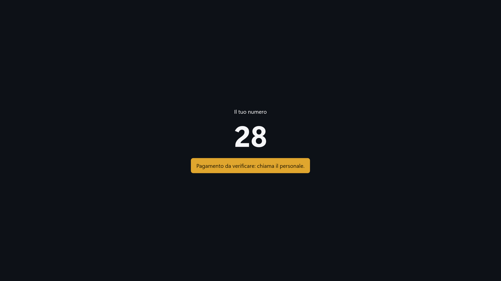
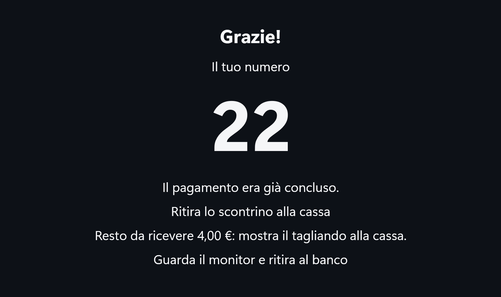
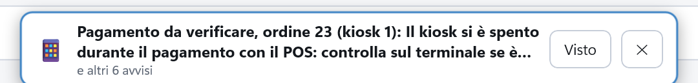
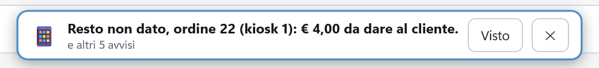
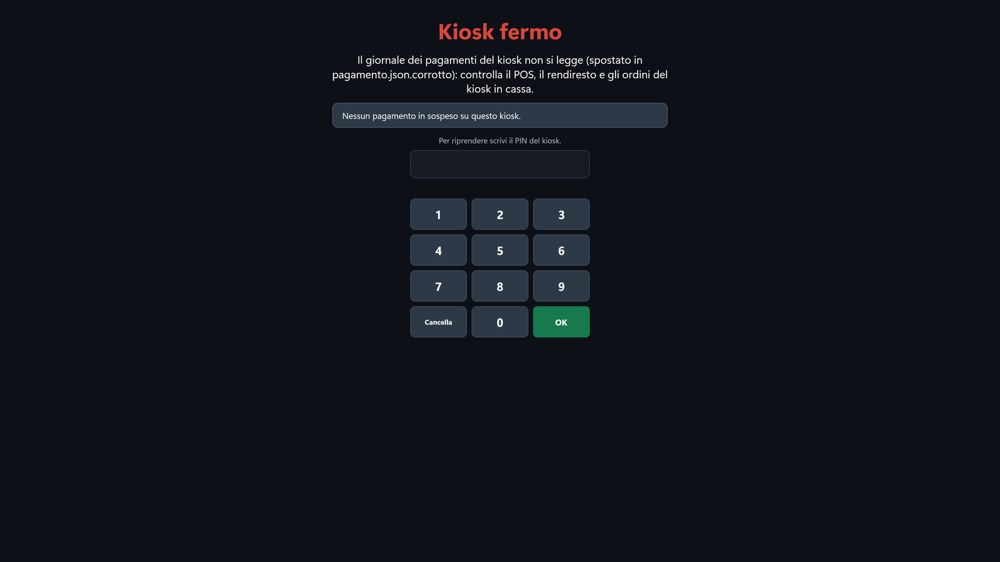
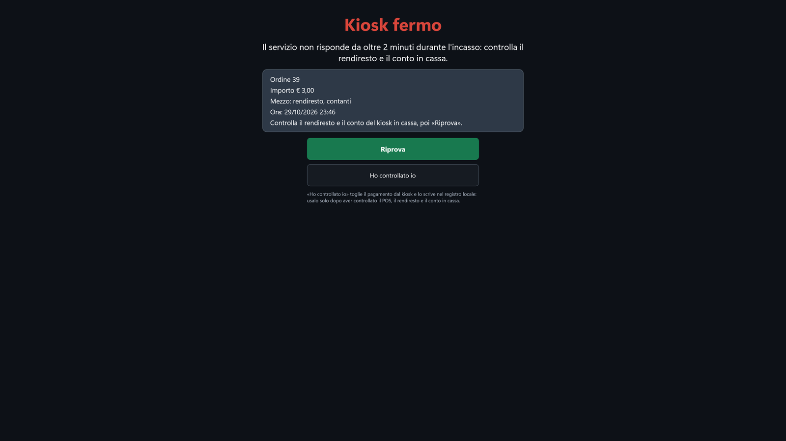
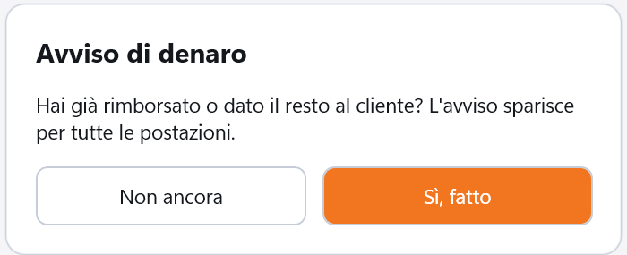
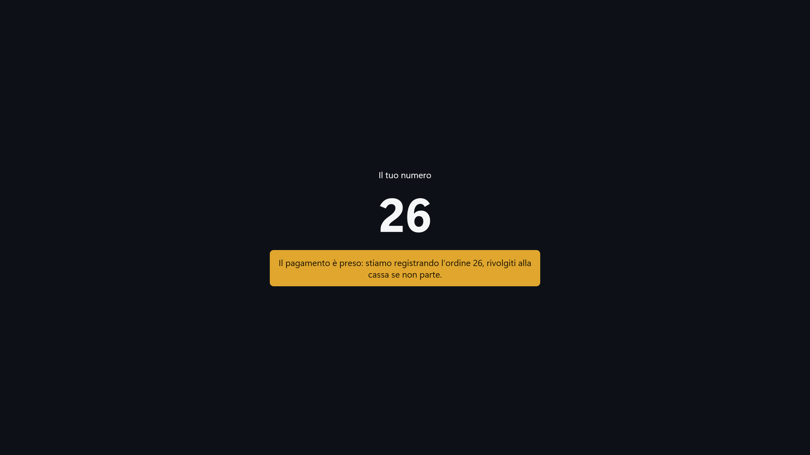
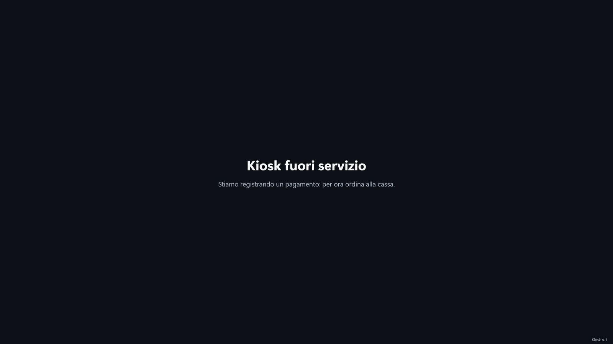
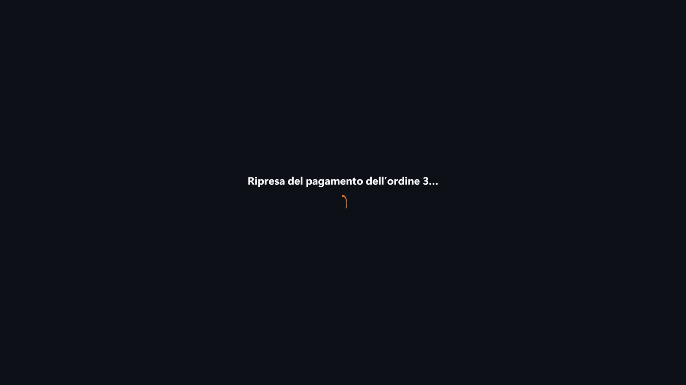

# Pagamenti, per il personale

Il kiosk non perde mai un pagamento preso e non fa mai pagare due volte. Quando non è sicuro di
com'è andato un pagamento, non riprova da solo: lo dice al cliente in parole semplici («chiama il
personale», «rivolgiti alla cassa»), stampa un tagliando e manda un **avviso alla cassa**. Questa
pagina spiega quegli avvisi, la **vista Fermo** e cosa fare dopo uno spegnimento.

!!! info "In sintesi"

    - **Dove si trova:** sul kiosk, nelle viste dopo il pagamento e nella vista **Kiosk fermo**; in cassa, negli avvisi in alto
    - **Chi la usa:** cassiere, titolare
    - **Disponibile anche su:** gli avvisi compaiono sulla cassa collegata allo stesso servizio

---

## A cosa serve

Un cliente paga con la carta, ma il POS perde il collegamento a metà e non dice se ha addebitato.
Il kiosk non può sapere se il cliente ha pagato, e non gli fa ripetere il pagamento: mostra il suo
numero con *Pagamento da verificare: chiama il personale.*, stampa il tagliando «Pagamento da
verificare» e in cassa compare l'avviso. Tu controlli sul giornale del POS se l'addebito c'è e
decidi: se c'è, l'ordine si conclude senza far pagare di nuovo; se no, il cliente paga in cassa.

## Prima di cominciare

- Per vedere gli avvisi del kiosk la cassa dev'essere collegata **allo stesso servizio** del kiosk.
- Il PIN del kiosk, per la vista Fermo.

## La schermata

### Al kiosk, gli esiti per il personale

Quando un pagamento chiede il personale il kiosk mostra *Il tuo numero*, il numero e l'avviso in
giallo. L'avviso resta **30 secondi** e un tocco non lo chiude (il cliente ha il tempo di leggerlo e
di prendere il tagliando); poi il kiosk torna all'attesa.

| Il cliente legge | Cosa è successo | Il tagliando dice |
|---|---|---|
| *Pagamento da verificare: chiama il personale.* | Il POS non ha dato l'esito, il rendiresto ha risposto in modo incerto, il kiosk si è spento durante il POS, o il servizio non conosce più la sessione dei contanti. Il cliente **forse** ha pagato. | «Pagamento da verificare: € 3,00 — Rivolgiti alla cassa con il numero 28» |
| *Hai versato 5,00 €: rivolgiti alla cassa con il numero 28.* | Il rendiresto ha tenuto dei soldi senza completare il pagamento (un annullo che non ha restituito tutto, o una macchina che ha preso solo una parte). Al cliente non si chiede la differenza. | «Hai versato € 5,00 — Rivolgiti alla cassa con il numero 28» |
| *Il pagamento è preso: stiamo registrando l’ordine 26, rivolgiti alla cassa se non parte.* | Il cliente ha pagato, ma il servizio non ha ancora registrato il pagamento (vedi sotto). | nessuno |
| *Resto da ricevere 4,00 €: mostra il tagliando alla cassa.* (sulla schermata del numero, con l'ordine pagato) | Il rendiresto non ha potuto dare tutto il resto. | «Resto da ricevere € 4,00 — Mostralo alla cassa» |
| *Il pagamento non è partito: rivolgiti alla cassa con il numero 28.*, o il messaggio del servizio | Il servizio ha rifiutato il pagamento prima di cominciare: nessun soldo è stato preso. Questo avviso si chiude anche al tocco. | nessuno |

Senza termica, o se la stampa non esce, il tagliando manca, ma l'avviso in cassa c'è lo stesso,
perché lo scrive il servizio.

### In cassa, gli avvisi

Gli avvisi del kiosk compaiono in alto su mappa, comanda e conto, nello stesso riquadro degli
avvisi del [self order](../cassa/self-order.md): l'icona (💳 pagamento da verificare, 💶 resto o
rimborso, 🧾 scontrino da emettere, ⏰ ordine non pagato), il testo, **Apri** per andare
all'ordine in [Ordini dal kiosk](../cassa/ordini-kiosk.md), **Visto** per toglierlo, **✕** per
chiudere il riquadro senza segnarlo visto, e sotto *e altri N avvisi* se ce ne sono altri. Ogni
avviso nomina l'ordine e il kiosk, per esempio «ordine 23 (kiosk 1)». Gli avvisi del kiosk non
compaiono sulle tessere dei tavoli. Sul palmare ci sono anche loro, senza **Apri**: gli ordini del
kiosk si gestiscono dalla cassa.

### La vista Fermo

Quando il kiosk non riesce a far sapere qualcosa al servizio, si ferma e chiama il personale:
**Kiosk fermo** in rosso, il motivo, il riquadro con il pagamento in sospeso e il tastierino con
*Per riprendere scrivi il PIN del kiosk.*. Sull'attesa il kiosk scrive **Kiosk fermo** con
*Chiama il personale.* e non accetta clienti.

Il riquadro mostra il pagamento che il kiosk ha in sospeso: **Ordine 39**, **Importo € 3,00**,
**Mezzo** (*POS*, *rendiresto, contanti* o *rendiresto, carta*), **Ora** e cosa controllare (per
esempio *Controlla il rendiresto e il conto del kiosk in cassa, poi «Riprova».*). Senza un pagamento
dice *Nessun pagamento in sospeso su questo kiosk.*. Dopo il PIN compaiono **Riprova** e, se c'è un
pagamento, **Ho controllato io**.

## Campi e indicatori

### Gli avvisi in cassa

| Avviso | Che cosa vuol dire |
|---|---|
| 💳 *Pagamento da verificare, ordine 23 (kiosk 1): …* | Il kiosk non sa se il cliente ha pagato. Il testo dice il perché (per esempio *Il kiosk si è spento durante il pagamento con il POS: controlla sul terminale se è passato.*), l'importo e i riferimenti dell'operazione. L'ordine **non** va in cucina e il suo conto non si chiude finché non decidi da [Ordini dal kiosk](../cassa/ordini-kiosk.md#decidere-un-pagamento-da-verificare). Il denaro **trattenuto** dal rendiresto arriva qui, con il suo importo. |
| 💳 *Il kiosk ha registrato il pagamento dell'ordine 15 dopo che era stato dato per non entrato: controlla prima di incassare.* | Avevi risposto **Non è entrato**, ma poi il kiosk ha registrato il pagamento. L'ordine torna da verificare. |
| 💶 *Resto non dato, ordine 22 (kiosk 1): € 4,00 da dare al cliente.* | L'ordine è pagato e in cucina; il cliente deve ricevere il resto dalla cassa. |
| 🧾 *Scontrino da emettere per l'ordine 27 (kiosk 1): …* | Il cliente ha pagato al kiosk e l'ordine è in cucina, ma lo scontrino non è uscito (per esempio la stampante fiscale è spenta). Il testo dice il motivo. Con *Scontrino da verificare* il kiosk non sa se lo scontrino è uscito: controlla prima sulla stampante. Lo scontrino si emette da [Ordini dal kiosk](../cassa/ordini-kiosk.md#emettere-lo-scontrino-di-un-ordine-pagato-al-kiosk). |
| 💶 *Rimborso di € …, ordine 27 (kiosk 1): …* | Il kiosk ha incassato più del conto, o il conto è sceso sotto quello che il cliente ha pagato (per esempio *… pagati al kiosk (contanti) e rimasti fuori dallo scontrino. Rimborsa il cliente.*): la differenza va restituita. |
| 💶 *Ordine 4 annullato dalla cassa (MARCO): rimborsa € 3,00 (pagati al kiosk con la carta).* | Hai annullato con **Annulla e rimborsa** un ordine pagato al kiosk. Fra parentesi l'operatore che l'ha annullato; anche gli avvisi di rimborso nati da una verifica nominano chi l'ha fatta (*… la cassa (MARCO) ha verificato …*). |
| ⏰ *Ordine 27 non pagato (kiosk 1, porta via): è in cucina e dopo 30 minuti non è ancora passato dalla cassa.* | Un ordine «paga alla cassa» mandato in cucina subito, e non ancora incassato. |
| *Cliente GIÀ ADDEBITATO, ordine 27 (kiosk 1), …: pagato al kiosk … su un ordine già chiuso (annullato o scaduto), che non è stato preparato; …* | Il pagamento è arrivato su un ordine che il servizio aveva già chiuso, per la scadenza o perché il cliente l'aveva annullato al kiosk: non è stato preparato. Non far pagare di nuovo: rifai l'ordine e chiudilo con questo pagamento, oppure rimborsa. |
| *Pagamento da verificare, ordine 27 (kiosk 1): pagato al kiosk … su un ordine già chiuso.* | Il cliente può aver pagato due volte: controlla, e rimborsa se serve. Il suo **Visto** chiede se hai rimborsato (vedi sotto). |

Gli avvisi di soldi (resto, rimborso, pagamento su un ordine già chiuso) restano finché non tocchi
**Visto**, anche a conto chiuso, e **Visto** chiede prima conferma:

*Hai già rimborsato o dato il resto al cliente? L'avviso sparisce per tutte le postazioni.*, con
**Non ancora** e **Sì, fatto** (per un avviso di soldi da verificare: *Hai
controllato il pagamento sul POS o sul rendiresto? L'avviso sparisce per tutte le postazioni: la
verifica si fa da «Ordini dal kiosk».*). Un tocco fuori dalla domanda vale **Non ancora**.
Sugli avvisi di rimborso del kiosk **Sì, fatto** registra anche il rimborso sul servizio: rispondi
così solo dopo aver reso davvero i soldi. Sul pagamento arrivato su un ordine già chiuso la domanda
è un'altra (**Avviso di denaro**): *Il cliente ha pagato al kiosk € … su un ordine già chiuso. Hai
rimborsato il cliente? Con «Sì, rimborsato» il rimborso si registra; con «No, non serve» (per
esempio l'ordine rifatto e chiuso con questo pagamento) il denaro resta da rimborsare nel registro.
L'avviso sparisce per tutte le postazioni.*, con **Non ancora**, **Sì, rimborsato** e **No, non
serve**. I rimborsi dei pagamenti dal telefono non lo chiedono: li registra il portale del
pagamento. Se il servizio non riesce a registrarlo, l'avviso resta
a video con *Rimborso non registrato: riprova fra poco. L'avviso resta: riprova con «visto».*
(senza risposta: *Il servizio non risponde: l'avviso resta. Riprova con «visto» fra poco.*). Gli avvisi *Pagamento da verificare* e *Scontrino da emettere* di un
ordine ancora aperto, una volta visti, escono dal riquadro ma restano legati all'ordine finché il
suo conto non si chiude; quello da verificare sparisce da solo quando il kiosk registra il
pagamento.

### La vista Fermo

| Elemento | Descrizione |
|---|---|
| **Kiosk fermo** e il motivo | Per esempio *Il servizio non risponde da oltre 2 minuti durante l'incasso: controlla il rendiresto e il conto in cassa.* |
| **Ordine**, **Importo**, **Mezzo**, **Ora** | Il pagamento in sospeso sul kiosk. |
| Tastierino del PIN | *Per riprendere scrivi il PIN del kiosk.* Gli errori contano come nella configurazione (5 errori, 5 minuti di blocco). |
| *«Ho controllato io» toglie il pagamento dal kiosk e lo scrive nel registro locale: …* | La spiegazione sotto i due tasti, dopo il PIN. |

## Pulsanti e comandi

| Comando | Effetto |
|---|---|
| **Apri** (avviso in cassa) | Apre [Ordini dal kiosk](../cassa/ordini-kiosk.md) con quell'ordine in cima. Solo sulla cassa. Dal conto, prima di lasciarlo, la cassa ricorda la carta già addebitata o il denaro della cassa automatica; con un incasso in corso non apre niente: *C'e' un incasso in corso su questo conto: finiscilo prima, poi apri l'avviso.* |
| **Visto** (avviso in cassa) | Toglie l'avviso: usalo dopo aver sistemato il caso. Sugli avvisi di soldi chiede prima conferma (**Sì, fatto**). |
| **✕** (avviso in cassa) | Chiude il riquadro senza segnare visto l'avviso. |
| **OK** (vista Fermo) | Con il PIN giusto mostra **Riprova** e, se c'è un pagamento, **Ho controllato io**. |
| **Riprova** | Il kiosk riprova a far sapere al servizio com'è andato il pagamento (o, senza pagamento, torna ad accogliere i clienti). Se il servizio risponde, il kiosk mostra l'esito e torna all'attesa; se dopo 30 secondi non ha ancora risposto, la vista dice *Il servizio non ha ancora dato una risposta definitiva: il kiosk continua a provare e mostra l'esito appena arriva.* e si blocca di nuovo. |
| **Ho controllato io** | Toglie il pagamento in sospeso dal kiosk e lo scrive nel registro locale del kiosk (il file `kiosk/personale.log` nella cartella dei dati dell'app), con data, ora, ordine, importo e motivo. Poi il kiosk torna ad accogliere i clienti. **Non** dice niente al servizio: usalo solo dopo aver controllato tu il POS, il rendiresto e il conto in cassa. |
| **Torna all'attesa** (configurazione) | Con il kiosk fermo vale come **Riprova**. |

Dopo ogni **Riprova** o **Ho controllato io** che lascia il kiosk fermo, la vista si blocca di nuovo
e chiede il PIN: i due tasti non restano a disposizione di chi passa.

## Come si fa

### Un pagamento da verificare

1. Leggi l'avviso in cassa: numero dell'ordine, importo, motivo.
2. Controlla la periferica: sul **giornale del POS** se l'addebito c'è; sul **rendiresto** quanto
   ha incassato e restituito per quell'ordine.
3. Tocca **Apri** sull'avviso: si apre [Ordini dal kiosk](../cassa/ordini-kiosk.md) con l'ordine
   in cima.
4. Tocca **Il denaro è entrato?**. Se il cliente ha pagato, scrivi l'importo che vedi sul POS o
   sul rendiresto, scegli **Carta** o **Contanti** e tocca **Il denaro è entrato**: l'ordine va in
   cucina e si conclude senza farlo pagare di nuovo (se l'importo non basta, la cassa apre la
   comanda per incassare il resto). Se non ha pagato, tocca **Non è entrato**: l'ordine si incassa
   alla cassa.
5. Tocca **Visto** sull'avviso.

Gli ordini del kiosk si aprono **sempre** da [Ordini dal kiosk](../cassa/ordini-kiosk.md): il tocco
sul tavolo del kiosk in sala porta lì, e non apre mai una comanda nuova. Gli ordini del kiosk non
sono nella coda dell'asporto.

### Un resto da dare

1. Il cliente arriva con il tagliando «Resto da ricevere».
2. Controlla che il numero e l'importo siano quelli dell'avviso *Resto non dato* in cassa.
3. Dai il resto al cliente.
4. Tocca **Visto** e rispondi **Sì, fatto**.

### Il pagamento è preso ma non registrato

Succede quando il cliente ha pagato ma il servizio non risponde (rete giù, servizio fermo).

1. Il cliente vede *Pagamento in corso…*; dopo un minuto *Il pagamento è preso: stiamo registrando
   l’ordine 26, rivolgiti alla cassa se non parte.*.
2. Il kiosk **ritenta da solo**, senza far pagare di nuovo, finché il servizio non risponde.
3. Nel frattempo l'attesa scrive **Kiosk fuori servizio** con *Stiamo registrando un pagamento: per
   ora ordina alla cassa.* e non accetta nuovi clienti.

4. Rimetti in funzione il servizio o la rete.
5. Appena il servizio risponde il pagamento si registra, l'ordine va in cucina e il kiosk torna da
   solo ad accogliere i clienti.

### Sbloccare un kiosk fermo

1. Leggi il motivo e il riquadro del pagamento.
2. Controlla quello che dice la vista: il POS, il rendiresto, il conto del kiosk in cassa.
3. Scrivi il PIN del kiosk e tocca **OK**.
4. Tocca **Riprova**: se il servizio risponde, il kiosk sistema il pagamento da solo e torna
   all'attesa.
5. Se il kiosk resta fermo e hai controllato tu com'è andato il pagamento, scrivi di nuovo il PIN e
   tocca **Ho controllato io**: il kiosk torna ad accogliere i clienti.

Il kiosk si ferma quando:

- il servizio non risponde da oltre **2 minuti** durante l'incasso in contanti (il cliente intanto
  vede *Un momento: il collegamento è lento.*);
- il giornale dei pagamenti del kiosk non si legge (*Il giornale dei pagamenti del kiosk non si
  legge (spostato in pagamento.json.corrotto): …*): in questo caso c'è solo **Riprova**;
- il giornale dei pagamenti è bloccato da un altro programma (*Il giornale dei pagamenti è bloccato
  da un altro programma: non si sa quale pagamento c'era.*): anche qui solo **Riprova**, perché il
  kiosk non sa quale pagamento togliere;
- dopo uno spegnimento il servizio non trova l'ordine, o non ne dice lo stato;
- un errore imprevisto dell'app (*Errore del kiosk durante il pagamento …*): il cliente non vede
  mai messaggi tecnici.

### Dopo uno spegnimento

Il kiosk scrive su disco ogni passo del pagamento **prima** di farlo. Alla riaccensione, prima di
mostrare l'attesa, riprende quello che era rimasto a metà, con *Ripresa del pagamento
dell'ordine 27…*:

| Spento durante… | Alla riaccensione |
|---|---|
| l'ordine, prima di pagare | L'ordine non pagato si annulla. |
| il pagamento con il **POS** | *Pagamento da verificare*: il POS non dice com'è finita l'ultima operazione, quindi il kiosk **non** ripete l'addebito. In cassa: *Il kiosk si è spento durante il pagamento con il POS: controlla sul terminale se è passato.* Controlla sul giornale del POS. |
| l'incasso in **contanti** | Il kiosk ritrova la sessione del rendiresto e la segue: il cliente, se è ancora lì, vede quanto ha inserito e può finire di pagare. Se il servizio non conosce più la sessione (per esempio è stato riavviato), il pagamento diventa *da verificare*, mai un incasso nuovo. |
| dopo il pagamento, prima che fosse registrato | Il kiosk registra il pagamento con la stessa chiave di prima: il cliente non paga due volte. |

Se alla riaccensione il servizio non risponde:

- con un pagamento già preso, il kiosk continua a registrarlo da solo e intanto è **fuori
  servizio** (vedi «Il pagamento è preso ma non registrato»);
- senza soldi in gioco (l'ordine non era ancora al pagamento), l'attesa dice *Kiosk
  momentaneamente chiuso: ordina alla cassa* e l'ordine vecchio si annulla più tardi;
- con un pagamento a metà (POS o contanti), dopo 2 minuti il kiosk passa alla **vista Fermo** con
  *Il servizio non risponde da oltre 2 minuti: il pagamento interrotto non si può riprendere.*:
  rimetti in funzione il servizio, poi PIN e **Riprova**.

## Controlli e messaggi

| Messaggio | Causa | Cosa fare |
|---|---|---|
| *Pagamento da verificare: chiama il personale.* | Il kiosk non sa se il cliente ha pagato. | Controlla il POS o il rendiresto e l'avviso in cassa (vedi «Un pagamento da verificare»). |
| *Hai versato 5,00 €: rivolgiti alla cassa con il numero 28.* | Il rendiresto ha tenuto dei soldi senza completare il pagamento. | Controlla la macchina; in cassa c'è l'avviso da verificare con l'importo. |
| *Il pagamento è preso: stiamo registrando l’ordine 26, rivolgiti alla cassa se non parte.* | Pagamento preso, servizio irraggiungibile. | Rimetti in funzione il servizio o la rete: il kiosk registra da solo. |
| *Stiamo registrando un pagamento: per ora ordina alla cassa.* | Kiosk fuori servizio finché il pagamento non è registrato. | Come sopra. |
| *Resto da ricevere 4,00 €: mostra il tagliando alla cassa.* | Il rendiresto non ha dato tutto il resto. | Dai il resto al cliente e tocca **Visto** sull'avviso. |
| *Rimborso non registrato: riprova fra poco. L'avviso resta: riprova con «visto».* (in cassa e sul palmare) | Il servizio non è riuscito a registrare il rimborso al «visto» dell'avviso. | Tocca di nuovo **Visto** fra poco. |
| *Il servizio non risponde: l'avviso resta. Riprova con «visto» fra poco.* | Il «visto» di un avviso di soldi non ha avuto risposta. | Controlla il collegamento e riprova. |
| *Il pagamento non è partito: rivolgiti alla cassa con il numero 28.* | Il servizio ha rifiutato il pagamento prima di cominciare. | Nessun soldo preso: il cliente paga in cassa o ricomincia l'ordine. |
| *Il pagamento è registrato ma l'ordine era già chiuso (annullato o scaduto): rivolgiti alla cassa con il numero 27* | Il cliente ha pagato un ordine che il servizio aveva già chiuso, per la scadenza o per un annullo al kiosk. | In cassa c'è l'avviso *Cliente GIÀ ADDEBITATO*: rifai l'ordine senza farlo pagare, o rimborsa. |
| *Questo kiosk non emette scontrini: rivolgiti alla cassa.* | Al kiosk è stata tolta la stampante fiscale mentre il cliente pagava. | Vedi l'avviso in cassa. |
| *Il pagamento non copre il conto: rivolgiti alla cassa.* | L'importo pagato è minore del conto. | Vedi l'avviso in cassa: incassa la differenza. |
| *Il servizio non risponde da oltre 2 minuti durante l'incasso: controlla il rendiresto e il conto in cassa.* (vista Fermo) | La rete o il servizio sono caduti mentre il cliente pagava in contanti. | Rimetti in funzione la rete o il servizio, poi PIN e **Riprova**. |
| *Il giornale dei pagamenti del kiosk non si legge (spostato in pagamento.json.corrotto): controlla il POS, il rendiresto e gli ordini del kiosk in cassa.* (vista Fermo) | Il file dei pagamenti del kiosk è rovinato. | Controlla le periferiche e gli avvisi in cassa, poi PIN e **Riprova**. |
| *Il giornale dei pagamenti è bloccato da un altro programma: non si sa quale pagamento c'era.* (vista Fermo) | Un altro programma (per esempio un antivirus o un backup) tiene aperto il file dei pagamenti. | Chiudi quel programma, poi PIN e **Riprova**. |
| *Il servizio non ha ancora dato una risposta definitiva: il kiosk continua a provare e mostra l'esito appena arriva.* (vista Fermo) | **Riprova** senza risposta entro 30 secondi. | Aspetta: l'esito arriva da solo quando il servizio risponde. |
| *Nessun pagamento in sospeso su questo kiosk.* (vista Fermo) | Il kiosk è fermo ma non ha pagamenti a metà. | PIN e **Riprova** per tornare ad accogliere i clienti. |

## Note

- **Un solo addebito.** Un doppio tocco su **Carta / bancomat** o **Contanti** fa un solo
  pagamento; il kiosk non fa mai partire un secondo incasso dello stesso tentativo, né dopo un
  errore né dopo uno spegnimento.
- **Il trattenuto** del rendiresto il kiosk non lo tiene: lo segnala subito come pagamento da
  verificare, con l'importo, nell'avviso in cassa.
- **Le stampe non fermano mai il cliente.** Se il tagliando o il promemoria non escono (termica
  spenta, senza carta, permesso USB mancante su Android), il kiosk va avanti: senza promemoria la
  schermata finale dice *Di’ alla cassa il numero 27*, e gli avvisi in cassa ci sono comunque.
- **La ricevuta del POS** esce sulla termica del kiosk, se c'è.
- **Il kiosk non restituisce mai soldi da solo**: un rimborso si fa dalla cassa.
<!-- DA VERIFICARE: comportamento sul terminale ECR17 vero (pagato, rifiutato, risposta persa col cavo staccato, kiosk spento durante il PIN): la prova sul POS reale non e' ancora stata fatta; i casi di questa pagina sono stati provati con un POS finto e con casse automatiche finte. -->

## Vedi anche

- [Ordini dal kiosk](../cassa/ordini-kiosk.md): verificare, emettere, annullare e rimborsare
- [Percorso del cliente](percorso.md)
- [Configurazione](configurazione.md)
- [Self order](../cassa/self-order.md): gli avvisi in cassa
- [Conto](../cassa/conto.md): POS e cassa automatica in cassa
