# Percorso del cliente

Quello che vede il cliente al kiosk, schermata per schermata: dall'attesa sceglie se mangia lì o
porta via, compone l'ordine, paga e riceve il suo numero. Questa pagina serve al personale per
sapere cosa trova il cliente, cosa gli si può consigliare e cosa succede in ogni momento.

!!! info "In sintesi"

    - **Dove si trova:** sul kiosk, dall'attesa (**Tocca per ordinare**)
    - **Chi la usa:** il cliente; il personale per assisterlo
    - **Disponibile anche su:** kiosk Windows e Android, con lo stesso percorso

---

## A cosa serve

Un cliente entra, tocca lo schermo, sceglie **Porto via**, mette nel carrello una pizza e una
bibita, conferma e paga con la carta. Il kiosk gli mostra *Grazie! Il tuo numero 27*: il 27 compare
sul monitor in sala fra gli ordini in preparazione, la pizza arriva in pizzeria sul monitor di
cucina, e quando è pronta il cliente la ritira al banco. Chi sceglie **Mangio qui** prende in più un
segnaposto e aspetta al tavolo: il vassoio gli viene portato lì.

## Prima di cominciare

- Il kiosk collegato, con la licenza o in prova, e i kiosk accesi sul servizio (vedi
  [Configurazione](configurazione.md)).
- Il menu dei kiosk impostato sul servizio. I piatti, le foto, le varianti, gli ingredienti, gli
  allergeni e i consigliati vengono dal [Menu](../cassa/menu.md) della cassa, come per il
  [self order](../cassa/self-order.md).
- I modi di pagamento: POS, rendiresto, «paga alla cassa». Un kiosk senza POS né rendiresto fa
  pagare alla cassa.

## La schermata

Il kiosk ha una sola schermata che cambia vista man mano che il cliente va avanti. La disposizione
si adatta alla forma dello schermo: **in verticale** (il totem) il carrello sta in basso; **in
orizzontale** (il tablet) le categorie stanno a sinistra e il carrello a destra. Tutti i tasti sono
grandi (almeno 15 mm) e non compare mai la tastiera del dispositivo: i numeri si scrivono con
tastierini disegnati.

### 1. Attesa

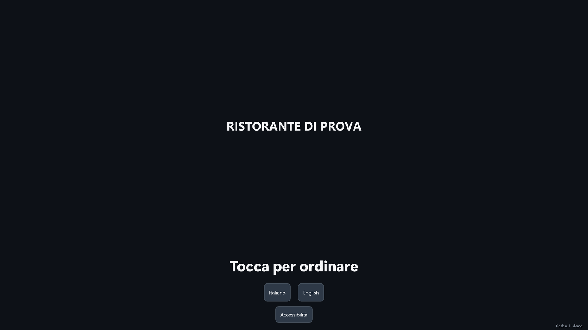

**Tocca per ordinare**, i tasti delle lingue con il nome della lingua nella lingua stessa
(**Italiano**, **English**, **Deutsch**, **Français**, **Español**: quelle tradotte nel menu) e
**Accessibilità**. Sopra scorrono, una ogni 6 secondi, le **immagini dell'attesa** scelte in cassa
(Menu ▸ [Kiosk](../cassa/kiosk.md#linguetta-attesa) ▸ **Attesa**); senza, le foto dei piatti
consigliati e delle sezioni del menu. In alto c'è il **logo**, se è stato scelto, altrimenti il nome
del locale. In basso a destra il numero del kiosk (*Kiosk n. 1*, con *· demo* in
modalità dimostrativa e *· solo alla cassa* se il kiosk non ha né POS né rendiresto e i clienti
pagano alla cassa). Un tocco in qualunque punto comincia l'ordine; un tocco su una lingua lo
comincia in quella lingua.

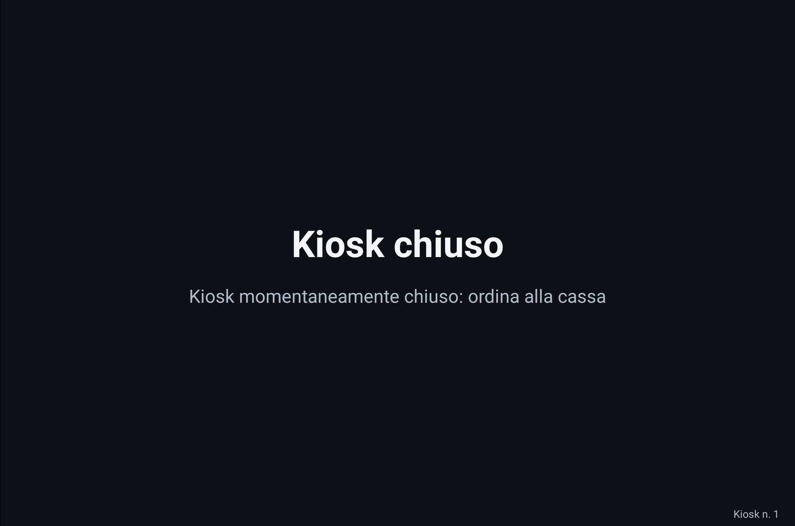

Quando il kiosk non può accogliere clienti l'attesa lo dice con un titolo e una riga, e non
risponde al tocco:

| Titolo | Riga | Perché |
|---|---|---|
| **Kiosk chiuso** | *Kiosk momentaneamente chiuso: ordina alla cassa* | Kiosk spenti o in pausa sul servizio, oppure servizio irraggiungibile (il kiosk riprova ogni 30 secondi). |
| **Kiosk non attivo** | il messaggio del servizio, per esempio *Kiosk non attivo, ordina alla cassa* o *Questo dispositivo non è il kiosk n. 1: associalo dalla cassa.* | Licenza assente, kiosk non configurato o non associato a questo dispositivo. |
| **Kiosk fuori servizio** | *Stiamo registrando un pagamento: per ora ordina alla cassa.* | Un pagamento già preso non è ancora registrato sul servizio (vedi [Pagamenti](pagamenti.md#il-pagamento-e-preso-ma-non-registrato)). |
| **Kiosk fermo** | *Chiama il personale.* | Serve il personale: vedi [la vista Fermo](pagamenti.md#la-vista-fermo). |

Mentre l'attesa è a video il kiosk rilegge lo stato dal servizio ogni minuto: un kiosk riacceso o
tolto dalla pausa torna ad accogliere da solo.

### L'accessibilità

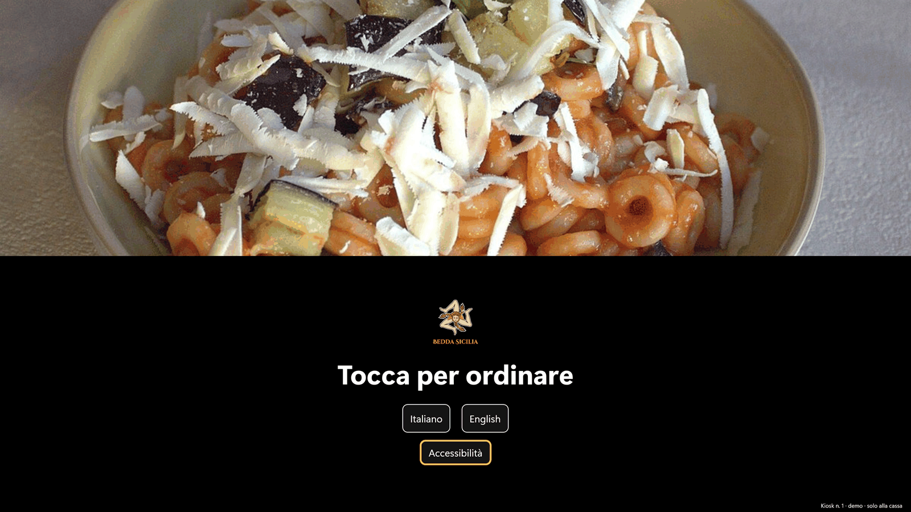

Il tasto **Accessibilità** dell'attesa porta il percorso nella **metà bassa** dello schermo,
raggiungibile da chi è seduto, con testi più grandi e colori ad alto contrasto (fondo nero, testi
bianchi, avvisi gialli), uguali con il tema chiaro e con quello scuro. L'attesa resta a tutto
schermo: le foto nella metà alta, e nella metà bassa il logo, **Tocca per ordinare**, le lingue e
**Accessibilità**; dalla vista dopo tutto il resto sta nella metà bassa. Vale fino alla fine di
quell'ordine: il cliente dopo trova il kiosk normale.

### 2. Dove mangi?

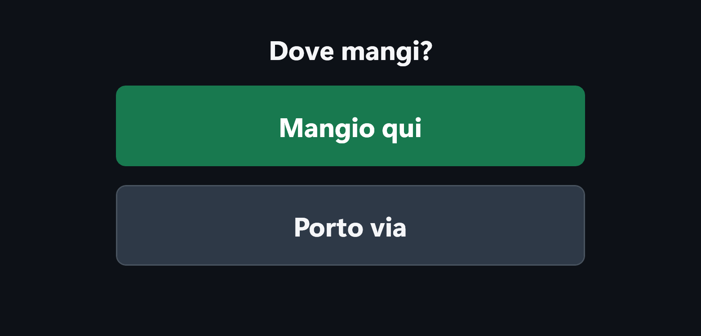

Due tasti grandi, **Mangio qui** e **Porto via**; in alto il nome del locale e **Annulla**, che torna
all'attesa. La scelta decide il listino e se più avanti si chiede il segnaposto.

### 3. Menu

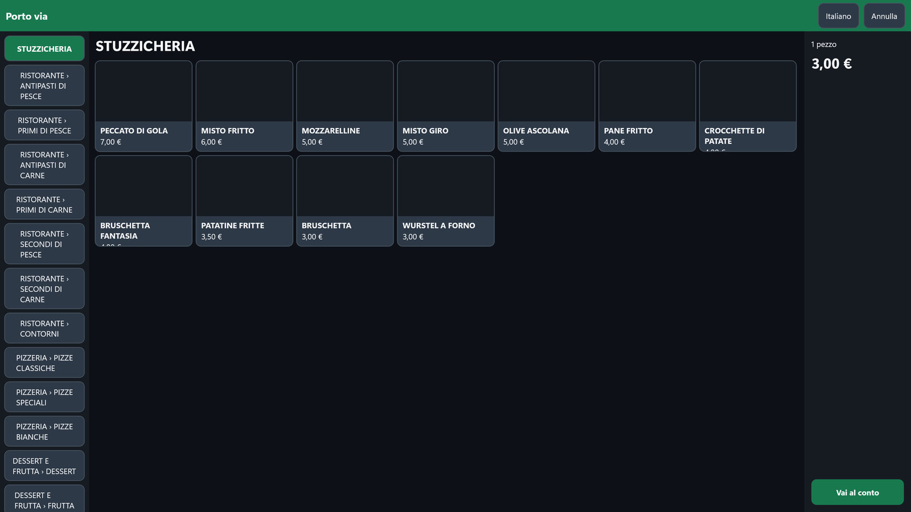

- **In alto**, la fascia con la scelta fatta (**Porto via** o **Mangio qui**), **Allergeni** (se
  il menu ne ha), il tasto della lingua (per cambiarla a metà ordine) e **Annulla**.
- **A sinistra**, le categorie del menu; con i menu composti c'è anche **Menu a prezzo fisso**.
- **Al centro**, i piatti a tessere con foto, nome, ingredienti e prezzo. Un piatto consigliato
  porta **Consigliato**; un piatto esaurito o non ordinabile resta a video in grigio, con
  **Esaurito**, e non si tocca. Un articolo a peso ha il prezzo «al kg».
- **Il carrello** (a destra in orizzontale, in basso in verticale): *Non hai ancora scelto
  niente.*, oppure i pezzi e il totale (*1 pezzo · 3,00 €*), e **Vai al conto**.

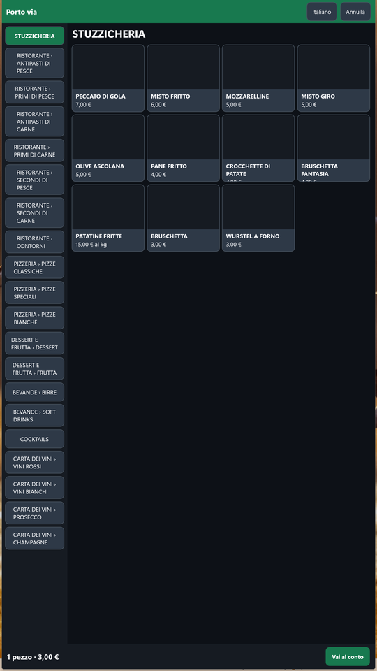{ .telefono }

Sul totem in verticale le categorie restano a sinistra e il carrello passa in una fascia in basso,
con i pezzi, il totale e **Vai al conto**.

**Annulla** con il carrello pieno chiede *Vuoi annullare l’ordine?* (**Sì** / **No**); con il
carrello vuoto torna subito all'attesa.

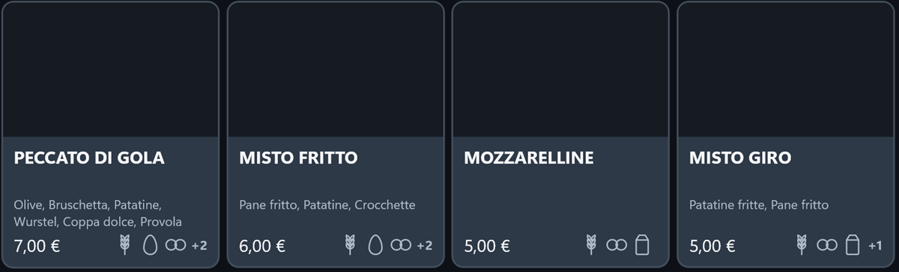

**La tessera del piatto.** Sotto il nome gli **ingredienti**, al più su due righe (in una categoria
dove nessun piatto li ha la riga non c'è). Accanto al prezzo le **icone degli allergeni**, al più
tre: prima quelli che il piatto contiene, a tratto pieno, poi quelli di cui può contenere tracce,
con l'icona **tratteggiata**. Se il piatto ne ha di più, o un allergene non ha l'icona, dopo le
icone c'è **+n** (per esempio *+2*). Su una tessera stretta si tagliano le icone, mai il prezzo.
Gli allergeni completi, con il nome, sono nel piatto.

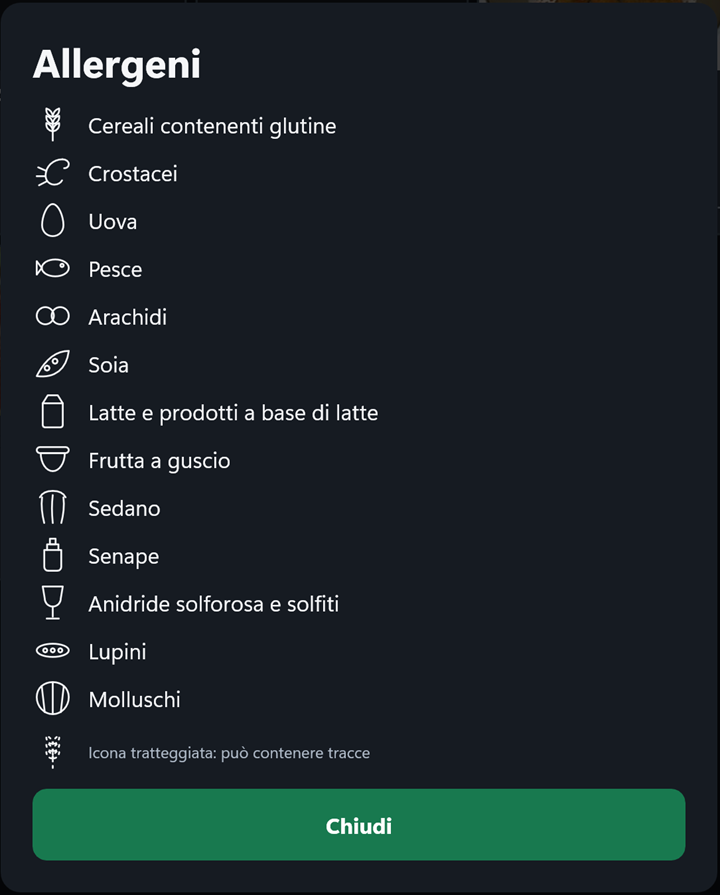

**Allergeni** apre la legenda: le icone degli allergeni dei piatti del menu, ognuna con il suo nome
nella lingua del cliente, e in fondo *Icona tratteggiata: può contenere tracce*. Si chiude con
**Chiudi** o con un tocco fuori, e si chiude da sola aprendo le lingue o un piatto.

**Tema chiaro o scuro.** Il kiosk è scuro di partenza. Il titolare può scegliere il tema chiaro per
tutti i kiosk, in cassa (Menu ▸ [Kiosk](../cassa/kiosk.md#linguetta-attesa) ▸ **Attesa** ▸
**Tema chiaro**), oppure dare a un kiosk un tema suo, nella sua
[configurazione](configurazione.md#tema). Un cambio dalla cassa arriva al kiosk quando torna
all'attesa: il cliente che sta ordinando finisce con il tema di prima. Col tema chiaro l'attesa usa
il **logo per il tema chiaro**, se c'è.

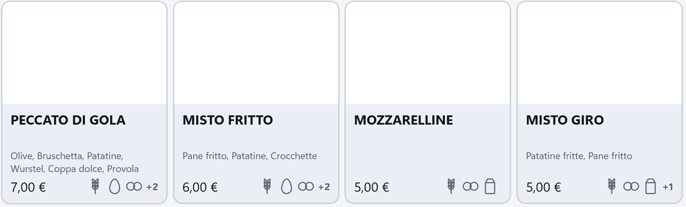

### 4. Piatto

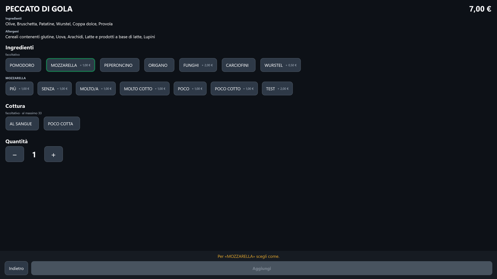

Il nome e il prezzo, gli **Ingredienti** e gli **Allergeni** nella lingua del cliente, poi i gruppi
di varianti, come sulla cassa e sul self order: ogni gruppo dice se è **obbligatorio** o
**facoltativo** e quante scelte ammette (*Scegli almeno 1*, *al massimo 2*); le varianti a
pagamento portano il supplemento. Scelta una variante che ha i **modificatori** (più, senza,
molto…), sotto il gruppo compare la riga dei suoi modificatori. In fondo **Quantità** (**−** /
**+**), **Indietro** e **Aggiungi · 7,00 €**, che resta spento finché manca una scelta obbligatoria:
sopra il tasto il kiosk dice cosa manca (per esempio *Per «MOZZARELLA» scegli come.*).

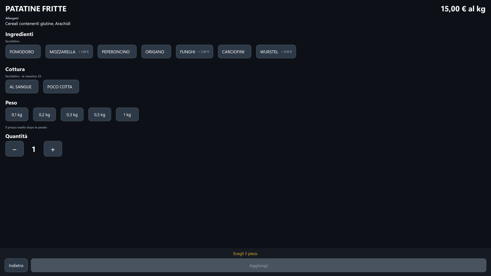

**Articoli a peso.** Al posto della quantità il cliente sceglie un **Peso** indicativo (di partenza
0,1 / 0,2 / 0,3 / 0,5 / 1 kg), con *Il prezzo esatto dopo la pesata*; la quantità ripete la
porzione (2 × 0,2 kg). Il prezzo diventa *circa 6,00 €* e un ordine con un articolo a peso **si
paga solo alla cassa**, dopo la pesata.

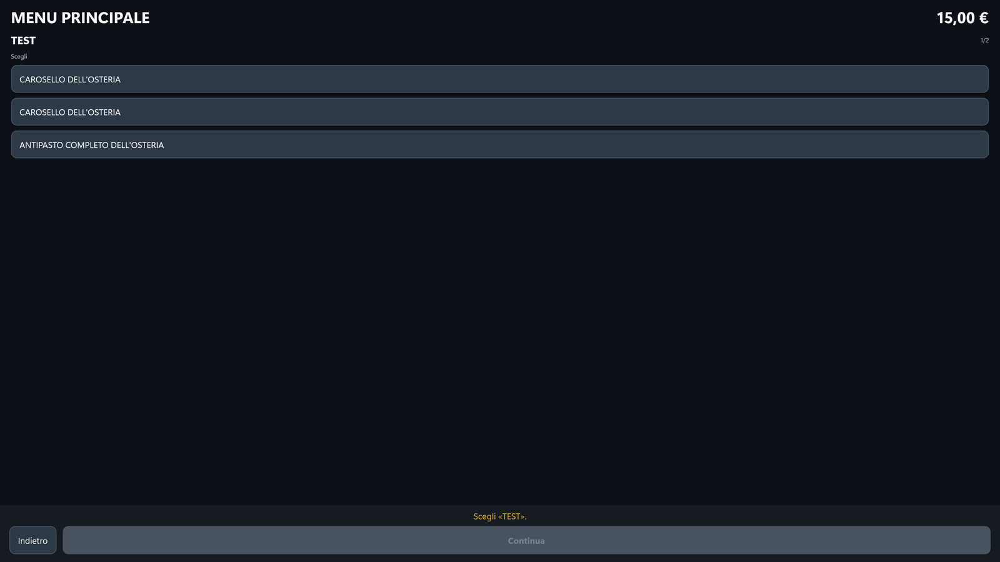

**Menu a prezzo fisso.** Si compone sezione per sezione (in alto a destra *1/2*, *2/2*): il cliente
sceglie i piatti di ogni sezione e va avanti con **Continua**; all'ultima sezione il tasto diventa
**Aggiungi il menu · 15,00 €**.

### 5. Suggerimenti

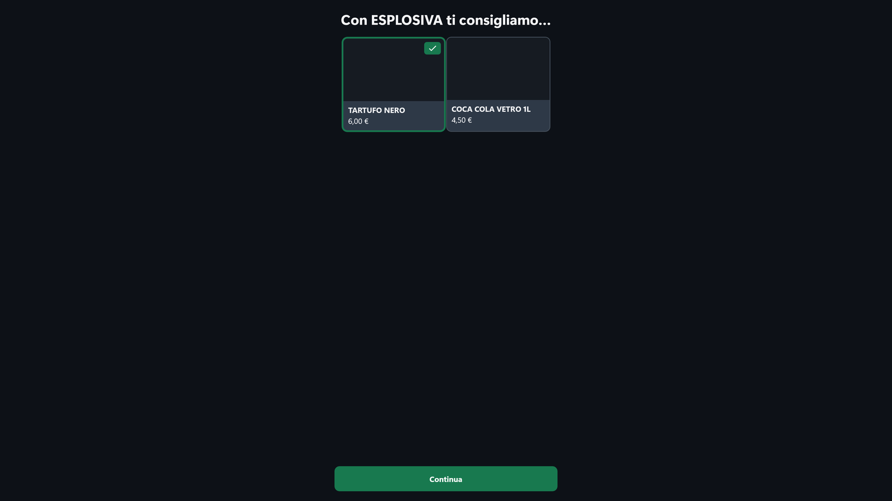

Dopo che un piatto entra nel carrello, il kiosk propone fino a **quattro** abbinamenti: *Con
ESPLOSIVA ti consigliamo…*. Prima gli abbinamenti scelti per quel piatto in cassa (Menu ▸
[Kiosk](../cassa/kiosk.md#linguetta-suggerimenti) ▸ **Suggerimenti**), altrimenti i
piatti consigliati delle categorie che nel carrello non ci sono ancora (per esempio una bibita e un
dolce). Un tocco su una tessera la aggiunge (con la spunta), oppure apre il piatto se ha scelte
obbligatorie. Il tasto in fondo dice **No, grazie** finché non si è aggiunto niente, poi
**Continua**.

La vista compare **una volta sola** per ogni piatto, mai dopo un menu a prezzo fisso, e non compare
se non c'è niente da proporre: niente esauriti, niente piatti già nel carrello.

### 6. Riepilogo

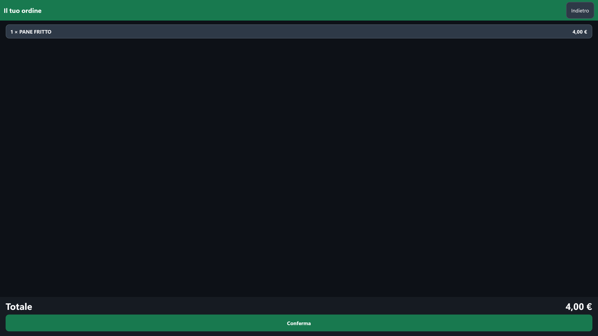

**Il tuo ordine**, con **Indietro** (torna al menu). Le righe con quantità, varianti e prezzo
(*1 × PANE FRITTO 4,00 €*); un tocco su una riga apre **Uno in meno**, **Uno in più** e **Togli**
(per un menu a prezzo fisso solo **Togli**). In fondo **Totale** e **Conferma**. Con gli articoli a
peso le righe e il totale dicono *circa* e sotto c'è *Il prezzo esatto dopo la pesata*.

### 7. Segnaposto

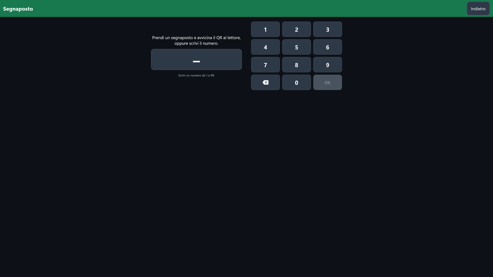

Solo per **Mangio qui**, dopo **Conferma**. Il cliente prende un segnaposto numerato e:

- con il lettore di QR: *Prendi un segnaposto e avvicina il QR al lettore, oppure scrivi il
  numero.* Avvicinato il QR, il kiosk passa da solo al pagamento;
- senza lettore: *Prendi un segnaposto e scrivi il suo numero.*

Il numero si scrive con il tastierino (al più due cifre, da 1 a 99: *Scrivi un numero da 1 a 99.*);
**OK** resta spento finché non c'è una cifra. Due clienti possono avere lo stesso segnaposto.

### 8. Pagamento

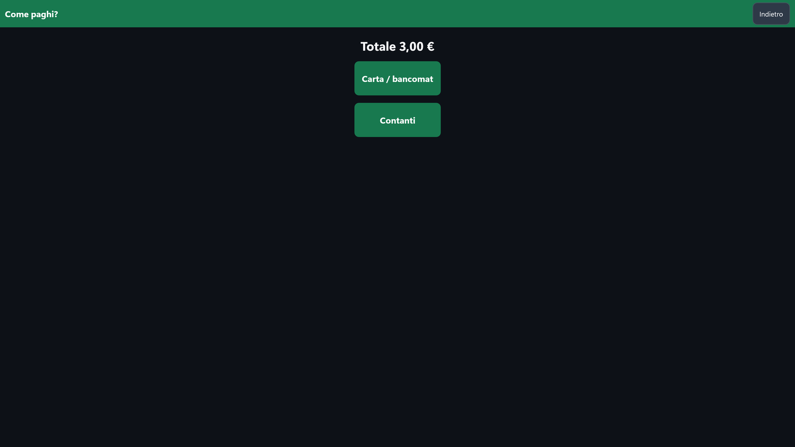

**Come paghi?**, con **Indietro**, il **Totale** e solo i modi che il kiosk ha davvero:

- **Carta / bancomat**: il kiosk ha un POS, o un rendiresto con il POS;
- **Contanti**: il kiosk ha un rendiresto;
- **Pago alla cassa**: acceso sul servizio, oppure il kiosk non ha la stampante fiscale, oppure
  non ha né POS né rendiresto, oppure nel carrello c'è un articolo a peso (*Con gli articoli a
  peso si paga alla cassa, dopo la pesata.*).

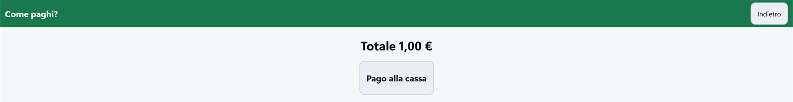

Un kiosk senza POS né rendiresto propone solo **Pago alla cassa**, anche con «paga alla cassa»
spento sul servizio: il cliente paga in cassa con il promemoria o con il suo numero. In quel caso,
come per il kiosk senza stampante fiscale, l'ordine va in cucina solo dopo il pagamento.

Toccato un modo, il kiosk manda l'ordine al servizio (*Invio in corso…*) e comincia l'incasso.
Mentre paga, il cliente vede:

- con la carta: *Segui le istruzioni sul POS*. Non c'è **Annulla**: il pagamento si conclude o si
  annulla sul terminale;
- con i contanti: *Inserisci banconote e monete*, con *Inserito*, *Mancano* e *Resto* che si
  aggiornano ogni secondo, e **Annulla** se la macchina lo permette (con la Cashlogy invece *Concludi
  o annulla sulla finestra della cassa*).

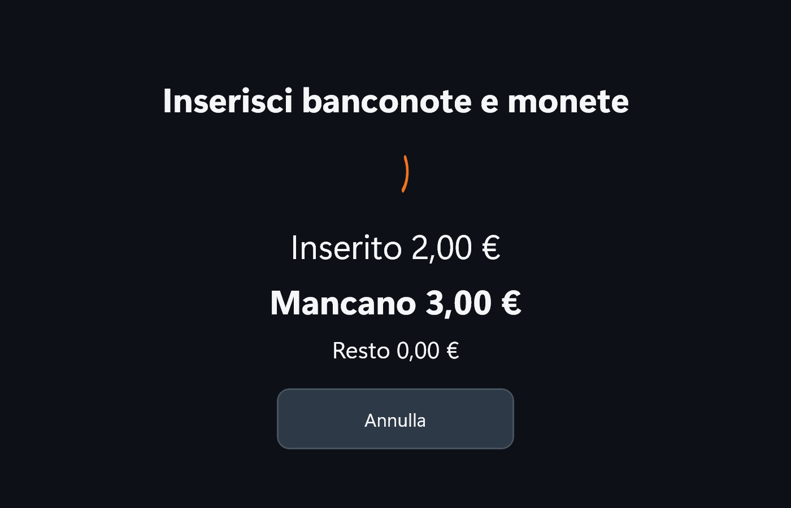

Se il pagamento non riesce (carta rifiutata, contanti annullati) si torna a **Come paghi?** con
*Il pagamento non è riuscito: puoi riprovare o scegliere un altro modo.*. Riprovando, o passando
fra carta e contanti, il cliente **tiene lo stesso numero d'ordine**. Nasce invece un **ordine
nuovo, con un numero nuovo** (quello di prima si annulla), quando il cliente:

- passa a **Pago alla cassa**;
- torna indietro e **cambia il carrello** o il **segnaposto** prima di pagare di nuovo.

Se al momento di pagare un prezzo è cambiato, il kiosk non incassa e torna al riepilogo con *I prezzi sono
cambiati: controlla il totale.* e i prezzi nuovi: si incassa sempre il totale calcolato dal
servizio, mai una cifra vecchia.

### 9. Il numero

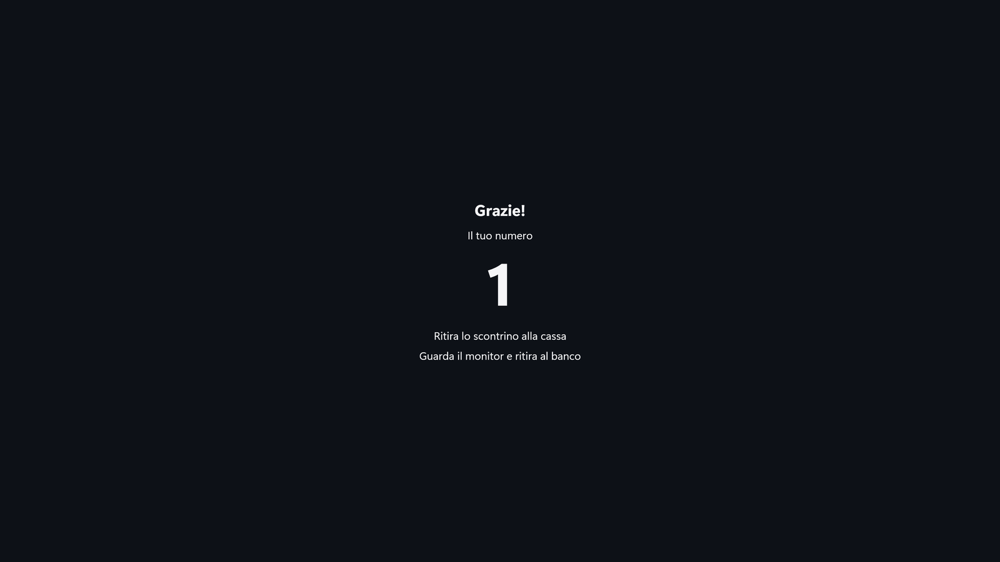

*Grazie!*, *Il tuo numero* e il numero grande: lo stesso del monitor in sala, delle Chiamate e del
monitor di cucina. Sotto, che cosa fare:

| Situazione | Il cliente legge |
|---|---|
| Pagato, scontrino uscito, stampante fiscale nel kiosk | *Ritira lo scontrino* |
| Pagato, scontrino uscito, stampante fiscale altrove | *Lo scontrino ti arriva con i piatti* |
| Pagato, scontrino non ancora emesso, mangia qui | *Lo scontrino te lo consegniamo con i piatti* |
| Pagato, scontrino non ancora emesso, porta via | *Lo scontrino te lo dà la cassa* |
| Pago alla cassa, con la termica | *Vai alla cassa con questo foglio* e *Vai alla cassa per pagare entro 30 minuti* |
| Pago alla cassa, senza termica o se la stampa non è uscita | *Di’ alla cassa il numero 27* |
| In fondo, mangia qui | *Ti portiamo il vassoio al segnaposto 12* |
| In fondo, porta via | *Guarda il monitor e ritira al banco* |

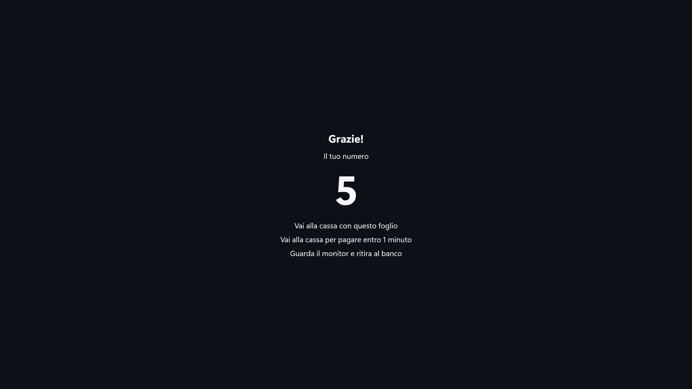

Con **Pago alla cassa** la termica stampa il **promemoria**: «ORDINE DAL KIOSK», il numero in
grande, *Porta via* o *Segnaposto 12*, le righe (con *circa* per gli articoli a peso), il totale,
un codice QR e *Vai alla cassa per pagare entro 30 minuti* (i minuti sono quelli della scadenza
impostata in cassa: nella schermata sopra, di prova, 1 minuto). In cassa il promemoria si passa
sotto il lettore per ritrovare l'ordine (vedi [Ordini dal kiosk](../cassa/ordini-kiosk.md)). Mentre stampa la vista dice *Un
momento…*. La vista si chiude da sola dopo **10 secondi**, o con un tocco, e il kiosk torna
all'attesa pronto per il cliente dopo.

**Il tagliando del ritiro.** Chi porta via e ha pagato al kiosk riceve dalla termica un tagliando
con «ORDINE», il numero in grande, «PORTA VIA» e *Ritira al banco quando chiamano il numero*, nella
lingua del cliente, quando lo scontrino **non** esce sul kiosk: la stampante fiscale non è nel
kiosk (interruttore **La stampante fiscale è in questo kiosk** spento, vedi
[Configurazione](configurazione.md#stampante-termica)), oppure lo scontrino non è stato emesso, e
allora il tagliando dice anche *Lo scontrino te lo dà la cassa*. Se lo scontrino esce sul kiosk il
tagliando non serve: lo scontrino porta già il numero. Chi mangia qui non lo riceve (aspetta il
vassoio al segnaposto), e senza termica resta il numero a video.

## Campi e indicatori

| Elemento | Descrizione |
|---|---|
| **Kiosk n. 1** / **Kiosk n. 1 · demo** / **Kiosk n. 1 · solo alla cassa** (attesa) | Il numero del kiosk; *demo* in modalità dimostrativa; *solo alla cassa* quando il kiosk non ha né POS né rendiresto. |
| **Consigliato** (tessera) | Piatto segnato consigliato nel menu. |
| Icone degli allergeni e **+n** (tessera) | Al più tre allergeni del piatto, l'icona tratteggiata per le tracce; **+n** quelli che non ci stanno. |
| **Esaurito** (tessera) | Piatto esaurito: resta in grigio e non si tocca. |
| **… al kg** (tessera) | Articolo venduto a peso. |
| **obbligatorio** / **facoltativo** · **al massimo N** (piatto) | Le regole del gruppo di varianti. |
| **Il carrello**: *N pezzi · totale* | Quanto c'è nel carrello; *circa* con gli articoli a peso. |
| **Inserito** / **Mancano** / **Resto** (contanti) | Quanto ha inserito il cliente, quanto manca e il resto che la macchina darà. |
| **Il tuo numero** (finale) | Il numero dell'ordine del giorno, da 1 a 999, unico per tutti gli ordini da asporto e del kiosk. |

## Pulsanti e comandi

| Comando | Effetto |
|---|---|
| **Tocca per ordinare** / tocco sull'attesa | Comincia un ordine in italiano. |
| Tasto di una lingua (attesa) | Comincia un ordine in quella lingua. |
| **Accessibilità** | Porta il percorso nella metà bassa dello schermo, con testi grandi e alto contrasto, fino alla fine dell'ordine. |
| **Mangio qui** / **Porto via** | Sceglie dove mangia il cliente. |
| Tasto della lingua (menu) | Apre l'elenco delle lingue: il menu si rilegge nella lingua scelta. |
| **Allergeni** (menu) / **Chiudi** | Apre e chiude la legenda delle icone degli allergeni. |
| **Annulla** | Ricomincia da zero (con conferma se il carrello non è vuoto). |
| Tocco su una tessera | Apre il piatto. |
| **Aggiungi · prezzo** / **Aggiungi il menu · prezzo** | Mette nel carrello il piatto o il menu composto. |
| **No, grazie** / **Continua** (suggerimenti) | Torna al menu. |
| **Vai al conto** | Apre il riepilogo. |
| **Uno in meno** / **Uno in più** / **Togli** | Cambiano la quantità di una riga o la tolgono. |
| **Conferma** | Va al segnaposto (mangio qui) o al pagamento (porto via). |
| **OK** (segnaposto) | Conferma il numero del segnaposto. |
| **Carta / bancomat**, **Contanti**, **Pago alla cassa** | Mandano l'ordine e cominciano il pagamento. |
| **Annulla** (contanti) | Annulla l'incasso e fa restituire i soldi inseriti. |
| **Indietro** | Torna alla vista di prima. |
| **Sì, continuo** | Ferma il conto alla rovescia dell'inattività. |

## Come si fa

### Aiutare un cliente che vuole ricominciare

1. Tocca **Annulla** in alto (nel menu o in **Dove mangi?**).
2. Se il carrello non è vuoto, tocca **Sì** a *Vuoi annullare l’ordine?*.
3. Il kiosk torna all'attesa con il carrello vuoto. Se l'ordine era già stato mandato al servizio
   e non pagato, il kiosk lo annulla.

### Un cliente che si allontana

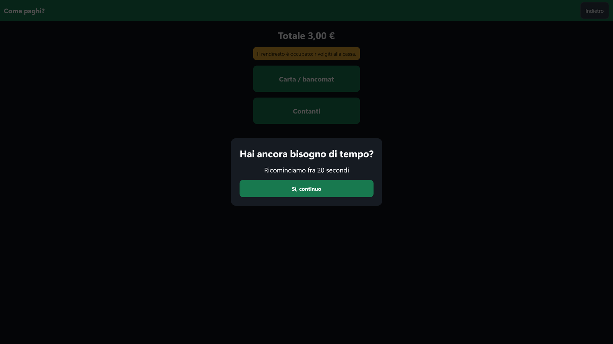

1. Dopo **60 secondi** senza tocchi compare *Hai ancora bisogno di tempo?* con *Ricominciamo fra
   20 secondi* e il conto alla rovescia.
2. Un tocco qualunque, o **Sì, continuo**, lo ferma e il cliente riprende dove era.
3. Altrimenti, finiti i 20 secondi, il kiosk torna all'attesa: carrello vuoto, italiano,
   accessibilità spenta; un ordine già mandato e non pagato si annulla.

Durante il pagamento (dall'invio dell'ordine al numero) l'inattività non scatta: comanda la
periferica, e il cliente può metterci il tempo che serve a inserire le banconote o il PIN della
carta.

## Controlli e messaggi

| Messaggio | Causa | Cosa fare |
|---|---|---|
| *Kiosk momentaneamente chiuso: ordina alla cassa* | Kiosk spenti o in pausa, o servizio irraggiungibile. | Accendi i kiosk o togli la pausa dalla cassa, Menu ▸ [Kiosk](../cassa/kiosk.md); controlla che il servizio sia acceso. Il kiosk riprova da solo. |
| *Questo ordine si paga alla cassa.* | La cassa ha preso l'ordine con **Prendi in cassa** mentre il cliente era ancora al kiosk. | Il cliente paga alla cassa: l'ordine è in [Ordini dal kiosk](../cassa/ordini-kiosk.md). |
| *Il tuo ordine è già in cucina: per cambiarlo rivolgiti alla cassa.* | Il cliente ha cambiato un ordine «paga alla cassa» già partito per la cucina (con l'invio **subito**, sempre). Il kiosk mostra il numero del primo ordine e non ne manda un secondo. | Il cliente va alla cassa con quel numero. |
| *Il tuo ordine è passato alla cassa: per cambiarlo rivolgiti lì.* | Il cliente ha cambiato un ordine che la cassa aveva già preso. | Il cliente va alla cassa. |
| *Kiosk non attivo, ordina alla cassa* | La licenza del kiosk non c'è. | Attivala dalla [Configurazione](configurazione.md). |
| *Kiosk da configurare: chiama il personale.* | Il kiosk non è collegato a nessun servizio. | Apri la configurazione e collega il servizio. |
| *Le credenziali del servizio non sono valide: chiama il personale.* | Utente o password del kiosk rifiutati. | Correggili in configurazione. |
| *Configurazione del kiosk da rifare: chiama il personale* | Il PIN del kiosk salvato sul dispositivo non si legge più. | Tieni premuto 3 secondi l'angolo in alto a sinistra e scegli un PIN nuovo. |
| *Il menu non si carica: riprova o ordina alla cassa.* | Il menu non è arrivato dal servizio dopo **Dove mangi?**. | Tocca **Riprova**; se insiste, controlla il servizio. |
| *Il servizio non risponde: riprova fra poco o ordina alla cassa.* | Il servizio non ha risposto all'invio dell'ordine. | Riprova; se insiste, controlla il servizio. |
| *Il menu è cambiato: controlla il tuo ordine.* / *Non più disponibili: …* | Mentre il cliente ordinava un piatto è finito o il menu è cambiato. | Il cliente controlla il carrello e sceglie altro. |
| *I prezzi sono cambiati: controlla il totale.* | Un prezzo è cambiato dopo che il piatto è entrato nel carrello. | Il cliente controlla il totale nuovo e conferma di nuovo. |
| *Scegli il peso.* | Articolo a peso senza peso scelto. | Tocca uno dei pesi. |
| *Per «MOZZARELLA» scegli come.* / *Scegli «Cottura».* / *Per «Cottura» scegli almeno 1.* | Manca una scelta obbligatoria nel piatto o nel menu composto. | Completa la scelta indicata. |
| *Scrivi un numero da 1 a 99.* | Indicazione del segnaposto. | Scrivi il numero del segnaposto. |
| *Con gli articoli a peso si paga alla cassa, dopo la pesata.* | Nel carrello c'è un articolo a peso. | Il cliente sceglie **Pago alla cassa**. |
| *Il pagamento non è riuscito: puoi riprovare o scegliere un altro modo.* | Carta rifiutata, pagamento annullato sul POS, contanti annullati. | Riprova, o scegli un altro modo. |
| *Il rendiresto è occupato: rivolgiti alla cassa.* | Il rendiresto sta già incassando per un'altra postazione. | Il cliente riprova più tardi, paga con la carta o va alla cassa. Il kiosk non riprova da solo. |
| *Annullo in corso: ritira i soldi restituiti.* | Il cliente ha toccato **Annulla** durante i contanti. | Il cliente ritira i soldi dalla macchina. |
| *Non riesco ad annullare: concludi il pagamento o chiama il personale.* | La macchina non accetta l'annullo. | Il cliente conclude il pagamento, o intervieni tu sulla macchina. |
| *Un momento: il collegamento è lento.* | Il kiosk non riesce per un attimo a leggere il rendiresto dal servizio. | Niente: il kiosk continua a leggere; dopo 2 minuti senza risposta passa alla [vista Fermo](pagamenti.md#la-vista-fermo). |
| *Il pagamento era già concluso.* | Il cliente ha toccato **Annulla** quando la macchina aveva già incassato tutto. | Niente: l'ordine è pagato e va in cucina. |

Gli esiti che chiedono il personale (*Pagamento da verificare: chiama il personale.*, *Il pagamento
è preso: …*, *Resto da ricevere …*) sono spiegati in [Pagamenti, per il personale](pagamenti.md).

## Note

- **Ogni cliente riparte da zero**: alla fine del numero, dopo **Annulla** e dopo l'inattività il
  carrello è vuoto, la lingua è l'italiano e l'accessibilità è spenta.
- **I testi** dell'app sono in cinque lingue (italiano, inglese, tedesco, francese, spagnolo); i
  nomi dei piatti vengono dalle traduzioni del menu. Una lingua del menu senza testi dell'app usa
  l'inglese. I messaggi del servizio arrivano in italiano.
- **Gli ordini del kiosk** stanno sul tavolo virtuale dei kiosk, con il numero del giorno. In cucina
  il titolo è «Ordine 27 · Porta via» o «Ordine 27 · Segnaposto 12» (vedi
  [Monitor di cucina](../kds/monitor.md#gli-ordini-da-asporto-e-del-kiosk)).
- **Il QR del promemoria** contiene il riferimento dell'ordine del kiosk: in cassa, passato sotto
  un lettore 2D, apre l'ordine in [Ordini dal kiosk](../cassa/ordini-kiosk.md).
- **«Pago alla cassa» cambiato.** Se il cliente sceglie **Pago alla cassa**, l'invio non riceve
  risposta e poi il cliente cambia idea (aggiunge un piatto, paga con la carta), il kiosk chiede al
  servizio se il primo ordine è arrivato: se non c'è manda quello nuovo; se c'è e non è in cucina lo
  annulla e manda quello nuovo; se è già in cucina mostra il suo numero con *Il tuo ordine è già in
  cucina: per cambiarlo rivolgiti alla cassa.*

## Vedi anche

- [Pagamenti, per il personale](pagamenti.md)
- [Configurazione](configurazione.md)
- [Chiamate e monitor in sala](../cassa/chiamate.md)
- [Menu](../cassa/menu.md)
