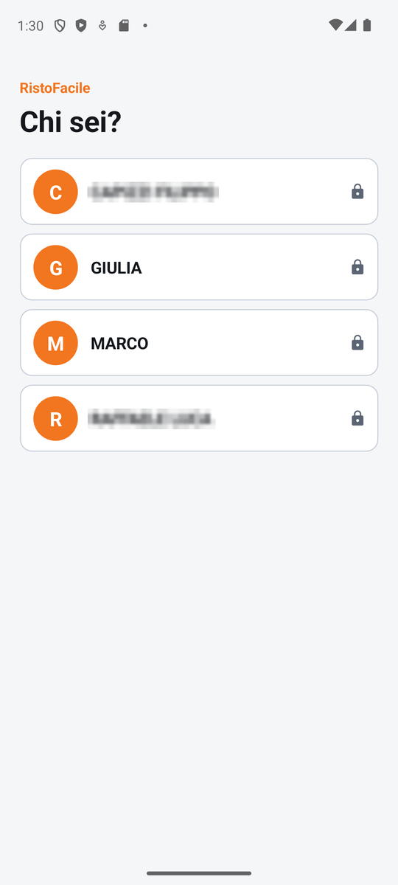
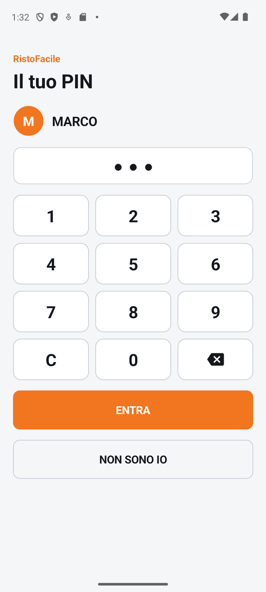

# Accesso

È la prima schermata del palmare: il cameriere tocca il suo nome e, se ha un PIN, lo digita.
Da quel momento le comande che manda portano il suo nome. Finché nessuno è entrato non si
raggiunge nessun'altra schermata.

!!! info "In sintesi"

    - **Dove si trova:** all'avvio del palmare; dopo **ESCI** in Menu ▸ Impostazioni ▸ **Turno**
    - **Chi la usa:** cameriere
    - **Disponibile anche su:** [Cassa](../cassa/accesso.md) (stessa schermata)

---

## A cosa serve

A inizio turno Marco prende il palmare, tocca **Marco** nell'elenco, digita il suo PIN e tocca
**ENTRA**: si apre la sala. Il palmare resta suo anche se lo spegne o chiude l'app: al
riavvio riparte già dentro, senza ridigitare niente. A fine turno esce da Impostazioni ▸
**Turno** ▸ **ESCI**, e il palmare torna a questa schermata per il collega.

Il PIN serve a sapere chi ha mandato una comanda, non a proteggere il telefono.

## Prima di cominciare

- Il palmare deve essere collegato al servizio del locale: [Impostazioni](impostazioni.md) ▸
  **Connessione**. Su un palmare mai configurato, all'avvio si apre direttamente la schermata
  delle impostazioni.
- Gli operatori, con l'eventuale PIN, si creano dalla cassa: [Operatori](../cassa/operatori.md).

## La schermata

{ .telefono }

La schermata ha due fasi.

**Fase 1, Chi sei?** In testa la scritta *RistoFacile* e il titolo **Chi sei?**. Sotto, l'elenco
degli operatori attivi: per ciascuno un cerchio arancione con l'iniziale e il nome. Chi ha un PIN
ha un **lucchetto** a destra: toccandolo si apre il tastierino; chi non ce l'ha entra subito.

{ .telefono }

**Fase 2, Il tuo PIN.** Titolo **Il tuo PIN**, il cerchio e il nome scelto, una casella che mostra
un pallino per ogni cifra digitata (mai le cifre), il tastierino e i pulsanti **ENTRA** e
**NON SONO IO**.

In entrambe le fasi un eventuale errore compare in un riquadro con il bordo rosso, sotto il
titolo, e resta a video finché non lo risolvi.

## Campi e indicatori

| Elemento | Descrizione |
|---|---|
| Elenco degli operatori | Gli operatori attivi del locale, con iniziale e nome. Il **lucchetto** indica che l'operatore ha un PIN. |
| Casella del PIN | Un pallino per cifra. Il PIN è di sole cifre, al massimo 8. |
| Riquadro rosso | Il motivo per cui non si è entrati (vedi *Controlli e messaggi*). |
| Riquadro grigio | Un avviso, per esempio quando non c'è nessun operatore. |
| Rotellina | Il palmare sta leggendo l'elenco o verificando il PIN. |

## Pulsanti e comandi

| Comando | Effetto |
|---|---|
| Nome dell'operatore | Senza PIN: entra subito. Con PIN: passa alla fase 2. |
| **1** … **9**, **0** | Aggiungono una cifra al PIN. |
| **C** | Cancella tutto il PIN digitato. |
| Tasto con la freccia (in basso a destra) | Cancella l'ultima cifra. |
| **ENTRA** | Verifica il PIN e, se è giusto, apre la sala. È spento finché non hai digitato almeno una cifra. |
| **NON SONO IO** | Torna all'elenco dei nomi. |
| **RIPROVA** | Compare con un errore di lettura: rilegge l'elenco degli operatori. |
| **IMPOSTAZIONI BACKEND** | Compare con un errore di lettura: apre le [Impostazioni](impostazioni.md) per controllare il collegamento. |
| Tasto indietro di Android | Nella fase del PIN torna all'elenco dei nomi; nella fase dei nomi non fa nulla. |

## Come si fa

### Entrare a inizio turno

1. Tocca il tuo nome.
2. Se compare **Il tuo PIN**, digita il PIN sul tastierino.
3. Tocca **ENTRA**.
4. Si apre la sala, con il tuo nome come operatore in turno.

### Cambiare cameriere sullo stesso palmare

1. Apri Menu ▸ **Impostazioni**.
2. Nel riquadro **Turno** tocca **ESCI** e conferma con **Esci**.
3. Il palmare torna a **Chi sei?**: il collega tocca il suo nome.

## Controlli e messaggi

| Messaggio | Causa | Cosa fare |
|---|---|---|
| *Digita il PIN.* | **ENTRA** senza cifre. | Digita il PIN. |
| *PIN errato.* | Il PIN non corrisponde. Le cifre digitate vengono cancellate. | Ridigita il PIN; se l'hai dimenticato fattelo reimpostare dalla cassa in [Operatori](../cassa/operatori.md). |
| *Operatore non piu' attivo. Chiedi a chi gestisce l'anagrafica.* | L'operatore è stato disattivato nel frattempo. | Chiedi al titolare di riattivarlo dalla cassa. |
| *Accesso non riuscito.* (con il dettaglio) | Il servizio non ha risposto alla verifica. | Riprova; se persiste controlla la rete del palmare. |
| *Impossibile leggere gli operatori dal server. Controlla la connessione e le impostazioni del backend.* (con il dettaglio) | Il servizio non risponde o il collegamento non è giusto. | Tocca **RIPROVA**; se non basta tocca **IMPOSTAZIONI BACKEND** e controlla la Connessione. |
| *Il backend risponde ma non conosce l'accesso operatori: va aggiornato…* | Il servizio del locale è più vecchio dell'app. | Fai aggiornare il servizio: fino ad allora non si entra. |
| *Nessun operatore attivo in anagrafica. Creane uno dalla cassa (Impostazioni - Operatori) prima di poter entrare.* | Il locale non ha operatori attivi. | Crea almeno un operatore dalla cassa in [Operatori](../cassa/operatori.md), poi chiudi e riapri l'app. |

<!-- DA VERIFICARE: con il messaggio "Nessun operatore attivo" non compaiono ne' RIPROVA ne' IMPOSTAZIONI BACKEND: come si ricarica l'elenco dopo aver creato l'operatore (riavviare l'app?). Il messaggio indica "Impostazioni - Operatori", ma sulla cassa Operatori e' una voce del menu, non delle Impostazioni. -->

## Note

- L'accesso resta valido finché non tocchi **ESCI**: chiudere l'app o spegnere il palmare non fa
  uscire.
- Prima di questa schermata il palmare controlla la licenza digitale: senza licenza né demo si
  apre la [Licenza digitale](../introduzione/licenza.md).
- Il palmare non ha una scorciatoia per saltare l'accesso: si entra solo scegliendo un nome.

## Vedi anche

- [Accesso operatore (cassa)](../cassa/accesso.md)
- [Operatori](../cassa/operatori.md)
- [Impostazioni](impostazioni.md)
- [Io](io.md)
- [Sala](sala.md)
