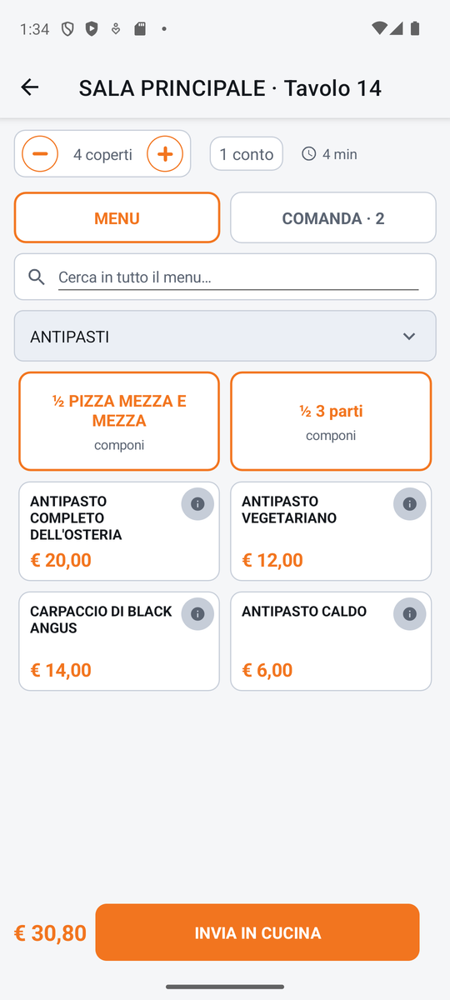
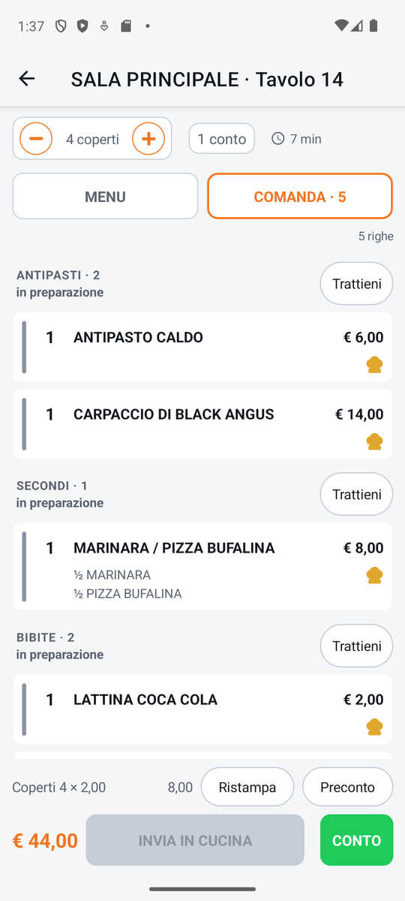
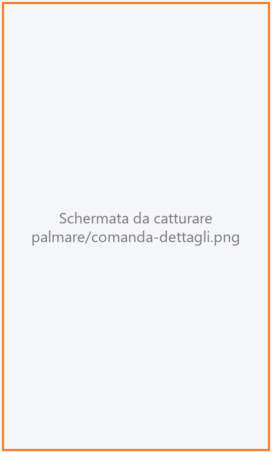
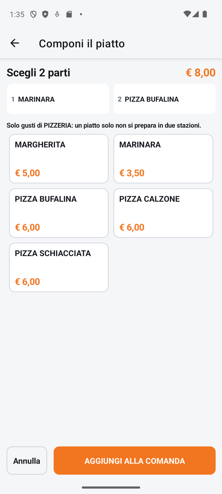
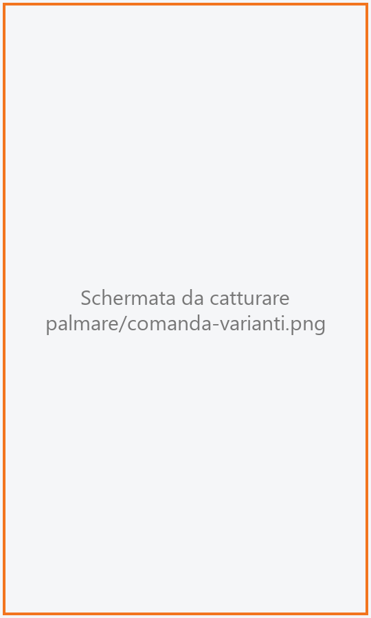
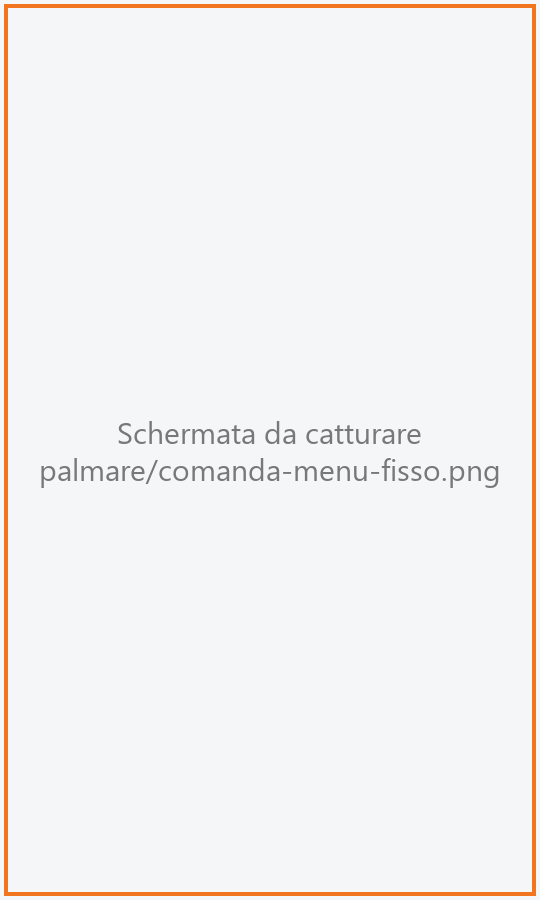
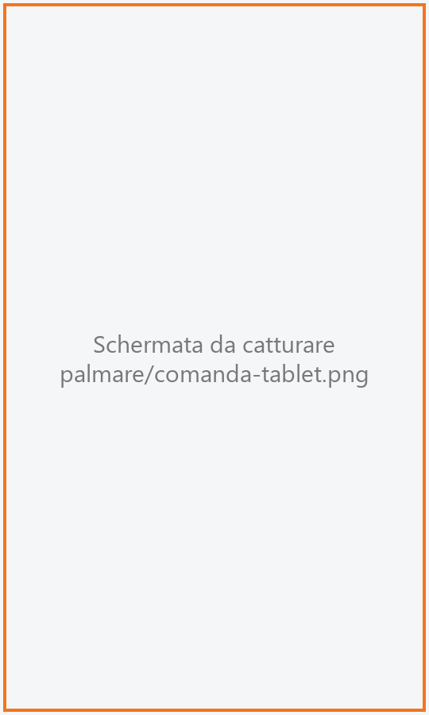

# Comanda

La schermata in cui il cameriere batte i piatti del tavolo, li corregge, aggiunge note e varianti,
li manda in cucina e dà il via alle portate successive. Qui si arriva toccando un tavolo nella
[Sala](sala.md) o aprendo un ordine dagli [Ordini](ordini.md).

!!! info "In sintesi"

    - **Dove si trova:** Sala ▸ tocco su un tavolo (anche: Ordini ▸ scheda dell'ordine ▸ **Apri comanda**)
    - **Chi la usa:** cameriere
    - **Disponibile anche su:** Cassa ([Comanda](../cassa/comanda.md))

---

## A cosa serve

È il blocchetto delle comande. Al tavolo il cameriere sceglie i piatti dal menu, scrive le note
per la cucina («senza cipolla»), sceglie le varianti obbligatorie (la cottura della carne), compone
una pizza mezza e mezza o un menu a prezzo fisso, e alla fine tocca **INVIA IN CUCINA**. Ogni piatto
arriva alla stampante o al monitor del suo centro di produzione (cucina, pizzeria, bar).

Se il menu è organizzato in **portate** (antipasti, primi, secondi…), al primo invio parte solo la
prima portata: le altre restano **in attesa del via** e il cameriere le fa partire dal tavolo,
quando è il momento, con il pulsante **VIA**.

## Prima di cominciare

- Devi essere entrato con il tuo PIN (vedi [Accesso](accesso.md)): senza operatore in turno non si
  può battere niente.
- Menu, sezioni, prezzi, varianti, portate e centri di produzione si preparano dalla cassa (vedi
  [Menu](../cassa/menu.md), [Varianti](../cassa/varianti-anagrafica.md), [Portate](../cassa/portate.md),
  [Centri di produzione](../cassa/centri-di-produzione.md)).
- Per stampare il preconto dal palmare: la stampante del preconto in
  [Impostazioni](impostazioni.md).

## La schermata

{ .telefono }

In alto, nel titolo, la sala e il tavolo (es. «Sala principale · Tavolo 12»). Sotto, quattro zone.

**1. La fascia del tavolo**, con delle piccole pastiglie:

- **i coperti** fra un **–** e un **+** (es. «4 coperti»);
- **il conto attivo**: «1 conto» se il tavolo paga tutto insieme, «Conto 2» se stai battendo per il
  conto 2 di un tavolo diviso (in arancione);
- l'**orologio** con da quanto è aperto il tavolo (es. «25 min», «1h 05m»);
- un **triangolo giallo** se l'anagrafica degli articoli non risponde (al posto dei nomi compaiono
  i codici): toccalo per la spiegazione;
- **Non in linea**, con un pallino, se il servizio non ha risposto all'ultima richiesta: toccalo per
  riprovare il collegamento.

**2. Le due schede MENU e COMANDA.** Sul telefono menu e comanda non stanno insieme: la scheda
accesa (bordo arancione) dice quale stai guardando. **COMANDA** porta anche il numero dei piatti
battuti (es. «COMANDA · 5»).

**3. La zona centrale**, che cambia con la scheda scelta (vedi sotto).

**4. La barra in fondo**, sempre visibile: il **totale** del tavolo, **INVIA IN CUCINA** (oppure
**LIBERA TAVOLO** se non è stato battuto niente) e **CONTO**, che compare quando tutti i piatti sono
stati mandati in cucina.

### La scheda MENU

- **Cerca in tutto il menu…**: scrivi una parte del nome (es. «carbo») e compaiono i piatti di
  tutte le sezioni che la contengono; sopra il nome di ogni piatto trovato c'è la sua sezione.
  Mentre cerchi, il campo della sezione dice «Tutto il menu».
- **Il campo della sezione**: il nome della sezione aperta (es. «Primi»). Toccalo per aprire
  l'elenco **Sezione**: in cima, in arancione, i menu a prezzo fisso («MENU INTERO · Menu del
  giorno» con il prezzo), poi tutte le sezioni con il numero di piatti. Compaiono solo le sezioni
  dei menu validi in quel giorno e a quell'ora.
- **La griglia dei piatti**: ogni tessera ha il nome, il prezzo (per i piatti a peso il prezzo al
  chilo, es. «€ 45,00/kg»), un pulsante **i** in alto a destra per gli allergeni e, se serve, il
  riquadro **ULTIME 3** (scorte basse, in ambra) o **ESAURITO** (in rosso). Un piatto esaurito non
  si può battere. Accanto al prezzo, al più tre icone degli allergeni (tratteggiate per le tracce)
  e **+n** per quelli che non ci stanno, come sul kiosk.
- **Le tessere di composizione**: se la sezione ha piatti componibili (es. pizze mezza e mezza), le
  prime tessere della griglia sono le regole di composizione, in arancione («½ Mezza e mezza») con
  la scritta «componi».

### La scheda COMANDA

{ .telefono }

- In alto a destra il riepilogo, es. «5 righe · 2 da inviare».
- **Le righe**, con l'ultimo piatto battuto in cima. Se ci sono portate, le righe sono raggruppate
  per portata con un titolo (es. «PRIMI · 3», oppure «SENZA PORTATA»). Ogni riga mostra la
  quantità, il nome, le varianti, le parti di un piatto composto (es. «½ Margherita»), la nota e il
  prezzo. Una striscia colorata a sinistra dice lo stato:
    - **arancione**: da inviare;
    - **grigia**, con il cappello da cuoco giallo accanto al prezzo: già in cucina;
    - **rossa**, con il nome barrato: stornata.
- Accanto al titolo di una portata può comparire lo stato dell'**uscita** e il pulsante **VIA** o
  **Trattieni** (vedi più sotto).
- In fondo alla lista: «Coperti 4 × 2,00» con il loro importo, e i pulsanti **Ristampa** e
  **Preconto**.

Toccando una riga si apre sotto di lei una piccola barra: **–** quantità **+** per cambiarla al
volo (solo sulle righe ancora da inviare) e **DETTAGLI** per tutto il resto. Al posto di –/+ può
comparire «Gia' in cucina», «Stornata» o «Il peso si cambia da DETTAGLI».

### I dettagli della riga

{ .telefono }

**DETTAGLI** apre una finestra con il nome del piatto e il prezzo unitario (es. «€ 9,50 cad.»;
«· IN OMAGGIO» se è offerto) e:

- **Modifica composizione** (solo per i piatti composti non ancora inviati);
- **QUANTITÀ** con **–** e **+**, oppure **CAMBIA PESO** per i piatti a peso;
- **USCITA**: la portata con cui esce il piatto («Nessuna» se non ha portata);
- **NOTA**: «Nota per la cucina…», si salva quando chiudi la finestra;
- **Varianti**: apre le varianti del piatto, a gruppi; per le varianti che lo prevedono compare la
  riga «… · intensità» con le scelte (es. «poco», «molto»). Si confermano con **Salva varianti**;
- in fondo **Allergeni**, **Omaggio** (o **Togli omaggio**) e **Storna**.

Quantità, uscita, nota e varianti si possono cambiare solo finché il piatto non è stato mandato in
cucina: dopo l'invio quella parte della finestra è sbiadita. Allergeni, omaggio e storno restano
disponibili anche dopo.

### Il piatto composto (mezza e mezza)

{ .telefono }

Toccando una tessera di composizione si apre **Componi il piatto**:

- in testa «Scegli 2 parti» (o «Modifica la composizione») e, a destra, il prezzo del piatto
  oppure quante parti mancano («manca 1 parte», «mancano 2 parti»);
- la fila delle **parti**, numerate: ognuna mostra il gusto scelto o «scegli», e un piccolo simbolo
  arancione se ha delle varianti. Toccando una parte la selezioni (bordo arancione) e sotto compare
  il suo nome con le varianti e il pulsante **VARIANTI**;
- un avviso quando la prima parte ha fissato la cucina, es. «Solo gusti di Pizzeria: un piatto solo
  non si prepara in due stazioni.»;
- la **griglia dei gusti** possibili, con il prezzo;
- in fondo **Annulla** e **AGGIUNGI ALLA COMANDA** (o **SALVA MODIFICHE**), attivo solo quando
  tutte le parti sono scelte.

Il prezzo del piatto segue la regola di composizione impostata sulla cassa: il gusto più caro, la
media, oppure il più caro più un supplemento; le varianti con un prezzo si aggiungono.

**VARIANTI** apre la schermata **Varianti** della parte: il nome del gusto, le varianti a gruppi
(tocca per accendere o spegnere) e, per quelle che lo prevedono, l'intensità. Si torna con
**CONFERMA VARIANTI**, attivo solo quando le scelte obbligatorie sono fatte, oppure **Annulla**.

{ .telefono }

### Il menu a prezzo fisso

{ .telefono }

Scegliendo «MENU INTERO · …» dall'elenco delle sezioni si apre la schermata del menu, con il suo
nome come titolo:

- in testa il nome e il prezzo totale, oppure quante sezioni mancano («manca 1 sezione»);
- le **sezioni** del menu (es. Antipasto, Primo, Dolce) come pastiglie: quelle ancora da completare
  dicono «manca», quelle complete il conteggio (es. «1/1»); la sezione aperta ha il bordo arancione;
- sotto, il nome della sezione con la sua regola (es. «Primo · obbligatoria · scegli 1») e i piatti
  già scelti in arancione: toccane uno per toglierlo;
- la **griglia dei piatti** della sezione: «incluso» oppure il supplemento (es. «+ € 3,00»);
- in fondo **Annulla** e **AGGIUNGI ALLA COMANDA**.

Quando una sezione è completa si passa da soli alla successiva da completare. In una sezione dove
se ne sceglie uno solo, toccare un altro piatto sostituisce quello scelto.

!!! note "Sul tablet"

    Nella forma tablet la comanda è su tre colonne affiancate: a sinistra le **sezioni** (con i menu
    a prezzo fisso in cima, «MENU INTERO» «un piatto per sezione»), al centro la ricerca e la griglia
    dei piatti con, sopra, le regole di composizione, a destra la **Comanda** con le righe. Non ci
    sono le schede MENU/COMANDA. In alto a destra c'è la pastiglia **OPERATORE** con il nome di chi
    è in turno e **ESCI**. In fondo alla colonna della comanda: coperti, **Totale**,
    **INVIA IN CUCINA** (o **LIBERA TAVOLO**), **Ristampa**, **Preconto** e **CONTO**. Anche
    composizione e menu a prezzo fisso sono su più colonne.

    

## Campi e indicatori

| Elemento | Descrizione |
|---|---|
| **Coperti (– 4 coperti +)** | Il numero di persone al tavolo. All'apertura vale quanto i posti del tavolo. Non scende sotto 1 né sotto i coperti già pagati, e non supera i posti massimi del tavolo (più quelli dei tavoli uniti). |
| **1 conto / Conto N** | Su quale conto vanno i prossimi piatti, quando il tavolo paga diviso. Vedi *Battere per conti separati*. |
| **Orologio** | Da quanto è aperto il tavolo. Si aggiorna da solo. |
| **Non in linea** | Il servizio non ha risposto. Toccalo per riprovare. |
| **Cerca in tutto il menu…** | Ricerca per nome in tutte le sezioni. |
| **Campo della sezione** | La sezione aperta; toccalo per cambiarla o per scegliere un menu a prezzo fisso. |
| **ULTIME N** | Il piatto sta finendo: restano N porzioni. Si può ancora battere. |
| **ESAURITO** | Il piatto è finito: toccarlo non fa nulla. |
| **i** | Mostra gli **ALLERGENI** del piatto: per ognuno «contiene» oppure «puo' contenere tracce». |
| **Titolo di portata (es. PRIMI · 3)** | Le righe di quella portata e quante sono. |
| **Stato dell'uscita** | Sotto il titolo della portata: «da inviare», «in attesa del via» (in ambra), «in preparazione», «2 pronti» o «pronta» (in verde), «servita». |
| **Cappello da cuoco** | Il piatto è già in cucina. |
| **Conto 2 × 1 · 1 da assegnare** | Su un tavolo diviso, a quali conti è assegnato il piatto. |
| **solo Conto 2 · € 24,00** | Compare nella scheda COMANDA quando batti per un conto: toccalo per vedere solo le righe di quel conto (e quelle non ancora assegnate). |
| **Totale** | Il totale di tutto il tavolo, coperti e servizio compresi, anche quando guardi un solo conto. |

## Pulsanti e comandi

| Comando | Effetto |
|---|---|
| **Tocco su un piatto** | Aggiunge una porzione alla comanda. Per i piatti a peso apre il tastierino del peso. Se il piatto ha varianti obbligatorie, subito dopo si apre la finestra dei dettagli con le varianti da scegliere. |
| **Tocco su una tessera di composizione** | Apre **Componi il piatto**. |
| **MENU INTERO · …** (nell'elenco delle sezioni) | Apre il menu a prezzo fisso. |
| **– / +** sui coperti | Toglie o aggiunge un coperto. |
| **Tocco su una riga** | Apre la barra sotto la riga (**–** **+** e **DETTAGLI**); un secondo tocco la richiude. |
| **–** sulla riga | Toglie una porzione; sotto 1 la riga sparisce dalla comanda (solo righe non ancora inviate). |
| **DETTAGLI** | Apre la finestra dei dettagli della riga. |
| **Salva varianti** | Registra le varianti scelte. È spento finché non cambi qualcosa. |
| **Allergeni** | Mostra gli allergeni del piatto. |
| **Omaggio / Togli omaggio** | Offre il piatto (vale zero sul conto) o toglie l'offerta. |
| **Storna** | Annulla il piatto: resta in comanda barrato e non si paga. |
| **VIA** | Fa partire in cucina una portata in attesa. |
| **Trattieni** | Ferma in attesa una portata che la cucina non ha ancora iniziato. |
| **INVIA IN CUCINA** | Manda in cucina tutti i piatti da inviare (e gli storni da comunicare). |
| **LIBERA TAVOLO** | Compare al posto di INVIA IN CUCINA se sul tavolo non è stato battuto niente: libera il tavolo e torna in sala. |
| **Ristampa** | Ristampa la comanda in cucina (vedi *Ristampare una comanda*). |
| **Preconto** | Mostra il preconto e segna il tavolo come «Preconto» in mappa. |
| **CONTO** | Va al [Conto](conto.md). Compare solo quando tutti i piatti sono stati inviati. |

Tastierino del **peso**: il nome del piatto, il prezzo al chilo, i grammi digitati (con l'equivalente
in kg e il prezzo), i tasti da **0** a **9**, **C** (cancella tutto), il tasto per cancellare
l'ultima cifra e **CONFERMA**.

## Come si fa

### Battere una comanda e mandarla in cucina

1. Nella scheda **MENU** tocca il campo della sezione e scegli la sezione (es. Antipasti).
2. Tocca i piatti: ogni tocco aggiunge una porzione. Compare per un attimo «Aggiungo...», ma puoi
   continuare a toccare.
3. Cambia sezione e continua (es. Primi, Secondi).
4. Tocca la scheda **COMANDA** per controllare le righe.
5. Tocca **INVIA IN CUCINA**.
6. Le righe diventano grigie con il cappello da cuoco; in mappa il tavolo diventa rosso
   (**In cucina**).

### Aggiungere una nota o una variante

1. Nella scheda **COMANDA** tocca la riga, poi **DETTAGLI**.
2. In **NOTA** scrivi la nota per la cucina (es. «ben cotta»).
3. Per le varianti tocca **Varianti**, accendi quelle che servono e tocca **Salva varianti**.
4. Chiudi la finestra con la **X**: la nota si salva e compare sotto il nome del piatto.

### Mandare le portate una alla volta

1. Batti tutta la comanda (antipasti, primi, secondi) e tocca **INVIA IN CUCINA**.
2. Parte solo la prima portata; le altre mostrano «in attesa del via» e il pulsante **VIA**.
3. Quando il tavolo ha finito gli antipasti, tocca **VIA** accanto a **PRIMI**.
4. La portata passa in cucina e il suo stato diventa «in preparazione», poi «pronta» quando la
   cucina la segna pronta sul [monitor](../kds/monitor.md).

Le righe senza portata e le portate impostate per partire subito non aspettano mai il via. Se
aggiungi piatti a una portata già partita, raggiungono la loro portata in cucina.

### Comporre una pizza mezza e mezza

1. Apri la sezione delle pizze e tocca la tessera «½ …» (componi).
2. Tocca il primo gusto, poi il secondo: riempiono le parti nell'ordine.
3. Per cambiare un gusto tocca prima la parte, poi il nuovo gusto.
4. Per le varianti di una parte tocca la parte, poi **VARIANTI**, scegli e tocca
   **CONFERMA VARIANTI**.
5. Tocca **AGGIUNGI ALLA COMANDA**. In comanda la riga mostra le parti (es. «½ Margherita»,
   «½ Diavola»).

### Aggiungere un menu a prezzo fisso

1. Tocca il campo della sezione e scegli «MENU INTERO · …».
2. Per ogni sezione del menu tocca il piatto scelto dal cliente: la schermata passa da sola alla
   sezione successiva.
3. Quando in testa compare il prezzo (nessuna sezione mancante), tocca **AGGIUNGI ALLA COMANDA**.
4. In comanda il menu è una riga sola con il prezzo e, sotto, i piatti scelti; ogni piatto va in
   cucina per conto suo.

### Battere per conti separati

1. Tocca la pastiglia **1 conto** in alto.
2. Nella finestra «Su quale conto vanno i prossimi piatti?» tocca **+ Nuovo conto (1)** (o un conto
   già esistente).
3. Batti i piatti del primo cliente: finiscono sul **Conto 1** (e così i coperti aggiunti col +).
4. Riapri la finestra e scegli **+ Nuovo conto (2)** per il cliente successivo.
5. Per tornare a battere senza dividere, scegli **Conto unico**.

La scelta vale da quel momento in poi: quello che era già in comanda non si sposta. Per spostare
piatti fra i conti usa **Dividi** dal [Conto](conto.md).

### Ristampare una comanda

1. Tocca **Ristampa** nella scheda COMANDA.
2. Se l'ultima stampa era fallita su qualche centro, la ristampa va lì. Altrimenti, se l'invio
   riguardava più centri, scegli in «Ristampa: dove serve la copia?» il centro o **Tutti i centri
   dell'invio**.
3. Compare l'esito, es. «Ristampa n.1 inviata a CUCINA.».

La copia porta la scritta di ristampa e l'ora dell'invio originale. Si ristampa l'ultimo invio fatto
da questo palmare; uscendo e rientrando nel tavolo si ristampa tutto quello già inviato.

### Fare il preconto

1. Tocca **Preconto**.
2. Si apre l'anteprima **PRECONTO** («documento non valido ai fini fiscali») con il nome del locale,
   il tavolo, data e ora, coperti, cameriere, le righe e il **TOTALE**. In mappa il tavolo diventa
   verde.
3. Tocca **Stampa** per stamparlo sulla stampante del preconto, oppure **Vai al conto**.

### Liberare un tavolo aperto per sbaglio

1. Se non è stato battuto niente, in fondo compare **LIBERA TAVOLO**: toccalo.
2. Conferma con **Libera**.
3. Si torna in sala e il tavolo è di nuovo libero.

## Controlli e messaggi

| Messaggio | Causa | Cosa fare |
|---|---|---|
| *Nessun operatore in turno: esci e rientra con il tuo PIN.* | Il palmare non ha un operatore in turno. | Esci da [Io](io.md) e rientra con il PIN. |
| *Apri prima un tavolo.* | Il tavolo non si è aperto. | Torna in sala e riapri il tavolo. |
| *"Bistecca" non ha un prezzo in listino: entra in comanda ma NON comparira' sul conto. Sistema il listino prima di incassare.* | Il piatto non ha prezzo nel listino della sala. | Fai sistemare il listino dalla cassa prima di incassare. |
| *"Tagliata": manca la scelta obbligatoria (Cottura). Sceglila prima di inviare.* | All'invio un piatto non ha una variante obbligatoria. | Scegli la variante nella finestra che si apre e reinvia. |
| *Puoi scegliere al massimo 2 opzioni per "Salse".* | Hai superato il massimo di un gruppo di varianti. | Spegni una variante prima di accenderne un'altra. |
| *"Cottura" e' obbligatoria: scegli almeno 1 opzione.* | **Salva varianti** senza una scelta obbligatoria. | Scegli una variante del gruppo. |
| *4 coperti sono gia' stati pagati: non si puo' scendere sotto.* | Togli coperti già incassati. | Nessuna. |
| *Sala principale · Tavolo 12 ha al massimo 4 posti. Per sedere piu' persone unisci un altro tavolo, o alza i posti massimi in Impostazioni -> Sale.* | Superati i posti del tavolo. | Unisci un tavolo dalla [Sala](sala.md) o fai alzare i posti dalla cassa. |
| *Per un altro menu tocca di nuovo il tasto del menu: ognuno ha le sue scelte.* | **+** su un menu a prezzo fisso. | Aggiungi un altro menu da «MENU INTERO». |
| *Questo piatto fa parte di un menu: per aggiungerne un altro battilo dalla sua sezione.* | **+** su un piatto di un menu. | Batti il piatto dalla sua sezione. |
| *Su questo tavolo e' gia' stato battuto qualcosa: si chiude dal conto, non si libera.* | **LIBERA TAVOLO** su un tavolo con righe. | Chiudi il tavolo dal [Conto](conto.md). |
| **Libera il tavolo** — *Su Sala principale · Tavolo 12 non e' stato battuto niente. Vuoi liberarlo e tornare in sala?* | Hai toccato **LIBERA TAVOLO**. | **Libera** o **Annulla**. |
| **Offri la casa** — *Offrire "Tiramisù" per € 6,00?* | Hai toccato **Omaggio**. | **Offri** o **Annulla**. |
| *Mario non e' abilitato ad applicare sconti: l'omaggio va concesso da chi lo e'.* | L'operatore non ha il permesso degli sconti. | Fai fare l'omaggio a un collega abilitato. |
| *Questa riga non ha un prezzo suo: l'omaggio va messo sulla riga principale.* | Omaggio su una parte di un piatto composto. | Offri il piatto intero. |
| *Mario non e' abilitato a stornare le righe. Il permesso si da' in Impostazioni -> Operatori.* | L'operatore non può stornare. | Fai stornare a un collega abilitato. |
| *Mario non e' abilitato a liberare i tavoli. Il permesso si da' in Impostazioni -> Operatori.* | L'operatore non può liberare i tavoli. | Chiedi a un collega abilitato. |
| *L'uscita Secondi era gia' stata avviata.* | Il via l'ha già dato un altro dispositivo. | Nessuna. |
| *L'uscita Secondi e' gia' in lavorazione: non si puo' piu' trattenere.* | La cucina l'ha già iniziata. | Nessuna. |
| *Comanda inviata in cucina, ma la STAMPA su "CUCINA" e' fallita:* | I piatti sono in cucina ma la stampante non ha stampato. | Controlla la stampante e usa **Ristampa**. |
| *Non c'e' niente da ristampare in cucina: nessuna riga inviata ha un centro di produzione.* | **Ristampa** senza righe che vadano in cucina. | Nessuna. |
| *CUCINA: nessuna stampante collegata (solo monitor), niente da ristampare.* | Il centro usa solo il monitor di cucina. | Nessuna: i piatti sono già a monitor. |
| *Stampante comande non configurata (Impostazioni).* | **Stampa** del preconto senza stampante. | Imposta la stampante del preconto in [Impostazioni](impostazioni.md). |
| *Stampa in corso…* / *Preconto stampato.* | Esito della stampa del preconto. | Nessuna. |
| *Questo tavolo e' stato chiuso da un altro dispositivo.* | Il tavolo è stato incassato o liberato altrove. | Si torna in sala. |
| *Questo tavolo e' stato chiuso o spostato da un altro dispositivo.* | Mentre eri nel tavolo, la cassa o un altro palmare l'ha chiuso o spostato. | Torna in sala e riapri il tavolo giusto. |
| **Conto a zero** — *Non c'e' niente da incassare su questo tavolo. Vuoi chiuderlo e liberarlo senza emettere nessun documento?* | **CONTO** con totale zero (es. tutto in omaggio). | **Chiudi tavolo** o **Annulla**. Serve il permesso di chiusura senza documento. |
| *Tutte le parti sono gia' assegnate: tocca la parte da sostituire, poi scegli il nuovo gusto.* | In **Componi il piatto**, tutte le parti sono piene. | Tocca la parte da cambiare, poi il gusto. |
| *La composizione e' gia' partita per la cucina: da qui non si modifica piu'.* | **Modifica composizione** su un piatto già inviato. | Stornalo e ribattilo. |
| *Manca "Primo" (obbligatoria · scegli 1).* | **AGGIUNGI ALLA COMANDA** nel menu senza aver completato una sezione. | Scegli il piatto mancante. |
| *In "Contorni" se ne possono scegliere al massimo 2: tocca a destra quello da togliere.* | Superato il massimo della sezione del menu. | Tocca un piatto già scelto (in arancione, sopra la griglia) per toglierlo. |
| *Questo menu non ha un prezzo fisso: si vende piatto per piatto dalle sue sezioni.* | Il menu non ha un prezzo. | Batti i piatti dalle sezioni. |
| *Il piatto e' in comanda, ma non e' stato possibile assegnarlo al Conto 2: resta da assegnare.* | Su un tavolo diviso il piatto è entrato ma non è stato assegnato al conto. | Assegnalo da **Dividi** nel [Conto](conto.md). |
| *Impossibile aggiungere l'articolo alla comanda.* / *Impossibile inviare la comanda in cucina.* / *Impossibile aprire il tavolo.* | Il servizio non risponde o rifiuta. Sotto compare il motivo. | Controlla la rete e riprova. |
| *Allergeni non leggibili: il server non risponde. Chiedi in cucina prima di rispondere al cliente.* | Gli allergeni non si sono potuti leggere. | Chiedi in cucina. |
| *Nessun allergene dichiarato per questo articolo.* | L'articolo non ha allergeni in anagrafica. | Nessuna. |

## Note

- Ogni tocco su un piatto lo scrive subito: non c'è un «salva». Le quantità cambiate con **–** e
  **+** si registrano un attimo dopo l'ultimo tocco.
- **Lo storno non chiede conferma** e non si annulla: il piatto resta in comanda barrato e non si
  paga. Se il piatto era già in cucina, dopo lo storno **INVIA IN CUCINA** torna attivo: toccandolo
  l'annullamento esce sulla carta del suo centro. Sul monitor di cucina il piatto stornato sparisce
  da solo.
- Una riga non ancora inviata si può anche togliere del tutto con **–**: sparisce dalla comanda
  invece di restare barrata.
- Quando la cucina segna pronti i piatti di una portata, sul palmare lo stato dell'uscita diventa
  verde («2 pronti», «pronta») entro pochi secondi. Con il **Richiamo dalla cucina** acceso
  (Impostazioni, solo Android) arriva anche una notifica «In cucina e' pronto».
- Se cassa e palmare lavorano sullo stesso tavolo, la comanda si aggiorna da sola con le modifiche
  dell'altro dispositivo, ma solo quando non hai finestre aperte o modifiche in corso.
- Il tavolo dell'asporto si apre dagli [Ordini](ordini.md): la comanda è la stessa.
- La riga a importo libero (senza articolo) c'è solo nella vendita al banco del tablet.

## Vedi anche

- [Sala](sala.md)
- [Conto](conto.md)
- [Menu](menu.md)
- [Messaggi](messaggi.md)
- [Comanda sulla cassa](../cassa/comanda.md)
- [Mezza e mezza sulla cassa](../cassa/mezza.md)
- [Menu fissi sulla cassa](../cassa/menu-fisso.md)
- [Monitor di cucina](../kds/monitor.md)
